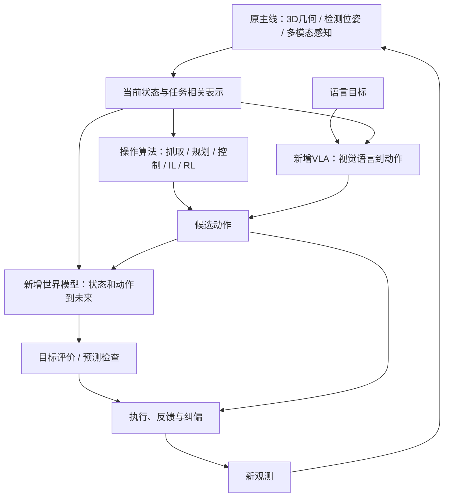

# 3D感知与机器人学习计划

[返回3D Learning](_index.md) ｜ [P1执行日程](P1-第一周-扫盲日程.md) ｜ [P2执行日程](P2-深度理解-日程.md) ｜ [P3执行日程](P3-项目实战-日程.md) ｜ [直接看新增三块](#addons)

**已决定（2026-09-07）**：本文件作为唯一主学习计划。原来的三阶段、17周、学习任务、基础预算及四个项目顺序保持；本次在其上增加 **VLA、世界模型、操作算法**，并迁入总纲中有用的学习组织方式。

| 原阶段 / 项目 | 时间 | 核心保持 |
| --- | --- | --- |
| 第一阶段 | W1 | 快速扫盲，含3D、机器人、遥操/自驾、数学/框架/工具 |
| 第二阶段 | W2-W5 | 几何与深度 → 检测与6D位姿 → 重建与神经渲染 → 视觉触觉/VLM/操作感知 |
| Π-1 | W6-W8 | 基础3D检测与位姿系统 |
| Π-2 | W9-W11 | 视觉、触觉、语言的多模态感知系统 |
| Π-3 | W12-W14 | 强化学习与仿真操作系统 |
| Π-4 | W15-W17 | A自动驾驶，或B多臂协作感知（原推荐B） |

**阅读方法**：下方保留原计划正文；“新增板块与执行细化”定义新增量。原文340h仍是基础投入，新增后507h是参考预算，不是对原任务的替换，也不是已经完成的学习记录。原资料中已知的题名/链接问题在文末单独标明；两处说明文字形成的伪链接仅改为普通文本。

## 原计划正文（原阶段、任务与基础时长保留）

<!-- original-plan-start -->
## 📋 学习概览

| 阶段 | 周期 | 目标 | 学习时长 | 投入强度 |
|------|------|------|---------|---------|
| **第一阶段** | 1周 | 快速扫盲 | 20h | 高密度 |
| **第二阶段** | 4周 | 深度理解原理 | 80h | 深度 |
| **第三阶段** | 12周 | 理论+实践 | 240h | 持续迭代 |

**总投入：** ~340小时 | **周均：** 20-25h

---

## 🚀 第一阶段：快速扫盲（Week 1）

### 目标
- 建立3D视觉感知的全景认识
- 了解机器人学习各子领域的基本概念
- 找到自己的兴趣聚焦点

### 学习策略
- **INTJ式学习**：不求深入，优先建立概念框架
- **高效输入**：YouTube/Bilibili 高质量综述、论文abstract阅读
- **跨域概览**：宽度优先，快速扫过所有相关领域

### 第一周学习清单

#### 3D视觉感知基础 (6h)
- [ ] **3D视觉概论** (1.5h)
  - 视频：3DCV vs 2D CV 核心差异 (30min)
  - 资源：CS231N Lecture 10-11 (3D) 速看 (1h)
  
- [ ] **3D表示方法速通** (1.5h)
  - 点云、深度图、网格、体素、NeRF 概念速查 (30min)
  - 论文abstract阅读：NeRF、3D-GAN、PointNet (1h)
  
- [ ] **核心传感器** (1.5h)
  - 相机标定、立体视觉、RGB-D、LiDAR 原理速过 (1.5h)
  
- [ ] **经典3D任务** (1.5h)
  - 3D检测、6D位姿估计、3D重建、SLAM概览 (1.5h)

#### 机器人学习扫盲 (7h)
- [ ] **强化学习基础** (1.5h)
  - MDP、policy、value function 快速概念复习 (1.5h)
  
- [ ] **机器人感知** (1.5h)
  - 视觉伺服、触觉感知、多模态融合初概念 (1.5h)
  
- [ ] **运动控制概览** (1h)
  - 正逆运动学、轨迹规划基本概念 (1h)
  
- [ ] **仿真与多模态** (1.5h)
  - PyBullet/MuJoCo、VLM在机器人中的应用 (1.5h)
  
- [ ] **导航与建图** (1h)
  - SLAM/Visual Odometry、路径规划基本概念 (1h)

#### 遥操与自动驾驶 (2h)
- [ ] **遥操系统** (1h)
  - 学习架构、延迟处理、多模态反馈 (1h)
  
- [ ] **自动驾驶感知** (1h)
  - 3D物体检测、BEV表示、多传感器融合概览 (1h)

#### 理论打基础 (5h)
- [ ] **数学回顾** (2h)
  - 线性代数（特征值/QR分解）、刚体变换、李群 速过 (2h)
  
- [ ] **DL框架速查** (1.5h)
  - PyTorch 3D相关库（pytorch3d, trimesh）快速上手 (1.5h)
  
- [ ] **论文阅读工具** (1.5h)
  - 建立论文阅读workflow、arxiv alert设置 (1.5h)

### 第一周产出
- 📄 **学习笔记**：3D视觉+机器人领域概念图 (Mindmap或表格)
- 📝 **兴趣评估表**：对各子领域的兴趣度评分
- 🔗 **资源库**：高质量YouTube频道、Bilibili博主、论文列表

---

## 📚 第二阶段：深度理解原理（Week 2-5，4周）

### 目标
- 掌握3D感知的数学基础与算法原理
- 理解前沿理论与最新进展
- 建立知识的因果关系与逻辑链条

### 学习策略
- **INTJ深度思考**：反复阅读核心论文，理解Why而非What
- **数学严谨性**：推导关键公式，理解几何直觉
- **论文驱动**：以经典+前沿论文为核心，教科书为辅助

---

### 第2-3周：3D视觉核心原理

#### 周2：3D几何基础与多视图几何 (20h)
- [ ] **3D变换与几何** (6h)
  - 📖 **教材**：《Multiple View Geometry in Computer Vision》Ch.1-3
  - 推导：齐次坐标、投影矩阵、极线几何
  - 手推：对极约束、三角化、PnP算法
  - **输出**：推导笔记 + numpy实现几何变换
  
- [ ] **立体视觉与深度估计** (7h)
  - 📖 教材：MVG Ch.4，加强学习部分 + COLMAP论文精读
  - 手推：特征匹配、立体匹配算法、视差→深度转换
  - 论文：
    - [[论文] COLMAP: Structure-from-Motion and Multi-View Stereo](https://colmap.github.io/)
    - [[论文] Stereo Matching by Training a Convolutional Neural Network to Compare Image Patches](https://arxiv.org/abs/1505.07427)
  - **输出**：立体匹配的不同方法对比表
  
- [ ] **相机标定与图像几何** (4h)
  - 📖 教材：MVG Ch.6 + 张正友标定算法原论文
  - 手推：内参/外参标定、畸变模型、非线性优化
  - 实验：使用OpenCV/pycalib进行标定，理解参数含义
  - **输出**：标定参数影响分析
  
- [ ] **论文精读与前沿** (3h)
  - [[论文] GCNet: End-to-End Learning of Geometry and Context for Deep Stereo](https://arxiv.org/abs/1703.04309)
  - 理解深度学习如何改进立体视觉

#### 周3：3D检测与6D位姿估计 (20h)
- [ ] **3D物体检测基础** (8h)
  - 论文精读：
    - [[论文] PointNet: Deep Learning on Point Sets for 3D Classification and Segmentation](https://arxiv.org/abs/1612.00593)
    - [[论文] PointNet++: Deep Hierarchical Feature Learning on Point Sets in a Metric Space](https://arxiv.org/abs/1706.02413)
    - [[论文] Frustum PointNets for 3D Object Detection from RGB-D Data](https://arxiv.org/abs/1711.08488)
  - 理解：点云处理、多尺度特征、2D-3D联合
  - **输出**：PointNet核心模块手写实现
  
- [ ] **2D到3D的投影** (4h)
  - 论文：[[论文] Objects as Points](https://arxiv.org/abs/1904.07850) (CenterNet)
  - 理解：BEV表示、伪雷达表示、多模态融合
  - **输出**：投影变换的几何理解笔记
  
- [ ] **6D位姿估计** (5h)
  - 论文：
    - [[论文] Normalized Object Coordinate Space for Category-Level 6D Object Pose and Size Estimation](https://arxiv.org/abs/1901.02970) (NOCS)
    - [[论文] 6D Pose Estimation for Objects with Planar Surfaces](https://arxiv.org/abs/1902.04070)
  - 理解：旋转表示、RANSAC、ICP算法
  - **输出**：旋转表示的对比分析（四元数/欧拉角/旋转矩阵/6D向量）
  
- [ ] **应用案例分析** (3h)
  - 分析：一个实际3D检测/位姿系统的完整管道
  - **输出**：系统框图与关键模块解析

---

### 第4-5周：前沿3D视觉方法

#### 周4：3D重建与神经渲染 (20h)
- [ ] **Structure from Motion** (5h)
  - 论文：[[论文] Building Rome in a Day](https://grail.cs.washington.edu/projects/rome/)
  - 深入：Bundle Adjustment、增量SfM、全局SfM
  - **输出**：SfM pipeline的完整梳理
  
- [ ] **NeRF与隐函数表示** (7h)
  - 论文精读：
    - [[论文] NeRF: Representing Scenes as Neural Radiance Fields for View Synthesis](https://arxiv.org/abs/2003.08934)
    - [[论文] Instant-NeRF: Lightning Fast NeRF Training with Grid-Guided Sampling](https://arxiv.org/abs/2201.05989)
    - [[论文] 3D Gaussian Splatting for Real-Time Radiance Field Rendering](https://arxiv.org/abs/2308.04079)
  - 理解：隐函数vs显函数、体积渲染、光场
  - 实验：跑通一个NeRF实现（instant-ngp或threestudio）
  - **输出**：NeRF推导笔记 + 实验记录
  
- [ ] **几何感知的3D重建** (5h)
  - 论文：
    - [[论文] NeRF-Factory: An Open Source Library for Neural Radiance Fields](https://arxiv.org/abs/2210.08396)
    - [[论文] MonoGRF: A Geometric Radiance Field for Monocular 3D Object Detection](https://arxiv.org/abs/2104.06896)
  - 理解：如何在端到端的3D中融入几何约束
  
- [ ] **3D与2D的统一视角** (3h)
  - 论文：[论文] Is it Time to Replace CNNs with Transformers for Medical Images?（关键思想：多尺度特征融合；原资料出处待核实）
  - **输出**：2D→3D的特征学习理论总结

#### 周5：机器人感知前沿与多模态 (20h)
- [ ] **机器人视觉伺服与接触感知** (6h)
  - 论文：
    - [[论文] Self-Supervised Learning of Tactile Pixel Embeddings from Unlabeled Motion Data](https://arxiv.org/abs/2103.07868)
    - [[论文] Learning Dense Visuotactile Descriptors](https://arxiv.org/abs/2112.00073)
  - 理解：视觉+触觉的多模态融合
  - **输出**：多模态感知框架设计笔记
  
- [ ] **VLM与Embodied AI** (6h)
  - 论文：
    - [[论文] Vision-Language Models as Zero-Shot Planners for Embodied Control](https://arxiv.org/abs/2210.01566)
    - [论文] Open-Vocabulary Perception and Manipulation for Embodied AI（关键概念：语言引导的3D感知；原资料出处待核实）
  - 理解：语言与3D感知的联系
  
- [ ] **机器人操作感知** (5h)
  - 论文：
    - [[论文] DINO: DETR with Improved DeNoising Anchor Boxes for End-to-End Object Detection](https://arxiv.org/abs/2203.03605)
    - [[论文] One-Stage 6D Object Pose Estimation Trained End-to-End on Synthetic Point Clouds](https://arxiv.org/abs/2103.06792)
  - 理解：端到端检测到操作的系统设计
  
- [ ] **论文综述整理** (3h)
  - **输出**：根据机器人应用细分的3D感知方法总结表

### 第二阶段产出
- 📖 **推导笔记**：核心算法的数学推导（立体视觉、SfM、NeRF、位姿估计）
- 💻 **代码实现**：关键算法的numpy/pytorch实现（3个关键模块）
- 📊 **对比分析表**：不同方法的优劣对比
- 🗺️ **理论地图**：3D视觉与机器人感知的完整知识图谱

---

## 🛠️ 第三阶段：理论+实践探索（Week 6-17，12周）

### 目标
- 将理论应用到具体项目
- 在实际问题中深化理解
- 建立专业能力（机器人操作感知方向）

### 学习策略
- **项目驱动**：每月一个完整项目，循序渐进
- **跨学科融合**：3D感知 + RL/控制 + 仿真
- **产出导向**：每个项目输出可复用的代码库 + 详细文档

---

### 周6-8（3周）：项目Π-1 基础3D感知系统

#### 项目目标
构建一个**端到端的3D物体检测与6D位姿估计系统**，从RGB-D图像到机器人可操作的姿态。

#### 技术栈
- 数据：YCB-Video 或 LineMOD 数据集
- 模型：FCOS3D + PnP 或 Frustum PointNet + ICP
- 框架：PyTorch + OpenCV + Trimesh
- 评估：ADD(-S) 指标

#### 阶段分解
- [ ] **周6：数据与基线** (20h)
  - 搭建数据加载管道，标准化评估指标
  - 复现一个SOTA 6D位姿方法（NOCS或EPro-PnP）
  - **产出**：可复用的数据加载器 + 评估框架
  
- [ ] **周7：模型改进** (20h)
  - 在已有方法基础上：融合多尺度特征 / 改进损失函数 / 添加几何约束
  - 实验3-5个改进方案，记录性能对比
  - **产出**：改进的模型 + 实验报告
  
- [ ] **周8：应用与可视化** (20h)
  - 集成相机标定 → 检测 → 位姿 → 可视化的完整管道
  - 在真实RGB-D设备上测试（或高质量仿真）
  - **产出**：完整的推理管道代码 + 可视化工具

#### 项目产出
- 📦 **代码库**：`robot_pose_estimation/`
- 📊 **基准测试**：标准数据集上的性能对标
- 📸 **可视化**：检测&位姿结果的实时可视化
- 📄 **文档**：系统设计文档 + 使用指南

---

### 周9-11（3周）：项目Π-2 多模态机器人感知系统

#### 项目目标
集成视觉、触觉、语言三模态，构建机器人**可理解、可感知、可操作**的感知系统。

#### 技术栈
- 视觉：3D检测 (from Π-1)
- 触觉：GelSight/BioTac 模拟器或数据集
- 语言：CLIP 或小型 VLM (LLaVA)
- 框架：PyTorch + 自定义多模态融合架构

#### 阶段分解
- [ ] **周9：触觉感知模块** (20h)
  - 学习触觉编码方法（标准论文+开源数据）
  - 构建触觉特征提取器
  - 建立视觉-触觉对齐（对比学习或多任务学习）
  - **产出**：触觉特征提取器 + 对齐模型
  
- [ ] **周10：多模态融合** (20h)
  - 设计多模态融合架构（Transformer或其他）
  - 实现联合编码器与交叉注意机制
  - 在多模态任务上评估（如6D位姿+接触预测）
  - **产出**：多模态融合模块 + 融合策略对比分析
  
- [ ] **周11：语言引导与端到端系统** (20h)
  - 集成 CLIP/VLM 进行语言查询
  - 实现"描述物体→检测→位姿估计"的端到端管道
  - 测试自然语言指令的效果
  - **产出**：语言引导的感知系统 + Demo

#### 项目产出
- 📦 **代码库**：`multimodal_robot_perception/`
- 🧠 **融合模块**：可迁移的多模态编码器
- 📈 **性能对比**：单模态 vs 多模态的定量评估
- 🎬 **Demo视频**：语言指导下的感知流程

---

### 周12-14（3周）：项目Π-3 强化学习+仿真操作系统

#### 项目目标
在仿真环境中，基于**3D感知反馈**，训练机器人学会一个操作任务（如pick-and-place、push）。

#### 技术栈
- 仿真：MuJoCo 或 PyBullet
- 感知反馈：从第三人视角的 6D 位姿 + 深度图
- RL算法：PPO 或 SAC（基础版本）
- 框架：Gym/Gymnasium + Stable-Baselines3

#### 阶段分解
- [ ] **周12：仿真环境与感知集成** (20h)
  - 搭建仿真环境（1-2个标准任务如 pick/push）
  - 集成相机模拟，获取RGB-D观测
  - 集成 Π-1 的检测模型，验证感知在仿真中的效果
  - **产出**：仿真环境 + 感知接口 + 数据记录工具
  
- [ ] **周13：RL训练** (20h)
  - 定义奖励函数（基于位姿、接触、任务成功）
  - 训练 RL agent（初始：足够演示学习的有效性）
  - 对比：有感知反馈 vs 无反馈的性能
  - **产出**：训练的 RL policy + 学习曲线分析
  
- [ ] **周14：Sim-to-Real & 可迁移性分析** (20h)
  - 分析仿真-真实间的 domain gap
  - 设计适应策略（如 domain randomization）
  - 在真实机器人上快速适应验证（如可行）
  - **产出**：迁移学习方案 + 分析报告

#### 项目产出
- 📦 **代码库**：`robot_rl_simulation/`
- 🎮 **仿真环境**：可复现的 Gym 环境
- 📊 **RL 模型**：训练完成的 policy + 性能曲线
- 🔍 **分析报告**：感知对 RL 学习的影响定量分析

---

### 周15-17（3周）：项目Π-4 自动驾驶3D感知（可选方向）或高级机器人感知深化

#### 项目目标（二选一）

**选项A：自动驾驶3D物体检测与追踪**
- 目标：在 KITTI / nuScenes 数据集上实现多模态 3D 检测与多目标追踪
- 技术：BEV 表示、多传感器融合、时序建模
- 产出：检测模型 + 追踪算法

**选项B：机器人多臂协作感知**（推荐，深化机器人方向）
- 目标：扩展 Π-2/Π-3 到多臂场景，实现**分布式感知与协作操作**
- 技术：多视角融合、通信架构、分布式决策
- 产出：多臂协作系统框架

**推荐选择**：选项B（契合你的机器人聚焦方向）

#### 选项B 详细分解
- [ ] **周15：多视角融合理论** (20h)
  - 学习论文：多臂场景的视角对齐与融合
  - 设计分布式感知架构（每臂一个相机）
  - 实现视角坐标系统一与信息融合
  - **产出**：多视角对齐模块
  
- [ ] **周16：协作操作系统** (20h)
  - 在 Π-3 基础上，扩展到 2-3 臂协作
  - 实现臂间通信与任务分配逻辑
  - 训练协作 RL policy
  - **产出**：协作 RL 环境 + policy
  
- [ ] **周17：综合验证与优化** (20h)
  - 整合所有技术到一个完整系统演示
  - 性能优化与ablation study
  - 编写完整文档与教程
  - **产出**：完整系统代码 + 技术报告 + 视频演示

#### 项目产出
- 📦 **代码库**：`multi_arm_robot_perception/` 或 `autonomous_driving_3d/`
- 📚 **技术报告**：系统设计与实验分析
- 🎬 **演示视频**：系统工作流程完整演示
- 📖 **教程文档**：方法可复现指南

---

## 📊 学习资源整理

### 核心教材
| 资源 | 适用阶段 | 难度 | 优先级 |
|------|---------|------|--------|
| Multiple View Geometry in Computer Vision | 阶段2 | 高 | ⭐⭐⭐⭐⭐ |
| NeRF 原论文 + tutorials | 阶段2 | 中 | ⭐⭐⭐⭐⭐ |
| PointNet 系列论文 | 阶段2 | 中 | ⭐⭐⭐⭐⭐ |
| PyTorch 3D 官方教程 | 阶段1/2 | 低 | ⭐⭐⭐⭐ |
| Robotics: Vision and Control (第2版) | 阶段1/2 | 中 | ⭐⭐⭐⭐ |

### 高效工具与平台
- **论文阅读**：Arxiv + Semantic Scholar（论文推荐）+ Connected Papers（论文关联图）
- **代码参考**：GitHub (按 Star 排序)、Papers with Code、Hugging Face
- **视频资源**：
  - Bilibili：国内顶级博主（如 3Blue1Brown、李宏毅）
  - YouTube：CMU 16-889、Stanford CS231N (3D部分)
  - B站：中科大、清华的相关课程
- **社区**：Reddit r/computervision、知乎3D视觉相关话题、OpenMMLab Discussions

---

## 🎯 学习风格优化（INTJ）

### 你的优势与策略
| INTJ特征 | 学习策略 |
|---------|--------|
| 独立思考 | 先读论文核心idea，不被教科书顺序束缚 |
| 系统思维 | 用"知识图谱"维度梳理（因果关系> 定义） |
| 追求深度 | 第二阶段深入数学推导而非快速浏览 |
| 快速学习 | 利用第一周的高密度输入快速建立框架 |
| 实战导向 | 项目代码库从Day 1就是生产级别 |

### 每周学习节奏建议
- **前3天**：新知识输入（讲座、论文）
- **第4-5天**：深入理解（推导、代码实现）
- **第6-7天**：总结产出（笔记、实验验证）

---

## 📈 进度跟踪指标

### 第一阶段验收
- [ ] 完成概念图谱（至少30个关键概念）
- [ ] 阅读15篇3D视觉核心论文的abstract
- [ ] 理解5个机器人学科（RL、仿真、多模态、控制、导航）的基本概念

### 第二阶段验收
- [ ] 完成立体视觉、SfM、NeRF、6D位姿的完整数学推导
- [ ] 手写实现3个核心算法（如PointNet层、PnP、Bundle Adjustment）
- [ ] 精读20篇前沿论文，每篇有深度分析笔记

### 第三阶段验收
- [ ] 完成4个项目，每个有可复用代码库
- [ ] 在标准数据集/基准上验证模型性能
- [ ] 撰写3篇系统设计文档（每个项目一篇）
- [ ] 制作3个技术演示视频

---

## 🚀 快速启动清单

**这周就开始：**
1. [ ] 整理 arxiv 关注列表 (3D视觉、机器人视觉、embodied AI)
2. [ ] 搭建论文管理系统 (Zotero + Obsidian 联动)
3. [ ] 克隆/收藏 5 个高质量 GitHub 仓库 (NeRF、PointNet、COLMAP等)
4. [ ] 第一周每天 4-5 小时视频 + 论文 abstract
5. [ ] 建立 Obsidian 知识库框架 (3D概念、机器人、理论、项目)

---

## 💡 常见陷阱与避坑指南

| 陷阱 | 应对方案 |
|------|--------|
| 论文太多，不知道看哪个 | 用 "Awesome 3D Vision" GitHub 列表排序，按 Star 和引用率 |
| 细节卡住，无法推进 | 记下疑问，继续向前；第二阶段深入时自然解答 |
| 项目需求太大 | 每个项目 scope 严格控制在 3 周；MVP 第一周完成 |
| 工程细节消耗时间 | 前 2 周优先用开源框架（Detectron2、MMDetection3D 等），不重复造轮子 |
| 多模态项目复杂度爆炸 | 前 2 周单独验证每个模态，第 3 周才做融合 |

---

## 🎓 预期收获与能力清单

### 第一阶段后
- ✅ 理解3D视觉全景 + 机器人感知各模块
- ✅ 能与业界讨论技术方向

### 第二阶段后
- ✅ 深刻理解3D感知算法的数学原理
- ✅ 能复现并改进论文算法
- ✅ 紧跟领域前沿（能识别新论文的贡献）

### 第三阶段后
- ✅ **工程能力**：能设计并实现完整系统
- ✅ **研究能力**：能发现问题并提出改进方案
- ✅ **产业能力**：能主导机器人感知系统的开发
- ✅ **跨学科**：3D感知 + RL + 仿真 + 多模态的综合应用

---

## 最后的话

这个计划设计思路：
- **1周内**建立系统认知（广度优先）
- **4周内**深入理论基础（深度优先，但不过度）
- **12周内**通过4个递进式项目验证与迁移（宽度+深度+广度）

符合 INTJ 的学习风格：明确框架 → 深入细节 → 实战应用。

核心是**不懈怠地学，有思想地做**。祝学习顺利！🚀

---

*原计划记录日期：2026-08-17 | 原预计完成：2026-12-17*
<!-- original-plan-end -->

---

## 新增板块与执行细化

### 三个板块怎样接到原主线

**已决定（2026-09-07）**：新增的是VLA、世界模型、操作算法；它们穿插进入原来的学习周和项目，不另起三个大项目。上文原计划中的RL、控制、触觉、VLM等内容继续学习；新增时段用于补全算法链、解释机制和实验对照。同一个知识点或实验不重复计时。

这里的“操作算法”指 **机器人 manipulation**，覆盖抓取、运动规划、控制、接触操作、学习策略与多臂协作。Learning保留上一轮提出的扫盲定位，作为理解这些算法的基础，不改成第四个独立项目。

图是学习中的模块分工；用世界模型给VLA或操作策略提供预测，是**待验证设计**，不预先假定效果更好。

### 板块A：VLA（深入浅出）

| 层次与位置 | 要理解的问题 | 学习内容 | 最小产出 |
| --- | --- | --- | --- |
| P1 D3/D6：全景 | VLM回答问题，VLA输出什么？ | 视觉、语言、本体状态、动作；模块化/端到端/层级方案 | 输入输出图，能解释动作接口不能跨机器人直接复用 |
| P2 W3/W5：机制 | 图像与语言怎样转成动作？ | token/embedding、联合表征、动作离散化、chunk、diffusion/flow matching；RT-2、OpenVLA原版、π0图解 | 三张模型卡；比较训练目标与推理流程 |
| P3 W9-W11：接原多模态项目 | 原来的语言查询与VLA差在哪？ | 视觉/触觉特征、语言条件、动作日志；VLM→目标→动作的模块化参考方案 | 可复用的观测/动作契约；一个VLA官方demo与数据适配检查 |
| P3 W12-W14：接原RL项目 | VLA/IL与原RL基线怎样比较？ | 选一个可运行模型，先推理，再按资源做冻结头/LoRA等小规模适配；固定测试条件 | 同任务VLA或语言条件策略与原RL基线对照，报告成功数/总数和延迟 |
| P3 W15-W17：原分支中的迁移 | 双臂或新场景改变哪些接口？ | B分支对齐双臂动作与语言分工；A分支只作跨任务适用边界分析 | 迁移限制、失败例和报告章节 |

代表模型按教学价值选择，不作最新排名；原版与后续变体分别记录。只要求一个可运行的VLA路径，不安排从零训练大模型。方法来源：[RT-2（2023）](https://robotics-transformer2.github.io/)、[OpenVLA（2024）](https://openvla.github.io/)、[π0（2024）](https://arxiv.org/abs/2410.24164)。

### 板块B：世界模型（深入浅出）

| 层次与位置 | 要理解的问题 | 学习内容 | 最小产出 |
| --- | --- | --- | --- |
| P1 D3/D4/D6：全景 | 静态地图与预测行动后果差在哪？ | 状态、观测、动作、转移；一步与多步预测 | 一个增益误差累积算例，区分策略和预测器 |
| P2 W2/W4：机制 | 为什么要历史与动作？ | 部分可观测性、隐状态、编码/转移/解码、预测损失、自由rollout | 小型状态转移模型与1/5/10步误差图 |
| P2 W4：使用方式 | 如何利用模型改进决策？ | MPC候选动作评分、Dreamer式想象中策略学习、V-JEPA 2/2-AC的训练阶段差别 | 规划与想象训练两条流程图，指出模型误差在哪传递 |
| P3 W9-W11：接原触觉/多模态项目 | 接触与多模态信息是否帮助预测？ | 从带动作的转移记录预测下一状态/接触；一步/多步对照 | 小模型、预测轨迹图；无动作数据仅做观察预测并写明边界 |
| P3 W12-W14：接原仿真操作项目 | 预测是否改善真实执行结果？ | 用原仿真器采转移数据；基于模型的候选评分或恢复，与原RL基线对照 | 闭环成功率、动作排序、预测误差与开销 |
| P3 W15-W17：迁移 | 双臂接触或交通时序有何新困难？ | B做联合动作/接触预测；A做目标运动/占据预测的小范围分析 | 域偏移和多步失败报告，不新增完整视频生成项目 |

**深度边界**：先学会一个小状态模型，再读潜空间大模型；不要求从零复现大型视频世界模型。不能用重建画面好看代替动态/控制验证。来源：[World Models（2018）](https://worldmodels.github.io/)、[DreamerV3](https://danijar.com/project/dreamerv3/)、[V-JEPA 2（2025）](https://ai.meta.com/research/publications/v-jepa-2-self-supervised-video-models-enable-understanding-prediction-and-planning/)。

### 板块C：操作算法（把原控制与RL基础接成完整链）

| 模块 | 原计划衔接 | 新增到算法层的内容 | 学习深度与产出 |
| --- | --- | --- | --- |
| 运动学与动作空间 | P1控制；P2几何 | FK/IK、雅可比、阻尼最小二乘、奇异位形；关节/末端、绝对/增量 | 手算二维双连杆例，画不同坐标系下动作方向 |
| 抓取与可操作性 | P2-W3位姿；P3项目Π-1 | 位姿→候选抓取，夹爪宽度、质量、碰撞、可达性、接近方向 | 至少一个抓取候选生成/筛选例；物体位姿与夹爪位姿分开 |
| 运动规划与轨迹 | 原运动控制；Π-1应用 | 配置空间、RRT/RRT-Connect直觉、碰撞检查、路径与时间参数化 | 仿真中目标位姿→无碰撞轨迹；画路径/轨迹差异 |
| 视觉伺服与接触控制 | P2-W5视觉/触觉；Π-2 | PBVS/IBVS概念；位置、力、阻抗/导纳控制；自由运动与接触阶段切换 | 用误差反馈图与弹簧阻尼算例解释，不要求完整控制理论课程 |
| 模仿学习操作策略 | 原遥操、Π-2数据、Π-3对照 | BC、DAgger、ACT、Diffusion Policy；多模态动作与分布偏移 | 理解数据与目标；BC加一种序列策略做小范围对照 |
| 强化学习与模型辅助操作 | 原Π-3的PPO/SAC | 奖励、价值、样本效率；与IL公平比较；MPC或失败恢复辅助 | 原RL训练保留；新增控制变量与失败归因 |
| 多臂协作与长任务 | 原Π-4选项B | 任务分配、动作同步、相对位姿、交接、冲突/失败恢复 | 复用原多臂系统，先一个交接子任务，再比较协作策略 |

几何/控制算法与学习策略可以组合。新增重点是理解“目标怎样变成可执行且能反馈的动作”，不把已有的RL/控制课再次整套学习。

材料：[Modern Robotics官方教材配套](https://modernrobotics.northwestern.edu/nu-gm-book-resource/)、[MoveIt运动规划说明](https://moveit.picknik.ai/main/doc/concepts/motion_planning.html)、[ACT / ALOHA（RSS 2023）](https://tonyzhaozh.github.io/aloha/)、[Diffusion Policy（RSS 2023）](https://diffusion-policy.cs.columbia.edu/)。

### Learning扫盲如何穿插

用同一张五格卡贯穿三块：**学什么 / 信号从哪来 / 目标函数 / 训练与推理 / 泛化怎样验证**。

- P1：监督、无监督、自监督、IL、RL；loss与metric、训练与推理。
- P2-W2：梯度、batch/epoch、训练验证测试、数据泄漏、预训练与微调。
- P2-W3：表征学习、对比学习、CNN/Transformer、动作生成与多模态分布。
- P2-W4：序列预测、teacher forcing与自由rollout、model-based/model-free。
- P2-W5：BC/DAgger、on/off-policy、offline/online、LoRA；多任务/元学习/持续学习只辨认目标差异。
- P3：只在实际模型/数据/评测中复习，不另建完整ML课程。基础入口：[Stanford CS229公开材料](https://cs229.stanford.edu/materials.html-withcomments)。

### 新增内容按周放在哪里

本表只管主题与产出，具体到每天或任务池见[P1](P1-第一周-扫盲日程.md)、[P2](P2-深度理解-日程.md)、[P3](P3-项目实战-日程.md)。上文原任务及预算继续有效。

| 周 | 原主线保持 | 新增重点 | 新增时长参考 | 新增可验收产出 |
| --- | --- | --- | --- | --- |
| W1 | 快速扫盲、数学/框架/工具基础 | 三块全景与Learning词汇 | 7h | Day3算例；策略/预测/控制关系图 |
| W2 | 几何、立体、标定 | 操作运动学、动作坐标、Learning基础；VLA/动态接口概念 | 10h | 二连杆IK/雅可比直觉、动作接口卡 |
| W3 | 3D检测与6D位姿 | 抓取候选、可达性与规划；VLA表征/动作生成扫盲 | 10h | 位姿→抓取→规划图与筛选例 |
| W4 | SfM、NeRF、几何重建 | 动作条件世界模型、多步误差、MPC/想象训练；碰撞几何 | 10h | 小动态模型、预测轨迹与误差图 |
| W5 | 视觉伺服、触觉、VLM、操作感知 | VLA结构、IL序列策略、阻抗/接触控制 | 10h | 三类方法卡、接触反馈图 |
| W6 | Π-1数据与基线 | 操作接口、单位/坐标/时间戳、预测数据格式 | 10h | 标准动作/观测契约 |
| W7 | Π-1模型改进 | 位姿误差对抓取候选/规划的影响 | 10h | 感知指标与操作可行性的对照 |
| W8 | Π-1应用与可视化 | 生成抓取、IK/碰撞/轨迹、执行日志 | 10h | 最小动作链及回放 |
| W9 | Π-2触觉模块 | 接触状态预测；操作控制直觉；VLA动作字段 | 10h | 触觉/动作时序字段和预测基线 |
| W10 | Π-2多模态融合 | 多模态动态预测与模态消融 | 10h | 一步/多步与有无触觉对照 |
| W11 | Π-2语言查询系统 | VLA推理/适配准备、语言→目标→动作、数据检查 | 10h | 语言条件动作接口与官方demo记录 |
| W12 | Π-3仿真与感知集成 | IL演示基线、仿真转移模型、VLA接口接入 | 10h | 同任务IL/VLA/RL可比较接口 |
| W13 | Π-3原RL训练 | RL与IL/VLA对照、世界模型候选评分 | 10h | 控制变量后的成功率/耗时表 |
| W14 | Π-3原Sim-to-Real分析 | 小范围适配/恢复、域偏移预测误差 | 10h | 迁移失败归因与对照报告 |
| W15 | Π-4多视角融合 / 自驾数据基线 | B：双臂动作对齐；A：动态目标预测 | 10h | 分支对应接口与预测图 |
| W16 | Π-4协作RL / 自驾追踪 | B：交接/同步/恢复；A：遮挡追踪预测与恢复 | 10h | 一个分支的闭环或时序对照 |
| W17 | Π-4综合验证 | 汇总三块证据、复跑关键对照、总结 | 10h | 总报告中新增三块的贡献与边界 |

### 学习时间：保留原预算，新增量另记

原计划的 **20+80+240=340h** 是基础学习预算，不把它改写成“新增后的总量”。沿用前次具体排期作为**建议预算**：

| 阶段 | 原预算 | 新增参考 | 合计参考 |
| --- | --- | --- | --- |
| P1/W1 | 20h | 7h | 27h |
| P2/W2-W5 | 80h | 40h | 120h |
| P3/W6-W17 | 240h | 120h | 360h |
| 全程 | 340h | 167h | 507h |

后续完整周的模板：工作日原2.5h+新增1.5h=4h；D6原5h+新增1h=6h；D7原2.5h+新增1.5h=4h，合计30h。P1前两天不追补新增时段，从D3起排增量，共27h。可按当天难度移动新增时段，记录实际耗时；30h是计划参考，不是已投入时长或新的硬性完成指标。

原文中的“20—25h”“第一周每天4—5h输入”保留为原始节奏建议，执行时使用这里的统一预算，**不再额外叠加**。原计划第一周逐条时长合计19.5h，与20h总预算的0.5h差额用于概念整理和复盘。

### 每天统一结构：宏观 → 微观 → 总结

**2026-09-08更新的讲义偏好**：以Day3的知识章节、排版和讲解深度为参照，直接交付完整详细讲义。原学时预算保留为计划背景；每日讲义不再分分钟数版本或列阅读耗时。新增知识与原任务穿插，不机械地把三块都塞进每一天：

| 顺序 | 知识组织 | 学习动作 |
| --- | --- | --- |
| 宏观定位 | 贯穿案例与系统图 | 回忆昨天，画今天模块在系统中的位置；明确输入输出 |
| 原理、机制与算例 | 按知识主线分章 | 问题→定义与机制→公式推导/符号/单位→算例→实现→边界 |
| 新增板块连接 | 自然接入当前问题 | 选当日相关的VLA/世界模型/操作算法，Learning按需解释 |
| 动手与可视化 | 图、关键代码、完整可运行实验 | 先预测，再运行，改变一个变量，解释结果；长代码折叠呈现 |
| 总结、自测与衔接 | 宏观收束与闭卷迁移 | 三句话、重点边界、自测、未理解问题及次日第一步；参考答案折叠 |

每篇讲义必须有：学习目标、材料、动手任务、输出、未理解问题、次日衔接。每个主要概念至少有一张有效图或一个算例；每张图说明它回答的问题。能运行的练习记录环境和验证结果，不把尚未完成的学习/实验写成已完成。

### 贯穿问题与验收

原贯穿问题迁入并扩展为：

> **3D表示的选择如何影响机器人操作性能？VLA、世界模型和操作算法分别在哪个环节利用、改善或放大这种影响？**

在W3/W8看几何误差与动作，W10看多模态信息，W13看策略对照，W17汇总。证据先写在当日输出中，形成有效结论后再汇总，避免提前建空笔记。

**原计划进度与验收沿用上文，新增验收单独记录：**

- [ ] VLA：能画结构与动作接口；完成一个可运行推理路径和同任务对照；硬件不足时明确记录受限的适配范围。
- [ ] 世界模型：能区别静态重建与动态预测；完成小模型及1/5/10步误差；有一次预测用于评分/恢复的效果检查。
- [ ] 操作算法：能讲清目标→抓取→规划→控制→反馈；至少跑通一条算法链并归因一个失败案例。
- [ ] Learning：能给上述三个实例填写五格卡，不混淆结构、监督来源与部署方式。
- [ ] 新增报告：记录模型/数据版本、坐标单位、模态、数据量、随机种子、测试条件、成功数/总数和耗时；不预先认定新增模型必然有效。

原文“预期收获”的✅属于能力愿景，不是个人已完成状态。原文“4个项目”和“3篇文档（每个项目一篇）”计数不一致，任务要求保留；实际按**每个已完成项目至少一份文档**整理，阶段勾选以真实产出为准。

### 推进、阅读与问题管理

- 延续原三阶段和17周，保留原文预计完成日期2026-12-17；不迁入前次总纲中不同的日期或项目顺序。原日历是计划档案，实际完成情况以输出为准。
- 原学习任务不因新增三块而删减或换序。超预算先调配新增时段、减少新增实验的模型数量与重复劳动；若原任务仍超预算，记录差额再明确讨论，不能自动砍掉原计划。
- 每周D7固定复盘；每个核心问题写成“我能解释什么、还不能解释什么、用哪个例子验证”，注明下次处理位置。
- 论文三遍法可参考10min看问题/图、20min看机制及关键实验、10min写问题/方法/代价；只是初读预算，原计划的精读与推导时长仍保留。
- 每篇来源记录论文名、年份、原论文/官方URL；资料纠错与学习主题分开处理。未核实条目不要作为事实或基准结论引用。
- 代码项目在vault外维护；学习笔记记录环境、结果与相对链接，不初始化本vault的Git、不更改Sync配置。

### 原资料的核验提示（主题和任务保持）

原文完整保留学习内容，资源名字不等同于已经核实的引用。当前确认/待确认事项：

| 原条目 | 状态 | 执行时处理 |
| --- | --- | --- |
| “Stereo Matching by Training a Convolutional Neural Network to Compare Image Patches”对应1505.07427 | 2026-09-22已确认原链接实际是PoseNet | 保留原立体匹配精读任务，阅读[正确论文1510.05970](https://arxiv.org/abs/1510.05970)或[JMLR 2016正式版本](https://www.jmlr.org/papers/v17/15-535.html)；不把PoseNet替代成立体匹配教材 |
| “6D Pose Estimation for Objects with Planar Surfaces”对应1902.04070 | 2026-09-23已确认原链接实际为Standard Model Physics at the HL-LHC and HE-LHC；与原题名匹配的正确论文出处待确认 | 保留平面物体位姿学习任务；[Day19](day19/Daily-Learning-Pack.md)用几何推导与OpenCV官方资料讲解，不把物理论文当作位姿论文，也不把未核实的原论文标为已精读 |
| “Instant-NeRF”对应2201.05989 | 已确认题名不匹配 | 应读取[Instant Neural Graphics Primitives with a Multiresolution Hash Encoding](https://arxiv.org/abs/2201.05989)，即Instant-NGP；保留原NeRF加速学习任务 |
| “NeRF-Factory”对应2210.08396 | 已确认链接指向非欧几里得带状结构自组装研究 | 原几何重建学习任务保留；该链接不作为NeRF资料，具体资源待核实；[原链接真实题名](https://arxiv.org/abs/2210.08396) |
| “MonoGRF”对应2104.06896 | 已确认链接指向非线性多孔介质方程研究 | 原几何约束学习任务保留；不能按该链接阅读3D检测论文；[原链接真实题名](https://arxiv.org/abs/2104.06896) |
| 两处括号内为“关键思想/关键概念”的资源 | 已确认是说明文字，不是URL | 保留题名与说明，改为普通文本，具体出处待核实 |
| CS231N课次、MVG章节、其余原论文题名与URL | 待逐项核实 | 使用前查官方课程目录/原论文，不因本次迁移称其全部已验证 |

### 本次合并取舍

- **保留的唯一主计划**：本文件；原阶段、原任务、原项目、原基本时长均保留。
- **从总纲迁入**：新增知识深度、时间预算、每日宏观→微观→总结模板、贯穿问题、增补进度、复盘与来源规则。
- **不沿用的冲突部分**：把Π-2换成仿真策略、把Π-3换成语言操作、把Π-4改成其他三个分支，以及不同的预计结束日期。阶段日程已按本文件的原路线重新对齐。
- P1/P2/P3是执行日程，`_index.md`只管导航；它们不再各自定义另一份总路线。

## 每日自动学习包（2026-09-08执行约定）

**已决定**：原17个课程周、原任务及四项目顺序继续保留；通过增加单日学习时间容纳新增内容。第四个项目执行 **B多臂协作**，A自动驾驶仍保留为原计划的历史可选方向。

| 项目 | 当前配置与证据 |
| --- | --- |
| 定时任务 | 3D机器人每日学习包；任务ID `3d`；已创建并启用，返回当前对话 |
| 执行时间 | 每天北京时间09:00开始生成；消息在生成完成后送达 |
| 首课 | 2026-09-08 09:00，Day4 / W1-D4；[Day4教材与已验证实验](day4/Daily-Learning-Pack.md)已预先准备，首次定时仍完整交付 |
| 内容依据 | 完整119课路线、阶段目标、前置关系、项目、验收、当前进度、来源纠错及输出规范直接保存在任务自身instructions；日常生成不依赖读取本计划或搜索原对话 |
| 讲义形式 | 按Day3的知识主线、排版与内容深度生成详细讲义；取消分钟数分档、阅读耗时和固定十栏模板 |
| 材料归档 | 截至2026-11-13，Day1–70讲义已归档；当日Day70讲义、CPU配对评价实验与四张默认/对照图已检查，原课号与课程日期保留，完整入口见[学习索引](_index.md) |
| 个人进度 | D1/D2有学习与批改记录；其余课程不因材料已生成而自动视为学完，掌握程度与阶段通过情况以个人作答、产出和验收为准 |
| 第四项目 | B多臂协作：多视角→通信分工与协作RL→交接、预测恢复和综合验证 |
| 手机接收 | 用户已确认手机ChatGPT通过Remote连接Mac；本次未独立验证首条定时通知的手机送达 |

**消息交付（2026-09-08最新偏好）**：完整讲义、图表、公式、练习、自测答案和配套代码写入文件，保持Day3式排版、组织与内容深度。文件写入并检查后，GPT消息只发简短brief与实际文件入口，通常3至5行、约100至200字，包含Day编号和主题、2至3个重点、1个难点或动手任务；不在消息中重复教材全文、长代码和答案。此约定替代此前“同一消息发送完整教材”的要求，brief不复制到本地讲义开头。

**文件讲义规范**：以核心命题和贯穿案例开篇，接学习目标与知识路线，再按宏观→微观机制→工程组合→动手→总结展开；不使用固定十栏、分钟数版本或预计阅读时间。重要概念给定义、输入输出、公式推导、单位、手算例、shape、实现与适用边界；用Day3式知识标题、对比表、Mermaid、先猜/先算和折叠参考组织。重点难点在正文讲透，默认8道自测，未理解问题与次日衔接之后，以折叠答案和判分收尾。

**推进规则**：按北京时间日历每天推进，无回复也生成新课；用户说`delay`默认顺延1天，明确N天则从下一次尚未生成的新课起顺延N天。顺延期间给巩固包，之后恢复新课；立即将顺延日期及恢复课号写入任务自身instructions，保留原任务配置。已生成课不重编号，学习状态不自动勾选。

**漏课补写（2026-09-22确认）**：保留原计划的主题、课号、前后关系与课程日期。若定时任务漏运行或生成中断，恢复后按日历生成当日课，同时按原课号补齐之前欠缺的完整讲义、实验与自测；不能用后一课中的前置摘要代替缺失课程，也不因漏课自动顺延。补写文件记录真实创建、修订与验证日期，并以`scheduled_date`保留原课程日期；每课保存并检查后才记为已生成。若尚有未补完内容，明确记录剩余课号，下次继续。

**日期口径**：自动课程锚点为2026-09-08→Day4，未delay时Day119对应2027-01-01；此前2026-12-17保留为原计划的历史预计日期，不用历史日期跳课或判定已完成。17个课程周不变，已学到Day3后剩116个定时课日；显式delay会顺延最后日期。最后一课发总验收包后暂停自动新课，不能把发完资料写成通过学习验收。

**2026-09-22补齐与对齐记录**：Day8–12、Day14–17共九课已补写，原定日期分别保留为2026-09-12至09-16、09-18至09-21。Day13补足原定GCNet精读、立体方法比较和完整多视角标定；Day18补足原定Objects as Points / CenterNet与自碰撞检查。各课保留详细教材、图解、完整主实验代码和文末自测答案，配套CPU实验已实际执行；真实设备与个人学习验收另行记录。原课程内容和顺序未调整，累计delay仍为0，下一次2026-09-23继续Day19 / W3-D5：NOCS、6D位姿、旋转与对称、RANSAC/ICP、绝对与增量动作。

**2026-09-29补齐记录**：Day20–25共六课已补齐，对应原定2026-09-24至09-29；实际创建、修订与CPU实验验证日期为2026-09-29。依次覆盖检测/投影/位姿综合与动作chunk、完整系统与W3验收、SfM、BA、NeRF和一步预测、Instant-NGP/3DGS及多步预测。详细讲义、配套代码与15张图已核对；官方大型模型完整复现和真实机器人执行不据此视为完成，个人掌握程度仍待验收。原17周路线、原任务、课号与日期不变，累计delay为0，下一次2026-09-30为Day26 / W4-D5。

**2026-10-09补齐记录**：Day26–35共十课已补齐，对应原定2026-09-30至2026-10-09；实际创建、修订与CPU实验验证日期为2026-10-09。保留W4几何约束重建、2D/3D融合、统一表示与评价，以及W5视觉触觉、视觉伺服、VLM、操作感知和P2验收；按原顺序加入MPC/Dreamer、V-JEPA 2/2-AC、RT-2/OpenVLA、pi0/flow matching、RL/IL数据协议与LoRA。十份讲义、实验和21张图已核对；Day35补足手写非共面DLT-PnP及阻尼精化，D10调用OpenCV不冒充手写求解器。20篇精读仍需个人阅读卡与分析，官方VLA推理、真实机器人执行和个人验收没有因此标记完成。原路线和课程日期不变，累计delay为0，下一次2026-10-10继续Day36 / W6-D1 / P3项目Π-1：数据集与任务协议。

**2026-10-24补齐记录**：Day36–50共十五课已补齐，对应原定2026-10-10至2026-10-24；实际创建、修订和CPU验证日期为2026-10-24。保留W6数据/划分/投影/原候选基线/评价/时间契约，W7多尺度/损失/几何/3至5方案受控对照/抓取/IK碰撞与消融报告，并进入W8的RGB-D输入与标定。十五份讲义、独立脚本、28张实验图和改变量结果已核对；NOCS/EPro-PnP官方网络训练、真实数据基准和真机执行仍需各自证据，不用教学求解器替代，个人验收未代填。原路线、课号与日期不变，累计delay仍为0，下一次2026-10-25为Day51 / W8-D2：检测/分割ROI与目标提取。

**2026-10-29补齐记录**： Day51–55五课已按原日序写入，scheduled_date保留2026-10-25至10-29，实际创建/修订/CPU验证为2026-10-29。包含ROI与点云提取、6D位姿可视化、物体到抓取/IK、轨迹动作日志、闭环测试；五个独立教学脚本、10张主实验图和单变量结果已检查。现有环境未安装MuJoCo/PyBullet，Day55完成的是明确标注的合成几何/控制闭环，原计划的真实RGB-D或高质量接触物理仿真正式验收仍待独立证据。资料生成、代码验证和个人学习保持分开。

**2026-10-30当日材料：** Day56已归档，包含Π-1可复现交付、系统接口与误差预算、完整分母、缺失结果界限、Wilson算例、系统文档和演示证据。独立CPU审计脚本、默认与删除失败行对照、四张图和另外四种错误注入已检查。40条结果为预设合成台账，不是新增物理试验；正式基准、真实/接触物理闭环和个人验收仍待各自证据。

**2026-11-11补齐记录：** Day57–68共十二课已按原顺序归档，scheduled_date保留2026-10-31至2026-11-11，实际创建、修订与CPU验证日期为2026-11-11。覆盖W9触觉数据/特征/对齐学习/独立评价/接触控制/动作转移/周验收，以及W10融合基线/联合编码/交叉注意/位姿接触评价/动作条件预测。十二份详细讲义、独立CPU脚本、46张默认及对照图、单变量实验与文末答案已检查；完整嵌入代码、日期和相对链接已核对。D59/D63错配训练使用独立随机流，避免同时改变模型初始化。D64的强噪声例与D68的触觉偏置例保留融合失效证据，不预设多模态一定更好。全部是明确标注的合成教学数据或算子/评价实验，正式真实数据、接触物理、官方模型复现及个人验收仍需独立证据。

**2026-11-12当日材料：** [Day69](day69/Daily-Learning-Pack.md)已归档，包含闭合状态、历史刚度辨识、自由rollout、误差传播、1/5/10步端点与整段评价、触觉/深度四组消融。独立CPU脚本、默认及测力+0.2 N对照、四张图和10道自测已检查。默认完整组合第10步位置RMSE1.108541 mm，偏置后3.059704 mm，劣于无触觉V+D的2.360731 mm；域外材料中偏置局部改善，保留误差抵消的边界。实验为已知解析动力学加历史参数辨识，不复用D68网络；正式预测不读取未来观测或真实刚度，特权重置诊断独立标明。真实设备、复杂接触与个人验收仍待独立证据。

**2026-11-13当日材料：** [Day70](day70/Daily-Learning-Pack.md)已归档，分别报告当前融合任务与动态预测，包含指标单位、配对episode bootstrap、缺失分母、多目标判断、W10证据矩阵和10道自测。独立CPU脚本、默认/删除8个难例对照与四张图已检查；48个合成episode上，三维平移RMSE为6.630561→1.922090 mm，未来x@10为3.276268→1.427360 mm。删记录后表面误差下降，但正式fusion、差值和CI均为null；固定估计器和已知弹簧方程没有网络训练或机器人尝试。资料、代码、正式项目与个人验收分别记录，W11按原日序进入语言查询。

日历锚点仍为2026-09-08→Day 4，累计delay为0；截至2026-11-13，Day1–70课程资料无缺口。下一门新课为2026-11-14的Day71 / W11-D1 / P3项目Π-2：CLIP或VLM语言查询；Π-1正式项目未完成项继续独立保留，Π-2正式项目与个人验收尚待证据，资料归档位置不等于个人学习位置。

**定时任务状态回写（2026-10-30）**：此前10月29日的进度提交未获得确认；本次已通过任务管理接口更新完整自包含prompt，并收到应用成功确认。随后只读核对确认材料快照已同步至Day56，下一课为2026-10-31的Day57；任务仍为ACTIVE，名称、每天北京时间09:00的原定时、目标对话与创建记录均保持不变。完整路线、累计delay=0及文件/通知偏好保留，未直接修改自动化配置文件。

**定时任务状态回写（2026-11-11）**：已通过任务管理接口更新完整自包含prompt，并收到应用成功确认；随后只读核对确认快照与提交全文一致，材料状态已同步至Day68，下一课为2026-11-12的Day69。任务仍为ACTIVE，名称、每天北京时间09:00定时、目标对话和创建记录保持不变；完整路线、累计delay=0、详细文件讲义与简短消息偏好均保留。没有直接修改自动化配置文件。

**定时任务状态回写（2026-11-12）**：已通过任务管理接口更新完整自包含prompt，并只读核对提交全文与配置一致；材料状态同步至Day69，下一课为2026-11-13的Day70。任务仍为ACTIVE，名称、每天北京时间09:00定时、目标对话、创建记录及通知配置均保留；完整119课路线与delay=0未改变。没有直接修改自动化配置文件。

**归档规则**：D4起使用`dayN/Daily-Learning-Pack.md`保存该课唯一教材，必要短代码同目录保存；若已有权威讲义则更新原讲义。自动生成内容与个人作答区分开，重跑保护个人笔记；只在现有学习索引追加真实入口。笔记库不可访问或保存失败时，若运行环境支持在已授权位置生成可下载文件，则提供文件入口并说明课程库归档未完成；否则简短报告未保存及原因，不伪造文件链接，也不改为长消息粘贴全文。

**运行前提**：本地任务执行需要Mac唤醒、联网且桌面应用运行。Remote可在手机查看同一任务并接收完成通知，手机的通知权限和实际送达需在首次定时完成时核对。[Remote官方说明](https://learn.chatgpt.com/docs/remote-connections)、[通知设置](https://learn.chatgpt.com/docs/notifications)。

**定时任务状态回写（2026-11-13）**：已通过任务管理接口更新完整自包含prompt，并只读核对提交全文与配置一致；材料状态同步至Day70，下一课为2026-11-14的Day71。为控制任务prompt长度，材料历史合并为事实摘要，保留关键实验边界；完整119课路线与教学、文件保护要求保持原文。任务仍为ACTIVE，名称、每天北京时间09:00定时、目标对话、创建记录及通知配置均保持；delay=0未改变，没有直接修改自动化配置文件。
