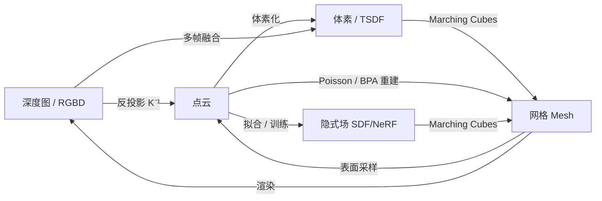
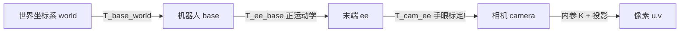

# D1 讲义 · 3D表示与坐标系

[返回 3D Learning](../_index.md)

> 用法：先通读本讲义（约 1h），边读边把「猜答案」的地方真的写下猜测；然后跑 [P1-D1-动手-open3d任务.py](P1-D1-动手-open3d任务.py)（0.6h）；最后填 [3D表示对比表](3D表示对比表.md)（0.4h）。看不懂的公式记进疑问清单，今天不算。

---

## 一、五种 3D 表示：一张转换地图

先看全景。五种表示不是并列的五个选项，而是一张**可以互相转换的图**，每种表示是图上的一个节点，工程上的常见操作是沿着边走：



这张图值得记住：你的 D405 工作流本质就是 `深度图 → 点云 →（TSDF 体素）→ 网格` 这条路径。

### 1. 深度图 / RGBD（2.5D）

每个像素存一个深度值 z，配上 RGB 就是 RGBD。**它是规则网格**，和普通图像一样，所以 2D CNN 可以直接吃——这是它最大的优点。

- 本质是 **2.5D**：只有相机看到的那层表面，被遮挡的背面不存在。视角一换，数据就完全不同。
- 深度值与视差的关系：$z = \dfrac{f_x \cdot B}{d}$（D405 机内就在做这件事）。
- 反投影到 3D：像素 $(u,v)$ + 深度 $z$ + 内参 $K$ → 相机坐标系下的点：

$$\begin{bmatrix} x \\ y \\ z \end{bmatrix} = z \cdot K^{-1} \begin{bmatrix} u \\ v \\ 1 \end{bmatrix}$$

- 典型任务/模型：单目/双目深度估计（Depth Anything、RAFT-Stereo）、RGBD 分割抓取。
- 适用边界：单视角、实时、要用成熟 2D 网络时首选；需要完整物体几何时不够。

### 2. 点云（Point Cloud）

一堆无序的三维点 $\{(x_i, y_i, z_i)\}$，可带法向量/颜色。**传感器的原生输出**（LiDAR 直接给，深度相机反投影一步就到）。

- 三个要命的性质：**无序**（点的存储顺序无意义，交换两行数据不变）、**无拓扑**（点之间没有"相邻"结构）、**密度不均**（近密远疏）。
- 这三条直接导致 2D 卷积失效 → 见文末核心问题。
- 典型任务/模型：分类分割（PointNet/PointNet++/Point Transformer）、配准（ICP）、抓取检测（GraspNet 输入就是点云）。
- 适用边界：几何处理、配准、机器人操作的主力表示；但不可微渲染、没有表面。

### 3. 体素（Voxel）

把空间切成 3D 网格，每个格子存占用/特征/距离值。**点云的"像素化"**——重新获得了规则结构，3D CNN 可以用。

- 代价：内存 $O(n^3)$。128³ 就是 200 万格子，而其中 >95% 是空的。
- 解法：**稀疏卷积**（只在非空格子上算）——自驾 3D 检测的标配。
- 特例：**TSDF**（截断符号距离场）——格子里存的不是"有没有"，而是"到最近表面的距离"，这是深度图多帧融合的标准容器（KinectFusion 一脉，你 P3 项目二会亲手写）。
- 适用边界：多帧融合、需要 3D 卷积时；高分辨率下内存爆炸。

### 4. 网格（Mesh）

顶点 + 边 + 三角面片。**唯一显式带表面拓扑的表示**。

- 图形学/物理仿真的原生语言：渲染、碰撞检测、有限元都要它（MuJoCo 里的物体就是 mesh）。
- 对深度学习不友好：顶点数不定、拓扑改变不可微，网络直接生成 mesh 很难，通常是别的表示转过来的（Marching Cubes / Poisson 重建）。
- 适用边界：交付给仿真器/渲染器/CAD 的最终格式；很少作为网络的中间表示。

### 5. 隐式场（SDF / Occupancy / NeRF）

不显式存几何，存一个**函数** $f_\theta(x, y, z) \to \text{值}$：

- SDF：返回到表面的符号距离（表面即零等值面 $f=0$）
- Occupancy：返回占用概率
- NeRF：$f_\theta(x, y, z, \theta, \phi) \to (\sigma, c)$，返回密度和颜色，靠体渲染训练

三大优点：**连续**（分辨率无限，想多细查多细）、**可微**（能端到端训练）、**紧凑**（一个 MLP 的权重就是整个场景）。代价：查询式的，取显式几何要跑 Marching Cubes，编辑和实时性都难（3DGS 的爆火正是因为把"可微"和"实时渲染"同时拿到了）。

- 适用边界：重建、新视角合成、需要可微几何的任务；机器人实时管线里目前仍是配角。

### 一句话记忆钩

| 表示 | 一句话 |
|---|---|
| 深度图 | 规则、能喂 CNN，但只有半个物体 |
| 点云 | 传感器母语，无序无拓扑 |
| 体素 | 点云的像素化，用内存换规则性 |
| 网格 | 图形学母语，有表面，DL 难生成 |
| 隐式场 | 几何即函数，连续可微 |

---

## 二、3D 感知算法的七大板块

3D 感知算法按**任务目标**分为 7 个大板块，每个板块解决不同的问题：

### 1. 深度获取（Depth Acquisition）

**目标**：从 2D 图像获得深度信息

- **单目深度估计**：单张 RGB → 深度图
  - 代表：Depth Anything, MiDaS, DPT
  - 特点：相对深度，尺度模糊
- **立体匹配**：双目图像对 → 视差图 → 深度
  - 代表：RAFT-Stereo, PSMNet, STTR
  - 特点：绝对深度，需标定。
- **多视图深度**：多张不同视角 → 深度
  - 代表：MVSNet, PatchMatchNet
- **主动感知**：ToF、结构光、LiDAR（硬件层面），例如：IR主动红外

> [!info] 被动 vs 主动：D405 的 `ir_left` / `ir_right` 到底是什么
> **D405 是被动式双目**（无红外投射器，且装了 IR Cut 滤光片），靠环境光 + 物体自身纹理算深度。D435/D455 才是主动式——打红外散斑，给白墙这类无纹理表面"人造纹理"。
>
> - `ir_left` / `ir_right`（RealSense 原生名 `infra1` / `infra2`）= 左右两个成像器的原始灰度图，**就是立体匹配的那对输入**。D405 有 IR Cut，所以它们实际是可见光灰度图，名字里的 "ir" 是主动机型留下的命名惯性。
> - `depth` = 机内 ASIC 对这对图做立体匹配的结果，用的就是 $z = f_x B / d$。
> - D405 没有独立 RGB 传感器，`color` 由**左目经彩色 ISP** 生成 —— 所以深度与 RGB 天然对齐，省掉了 D435 那种 depth-to-color 配准。
> - **代价**：被动式在无纹理表面（白墙、反光金属）上视差匹配会失败，出空洞。
>
> 这也是腕部相机方案的切入点：把 `ir_left` / `ir_right` 喂给 Fast-FoundationStereo 等深度学习立体匹配模型，在域控上推理，替代机内硬件深度——同一对输入，换更强的匹配算法。详见《RealSense-D405-规格汇总》《腕部相机接入报告-20260814-汇报版》（旧库资料，本次未迁移）。

### 2. 3D 表示学习（3D Representation Learning）

**目标**：对 3D 数据本身进行理解（分类、分割、检测）

- **点云处理**：
  - 分类：PointNet, PointNet++, Point Transformer
  - 语义分割：RandLA-Net, KPConv
  - 实例分割：PointGroup, SoftGroup
  - 目标检测：PointPillars, VoxelNet（自动驾驶主力）
- **体素处理**：
  - 3D 卷积：VoxNet, 3D U-Net（内存消耗大）
  - 稀疏卷积：MinkowskiNet, SECOND（自驾标配）
- **多模态融合**：RGB-D 融合、点云 + 图像（PointPainting）--形式：RGBD相机+lidar

### 3. 3D 重建（3D Reconstruction）

**目标**：从传感器数据重建完整 3D 模型

- **经典几何方法**：
  - 多视图立体（MVS）：COLMAP, OpenMVS
  - 表面重建：Poisson, BPA, **Marching Cubes**
  - SLAM：ORB-SLAM, VINS, Cartographer
- **神经隐式表示**：
  - NeRF 系列：NeRF, Instant-NGP, Mip-NeRF
  - SDF 网络：DeepSDF, NeuS, VolSDF
  - 3D 高斯泼溅（3DGS）：比 NeRF 快 100 倍
- **融合方法**：
  - TSDF 融合：KinectFusion, Voxblox

### 4. 位姿估计（Pose Estimation）

**目标**：估计物体/相机在 3D 空间中的位置和朝向

- **相机位姿**：视觉里程计（DSO, ORB-SLAM）
- **物体 6D 位姿**：DenseFusion, PoseCNN（机器人抓取必备）
- **人体/手部姿态**：OpenPose 3D, MediaPipe, MANO

### 5. 配准与对齐（Registration & Alignment）

**目标**：对齐不同帧/视角的 3D 数据

- **点云配准**：ICP, Colored-ICP, Deep Closest Point
- **特征匹配**：FPFH, 3DMatch, FCGF, Predator
- **多帧融合**：深度图融合 → TSDF、SLAM 回环检测

### 6. 场景理解（Scene Understanding）

**目标**：理解 3D 场景的语义和结构

- **室内场景**：语义分割（ScanNet）、房间布局、平面检测
- **室外场景**：自动驾驶感知（KITTI, nuScenes）、场景流
- **场景图构建**：物体关系、空间关系（任务规划用）

### 7. 机器人专用感知（Robot Perception）

**目标**：面向机器人操作的特定任务

- **抓取检测**：GraspNet, Contact-GraspNet（点云 → 抓取姿态）
- **手眼标定**：Eye-in-Hand（D405 配置）、Eye-to-Hand
- **可操作性分析**：可行性检测、碰撞检测
- **物体跟踪**：3D 多目标跟踪（AB3DMOT）

### nerve 项目的感知管线

从你的 D405 工作流看，nerve 涵盖：

1. **深度获取**：立体匹配算法（FFS）
2. **3D 重建**：深度图 → 点云 → TSDF → Mesh
3. **配准对齐**：手眼标定
4. **机器人感知**：抓取检测（GraspCheck）、6D 位姿估计（包含了）

---

## 三、坐标系变换链

机器人感知的一切几何 bug，90% 出在这条链上。整条链就是一串 4×4 矩阵连乘：



> [!tip] D405 的内参和畸变系数怎么看？
> **内参存在哪**：D405 出厂时已把内参 $K$ 和畸变系数写进 EEPROM，插上就能读，不用手动标。
>
> **Python 读取**（用 `pyrealsense2`）：
> ```python
> import pyrealsense2 as rs
> pipeline = rs.pipeline()
> config = rs.config()
> config.enable_stream(rs.stream.color, 640, 480, rs.format.bgr8, 30)
> profile = pipeline.start(config)
> 
> # 获取内参
> intrinsics = profile.get_stream(rs.stream.color).as_video_stream_profile().get_intrinsics()
> print(f"fx={intrinsics.fx}, fy={intrinsics.fy}")
> print(f"cx={intrinsics.ppx}, cy={intrinsics.ppy}")  # principal point
> print(f"畸变模型: {intrinsics.model}")  # 通常是 Brown-Conrady
> print(f"畸变系数: {intrinsics.coeffs}")  # [k1, k2, p1, p2, k3]
> ```
>
> **ROS2 中获取**：订阅 `/camera/color/camera_info` topic，内参在 `K` 字段（3×3 矩阵展平成 9 个数），畸变系数在 `D` 字段。
>
> **内参矩阵各项含义**：
> - $f_x$, $f_y$：焦距（像素单位），D405 约 450-500 px（取决于分辨率）
> - $c_x$, $c_y$：主点（光轴与图像平面交点），理想情况是图像中心，实际有 1-2 px 偏差
> - **畸变系数** $[k_1, k_2, p_1, p_2, k_3]$：径向畸变 $k_1, k_2, k_3$（桶形/枕形）+ 切向畸变 $p_1, p_2$（镜头未完全平行）
>
> **什么时候要用**：反投影（深度图 → 点云）、手眼标定、多相机配准时都需要精确内参。D405 的内参每次开机自动加载，换相机后新内参也自动生效——**不需要重新内参标定，但手眼外参 $T^{cam}_{ee}$ 必须重标**（见上文）。

### 齐次变换

三维点用齐次坐标 $\tilde{X} = [x, y, z, 1]^T$，每一步变换是：

$$T = \begin{bmatrix} R & t \\ \mathbf{0}^T & 1 \end{bmatrix} \in SE(3), \quad R \in SO(3),\ t \in \mathbb{R}^3$$

世界系一个点投到像素的完整公式：

$$z \begin{bmatrix} u \\ v \\ 1 \end{bmatrix} = K \cdot \left[ T^{cam}_{ee} \cdot T^{ee}_{base} \cdot T^{base}_{world} \cdot \tilde{X}_{world} \right]_{1:3}$$

其中内参矩阵：

$$K = \begin{bmatrix} f_x & 0 & c_x \\ 0 & f_y & c_y \\ 0 & 0 & 1 \end{bmatrix}$$

三个工程要点（每个都坑过无数人）：

1. **下标方向要有纪律。** 建议统一写 $T^{A}_{B}$ = "把 B 系的点变到 A 系"。链式相乘时下标像分数一样约掉：$T^{cam}_{base} = T^{cam}_{ee} \cdot T^{ee}_{base}$。自己选一种约定并终身不换。
2. **$T^{cam}_{ee}$ 来自手眼标定**（eye-in-hand，相机装在腕上——就是你的 D405 配置）。这一环的误差会乘进后面所有计算。明天 D2 细讲。
3. **轴向约定是隐形杀手。** OpenCV/ROS optical frame：z 朝前、y 朝下；OpenGL/Blender：z 朝后、y 朝上；ROS link frame：x 朝前、z 朝上。跨库传位姿时先画轴。

### 逆变换速查

$$T^{-1} = \begin{bmatrix} R^T & -R^T t \\ \mathbf{0}^T & 1 \end{bmatrix}$$

（因为 $R^{-1} = R^T$，正交矩阵。）

---

## 四、位姿（旋转）表示速查

| 表示        | 参数量     | 优点                             | 致命缺点                      | 主要用途               |
| --------- | ------- | ------------------------------ | ------------------------- | ------------------ |
| 旋转矩阵 $R$  | 9（自由度3） | 组合=矩阵乘，无歧义                     | 冗余，优化时要维持正交约束             | 计算与变换的通用中间格式       |
| 欧拉角       | 3       | 人类可读                           | **万向锁**；同一旋转多组表示；数值不连续    | 只用于给人看，别进算法        |
| 轴角 / 旋转向量 | 3       | 最紧凑，李代数 $\mathfrak{so}(3)$ 就是它 | 180° 附近数值问题               | 优化中的增量更新（P2 第3周主角） |
| 四元数 $q$   | 4（单位约束） | 无万向锁、插值优雅（slerp）               | **双重覆盖**：$q$ 和 $-q$ 是同一旋转 | 存储、插值、ROS 消息标准     |
| 6D 连续表示   | 6       | **对神经网络连续**                    | 只用于网络输出层                  | 神经网络预测旋转的主流方案      |

### 为什么深度学习回归旋转不用欧拉角（也不直接用四元数）？

> [!question] "DL 回归旋转"是什么意思？
> **回归** = 让神经网络输出连续数值（相对于分类输出离散类别）。比如让网络看一张物体照片，预测物体旋转了多少度——这就是"回归旋转"。典型应用：
> - 抓取检测：预测夹爪应该转到什么角度
> - 6D 位姿估计：预测物体的朝向（如瓶子是立着还是倒着）
> - 相机位姿估计：预测相机相对场景转了多少

核心是**连续性**：神经网络是连续函数，如果目标表示空间本身不连续，同一个真实旋转附近的两个样本可能对应差得很远的目标值，损失函数会在这些地方教网络学错误的东西。

**具体的坑**：
- **欧拉角**：在 ±180° 处跳变。两张几乎一样的照片（物体转了 179° 和 -179°，只差 2°），标签数值却差 358°——网络学不出"它们应该很接近"。
- **四元数**：双重覆盖，$q$ 和 $-q$ 表示同一旋转。同一张照片可能被标注成两个完全相反的值，网络不知道该学哪个。
- **结论**（Zhou et al., CVPR 2019《On the Continuity of Rotation Representations》）：3D/4D 的旋转表示在拓扑上不可能连续，最低要 5D，实用取 6D——让网络输出两个 3 维向量，Gram-Schmidt 正交化得到 $R$ 的前两列，叉乘出第三列。

**6D 表示的实际做法**：
1. 网络最后一层输出 6 个数（两个 3D 向量 $v_1, v_2$）
2. Gram-Schmidt 正交化：$u_1 = v_1 / \|v_1\|$，$u_2 = (v_2 - (v_2 \cdot u_1) u_1) / \| \cdot \|$
3. 叉乘得第三列：$u_3 = u_1 \times u_2$
4. 拼成旋转矩阵：$R = [u_1 | u_2 | u_3]$
5. 这个 $R$ 就是网络预测的旋转，可以直接用在后续计算里

**为什么现在都用这个**：因为它避开了所有"不连续"的坑，训练稳定，精度高，已被 CVPR/ICCV 大量论文验证有效。

> [!tip] 万向锁 30 秒直觉
> 欧拉角是三个套在一起的转轴。当中间那个轴转到 ±90°，第一和第三个轴转到同一平面——三个自由度塌缩成两个。动手脚本 Stage D 会用数值让你亲眼看到。

---

## 五、今日核心问题

> [!question] 为什么 2D CV 的卷积不能直接用在点云上？
> **先合上讲义，写下你的猜测，再展开看。**

> [!note]- 参考答案（先猜再看）
> 2D 卷积的前提是**规则网格**：每个像素有固定的邻域（3×3 就是周围 8 个），且数据的存储顺序编码了空间位置。点云三条全破坏了：
> 1. **无序性**：点的存储顺序任意，卷积核按顺序滑动的结果随排列改变——但物体没变。合格的点云网络必须**置换不变**。
> 2. **无规则邻域**：没有"左边那个点"的概念，邻域要靠最近邻搜索现算，每个点的邻居数量和分布都不同。
> 3. **密度不均**：近密远疏，固定尺寸的核在不同区域"看到"的东西完全不可比。
>
> PointNet 的答案：用逐点 MLP + **对称函数**（max pooling）保证置换不变；PointNet++ 再加上分层邻域采样找回"局部性"。P2 第 4 周精读。

---

## 六、疑问清单种子（今天允许不懂的）

把这些抄进你的疑问清单，标注解答时间：

- $SE(3)$、$SO(3)$、李代数到底是什么结构 → P2 第 3 周
- 反投影公式里 $K^{-1}$ 为什么长那样、畸变去哪了 → D2 + P2 第 2 周
- NeRF 的体渲染积分怎么可微 → P2 第 5 周
- TSDF 的"截断"是截什么 → P3 项目二亲手写

明天 D2（传感器与深度获取）会直接用到今天的：反投影公式、内参 K、坐标链里的手眼标定。

→ 动手：[P1-D1-动手-open3d任务.py](P1-D1-动手-open3d任务.py) ｜ 产出：[3D表示对比表](3D表示对比表.md)
