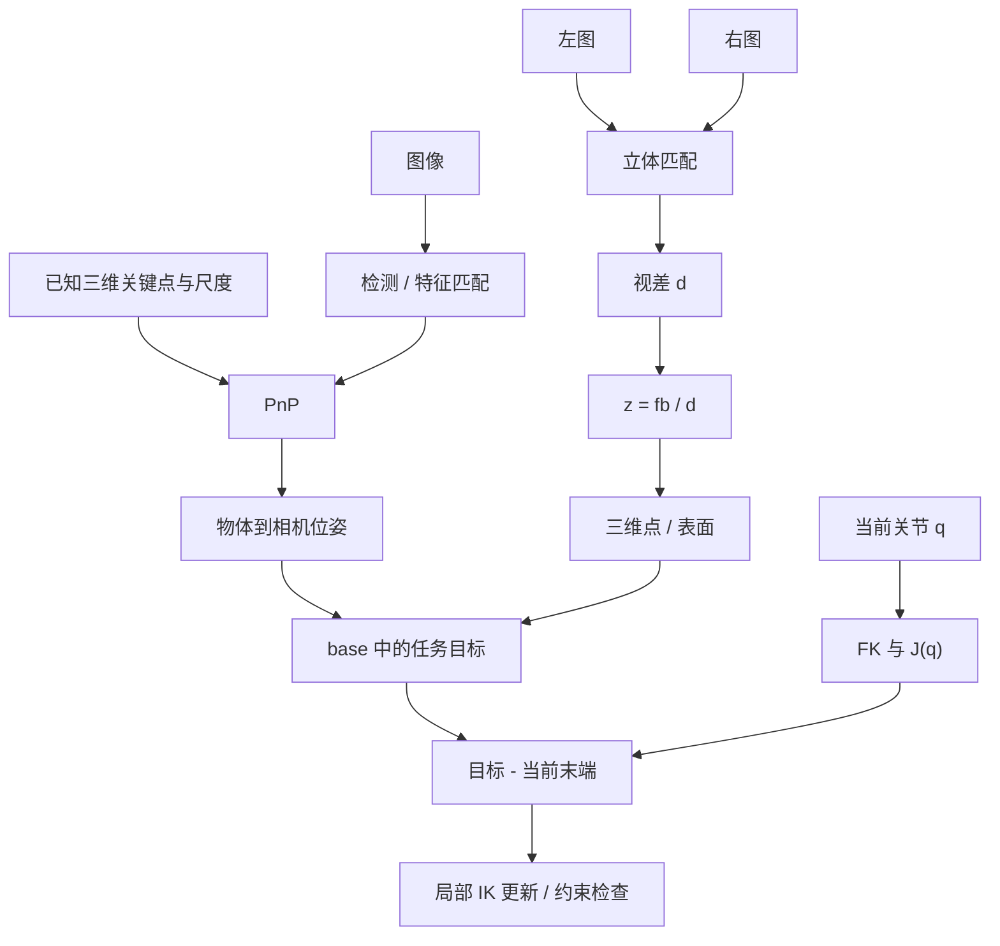
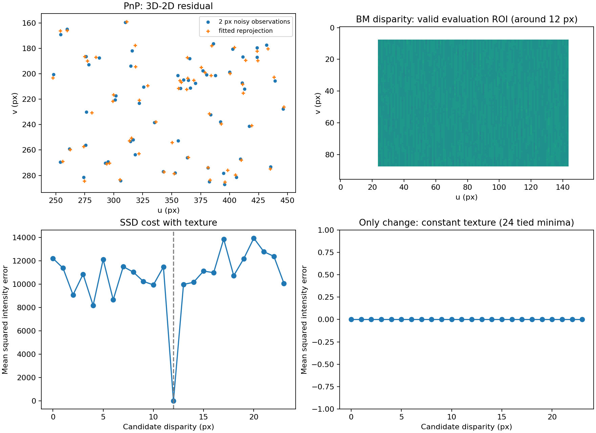
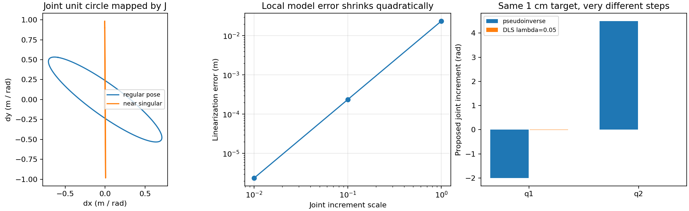

# Day 10 · PnP、立体匹配与局部运动学

[返回学习入口](../_index.md) ｜ [原定 P2 日程](../P2-深度理解-日程.md) ｜ [上一课 Day 9](../day9/Daily-Learning-Pack.md) ｜ [下一课 Day 11](../day11/Daily-Learning-Pack.md) ｜ [CPU 实验](demo.py)

**今天把三个“求解器”放到正确的位置：PnP 用已知三维结构求位姿；立体匹配用图像找对应关系，再算深度；雅可比把小的末端变化转换成小的关节变化。** 它们各自有已知量、未知量和适用尺度，输入给错时，即使函数返回成功也没有工程意义。

> [!info] 课程位置与补写说明
> 本课对应原计划 W2-D3，原定日期 2026-09-14，于 2026-09-22 补写。原任务是 PnP/几何变换收尾与传统匹配、视差到深度；新增雅可比、阻尼最小二乘、奇异位形和局部线性近似边界。学习式立体匹配在 Day 11 展开，标定在 Day 12 展开，不用新内容挪走原课程。

<details>
<summary>个人笔记区</summary>

<!-- learner-notes:start -->
- 我的 PnP 输入输出卡：
- 雅可比手算与数值对照：
- 实验修改、错题和未理解问题：
<!-- learner-notes:end -->

</details>

<!-- daily-pack-generated:start -->

## 0. 本课目标与先后关系

Day 8 解决坐标与投影；Day 9 解决对极约束、三角化和二连杆 FK/IK。今天补齐两个缺口：**像素对应怎样得到、已知模型怎样定位**，并解释数值 IK 的更新步骤为什么会失效。

学完应能：

- 用自己的话区别 PnP、三角化、相机标定，标注每项的已知量和未知量。
- 写出重投影误差，识别 `solvePnP` 返回的变换方向与尺度来源。
- 实现或读懂窗口匹配的 cost volume，解释纹理缺失为何导致不可辨识。
- 从二连杆 FK 求偏导，得到雅可比；用有限差分检查解析结果。
- 解释奇异值、伪逆放大和 DLS 的取舍，拒绝把局部线性更新直接当任意大动作。

## 1. 宏观：同一场景，三类求解任务

假设机器人要拿起桌上的已知零件。



PnP 可以定位已知物体，但需要已知 3D–2D 对应；立体匹配能为许多像素提供深度，但不直接说明哪个点属于哪个物体；雅可比描述机器人当前构型的局部运动关系，与视觉网络结构没有直接等价关系。

| 算法 | 已知 | 未知 | 主要误差空间 |
| --- | --- | --- | --- |
| PnP | 3D 模型点、对应像素、K/畸变 | 物体到相机的 R,t | 像素重投影 |
| 三角化 | 两个相机矩阵、对应像素 | 3D 点 | 射线/重投影 |
| 相机标定 | 标定物几何、多视角角点 | K、畸变、各视角外参 | 多图重投影 |
| 立体匹配 | 校正后图像、搜索范围 | 视差/对应 | 外观代价及正则化 |
| 局部 IK | FK、当前 q、末端误差 | 关节增量 | 任务空间残差+更新代价 |

不要仅凭“都用最小二乘”把它们混成一个问题。未知量不同，尺度来源、退化条件和验收方法都会不同。

## 2. PnP：已知空间形状，求它相对相机怎么放

### 2.1 数学定义和接口

已知物体坐标系中的点 $X_i^o$，图像对应像素 $u_i$，内参 K。求：

$$
X_i^c=R^c_oX_i^o+t^c_o,
$$

$$
\min_{R\in SO(3),t}
\sum_i\left\|u_i-\pi(K(RX_i^o+t))\right\|^2.
$$

$\pi$ 表示齐次除法；有畸变时还要在投影模型中加入畸变函数。输出 $R,t$ 的方向是 **object/world → camera**。若你要相机在物体坐标系中的位置，则：

$$
C^o=-R^\mathsf Tt,\qquad
T^o_c=(T^c_o)^{-1}.
$$

**t 不是相机在物体系中的位置。** 这是最常见的“数值合理、方向用错”。

Python 中本课输入：

| 名称 | shape / dtype | 本课语义 |
| --- | --- | --- |
| `objectPoints` | $(N,3)$，float64 | 物体系米制三维点 |
| `imagePoints` | $(N,2)$，float64 | 对应的 $(u,v)$ 像素 |
| `cameraMatrix` | $(3,3)$ | K |
| `distCoeffs` | None | 本课合成理想无畸变 |
| `rvec` | $(3,1)$ | Rodrigues 轴角向量，不是 roll/pitch/yaw |
| `tvec` | $(3,1)$ | 物体原点在相机中的位置，单位随模型 |

`rvec` 的方向是旋转轴、范数是旋转角；可用 `cv2.Rodrigues` 得 R。不能把三个分量当作分别绕 x/y/z 的独立欧拉角。

[OpenCV PnP 文档](https://docs.opencv.org/4.x/d5/d1f/calib3d_solvePnP.html)列出了各求解方法及对应条件。本课用 `SOLVEPNP_ITERATIVE`、60 个非共面点，避免将特定最小求解器的点数条件错误套到所有方法。没有训练网络。

### 2.2 度量尺度从哪里来

如果已知物体点用米，t 的单位就是米；如果点整体放大 1000 倍，存在同样放大后的 t 给出完全相同投影。PnP 并没有从像素中独立“测出米”，它继承了三维模型的尺度。

例如物体角点真实相隔 0.1 m，你的模型文件却用 100 表示且解释成米，PnP 可以得到数值很大的 t、同时保持低重投影误差。**重投影低不能证明尺度正确。**

### 2.3 为什么要检查三维分布

把点分散在物体不同位置，可以提供更多姿态信息。全部点几乎共线、集中在小区域、投影变化很小，会使某些自由度弱约束；平面目标可用合适的平面方法求解，但存在特定的多解与视角歧义，不能只看到“角点很多”就认为可靠。

实际使用中要分开检查：

- 对应是否正确，是否有离群匹配；
- 3D 点几何布局和尺度是否准确；
- K/畸变是否与当前图像一致；
- 解的正深度、重投影误差分布及可用候选；
- 与运动先验/上一帧是否一致。

RANSAC 能通过采样一致集合降低离群点影响，但不能修复统一的单位错误、错误内参或所有点都错到同一规则位置的系统误差。本课实验不含离群点，因此没有宣称鲁棒 PnP 已验证。

### 2.4 最小二乘里的“误差小”到底是什么

本课像素 RMSE 定义为：

$$
e_{\rm px}=
\sqrt{\frac1N\sum_i
\left((\hat u_i-u_i)^2+(\hat v_i-v_i)^2\right)}.
$$

它是每点二维欧氏误差的均方根，不是把 $2N$ 个坐标独立平均后的数；两者相差 $\sqrt2$。报告指标时必须写公式。

有真值时还单独看平移误差 $\|\hat t-t^\star\|$ 和旋转测地角：

$$
e_R=
\arccos\left[
\operatorname{clip}\left(
\frac{\operatorname{tr}(\hat R(R^\star)^\mathsf T)-1}{2},
-1,1\right)\right].
$$

其中 clip 处理浮点误差。近零重投影不代表三维位姿各自由度同样可靠；独立位姿真值和空间误差仍然重要。

## 3. 从图像到视差：真正困难的是找到对应

Day 9 的 $Z=fb/d$ 假设 d 已知。真实系统先要从两张图里找“同一个表面点”。

### 3.1 校正与匹配 pipeline

1. 标定与畸变处理：获得各自 K、畸变和相对位姿。
2. Stereo rectification：重映射图像，使对应点落在近似相同的行。
3. 建立匹配代价：对每个像素和候选 d 比较局部外观。
4. 聚合/正则化：结合邻域，减少孤立误匹配。
5. 选视差、可选亚像素细化。
6. 做左右一致性、遮挡、唯一性、纹理和有效范围检查。
7. 使用校正后的几何参数恢复三维，保留无效 mask。

**校正是图像几何重采样，不是已经完成匹配。** 校正会改变相机投影参数；恢复深度时应使用对应的校正参数或 Q 矩阵，而不是随手拿原相机焦距。

### 3.2 局部窗口代价与 cost volume

对左图像素 $(u,v)$，沿右图同一行搜索候选 d：

$$
C(u,v,d)=
\frac1{|\Omega|}
\sum_{(\Delta u,\Delta v)\in\Omega}
\left[
I_L(u+\Delta u,v+\Delta v)-
I_R(u-d+\Delta u,v+\Delta v)
\right]^2.
$$

这是 SSD 代价。若图像大小 $H\times W$，候选视差有 D 个，标量代价体 shape 为 $H\times W\times D$。取：

$$
\hat d(u,v)=\arg\min_dC(u,v,d).
$$

伪代码：

```text
for d in disparity_candidates:
    对齐 left[u] 与 right[u-d]
    pixel_cost = (left - shifted_right)^2
    C[:, :, d] = 邻域平均(pixel_cost)
best_d = argmin(C, axis="disparity")
valid = 可见区域 & 足够纹理 & 代价足够唯一 & 一致性通过
```

边界区域不能用循环平移 `roll` 默认回绕来伪造真实对应；右图没有的像素必须标无效。若扩展到彩色/特征向量，代价还需指定在哪个通道上聚合。

### 3.3 三个窗口匹配的直觉

- **纹理足够**：错移后窗口差异大，真视差形成尖锐低谷。
- **全白墙**：多个位移下窗口完全一样，所有代价同样低。argmin 虽会返回一个索引，但信息不足。
- **重复条纹**：多个间隔相同的低谷，对应歧义很强；低最小代价不等于唯一正确。

增大窗口能抑制部分噪声，但若窗口跨越前景与背景，里面可能存在两个真实视差。一个 d 无法同时解释两层，边缘就可能被“抹过去”。缩小窗口保留边界，却降低纹理统计稳定性。Day 11 将在相同问题上加入学习特征和全局/半全局约束。

### 3.4 视差编码和深度无效值

本课使用 OpenCV StereoBM。实验实测该接口返回定点编码的视差，需：

```python
disparity_px = stereo.compute(left, right).astype(np.float32) / 16.0
valid = disparity_px > 0
depth_m = focal_px * baseline_m / disparity_px[valid]
```

以上 `valid>0` 适用于本课 minDisparity=0、正视差的实验；真实配置要结合算法无效编码、minDisparity、视差范围和置信度定义，不可把这一行当普适有效性规则。还必须保留评估 ROI，避免只报算法自行筛选后的误差而隐藏大面积无效输出。

[OpenCV Stereo 深度教程](https://docs.opencv.org/4.x/dd/d53/tutorial_py_depthmap.html)适合核对 BM 参数与纹理/唯一性直觉。它展示的是传统匹配；本课同样不下载神经网络或把合成平面表现当真实场景水平。

## 4. 二连杆雅可比：每一列都是一个关节的影响

从 Day 9 的 FK 出发：

$$
p(q)=
\begin{bmatrix}
l_1\cos q_1+l_2\cos(q_1+q_2)\\
l_1\sin q_1+l_2\sin(q_1+q_2)
\end{bmatrix}.
$$

对每个关节求偏导：

$$
J(q)=\frac{\partial p}{\partial q}
=
\begin{bmatrix}
-l_1\sin q_1-l_2\sin(q_1+q_2)&-l_2\sin(q_1+q_2)\\
l_1\cos q_1+l_2\cos(q_1+q_2)&l_2\cos(q_1+q_2)
\end{bmatrix}.
$$

$J\in\mathbb R^{2\times2}$，本课每个元素可以理解为 m/rad。第一列说明只微动 q1 时末端怎样动；第二列说明只微动 q2 时末端怎样动。

两个用途要区分：

$$
\dot p=J(q)\dot q
$$

是当前瞬时速度关系；而

$$
p(q+\Delta q)-p(q)\approx J(q)\Delta q
$$

是有限增量的一阶近似，需要 $\Delta q$ 足够小。**瞬时速度关系准确，不等于把它乘一大段时间仍准确**，因为 q 和 J 会随运动改变。

### 4.1 手算一个数值例

$l_1=0.5,l_2=0.4$ m，$q=(0.4,1.0)$ rad：

$$
J\approx
\begin{bmatrix}
-0.588889&-0.394180\\
0.528517&0.067987
\end{bmatrix}.
$$

若 $\Delta q=(0.003,-0.002)$ rad，则：

$$
J\Delta q\approx(-0.000978307,\ 0.001449578)\text{ m}.
$$

真实 FK 差值约 $(-0.000980413,\ 0.001448503)$ m，两者误差 $2.364\times10^{-6}$ m。把增量放大 100 倍，误差变为 0.0236883 m，约放大一万倍，符合二阶余项占主导的局部规律。

### 4.2 用有限差分检查导数

$$
J_{:,j}^{\rm FD}=
\frac{f(q+\epsilon e_j)-f(q-\epsilon e_j)}{2\epsilon}.
$$

本例 $\epsilon=10^{-6}$ rad，解析与有限差分最大元素差为 $3.03\times10^{-11}$。这是实现核对，不能证明机械臂真实 FK 参数准确；如果连杆长度本身错，解析和数值求导可以“一起正确地求错模型的导数”。

$\epsilon$ 太大会产生截断误差，太小会受浮点消减影响。实际验证可看一段稳定的 epsilon 区间，而不是迷信固定极小值。

## 5. 奇异点：有些方向突然变得很难动

二连杆位置雅可比的行列式：

$$
\det J=l_1l_2\sin q_2.
$$

当 $q_2=0$ 或 $\pi$ 时 rank 降低。手臂完全伸直的 $q=(0,0)$：

$$
J=
\begin{bmatrix}
0&0\\
0.9&0.4
\end{bmatrix}.
$$

两个关节的瞬时运动都只能让末端沿 y 方向走，无法用一阶运动沿 x 方向走。虽然把手臂弯起来后能向内缩，但这种 x 变化在当前点是二阶效应。

**奇异不等于机械臂完全不能动。** 它表示在选定任务变量下，局部可控运动方向减少。这里的任务变量是二维位置；换成其他任务或不同雅可比，rank 的解释也会变化。

### 5.1 SVD 看清误差为何被放大

设 $J=U\Sigma V^\mathsf T$，$\Sigma$ 的非负对角值为奇异值 $\sigma_i$。

- V 的方向：关节空间的特定组合。
- U 的方向：末端空间中的对应运动方向。
- $\sigma_i$：该关节组合能产生多大的末端变化。

伪逆：

$$
J^\dagger=V\Sigma^\dagger U^\mathsf T.
$$

若某 $\sigma_i$ 很小，求逆时变成很大的 $1/\sigma_i$。很小的末端误差就可能建议巨大关节更新。这个更新又离开局部线性区域，使一次更新后真实误差更大。

本课近伸直位形 $q=(0,0.01)$ 的奇异值约 $(0.984874,0.00203068)$，条件数约 **484.996**。对末端向内 1 cm 的目标，伪逆提出：

$$
\Delta q\approx(-1.99993,\ 4.49998)\text{ rad}.
$$

这显然不是“小修正”。线性方程可能拟合得很好，真实 FK 更新后的目标残差却达到 **1.43818 m**。直接把这个数发给控制器，是把求解器局部近似错当成完整运动规划。

## 6. 阻尼最小二乘：少追一点误差，换更温和的更新

Damped Least Squares，DLS，求：

$$
\min_{\Delta q}
\|J\Delta q-e\|^2+\lambda^2\|\Delta q\|^2.
$$

对 $\Delta q$ 求导得：

$$
(J^\mathsf TJ+\lambda^2I)\Delta q=J^\mathsf Te,
$$

等价写法：

$$
\Delta q=
J^\mathsf T(JJ^\mathsf T+\lambda^2I)^{-1}e.
$$

实现应解线性方程，而不是显式算逆：

```python
dq = J.T @ np.linalg.solve(J @ J.T + damping**2 * np.eye(2), error)
```

在 SVD 的每个方向，伪逆增益 $1/\sigma_i$ 变为：

$$
g_i=\frac{\sigma_i}{\sigma_i^2+\lambda^2}.
$$

当 $\sigma_i$ 很小时，增益受到抑制；当它远大于 $\lambda$，接近普通伪逆。阻尼不是生成新信息，而是承认某些方向当前难以可靠实现。

### 6.1 本课的数值对照

保持 J、目标误差完全相同，仅将求解方式从伪逆改为 DLS，$\lambda=0.05$（在本课 m/rad 数值尺度下）：

$$
\Delta q_{\rm DLS}\approx(-0.00324387,\ 0.00743237)\text{ rad}.
$$

真实更新后残差约 **0.00997725 m**。它避免了巨大的错误更新，但距离原来的 1 cm 目标只改善很少。**不要把“DLS 稳定”写成“DLS 已到达目标”。** 本课只检验单步更新，没有证明整个 DLS 迭代在所有初值都收敛。

当误差包含位置和朝向，米与弧度不能未经权重直接相加。需要选任务误差的度量、权重和归一化，$\lambda$ 也应与这些尺度一起设计；同一个数值 0.05 不可原样搬到毫米坐标或不同机器人。

### 6.2 DLS 以外还需要什么

在真实 IK/控制中，通常还要：

- 限制每次关节步长和速度，加线搜索或 trust region；
- 检查更新后真实残差是否下降，再接受步骤；
- 管理关节限位、连续分支、碰撞和任务权重；
- 对奇异附近的不可实现方向报告残差，而不是继续加大命令。

[Modern Robotics 5.3 Singularities](https://modernrobotics.northwestern.edu/nu-gm-book-resource/5-3-singularities/)可核对 rank 降低和失去瞬时运动方向的几何解释。本课 DLS 公式由所写正则化目标直接求导，数值结论来自本课独立实验。

## 7. 实操：三组实验连成一条证据链

### 7.1 运行环境与输出

```bash
python -B 3d_learning/day10/demo.py
MPLCONFIGDIR=/tmp/3d-learning-mpl python -B 3d_learning/day10/plot_demo.py
```

实际运行环境：Python 3.11.15、NumPy 1.26.4、OpenCV 4.10.0、Matplotlib 3.10.9，seed=10。[主脚本](demo.py)只使用已有 CPU 依赖；[绘图脚本](plot_demo.py)读取保存数组。

[原始结果](../../_assets/3d_learning/day10/results.json) ｜ 数值数组 (not exported: excluded by publication policy)

### 7.2 PnP：只改变像素噪声幅度

固定 60 个非共面模型点、真值位姿、K 和同一组标准噪声，将噪声标准差设为 0、0.5、2.0 px：

| 像素噪声标准差 | 平移误差 | 旋转误差 | 每点二维重投影 RMSE |
| --- | --- | --- | --- |
| 0 px | $7.76\times10^{-18}$ m | 0° | $2.11\times10^{-14}$ px |
| 0.5 px | 0.576 mm | 0.1646° | 0.6466 px |
| 2.0 px | 2.331 mm | 0.6564° | 2.5866 px |

这是特定模型几何、点数与噪声下的结果，不是 PnP 通用误差常数。它表明测量噪声会同时影响重投影和三维姿态；不能把这组数外推成真实 RGB-D 系统精度。

### 7.3 传统匹配：同样的视差，改变纹理

生成 $96\times160$ 灰度随机纹理，并把右图向左平移 12 px，模拟无遮挡、无光照变化、单一深度的平面。在有效公共区域，真视差为 12 px。$f=600$ px、$b=0.12$ m，真深度为 6 m。

- StereoBM 评估 ROI 内有效比例 100%。
- 视差 MAE 约 0.02986 px，深度中位数 6.0 m。
- 中心纹理窗口的 SSD 最小值在 d=12。
- 只将左右纹理改成相同常数，24 个候选视差的代价全部相同。

这是故意简单的输入，**不包含真实遮挡边界、曝光差、镜面反射、标定误差和多深度表面**。所以这个 100% 只适用于明确 ROI 内的合成案例；它的价值在于把“有纹理”和“不可辨识”的原因隔离出来。



左上比较噪声像素与位姿拟合后的重投影。右上仅显示评估 ROI 的有效视差，空白不是零深度。下方两个代价曲线的输入只差纹理：右侧全平，说明 argmin 返回数字并不等于测到了可靠对应。

### 7.4 雅可比：同时报告稳定性和剩余误差

| 检查 | 实际结果 | 能说明什么 |
| --- | --- | --- |
| 解析 J vs 中心差分 | 最大差 $3.03\times10^{-11}$ | 公式与实现一致 |
| $\Delta q=(0.3,-0.2)$ rad | 线性化误差 23.6883 mm | 大步误差不可忽略 |
| 增量缩至 0.1 倍 | 0.236507 mm | 近似呈二阶缩小 |
| 增量缩至 0.01 倍 | 0.002364 mm | 小步局部近似可靠很多 |
| 近奇异位形伪逆步 | 更新后残差 1.43818 m | 线性解偏离真实 FK |
| 同一目标 DLS 步 | 更新后残差 9.97725 mm | 温和，但几乎未完成目标 |



左图把关节单位圆经 J 映射到任务空间：近奇异椭圆很扁，一些方向几乎不能移动。中图是 log–log 误差缩放，展示局部近似的尺度边界。右图比较同一目标的关节建议量，DLS 的柱子贴近零并不意味着目标已经达成。

### 7.5 自己动手的三个小任务

1. 固定 PnP 点与噪声，只把三维模型单位放大 1000 倍；解释为什么重投影仍可很好，但 t 单位改变。保留对照数值。
2. 固定左右纹理和真视差，将窗口半径从 3 改为 1，比较代价最小值和次小值之差。解释单个案例不能证明小窗口普遍更差。
3. 固定近奇异位形和目标误差，尝试 $\lambda=0.01,0.05,0.2$，记录关节增量范数和真实 FK 残差。画出折中，而不是只寻找最小更新量。

至少完成其中一项并提交“固定量—变化量—预测—实测—结论”。本课没有要求训练学习模型；Day 11 才把匹配与 Learning 基础连起来。

### 7.6 完整 CPU 主脚本

> [!note]- 完整 CPU 主脚本（与 demo.py 一致）
>
> ```python
> """Day 10: PnP, block matching and differential kinematics. CPU only."""
> from pathlib import Path
> import json
> import platform
> import numpy as np
> import cv2
> 
> OUT=Path(__file__).resolve().parents[2]/"_assets/3d_learning/day10"
> L1,L2=.5,.4
> 
> def fk(q):
>     a,b=q
>     return np.array([L1*np.cos(a)+L2*np.cos(a+b),L1*np.sin(a)+L2*np.sin(a+b)])
> 
> def jacobian(q):
>     a,b=q
>     return np.array([[-L1*np.sin(a)-L2*np.sin(a+b),-L2*np.sin(a+b)],
>                      [ L1*np.cos(a)+L2*np.cos(a+b), L2*np.cos(a+b)]])
> 
> def dls(J,error,damping):
>     return J.T@np.linalg.solve(J@J.T+damping*damping*np.eye(J.shape[0]),error)
> 
> def patch_cost(left,right,u=80,v=48,r=3,max_d=24):
>     ref=left[v-r:v+r+1,u-r:u+r+1].astype(float)
>     return np.array([np.mean((ref-right[v-r:v+r+1,u-d-r:u-d+r+1].astype(float))**2)
>                      for d in range(max_d)])
> 
> def main():
>     OUT.mkdir(parents=True,exist_ok=True)
>     rng=np.random.default_rng(10)
>     K=np.array([[600.,0.,320.],[0.,600.,240.],[0.,0.,1.]])
>     X=rng.uniform([-.15,-.1,-.08],[.15,.1,.08],(60,3))
>     rtrue=np.array([.15,-.20,.05]); ttrue=np.array([.04,-.02,.9])
>     uv=cv2.projectPoints(X,rtrue,ttrue,K,None)[0].reshape(-1,2)
>     unit_noise=rng.normal(size=uv.shape)
>     cases=[]; reprojects=[]
>     for sigma in [0.,.5,2.]:
>         obs=uv+sigma*unit_noise
>         ok,r,t=cv2.solvePnP(X,obs,K,None,flags=cv2.SOLVEPNP_ITERATIVE)
>         assert ok
>         pred=cv2.projectPoints(X,r,t,K,None)[0].reshape(-1,2)
>         R,_=cv2.Rodrigues(r); Rtrue,_=cv2.Rodrigues(rtrue)
>         angle=np.arccos(np.clip((np.trace(R@Rtrue.T)-1)/2,-1,1))
>         cases.append({"pixel_noise_std":sigma,"translation_error_m":float(np.linalg.norm(t.ravel()-ttrue)),
>                       "rotation_error_deg":float(np.rad2deg(angle)),
>                       "reprojection_rmse_px":float(np.sqrt(np.mean(np.sum((pred-obs)**2,axis=1))))})
>         reprojects.append(pred)
>     # Frontoparallel synthetic plane: one disparity, ideal rectification/photometry.
>     left=rng.integers(0,256,(96,160),dtype=np.uint8)
>     right=rng.integers(0,256,left.shape,dtype=np.uint8)
>     disparity_true=12;right[:,:-disparity_true]=left[:,disparity_true:]
>     flat=np.full_like(left,127)
>     textured_cost=patch_cost(left,right); flat_cost=patch_cost(flat,flat)
>     stereo=cv2.StereoBM_create(numDisparities=16,blockSize=9)
>     disparity=stereo.compute(left,right).astype(np.float32)/16.
>     roi=np.zeros_like(disparity,dtype=bool);roi[8:-8,24:-16]=True
>     valid=roi&(disparity>0)
>     depth=600.*.12/disparity[valid]
>     q=np.array([.4,1.]);J=jacobian(q);eps=1e-6
>     finite=np.column_stack([(fk(q+np.eye(2)[i]*eps)-fk(q-np.eye(2)[i]*eps))/(2*eps) for i in range(2)])
>     local=[]
>     direction=np.array([.3,-.2])
>     for scale in [1.,.1,.01]:
>         dq=scale*direction
>         exact=fk(q+dq)-fk(q); approx=J@dq
>         local.append({"scale":scale,"delta_q_rad":dq.tolist(),"exact_delta_m":exact.tolist(),
>                       "linear_delta_m":approx.tolist(),"linearization_error_m":float(np.linalg.norm(exact-approx))})
>     near=np.array([0.,.01]);Jn=jacobian(near);error=np.array([-.01,0.])
>     pinv_step=np.linalg.pinv(Jn)@error
>     dls_step=dls(Jn,error,.05)
>     singular=jacobian([0.,0.]); singular_values=np.linalg.svd(Jn,compute_uv=False)
>     assert np.max(np.abs(J-finite))<1e-8
>     assert cases[0]["translation_error_m"]<1e-8
>     assert np.argmin(textured_cost)==disparity_true
>     assert np.ptp(flat_cost)==0
>     assert np.linalg.norm(dls_step)<np.linalg.norm(pinv_step)
>     assert np.linalg.matrix_rank(singular)==1
>     assert local[2]["linearization_error_m"]<local[1]["linearization_error_m"]<local[0]["linearization_error_m"]
>     report={"environment":{"python":platform.python_version(),"numpy":np.__version__,"opencv":cv2.__version__},
>             "seed":10,"pnp":cases,"stereo":{"true_disparity_px":12,"true_depth_m":6.,
>             "valid_fraction_in_roi":float(valid.sum()/roi.sum()),"depth_median_m":float(np.median(depth)),
>             "disparity_mae_px":float(np.mean(abs(disparity[valid]-12))),
>             "textured_best_disparity":int(np.argmin(textured_cost)),"flat_equal_minima":int(np.sum(flat_cost==flat_cost.min()))},
>             "jacobian":J.tolist(),"finite_difference_max_error":float(np.max(np.abs(J-finite))),
>             "local_linearization":local,"near_singular_values":singular_values.tolist(),
>             "near_singular_condition":float(singular_values[0]/singular_values[-1]),
>             "desired_delta_m":error.tolist(),"pinv_delta_q_rad":pinv_step.tolist(),"dls_delta_q_rad":dls_step.tolist(),
>             "pinv_nonlinear_residual_m":float(np.linalg.norm(fk(near+pinv_step)-fk(near)-error)),
>             "dls_nonlinear_residual_m":float(np.linalg.norm(fk(near+dls_step)-fk(near)-error)),
>             "scope":"synthetic non-planar PnP, ideal textured plane, single-step DLS; no full IK or robot execution"}
>     (OUT/"results.json").write_text(json.dumps(report,indent=2)+"\n")
>     np.savez(OUT/"arrays.npz",left=left,right=right,disparity=disparity,valid=valid,
>              textured_cost=textured_cost,flat_cost=flat_cost,uv=uv,noisy_uv=uv+2*unit_noise,
>              reproject=reprojects[-1],q=q,J=J,near=near,Jn=Jn,pinv=pinv_step,dls=dls_step)
>     print(json.dumps(report,indent=2))
> 
> if __name__=="__main__":main()
> ```

## 8. 工程视角：感知和操作应该交换什么

一个传统机器人感知模块可以输出物体位姿 $T^c_o$，经过 $T^b_c$ 变成 base 位姿，再应用物体系中的抓取模板 $T^o_g$：

$$
T^b_g=T^b_cT^c_oT^o_g.
$$

PnP 负责估计 $T^c_o$；它不负责选择哪种抓取，也不负责工具补偿。若拿立体点云做抓取，输入路径不同，但进入操作层仍应明确参考系、尺度、时间和质量。

对 VLA/AI Coding，同样可把今日知识变成审查问题：

- 模型声称输出位姿，究竟是 object→camera 还是反向？
- 模型输出深度，是否来自定点视差、度量 z、相对深度或归一化量？
- 策略输出末端增量，用哪个参考系，单位是什么？
- IK 返回成功，是仅残差达到阈值，还是已经检查限位、碰撞和时间约束？
- 使用世界模型预测动作后果时，预测器是否将 J 的局部线性范围误当成大范围运动规律？

这些问题能把“模型看起来聪明”转换为“接口有没有物理意义”。实现最小模块、记录失败证据，比堆模型名称更能支撑后续实战。

## 9. 精读材料：只追三个明确问题

1. [OpenCV PnP pose computation](https://docs.opencv.org/4.x/d5/d1f/calib3d_solvePnP.html)：读开头坐标方向图和 `solvePnP` 方法列表。输出一张 PnP 卡：输入/输出/单位/参考系/退化/验收。不要只抄函数名。
2. [OpenCV Depth Map from Stereo Images](https://docs.opencv.org/4.x/dd/d53/tutorial_py_depthmap.html)：读视差几何图、BM 示例和参数解释，回答窗口、纹理、唯一性各解决哪类问题。对照本课常数纹理反例。
3. [Modern Robotics 5.3 Singularities](https://modernrobotics.northwestern.edu/nu-gm-book-resource/5-3-singularities/)：精读 rank 与 lost directions 的几何解释；再独立从本课二连杆 J 求行列式。借用定义，不把教材例子的结论机械搬到不同任务雅可比。

在线 OpenCV 文档当前指向 4.x 新版，实际示例已在 4.10.0 验证。未使用新版本特有接口。研究型立体网络的论文精读按原计划后续课程继续。

## 10. 宏观收束：今日重点、难点和产出

五个最重要的点：

1. **PnP 解位姿，三角化解点。** 明确未知量，才能选择数据与验收指标。
2. **尺度来自已知模型/基线。** 重投影不能替你验证米和毫米。
3. **匹配需要可辨识外观。** cost 低与对应唯一是两回事。
4. **J 只描述当前构型的局部变化。** 大步更新必须重新评估真实 FK。
5. **DLS 用残差换温和更新。** 稳定和完成任务要同时报告，不能只展示一半。

三处最容易踩坑：将 rvec 当欧拉角；忽略 StereoBM 的视差编码；看到伪逆解就直接执行。分别用“旋转轴角定义”“已知 12 px 合成输入”“真实 FK 更新后的残差”来反查，避免仅靠目测。

今日产出：PnP 输入输出卡、SSD cost 曲线、视差到深度计算、二连杆 J 手算和有限差分验证、阻尼单变量对照、八题作答。代码已跑通不替代个人解释这些产物的能力。

## 11. 自测

1. PnP、三角化、相机标定各求什么未知量？PnP 的米制尺度来自哪里？
2. `solvePnP` 输出 R,t 后，怎样求相机中心在物体系的位置？rvec 能否直接作为欧拉角？
3. 某模型单位放大 1000 倍，重投影误差不变。为什么？哪些三维误差/任务指标会暴露问题？
4. 取 $f=600$ px、$b=0.12$ m，StereoBM 原始输出为 192。按本课编码，真实视差和深度是多少？输出无效区域应如何处理？
5. 全白墙两个图像窗口完全相同，SSD 最小值为 0。为什么仍不能确定深度？用哪个统计能区分“低代价”和“唯一性”？
6. 对 $q=(0,0)$ 写出本课二连杆 J，指出不能实现的瞬时位置方向。为什么仍可以通过有限弯曲向内缩？
7. 推导 DLS 正规方程，说明 $\lambda$ 增大对小奇异值方向的影响；它能保证到达目标吗？
8. 一个视觉伺服程序在近伸直位形突然建议大关节更新。你如何用日志区分像素测量异常、单位错误和雅可比病态？给出至少四个应记录量和一个接受/拒绝步骤的规则。

## 12. 未理解问题与下一课

如果你能背出 DLS 公式，却解释不了实验中“残差仍接近 1 cm”，请重新看小奇异值方向：阻尼抑制的恰好可能是目标所需方向。若对 PnP 的 t 仍有疑惑，选物体原点 $X^o=0$ 代回投影式，t 就是该原点在相机中的坐标。

下一课 [Day 11](../day11/Daily-Learning-Pack.md)继续原定“深度获取算法”：传统与学习式立体匹配、代价与视差误差传播；新增 loss/metric、梯度、batch/epoch 和数据划分/泄漏。今天写出的 cost volume 会成为连接几何与学习的入口。

## 13. 参考答案与判分标准

> [!note]- 答完后展开：0 / 1 / 2 分，共 16 分
> 0 分为关键结论错误或未答；1 分为结论对但缺关键公式/条件/解释；2 分为回答完整且不夸大工程含义。建议至少 13 分，并确保第 2、4、6 题无基础错误后继续；个人状态仍以实际作答为准。
>
> 1. PnP 求给定模型到相机的 R,t；三角化求 X；标定求 K/畸变及各视角外参。PnP 尺度由已知三维模型提供。
> 2. $C^o=-R^\mathsf Tt$；不能直接当欧拉角，rvec 是轴角向量，应按 Rodrigues 解释。
> 3. X 与 t 同时放大时，投影除法会消去尺度。独立度量平移、模型尺寸、机器人工作空间和抓取点误差能揭示；不能只重复算像素残差。
> 4. $d=192/16=12$ px，$Z=600\times0.12/12=6$ m。无效区域保留 mask/NaN，不用零或任意巨大深度伪装有效结果。
> 5. 所有候选都同样匹配，argmin 只是规则挑出一个索引。看最优与次优代价差/比、局部纹理或分布熵等；还需一致性检查。
> 6. $J=[[0,0],[0.9,0.4]]$，x 方向瞬时不可实现。向内弯曲引起二阶 x 位移，不能由当前一阶 J 捕获。
> 7. 对目标函数求导得 $(J^\mathsf TJ+\lambda^2I)\Delta q=J^\mathsf Te$。增益变为 $\sigma/(\sigma^2+\lambda^2)$，弱方向被压制；不保证到达、限位或无碰撞。
> 8. 记录原始像素/深度有效性、单位与帧、任务误差、J 奇异值/条件数、建议 dq、限位、实际 FK 预测残差。只接受满足更新限制且真实残差足够下降的步骤，否则缩步/加阻尼/报告失败；异常测量先回到感知与契约验证，不盲调控制增益。
<!-- daily-pack-generated:end -->
