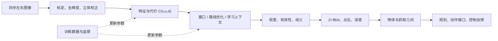
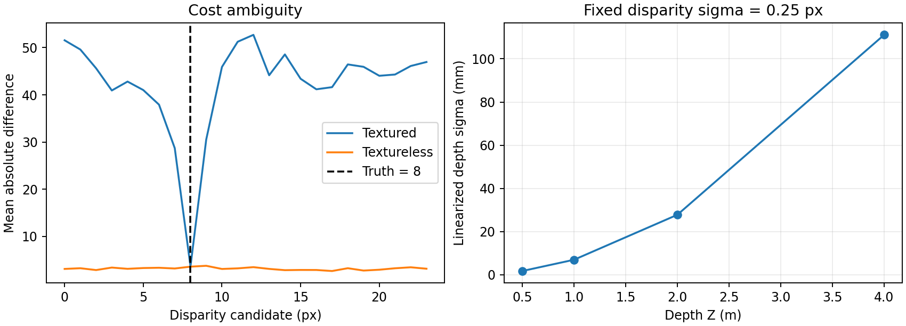
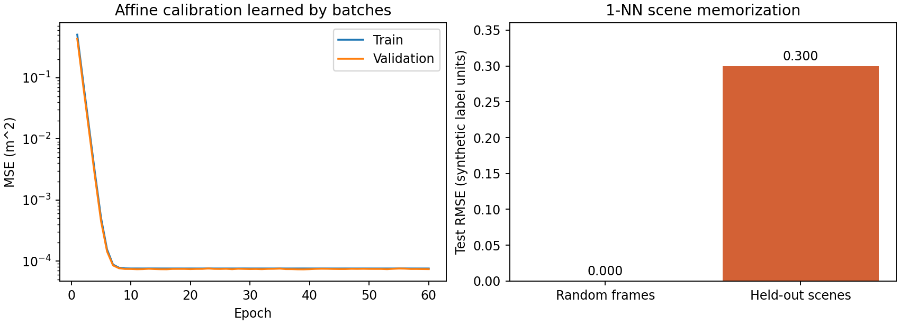
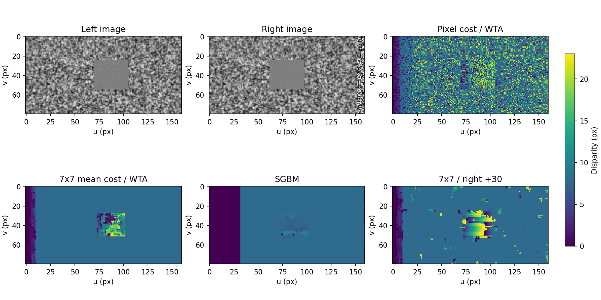

# D11 · 一对图像怎样变成深度，算法又怎样从数据中变好

[返回学习入口](../_index.md) · [P2 日程](../P2-深度理解-日程.md) · [上一课 D10](../day10/Daily-Learning-Pack.md) · [下一课 D12](../day12/Daily-Learning-Pack.md) · [CPU 实验](demo.py) · [绘图脚本](plot_demo.py)

**立体匹配先比较候选，再利用上下文消除歧义，最后把视差变成有物理单位的深度。学习式方法改变的是比较与推理规则的获得方式，不会自动取消几何、标定、有效像素和独立测试的要求。**

本课按原定 W2-D4 补写，课号与课题不变。D10 讲 PnP、匹配与视差；本课深入传统与学习式立体，同时用同一感知问题解释 loss、metric、梯度、batch、epoch、数据划分。D12 接着研究支撑这些计算的标定参数。

<details>
<summary>个人学习记录（后续更新时保留）</summary>

<!-- learner-notes:start -->

- 当前学习状态：尚未验收。
- 我对三种匹配方法的预测：
- 我的数据划分规则：
- 自测作答与分数：
- 尚未理解的问题：

<!-- learner-notes:end -->

</details>

<!-- daily-pack-generated:start -->

## 0. 学习目标与路线

完成后应能：

1. 写出代价体每个轴的含义，解释纹理、窗口、遮挡怎样改变代价曲线。
2. 区分局部匹配、SGM、学习匹配代价和端到端立体回归。
3. 推导视差误差到深度误差，说明亚像素输出与真实精度的差别。
4. 为同一问题分别定义训练损失、验证指标、测试覆盖率和机器人任务指标。
5. 手算梯度更新，计算 epoch 与参数更新次数的关系。
6. 设计按场景隔离的数据划分，用证据识别近邻帧泄漏。

| 顺序 | 要回答的问题 | 产出 |
| --- | --- | --- |
| 宏观 | 深度来自管线的哪个步骤？ | 输入输出图 |
| 微观 | 每个候选怎样获得支持？ | 代价曲线与方法比较 |
| Learning | 什么变化才叫训练？ | 梯度算例与划分规则 |
| 实验 | 哪些判断有实际数据支持？ | 图、JSON、改变量记录 |
| 总结 | 如何把视差质量接入机器人？ | 工程判断与自测 |

## 1. 宏观：深度是一条测量链的结果



校正后，同一三维点理想地落在同一行。定义左视差 $d=u_L-u_R$，左图 $(u,v)$ 的右图候选就是 $(u-d,v)$。因此代码中 left[:,d:] 对应 right[:,:W-d]。写反方向会改变几何语义。

视差图 $D\in\mathbb R^{H\times W}$ 存的是**像素差**，不是米。变成深度还需焦距和基线；变成机器人目标又需参考系、时间戳、物体与夹爪定义。检测已经找对杯子，杯沿深度仍可能不可靠；背景大平面占据很多像素，可以把平均误差“稀释”得很好看。

今天固定其他模块，只检验“匹配→视差→误差”以及学习诊断。这样看到坏点云时，我们能追问错误究竟来自观测、候选比较、上下文还是转换参数。

## 2. 微观：每一个候选为什么便宜或昂贵

### 2.1 单像素证据太弱，窗口又引入了假设

绝对亮度差：

$$
C_{\mathrm{AD}}(v,u,d)=|I_L(v,u)-I_R(v,u-d)|.
$$

左像素 120，三个候选为 118、121、175，代价是 2、1、55。最低代价是 1，但图像中可以有很多亮度 121 的位置，仅凭这个数无法确认同一个三维点。

窗口 SAD 汇总邻域：

$$
C_{\mathrm{SAD}}(p,d)=\sum_{q\in\mathcal N(p)}
|I_L(q)-I_R(q-[d,0]^\top)|.
$$

多个像素共同描述纹理，独立噪声也更容易平均掉。本课用窗口均值而不是和；固定窗口时除以同一常数不改变 argmin，但后续若接固定惩罚或 softmax 温度，这个常数不能忽略。

大窗口的代价是它假设邻域对应关系相近。杯沿附近同时包含杯子与远处背景，一个视差无法解释整个窗口，于是边界可能被平滑、前景可能“变胖”。增大窗口不是单纯提高准确率，而是在噪声、纹理辨识与边界保持之间取舍。

把四类失败分开：

| 失败 | 本质 | 为什么仅增大窗口未必有用 |
| --- | --- | --- |
| 无纹理 | 多个候选都缺乏可区分证据 | 更大范围仍可能全部平坦 |
| 重复纹理 | 多个候选都存在类似模式 | 可能继续出现多个低谷 |
| 遮挡 | 另一幅图中根本没有正确对应 | 再优化也不能制造观测 |
| 反光/透明 | 左右外观不服从稳定表面对应 | 亮度相近可能是错误物理来源 |

### 2.2 代价体保存全部候选，而非提前压成一个深度

$$
C\in\mathbb R^{D\times H\times W},
\qquad
\hat d(v,u)=\arg\min_d C(v,u,d).
$$

D 是候选数量，例如 24 个候选 0…23 px。相邻 d 相差 1 px，但对应真实深度不等间隔，因为 $Z=fB/d$ 是倒数关系。这个第三维不是米制 z 轴。

本实验 $24\times80\times160=307\,200$ 个 float32，原始代价约 1.17 MiB。宽、高、候选数各翻倍，内存变八倍，其他特征与缓存尚未计入。

逐像素 argmin 又叫 Winner-Takes-All。它只回答谁最低，不回答最低与次低差多少、最低是否仍很差、这里是否可见。应分别保存视差和有效性；缺失不是零米。



左图的有纹理位置在 d=8 附近出现清晰低谷。无纹理位置的绝对代价可以更小，但候选之间差距也很小：**低代价不等于高置信**。代价间隔、左右一致性和预测置信都要与独立真值误差对照，才能知道是否可靠。

## 3. 上下文怎样帮助无纹理区，也怎样伤害边界

### 3.1 从各点独立选择到整条路径

用一个能量表达两种偏好：

$$
E(D)=\sum_p C(p,D_p)+
\sum_{(p,q)\in\mathcal E}\rho(D_p-D_q).
$$

第一项要求候选能解释图像；第二项偏好邻居视差合理连续。经典分段惩罚可以规定：相同不罚，差 1 罚 $P_1$，差大于 1 罚 $P_2$，其中 $P_2>P_1$。

SGM 沿多个方向做路径动态规划。单方向递推：

$$
L_r(p,d)=C(p,d)+
\min\left\{\begin{aligned}
&L_r(p-r,d),\\
&L_r(p-r,d-1)+P_1,\\
&L_r(p-r,d+1)+P_1,\\
&\min_kL_r(p-r,k)+P_2
\end{aligned}\right\}
-\min_kL_r(p-r,k).
$$

减去上一位置最小值不改变本位置候选排序，主要抑制数值累积。汇总多个方向能减轻单方向条纹，但不是完整二维全局优化的精确解。

平滑是先验。它能把有纹理处的可靠信息传播进邻近低纹理区域，也可能抹掉物体边缘的真实跳变。P2 越大通常越不愿意接受大跳变；“更平滑”与“更正确”不是同义词。

本实验使用 OpenCV SGBM 的 3WAY 模式。它包含工程修改，不把调用结果当作手写完整 SGM 的复现。[OpenCV SGBM 官方文档](https://docs.opencv.org/4.x/d2/d85/classcv_1_1StereoSGBM.html)

### 3.2 一致性检查与亚像素估计

若左右视差都定义为正的对应距离，则理想一致性为：

$$
|d_L(u,v)-d_R(u-d_L(u,v),v)|<\tau.
$$

右图实现若用相反符号，检查就需要改为求和。两个方向也可能犯一致错误，所以这个检查不能代替真值。

对整数最优 $d_0$，局部三点二次插值为：

$$
\Delta d=
\frac{C(d_0-1)-C(d_0+1)}
{2[C(d_0-1)-2C(d_0)+C(d_0+1)]}.
$$

前提是局部曲线可近似二次、分母可靠且 d 不在候选边界。输出 8.125 px 只说明表示分辨率；不是已证明误差小于 0.125 px。OpenCV 固定点视差输出需转浮点并除以 16；无效值仍须检查，不能仅转换类型。

## 4. 学习式立体保留几何，改变证据与上下文的获得方式

### 4.1 MC-CNN：先学局部块的相似性

通过真值视差构造对应的正样本和错开的负样本，用共享图像编码器提取特征，再比较相似度。相似度越高，匹配代价越低；若 C=-similarity，必须统一 argmin/argmax 的符号。

后面仍可接经典聚合、SGM、一致性和细化，因此“学习匹配代价”不等于“所有步骤端到端联合学习”。本日读原文的数据构造和代价机制，不声称运行过其模型。[MC-CNN，JMLR 2016 原文](https://www.jmlr.org/papers/volume17/15-535/15-535.pdf)

**资料勘误：**原主计划同题链接 1505.07427 实际是 PoseNet；正确同题版本是 [1510.05970](https://arxiv.org/abs/1510.05970)。修正来源不改变原课题。

### 4.2 GC-Net：把候选配对和上下文连接进网络

GC-Net 将共享特征、视差方向配对、三维卷积与可微视差回归接在一起。三维卷积的几何索引是“候选视差、图像行、图像列”，不是世界 XYZ；通道内是特征。D13 接着检验 soft argmin 梯度，D14 完成精读对照。[GC-Net 原文 §3 与 Table 1](https://arxiv.org/pdf/1703.04309)

| 步骤 | 示例 shape | 含义 |
| --- | --- | --- |
| 左右 RGB | 各 [B,3,H,W] | 已校正图像 |
| 共享特征 | 各 [B,C,H',W'] | 各位置描述子 |
| 候选拼接 | [B,2C,D',H',W'] | 左特征与移位右特征 |
| 上下文代价 | [B,D,H,W] | 每像素、每候选的代价 |
| 视差回归 | [B,H,W] | 像素单位视差 |

```python
# 形状伪代码：不是未经训练就可用的立体模型。
left_feature, right_feature = shared_encoder(left), shared_encoder(right)
for d in disparity_candidates:
    cost_features[:, :, d, :, d:] = concat(
        left_feature[:, :, :, d:],
        right_feature[:, :, :, :W_feature-d], axis="channel")
cost = regularizer_3d(cost_features)
probability = softmax(-cost / temperature, axis="disparity")
disparity = sum(probability * candidate_values, axis="disparity")
```

越界候选不能拿任意零当作真实匹配证据。若特征分辨率减半，一个特征格与一个输入像素也不同，必须核对候选尺度和最终上采样。

### 4.3 可微解码与多峰平均

$$
p_d=\frac{\exp(-c_d/T)}{\sum_k\exp(-c_k/T)},
\qquad
\hat d=\sum_d d\,p_d.
$$

若 d=2 与 d=8 各有 0.5 权重，soft argmin 输出 5，但 d=5 可能没有任何高支持度。连续输出不是自动消歧。机器人需要保留有效性、多峰或其他一致性证据，而不是被小数位说服。

| 方法 | 候选证据 | 上下文 | 主要边界 |
| --- | --- | --- | --- |
| SAD+WTA | 像素绝对差 | 固定窗口 | 光照、无纹理、边界 |
| SGM/SGBM | 手工或外部代价 | 多路径惩罚 | 平滑假设、遮挡 |
| MC-CNN+后处理 | 学习局部相似性 | 聚合与后处理 | 标签、域变化、后处理 |
| GC-Net | 配对的学习特征体 | 三维卷积 | 内存、候选范围、域偏移 |

这里不是永久排名。选型应结合训练域、资源、工作距离、失败成本与真实独立评估。

## 5. 视差误差为什么会在远处放大

对已校正、焦距一致、主点差已处理的双目：

$$
Z=\frac{fB}{d},\qquad
\frac{\partial Z}{\partial d}
=-\frac{fB}{d^2}=-\frac{Z^2}{fB}.
$$

小的视差随机误差可一阶近似：

$$
\sigma_Z\approx\frac{Z^2}{fB}\sigma_d.
$$

取 f=600 px、B=0.06 m、$\sigma_d=0.25$ px：

| 深度 | 视差 | 近似深度标准差 |
| --- | --- | --- |
| 0.5 m | 72 px | 1.74 mm |
| 1 m | 36 px | 6.94 mm |
| 2 m | 18 px | 27.78 mm |
| 4 m | 9 px | 111.11 mm |

距离加倍，固定视差标准差对应的深度标准差约变四倍。增大基线改善一阶灵敏度，也会增加遮挡和视场不重合，所以不是无限增大最好。

误匹配跳到另一物体不满足小扰动假设。d 接近零时倒数变换强烈非线性，也不能只信一阶近似。应同时评估像素误差、米制误差、距离分组、关键接触区域和无效比例。

## 6. Learning 扫盲：训练的一次更新究竟改变什么

### 6.1 数据、模型、参数、目标四个角色

用一个可完全看清的模型校正深度：

$$
\hat z=a z_{\rm raw}+b,\qquad
\mathcal L(a,b)=\frac1N\sum_i(a z_i+b-z_i^*)^2.
$$

输入是原始米制读数，标签来自独立测量，参数 a 无量纲、b 为米，目标是减小平方误差。通过数据调整参数就是学习，并不要求模型必须很大。

手算一个样本：z=1.0 m，真值 1.1 m，初始 a=1、b=0，则 e=-0.1，loss=0.01 m²。

$$
\frac{\partial\mathcal L}{\partial a}=2ez=-0.2,
\qquad
\frac{\partial\mathcal L}{\partial b}=2e=-0.2.
$$

以示意步长 0.1 同时更新，a=1.02、b=0.02，新预测 1.04 m，loss=0.0036 m²。它是在沿减小目标的方向走一步。

一个距离的样本无法唯一确定 a 和 b；不同组合都能预测同一读数。需要多个距离才能辨识。这与 D12 中“多张几乎相同姿态图片并不提供足够独立标定约束”相通。

本课代码仅用训练集均值与标准差标准化输入，在该空间更新参数，再还原物理系数。标准化改善优化尺度，不能替代物理单位校正。

### 6.2 batch、step、epoch

训练集 100 个样本，batch size=20。一次 batch 用 20 个样本平均梯度；一次 optimizer step 据该梯度更新参数；一个 epoch 遍历全部训练样本，这里有 5 次更新；60 个 epoch 共 300 次更新。

不能整除时，要交代是否保留最后一批。随机小批量会使曲线波动，不必每一步都单调下降；应检查总体趋势与验证表现。增加 epoch 也不保证泛化改善，可能只是在更充分记忆训练数据。

### 6.3 loss 和 metric 不是一回事

| 量 | 作用 | 示例 | 不能据此推出 |
| --- | --- | --- | --- |
| 训练 loss | 提供参数更新方向 | 视差 L1、深度 MSE | 机器人一定抓得准 |
| 验证 metric | 选超参数与模型版本 | EPE、深度 RMSE | 多次选择后仍完全无偏 |
| 测试 metric | 冻结方案后的独立检查 | 场景隔离误差与覆盖率 | 超出测试域的能力 |
| 系统指标 | 判断任务结果 | 成功率、延迟、恢复率 | 每个内部模块都正确 |

本课 EPE 是平均绝对视差误差，Bad-1 是绝对误差大于 1 px 的比例。它不是任意基准的官方“坏点率”；读 KITTI/Middlebury 结果必须核对阈值、相对误差条件、区域与有效性协议。

## 7. 数据边界决定高分到底证明什么

### 7.1 随机拆帧为什么可能把记忆当成泛化

视频邻帧共享场景、纹理、物体、光照。随机拆帧可能让测试回答“能否识别见过场景的近邻”，而部署需要“能否处理未见场景”。

不是所有逐帧划分都错误；应根据目标决定分组单位。如果宣称跨场景、跨物体泛化，就要按场景、物体实例、采集序列等隔离，并报告交集。若任务只针对同一固定场景，也应诚实限制结论。

本实验有 40 个合成场景，每场景 10 个近似相同的特征，标签是任意场景特有值，没有可迁移规律。1-NN 随机拆帧时能查到同场景，测试 RMSE=0；按场景隔离后 RMSE≈0.300。低分不是算法突然变笨，而是测试终于要求未知场景能力。



### 7.2 没有进入反向传播，也可能泄漏

- 在完整数据上拟合标准化、PCA、填补规则，再划分训练测试。
- 用测试真值选择去掉哪些难例、无效像素或异常数据。
- 不断据测试集调窗口、学习率与增强，最后仍把它称为独立测试。
- 同一个原始样本及其增强版本跨集合。

正确顺序是先确定部署问题与分组，再划分；统计预处理只拟合训练集；方法选择使用验证集；最后冻结协议做测试。更严格划分后分数下降，不自动说明模型退步，也可能揭露之前的乐观偏差，需要组别证据而不是猜测。

## 8. 实操：三种匹配、一次学习、一次泄漏反例

### 8.1 起步与数据假设

实际验证环境：Python 3.11.15、NumPy 1.26.4、OpenCV 4.10.0、Matplotlib 3.10.9，CPU。没有下载权重、连接设备或训练 MC-CNN/GC-Net。

在 vault 根目录、已有依赖的环境运行：

```bash
python -B 3d_learning/day11/demo.py
python -B 3d_learning/day11/plot_demo.py
```

场景为 80×160 合成正面平面，视差真值 8 px，有中央无纹理块和固定随机噪声。比较单像素、7×7、SGBM，再只把右图加亮 30，其余不变。

SAD 搜索 0…23，SGBM 搜索 0…31，后者受候选数倍数约束影响。本实验是机制演示，**不是等搜索空间的严谨算法排名**。固定共同图像区域，同时记录有效输出覆盖率；不同方法有效像素仍有差别，必须与 EPE 一起看。



### 8.2 真实运行结果

完整值见 [results.json](../../_assets/3d_learning/day11/results.json)。

| 方法 | 全区有效 EPE | 有效覆盖率 | 有纹理 EPE | 无纹理 EPE |
| --- | --- | --- | --- | --- |
| 单像素，亮度不变 | 3.878 px | 97.14% | 3.527 px | 6.708 px |
| 7×7，亮度不变 | 0.563 px | 99.52% | 0 | 6.498 px |
| SGBM，亮度不变 | 0.083 px | 99.94% | 0.0013 px | 0.833 px |
| 7×7，右图 +30 | 0.990 px | 99.46% | 0.124 px | 7.783 px |
| SGBM，右图 +30 | 0.083 px | 99.46% | 0.0060 px | 0.822 px |

SGBM 在本例加亮前后平均 EPE 接近，但覆盖率变化，不能据此宣称它完全不受光照影响。无纹理仍弱，真实材料、遮挡和不同距离未验证。

仿射模型学得 a=1.10034、b=0.02961，测试 RMSE=0.01191 m；合成真值为 a=1.1、b=0.03 并有噪声。随机拆帧集合共享 39 个场景，分组划分共享 0 个。这里实际训练的是仿射模型，场景诊断用 1-NN，不混称为立体深度网络。

### 8.3 亲手只改一个量

脚本已经执行亮度单变量对照。再改变窗口，下面可直接使用基线数组：

```python
import importlib.util
import numpy as np
spec = importlib.util.spec_from_file_location("d11", "3d_learning/day11/demo.py")
m = importlib.util.module_from_spec(spec)
spec.loader.exec_module(m)
a = np.load("_assets/3d_learning/day11/arrays.npz")
for window in (3, 7, 11):
    d = m.costs(a["left"], a["right_offset0"], window=window).argmin(0)
    print(window, m.scores(d, 8, a["mask"]))
```

先写预测，再看输出。本合成图没有真正的前后景深度跳变，不能用它证明“大窗口会损伤深度边界”；验证后者需要另造两个深度层并处理遮挡。知道实验没测什么，与知道测出什么同样重要。

### 8.4 完整主脚本

重点追踪 volume[d,v,u]、共同 mask、固定点视差 /16、训练集统计、场景交集。断言验证合成机制，不等于真实机器人验收。

> [!note]- 完整 CPU 主脚本（与 demo.py 一致）
>
> ```python
> """Day11: CPU stereo costs, depth sensitivity, gradient learning, split leakage.
> Synthetic diagnostics only: not MC-CNN/GC-Net training or a real-scene benchmark.
> """
> from pathlib import Path
> import argparse
> import json
> import platform
> import time
> import cv2
> import numpy as np
> 
> 
> def costs(left, right, disparities=24, window=7):
>     h, w = left.shape
>     volume = np.full((disparities, h, w), 1e5, np.float32)
>     for d in range(disparities):
>         c = np.full((h, w), 255.0, np.float32)
>         c[:, d:] = np.abs(left[:, d:] - right[:, :w-d])
>         volume[d] = cv2.boxFilter(c, -1, (window, window), normalize=True)
>         volume[d, :, :d + window // 2] = 1e5
>     return volume
> 
> 
> def scores(disp, truth, mask):
>     valid = mask & np.isfinite(disp) & (disp > 0)
>     error = np.abs(disp[valid] - truth)
>     return dict(coverage=float(valid.sum() / mask.sum()), epe_px=float(error.mean()),
>                 bad1_fraction=float(np.mean(error > 1)), n=int(valid.sum()))
> 
> 
> def train_affine(seed):
>     rng = np.random.default_rng(seed)
>     measured = rng.uniform(0.5, 2.5, 160)
>     truth = 1.1 * measured + 0.03 + rng.normal(0, .01, 160)
>     train, valid, test = np.arange(100), np.arange(100, 130), np.arange(130, 160)
>     # Standardization is fitted on train only; validate selects no hyperparameter here.
>     mu, sd = measured[train].mean(), measured[train].std()
>     x = np.column_stack(((measured - mu) / sd, np.ones(160)))
>     theta = np.zeros(2)
>     history = []
>     for epoch in range(60):
>         for batch in np.array_split(rng.permutation(train), 5):
>             residual = x[batch] @ theta - truth[batch]
>             grad = 2 * x[batch].T @ residual / len(batch)
>             theta -= .08 * grad
>         history.append([np.mean((x[train] @ theta - truth[train])**2),
>                         np.mean((x[valid] @ theta - truth[valid])**2)])
>     test_rmse = np.sqrt(np.mean((x[test] @ theta - truth[test])**2))
>     physical = [theta[0] / sd, theta[1] - theta[0] * mu / sd]
>     return dict(coefficients=physical, test_rmse_m=float(test_rmse),
>                 split_sizes=[100,30,30], batch_size=20, epochs=60, updates=300), np.array(history)
> 
> 
> def leakage(seed):
>     rng = np.random.default_rng(seed)
>     groups, frames = 40, 10
>     # A scene fingerprint plus an arbitrary scene-specific label: no transferable rule.
>     identity = np.repeat(np.eye(groups), frames, axis=0)
>     x = identity + rng.normal(0, .002, identity.shape)
>     labels = np.repeat(rng.normal(0, .3, groups), frames)
>     scene = np.repeat(np.arange(groups), frames)
>     shuffled = rng.permutation(len(labels))
>     splits = dict(random_frames=(shuffled[:280], shuffled[280:]),
>                   grouped_scenes=(np.where(scene < 28)[0], np.where(scene >= 28)[0]))
>     result = {}
>     for name, (tr, te) in splits.items():
>         distances = ((x[te, None] - x[None, tr])**2).sum(2)
>         predicted = labels[tr[np.argmin(distances, axis=1)]]
>         result[name] = dict(rmse=float(np.sqrt(np.mean((predicted-labels[te])**2))),
>                             shared_scenes=int(len(set(scene[tr]) & set(scene[te]))))
>     return result
> 
> 
> def main():
>     parser = argparse.ArgumentParser()
>     parser.add_argument('--seed', type=int, default=11)
>     parser.add_argument('--out-dir', type=Path, default=Path(__file__).resolve().parents[2]/'_assets/3d_learning/day11')
>     args = parser.parse_args()
>     args.out_dir.mkdir(parents=True, exist_ok=True)
>     rng = np.random.default_rng(args.seed)
>     h, w, truth = 80, 160, 8
>     texture = cv2.GaussianBlur(rng.uniform(0, 255, (h, w)).astype(np.float32), (3, 3), .6)
>     texture[25:55, 70:105] = 127.0
>     right_clean = np.empty_like(texture)
>     right_clean[:, :-truth] = texture[:, truth:]
>     right_clean[:, -truth:] = rng.uniform(0, 255, (h, truth))
>     left = np.clip(texture + rng.normal(0, 3, texture.shape), 0, 255).astype(np.float32)
>     noise = rng.normal(0, 3, texture.shape)
>     mask = np.zeros((h, w), bool)
>     mask[12:-12, 32:-12] = True  # Fixed common support for every comparison.
>     textured = mask.copy(); textured[20:60,65:110] = False
>     flat = mask.copy(); flat[:] = False; flat[33:47,80:95] = True
>     records, arrays = {}, dict(left=left, mask=mask)
>     started = time.perf_counter()
>     for offset in (0, 30):  # Single changed condition: right-image brightness offset.
>         right = np.clip(right_clean + noise + offset, 0, 255).astype(np.float32)
>         for window in (1, 7):
>             volume = costs(left, right, window=window)
>             disp = np.argmin(volume, axis=0).astype(np.float32)
>             key = f'sad{window}_offset{offset}'
>             records[key] = dict(all=scores(disp, truth, mask), textured=scores(disp, truth, textured), flat=scores(disp, truth, flat))
>             arrays[key] = disp
>             if offset == 0 and window == 7:
>                 arrays['cost_textured'] = volume[:, 40, 45]
>                 arrays['cost_flat'] = volume[:, 40, 88]
>         sgbm = cv2.StereoSGBM_create(minDisparity=0, numDisparities=32, blockSize=5,
>                 P1=8*25, P2=32*25, uniquenessRatio=5, speckleWindowSize=0,
>                 disp12MaxDiff=1, mode=cv2.STEREO_SGBM_MODE_SGBM_3WAY)
>         disp = sgbm.compute(left.astype(np.uint8), right.astype(np.uint8)).astype(np.float32)/16
>         records[f'sgbm_offset{offset}'] = dict(all=scores(disp, truth, mask), textured=scores(disp, truth, textured), flat=scores(disp, truth, flat))
>         arrays[f'sgbm_offset{offset}'] = disp
>         arrays[f'right_offset{offset}'] = right
>     stereo_ms = 1000*(time.perf_counter()-started)
>     learning, arrays['loss_history'] = train_affine(args.seed)
>     leakage_result = leakage(args.seed)
>     z = np.array([.5,1,2,4]); f, baseline, sigma_d = 600., .06, .25
>     sigma_z = z*z/(f*baseline)*sigma_d
>     arrays['depth'] = z; arrays['sigma_z'] = sigma_z
>     bimodal = np.array([0,0,.5,0,0,0,0,0,.5,0], float)
>     report = dict(environment=dict(python=platform.python_version(), numpy=np.__version__, opencv=cv2.__version__),
>         seed=args.seed, truth_disparity_px=truth, stereo=records, stereo_runtime_ms=stereo_ms,
>         depth_sigma=dict(z_m=z.tolist(), sigma_d_px=sigma_d, sigma_z_m=sigma_z.tolist()),
>         affine_learning=learning, leakage=leakage_result,
>         soft_argmin_bimodal=dict(modes=[2,8], expectation=float(np.arange(10)@bimodal)),
>         scope='synthetic rectified plane; no learned stereo model training; affine training only')
>     assert records['sad7_offset0']['textured']['epe_px'] < .1
>     assert learning['test_rmse_m'] < .03
>     assert leakage_result['random_frames']['shared_scenes'] > 0
>     assert leakage_result['grouped_scenes']['shared_scenes'] == 0
>     (args.out_dir/'results.json').write_text(json.dumps(report, indent=2), encoding='utf-8')
>     np.savez_compressed(args.out_dir/'arrays.npz', **arrays)
>     print(json.dumps(report, indent=2))
> 
> 
> if __name__ == '__main__':
>     main()
> ```

## 9. 原论文阅读：今天读到哪一层

精读 [MC-CNN 原文](https://www.jmlr.org/papers/volume17/15-535/15-535.pdf) §3.1 数据构造、§3.2 两种网络、§3.3 代价计算，以及 §4 开头与 §4.2 的 SGM。产出一张“共享特征→候选相似性→代价→后处理”图，并回答正负样本如何构造、哪些步骤学习、哪些步骤仍是经典算法。

对照 [GC-Net](https://arxiv.org/pdf/1703.04309) Figure 1、§3.2、§3.4，先指出学习上下文发生在哪里。D13 会有微观实验，D14 收束比较。历史榜单分数只属于当时的数据与协议，不作为今日新排名。

## 10. 总结：最值得掌握的五点与三个坑

1. **代价体保留候选。** 它让坏点云变成可定位的错误，而非一个黑盒结果。
2. **上下文是先验。** 它能填补弱证据，也能抹掉真实边界。
3. **像素误差要换算成工作距离上的米。** 这决定感知能否支持操作精度。
4. **loss、测试和闭环成功分层验证。** 一个数字不能跨层证明全部能力。
5. **独立性首先来自数据分组。** 组别不清楚，高分的含义就不清楚。

三个坑：小数位多不代表精度高；绝对代价小不代表候选唯一；随机拆视频帧不代表新场景测试。

今日产出：立体方法比较表、场景隔离规则、三张图的个人解释、一次窗口变量记录、八题作答。文件和代码完成不等于你已通过学习验收。

## 11. 自测：先写答案

1. 左像素 u=100，d=8，右图对应位置在哪里？为什么不能向右移？
2. 大窗口的收益与代价分别是什么？无纹理与遮挡有什么本质差别？
3. f=600 px、B=0.06 m，d 从 36 变成 35.75 px，深度增加多少？一阶近似是否接近？
4. [B,2C,D,H,W] 中 D、2C 分别是什么？这是世界坐标体素吗？
5. d=2 和 d=8 各有 0.5 权重，输出为什么可能不可信？
6. 1000 个训练样本，batch=64，保留尾批，3 个 epoch 共多少次更新？测试能用于选学习率吗？
7. 删除最难 20% 像素后 EPE 降低一半，至少还要补报什么？
8. 已见场景新帧测试 0.99，未见场景 0.65，设计一次区分场景记忆与泛化的实验。

## 12. 未理解问题与下一课

把问题写具体：我的失败来自遮挡、无纹理、反光、校正残差还是不同步？测试覆盖实际工作距离与材质吗？置信能否预测真实误差？

下一课 [D12 相机标定](../day12/Daily-Learning-Pack.md) 固定特征观测，追踪内参、畸变、格长和外参如何改变像素误差与末端目标。“匹配没错”仍不足以保证物理空间正确。

## 13. 参考答案与判分

> [!note]- 作答后展开：每题 0 / 1 / 2 分
> 0 分：结论错误；1 分：核心正确但缺少条件、单位或工程解释；2 分：结论、理由和边界完整。建议至少 13/16，方向、单位、数据边界题不应为 0；未替你评分。
>
> 1. 右图同一行 u=92，因为 d=uL-uR。符号反会改变搜索方向。
> 2. 增大窗口增加纹理支持并抑制噪声，但可能混合深度边界；无纹理是证据不足，遮挡是正确对应可能不存在。
> 3. 36/35.75≈1.006993 m，比 1 m 增加 6.99 mm；一阶约 6.94 mm，很接近。
> 4. D 是视差候选，2C 是左右拼接特征；另两轴为图像行列，不是米制 XYZ。
> 5. 输出 5，但中间候选未被支持；需保留多峰/有效性，借其他证据消歧或拒绝。
> 6. 每 epoch 16 次，共 48 次；学习率由训练/验证选择，测试参与选择后不再独立。
> 7. 覆盖率、相同固定区域比较、关键接触区域/距离分组误差以及拒绝代价，不能隐藏难点。
> 8. 按场景/物体/采集序列隔离并查交集，同模型同预算比较已见场景新帧和未见场景，预先固定筛选规则，再解释差距。

<!-- daily-pack-generated:end -->

