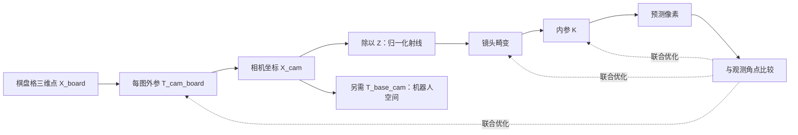
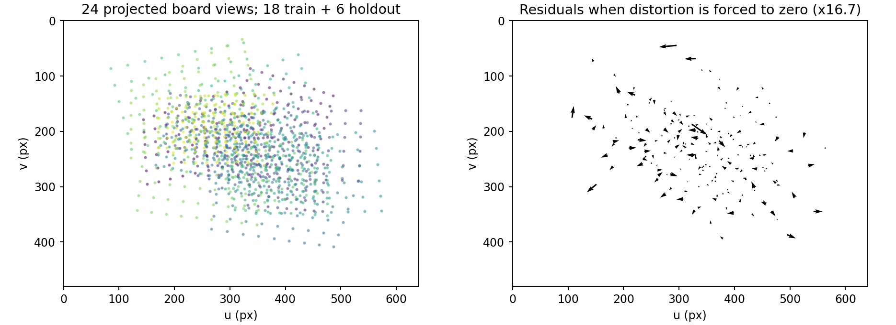
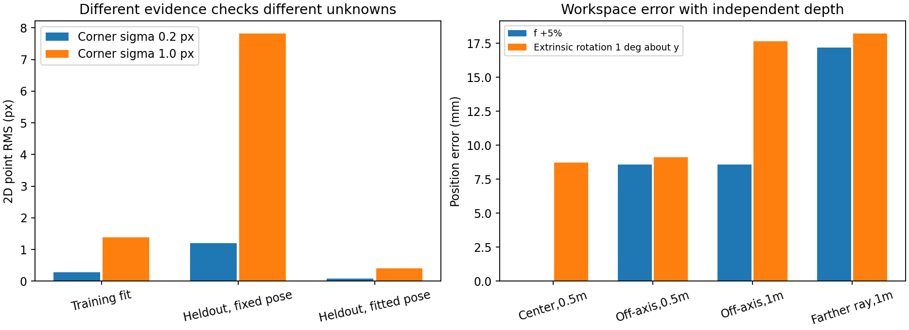
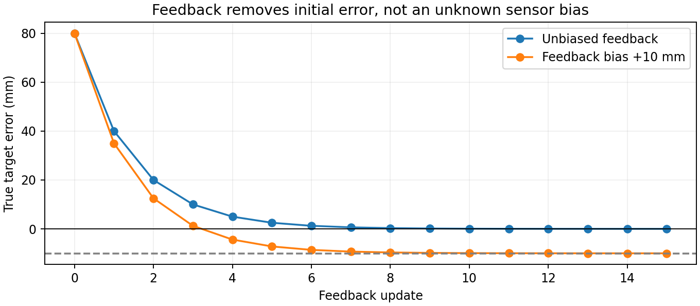

# D12 · 标定不是拿到一个矩阵，而是确定像素怎样对应真实空间

[返回学习入口](../_index.md) · [P2 日程](../P2-深度理解-日程.md) · [上一课 D11](../day11/Daily-Learning-Pack.md) · [下一课 D13](../day13/Daily-Learning-Pack.md) · [CPU 实验](demo.py) · [绘图脚本](plot_demo.py)

**今天把“相机参数”变成一个可以检验的估计问题：从多个已知几何图案的观测，联合估计内参、畸变和每一张图的位姿，再检查它们是否能解释独立观测与真实尺寸。重投影误差小只是其中一类证据。**

原定 W2-D5，按原课号补齐。D11 固定标定参数研究匹配；本课把这些参数当成未知量。D13 将把标定、立体、论文和动作坐标接口放进综合实验。所有新结果均为合成角点的实际 OpenCV 优化，不代表已重新标定你的 RealSense 或机器人。

<details>
<summary>个人学习记录（后续更新时保留）</summary>

<!-- learner-notes:start -->

- 当前学习状态：尚未验收。
- 我画出的坐标链：
- 我对格长误差实验的预测：
- 实验观察与自测作答：
- 尚未理解的问题：

<!-- learner-notes:end -->

</details>

<!-- daily-pack-generated:start -->

## 0. 今日目标与路线

学完应能：

1. 区分相机内参、畸变、棋盘格到相机外参、相机到机器人外参。
2. 从平面单应性推导张正友标定的约束来源，说明多姿态为什么重要。
3. 写出重投影非线性最小二乘目标，解释初始化、雅可比与阻尼的作用。
4. 运行真正的多视角 OpenCV 标定，读懂每个返回值的方向与单位。
5. 对比拟合残差、独立保留姿态和真实尺度误差，识别无法由图像单独发现的问题。
6. 把内外参误差换算成目标点误差，理解视觉反馈能改什么、不能改什么。

| 顺序 | 主问题 | 当天证据 |
| --- | --- | --- |
| 系统全景 | 到底在标定哪个变换？ | 坐标链与参数卡 |
| 投影与畸变 | 镜头如何改变理想针孔像素？ | 畸变手算 |
| 参数估计 | 多张图片怎样约束同一组内参？ | 单应性与优化推导 |
| CPU 实验 | 低 RMS 是否足以证明准确？ | 标定、格长、噪声与残差图 |
| 操作与反馈 | 相机误差怎样传到末端？ | 毫米误差和反馈反例 |

## 1. 宏观：相机与机器人参数各自约束什么

沿用 $T^A_B$ 把 B 系点变到 A 系的约定。腕部相机看到棋盘格或杯子时，可能同时涉及：

| 量 | 作用 | 随什么变化 |
| --- | --- | --- |
| K | 理想归一化射线与像素的关系 | 图像分辨率、裁剪、镜头状态等 |
| 畸变系数 | 理想射线与实际成像的偏离 | 镜头与模型设置 |
| $T^{cam}_{board,i}$ | 第 i 张图的棋盘格到相机位姿 | 每次移动棋盘格/相机 |
| $T^{ee}_{cam}$ | 相机与末端的固定安装关系 | 手眼安装变化 |
| $T^{base}_{ee}(q,t)$ | 机器人当时的末端位姿 | 关节状态与采样时刻 |

单相机 calibrateCamera 返回的是 K、畸变和每张图的 board→camera 位姿。**它不会仅凭棋盘格照片给出 camera→robot base 的外参。** 后者还需要机器人位姿、标定物固定关系或其他测量，属于手眼/机器人外参问题。



标定的输出不是一份与图像流无关的永久 YAML。它应与相机序列号/流、分辨率、裁剪、畸变模型、日期及验证场景对应。今天不读取或更改真实设备配置，只理解这些字段为什么必要。

## 2. 从针孔到畸变：每一步在什么坐标里计算

### 2.1 投影先除深度，再变像素

设相机坐标点 $(X,Y,Z)$，Z>0：

$$
x=X/Z,\qquad y=Y/Z,\qquad
u=f_xx+c_x,\quad v=f_yy+c_y.
$$

x、y 无量纲，f 与 c 用像素。物理镜头焦距的毫米数不能直接填入 K，必须结合像元尺度或标定求得像素焦距。

对于世界/棋盘格点：

$$
\mathbf X_c=R\mathbf X_b+t,\qquad
K=
\begin{bmatrix}
f_x&0&c_x\\0&f_y&c_y\\0&0&1
\end{bmatrix}.
$$

R 描述方向，t 是棋盘格原点在相机系的位置；t 的长度单位继承棋盘格点坐标。若格长写为 25，输出 t 就按同样的“25 对应单位”解释，不会自动识别你想表达毫米还是米。

### 2.2 常用五参数畸变模型

令 $r^2=x^2+y^2$，径向因子为：

$$
a(r)=1+k_1r^2+k_2r^4+k_3r^6.
$$

加入切向畸变：

$$
x_d=xa(r)+2p_1xy+p_2(r^2+2x^2),
$$

$$
y_d=ya(r)+p_1(r^2+2y^2)+2p_2xy.
$$

最后用 K 将 $(x_d,y_d)$ 变成像素。本课使用系数顺序 $(k_1,k_2,p_1,p_2,k_3)$，固定 $k_3=0$。并非所有镜头或 OpenCV 模型都只有这五个量：鱼眼、rational 等模型不能只凭系数个数混用。

手算：x=0.3、y=0.2，$r^2=0.13$，取 $k_1=-0.2$，其他为零，则因子 0.974，x_d=0.2922。若 f_x=600，横向相对无畸变像素差约为：

$$
600(0.2922-0.3)=-4.68\ {\rm px}.
$$

在 1 m 深度，4.68 px 对应约 7.8 mm 的横向误差。这个算例说明：画面“看起来没明显弯曲”仍可能影响近场抓取。实际误差由整个位置、畸变与深度共同决定。

### 2.3 去畸变后必须跟随新的像素定义

“原图像素+原 K+畸变模型”是一套自洽描述；“去畸变图像+对应的新 K+零畸变”也是一套。不能对已经去畸变的图再次施加旧畸变，或用裁剪后的像素搭配旧主点。

理想的连续坐标缩放里，横向缩放 s_x 则 f_x、c_x 同比例变化；裁剪左上角 $(u_0,v_0)$ 后，主点变为 $(c_x-u_0,c_y-v_0)$。具体 resize 的像素中心约定还要和实际采样实现一致，尤其在高精度任务中不要漏掉半像素偏移。

接口形状示例：三维点为 [N,3]，像素为 [N,2]，K 为 [3,3]，rvec/tvec 通常为 [3,1]；这些形状不携带物理单位或变换方向，文档必须额外说明。

## 3. 张正友标定：为什么一块平面也能约束相机

### 3.1 每个平面视图给出一个单应矩阵

把棋盘格置于其自身 Z=0 平面，忽略畸变时：

$$
s\begin{bmatrix}u\\v\\1\end{bmatrix}
=K[r_1\ r_2\ t]
\begin{bmatrix}X\\Y\\1\end{bmatrix}
=H\begin{bmatrix}X\\Y\\1\end{bmatrix}.
$$

因此每张棋盘格图可以先估计一个 3×3 单应矩阵 H。H 只有比例意义，9 个元素中有 8 个自由度；每个对应点提供两个约束。实际应使用多于最低数量的角点，并进行坐标归一化与稳健处理，降低噪声影响。

但 H 不是任意投影：它的前两列来自旋转矩阵的前两列，而旋转列向量必须互相正交且等长。

### 3.2 正交和等长如何变成内参约束

设 H 的列为 $h_1,h_2,h_3$，定义：

$$
B=K^{-T}K^{-1}.
$$

由 $r_1^\top r_2=0$、$\|r_1\|=\|r_2\|$，得到：

$$
h_1^\top B h_2=0,
\qquad
h_1^\top B h_1-h_2^\top B h_2=0.
$$

B 对称，只有 6 个不同元素，整体比例又不可辨。一张有效姿态给出两条约束，多个不同倾角将它们堆叠起来，求 B 的零空间，再恢复 K。对不额外约束的一般内参模型，至少需要足够独立的视图约束；**不要把“拍到了三张”当作充分条件**，姿态退化时数量无用。

有了 K，可由 $K^{-1}h_1,K^{-1}h_2$ 得旋转前两列，叉积得到第三列，缩放 $K^{-1}h_3$ 得 t。噪声会破坏严格正交，常用 SVD 将近似旋转投影回 SO(3)。

这一套提供初始化；真正镜头有畸变、角点有噪声，最终还要联合优化。原文结构见 [Zhang 技术报告 §2.2–2.3、§3.1–3.3、§4](https://www.microsoft.com/en-us/research/wp-content/uploads/2016/02/tr98-71.pdf)。

### 3.3 多张图为什么仍可能辨识不好

始终正对棋盘格、只做平移，不能像改变法向那样增加独立内参约束。图案始终只占图像中心，r 很小，高阶 $r^4,r^6$ 对观测影响弱，k2、k3 容易不稳定。

这不是“优化器不够强”，而是观测对某些参数不敏感。实际采样应覆盖不同倾斜、距离、图像位置，同时保证角点清晰、棋盘格平整、运动模糊小。斜得过度导致角点不可靠，也不等于更有信息。

参数个数越多，拟合训练点越灵活，但未必带来更可信的外推。高阶参数应由覆盖范围、镜头模型和独立验证支持，不应仅以训练 RMS 更低为理由不断增加。

## 4. 非线性优化：把当前参数再往更自洽的方向推进

### 4.1 最小化什么误差

共有 M 张图，第 i 张图有 N_i 个角点，预测函数记为 $\pi$：

$$
\min_{\theta}
\sum_{i=1}^{M}\sum_{j=1}^{N_i}
\|\pi(K,\mathbf d,R_i,t_i,\mathbf X_j)-\mathbf u_{ij}\|_2^2.
$$

$\theta$ 包含共享 K、畸变 d 与每图位姿。残差向量长度为 $2\sum_iN_i$。本课 18×54 个训练角点，残差维度为 1944；采用 4 个内参、4 个自由畸变、18×6 个位姿参数，共 116 个自由数。这个计数只是说明约束数量，不能证明约束独立或模型正确。

对当前参数附近线性化：

$$
r(\theta+\delta)\approx r(\theta)+J\delta.
$$

Gauss–Newton 的正规方程为：

$$
J^\top J\,\delta=-J^\top r.
$$

Levenberg–Marquardt 加阻尼，例如：

$$
(J^\top J+\lambda I)\delta=-J^\top r.
$$

$\lambda$ 较大时更保守；较小时更接近 Gauss–Newton。工程实现可能用对角缩放、稀疏结构等改进，这里只解释核心机制。像素、米和弧度尺度不同，参数缩放与初始化都影响数值优化。

### 4.2 为什么不能只盯着一个 RMS

本课遵循二维点残差定义：

$$
\mathrm{RMS}=
\sqrt{\frac1{\sum_iN_i}
\sum_{ij}[(u-\hat u)^2+(v-\hat v)^2]}.
$$

如果角点 u、v 各自独立噪声标准差为 0.2 px，未拟合前二维距离 RMS 大约是 $\sqrt2\times0.2$，不是 0.2。优化会吸收一部分误差，仍不能拿它和“每坐标标准差”直接比较。

还应该看每张图误差、残差随半径/方向的分布、参数稳定性、保留视图、实际工作区物理误差。把高残差图片直接删掉，会降低训练 RMS，也可能只是删掉了边缘畸变和困难视角；必须找原因并记录剔除规则。

## 5. 真实运行 OpenCV 多视角标定

### 5.1 数据与 API 的含义

本课合成一个 9×6 **内角点**棋盘格，格长 0.025 m，54 个点；生成 24 个不同旋转、平移的观测，用 18 个视图估计，6 个保留视图检查。真实 K：

$$
K_{\rm true}=
\begin{bmatrix}
620&0&320\\0&610&240\\0&0&1
\end{bmatrix};
\quad
\mathbf d_{\rm true}=(-0.18,0.04,0.001,-0.0008,0).
$$

图像 640×480，实际调用 OpenCV 的 projectPoints、calibrateCamera、solvePnP 和 undistortPoints。由于直接合成角点，本实验**没有测试真实棋盘格检测质量、板面不平、快门同步、手眼或机器人运动**。

```python
rms, K, distortion, rvecs, tvecs = cv2.calibrateCamera(
    objectPoints, imagePoints, (640, 480), None, None,
    flags=cv2.CALIB_FIX_K3)
# objectPoints: M 个 [N,3]，长度单位为米
# imagePoints: M 个 [N,2]，像素单位
# rvecs/tvecs: 每图 board -> camera；rvec 是旋转向量，不是欧拉角
```

实际返回值和参数以 [OpenCV calib3d 官方说明](https://docs.opencv.org/4.x/d9/d0c/group__calib3d.html) 为准。本地验证为 OpenCV 4.10.0；网页当前版本可能更高，未据此声称本机已升级。

### 5.2 三组对照只改变一个条件

1. **角点噪声 0.2→1.0 px。** 使用同一组标准高斯样本乘不同系数，图案、姿态和优化模型不变。
2. **假定格长增加 5%。** 图像观测不变，只把 objectPoints 乘 1.05。
3. **强制忽略畸变。** 图像不变，将径向和切向畸变固定为零，其他参数继续估计。

从 vault 根目录运行：

```bash
python -B 3d_learning/day12/demo.py
python -B 3d_learning/day12/plot_demo.py
```

环境：Python 3.11.15、NumPy 1.26.4、OpenCV 4.10.0、Matplotlib 3.10.9。CPU，无新增安装、权重或硬件访问。



左图展示实际参与生成的 24 组角点。右图残差箭头放大约 16.7 倍，避免把可视化箭头长度误认为原像素误差。即使整体 RMS 不算巨大，有结构的残差也提示模型系统性不符。

### 5.3 已确认的结果与解释

原始数值见 [results.json](../../_assets/3d_learning/day12/results.json)。

| 条件 | 训练二维点 RMS | 焦距相对误差 | 保留图：固定真实位姿 | 保留图：重新拟合位姿 |
| --- | --- | --- | --- | --- |
| 每坐标噪声 0.2 px | 0.2771 px | 0.119% | 1.203 px | 0.0794 px |
| 每坐标噪声 1.0 px | 1.3854 px | 0.609% | 7.826 px | 0.3990 px |

后两列都对比保留图的**无噪声真值像素**。固定真实位姿时，把内参/畸变误差直接暴露出来；重新拟合位姿时，一部分相机模型误差可以被位姿吸收，因此像素误差变小。后者不是“联合系统一定更准确”的证明。真实设备上通常没有精确位姿真值，需独立测量设计来替代本实验的合成真值。

噪声 0.2 px 时估计 K 的 fx≈620.872、fy≈610.563、cx≈320.687、cy≈239.039；k1≈−0.18037，但 k2≈0.01998，与真值 0.04 有明显差距。**低 RMS 不意味着每个参数都被高精度辨识。** 高阶畸变在有限视野中的影响可能与其他参数耦合。

强制零畸变后，训练 RMS 增加到 0.4921 px，fx≈634.76、fy≈626.69，主点也发生偏移。优化器试图用内参和位姿解释缺失的畸变，结果可能仍“能拟合”，但参数的物理意义已偏离真值。

## 6. 格长错了，为什么几乎不改变重投影误差

本课格长增加 5% 后，训练 RMS 从 0.277126776 变成 0.277126779 px，几乎相同；每张图平移模长平均变为原来的 1.04999995 倍，K 相对变化约 $2.6\times10^{-9}$。

这是可以直接推导的尺度自由度。投影前相机点为：

$$
X_c=RX_b+t.
$$

若棋盘格模型乘 s，同时 t 乘 s：

$$
R(sX_b)+st=s(RX_b+t).
$$

除以 Z 时 s 被消掉，因此像素完全相同。**图像告诉你投影是否自洽，却不能替你核对打印出来的格长。**

例如真实棋盘格距相机 0.6 m，尺寸被写大 5%，求得距离会相应约 0.63 m，误差 3 cm；像素仍可能贴得很好。动作归一化不能修复这类缺少物理标尺的错误，因为它只把已有数字按统计范围重编码，不会凭空知道真值。

这一点与 D13 的双目基线尺度反例相通：只要重建和重投影都用同一个错误尺度，闭环自洽就可能掩盖物理错误。

## 7. 从参数误差到末端误差：先算量级，再谈控制

### 7.1 内参错一点，空间能偏多少

已知独立深度 Z：

$$
X=\frac{(u-c_x)Z}{f_x}.
$$

局部敏感性：

$$
\frac{\partial X}{\partial u}=\frac Z{f_x},\quad
\frac{\partial X}{\partial c_x}=-\frac Z{f_x},\quad
\frac{\partial X}{\partial f_x}=-\frac X{f_x}.
$$

在 Z=1 m、f=600 px 时，1 px 的横向误差约为 1.67 mm。若真实 X=0.15 m，焦距错误增加 5%，反投影会得到 $0.15/1.05=0.14286$ m，横向偏差约 7.14 mm。相机主轴上的点 X=0 对这个焦距扰动不敏感，不能只测图像中心。

深度误差还会同时影响 X、Y、Z。若同一参数影响多个轴，这些误差存在相关性，不能任意把每轴方差当作独立量相加。

### 7.2 外参小角度误差随距离放大

变换为 $p_b=Rp_c+t$。小旋转扰动满足近似：

$$
\delta p_b\approx\delta t+\delta\theta\times(Rp_c).
$$

只取量级，绕某轴的角度误差乘以点到该轴的垂直距离。1°≈0.01745 rad；一米量级的杠杆臂可能带来约 17 mm 的位置误差。

本课实际扰动是**绕相机 Y 轴旋转 1°**。代码 Rodrigues([0,1deg,0])、结果键 extrinsic_y_axis1deg_error_m 和下图使用同一约定，不把它混称为机器人通常绕 Z 轴定义的 yaw。



实验独立深度不变，焦距 +5% 在四个测试点造成 0、8.58、8.58、17.17 mm 误差；绕 Y 轴 1° 造成约 8.73、9.11、17.65、18.22 mm。焦距误差主要随离轴位置变化，旋转误差则受杠杆臂影响。二者不是一个统一“标定误差百分比”。

### 7.3 手眼、TCP 和时间戳缺一项都可能抓偏

腕部相机目标点：

$$
p_b=T^{base}_{ee}(t_{\rm image})T^{ee}_{cam}p_c.
$$

移动时若用到另一时刻的机器人姿态，链条虽乘法正确，物理状态却不对应。若夹爪目标相对的是指尖中心，而控制器使用法兰，还需要正确 TCP 偏置。

今日单相机标定不会直接解决这些问题。工程产物应分别记录：相机模型验证、手眼方向验证、TCP 定义、时间对齐、独立工作空间误差。每项证据对应它实际约束的未知量。

## 8. 视觉反馈能逐步纠偏，但不能自动识别未知偏置

用一维理想例子理解。真实末端误差 e，测量误差 $\hat e=e+b$，按比例更新：

$$
e_{k+1}=e_k-\lambda\hat e_k
=(1-\lambda)e_k-\lambda b.
$$

若 b=0 且 0<λ<2，理想离散系统收敛到 0；若 b 是固定偏置，平衡点是 $e_\infty=-b$。控制器以为测量误差已经消失，真实误差却还存在。



本实验初始误差 80 mm，λ=0.5。无偏时 15 次更新后约 0.00244 mm；测量偏置 +10 mm 时收敛到约 −9.997 mm。这只是没有延迟、饱和、噪声和机器人动力学的一维示意，不是 PBVS/IBVS 的真实稳定性验证。

真正视觉伺服要处理图像特征与相机运动的关系、深度估计、时延、执行限幅和任务约束。它在原 W5 才会系统展开；今天先保留一个判断：**重新观察有助于纠正执行偏差，但若观测模型本身有固定偏差，闭环可能只是稳定地停在错误位置。**

对 VLA 同样如此。训练数据中的动作、相机和机器人参考系若不一致，网络可能在训练场景中补偿部分偏差，也可能迁移失败。标准化与微调不是自动替代标定的物理证据。

## 9. 实操产出与完整代码

### 9.1 你的独立任务

先预测格长 +5% 对 K、t、RMS 的影响，再读 JSON 对照。随后只改变角点噪声或单个畸变系数，保留原结果，使用新的输出目录记录实验。

需要重新验证时：

```bash
python -B 3d_learning/day12/demo.py --seed 13 --out-dir /tmp/day12-new-seed
```

改变 seed 会同时改变姿态和噪声，用于检查结论稳定性，**不是单变量因果实验**。单变量对照已在同一次脚本中固定标准噪声实现；如果要单独改变 k1，要保持其他变量与随机样本相同，并在记录中说明。

今日最低产物不是一份 K，而是“输入/单位/方向—模型假设—优化结果—独立证据—边界”五项卡。再给每张图写两句话：看到什么；不能据此证明什么。

### 9.2 完整主脚本

> [!note]- 完整 CPU 主脚本（与 demo.py 一致）
>
> ```python
> """Day12: multi-view OpenCV calibration with known synthetic metric truth."""
> from pathlib import Path
> import argparse
> import json
> import platform
> import cv2
> import numpy as np
> 
> 
> def project(obj, pose, k, distortion):
>     return cv2.projectPoints(obj, pose[0], pose[1], k, distortion)[0].reshape(-1, 2)
> 
> 
> def solve(obj, images, flags=0):
>     objects = [obj.astype(np.float32) for _ in images]
>     return cv2.calibrateCamera(objects, [x.astype(np.float32) for x in images],
>         (640,480), None, None, flags=flags | cv2.CALIB_FIX_K3,
>         criteria=(cv2.TERM_CRITERIA_EPS | cv2.TERM_CRITERIA_MAX_ITER, 100, 1e-10))
> 
> 
> def main():
>     parser = argparse.ArgumentParser()
>     parser.add_argument('--seed', type=int, default=12)
>     parser.add_argument('--out-dir', type=Path, default=Path(__file__).resolve().parents[2]/'_assets/3d_learning/day12')
>     args = parser.parse_args(); args.out_dir.mkdir(parents=True, exist_ok=True)
>     rng = np.random.default_rng(args.seed)
>     obj = np.zeros((9*6,3), np.float32)
>     obj[:,:2] = np.mgrid[0:9,0:6].T.reshape(-1,2)*.025
>     obj[:,:2] -= obj[:,:2].mean(0)
>     k = np.array([[620.,0,320],[0,610,240],[0,0,1]])
>     distortion = np.array([-.18,.04,.001,-.0008,0.])
>     poses = [(rng.uniform([-.45,-.45,-.3],[.45,.45,.3]),
>               rng.uniform([-.13,-.09,.48],[.13,.09,.9])) for _ in range(24)]
>     clean = np.array([project(obj, pose, k, distortion) for pose in poses])
>     assert np.all((clean[...,0]>0)&(clean[...,0]<640)&(clean[...,1]>0)&(clean[...,1]<480))
>     standard_noise = rng.normal(size=clean.shape)
>     records, arrays = {}, dict(clean=clean, object_points=obj, true_K=k)
>     for sigma in (.2, 1.):
>         observed = clean + sigma*standard_noise
>         rms, estimated_k, estimated_d, rv, tv = solve(obj, observed[:18])
>         held_known, held_fitted = [], []
>         for index in range(18,24):
>             pred = project(obj, poses[index], estimated_k, estimated_d)
>             held_known.append(np.mean(np.sum((pred-clean[index])**2,axis=1)))
>             ok, r, t = cv2.solvePnP(obj, observed[index], estimated_k, estimated_d)
>             assert ok
>             fit = project(obj, (r,t), estimated_k, estimated_d)
>             held_fitted.append(np.mean(np.sum((fit-clean[index])**2,axis=1)))
>         records[f'noise_{sigma}'] = dict(training_rms_px=float(rms), K=estimated_k.tolist(),
>             distortion=estimated_d.ravel().tolist(),
>             focal_relative_error=float(np.linalg.norm(estimated_k.diagonal()[:2]-k.diagonal()[:2])/np.linalg.norm(k.diagonal()[:2])),
>             heldout_fixed_truth_pose_rms_px=float(np.sqrt(np.mean(held_known))),
>             heldout_fitted_pose_rms_px=float(np.sqrt(np.mean(held_fitted))))
>         arrays[f'K_noise_{sigma}'] = estimated_k
>         arrays[f'D_noise_{sigma}'] = estimated_d
>         if sigma == .2:
>             base = (rms, estimated_k, estimated_d, rv, tv)
>             arrays['observed'] = observed
>     # Same image points, only assumed board scale changes by 5%.
>     scaled = solve(obj*1.05, arrays['observed'][:18])
>     ratios = [np.linalg.norm(b)/np.linalg.norm(a) for a,b in zip(base[4], scaled[4])]
>     records['board_scale_1.05'] = dict(training_rms_px=float(scaled[0]),
>         translation_norm_ratio_mean=float(np.mean(ratios)),
>         focal_relative_change=float(np.linalg.norm(scaled[1]-base[1])/np.linalg.norm(base[1])))
>     # Omit distortion while optimizing the same unknowns other than fixed zero distortion.
>     omitted = solve(obj, arrays['observed'][:18], cv2.CALIB_ZERO_TANGENT_DIST | cv2.CALIB_FIX_K1 | cv2.CALIB_FIX_K2)
>     records['zero_distortion_model'] = dict(training_rms_px=float(omitted[0]), K=omitted[1].tolist())
>     full_errors, omit_errors = [], []
>     for i in range(18):
>         full_errors.append(project(obj,(base[3][i],base[4][i]),base[1],base[2])-arrays['observed'][i])
>         omit_errors.append(project(obj,(omitted[3][i],omitted[4][i]),omitted[1],omitted[2])-arrays['observed'][i])
>     arrays['full_residuals'] = np.array(full_errors); arrays['omitted_residuals'] = np.array(omit_errors)
>     # Independently known depth and ray; isolate focal error / extrinsic rotation.
>     points = np.array([[.0,0,.5],[.15,.10,.5],[.15,.10,1.0],[.3,.2,1.0]])
>     pixel = project(points,(np.zeros(3),np.zeros(3)),k,np.zeros(5))
>     wrong_k = k.copy(); wrong_k[0,0] *= 1.05; wrong_k[1,1] *= 1.05
>     ray = cv2.undistortPoints(pixel.reshape(-1,1,2),wrong_k,np.zeros(5)).reshape(-1,2)
>     reconstructed = np.column_stack((ray*points[:,2,None],points[:,2]))
>     rotation,_ = cv2.Rodrigues(np.array([0,np.deg2rad(1),0]))
>     rotated = points@rotation.T
>     records['workspace'] = dict(points_m=points.tolist(),
>         focal_plus5_error_m=np.linalg.norm(reconstructed-points,axis=1).tolist(),
>         extrinsic_y_axis1deg_error_m=np.linalg.norm(rotated-points,axis=1).tolist())
>     # A scalar idealized feedback example: residual measurement bias cannot be corrected away.
>     histories = []
>     for bias in (0., .01):
>         error = .08; values = [error]
>         for _ in range(15):
>             error -= .5*(error+bias); values.append(error)
>         histories.append(values)
>     arrays['feedback_error'] = np.array(histories)
>     report = dict(environment=dict(python=platform.python_version(),numpy=np.__version__,opencv=cv2.__version__),
>         seed=args.seed, board=dict(inner_corners=[9,6], square_m=.025, views_train=18,views_holdout=6),
>         true_K=k.tolist(), true_distortion=distortion.tolist(), results=records,
>         feedback_final_error_m=[float(v[-1]) for v in histories],
>         scope='synthetic corner observations, real calibrateCamera optimization; no detector/hand-eye/robot validation')
>     assert base[0] < .35
>     assert abs(np.mean(ratios)-1.05) < 1e-4
>     assert records['noise_1.0']['training_rms_px'] > records['noise_0.2']['training_rms_px']
>     assert omitted[0] > base[0]
>     (args.out_dir/'results.json').write_text(json.dumps(report,indent=2),encoding='utf-8')
>     np.savez_compressed(args.out_dir/'arrays.npz',**arrays)
>     print(json.dumps(report,indent=2))
> 
> 
> if __name__ == '__main__':
>     main()
> ```

## 10. 原文精读与工程回查

读 [Zhang 技术报告](https://www.microsoft.com/en-us/research/wp-content/uploads/2016/02/tr98-71.pdf) §2.2–2.3 平面约束、§3.1 初始化、§3.2–3.3 非线性与畸变、§4 退化、§5.3 图案误差。版本是作者技术报告，章节编号与期刊排版可能不同；按标题核对。

精读产物：

1. 不看本文，画 H=K[r1 r2 t]，写出正交和等长两条约束。
2. 指出真实尺度从哪里进入，解释为什么格长错误不会被投影自动发现。
3. 选本实验的“噪声增加”“零畸变模型”“格长 +5%”之一，把结果对应到原文假设。
4. 写出下一次真实标定采样应增加的视角或证据，而不是仅说“多拍一些”。

没有运行真实检测或机器人验证的环节标成待验证，不以合成优化成功代替。

## 11. 回到宏观：今日五个重点与三类难点

1. **参数有方向和单位。** 区分 board→camera 与 camera→base，避免把正确矩阵接错接口。
2. **多视图来自独立几何约束。** 数量多不等于可辨识性强，姿态与画面覆盖决定信息。
3. **RMS 是模型内的残差。** 它能发现部分不一致，不能独立验证打印尺寸或真实尺度。
4. **工作空间误差才连接操作要求。** 将像素、焦距、角度误差换算成毫米，才能判断任务余量。
5. **反馈必须依赖可信观测。** 闭环不自动消除未知系统偏置。

难点一：rvec 是轴角旋转向量，不能逐元素当 roll/pitch/yaw。难点二：固定真实位姿与重新估计位姿的保留图测试回答不同问题。难点三：标定参数看似不准但投影仍可贴合，是参数耦合与有限观测的正常可能性，不是应该忽略的细节。

三句话总结：标定通过已知几何约束成像模型；独立尺度与工作区证据保证模型对应真实物理；机器人最终依赖整条参考系与时间链，而非单个低 RMS。

## 12. 自测：先作答

1. calibrateCamera 的 tvec 是哪个坐标系里的什么量？格长用毫米，tvec 用什么单位？
2. 从 Z_board=0 写出 H=K[r1 r2 t]，再写出 H 对内参提供的两条约束。
3. 为什么始终正对平面、只平移拍很多张，不能替代姿态变化？
4. x=0.3、y=0.2、k1=−0.2、其他畸变为零，f_x=600，横向畸变约多少像素？
5. 格长放大 5% 后 RMS 不变，这意味着标定正确吗？哪种独立证据能发现问题？
6. 保留图重新估计位姿后重投影很好，固定真实位姿却明显变差，应怎样解释？
7. 已知 Z=1 m、f_x=600，主点误差 +3 px 使反投影 X 偏多少？符号是什么？
8. 测量误差为 e+0.01 m，比例反馈收敛时真实误差是多少？动作归一化能否自动修复？

## 13. 未理解问题与明日衔接

保留三个待追踪问题：真实图案平整度和尺寸如何验证；内参、手眼、TCP、时钟怎样分别验收；残差是否随半径、倾角和工作距离有规律？

下一课 [D13 综合实验](../day13/Daily-Learning-Pack.md) 会把几何、立体、标定与 GC-Net 精读接到动作的坐标、单位和采样周期。本课提供标定基础，D13 的独立实验继续核对这些证据，不改变原课程顺序。

## 14. 参考答案与判分

> [!note]- 作答后展开：每题 0 / 1 / 2 分
> 0 分：核心错误；1 分：主要结论正确但缺方向/单位/假设；2 分：推理与边界完整。建议至少 13/16，坐标方向、尺度和反馈偏置题不应为 0；尚未替你验收。
>
> 1. tvec 是棋盘格原点在相机坐标系的位置，与 rvec 组成 board→camera；单位继承 objectPoints，因此是毫米。
> 2. 平面点只有 X、Y，投影为 K[r1 r2 t][X,Y,1]；令 B=K^−T K^−1，有 h1^T B h2=0、h1^T B h1=h2^T B h2。
> 3. 相同平面法向产生相关/退化约束，重复观测主要降噪而不补足缺失的几何信息。
> 4. r²=0.13，径向因子0.974，x偏−0.0078，像素偏−4.68 px。
> 5. 不代表物理尺度正确，t 可同时放大掩盖误差；需要真实量尺、可信格长、独立距离或工作区测量。
> 6. 位姿自由度吸收了部分相机模型误差。两类测试约束不同，拟合后像素好不能证明内参/真实位姿都准。
> 7. X=(u-cx)Z/fx，cx增加3使X减少3/600 m，即−5 mm。
> 8. 理想稳态为−0.01 m。归一化只是数值变换，不新增真实尺度或无偏观测，不能自动校正这种偏置。

<!-- daily-pack-generated:end -->

