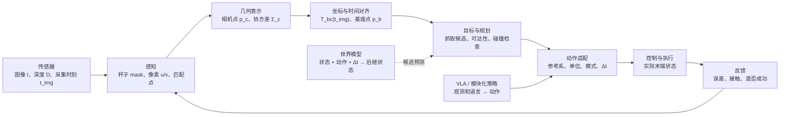
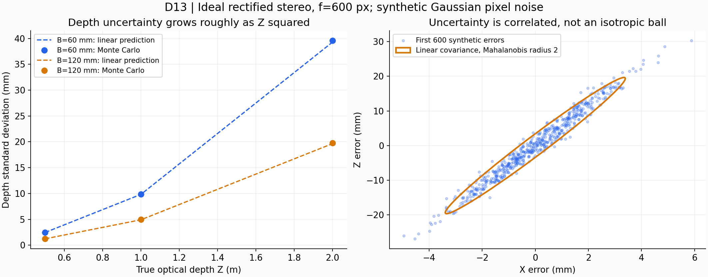
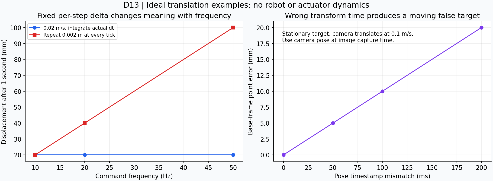
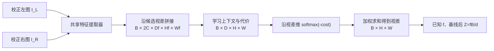
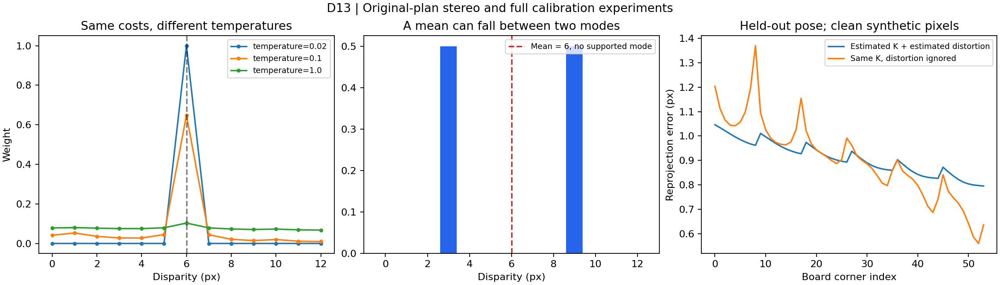

# D13 · 从几何深度误差到可执行动作

[返回学习入口](../_index.md) · [P2 本周日程](../P2-深度理解-日程.md) · [上一课 D12](../day12/Daily-Learning-Pack.md) · [下一课 D14](../day14/Daily-Learning-Pack.md) · [CPU 实验](demo.py) · [立体与标定实验](stereo_calibration.py)

**今天要建立的能力，是沿着“像素 → 米 → 机器人坐标 → 带时间含义的动作”逐层核对：一个看起来准确的视觉结果，究竟凭什么能成为可靠的操作输入。**

贯穿案例仍是 RGB-D 机械臂抓杯子。我们暂时固定检测结果与夹爪姿态，把注意力放在一个杯子表面点：相机认为它在哪里？这个位置有多不确定？转换到机械臂基座后是否仍正确？策略输出的“向前 0.02”，最后应该移动多少、沿哪个轴、持续多久？

按课程顺序，上一课 D12 是标定、误差传播与视觉反馈，本课是 W2-D6 的论文与几何深度综合实验，下一课 D14 将完成几何验收与预训练、微调的概念整理。**原定课程日期为 2026-09-17，课号与主题保持不变。** 2026-09-22 对照原计划补全 GCNet 精读、立体方法比较及完整 OpenCV 标定实验；前文保留必要几何回查，不替代 D8–D12 的逐课学习。

<details>
<summary>个人学习记录（自动更新教材时保留）</summary>

<!-- learner-notes:start -->

- 当前学习状态：尚未验收。
- 我的预测与实际结果：
- 我能独立推导的公式：
- 我的自测作答：
- 尚未理解的问题：

<!-- learner-notes:end -->

</details>

<!-- daily-pack-generated:start -->

## 0. 学习目标与路线

完成本课后，你应当能够：

1. 从校正双目的投影关系推导 $Z=fB/d$，明确其坐标、单位和成立条件。
2. 手写齐次线性三角化，分清代数残差、重投影误差与实际三维误差。
3. 用雅可比预测深度误差，并用 Monte Carlo（蒙特卡洛随机采样）验证；解释为什么输入误差之间的相关性不能随意删掉。
4. 设计一个“重投影很准、物理尺度很错”的反例，指出缺少哪条独立证据。
5. 将视觉目标接入动作接口，区分点、向量、绝对位姿、增量位移、速度、参考系和采样周期。
6. 为 VLA 动作数据与世界模型转移样本写出足够明确的接口，而不只记录一个无语义数组。
7. 解释 GCNet 的代价体与可微视差回归，完成立体方法比较和多视角标定，识别低残差掩盖参数或尺度问题的情况。

| 顺序 | 知识主线 | 需要回答的问题 |
| --- | --- | --- |
| 1 | 从观测到动作的整条链 | 哪些错误能被下游看到，哪些会被错误模型掩盖？ |
| 2 | 投影、深度与三角化 | 一个像素为什么不能独自给出三维位置？ |
| 3 | 残差与物理尺度 | 重投影误差很低，为什么依然可能抓偏？ |
| 4 | 噪声与协方差 | 距离、基线和像素噪声怎样共同影响位置？ |
| 5 | 坐标、单位与时钟 | “0.02”到底是多远、朝哪里、每步还是每秒？ |
| 6 | 综合实验与论文 | 怎样把理论变成可复核的工程证据？ |

## 1. 宏观：图像中的正确，不会自动传递到机器人中

### 1.1 今天沿着哪些量向下追踪



图中的箭头不是只传一个 tensor（张量）。每个量都必须有语义。例如 `p_c=[0.1,0,0.8]` 需要同时说明“单位米、相机光学坐标系、对应哪一帧”。省略这些信息，数值本身无法告诉控制器该怎样使用它。

本课的代码覆盖图中的几何、误差与动作适配，**没有实现完整物体检测、抓取候选生成、IK、碰撞检测或真实控制**。这样可以固定其他因素，单独观察接口错误的影响。一个表面点也不是完整物体位姿，更不是已经验证可执行的抓取位姿。

### 1.2 三种不同的“对”

| 层级 | 要求 | 典型证据 | 不能据此推出什么 |
| --- | --- | --- | --- |
| 数值自洽 | 投影、反投影、矩阵方向相互一致 | 合成真值回环、库函数交叉核对 | 实际传感器标定一定正确 |
| 物理正确 | 长度、姿态、时间对应真实世界 | 独立量尺、已知物体尺寸、保留姿态、对时记录 | 夹爪一定能到达或抓稳 |
| 任务成功 | 完成指定操作且满足约束 | 独立试验次数、接触与成功记录 | 每个中间估计都无偏 |

今天最值得抓住的判断是：**每种证据只能回答它实际观测到的问题。** 使用同一个错误相机模型做重建、再用它做重投影，只能检查该模型内部是否自洽。

## 2. 微观：从一个像素到有尺度的三维点

### 2.1 投影丢掉了什么

设相机光学坐标为右手系，`x` 向右、`y` 向下、`z` 向前；三维点为：

$$
\mathbf p_c=[X,Y,Z]^\top,\qquad Z>0.
$$

在零畸变、零 skew（像素轴倾斜项）的针孔模型中：

$$
u=f_x\frac{X}{Z}+c_x,\qquad
v=f_y\frac{Y}{Z}+c_y.
$$

`X,Y,Z` 用米，`u,v,f_x,f_y,c_x,c_y` 用像素。注意焦距的这里一组数值是“以像素为单位的焦距”，不是直接把镜头标出的毫米焦距填入矩阵。

用齐次形式写：

$$
Z\begin{bmatrix}u\\v\\1\end{bmatrix}
=K\mathbf p_c,\qquad
K=
\begin{bmatrix}
f_x&0&c_x\\0&f_y&c_y\\0&0&1
\end{bmatrix}.
$$

已知一个像素，只能得到射线：

$$
\mathbf p_c(\lambda)=\lambda K^{-1}
\begin{bmatrix}u\\v\\1\end{bmatrix},\qquad \lambda>0.
$$

这里把射线第三分量固定为 1，所以 $\lambda$ 正好是光轴深度 `Z`。如果把射线归一化为单位长度，乘数就变成相机到该点的欧氏距离 `r`；这两个量通常不同。

例如 `K` 的焦距均为 `600`、主点为 `(320,240)`，像素 `(440,300)` 对应：

$$
K^{-1}[440,300,1]^\top=[0.2,0.1,1]^\top.
$$

若深度 $Z=1\ {\rm m}$，点为 $[0.2,0.1,1]^\top{\rm m}$，射线距离是 $\sqrt{1.05}\approx1.0247\ {\rm m}$。把距离当光轴深度，会把整条射线上的点放远。

> [!question] 先判断
> 点 `[0.2,0.1,1]` 与 `[0.4,0.2,2]` 是否有相同像素？如果有，为什么仅靠投影回环不能验证深度尺度？

还有一个细节：`[X,Y,Z,1]` 与 `[2X,2Y,2Z,2]` 表示同一个齐次三维点；`[2X,2Y,2Z,1]` 则表示不同的三维点。前者是表示的比例自由度，后者是物理位置沿射线变化。

### 2.2 深度把射线变成点，双目提供另一条射线

RGB-D 反投影使用测得的光轴深度：

$$
\mathbf p_c=
\begin{bmatrix}
(u-c_x)Z/f_x\\
(v-c_y)Z/f_y\\
Z
\end{bmatrix}.
$$

深度输入必须已经完成单位转换，并与所用内参、像素网格对应。对原始深度整数，应依据实际流的 scale 转换；不能因为看过某个例子就假定所有设备都是 `0.001 m/unit`。

双目则从两个视角约束同一个点。考虑**已经去畸变、校正、具有相同焦距和相同主点的水平双目**：

- 左相机作为参考坐标系。
- 右相机中心位于左相机的 $[B,0,0]^\top$。
- 相机姿态相同，`B>0` 为基线长度。

同一点在右相机中的横坐标为 `X-B`，所以：

$$
u_L=f\frac{X}{Z}+c_x,\qquad
u_R=f\frac{X-B}{Z}+c_x.
$$

相减定义 disparity（视差）`d=u_L-u_R`：

$$
d=\frac{fB}{Z}
\quad\Longrightarrow\quad
\boxed{Z=\frac{fB}{d}}.
$$

单位也要相消：$({\rm px}\cdot{\rm m})/{\rm px}={\rm m}$。

本课默认 $f=600\ {\rm px},B=0.06\ {\rm m}$。当 $Z=1\ {\rm m}$，$d=36\ {\rm px}$；当 $Z=2\ {\rm m}$，视差变为 $18\ {\rm px}$。

如果左右主点不同，应先消除其差：

$$
d_{\rm eff}=(u_L-c_{xL})-(u_R-c_{xR}).
$$

不能把任意未校正图像的横坐标差，直接代入简化公式。一般姿态需要完整投影矩阵；畸变像素也不满足理想针孔射线关系。

### 2.3 从深度图到目标点，还差一个数据选择问题

假设杯子表面在 `0.8 m`，背景在 `1.2 m`。检测框内只有 40% 像素属于杯子：

- 对框内深度求均值，得到 `1.04 m`，可能对应空间中并不存在的表面。
- 对框内深度取中位数，可能得到背景的 `1.2 m`。
- 加入正确实例 mask 后，才有机会估计杯子表面；仍需排除孔洞、边缘混合和离群值。

**统计量稳健，不代表你选中了正确的物理对象。** 中位数只能抵抗一定比例的异常观测，不能替你理解实例归属。

同样，检测框中心加一个深度，只能得到某条视线上的表面点。物体中心、抓取接触点与这个表面点不是自动相同的量。

## 3. 微观：手写三角化，知道求解器到底优化了什么

### 3.1 从投影消去未知比例

令世界点的齐次形式为 $\tilde{\mathbf X}=[X,Y,Z,1]^\top$，投影矩阵为 $P\in\mathbb R^{3\times4}$。以 `P_1,P_2,P_3` 表示其三行：

$$
u=\frac{P_1\tilde{\mathbf X}}{P_3\tilde{\mathbf X}},
\qquad
v=\frac{P_2\tilde{\mathbf X}}{P_3\tilde{\mathbf X}}.
$$

整理得到：

$$
(uP_3-P_1)\tilde{\mathbf X}=0,\qquad
(vP_3-P_2)\tilde{\mathbf X}=0.
$$

两个视角拼成：

$$
A\tilde{\mathbf X}=0,\qquad
A=
\begin{bmatrix}
u_LP_{L3}-P_{L1}\\
v_LP_{L3}-P_{L2}\\
u_RP_{R3}-P_{R1}\\
v_RP_{R3}-P_{R2}
\end{bmatrix}\in\mathbb R^{4\times4}.
$$

有噪声时通常找不到严格非零解。DLT（Direct Linear Transform，直接线性变换）求：

$$
\min_{\|\tilde{\mathbf X}\|_2=1}\|A\tilde{\mathbf X}\|_2^2.
$$

令 $A=USV^\top$，取 `V` 中最小奇异值对应的列，也就是 NumPy 返回的 `vt[-1]`。得到 `[h_x,h_y,h_z,h_w]` 后，除以 `h_w` 回到三维坐标。若 `h_w` 接近零，该点接近无穷远，不能用“加一个很小的 epsilon”掩盖几何退化。

核心实现仅几行：

```python
# A: [N, 4, 4], 每个匹配点有一个独立线性系统
_, singular_values, vt = np.linalg.svd(A)
h = vt[:, -1, :]             # [N, 4]
xyz = h[:, :3] / h[:, 3:]     # [N, 3]，之前必须检查 h[:, 3]
```

得到有限值后还要检查两个相机中的 `Z>0`。这叫 cheirality（正深度）检查。满足它不等于点没有被遮挡，也不等于左右匹配真实正确。

### 3.2 为什么代数残差不等于像素误差

其中一条代数残差为：

$$
r_{\rm alg}=uP_3\tilde{\mathbf X}-P_1\tilde{\mathbf X}.
$$

而实际横向重投影残差是：

$$
r_{\rm pixel}
=u-\frac{P_1\tilde{\mathbf X}}{P_3\tilde{\mathbf X}}
=\frac{r_{\rm alg}}{P_3\tilde{\mathbf X}}.
$$

分母依赖正在估计的点。最小化代数平方和，并不一般等价于最小化像素平方和；对 `A` 的行任意缩放，也会改变带噪声问题的代数权重。

这不意味着 DLT 没用。它很适合建立基线、验证坐标约定、提供非线性优化初值；但不能把“我调用了 SVD”描述成“我已求得最小重投影误差的全局最优解”。

若图像定位噪声可近似为独立同方差高斯噪声，一个自然的几何目标是：

$$
L(\mathbf X)=
\sum_{j\in\{L,R\}}
\|\mathbf u_j-\pi(P_j,\mathbf X)\|_2^2.
$$

$\pi$ 包含齐次投影与除法。不同观测有不同协方差时，应考虑：

$$
L(\mathbf X)=
\sum_j\mathbf r_j^\top\Sigma_j^{-1}\mathbf r_j.
$$

这表示“按观测噪声大小衡量偏差”。一个定位本来就很不确定的点，不应仅凭同样 1 px 残差获得和精确角点相同的权重。若存在错误匹配，仅加权高斯模型仍不足，需要外点处理或鲁棒损失。

### 3.3 代表方法怎样分工

| 方法 | 主要计算 | 优点 | 本课必须保留的边界 |
| --- | --- | --- | --- |
| 校正双目闭式公式 | $Z=fB/d$ | 易推导、易检查量纲 | 只适用于匹配的校正几何，不能吞掉畸变和主点差 |
| 齐次 DLT | 构造 `A`，做 SVD | 简单，适合一般投影矩阵与初始化 | 优化代数残差，噪声下不保证几何最优 |
| 非线性重投影优化 | 从初值迭代更新三维点 | 直接对应选择的像素噪声模型 | 依赖初值、模型和退化情况；局部求解不等于全局保证 |

Hartley 与 Sturm 的 *Triangulation* 专门分析了优化准则与不同三角化方法。今天只复现 DLT 和受控误差实验，**没有复现其最优多项式求解器**。阅读位置与讨论任务见第 9 节。[论文原稿](https://users.cecs.anu.edu.au/~hartley/Papers/triangulation/triangulation.pdf)

### 3.4 张量 shape 与像素空间必须配套

| 量 | 本课形状 | 含义 |
| --- | --- | --- |
| `K` | `[3,3]` | 理想图像的内参，焦距和主点用 px |
| `P_L,P_R` | 各 `[3,4]` | 从共同三维坐标系投影到对应图像 |
| `xyz` | `[N,3]` | 米；本例共同坐标系就是左相机 |
| `uv_L,uv_R` | 各 `[N,2]` | 对应点顺序严格一致 |
| `A` | `[N,4,4]` | 每点一个齐次系统 |
| `h` | `[N,4]` | 齐次输出，不可直接当 XYZ |
| $\Sigma_X$ | `[N,3,3]` | 三维位置协方差，单位 `m²` |

两种常见合法组合：

- 理想像素坐标，与 $K[R\mid t]$ 配套。
- 归一化相机坐标，与 $[R\mid t]$ 配套。

先用 $K^{-1}$ 把像素归一化，却仍传入包含 `K` 的投影矩阵，相当于混用了两套坐标。图像裁剪、缩放或校正后，也必须使用相应图像空间的内参或投影矩阵。

OpenCV 的 `triangulatePoints` 使用 `2×N` 图像点并输出 `4×N` 齐次点；`stereoRectify` 的投影矩阵对应校正后的坐标系。代码中显式转置与齐次除法就是为此服务。若使用 StereoBM/SGBM 的定点视差，应先按其输出约定转成实际像素视差；常见的 `int16` 结果需除以 16，不能只换 dtype。[OpenCV 4.10 接口说明](https://docs.opencv.org/4.10.0/d9/d0c/group__calib3d.html)

## 4. 微观：低重投影误差为什么能掩盖大尺度错误

### 4.1 把错误基线代入同一组观测

真实基线为 `B`，使用的基线为：

$$
\hat B=(1+\epsilon)B.
$$

对固定观测视差 `d`，重建深度变为：

$$
\hat Z=\frac{f\hat B}{d}=(1+\epsilon)Z.
$$

横纵坐标也同倍缩放：

$$
\hat X=(u-c_x)\hat Z/f=(1+\epsilon)X,\qquad
\hat Y=(1+\epsilon)Y.
$$

在左图中，$\hat X/\hat Z=X/Z$，所以投影完全一样；在**同一个错误右相机模型**中：

$$
\frac{\hat X-\hat B}{\hat Z}
=\frac{(1+\epsilon)(X-B)}{(1+\epsilon)Z}
=\frac{X-B}{Z}.
$$

右图投影也一样。错误尺度被相机基线和三维点共同吸收，图像残差无法识别它。

这不是数值优化不努力，而是当前证据没有提供独立的长度约束。要发现它，需要已知真实基线、独立标尺、已知物体尺寸，或其他可信的米制观测。

### 4.2 本次实际运行的反例

实验生成 100 个真实三维点，横向范围 `[-0.15,0.15] m`，纵向 `[-0.10,0.10] m`，深度 `[0.6,1.5] m`。点没有畸变与观测噪声，专门隔离尺度错误。

| 检查 | 正确基线 | 基线写大 5% |
| --- | --- | --- |
| 在各自使用的相机模型中重投影 RMS | 约 $8.0×10^{-14} px$ | 约 $7.8×10^{-14} px$ |
| 相对真实三维点的误差 | 最大约 $8.9×10^{-15} m$ | 三维 RMSE **55.65 mm** |
| 用独立真实相机重新检验错误重建 | — | 重投影 RMS **1.243 px** |

数量级接近浮点数误差的残差只能写为“本合成例数值上接近零”，不能宣称现实系统达到如此精度。

这里的重投影 RMS 定义为：

$$
e_{\rm reproj}=
\sqrt{\frac{1}{2N}
\sum_{i=1}^N\sum_{j\in\{L,R\}}
\|\hat{\mathbf u}_{ij}-\mathbf u_{ij}\|_2^2}.
$$

分母是 `2N` 个二维点，而不是 `4N` 个单独坐标。三维 RMSE 为：

$$
e_{\rm 3D}=
\sqrt{\frac1N\sum_i
\|\hat{\mathbf X}_i-\mathbf X_i\|_2^2}.
$$

必须记录误差定义与单位。把“每坐标 RMSE”和“每点欧氏 RMS”放在同一表格中直接比较，会引入一个与维度有关的比例。

### 4.3 PnP 也会继承输入物体坐标的长度单位

PnP（Perspective-n-Point，透视 n 点问题）在已知三维物体点与二维对应关系时求解物体到相机的 `R,t`。如果把全部物体点数值乘以 `s`，同时平移也乘以 `s`：

$$
R(s\mathbf X)+s\mathbf t=s(R\mathbf X+\mathbf t),
$$

投影仍不变。所以“使用毫米建模，返回平移却按米理解”不会一定导致重投影异常。

本次 OpenCV 交叉实验生成 30 个非共面物体点：

| 物体点坐标的数值尺度 | PnP 返回平移 | 重投影 RMS |
| --- | --- | --- |
| 以米输入 | `[0.05,-0.03,0.8]`，单位米 | 约 $7.8×10^{-14} px$ |
| 相同点改以毫米输入 | `[50,-30,800]`，单位毫米 | 约 $2.2×10^{-14} px$ |

两组本来都可以正确，**错误发生在调用方把第二组的单位标成米时**。求解器不会从点坐标数组推断你心中的物理单位。

> [!warning] 一个特别容易误判的排障结论
> “PnP 返回 success，重投影也小，所以抓偏一定是机械臂的问题。”  
> 这至少还缺物体模型尺度、外参方向、目标定义、时间戳、动作模式和真实执行反馈的证据。

## 5. 微观：从像素噪声推导深度误差

### 5.1 深度不是视差的线性函数

对 $Z=fB/d$ 求微分：

$$
\delta Z
\approx
\frac{B}{d}\delta f+
\frac{f}{d}\delta B-
\frac{fB}{d^2}\delta d.
$$

除以 `Z`：

$$
\frac{\delta Z}{Z}
\approx\frac{\delta f}{f}+\frac{\delta B}{B}
-\frac{\delta d}{d}.
$$

它可以回答不同问题：

- `B` 系统性偏大 5%，深度也系统性偏大约 5%。
- 在 `f,B` 已知时，视差的随机波动被 $fB/d^2$ 放大。
- `d` 很小时，同样的像素误差会变成更大的深度误差。

若只考虑零均值视差噪声，局部一阶近似给出：

$$
\sigma_Z\approx
\left|\frac{\partial Z}{\partial d}\right|\sigma_d
=\frac{Z^2}{fB}\sigma_d.
$$

$\sigma$ 是标准差，不是最大误差，也不是自动包含偏差的 RMSE。

### 5.2 左右像素噪声怎样合成视差噪声

由于 `d=u_L-u_R`：

$$
\operatorname{Var}(d)
=\sigma_L^2+\sigma_R^2
-2\operatorname{Cov}(u_L,u_R).
$$

本合成实验假定左右横坐标定位误差独立，且各自 $\sigma_{\rm px}=0.25 px$，所以：

$$
\sigma_d=\sqrt2\,\sigma_{\rm px}
\approx0.35355\ {\rm px}.
$$

这个 `0.25 px` 是**人为设置的实验噪声**，不是某款 RealSense 的性能承诺。

在 `Z=1 m,f=600 px,B=0.06 m` 时：

$$
\sigma_Z\approx
\frac{1^2}{600\times0.06}\times0.35355
=0.009821\ {\rm m}
\approx9.82\ {\rm mm}.
$$

同样条件下，`Z=2m` 时标准差约 `39.28mm`，不是 `19.64mm`。原因是视差先因距离翻倍而减半，而 `1/d` 的局部斜率又变大。

### 5.3 用随机采样核对推导

每个条件采样 5,000 组左右横坐标噪声。各条件复用相同标准化随机误差，以减少对照之间无关的随机波动；这不表示不同条件的结果彼此独立。

| 基线 | 真值深度 | 真值视差 | 一阶预测 $\sigma_Z$ | 实测标准差 | $\lvert\hat Z-Z\rvert<20\,\mathrm{mm}$ 数量 |
| --- | --- | --- | --- | --- | --- |
| 60 mm | 0.5 m | 72 px | 2.455 mm | 2.469 mm | 5000 / 5000 |
| 60 mm | 1.0 m | 36 px | 9.821 mm | 9.880 mm | 4778 / 5000 |
| 60 mm | 2.0 m | 18 px | 39.284 mm | 39.573 mm | 1888 / 5000 |
| 120 mm | 0.5 m | 144 px | 1.228 mm | 1.234 mm | 5000 / 5000 |
| 120 mm | 1.0 m | 72 px | 4.910 mm | 4.938 mm | 5000 / 5000 |
| 120 mm | 2.0 m | 36 px | 19.642 mm | 19.761 mm | 3445 / 5000 |

“20 mm 内”的计数只是本实验预先定义的深度容差，不是抓取成功率。物体尺寸、夹爪几何和任务容差还没有进入这个指标。



左图虚线是一阶公式在三个距离处的预测，圆点是随机实验实测值；折线只连接采样位置，连续理论关系是 `Z²`。右图稍后解释：误差在空间中有方向与相关性，不能一律画成各向同性的球。

### 5.4 一阶近似什么时候不可信

一阶公式依赖“噪声比有效视差小”。当 `d` 接近零，非线性、长尾和无效观测会占主导。对跨越零附近的视差分布，不能继续把 `1/d` 的有限样本均值当成稳定总体统计。

工程上应报告无效比例、有效范围与裁剪规则。不能把负视差全部替换成 $10^{-6}$，再将得到的巨大深度混入平均值；也不能只保留看起来合理的样本却隐藏剔除数量。

即使远离零，零均值视差噪声经过倒数也可能产生正的深度偏差。局部二阶展开为：

$$
\frac{fB}{d+\epsilon}
\approx \frac{fB}{d}
-\frac{fB}{d^2}\epsilon
+\frac{fB}{d^3}\epsilon^2.
$$

取期望后，二阶项约为 $fB\sigma_d^2/d^3$。这只是小噪声局部解释，不是对任意高斯尾部跨零情况给出的全局期望保证。

增大基线在这个模型里能减小深度不确定性，但实际还会改变双目共同视野、遮挡和匹配难度。不能把“其他条件固定时误差减半”直接变成“硬件基线越大越好”。

## 6. 微观：从一个标准差走向三维协方差

### 6.1 三维误差为什么不是三个独立数字

在简化双目中，用输入：

$$
\mathbf q=[u_L,v_L,d]^\top
$$

重建：

$$
\mathbf X=g(\mathbf q)=
\begin{bmatrix}
B(u_L-c_x)/d\\
B(v_L-c_y)/d\\
fB/d
\end{bmatrix}.
$$

对三个输入求偏导：

$$
J=
\frac{\partial\mathbf X}{\partial\mathbf q}
=
\begin{bmatrix}
B/d&0&-B(u_L-c_x)/d^2\\
0&B/d&-B(v_L-c_y)/d^2\\
0&0&-fB/d^2
\end{bmatrix}.
$$

`J` 的每列单位都是 `m/px`。位置协方差的一阶传播为：

$$
\Sigma_X\approx J\Sigma_qJ^\top.
$$

$\Sigma_q$ 的单位为 `px²`，结果自然为 `m²`。协方差对角元素是各轴方差，非对角元素描述两轴误差共同变化的程度。

### 6.2 一个很容易漏掉的相关项

尽管 `u_L,u_R,v_L` 的噪声可以独立，`u_L` 与 `d=u_L-u_R` 却不独立：

$$
\operatorname{Cov}(u_L,d)
=\operatorname{Var}(u_L)
-\operatorname{Cov}(u_L,u_R)
=\sigma_{\rm px}^2.
$$

因此，本实验正确的输入协方差是：

$$
\Sigma_q=\sigma_{\rm px}^2
\begin{bmatrix}
1&0&1\\
0&1&0\\
1&0&2
\end{bmatrix}.
$$

如果随手把它改为对角矩阵，就把重复使用同一像素引入的依赖关系删掉了。

在 `(u_L,v_L,Z)=(440,300,1m)` 处，本次结果：

| 方法 | $\sigma_X$ | $\sigma_Y$ | $\sigma_Z$ |
| --- | --- | --- | --- |
| 保留相关项的一阶传播 | 1.695 mm | 1.067 mm | 9.821 mm |
| 错把 `u_L,d` 当独立量 | 2.008 mm | 1.067 mm | 9.821 mm |
| 5,000 次随机采样 | 1.701 mm | 1.072 mm | 9.872 mm |

这个例子里省略相关项高估了横向不确定性；换一组参数或依赖关系，也可能低估。不能把“忽略相关性”当成固定方向的保守策略。

图中右侧 X-Z 散点是前 600 个随机误差，橙线是局部高斯近似的 Mahalanobis（马氏）半径 2 椭圆。**二维的半径 2 椭圆不等于一维的约 95% 区间**；理想二维高斯中其覆盖概率约为 $1-e^{-2}\approx86.5\%$。图的横纵轴量程不同，不应凭屏幕上的倾角推断实际主轴角度。

### 6.3 从相机坐标传播到基座坐标

用 `T_{bc}` 表示“把相机坐标变成基座坐标”的刚体变换：

$$
\mathbf p_b=R_{bc}\mathbf p_c+\mathbf t_{bc}.
$$

若外参被视作固定且精确：

$$
\Sigma_b=R_{bc}\Sigma_cR_{bc}^\top.
$$

这会旋转误差椭球，固定平移不会改变其形状。

如果外参也不确定，需要加入外参误差。令旋转采用右扰动 $R'=R\exp([\delta\theta]_\times)$，平移扰动在基座中表达，则一阶有：

$$
\delta\mathbf p_b
\approx R\,\delta\mathbf p_c
-R[\mathbf p_c]_\times\delta\theta
+\delta\mathbf t.
$$

$[\mathbf p]_\times\mathbf a=\mathbf p\times\mathbf a$。这说明旋转误差会通过“力臂”放大为位置误差：距相机 `1m$ 的横向杠杆，在约 $1^\circ=0.01745rad$ 的小角误差下，可产生约 $17.45mm` 的位置偏差，具体大小取决于与旋转轴的夹角。

只有在各误差源独立、零均值等假设下，才可以把相应协方差贡献相加。**共同标定偏差不会因为平均了更多点就自动按 $1/\sqrt N$ 消失。**

## 7. 微观：动作空间是一份约定，不是数组长度

### 7.1 先把点和向量分开

同一刚体变换对点和自由向量的作用不同：

$$
\mathbf p_b=R_{be}\mathbf p_e+\mathbf t_{be},
\qquad
\Delta\mathbf p_b=R_{be}\Delta\mathbf p_e.
$$

点有相对原点的位置，位移向量没有固定起点，所以纯位移变换不加平移项。

ROS 的通用坐标约定采用米、秒、弧度；常见机体轴为前、左、上，光学坐标轴则为右、下、前。需要通过明确变换连接，不能仅修改字符串 `frame_id`。[REP-103 原文](https://raw.githubusercontent.com/ros-infrastructure/rep/master/rep-0103.rst)

### 7.2 同样是三个数，含义可能完全不同

| 动作模式 | 例子 | 单位与执行关系 | 接口必须补充 |
| --- | --- | --- | --- |
| 绝对位置 | `[0.5,0.0,0.3]` | 目标点，m | 参考系、姿态、到达方式 |
| 增量位移 | `[0.02,0,0]` | 从约定起点移动 2 cm | 起点是当前实测还是上次目标、在哪个帧表达 |
| 线速度 | `[0.02,0,0]` | `0.02m/s`，积分后才是位移 | 生效区间、超时规则、采样周期 |
| 关节位置或增量 | $[0.02,\ldots]$ | 转动关节通常是 rad | 关节顺序、绝对/增量、移动关节单位 |
| 归一化模型输出 | $[0.02,\ldots]$ | 可能暂时无量纲 | 训练数据的反归一化、动作模式及截断规则 |

示例仅列三维平移，不意味着实际抓取只需要三个自由度。完整操作还包括姿态与夹爪状态；夹爪值也可能表示开口宽度、离散开关或归一化命令。

### 7.3 坐标混用：向前 2 cm，变成向侧面 2 cm

假设工具相对基座绕 `z` 轴旋转 $90^\circ$：

$$
R_{be}=
\begin{bmatrix}
0&-1&0\\1&0&0\\0&0&1
\end{bmatrix}.
$$

期望在基座 `x` 方向移动 2 cm：

$$
\Delta\mathbf p_b=[0.02,0,0]^\top.
$$

如果接口要求工具系位移，正确数值应是：

$$
\Delta\mathbf p_e
=R_{be}^\top\Delta\mathbf p_b
=[0,-0.02,0]^\top.
$$

直接把基座位移发给工具系接口，实际基座位移会变成 $[0,0.02,0]^\top$。末端与目标之间的偏差是：

$$
\sqrt{0.02^2+0.02^2}
\approx0.028284\ {\rm m}
=28.28\ {\rm mm}.
$$

这个错误不需要任何感知噪声就会出现。检测、深度与标定都完美，也无法修复一个被误解释的动作。

### 7.4 带旋转的相对位姿，不能照搬位置相减

设当前与目标工具位姿都在基座系中：

$$
T_{\rm current},T_{\rm goal}\in SE(3).
$$

在当前工具局部表达的相对变换：

$$
\Delta T_{\rm body}=T_{\rm current}^{-1}T_{\rm goal},
\quad
T_{\rm goal}=T_{\rm current}\Delta T_{\rm body}.
$$

左乘形式的相对变换：

$$
\Delta T_{\rm spatial}=T_{\rm goal}T_{\rm current}^{-1},
\quad
T_{\rm goal}=\Delta T_{\rm spatial}T_{\rm current}.
$$

两者通常不同。尤其左乘相对变换的平移项是：

$$
\mathbf t_\Delta=
\mathbf t_{\rm goal}-R_\Delta\mathbf t_{\rm current},
$$

并不总等于 $\mathbf t_{\rm goal}-\mathbf t_{\rm current}$。本课实验特意固定姿态，只检查平移；它没有把三维加法冒充通用六自由度动作积分。

同理，一个同时含线速度与角速度的六维 twist（刚体速度）在改变参考原点时，一般需要 `SE(3)` 的伴随变换；不能不问速度定义就只对两个三维块分别乘旋转矩阵。

## 8. 微观：采样周期与时间戳也是动作语义

### 8.1 每步位移与每秒速度不能直接互换

在理想平移模型中，速度零阶保持于一个时间区间：

$$
\Delta\mathbf p_k=\mathbf v_k\Delta t_k.
$$

$\mathbf v$ 用 `m/s`，$\Delta t$ 用秒，乘积才是米。

在 $\Delta t=0.1s$ 的区间想移动 `0.02m`，需要：

$$
v=0.02/0.1=0.2\ {\rm m/s}.
$$

如果把数值 `0.02` 当速度执行，只移动 `0.002m`，比目标少 `18mm`。但这个算例描述理想积分，不包含加速度限制、执行器跟踪误差或控制器插值。

把频率从 10 Hz 改成 50 Hz，也不是只改一个“更流畅”的参数：

- 持续执行 `0.02m/s` 一秒，按真实周期积分，总位移仍是 `0.02m`。
- 每个周期重复执行 `0.002m`，10 Hz 一秒移动 `0.02m`，50 Hz 一秒移动 `0.10m`。

如果一个动作 chunk（分块序列）是在 10 Hz 数据上训练的，不能把同样每步位移不加处理地以 50 Hz 播放。需要明确插值、重采样、目标语义与底层控制器行为。

### 8.2 四个时间不要混成一个

| 时间 | 表示什么 | 典型错误 |
| --- | --- | --- |
| $t_{\rm image}$ | 图像实际采集时刻 | 用收到图像的时刻代替采集时刻 |
| $t_{\rm pose}$ | 本体状态、外参链对应时刻 | 用最新姿态配旧图像 |
| $t_{\rm command}$ | 命令计划生效或下发时刻 | 忽略推理和队列延迟 |
| $t_{\rm feedback}$ | 执行反馈采样时刻 | 把命令目标当成实际到达状态 |

一个眼在手上的相机，其固定手眼外参可能是 `T_{ec}`，但相机到基座的变换会随机械臂运动：

$$
T_{bc}(t)=T_{be}(t)\,T_{ec}.
$$

处理旧图像中的点时，应先计算：

$$
\mathbf p_b=
R_{bc}(t_{\rm image})\mathbf p_c(t_{\rm image})
+\mathbf t_{bc}(t_{\rm image}).
$$

“手眼外参固定”不等于“相机到基座的整条外参链固定”。

### 8.3 时间错位可以伪造目标运动

构造一个静止目标：

$$
\mathbf p_b=[0.5,0,0.8]^\top{\rm m}.
$$

拍摄时相机位置为 $[0.4,0,0]^\top m$，姿态为单位旋转，所以观测点是 $[0.1,0,0.8]^\top m$。此后相机沿基座 `x` 以 `0.1m/s` 运动。

如果拿延后 `0.1s` 的相机位置去转换旧点，会得到：

$$
\hat{\mathbf p}_b=[0.51,0,0.8]^\top{\rm m},
$$

产生 10 mm 的虚假目标位移。在这个纯平移例中：

$$
\|\delta\mathbf p\|=\|\mathbf v_{\rm camera}\|\,|\delta t|.
$$

若同时存在相机转动，局部误差还包含约 $\delta\boldsymbol\theta\times R\mathbf p_c$ 的贡献。以 `0.8m` 的垂直力臂、`0.2rad/s` 的角速度和 `0.1s` 的错位估算，可额外产生约 16 mm 偏差；方向与实际运动有关。



左图把不同频率下“一秒的物理运动”放在一起比较；右图表示同一静止点被错误时刻的外参转换后，误差随时差增长。本例只改变命令语义或配对时间，没有改变视觉检测质量。

### 8.4 时间对齐不是把所有消息排成同一序号

真实系统要核对时间基准、时钟偏差与同步方式；相机硬件时钟、系统时钟和控制器时钟可能不在同一时间域。对齐时还需要：

1. 为图像寻找对应时刻的本体姿态；必要时插值，保留插值与外推的区别。
2. 点被换算到基座后，若物体会动，还需要针对观测到执行之间的延迟更新目标。
3. 控制侧明确动作的开始时刻、持续时间、有效期与实际执行反馈。
4. 日志同时保留采集、接收、推理结束、命令下发和反馈时间，避免只有一列模糊的 `timestamp`。

给一个数据包写上时间戳，不代表已经完成时钟同步。对 `T(t)` 做插值也不是对四元数四个数任意线性相加后直接使用。

## 9. 从实验读论文：读清目标函数、假设与证据

本节保留几何与标定精读，并补全原计划指定的 GCNet。它们是本周精读素材，不自动计入“用户已完成 20 篇精读”。第一次接触时先回答这里的问题，再回到原文核对符号。

### 9.1 Hartley & Sturm：为什么三角化需要选择误差准则

**原始材料：** Richard I. Hartley、Peter Sturm，*Triangulation*，CVIU，1997。今天使用作者托管的 21 页稿件；以下按该稿件章节定位，不把其他版本的页码混用。[原文 PDF](https://users.cecs.anu.edu.au/~hartley/Papers/triangulation/triangulation.pdf)

阅读第 3 节 **The Minimization Criterion**、第 5.1 节 **Linear Triangulation**、第 5.2 节 **Iterative Linear Methods**；对照第 6 节实验中二维误差与三维误差的区别。

核心问题是：带噪声的两条射线通常不严格相交；“求一个交点”必须先确定衡量偏差的方法。论文比较代数与几何准则，并讨论解对坐标变换的性质。

带着本课实验做三项记录：

1. 从 $r_{\rm pixel}=r_{\rm alg}/(P_3\tilde X)$ 解释线性方法为什么不自动优化像素误差。
2. 写出今天 DLT 的目标函数和你真正关心的三维误差，各自依赖什么数据。
3. 说明今天 5% 基线反例属于模型尺度错误，不能期待只更换三角化优化器就恢复真实尺度。

**今天的复现边界：** 手写线性模块、数值交叉核对和独立设计的合成反例；没有复跑原论文全部实验，没有实现论文的全局最优求解。

### 9.2 Zhang：为什么标定既需要几何约束，也需要验证条件

**原始材料：** Zhengyou Zhang，*A Flexible New Technique for Camera Calibration*。发表信息见 [Microsoft Research 页面](https://www.microsoft.com/en-us/research/publication/a-flexible-new-technique-for-camera-calibration/)；本次阅读的是其扩展技术报告 MSR-TR-98-71，封面注明多次修订，不将它与期刊短文页码混同。[技术报告 PDF](https://www.microsoft.com/en-us/research/wp-content/uploads/2016/02/tr98-71.pdf)

定位报告第 2.2–2.3 节（平面单应与内参约束）、第 3.1–3.2 节（闭式解与最大似然细化）、第 4 节（退化配置）。

平面模型令物体坐标 `Z=0`，于是：

$$
H\sim K[\mathbf r_1,\mathbf r_2,\mathbf t].
$$

旋转列向量的正交与等长条件，对 $C=K^{-T}K^{-1}$ 给出：

$$
\mathbf h_1^\top C\mathbf h_2=0,\qquad
\mathbf h_1^\top C\mathbf h_1=
\mathbf h_2^\top C\mathbf h_2.
$$

`H` 是平面单应矩阵，$\mathbf h_i$ 为其列。这里用 `C` 避免与本课双目基线 `B` 重名。

原报告说明：一般五内参情形需要足够独立的多视角约束；“两张也可解”需要额外约束，例如零 skew。重复拍几乎相同方向，不能简单用图片数量代替有效信息量。

今天的阅读产出是：说明这两条约束从何而来，写清非线性细化优化什么，再设计一项未参与拟合的尺度核验。第 11.6 节实际运行完整合成多视角标定，再与前面的下游尺度反例对照。

### 9.3 把论文理解变成一张可复查的卡

每篇各写一张，先自己填，再用原文核对：

| 栏目 | 今天应填的具体内容 |
| --- | --- |
| 要解决的问题 | 三角化点估计，或内参与外参标定 |
| 给定量与未知量 | 对应点、相机矩阵、平面模型、内参、外参分别属于哪一边 |
| 优化准则 | 代数误差、像素误差、噪声与权重假设 |
| 证据 | 原文实验是什么；自己实际运行了哪一个小实验 |
| 边界与迁移 | 尺度、退化、畸变、噪声和机器人端接口有哪些额外条件 |

“读过标题”“看过 AI 摘要”“自己推过公式”“独立复现过模块”是四种不同的学习证据，应分别记录。

### 9.4 原计划精读：GCNet 怎样把几何先验接入端到端学习

**指定来源：** Kendall 等，*End-to-End Learning of Geometry and Context for Deep Stereo Regression*，2017。阅读第 3.1–3.5 节、Figure 1/2 与第 4.1 节的模块消融。[论文全文](https://arxiv.org/html/1703.04309v1)

GCNet 的关键组合是共享二维特征、按视差拼接的代价体、三维卷积上下文，以及 soft argmin 视差回归。其 3D 卷积的三个扫描轴是视差和两个图像轴；这里的“3D”不表示它在米制点云上卷积。训练的监督目标是有效标签位置上的视差误差。



为理解而设一个缩小的例子：左右特征均为 `[1,8,24,32]`，搜索 12 个特征尺度视差。拼接后为 `[1,16,12,24,32]`，共有 147,456 个数，float32 仅这个张量就占 576 KiB。还没有计入中间激活、梯度和优化器。若原图缩小两倍提特征，特征尺度 3 格对应原图 6 px；**最后回归所在分辨率决定视差数值的单位**，不能只按 shape 猜。

拼接教学伪代码如下，左像素横坐标为 `x`，右像素为 `x-d`：

```python
volume = zeros(B, 2*C, Df, Hf, Wf)
for d in range(Df):
    volume[:, :C, d, :, d:] = left_feature[:, :, :, d:]
    volume[:, C:, d, :, d:] = right_feature[:, :, :, :Wf-d]
# x<d 没有右侧对应：明确无效区的处理规则。
# 对正则化后的标量代价沿视差维归一化，不能沿通道或宽度维归一化。
```

下面单独研究一个不依赖完整网络的数学算子。对代价 $c_d$，定义温度 $\tau>0$：

$$
p_d=\frac{\exp(-c_d/\tau)}{\sum_j\exp(-c_j/\tau)},\qquad
\hat d=\sum_d d\,p_d.
$$

代价越小，权重越大；温度降低会增强峰值差异。实现先减去最大 logit，避免指数溢出。soft argmin 与硬 argmin 的区别不是“输出一定更正确”，而是输出为可连续变化的加权平均。

手算 $d=[2,3,4]$，$p=[0.1,0.6,0.3]$，则 $\hat d=3.2px$。若 $f=600px,B=0.06m$，深度为 $36/3.2=11.25m$。请注意这里故意选择小视差，说明亚像素误差仍可放大成显著距离误差；连续输出本身不是精度证据。

对代价的导数可以自己推出来：

$$
\frac{\partial p_d}{\partial c_k}
=-\frac1\tau p_d(\mathbf1_{d=k}-p_k),
\qquad
\frac{\partial\hat d}{\partial c_k}
=-\frac1\tau p_k(k-\hat d).
$$

这条式子解释了梯度如何从视差误差返回各候选代价：当 $k>\hat d$，降低该处代价会把期望向更大的视差拉动。第 11.6 节用中心差分核对导数，**没有把数值微分检查说成训练了 GCNet**。

> [!question] 先算多峰反例
> 如果仅 $d=3$ 和 $d=9$ 有相等权重，输出为 6。场景中是否真的存在视差 6 的表面？若直接用它计算深度，会怎样影响抓取目标位置？

这个例子提醒我们保留峰值、分布形态和有效性证据。被期望运算压掉的多峰信息，不会因为后续点云更密而回来。第 18 课将从深度假设提升到 BEV 再遇到同样问题。

精读时分别写清：几何先验固定了哪些候选对应；网络学习哪些参数；哪项消融支持上下文模块；为何 soft argmin 仍需讨论歧义。不要把“模型可端到端训练”写成“没有标定、没有监督或没有数据分布条件”。

### 9.5 原产出：把立体方法放进同一张比较表

| 路线 | 代价从哪里来 | 怎样利用邻域 | 视差输出 | 需要分别验证的边界 |
| --- | --- | --- | --- | --- |
| 局部 SAD/SSD | 光度差 | 固定窗口聚合 | 最小代价索引，可加亚像素细化 | 光照变化、弱纹理、窗口跨越深度边缘 |
| SGM/SGBM 类 | 选定的数据项 | 多方向路径聚合与平滑惩罚 | 聚合代价与后处理 | 惩罚强度、遮挡、左右一致性 |
| 学习匹配描述子 | 训练得到的特征相似性 | 依具体系统搭配聚合 | 后端选择或优化视差 | 训练域与部署域、上游数据泄漏 |
| 端到端代价体网络 | 学习特征与代价规则 | 学习的空间和视差上下文 | 可微回归等输出头 | 搜索范围、显存、歧义及泛化 |

比较必须固定校正图像、有效区域、最大视差和评价口径；同时报告视差误差与米制深度误差。今天的局部匹配实验只是第一行的受控实现，后三行的机制分析与阅读不能冒充在本机完整复现。D14 负责回查本周原论文和产出是否齐全。

## 10. 回到宏观：Learning、VLA 与世界模型如何使用这些几何结果

### 10.1 几何求解与学习模型，不按有没有神经网络判断可靠性

使用五格卡区分今天三个对象：

| 五格 | 几何三角化 | 学习式深度 | 动作条件状态预测器 |
| --- | --- | --- | --- |
| 数据从哪来 | 两视角对应点与相机模型 | 图像及深度标签，或多视角约束 | 对齐的 $(s_t,a_t,\Delta t,s_{t+1})$ |
| 求什么 | 当前三维点 | 图像到深度/视差的映射 | 给定动作后的后继状态 |
| 改善信号 | 代数或重投影残差 | 深度监督、视差或重投影等损失 | 状态、潜表示或重建误差 |
| 训练与推理 | 当前例子无训练；直接求解 | 训练参数，推理输出深度 | 训练转移关系，再作一步或多步预测 |
| 泛化如何测 | 噪声、基线、深度及退化条件 | 未见场景、传感器与距离范围 | 未见初态、动作、周期和长时 rollout |

“优化了一个 loss”不一定就是训练一个跨样本泛化的模型；当前三角化也优化目标函数，但求的是这一个点。反过来，网络的深度输出也不会因为结构复杂就自动拥有正确的米制尺度。

学习式深度常见误差包括相对误差与 RMSE。例如对有效区域 `M`：

$$
\operatorname{AbsRel}
=\frac1{|M|}\sum_{i\in M}\frac{|\hat Z_i-Z_i|}{Z_i},
\quad
\operatorname{RMSE}
=\sqrt{\frac1{|M|}\sum_{i\in M}(\hat Z_i-Z_i)^2}.
$$

前者无量纲，后者与深度同单位。若评测时先利用真值做尺度对齐，必须明确写出；这种结果不能直接证明机器人部署时的绝对尺度正确。

真实视频数据划分也要避免相邻帧大量分散到训练和测试两侧。应按部署需要考虑场景、序列、物体或设备划分，防止模型只是在熟悉背景上插值。

### 10.2 VLA 动作接口：模型输出之前与之后都要有约定

一个示意训练样本可能包含：

```text
rgb                 [B, T_obs, V, 3, H, W]  图像
proprio             [B, T_obs, D_q]          关节或本体状态
language_tokens     [B, L]                  语言序列
action_target       [B, H_a, D_a]            未来动作标签
action_valid        [B, H_a]                 有效步掩码
```

这里 `B` 是 batch size，和前文基线符号属于不同上下文；`V` 是视角数，`H_a` 是预测步数。**这些只是示意 shape，不是某个 VLA 的通用官方接口。**

假设训练时对米制位移做标准化：

$$
\tilde{\mathbf a}=(\mathbf a-\boldsymbol\mu)/\boldsymbol\sigma.
$$

部署时需要恢复：

$$
\mathbf a=\boldsymbol\sigma\odot\tilde{\mathbf a}+\boldsymbol\mu.
$$

这只完成数值反归一化，尚未解决坐标变换、位移/速度切换、控制周期或夹爪映射。若训练代码用的是分位数缩放或离散动作 token，不能拿上面这条公式直接套用。

同一张图被裁剪后，基座系物理动作标签未必需要变化，但像素标注和内参需要同步处理。相反，若把动作从基座系重新标成工具系，即使图像完全没变，动作数值也通常要变。**图像增强与动作参考系变换是两件事。**

### 10.3 世界模型必须知道“执行多久”

最简单的状态是位置，动作是速度：

$$
s_{t+1}=s_t+a_t\Delta t.
$$

若同一个 `a_t` 在数据集中有时执行 `0.1s`、有时执行 `0.02s`，但训练时丢掉 $\Delta t$，就会出现“相同状态动作对应不同后果”。模型可能学到平均运动，也可能把时间差当成不可解释噪声。

可以固定并严格保持采样周期，也可以将时间间隔作为条件；选择取决于模型和应用。若动作定义为已经完成的位移，理想几何终点可能不需要再乘周期，但速度、加速度与接触动态仍会受时间影响。

动作序列中的工具坐标也要说明是“每步当前工具帧”，还是“chunk 开始时冻结的工具帧”。工具姿态在变化时，两者不等价。

一个后续可用的数据契约至少应包含：

```yaml
observation:
  frame: camera_optical
  timestamp_domain: synchronized_system_clock
  depth_semantics: optical_z
  depth_unit: m
  calibration_id: synthetic_example
action:
  mode: delta_position
  frame: base
  translation_unit: m
  reference_state: measured_state_at_command_start
  duration_s: 0.1
  rotation_representation: not_used_in_this_translation_demo
transition:
  state_frame: base
  applied_action_available: true
  next_state_is_measured_feedback: true
```

这是一份教学示例，末两项描述应达到的日志条件；当前合成脚本没有真实机器人反馈。真实记录中如果只保存命令，不能把 `applied_action_available` 或“已执行”标为真。

## 11. 动手：先预测，再运行，再改变一个变量

### 11.1 实验文件、依赖与环境

- [demo.py](demo.py)：合成投影、手写 DLT、基线尺度反例、深度噪声、协方差、时间错位和动作契约；有 OpenCV 时再做交叉验证。
- [plot_demo.py](plot_demo.py)：只读取已保存结果，生成两张误差图，不重复实验。
- [默认实验完整结果](../../_assets/3d_learning/day13/results.json)：包含参数、软件版本、结果和绘图采样。
- [像素噪声翻倍的对照摘要](../../_assets/3d_learning/day13/noise-ablation.json)：默认条件的单变量对照。

**实际验证环境：** macOS，CPU；Python 3.11.15、NumPy 1.26.4、OpenCV 4.10.0、Matplotlib 3.10.9。主实验只必需 NumPy；OpenCV 缺失时脚本明确标记交叉验证未运行，其他实验仍可执行。绘图另外需要 Matplotlib。

本次使用已有环境，没有安装依赖、下载模型或连接设备。新环境若缺依赖，可自行安装：

```bash
python -m pip install numpy
# 以下仅用于库函数交叉验证和重绘图片
python -m pip install opencv-python matplotlib
```

选择已经装好这些库的 Python，以下命令从 vault 根目录运行：

```bash
python -B 3d_learning/day13/demo.py
MPLCONFIGDIR=/tmp/day13-mpl python -B 3d_learning/day13/plot_demo.py
```

`-B` 避免生成不必要的 Python 缓存文件。脚本按自身位置定位课程附件，不依赖某位用户的绝对路径；默认执行会更新本课已生成的实验结果和图片，不改个人作答。

### 11.2 运行前，先写四个预测

1. 把基线写大 5%，重投影误差会明显增大吗？三维尺度会怎样变化？
2. 距离由 1 m 变为 2 m，同样像素噪声下深度标准差大约变成几倍？
3. 在固定工具 yaw 为 90° 时，把基座 `[0.02,0,0]` 当工具位移，会向哪边移动？
4. 从 10 Hz 改到 50 Hz，重复固定增量与积分固定速度的结果是否相同？

预测写在个人记录区，运行后不要删掉原判断。错误预测往往比最终数字更能暴露概念缺口。

### 11.3 按六组检查读取结果

| 实验组 | 固定什么、改变什么 | 成功的技术检查 |
| --- | --- | --- |
| 无噪声 DLT | 真值点、正确相机 | 100 个点数值恢复，最大误差小于 $10^{-10}m$ |
| 尺度反例 | 同一组像素，估计基线乘 1.05 | 恢复点同步乘 1.05；错误模型内部重投影仍接近零 |
| 深度噪声 | 固定随机数，改变距离或基线 | 标准差趋势与局部推导一致，并记录有效数 |
| 协方差 | 固定位置，显式保留共享像素 | 保留相关项的 X 标准差更接近采样结果 |
| 时间与动作 | 固定理想平移模型，单独改变语义 | 方向、单位、周期错误产生可手算偏差 |
| OpenCV 核对 | 同一合成数据 | DLT 与库结果吻合，PnP 平移遵循输入尺度 |

六个动作样例故意混合三种正确契约与三种错误契约，其中 3/6 在 1 mm 以内。**这不是算法成功率对比，而是带有预期结果的教学用例。**

额外三个非法契约（位移搭配速度单位、未知参考系、零周期）均被拒绝，记录为 3/3。脚本无法从数值本身知道“20 被错误标成米”；格式校验只能抓住声明不一致，抓不住所有错误声明。

本机对 100 点 DLT 连同有效性检查重复 50 次，平均约 **0.145 ms/次**。这是局部 CPU 算法段耗时，不含图像获取、检测、通信、推理或控制；不能当机器人端到端延迟。随机种子为 13，真实机器人交互数为 0，训练步数为 0。

### 11.4 只改变像素噪声

保留默认种子与场景，把单侧像素标准差从 `0.25` 改为 `0.5 px`；结果输出到临时位置，避免覆盖默认教材基线：

```bash
python -B 3d_learning/day13/demo.py \
  --pixel-sigma 0.5 \
  --out /tmp/day13-sigma05.json
```

**本次已执行的对照：**

- `B=60mm,Z=1m` 时，深度标准差由 `9.880mm` 变为 `19.786mm`，约 2.003 倍。
- `B=60mm,Z=2m` 时，由 `39.573mm` 变为 `79.537mm`，约 2.010 倍。

近似翻倍符合一阶推导；偏离恰好两倍来自非线性与有限样本。不要把这几个百分之一的差异解释成真实相机的噪声特性。

接着自己修改一次动作样例：把工具 yaw 改为 0°，预判 `wrong_frame` 是否还暴露错误。你会发现某些错误在特殊姿态下刚好被掩盖，**一个姿态通过不能代替跨姿态检查**。若修改这处，还要相应调整“正确样例数为 3”的教学断言；该断言只针对原始 90° 条件。

### 11.5 完整可复制主脚本

短代码解释已放在前面的机制章节；以下折叠区与同目录 `demo.py` 完全一致。图片生成逻辑独立保存，便于正文连续阅读。

> [!note]- 完整 CPU 主脚本（与 demo.py 一致）
>
> ```python
> """D13: CPU synthetic geometry and action-contract experiments.
>
> Requires NumPy; OpenCV is optional for an independent DLT/PnP check.
> No camera, network, model checkpoint, ROS node, or robot is accessed.
> """
> import argparse
> import json
> import platform
> import time
> from pathlib import Path
>
> import numpy as np
>
>
> def project(P, xyz):
>     """P: (3,4), xyz: (N,3), result: ideal pixels (N,2)."""
>     xyz = np.asarray(xyz, dtype=np.float64)
>     q = np.c_[xyz, np.ones(len(xyz))] @ P.T
>     if not np.isfinite(q).all() or np.any(q[:, 2] <= 1e-9):
>         raise ValueError("Projection requires finite positive camera depth")
>     return q[:, :2] / q[:, 2:]
>
>
> def triangulate(P1, P2, uv1, uv2):
>     """Homogeneous DLT, then cheirality checks in both cameras."""
>     A = np.stack([
>         uv1[:, 0, None] * P1[2] - P1[0],
>         uv1[:, 1, None] * P1[2] - P1[1],
>         uv2[:, 0, None] * P2[2] - P2[0],
>         uv2[:, 1, None] * P2[2] - P2[1],
>     ], axis=1)  # (N,4,4)
>     _, _, vt = np.linalg.svd(A)
>     h = vt[:, -1, :]
>     if np.any(np.abs(h[:, 3]) < 1e-10):
>         raise ValueError("Point at/near infinity; do not divide by tiny w")
>     xyz = h[:, :3] / h[:, 3:]
>     project(P1, xyz)
>     project(P2, xyz)
>     return xyz
>
>
> def rms_pixels(P1, P2, xyz, uv1, uv2):
>     # RMS Euclidean pixel distance per observed 2D point, NOT per coordinate.
>     e = np.concatenate([project(P1, xyz) - uv1, project(P2, xyz) - uv2])
>     return float(np.sqrt(np.mean(np.sum(e * e, axis=1))))
>
>
> def stereo_cameras(f, baseline):
>     K = np.array([[f, 0, 320], [0, f, 240], [0, 0, 1.]], float)
>     P1 = K @ np.c_[np.eye(3), np.zeros(3)]
>     P2 = K @ np.c_[np.eye(3), [-baseline, 0, 0]]
>     return K, P1, P2
>
>
> def rz(angle):
>     c, s = np.cos(angle), np.sin(angle)
>     return np.array([[c, -s, 0], [s, c, 0], [0, 0, 1.]])
>
>
> def action_endpoint(a, mode, unit, frame, dt, R_base_tool):
>     """Translation only, fixed tool orientation, one ideal control interval."""
>     a = np.asarray(a, float)
>     if a.shape != (3,) or not np.isfinite(a).all():
>         raise ValueError("Expected a finite three-vector")
>     if dt <= 0 or not np.isfinite(dt):
>         raise ValueError("dt must be finite and positive")
>     scales = {
>         ("delta_position", "m"): 1.,
>         ("delta_position", "mm"): .001,
>         ("linear_velocity", "m/s"): dt,
>         ("linear_velocity", "mm/s"): .001 * dt,
>     }
>     if (mode, unit) not in scales or frame not in ("base", "tool"):
>         raise ValueError("Unknown mode/unit/frame contract")
>     delta = a * scales[(mode, unit)]
>     return R_base_tool @ delta if frame == "tool" else delta
>
>
> def main():
>     ap = argparse.ArgumentParser()
>     ap.add_argument("--seed", type=int, default=13)
>     ap.add_argument("--pixel-sigma", type=float, default=.25)
>     ap.add_argument("--samples", type=int, default=5000)
>     ap.add_argument("--out", type=Path, default=(
>         Path(__file__).resolve().parents[2] /
>         "_assets/3d_learning/day13/results.json"))
>     args = ap.parse_args()
>     if args.pixel_sigma <= 0 or args.samples < 100:
>         ap.error("pixel-sigma must be positive; samples must be >= 100")
>     rng = np.random.default_rng(args.seed)
>     f, B = 600., .06
>     K, P1, P2 = stereo_cameras(f, B)
>     xyz = rng.uniform([-.15, -.10, .6], [.15, .10, 1.5], (100, 3))
>     uv1, uv2 = project(P1, xyz), project(P2, xyz)
>     exact = triangulate(P1, P2, uv1, uv2)
>     exact_error = float(np.max(np.linalg.norm(exact - xyz, axis=1)))
>     assert exact_error < 1e-10
>
>     # Deliberately wrong metric calibration: same correspondences, 5% larger B.
>     _, _, P2_wrong = stereo_cameras(f, B * 1.05)
>     wrong = triangulate(P1, P2_wrong, uv1, uv2)
>     np.testing.assert_allclose(wrong, xyz * 1.05, atol=1e-10)
>     geometry = {
>         "point_count": len(xyz),
>         "clean_max_3d_error_m": exact_error,
>         "clean_reprojection_rms_px": rms_pixels(P1, P2, exact, uv1, uv2),
>         "wrong_baseline_relative_scale_error": .05,
>         "wrong_baseline_3d_rmse_m": float(np.sqrt(np.mean(
>             np.sum((wrong - xyz) ** 2, axis=1)))),
>         "wrong_baseline_fitted_reprojection_rms_px": rms_pixels(
>             P1, P2_wrong, wrong, uv1, uv2),
>         "wrong_baseline_true_camera_reprojection_rms_px": rms_pixels(
>             P1, P2, wrong, uv1, uv2),
>     }
>
>     # Same standardized random errors in every depth/baseline condition.
>     eps = rng.normal(size=(args.samples, 2))
>     stereo = []
>     sigma_d = np.sqrt(2) * args.pixel_sigma
>     for b in [.06, .12]:
>         for z in [.5, 1., 2.]:
>             d_true = f * b / z
>             d_obs = d_true + args.pixel_sigma * (eps[:, 0] - eps[:, 1])
>             valid = np.isfinite(d_obs) & (d_obs > 1e-6)
>             z_hat = f * b / d_obs[valid]
>             if not len(z_hat):
>                 raise ValueError("No valid disparities in this condition")
>             e = z_hat - z
>             predicted = z * z / (f * b) * sigma_d
>             stereo.append({
>                 "baseline_m": b, "depth_m": z, "disparity_px": d_true,
>                 "trials": args.samples, "valid": int(valid.sum()),
>                 "sigma_z_linear_m": float(predicted),
>                 "sigma_z_empirical_m": float(np.std(z_hat, ddof=1)),
>                 "bias_m": float(np.mean(e)),
>                 "rmse_m": float(np.sqrt(np.mean(e * e))),
>                 "p95_absolute_error_m": float(np.quantile(abs(e), .95)),
>                 "within_20mm": int(np.sum(abs(e) < .02)),
>             })
>
>     # Correlation matters because d = u_L - u_R shares u_L.
>     z, u, v = 1., 440., 300.
>     d = f * B / z
>     J = np.array([[B/d, 0, -B*(u-320)/d**2],
>                   [0, B/d, -B*(v-240)/d**2],
>                   [0, 0, -f*B/d**2]])
>     s2 = args.pixel_sigma ** 2
>     cov_uvd = s2 * np.array([[1, 0, 1], [0, 1, 0], [1, 0, 2.]])
>     cov_xyz = J @ cov_uvd @ J.T
>     naive_cov = J @ np.diag(np.diag(cov_uvd)) @ J.T
>     eps3 = rng.normal(size=(args.samples, 3)) * args.pixel_sigma
>     uu, vv = u + eps3[:, 0], v + eps3[:, 1]
>     dd = d + eps3[:, 0] - eps3[:, 2]
>     valid = dd > 1e-6
>     cloud = np.c_[(uu[valid]-320)*B/dd[valid],
>                   (vv[valid]-240)*B/dd[valid], f*B/dd[valid]]
>     uncertainty = {
>         "input_order": ["u_L_px", "v_L_px", "disparity_px"],
>         "xyz_linear_std_m": np.sqrt(np.diag(cov_xyz)).tolist(),
>         "xyz_naive_independent_std_m": np.sqrt(np.diag(naive_cov)).tolist(),
>         "xyz_empirical_std_m": np.std(cloud, axis=0, ddof=1).tolist(),
>         "valid": int(valid.sum()), "trials": args.samples,
>         "xz_error_samples_m": (cloud[:600, [0, 2]] - [.2, 1.]).tolist(),
>         "cov_xz_linear_m2": cov_xyz[np.ix_([0, 2], [0, 2])].tolist(),
>     }
>
>     # Eye-in-hand timing example: fixed point in base, translating camera.
>     true_base = np.array([.5, 0., .8])
>     p_cam_at_capture = np.array([.1, 0., .8])
>     camera_at_capture = np.array([.4, 0., 0.])
>     camera_velocity = np.array([.1, 0., 0.])  # m/s, synthetic
>     stale = []
>     for age in [0., .05, .10, .20]:
>         using_latest = p_cam_at_capture + camera_at_capture + camera_velocity*age
>         stale.append({"age_s": age,
>                       "position_error_m": float(np.linalg.norm(using_latest-true_base))})
>
>     # Fixed tool yaw +90deg. Desired base-frame displacement is +20mm in x.
>     R = rz(np.pi / 2)
>     target = np.array([.02, 0., 0.])
>     local = R.T @ target
>     commands = [
>         ("correct_base_delta", target, "delta_position", "m", "base", .1),
>         ("correct_tool_delta", local, "delta_position", "m", "tool", .1),
>         ("wrong_frame", target, "delta_position", "m", "tool", .1),
>         ("wrong_mm_as_m", target*1000, "delta_position", "m", "base", .1),
>         ("wrong_delta_as_velocity", target, "linear_velocity", "m/s", "base", .1),
>         ("correct_velocity", target/.1, "linear_velocity", "m/s", "base", .1),
>     ]
>     actions = []
>     for name, a, mode, unit, frame, dt in commands:
>         endpoint = action_endpoint(a, mode, unit, frame, dt, R)
>         error = float(np.linalg.norm(endpoint - target))
>         actions.append({"case": name, "endpoint_m": endpoint.tolist(),
>                         "error_m": error, "within_1mm": bool(error < .001)})
>     assert sum(a["within_1mm"] for a in actions) == 3
>     frequency = []
>     for hz in [10, 20, 50]:
>         velocity_displacement = hz * .02 * (1/hz)
>         repeated_delta_displacement = hz * .002
>         frequency.append({"hz": hz, "duration_s": 1.,
>                           "velocity_endpoint_m": velocity_displacement,
>                           "fixed_delta_endpoint_m": repeated_delta_displacement})
>     np.testing.assert_allclose([a["velocity_endpoint_m"] for a in frequency], .02)
>
>     # Guardrails are data-contract checks, not physical safety certification.
>     invalid_rejected = 0
>     for mode, unit, frame, dt in [
>         ("delta_position", "m/s", "base", .1),
>         ("linear_velocity", "m/s", "camera", .1),
>         ("delta_position", "m", "base", 0.),
>     ]:
>         try:
>             action_endpoint(target, mode, unit, frame, dt, R)
>         except ValueError:
>             invalid_rejected += 1
>     assert invalid_rejected == 3
>     start = time.perf_counter()
>     for _ in range(50):
>         triangulate(P1, P2, uv1, uv2)
>     latency_ms = (time.perf_counter() - start) * 1000 / 50
>
>     cv_result = {"status": "not_run", "reason": "opencv-python not installed"}
>     try:
>         import cv2
>     except ImportError:
>         pass
>     else:
>         h = cv2.triangulatePoints(P1, P2, uv1.T, uv2.T)
>         cv_xyz = (h[:3] / h[3]).T
>         cv_diff = float(np.max(np.linalg.norm(cv_xyz - exact, axis=1)))
>         assert cv_diff < 1e-10
>         obj = rng.uniform(-.05, .05, (30, 3)).astype(np.float64)
>         rvec = np.array([.1, -.15, .05], float)
>         tvec = np.array([.05, -.03, .8], float)
>         pixels, _ = cv2.projectPoints(obj, rvec, tvec, K, np.zeros(5))
>         pnp = []
>         for scale in [1., 1000.]:
>             ok, r_hat, t_hat = cv2.solvePnP(
>                 obj*scale, pixels, K, np.zeros(5), flags=cv2.SOLVEPNP_ITERATIVE)
>             assert ok
>             fitted, _ = cv2.projectPoints(obj*scale, r_hat, t_hat, K, np.zeros(5))
>             err_px = float(np.sqrt(np.mean(np.sum(
>                 (fitted.reshape(-1, 2)-pixels.reshape(-1, 2))**2, axis=1))))
>             assert err_px < 1e-6
>             np.testing.assert_allclose(t_hat.ravel()/scale, tvec, atol=1e-7)
>             pnp.append({"object_coordinate_scale": scale,
>                         "translation_in_input_length_unit": t_hat.ravel().tolist(),
>                         "reprojection_rms_px": err_px})
>         cv_result = {"status": "passed", "version": cv2.__version__,
>                      "dlt_max_difference_m": cv_diff, "pnp_scale_cases": pnp}
>
>     report = {
>         "metadata": {
>             "data": "synthetic ideal rectified stereo; no distortion or hardware",
>             "modalities": ["ideal image coordinates", "synthetic actions"],
>             "python": platform.python_version(), "numpy": np.__version__,
>             "device": "CPU", "seed": args.seed, "pixel_sigma_px": args.pixel_sigma,
>             "length_unit": "m", "camera_axes": "x right, y down, z forward",
>             "timing": "synthetic seconds; each action dt explicit; no sensor clock",
>             "initial_action_position_m": [0., 0., 0.],
>             "initial_tool_yaw_rad": float(np.pi/2),
>             "robot_interactions": 0, "training_steps": 0,
>             "dlt_100_points_mean_ms_50_repeats": latency_ms,
>             "latency_scope": "local DLT + validity checks, no IO/perception/control",
>         },
>         "geometry": geometry, "stereo_noise": stereo,
>         "uncertainty": uncertainty, "timestamp_cases": stale,
>         "action_cases": actions, "frequency_cases": frequency,
>         "invalid_contract_rejections": {"rejected": invalid_rejected, "attempts": 3},
>         "opencv_check": cv_result,
>     }
>     args.out.parent.mkdir(parents=True, exist_ok=True)
>     args.out.write_text(json.dumps(report, indent=2, ensure_ascii=False), encoding="utf-8")
>     print(json.dumps({"output": str(args.out), "geometry": geometry,
>                       "action_examples_within_1mm": "3/6 deliberately mixed cases",
>                       "opencv": cv_result["status"]}, indent=2, ensure_ascii=False))
>
>
> if __name__ == "__main__":
>     main()
> ```

### 11.6 按原计划完成立体匹配与完整标定实验

[完整脚本 stereo_calibration.py](stereo_calibration.py) 将本日原定的“立体/深度实验、标定实验、GCNet机制”放进三组可以复查的数值实验。它使用已有的 NumPy、OpenCV 与 Matplotlib：

```bash
MPLCONFIGDIR=/tmp/day13-mpl python -B 3d_learning/day13/stereo_calibration.py
```

**第一组：从图像构造代价。** 生成 `48×128` 随机纹理左图，把其内容水平移动形成真值视差 6 px 的右图，再加亮度噪声。对 0–12 px 的候选视差逐一比较，使用 `5×5` 局部聚合；代价体为 `[13,48,128]`。排除边界后 4,928 个像素的硬匹配正确率为 100%。这是简单、恒定视差、无真实遮挡复杂性的合成测试；不能拿这个数字声称通用立体算法准确率。

**第二组：固定代价，只改变温度。** 对同一条代价曲线分别取 $\tau=0.02,0.1,1$，比较归一化权重与回归视差。另构造仅 3、9 px 两峰的曲线，soft argmin 输出 6 px，而 6 px 的权重接近零。中心差分与解析导数的最大差异小于 $10^{-6}$；验证的是算子实现，不是三维卷积网络能力。

**第三组：真正调用相机标定。** 生成 20 个倾斜角度和距离不同的平面棋盘，棋盘有 `9×6` 个内角点、格长 0.025 m；用已知 $K$ 和畸变生成像素，并加每坐标 0.12 px 高斯噪声。每视角物体点为 `[54,3]`，像素为 `[54,1,2]`，模型使用 $k_1,k_2$，本合成条件固定切向畸变与 $k_3$ 为零。

```python
# object_points: 20 个 [54,3] float32 数组，米
# image_points: 20 个 [54,1,2] float32 数组，像素
# image_size 按 (width, height)，不是数组的 (height, width)
flags = cv2.CALIB_ZERO_TANGENT_DIST | cv2.CALIB_FIX_K3 | cv2.CALIB_USE_LU
rms, K_hat, dist_hat, rvecs, tvecs = cv2.calibrateCamera(
    object_points, image_points, (640, 480), None, None, flags=flags
)
# 每对 rvec/tvec 将当前棋盘坐标变到相机坐标。
# 将格长放大 5%，重新拟合，同步观察 RMS、K 和 t，而非仅打印 RMS。
```

API 参数见 [OpenCV 官方标定文档](https://docs.opencv.org/4.x/d9/d0c/group__calib3d.html)。本次实际运行版本为 **4.10.0**；网页为动态版本，结果以脚本记录的本机版本为准。

| 检查量 | 实测结果 | 解释 |
| --- | --- | --- |
| $f_x,f_y$ 真值 | 720、710 px | 已知合成相机 |
| 拟合 $f_x,f_y$ | 721.359、711.380 px | 两者相对误差约 0.19% |
| 训练角点 RMS | 0.169020 px | 是二维角点欧氏残差的 RMS，不是米制误差 |
| 格长写大 5% 后 RMS | 0.169020 px | 图像残差几乎不变 |
| 错误格长下平移比例 | 1.050000 | 外参平移继承了棋盘尺度错误 |
| 新视角、固定真值姿态的 RMS | 0.910594 px | 未重拟合该视角的外参；检查标定模型本身 |
| 同一新视角忽略畸变 | 0.921346 px | 本例上略差，不能推广成所有图像上的固定差额 |

这里还留着一个有意义的不完美：$k_2$ 真值 0.04，拟合约 0.3166。原因不能只看单个数字下定论，但本构造的角点更多分布在图像中心，高阶径向项的约束偏弱；$K$、畸变与每视角外参又可以互相补偿。**低训练残差与焦距较准，并不保证每个畸变参数都准确。** 下一次可固定噪声与模型，只增加画面边缘的棋盘覆盖，再检查保留视角残差和参数稳定性。



左图回答“代价相同，输出为什么仍依赖归一化”；中图展示均值落在没有支持的位置；右图把训练外的已知姿态固定，避免再用拟合外参掩盖模型误差。这个合成检查使用了真实数据通常不可直接获得的姿态真值；实测系统需要独立测量或明确另一套验证协议。

完整数字见 [stereo-calibration.json](../../_assets/3d_learning/day13/stereo-calibration.json)。随机种子 1313，无网络训练、无机器人交互。保留原 `demo.py` 的尺度、协方差、动作与时间对照，两个脚本共同覆盖本日原任务和新增接口任务。

## 12. 回到工程：怎样接入 RGB-D、ROS 与抓取管线

### 12.1 按顺序定位，不一次更换所有模块

| 观察到的现象 | 优先核查 | 能区分原因的小实验 |
| --- | --- | --- |
| 点云整体放大或缩小 | 深度尺度、基线、物体模型单位 | 固定一段独立已知长度 |
| 图像中心较准、边缘偏差大 | 畸变模型、内参、图像变换 | 比较不同半径位置的残差 |
| 点在相机系合理，基座系整体偏移 | 外参方向、链顺序、基座定义 | 在多个已知位置验证变换 |
| 静止时准，运动时偏 | 图像与本体时间对齐 | 分开做静止、平移、旋转实验 |
| 换工具姿态后移动方向错误 | 动作参考系与相对变换定义 | 同一基座目标在两种工具姿态下执行合成回放 |
| 换控制频率后运动变快 | 固定位移、速度与 chunk 播放周期 | 比较同一物理持续区间的积分位移 |
| 视觉位置对，夹爪仍抓空 | 目标点定义、抓取姿态、IK、碰撞与反馈 | 记录物体、抓取目标和实测末端三者，而非只画一个点 |

今天的实验协议就是这个排障表的缩小版本：一次改变一个量，保留其他条件，分别记录中间输出和最终物理量。

### 12.2 接入真实数据时应替换哪些输入

1. 用真实图像、深度或匹配点替换合成像素；保存有效 mask 与采集时间。
2. 读取对应流的内参、畸变和深度语义，明确像素是在原图、裁剪图还是校正图中。
3. 若 RGB 与深度来自不同相机，走“深度反投影 → 深度到彩色外参 → 彩色投影”的映射，并处理遮挡与孔洞；简单 resize 不是几何对齐。
4. 获取与采集时刻匹配的本体状态与外参链，再把点转换到基座。
5. 先在离线日志中检验已知长度、变换方向和动作回放，再接到已有规划控制流程。

实际设备的对齐输出可能有特定深度定义，应核实 SDK 合约，不能仅凭图像大小相同就推定它是彩色相机光轴的 `Z`。

本课没有替用户确认任何真实机器人接口或运行真机。硬件扩展的验收应另记数据来源、机器人初态、执行动作、尝试次数、实际反馈与失败分类。

### 12.3 面向 AI Coding 的一个有效检查顺序

请 AI 生成视觉几何或动作代码时，把接口约定写在函数签名前面，并要求它为一个可手算点列出中间结果：

```text
输入像素在哪张图？
深度是 optical Z 还是 range，单位是什么？
T_ab 把哪个坐标系变到哪个坐标系？
输出是位置、增量还是速度？
输出参考系是什么，持续时间是多少？
验证用的是独立真值，还是同一个模型的回环？
```

能顺利运行只说明程序经过了某条执行路径。**与手算、独立实现和物理量纲相符，才开始形成可信证据。**

## 13. 今日总结：把“看起来正确”变成可验证的正确

三句话带走本课：

1. 图像投影约束了方向，但真实尺度需要额外可信的长度信息；同一个错误模型可以同时解释图像和错误三维结果。
2. 几何误差通过非线性和坐标变换传播，应明确噪声、相关性、偏差与验证指标，而不只记录一个平均像素误差。
3. 动作必须同时带有单位、参考系、模式和时间含义；感知准确并不能补救下游接口的错误解释。

### 13.1 最值得掌握的五个结论

- **$Z=fB/d$ 的假设与尺度来源。** 它让你直接判断“改了哪个输入，三维结果应怎样变”，比记住一个 API 更有迁移价值。
- **像素残差与米制误差分别报告。** 5% 基线反例说明它们回答不同问题，必须建立独立验证。
- **$\Sigma_X\approx J\Sigma_qJ^\top$ 并保留相关项。** 这是从传感器误差连接到位置可信程度的桥梁，后续规划与融合都要用到。
- **动作的模式、单位和坐标系。** 这几个标签决定同一个数值实际指向哪里；VLA 输出也不能省略。
- **$\Delta t$ 与采集时间。** 前者影响动作后果，后者决定变换该使用哪一时刻；它们会直接影响数据集质量和闭环行为。

### 13.2 三个容易混淆的边界

1. **求解成功不等于物理正确。** 返回值、低残差和矩阵可逆，都不能独立证明尺寸与单位。
2. **随机误差不等于系统偏差。** 多采样能降低某些随机波动；共同错误基线不会被平均掉。
3. **目标命令不等于执行反馈。** `a_t` 被发出与机器人已完成它，是不同事件；世界模型训练和操作验收都需要分开记录。

### 13.3 今天应留下的产出

- 一页“像素 → 米 → 基座 → 动作”的接口图，逐箭头写明单位、参考系与时间。
- 一份实际运行记录，包含默认参数、噪声翻倍对照与自己的原始预测。
- 一个自己解释得清楚的反例：低重投影误差为何掩盖尺度错误。
- Hartley–Sturm、Zhang 与原定 GCNet 的精读卡，注明原文阅读位置、自己推导过什么、尚未复现什么。
- 立体方法比较表、soft argmin 多峰反例和完整标定参数/尺度核查记录。
- 以下自测的个人作答与理由；不要用已生成的参考答案代替学习记录。

## 14. 自测：从概念到系统迁移

先独立作答。默认每题 0/1/2 分，总分 20 分；最后的折叠答案用于核对，不预填个人分数。

1. **概念。** 给定 `K` 与一个像素，为什么不能唯一恢复三维点？光轴深度 `Z` 与射线距离 `r` 有什么关系？
2. **算例。** `f=600px,B=0.06m,d=24px`，求深度。如果左右横坐标噪声独立且各为 `0.25px`，求一阶深度标准差。
3. **原理。** 把真实基线 60 mm 错写为 63 mm，为什么两个视角的拟合重投影仍可接近零？给出一种独立检验。
4. **实现。** 用 $K^{-1}$ 归一化了像素，却给三角化传入 $K[R\mid t]$，问题是什么？齐次输出的最后一维接近零应该如何处理？
5. **不确定性。** 已知 `u_L,u_R` 的误差独立，为什么 `u_L` 与 `d=u_L-u_R` 不独立？忽略这个相关性是否总是保守？
6. **动作。** 工具 yaw 为 90°，想沿基座 `x` 移动 20 mm。工具系位移应是多少？如果改用基座线速度接口且持续 0.1 s，应给多大速度？
7. **时序。** 眼在手上相机以 0.1 m/s 平移；你用晚 100 ms 的本体姿态转换一张旧图像，静止目标可能出现多大位置误差？相机到工具的固定外参为什么不能免除这个问题？
8. **迁移。** 一个 VLA 的动作序列来自 10 Hz、工具系、毫米增量数据；现在接口要求 50 Hz、基座系、米每秒。请列出必要适配，并说明世界模型训练样本至少还应保留哪些信息。

9. **学习式立体。** 代价体的视差轴是米制深度轴吗？仅视差 3、9 px 各有一半权重时，soft argmin 输出多少，能否当作有观测支持的表面？
10. **标定。** 棋盘格尺寸写大 5% 后，RMS 仍相同，但平移同步放大，说明什么？焦距较准、训练 RMS 很低，能否保证高阶畸变参数准确？

## 15. 未理解问题与次日衔接

把自己的问题写到开头个人区，优先从以下问题定位缺口：

| 如果仍不确定 | 先回看什么 | 后续课程如何继续 |
| --- | --- | --- |
| 为什么单目和双目的尺度条件不同 | 第 2、4 节的两条射线与错误基线推导 | D14 几何验收，W4 SfM 的尺度与优化 |
| SVD 的最小奇异向量为什么给出线性解 | 第 3 节的单位范数最优化 | D14 几何闭卷与手写模块核查 |
| 协方差中的交叉项有什么作用 | 第 6 节，重新代入一个数值点 | W3 位姿、W4 BA 的残差与条件性 |
| 增量位姿的左乘和右乘为何不同 | 第 7 节，用两个变换实际相乘 | W3 位姿与动作坐标，W5 控制与策略接口 |
| 动作 chunk 怎样重采样才不改任务 | 第 8、10 节的模式与时间约定 | W3-D6 ACT/Diffusion Policy，W5 策略与执行 |

下一课 D14 是 W2 的几何验收与精读收尾，并引入预训练和微调。第一步是**合上讲义，独立推导 $Z=fB/d$、写出三角化矩阵、解释一个低残差但物理错误的案例**，再用五格卡区分“求解当前几何未知量”与“训练可泛化的模型参数”。

材料补齐与个人掌握情况分别记录。请按 D8–D14 原顺序学习，不能因为本课实验已运行就标记前五课、P1 或 P2 已通过。

## 16. 自测核对答案与判分标准

> [!note]- 完成作答后展开：参考答案与 0/1/2 分标准
> **1.** 一个像素确定一条射线，不确定其尺度；在针孔约定下 $r=Z\|K^{-1}[u,v,1]^\top\|$。0 分：认为一个像素直接确定 XYZ；1 分：能说需要深度；2 分：能解释射线与 `Z/r` 的区别并举例。
>
> **2.** `Z=600×0.06/24=1.5m`；$\sigma_d=\sqrt2×0.25≈0.35355px$；$\sigma_Z≈1.5²×0.35355/36≈0.02210m=22.10mm$。0 分：公式或量纲错误；1 分：深度正确，漏掉双目噪声合成；2 分：深度、标准差与小噪声前提均清楚。
>
> **3.** 点与基线同时按 1.05 缩放，左右投影中的比例不变。可用独立基线测量、已知长度或另一个可信米制观测检验。0 分：认为低重投影能排除尺度错误；1 分：只说基线导致深度偏差；2 分：说明尺度抵消并提出独立证据。
>
> **4.** 归一化点应与 $[R\mid t]$ 配套；理想像素才与 $K[R\mid t]$ 配套。齐次末维接近零提示近无穷远/退化，需标无效并检查视差与几何，不能悄悄 clamp。0 分：认为 shape 对即可；1 分：指出其一；2 分：两处都解释正确。
>
> **5.** $\operatorname{Cov}(u_L,d)=\sigma_L²$，因为 `d` 复用了 `u_L`。相关项通过雅可比符号影响方差，忽略后可能高估也可能低估。0 分：坚持独立；1 分：知道共享量；2 分：写出协方差并说明没有统一的保守方向。
>
> **6.** 工具系位移 `[0,-0.02,0]m`；基座速度 `[0.2,0,0]m/s`，理想保持 0.1 s。0 分：参考系和单位均错；1 分：答对其中一个；2 分：均正确且能说明固定姿态与理想积分假设。
>
> **7.** 纯平移例约 `0.1×0.1=0.01m=10mm`。固定的是 `T_{ec}`，而 `T_{bc}(t)=T_{be}(t)T_{ec}` 随时间变化；要配采集时刻的本体姿态。0 分：认为无误差；1 分：算对 10 mm；2 分：同时指出变换链与时间配对。
>
> **8.** 先确认每个增量的起点与工具帧是否冻结，毫米转米；根据对应时刻姿态转换参考系，再按原动作时间跨度构造速度或连续目标并重采样，不能简单把每步增量原样重复五次。若含旋转需遵循完整位姿/速度约定；还要处理模型反归一化、夹爪、有效掩码和执行反馈。转移样本应保留状态帧、采集与动作时间、$\Delta t$、实际施加动作及后继状态。0 分：仅改数组或频率；1 分：提到单位和坐标但遗漏时间/起点；2 分：同时覆盖单位、帧、周期、参考状态与实测后果。
>
> **9.** 视差是图像匹配位移，深度由标定参数与非线性关系换算；均值为 6 px，但那里可以没有分布支持。0 分：混淆视差和深度；1 分：均值正确；2 分：同时解释轴的物理意义与多峰失真。
>
> **10.** 图像比例允许棋盘尺度与外参平移共同缩放；需要独立尺度证据。低残差也可能来自参数耦合和中心视野覆盖，需检查边缘/保留视角及稳定性。0 分：认定 RMS 足够；1 分：说明尺度或可辨识性之一；2 分：两者及验证方式正确。
>
> **建议验收线：** 16/20，且第 3、6、7、9、10 题均至少 1 分；另外能独立运行一次实验并解释一项单变量对照。这只是本课自检建议，不替代个人实际作答，也不代表整周或整个阶段自动通过。

<!-- daily-pack-generated:end -->
