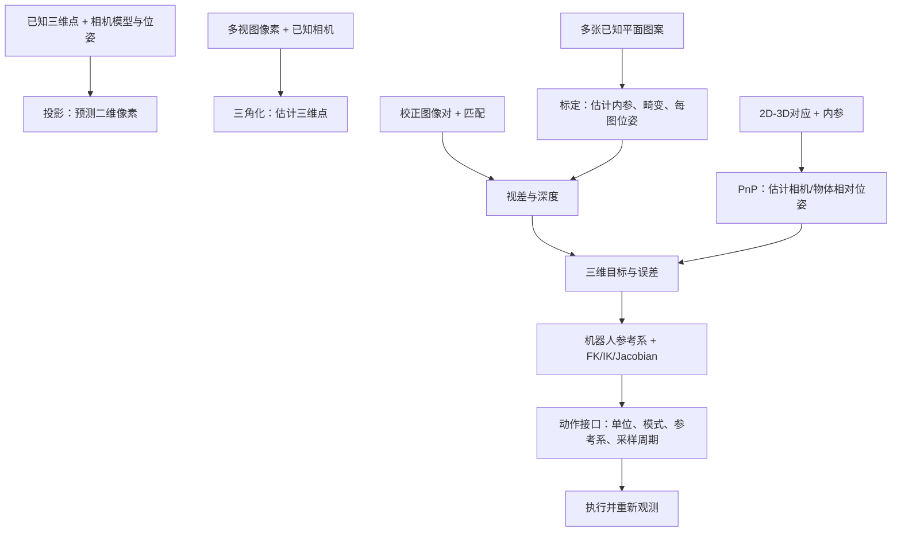
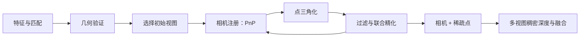
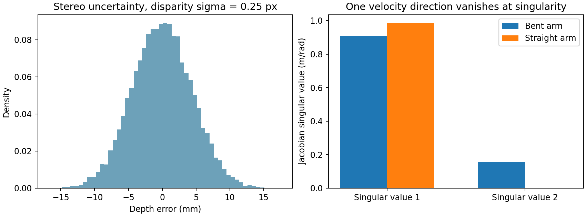
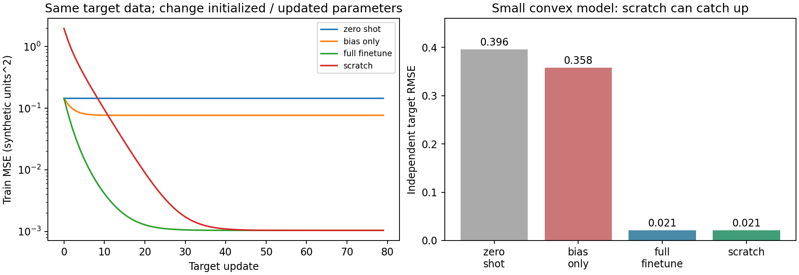

# D14 · 把几何、立体和标定连成一条能解释、能检验的链

[返回学习入口](../_index.md) · [P2 日程](../P2-深度理解-日程.md) · [上一课 D13](../day13/Daily-Learning-Pack.md) · [下一课 D15](../day15/Daily-Learning-Pack.md) · [CPU 实验](demo.py) · [绘图脚本](plot_demo.py)

**今天完成原定 W2-D7：收束原论文精读，闭卷检查几何、立体、标定、运动学和动作接口，再用一个小模型理解预训练与微调。重点是形成可独立使用的判断，而不是再增加一串模型名字。**

本课保持原计划位置，下一课才进入 W3 的 PointNet 与点集表示。D13 的 GC-Net 机制、标定实验与动作接口是本课前置；如果其中某项还不能解释，就把具体欠缺写入个人区，不能因为教材已生成而自动记为掌握。

<details>
<summary>个人学习记录（后续更新时保留）</summary>

<!-- learner-notes:start -->

- 当前学习状态：尚未验收。
- W2 仍未独立完成的任务：
- 原论文精读卡的路径/页码：
- 闭卷作答、评分及重做日期：
- 尚未理解的问题与下一步验证：

<!-- learner-notes:end -->

</details>

<!-- daily-pack-generated:start -->

## 0. 学习目标：能复原机制，也能说清证据边界

今天结束时，你应能：

1. 从观测、未知量和已知条件区分投影、三角化、PnP、标定、立体和运动学。
2. 不查公式复原 $Z=fB/d$、DLT 三角化、平面标定约束及二维二连杆雅可比。
3. 完成 MC-CNN、GC-Net、Zhang 标定与 COLMAP 对应原文的比较卡。
4. 运行几何审计，解释“误差接近零”何时只代表模型内部自洽。
5. 区分初始化来源和参数更新范围，解释预训练、冻结、微调、从头训练。
6. 说明几何怎样约束 VLA 动作和世界模型转移，不把归一化、预测或高分当作物理校正。
7. 完成闭卷验收，留下自己真正不会的环节，不用新增主题抵扣原任务。

| 顺序 | 核心问题 | 产出 |
| --- | --- | --- |
| 宏观回收 | 这些算法各自在解什么未知量？ | 一张任务地图 |
| 原理回收 | 哪些推导应该能独立重写？ | 四段推导与单位 |
| 论文收尾 | 论文究竟改了哪一段？ | 四张证据卡 |
| 新增扫盲 | 预训练和微调改变哪些参数？ | 五格卡与小实验 |
| 验收 | 能否在新算例中做正确判断？ | 闭卷答案、未理解问题 |

## 1. 宏观：所有模块都在处理“已知什么，未知什么”



这个图比“知道十个算法名字”更有用：当你拿到一个函数输入时，先确认它解的未知量，才知道是否解决当前问题。

| 问题 | 已知 | 未知 | 一个关键歧义/边界 |
| --- | --- | --- | --- |
| 投影 | 点、K、畸变、位姿 | 像素 | 多个同射线点可投到同像素 |
| 三角化 | 多视图点、相机投影 | 三维位置 | 视差小/基线小，深度不稳定 |
| PnP | 2D-3D对应、相机模型 | 刚体位姿 | 模型尺度、几何退化、外点 |
| 相机标定 | 已知图案、多视图观测 | K、畸变、每图外参 | 图案尺度/平整度、姿态不足 |
| 立体匹配 | 已校正图像对 | 视差与有效性 | 遮挡、无纹理、反光 |
| FK | 关节、连杆几何 | 末端位姿 | 机器人模型与TCP定义 |
| IK | 目标位姿、机构模型 | 关节解 | 多解、无解、限位、奇异 |
| 世界模型 | 状态/历史、动作、时间 | 后继状态/表征 | 未观测状态、分布偏移 |
| 策略/VLA | 观测、目标/语言 | 动作 | 动作语义与闭环可执行性 |

IK 有解不代表无碰撞；相机位姿正确不代表机器人手眼正确；动作预测误差小不代表真实闭环能完成任务。今天把这些判断固定下来，后续 W3 会具体讨论检测、位姿、可达性与规划。

## 2. 四段必须能独立写出的推导

### 2.1 从两条投影式到距离

已校正双目，相同 f、相同主点，右相机相对左相机沿 x 方向平移 B：

$$
u_L=fX/Z+c_x,\qquad
u_R=f(X-B)/Z+c_x.
$$

相减得到：

$$
d=u_L-u_R=fB/Z,\qquad Z=fB/d.
$$

f 为 px、B 为 m、d 为 px，Z 为 m。若主点不同，d 还需要按投影矩阵的定义处理主点差；不能把未经校正的任意双目直接代入简式。

手算 f=600、B=0.06、d=45，得到 Z=0.8 m。视差噪声 0.25 px：

$$
\sigma_Z\approx\frac{0.8^2}{600\times0.06}\times0.25
=0.004444\ {\rm m}.
$$

这只是随机小误差一阶近似，基线偏置、匹配外点与时间不一致要另算。

### 2.2 DLT 三角化的代数约束

设齐次三维点 $\tilde X$，投影矩阵 P 的各行为 $p_1^\top,p_2^\top,p_3^\top$，像素为 $(u,v)$：

$$
u=\frac{p_1^\top\tilde X}{p_3^\top\tilde X},
\qquad
v=\frac{p_2^\top\tilde X}{p_3^\top\tilde X}.
$$

移项得到每个视图两行：

$$
(u p_3^\top-p_1^\top)\tilde X=0,\quad
(v p_3^\top-p_2^\top)\tilde X=0.
$$

两个视图堆叠为 A∈R^{4×4}，取 SVD 最小奇异值对应的右奇异向量，再除以最后一个齐次分量。近乎无穷远或退化时，最后分量可能过小，应拒绝或采用合适表示。

注意这是代数残差最小化；它不直接等于最小几何重投影误差，也不直接证明三维位置准确。实际需检查正深度、重投影、视线夹角、外点和相机参数。

### 2.3 平面标定约束和尺度自由度

平面 Z=0，有 H=K[r1 r2 t]。令 B=K^−T K^−1：

$$
h_1^\top B h_2=0,\qquad
h_1^\top B h_1=h_2^\top B h_2.
$$

它们来自旋转列向量正交且等长。多个独立倾角约束同一组内参，随后用全部像素残差联合非线性优化。

将棋盘格坐标与 t 同时乘 s，投影不变。将双目基线与重建点同时乘 s，也可以保持图像解释不变。**物理长度必须通过可靠的格长、基线、独立距离等证据进入系统。**

因此“能把三维点投回原像素”是必要诊断，但不是完整物理验收。独立真值有时不容易拿到，应如实标注无法检验的自由度，而不是把拟合残差当成替代品。

### 2.4 二连杆雅可比为什么只在局部有效

二维二连杆长度 L1、L2，关节 q1、q2：

$$
x=L_1\cos q_1+L_2\cos(q_1+q_2),\quad
y=L_1\sin q_1+L_2\sin(q_1+q_2).
$$

逐项求导：

$$
J(q)=
\begin{bmatrix}
-L_1\sin q_1-L_2\sin(q_1+q_2)&-L_2\sin(q_1+q_2)\\
L_1\cos q_1+L_2\cos(q_1+q_2)&L_2\cos(q_1+q_2)
\end{bmatrix}.
$$

小变化满足 $\Delta x\approx J\Delta q$，速度关系为 $\dot x=J\dot q$。J 的单位为 m/rad；速度单位必须一起匹配。

若机械臂完全伸直 q1=q2=0：

$$
J=\begin{bmatrix}0&0\\L_1+L_2&L_2\end{bmatrix}.
$$

它只能一阶产生 y 方向末端速度，x 方向在该瞬间失去可控性。这不等于“以后永远不能改变 x”，而是局部一阶映射秩下降。

阻尼最小二乘：

$$
\Delta q=J^\top(JJ^\top+\lambda^2I)^{-1}\Delta x
$$

可以避免病态逆导致极大关节步长，但引入任务误差，并不会创造机构缺失的运动方向。大步运动需要重新计算 J、限制步长并检查目标与约束，不可一次局部线性化一路用到底。

## 3. 论文精读收尾：保留原任务，明确每篇回答的问题

### 3.1 阅读不是记住摘要，而是找机制、证据与边界

每篇原文填一张五格卡：

| 格子 | 必须写出的内容 |
| --- | --- |
| 问题与输入输出 | 它估计什么，假定已知什么？ |
| 关键机制 | 哪一步不同于基线，写公式/shape/图？ |
| 训练或求解 | 损失、优化、数据或观测约束来自哪里？ |
| 实验与证据 | 哪个对照支持哪个具体结论？ |
| 失败与关联 | 什么假设失效；与自己机器人链条哪段相关？ |

空泛地写“准确率提升、速度更快”不够。要能指出比较对象、协议、数据范围与付出的资源代价。下面材料是阅读导航与问题说明，不宣称你已经完成原文精读。

### 3.2 MC-CNN：把匹配代价变成学习问题

来源：[Stereo Matching by Training a Convolutional Neural Network to Compare Image Patches，JMLR 2016](https://www.jmlr.org/papers/volume17/15-535/15-535.pdf)。

回读 §3.1–3.3、§4.2、§5 的实验。重点不是背网络层数，而是回答：

- 正负图像块怎样由视差真值定义？
- 局部特征比较给出什么，经典聚合与 SGM 又补充什么？
- “更好的匹配代价”如何在固定其余组件时单独检验？

D11 已说明原计划 arXiv 链接误指 PoseNet；沿正确同题原文完成学习即可，不更改课题。产出要画清训练部分与后处理部分，避免把它误写为整条管线的全端到端回归。

### 3.3 GC-Net：候选维度与学习上下文

来源：[End-to-End Learning of Geometry and Context for Deep Stereo Regression，ICCV 2017](https://arxiv.org/pdf/1703.04309)。

重读 §3.1–3.4、Table 1，以及 §4.1 的组件比较。对照 [D13 讲义](../day13/Daily-Learning-Pack.md) 的 GC-Net 与 soft argmin 实验，完成：

1. 将输入、左右特征、拼接候选体、三维正则化与最终视差标 shape。
2. 指出候选维是视差，而非机器人世界坐标深度。
3. 手算两个峰平均到不受支持的中间视差，解释预测不确定性。
4. 从原文一个消融实验说明“保留几何候选结构”与“学习上下文”分别带来哪类证据。

“使用 3D convolution”不自动意味着处理物理三维点云；“可微”只表示能传梯度，不能保证标定、尺度、遮挡或部署域正确。

### 3.4 Zhang：约束从哪里来，哪些量仍需外部测量

来源：[A Flexible New Technique for Camera Calibration，作者技术报告](https://www.microsoft.com/en-us/research/wp-content/uploads/2016/02/tr98-71.pdf)。

回读 §2.2–2.3、§3.1–3.3、§4，查看 §5.3 对模型图案误差的讨论。把 [D12 标定实验](../day12/demo.py) 的格长、角点噪声和零畸变模型三个结果填进卡片。

原文的解析初始化与非线性精化分工不同：初始化提供合理起点；精化减少选定成像模型下的残差。二者都不能把错误实物尺寸自动变成真实尺寸。

### 3.5 COLMAP：把本周几何连接成一个实际系统

原计划的 COLMAP 项目入口包含 SfM 与 MVS，不是一篇题为“COLMAP”的单独论文。这里明确精读 [Structure-from-Motion Revisited，CVPR 2016，作者原文](https://demuc.de/papers/schoenberger2016sfm.pdf) 的 Figure 2、§2.1–2.2、§4.1–4.3，再查看 [COLMAP 官方项目入口](https://colmap.github.io/) 中稀疏与稠密重建的分工。

本周阅读重点是：匹配先经过几何验证；新相机用 2D–3D 对应注册；新点通过三角化加入；相机和点由 BA 联合精化。读 §4.3 时，把“正深度”和“足够三角化角”对应回自己的 DLT 程序。

闭卷画出：



本周要求定位机制、误差来源和几何模块，不在今天开展 W4 的完整 SfM/BA/NeRF 课程，也不把本课审计脚本说成已运行 COLMAP 稠密重建。后者属于尚未执行的系统实验。

### 3.6 阅读记录的验收

四张卡都应包含一条自己能够推导/画出的机制、一项来自原文的实际对照，以及一条与机器人使用条件相关的限制。你可以把“尚未读完的实验部分”明确留下；不能用本课摘要替代原计划论文精读，更不能勾选虚假的完成状态。

## 4. 运动学与 Learning 五格卡：帮助以后快速检索

### 4.1 操作模块的五格卡

| 方法 | 输入 | 输出 | 核心关系 | 失败边界 |
| --- | --- | --- | --- | --- |
| FK | q、机构与TCP | 末端位姿 | 关节变换链 | 模型/零位/TCP不准 |
| IK | 目标、初始解/机构 | 一组或多组q | 求FK逆问题 | 无解、多解、限位 |
| 雅可比 | q、小速度/位移 | 局部映射 | dx≈Jdq | 奇异、大步近似失效 |
| 阻尼最小二乘 | J、误差、λ | 保守关节更新 | 正则化逆 | 残差与步长权衡 |
| 视觉反馈 | 新观测、目标 | 下一次纠偏 | 测量误差闭环 | 测量偏置、延迟 |

关键是顺序：感知估计物体→转换目标→选择可执行动作→控制执行→重新观察。上表没有完成自碰撞、环境碰撞和动力学检验；本周只建立接口，W3 会加入可达性与路径。

### 4.2 学习过程的五格卡

| 概念 | 数据/输入 | 可调整的量 | 目标/用途 | 主要边界 |
| --- | --- | --- | --- | --- |
| 监督学习 | 输入+标签 | 模型参数 | 减小预测与标签差 | 标签噪声/数据偏差 |
| 梯度更新 | loss与batch | 指定参数 | 沿局部下降方向优化 | 步长/尺度/病态 |
| 验证 | 未用于梯度的集合 | 方法/超参数选择 | 选择泛化较好版本 | 反复调参也会过拟合 |
| 测试 | 冻结后独立集合 | 不再调整 | 估计给定部署能力 | 分组泄漏/域覆盖 |
| 预训练与微调 | 源任务→目标任务 | 初始化与更新集合 | 迁移已学表示/参数 | 任务与数据不匹配 |

把“训练过”和“适合当前机器人”分开。预训练来源、动作定义、视觉输入、分辨率、设备与目标任务都可能影响迁移。

## 5. 预训练与微调：先分开两条轴

### 5.1 一条轴问参数从哪里来，另一条问更新哪些参数

- 从头训练：初始化通常不来自相关已训练任务。
- 预训练：先在某个源数据/目标上学习，得到可复用参数。
- 零样本使用：针对当前目标评估时，不在该目标训练数据上更新参数。
- 冻结特征再训练头：部分参数保持不变，只更新允许部分。
- 全量微调：使用预训练初始化，并在目标数据上更新全部选定模型参数。
- 参数高效适配：只更新较小新增/指定参数集合；后续再学习 LoRA 等具体机制。

“冻结”不是不能做前向传播，也不总意味着不计算中间梯度；从数学上看，是该参数不参与优化器更新。具体框架的梯度追踪和训练/评估模式还要分开理解，例如 BatchNorm 的运行统计与 Dropout 行为并不单由 requires_grad 决定。[PyTorch 官方迁移学习教程](https://docs.pytorch.org/tutorials/beginner/transfer_learning_tutorial.html)

### 5.2 一个三参数模型就能看见迁移失败的机制

模型：

$$
\hat y=w_1x_1+w_2x_2+b.
$$

先用源数据训练，源规律约为 $[w_1,w_2,b]=[1.2,-0.6,0.1]$。目标规律改为 $[1.5,-0.8,0.3]$。

若只允许更新 b，只能改变输出整体偏置；两个输入方向的斜率错误保留下来。再多目标样本也不能突破这个冻结模型族的表示限制。若目标只改变 b，不改斜率，冻结斜率恰好可以完成适配。

对 mini-batch X∈R^{N×3}、参数 θ∈R³，最后一列为 1：

$$
\mathcal L=\frac1N\|X\theta-y\|^2,\qquad
\nabla_\theta\mathcal L=\frac2N X^\top(X\theta-y).
$$

用更新 mask m∈{0,1}³：

$$
\theta\leftarrow\theta-\eta(m\odot\nabla_\theta\mathcal L).
$$

m=[0,0,1] 就是只改偏置，m=[1,1,1] 更新全部。这个小模型没有深层“编码器/头”，只用来隔离参数初始化与可更新集合的差别，不能将其数值效果推广成大模型迁移结论。

### 5.3 预训练未必在最终指标上赢过从头训练

对简单凸线性回归、充分更新和充分数据，从不同初始化可能收敛到同一个解。因此本课允许观察“从头训练追上微调”，并不为了展示预训练好处而修改数据。

预训练的实际价值可能体现在更好的表示、少样本、收敛速度、优化起点或源任务知识，但也可能产生负迁移。必须用同样目标数据、评价协议与资源条件比较，而不是只宣称“用了预训练所以更强”。

## 6. 几何怎样约束 VLA 和世界模型

### 6.1 先定义动作，再学习动作

假设 VLA 输出归一化动作 $\tilde a$，反归一化为 $a=S\tilde a+\mu$。这个式子需要知道每一维的单位、坐标系、绝对/增量/速度语义、夹爪编码和时间周期。

若 a 是末端局部位移 $\Delta p_{ee}$，转换到 base 方向是：

$$
\Delta p_{base}=R^{base}_{ee}\Delta p_{ee}.
$$

它是向量，只乘旋转，不加平移。若是点位置，则需要完整齐次变换。归一化不会替你判断这两个量是哪一个。

一个参考系用错的示例：末端相对 base 绕 z 转 90°，局部 x 正方向对应 base 的 y 正方向。若把局部 +0.02 m 当 base x +0.02 m，长度看起来完全正常，方向仍会错 90°。

### 6.2 世界模型必须把动作语义与时间连起来

最小状态转移：

$$
p_{t+1}=p_t+v_t\Delta t.
$$

若动作是位移增量，则直接加 $\Delta p$；若是速度，则乘采样间隔。每个样本的时间戳与动作区间不清楚，模型可能把不同物理过程混成同一种转移。

世界模型可以预测下一状态/特征，不能仅凭预测图像看起来清晰就证明接触几何正确。对于操作，需要验证对象、机器人、动作和采样周期的对应，区分可观测状态与历史不足造成的歧义。

### 6.3 几何可以放在哪些位置

1. 数据整理：转换参考系、核对单位、对齐时间，保证监督信号一致。
2. 模型结构/特征：使用已知投影、视差候选、三维位置等约束。
3. 损失与评价：检查重投影、一致性与米制位置误差，但注意尺度自由度。
4. 运行时：对动作做限幅、可达性与约束检查，配合反馈重规划。
5. 失效诊断：用独立几何实验区分感知、动作适配和模型分布偏移。

这些是可组合的工程位置，不要求所有 VLA 都显式输出点云或世界坐标。端到端模型也必须在实际接口上遵守单位、参考系、时钟和设备约束。

## 7. 实操：同一条链的四项审计与参数迁移

### 7.1 运行与范围

```bash
python -B 3d_learning/day14/demo.py
python -B 3d_learning/day14/plot_demo.py
```

环境实际验证：Python 3.11.15、NumPy 1.26.4、OpenCV 4.10.0、Matplotlib 3.10.9，CPU。几何部分为 NumPy 实现，脚本同时记录已安装 OpenCV 版本；不是调用真实机器人，不下载或训练基础模型。

四项几何审计：无噪声 DLT、基线 +5% 尺度、视差噪声 Monte Carlo、雅可比有限差分与奇异性。学习部分先实际拟合 500 个源样本，再用同样 12 个目标样本做不同参数更新方式，用独立 1000 个目标输入测评。

### 7.2 实际结果

完整 [results.json](../../_assets/3d_learning/day14/results.json)：

| 审计 | 实际值 | 能证明什么 |
| --- | --- | --- |
| 无噪声三角化误差 | $7.93\times10^{-16}$ m | 该合成配置下实现自洽 |
| 基线 +5% 后三维误差 | 40.50 mm | 物理尺度已变 |
| 同错误尺度下重投影 | $5.68\times10^{-14}$ px | 像素回环无法发现此尺度错误 |
| 深度 σ，Monte Carlo | 4.4358 mm | 当前小噪声模型下的经验波动 |
| 深度 σ，一阶预测 | 4.4444 mm | 一阶近似与实验相符 |
| 雅可比与有限差分最大差 | $2.91\times10^{-11}$ | 局部导数实现正确 |
| 小位移线性化剩余误差 | 0.01376 mm | 近似仍有二阶残差 |



左图是视差高斯噪声经倒数转换后的深度误差。本设置相对误差小，分布接近对称；不能据此推断所有距离/噪声都近似高斯。右图弯曲机械臂的两个雅可比奇异值约 0.9076、0.1581 m/rad；伸直时第二个变成 0，明确显示局部方向丢失。

### 7.3 预训练/微调真实对照



| 目标阶段方式 | 更新参数数 | 独立目标 RMSE |
| --- | --- | --- |
| 直接使用源模型 | 0 | 0.39593 |
| 只更新偏置 b | 1 | 0.35806 |
| 源初始化，全量微调 | 3 | 0.02109 |
| 零初始化，从头训练 | 3 | 0.02114 |
| 冻结拟合源斜率、使用无噪声目标的可表达性检查 | 1 | 约 $5.94\times10^{-11}$ |

单位为合成标签单位，没有伪装成米或真实任务成功率。前四行使用相同目标数据，其中需要目标训练的三种方式均迭代80次。第五行是**独立构造的可表达性检查**：目标斜率直接取已拟合源模型的 `pretrained[:2]`，并去掉标签噪声，只需恢复偏置。它同时改变了目标规律和噪声，不能与前四行作单变量因果对照或性能排名；近零误差也不代表恢复原始源真值斜率 `[1.2,-0.6]` 的统计精度。

从头训练最终追上全量微调符合凸线性问题直觉。冻结斜率在目标只变化偏置时成功，在斜率也变化时失败，说明**是否冻结要由目标变化决定**，不是冻结越多越好或更新越多越好。

### 7.4 你必须完成的小任务

先不运行，预测基线 +10% 会不会改变图像回环误差，并预测三维误差是否约翻倍。再在脚本中只把 scale=1.05 改为 1.10，使用临时输出目录：

```bash
python -B 3d_learning/day14/demo.py --out-dir /tmp/day14-scale-check
```

固定输入图像与真实点；若同时改变相机、像素与真值，就不是在检验原先的尺度错误了。提交一段解释：这项测试证明“实现能够识别什么”，以及还需要什么独立真值。

再从几何审计中选择一个失败边界：极小基线、很大噪声、伸直机构、错误动作周期。设计预期失败判据，不必为了“通过所有断言”隐藏失败。

### 7.5 完整主脚本

> [!note]- 完整 CPU 主脚本（与 demo.py 一致）
>
> ```python
> """Day14 cumulative geometry audit and toy parameter-transfer experiment."""
> from pathlib import Path
> import argparse
> import json
> import platform
> import cv2
> import numpy as np
> 
> 
> def triangulate(p1,p2,x1,x2):
>     a=np.stack((x1[0]*p1[2]-p1[0],x1[1]*p1[2]-p1[1],x2[0]*p2[2]-p2[0],x2[1]*p2[2]-p2[1]))
>     _,_,vh=np.linalg.svd(a); h=vh[-1]
>     return h[:3]/h[3]
> 
> 
> def fk(q):
>     return np.array([.5*np.cos(q[0])+.4*np.cos(q.sum()),.5*np.sin(q[0])+.4*np.sin(q.sum())])
> 
> 
> def jac(q):
>     return np.array([[-.5*np.sin(q[0])-.4*np.sin(q.sum()),-.4*np.sin(q.sum())],
>                      [.5*np.cos(q[0])+.4*np.cos(q.sum()),.4*np.cos(q.sum())]])
> 
> 
> def optimize(x,y,initial,trainable,steps=80):
>     w=initial.copy(); histories=[]
>     for _ in range(steps):
>         error=x@w-y
>         histories.append(float(np.mean(error**2)))
>         grad=2*x.T@error/len(y)
>         w-=.12*grad*trainable
>     return w,np.array(histories)
> 
> 
> def main():
>     parser=argparse.ArgumentParser()
>     parser.add_argument('--seed',type=int,default=14)
>     parser.add_argument('--out-dir',type=Path,default=Path(__file__).resolve().parents[2]/'_assets/3d_learning/day14')
>     args=parser.parse_args(); args.out_dir.mkdir(parents=True,exist_ok=True)
>     rng=np.random.default_rng(args.seed)
>     k=np.array([[600.,0,320],[0,600,240],[0,0,1]])
>     p1=k@np.column_stack((np.eye(3),np.zeros(3)))
>     p2=k@np.column_stack((np.eye(3),np.array([-.06,0,0])))
>     point=np.array([.12,.04,.8]); h=np.r_[point,1.]
>     x1=p1@h; x1=x1[:2]/x1[2]; x2=p2@h; x2=x2[:2]/x2[2]
>     recovered=triangulate(p1,p2,x1,x2)
>     scale=1.05
>     scaled_p2=k@np.column_stack((np.eye(3),np.array([-.06*scale,0,0])))
>     wrong=triangulate(p1,scaled_p2,x1,x2)
>     reproject=p1@np.r_[wrong,1]; reproject=reproject[:2]/reproject[2]
>     noisy=rng.normal(0,.25,20000)
>     depths=36./(45+noisy)
>     q=np.array([.4,-.8]); eps=1e-6
>     fd=np.column_stack([(fk(q+np.eye(2)[i]*eps)-fk(q-np.eye(2)[i]*eps))/(2*eps) for i in range(2)])
>     j=jac(q); singular=jac(np.zeros(2))
>     delta=np.array([.002,-.001]); dq=np.linalg.solve(j,delta)
>     linearization_error=np.linalg.norm((fk(q+dq)-fk(q))-delta)
>     # Source pretraining is actually fitted, not a hand-written checkpoint.
>     source_x=np.column_stack((rng.normal(size=(500,2)),np.ones(500)))
>     source_y=source_x@np.array([1.2,-.6,.1])+rng.normal(0,.03,500)
>     pretrained,prehistory=optimize(source_x,source_y,np.zeros(3),np.ones(3),100)
>     target_x=np.column_stack((rng.normal(size=(12,2)),np.ones(12)))
>     target_y=target_x@np.array([1.5,-.8,.3])+rng.normal(0,.03,12)
>     test_x=np.column_stack((rng.normal(size=(1000,2)),np.ones(1000)))
>     test_y=test_x@np.array([1.5,-.8,.3])
>     cases={'zero_shot':(pretrained,np.zeros(3)), 'bias_only':(pretrained,np.array([0,0,1])),
>            'full_finetune':(pretrained,np.ones(3)), 'scratch':(np.zeros(3),np.ones(3))}
>     records,arrays={},dict(pretrain_loss=prehistory,depth_samples=depths)
>     for name,(initial,mask) in cases.items():
>         fitted,history=optimize(target_x,target_y,initial,mask)
>         records[name]=dict(updated_parameters=int(mask.sum()),weights=fitted.tolist(),
>                           target_test_rmse=float(np.sqrt(np.mean((test_x@fitted-test_y)**2))))
>         arrays[f'loss_{name}']=history
>     # Separate expressivity check: fitted source slopes and noise-free target labels.
>     no_shift_y=target_x@np.r_[pretrained[:2],.3]
>     frozen,_=optimize(target_x,no_shift_y,pretrained,np.array([0,0,1]))
>     records['bias_only_no_slope_shift']=dict(target_test_rmse=float(np.sqrt(np.mean((test_x@frozen-test_x@np.r_[pretrained[:2],.3])**2))))
>     report=dict(environment=dict(python=platform.python_version(),numpy=np.__version__,opencv=cv2.__version__),seed=args.seed,
>         geometry=dict(triangulation_error_m=float(np.linalg.norm(recovered-point)),
>             baseline_plus5_error_m=float(np.linalg.norm(wrong-point)), same_wrong_model_reprojection_px=float(np.linalg.norm(reproject-x1)),
>             depth_sigma_empirical_m=float(depths.std()), depth_sigma_linear_m=float(.8**2/36*.25),
>             jacobian_fd_max_error=float(np.max(np.abs(fd-j))), regular_singular_values=np.linalg.svd(j)[1].tolist(),
>             straight_arm_singular_values=np.linalg.svd(singular)[1].tolist(), small_step_linearization_error_m=float(linearization_error)),
>         transfer=records, pretrain_samples=500,target_train_samples=12,target_test_samples=1000,
>         scope='geometry unit audit + fitted three-parameter linear transfer; no foundation model or robot training')
>     assert report['geometry']['triangulation_error_m'] < 1e-10
>     assert report['geometry']['same_wrong_model_reprojection_px'] < 1e-8
>     assert report['geometry']['jacobian_fd_max_error'] < 1e-8
>     assert abs(report['geometry']['depth_sigma_empirical_m']/report['geometry']['depth_sigma_linear_m']-1)<.05
>     assert records['full_finetune']['target_test_rmse'] < records['bias_only']['target_test_rmse']
>     (args.out_dir/'results.json').write_text(json.dumps(report,indent=2),encoding='utf-8')
>     np.savez_compressed(args.out_dir/'arrays.npz',**arrays)
>     print(json.dumps(report,indent=2))
> 
> 
> if __name__=='__main__':
>     main()
> ```

## 8. 本周产出验收：原任务与新增任务分别留证据

| 原计划任务 | 应有产物 | 自己通过的标准 |
| --- | --- | --- |
| 几何变换与投影 | D8–D10 推导及 NumPy 模块 | 能说明方向/单位，能从零复原核心公式 |
| 对极、三角化、PnP | 输入输出卡、噪声/退化反例 | 不混淆未知量，能解释尺度与几何条件 |
| 立体与深度 | D11 方法表与 D13 综合对照 | 能解释候选/上下文/误差，评价区域明确 |
| 相机标定 | D12/D13 参数和独立误差分析 | 理解格长、畸变、姿态与工作区误差 |
| 原论文精读 | 本课四张卡与原文段落 | 机制、证据、限制均能口述 |

新增任务另列：二连杆 FK/IK/雅可比卡；动作单位/坐标/采样周期卡；loss/metric/数据边界卡；预训练/微调小实验；几何约束 VLA 与世界模型的口述。它们加深原主线，不抵扣原几何、实验或论文任务。

“教材文件已存在”和“CPU脚本验证过”是材料状态；你的作答、推导、实验解释和复盘才是学习状态。没有记录的项目保持待验收。

## 9. 今日重点、难点与三句话总结

最重要的五点：

1. **从未知量辨认任务。** 避免拿 PnP 的位姿结果误当单点深度或机器人手眼。
2. **把模型内一致性与物理正确分开。** 尺度反例能防止最隐蔽的“所有数字都对但抓偏”。
3. **几何信息量决定数值稳定性。** 三角化夹角、标定姿态与雅可比奇异性都是“约束是否足够”的不同表现。
4. **预训练与更新范围是两条轴。** 这比只记“微调效果好”更能指导实现与评估。
5. **动作语义是学习与控制的共同接口。** 单位、参考系和采样周期必须在数据、模型与执行中一致。

难点一：图像回环小不能验证尺度；难点二：可微与可学习不能补足缺失观测；难点三：冻结能减少自由度，也可能冻结住目标任务需要改变的方向。

三句话总结：**几何说明观测与空间的约束，学习从数据中选择参数与表示，机器人接口把这些数变成有单位、有参考、有时间的动作。** 每层都有必须独立检查的未知量。可靠系统来自相互配合的证据，不来自某一张好看的图或一个足够低的 loss。

## 10. W2 闭卷验收：先答，末尾再评分

共 12 题，从概念到推导、工程判断与设计。

1. 给出三角化、PnP、相机标定各自已知量与未知量；举一个不能互相替代的例子。
2. 从左右投影式推导 Z=fB/d，并列出必要条件与每个量的单位。
3. f=600 px、B=0.06 m、d=45 px、σd=0.25 px，计算深度与一阶标准差。
4. 写出单个视图为 DLT 提供的两行约束；说明 SVD 解为什么还需几何检查。
5. 格长或基线错误放大 5%，重投影可能仍准确的原因是什么？如何发现它？
6. MC-CNN 与 GC-Net 的学习范围有何区别？三维代价体的三轴是什么？
7. 某像素视差 2 和 8 各一半概率，预测 5 有何风险？“可微”是否意味着正确？
8. L1=0.5、L2=0.4、q1=q2=0，写出 J，解释能产生和不能一阶产生的末端速度方向。
9. 训练集 100、batch=20、60 epoch 共几次更新？随机拆同场景视频帧为什么可能高估新场景能力？
10. 源模型斜率错误、目标只允许更新偏置，为什么充分训练仍有误差？预训练与全量微调分别回答哪个问题？
11. 末端局部位移转到 base 为什么只乘 R？速度动作与位移动作怎样使用 Δt？
12. 设计“杯子定位→动作→预测下一状态”的最小验收：至少写出四类输入约定、三项独立测试和一种失效后处理。

## 11. 未理解问题与下一课

在个人区只保留具体问题，例如“能写 DLT 但不懂视线夹角影响”“只会看总体 RMS”“不能解释 rvec 与欧拉角”“不确定动作是每步位移还是速度”。为每个问题指定回读章节或单变量实验。

下一课 [D15 PointNet](../day15/Daily-Learning-Pack.md) 才开始 W3：点集怎样进入网络、共享逐点映射与对称聚合、分类不变与分割等变、表示/token/embedding。现在先完成本周几何证据，原课程节奏不变。

## 12. 参考答案与评分标准

> [!note]- 完成闭卷后展开：每题 0 / 1 / 2 分，共 24 分
> 0 分：主要结论错误或无有效作答；1 分：核心正确但缺推导、单位或边界；2 分：结论、依据与工程含义完整。建议至少 20/24，尺度、坐标、动作周期题不得为 0。未通过题回到对应原课修正后再答；不自动记录你已通过。
>
> 1. 三角化：已知相机与多视图像素求点；PnP：已知K及2D-3D对应求位姿；标定：已知图案多图求K/畸变/每图位姿。PnP不会凭空给出未知物体表面每点深度。
> 2. uL=fX/Z+cx，uR=f(X−B)/Z+cx，相减消X/cx；校正、同焦距、主点差处理与同步等条件要说明。f/d为px，B/Z为米。
> 3. Z=36/45=0.8 m，σZ≈0.8²×0.25/36=0.004444 m。
> 4. (u p3−p1)Xh=0、(v p3−p2)Xh=0。SVD只优化代数目标，仍查正深度、重投影、视角、外点与相机参数。
> 5. 三维结构和相机平移同尺度变化，齐次除法消掉尺度；用独立可信格长、基线、距离或实物尺寸发现。
> 6. MC-CNN主要学习局部匹配代价再接后处理；GC-Net联合特征、候选体上下文与可微视差回归。代价体三索引为视差、图像行列，通道为特征。
> 7. 均值落在无支持中间候选，可能不对应真实表面；可微只允许梯度传播，不保证正确，需要歧义/有效性处理。
> 8. J=[[0,0],[0.9,0.4]] m/rad，可一阶产生y速度，不能产生x速度；秩为1，是局部奇异而非永远无法改变x。
> 9. 每epoch5次，共300次。相邻帧共享场景身份，跨集合可能使测试变为近邻记忆，应按部署目标分组隔离。
> 10. 偏置只能整体平移输出，无法修正输入方向的斜率；预训练问初始化/知识来源，微调问目标阶段怎样更新参数。
> 11. 位移是向量，平移项在两点相减中抵消；速度乘Δt得位移，每步位移直接相加，不能重复乘或漏乘。
> 12. 输入应明确相机K/畸变、深度单位、坐标链方向、时间戳和动作模式/Δt等；测试可含独立尺度、投影/反投影、坐标向量回环、动作回放和多步预测。失效时拒绝不可靠估计、重观察/重规划并记录原因，不能盲目继续执行。

<!-- daily-pack-generated:end -->
