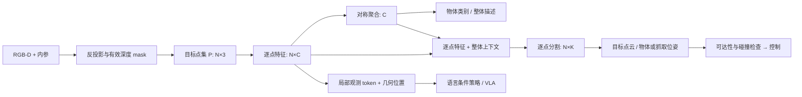
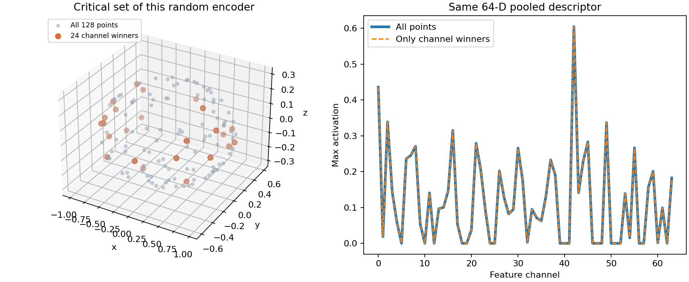
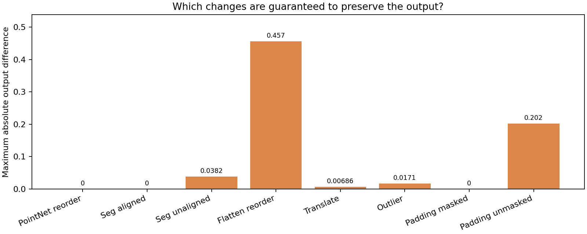

# D15 · 一堆顺序随时改变的点，怎样得到稳定的理解？

[返回学习入口](../_index.md) ｜ [本周原定日程](../P2-深度理解-日程.md) ｜ [上一课 D14](../day14/Daily-Learning-Pack.md) ｜ [下一课 D16](../day16/Daily-Learning-Pack.md) ｜ [完整 CPU 实验](demo.py)

**今天保留原计划 W3-D1：PointNet 点集表示、对称聚合、分类与分割、手写核心模块；新增内容是表征、token、embedding 和输入形状。** 本课按原定日期 2026-09-19 补写，课号及前后顺序不变。文件和实验已经准备好，不代表你已经学完或通过验收。

一台 RGB-D 相机给同一个杯子采了 128 个点。下一次读取时，只是数组顺序变了，杯子当然不能突然变成盘子；但如果输出的是“第几个点属于杯把”，输出数组就必须跟着点一起移动。**今天要把这种直觉写成数学约束，再把约束写成 PyTorch 代码。**

<details>
<summary>个人学习记录（由你填写，后续生成不覆盖）</summary>

<!-- learner-notes:start -->
学习日期：

我能独立解释的内容：

我还不理解的问题：

实验修改与观察：

自测得分与待补内容：
<!-- learner-notes:end -->

</details>

<!-- daily-pack-generated:start -->

## 0. 今日目标：从“认识模型名”到“能验证结构”

学完应能完成五件事：

1. 用置换矩阵区分分类不变性与逐点分割等变性，写出两条等式。
2. 手算共享 MLP 和 max pooling，说明模型如何接收不同点数。
3. 看着 `[B,N,3]` 写出编码、聚合、分类、分割每一步的 tensor shape。
4. 运行自己的小 PointNet，验证重排、离群点、无效 padding 的影响。
5. 解释一个点特征如何成为 VLA 的观测 token，以及几何坐标为何不能凭空省略。

路线是：**系统位置 → 无序约束 → 共享特征 → 对称聚合 → 两种输出 → 训练与接口 → 可运行实验 → 回到机器人系统。**

## 1. 宏观：PointNet解决感知链中的哪一段？

先看“抓桌上的杯子”的模块图：



这里 PointNet 学的是**表征与感知映射**，不会因为输出了“杯子”，就自动拥有夹爪轨迹。分类、分割、检测、位姿是不同输出契约。

| 任务 | 输入 | 输出 | 最重要的结构要求 |
| --- | --- | --- | --- |
| 物体分类 | 一份物体点云 | 一个类别分布 | 重新排列点，整体输出不变 |
| 逐点语义/部件分割 | 点云 | 每个点的类别分布 | 点怎么排列，预测就怎么排列 |
| 检测 | 场景或候选区域点云 | 一组带分数的空间框 | 还需要候选、中心、尺寸等机制 |
| 策略表征 | 点云及机器人状态 | 供策略使用的特征 | 特征应保留动作所需几何信息 |

今天先把前两项的核心搭起来。明天再加入局部邻域和二维候选，把点集网络放进检测流程。

## 2. “无序”不是一句口号：先写正确的不变关系

设一个样本为：

$$
P=\begin{bmatrix}p_1^\top\\ \vdots\\p_N^\top\end{bmatrix}\in\mathbb R^{N\times3}
$$

置换矩阵 $\Pi\in\{0,1\}^{N\times N}$ 只是换行，不修改任何坐标。

### 2.1 分类：输入换行，答案不变

$$
f(\Pi P)=f(P),\qquad f(P)\in\mathbb R^{K_{\mathrm{cls}}}
$$

这叫 **permutation invariance，置换不变性**。它约束的是“同一个集合的两种排列”。

### 2.2 分割：答案必须跟随对应点换行

$$
S(\Pi P)=\Pi S(P),\qquad S(P)\in\mathbb R^{N\times K_{\mathrm{seg}}}
$$

这叫 **permutation equivariance，置换等变性**。

例子：原点顺序为“杯身、杯把、杯口”，预测标签是 `[0,1,2]`。输入变成“杯口、杯身、杯把”，正确输出是 `[2,0,1]`。若输出仍固定 `[0,1,2]`，才是错的。

因此程序里应比较：

```python
logits_p, seg_p, *_ = model(points[:, permutation])
assert torch.allclose(logits_p, logits)
assert torch.allclose(seg_p, seg[:, permutation])
```

把 `seg_p` 直接与 `seg` 相减会产生一个假的“不稳定”结论。模型测试必须与任务的数学性质一致。

### 2.3 点重排不变，不等于旋转不变

$\Pi P$ 是换行，$PR^\top$ 是转动物体，$P+\mathbf1t^\top$ 是平移，$sP$ 是缩放。它们是四种不同操作。

- 物体类别经常希望对旋转相对稳定。
- 抓取接近方向却必须知道物体在机器人坐标系中的旋转。
- 尺寸归一化可帮助形状识别，但夹爪需要真实米制宽度。

所以不能把“消除变化”一律视为进步。先问：**这个变化对当前任务是噪声，还是动作必须使用的信息？**

## 3. 微观一：共享 MLP 为什么能够处理每个点？

共享 MLP 对每个点使用同一组参数：

$$
h_i=\sigma(Wp_i+b)\in\mathbb R^C
$$

$W\in\mathbb R^{C\times3}$ 与点索引 $i$ 无关。换了点的顺序，得到的特征也只是换顺序：

$$
H(\Pi P)=\Pi H(P)
$$

一层可以看方向、半空间或非线性位置模式；多层可组合更复杂的响应。不过单个 $h_i$ 在聚合前不知道其他点在哪里，不能直接得到“这个点的邻居围成一个孔”。

### 3.1 为什么用 kernel_size=1 的 Conv1d？

PyTorch 的输入按 `[B,C_in,N]` 排列。`Conv1d(3,16,1)` 在每个点位置上做同一个从 3 到 16 维的线性映射，沿点序号不滑动到邻点。

```python
x = points.transpose(1, 2)       # [B,N,3] -> [B,3,N]
local = torch.relu(conv1(x))      # [B,16,N]
```

这里“1D 卷积”是代码实现名，**不意味着点云是一条有几何邻接关系的一维序列**。如果用 kernel_size=3 沿随意的点索引卷积，就把数组相邻误当成了空间相邻。`Linear(3,16)` 直接作用在 `[B,N,3]` 的最后一维也可实现共享线性层。[PyTorch Conv1d 文档](https://docs.pytorch.org/docs/stable/generated/torch.nn.Conv1d.html)

### 3.2 一个能手算的点特征

取二维点便于计算：

$$
p_1=(1,0),\quad p_2=(0,2),\quad p_3=(-1,1)
$$

定义演示用特征（这是人为选择的函数，不是训练结果）：

$$
h(x,y)=[\max(x,0),\max(-x,0),\max(y,0),\max(x+y,0)]
$$

则：

$$
H=
\begin{bmatrix}
1&0&0&1\\
0&0&2&2\\
0&1&1&0
\end{bmatrix}
$$

每一列代表一种响应，不必给它强行命名为“杯把通道”或“杯口通道”。只有结合数据、训练任务和可视化，才能讨论学到的语义。

## 4. 微观二：对称聚合怎样产生整个点集的描述？

对每个特征通道独立取最大值：

$$
g_c=\max_{i=1,\ldots,N}h_{i,c}
$$

上面的例子得到：

$$
g=[1,1,2,2]
$$

换任意行顺序，每一列的最大值都一样，于是：

$$
f(P)=\gamma\left(\max_i h(p_i)\right)
$$

天然满足点重排不变。$\gamma$ 是对整体特征做处理的 MLP。

### 4.1 sum、mean、max 都对称，但保留的信息不同

| 聚合 | 固定的性质 | 重复一个完全相同点时 | 主要风险 |
| --- | --- | --- | --- |
| sum | 不依赖顺序 | 总和改变 | 特征尺度随采样密度/点数改变 |
| mean | 不依赖顺序 | 通常改变权重分布 | 稀有小结构可能被大量背景稀释 |
| max | 不依赖顺序 | 最大值不变 | 离群点可能占据极值；细节可能被压缩 |

注意“mean 不受点数影响”不够严谨：重复**全部点同样次数**，mean 不变；只重复某些点，mean 一般改变。max 则对重复任意已有点幂等。

### 4.2 关键点集：一个通道可能由一个点决定

设 $C$ 个通道各选一个 argmax 索引，它们的并集是本次输入的关键点集。保留这些点，聚合向量仍可保持不变。最多选到 $C$ 个不同点，也可能多个通道被同一个点赢得。

本实验 128 个点、64 个通道中，随机网络的获胜索引并集只有 **24 个点**。仅保留这 24 个点，整体描述最大差为 $5.96\times10^{-8}$，属于浮点计算误差量级。



读图：左图橙色点是本次随机权重下的通道极值提供者；右图两条曲线重合。**这证明的是聚合机制，不能证明网络理解了物体。** 改权重或输入，关键点集合会改变。

### 4.3 max pooling 的梯度为什么稀疏？

最大值唯一时：

$$
\frac{\partial g_c}{\partial h_{i,c}}=
\begin{cases}
1,&i=\arg\max_jh_{j,c}\\
0,&\text{其他}
\end{cases}
$$

每个通道的直接梯度沿获胜点返回。不同通道可选不同点，所以不是整个网络只训练一个点。有并列极值时，不同归约算子对次梯度的分配约定可能不同；今天只检验前向性质与存在非零梯度，不借此声称完整训练行为。

离群点若在若干通道上产生大激活，就会改写 $g$。因此“对称”只解决顺序，不解决噪声、遮挡、背景混入和域偏移。

## 5. 分类与分割：同一骨干，两个不同的头

### 5.1 本课的小网络逐层形状

取 $B=2,N=128$，分类 3 类、逐点分割 2 类：

| 位置 | 计算 | Tensor shape |
| --- | --- | --- |
| 输入 | xyz | `[2,128,3]` |
| 转维 | 供 Conv1d 使用 | `[2,3,128]` |
| 逐点局部层 | 3→16 | `[2,16,128]` |
| 逐点编码层 | 16→32→64 | `[2,64,128]` |
| 全局 max | 沿 N 聚合 | `[2,64]` |
| 分类头 | 64→32→3 | `[2,3]` |
| 全局广播 | 每个点看同一整体上下文 | `[2,64,128]` |
| 拼接局部与全局 | 16+64 | `[2,80,128]` |
| 分割头 | 80→32→2，再转维 | `[2,128,2]` |

分割写成：

$$
s_i=\psi([h_i^{local},g])
$$

全局 $g$ 重排不变，局部 $h_i^{local}$ 随点重排，所以 $s_i$ 正好等变。这里复制的是“上下文”，不是把所有点预测成同一类别。

### 5.2 为什么只用全局特征不能完成逐点分割？

若每个点都只拿同一个 $g$，再用同一个预测函数，所有点会得到同一组 logits。局部坐标/特征告诉网络“我是哪一个点”，全局信息告诉它“我处在什么物体或场景中”。

对机械臂而言：局部结构可帮助区分杯口与杯壁，全局形状可减少孤立局部片段的歧义。但强制只保留一个全局向量，会成为几何细节瓶颈，这正是明天引入局部层级结构的动机之一。

## 6. 训练扫盲：参数怎样获得意义？

分类监督样本 $(P,y)$ 的交叉熵：

$$
\mathcal L_{\mathrm{cls}}=-\log
\frac{\exp(z_y)}{\sum_{k=1}^{K}\exp(z_k)}
$$

其中 $z=\gamma(g)$ 是 logits，未经 softmax。给 `CrossEntropyLoss` 的是 logits 和整数类别，通常不要先手动 softmax。

逐点分割的 mask 平均：

$$
\mathcal L_{\mathrm{seg}}
=\frac{\sum_{b,i}m_{bi}\,\mathrm{CE}(s_{bi},y_{bi})}
{\sum_{b,i}m_{bi}}
$$

$m_{bi}$ 表示真实有效点，padding 不参与损失。使用不同类别权重时，分母约定也要和实现保持一致。

| Learning 五格 | 本课具体内容 |
| --- | --- |
| 数据 | xyz 点云与物体/逐点标签 |
| 参数 | 共享 MLP、分类头、分割头的权重 |
| 目标 | 正确类别概率提高，交叉熵降低 |
| 更新 | 反向传播得到梯度，优化器修改参数 |
| 验证 | 独立对象/场景划分上的指标和结构性质 |

本实验只执行一次 `loss.backward()` 检查梯度，没有执行 `optimizer.step()`。因此 **training_steps=0**；不能把输出 logits 或 argmax 当成已经学会的分类器，也不能报告随机网络“识别成功”。

### 6.1 T-Net：对齐是另一件事

完整 PointNet 还包含输入/特征对齐模块。它们预测变换用于规范化输入或中间特征；特征变换可配合正交正则项：

$$
\mathcal L_{\mathrm{reg}}=\lVert I-AA^\top\rVert_F^2
$$

这不是“结构上严格保证旋转不变”的证明。变换预测质量依赖学习，也可能丢失下游动作需要的方向。本课小模块有意不含 T-Net、BatchNorm、Dropout，便于只观察共享映射与对称聚合；它是核心机制实现，非论文完整训练复现。[PointNet 原论文第4.2节、Figure 2](https://arxiv.org/html/1612.00593v2)

## 7. 从点特征到VLA：representation、embedding、token怎么连起来？

**Representation（表征）** 是用于后续计算的信息组织；**embedding（嵌入）** 是把某类输入映射成数值向量；**token** 是模型一次处理的一项表示单位。token 不必是文字，也不必先变成离散整数。

设每个点的编码是 $H\in\mathbb R^{B\times N\times64}$，后续多模态模型使用维数 $d=256$：

$$
Z=HW_e+b_e,\qquad W_e\in\mathbb R^{64\times256}
$$

于是 $Z$ 为 `[B,N,256]`。也可以只投影全局描述，得到 `[B,1,256]`。二者的几何信息与计算成本不同：

| 方案 | token 数 | 保留什么 | 要付出的代价 |
| --- | --- | --- | --- |
| 全局描述 | 1 | 整体形状摘要 | 局部位置可能难以恢复 |
| 逐点 token | N | 每个点的差异 | 注意力和传输成本较大 |
| 局部区域 token | M，通常小于 N | 局部几何及中心位置 | 需要采样、分组和聚合 |

第三行衔接 PointNet++。常见做法还给局部中心加几何位置编码 $\phi(p)$，并附上坐标系/尺度契约。**数组的第17行不应被误解为“物体左侧”；几何位置来自 xyz，不来自随意顺序。**

如果使用不带索引位置编码的自注意力，并把 mask 等关联信息同步重排，它可以保持集合的等变结构；如果随意加入“第1/2/3个点”的位置编码，就可能引入不需要的顺序依赖。

机器人中还要保存：

```text
observation:
  points: float32 [B,N,3]
  frame: camera_optical
  units: m
  timestamp: 与机器人状态对齐
  valid_mask: bool [B,N]
  normalization: 中心、尺度、是否保留原始坐标
policy_output:
  action_frame / units / action_type / horizon / dt
```

点云中心化可以让分类更容易，但不能把中心化后的 `x=0` 直接解释成机器人基座原点。若模型需要物体中心与尺寸，必须在接口中显式保留或恢复。

## 8. 工程坑：padding、采样与模型状态

### 8.1 为什么补零不总是安全？

某一通道有效点特征为 `[-2,-3]`，补一个零后 max 从 −2 变成 0。即便网络当前用了 ReLU，补零坐标经过带 bias 的 MLP 后也不一定输出零。

应在聚合前用 mask 把无效特征设为 $-\infty$，并保证每个样本至少有一个有效点：

```python
encoded = encoded.masked_fill(~valid[:, None, :], -torch.inf)
global_feature = encoded.amax(dim=2)
```

分割时无效点仍可能有数值输出，调用方必须继续带 mask；“pool 时 mask 过”不等于“所有后续输出都变成合法观测”。

### 8.2 重排、重采样、删除是不同实验

- 重排：同一组点换顺序，应严格满足结构约束。
- 重采样：点集内容已经改变，只能讨论统计稳定性。
- 遮挡：丢失的是有结构的一片表面，往往比随机删点更难。
- 加离群点：几何支持范围变了，max 可能被污染。

不能用“重排验证通过”替代“遮挡鲁棒性测试通过”。本课实验对前者有数学预期，对其他变化只给可观察结果。

### 8.3 训练模式与可重复性

测试前固定随机种子、使用 `eval()`、关闭梯度；含 Dropout 的模型在训练模式会随机改变输出。BatchNorm 的统计、数值精度、设备并行归约也可能造成差异。先控制这些变量，再判断结构是否写错。

点序号是无序的，但图像像素索引、相邻帧时间与机器人关节编号并非无序集合；不要把 PointNet 的假设推广到所有输入。

## 9. 实操：先验证性质，再解释数字

本目录 [demo.py](demo.py) 自包含，用合成点云，无需数据集、下载权重或连接机器人。环境已实际执行：Python 3.11.15、NumPy 1.26.4、PyTorch 2.13.0.dev20260423、Matplotlib 3.10.9，CPU 单线程。开发版 PyTorch 是本机记录，不是要求你安装同一版本。

在知识库根目录，用已有可导入这些库的 Python 运行：

```bash
python -B 3d_learning/day15/demo.py
```

脚本默认把结果写入 `_assets/3d_learning/day15/`；本页内的两个图由同一次运行生成。[原始结果 JSON](../../_assets/3d_learning/day15/results.json)

### 9.1 最小起步代码

```python
import torch
from torch import nn

torch.manual_seed(15)
points = torch.randn(2, 128, 3)
encoder = nn.Sequential(nn.Linear(3, 16), nn.ReLU(),
                        nn.Linear(16, 64), nn.ReLU())
features = encoder(points)                    # [2,128,64]
global_feature = features.amax(dim=1)          # [2,64]
permutation = torch.randperm(128)
assert torch.allclose(encoder(points[:, permutation]).amax(1),
                      global_feature)
```

### 9.2 已运行的单变量对照

同一随机模型、同一两份点云，逐项只改变相应输入因素：

| 对照 | 输出最大绝对差 | 结论范围 |
| --- | --- | --- |
| 仅重排，分类 logits | 0 | 分类置换不变验证通过 |
| 仅重排，分割按点对齐后 | 0 | 分割等变验证通过 |
| 仅重排，分割错误地不对齐 | 0.03818 | 测试写错会误判网络 |
| 把同一点云 flatten 后接普通全连接，再重排 | 0.45675 | 依赖固定索引的基线会改变 |
| 仅平移所有点 | 0.00686 | 该结构不保证平移不变 |
| 加一个 x=6 的离群点 | 0.01711 | 顺序不变性不保证抗离群点 |
| 添加16个无效 padding，并正确 mask | 0 | 无效点不影响池化 |
| 同样 padding，不使用 mask | 0.20173 | 无效值污染整体特征 |



这些差值是随机网络 logits 的数值变化，**不是精度下降百分比**。不同结构的 logits 标度不同，也不能凭柱高比较哪个模型更好。

另外，一次随机标签交叉熵为 1.13036，第一层梯度范数为 0.006785，说明计算图能把损失传到输入编码层；这仍不是模型完成训练的证据。

### 9.3 你要实际改什么？

1. 先运行默认脚本，找到两个为零的重排误差。
2. 在 `forward` 中临时改为取 `encoded[:,:,0]`，重新检查分类不变性；记录断言为何失败，随后恢复。
3. 将 `--outlier` 改成 12，输出到独立实验目录；比较离群点强度改变的结果：

```bash
python -B 3d_learning/day15/demo.py --outlier 12 --out-dir /tmp/day15-outlier12
```

4. 写出 `[B,N,3] → [B,N,64] → [B,1,256]` 的三行 embedding 代码，并在旁边解释丢掉了什么局部信息。

不要为了“让断言通过”改宽误差阈值；先检查比较对象是否正确、输入内容是否真的相同。

### 9.4 完整主脚本

> [!note]- 完整 CPU 主脚本（与 demo.py 一致）
>
> ```python
> """D15: PointNet mechanism checks, CPU only; no training or benchmark claims."""
> from pathlib import Path
> import argparse
> import json
> import platform
> import numpy as np
> import torch
> from torch import nn
> import matplotlib
> matplotlib.use('Agg')
> import matplotlib.pyplot as plt
>
>
> class TinyPointNet(nn.Module):
>     def __init__(self):
>         super().__init__()
>         self.local = nn.Sequential(nn.Conv1d(3, 16, 1), nn.ReLU())
>         self.encoder = nn.Sequential(nn.Conv1d(16, 32, 1), nn.ReLU(),
>                                      nn.Conv1d(32, 64, 1), nn.ReLU())
>         self.classifier = nn.Sequential(nn.Linear(64, 32), nn.ReLU(), nn.Linear(32, 3))
>         self.segmenter = nn.Sequential(nn.Conv1d(80, 32, 1), nn.ReLU(), nn.Conv1d(32, 2, 1))
>
>     def forward(self, points, valid=None):
>         # points: B,N,3; Conv1d expects B,C,N. The kernel never mixes points.
>         local = self.local(points.transpose(1, 2))
>         encoded = self.encoder(local)
>         if valid is not None:
>             if not valid.any(dim=1).all():
>                 raise ValueError('Each sample must contain at least one valid point.')
>             encoded = encoded.masked_fill(~valid[:, None, :], -torch.inf)
>         global_feature = encoded.amax(dim=2)
>         logits = self.classifier(global_feature)
>         fused = torch.cat([local, global_feature[:, :, None].expand(-1, -1, points.shape[1])], 1)
>         per_point = self.segmenter(fused).transpose(1, 2)
>         return logits, per_point, encoded, global_feature
>
>
> def main():
>     parser = argparse.ArgumentParser()
>     parser.add_argument('--seed', type=int, default=15)
>     parser.add_argument('--outlier', type=float, default=6.0)
>     parser.add_argument('--out-dir', type=Path,
>                         default=Path(__file__).resolve().parents[2] / '_assets/3d_learning/day15')
>     args = parser.parse_args()
>     args.out_dir.mkdir(parents=True, exist_ok=True)
>     torch.set_num_threads(1)
>     torch.manual_seed(args.seed)
>     rng = np.random.default_rng(args.seed)
>     raw = rng.normal(size=(2, 128, 3)).astype(np.float32)
>     raw /= np.linalg.norm(raw, axis=-1, keepdims=True)
>     raw *= np.array([1.0, .6, .3], dtype=np.float32)
>     points = torch.from_numpy(raw)
>     model = TinyPointNet().eval()
>     permutation = torch.randperm(128)
>     with torch.no_grad():
>         logits, seg, encoded, global_feature = model(points)
>         lp, sp, _, _ = model(points[:, permutation])
>         invariant_error = (lp - logits).abs().max().item()
>         equivariant_error = (sp - seg[:, permutation]).abs().max().item()
>         wrong_alignment_error = (sp - seg).abs().max().item()
>         # Same flatten classifier and same points; only their order changes.
>         flatten = nn.Linear(128 * 3, 3)
>         flatten_error = (flatten(points.flatten(1)) -
>                          flatten(points[:, permutation].flatten(1))).abs().max().item()
>         translated = points + torch.tensor([.3, -.2, .1])
>         translation_error = (model(translated)[0] - logits).abs().max().item()
>         critical = torch.unique(encoded[0].argmax(dim=1))
>         kept = points[0:1, critical]
>         critical_error = (model(kept)[3] - global_feature[0:1]).abs().max().item()
>         outlier = torch.tensor([[[args.outlier, 0., 0.]]]).expand(2, -1, -1)
>         contaminated = torch.cat([points, outlier], dim=1)
>         outlier_error = (model(contaminated)[0] - logits).abs().max().item()
>         # Invalid padding deliberately has large values. Mask belongs at the pool.
>         padded = torch.cat([points, torch.full((2, 16, 3), 20.)], 1)
>         valid = torch.arange(144)[None, :].expand(2, -1) < 128
>         masked_error = (model(padded, valid)[0] - logits).abs().max().item()
>         unmasked_error = (model(padded)[0] - logits).abs().max().item()
>     labels = torch.tensor([0, 2])
>     loss = nn.CrossEntropyLoss()(model(points)[0], labels)
>     loss.backward()  # A gradient-flow check, not an optimizer step or training run.
>     grad_norm = float(model.local[0].weight.grad.norm())
>     assert invariant_error < 1e-6 and equivariant_error < 1e-6
>     assert critical_error < 1e-6 and masked_error < 1e-6
>     assert flatten_error > 1e-4 and unmasked_error > 1e-4 and grad_norm > 0
>     report = {
>         'seed': args.seed, 'python': platform.python_version(), 'torch': torch.__version__,
>         'numpy': np.__version__, 'device': 'cpu', 'training_steps': 0,
>         'shapes': {'points': list(points.shape), 'encoded': list(encoded.shape),
>                    'global': list(global_feature.shape), 'classification': list(logits.shape),
>                    'segmentation': list(seg.shape)},
>         'max_abs_logit_error_permutation': invariant_error,
>         'max_abs_segmentation_error_aligned': equivariant_error,
>         'max_abs_segmentation_error_wrong_alignment': wrong_alignment_error,
>         'max_abs_flatten_logit_error_permutation': flatten_error,
>         'max_abs_logit_error_translation': translation_error,
>         'critical_point_count_of_128': len(critical), 'critical_only_global_error': critical_error,
>         'outlier_x': args.outlier, 'outlier_logit_error': outlier_error,
>         'invalid_padding_masked_error': masked_error, 'invalid_padding_unmasked_error': unmasked_error,
>         'cross_entropy_random_model': loss.item(), 'first_layer_gradient_norm': grad_norm,
>         'interpretation': 'Architecture and autograd checks only; weights are random, no trained accuracy.'}
>     (args.out_dir / 'results.json').write_text(json.dumps(report, indent=2) + '\n')
>     np.savez(args.out_dir / 'arrays.npz', points=raw, critical=critical.numpy(),
>              local_features=encoded[0].detach().numpy(), global_feature=global_feature[0].numpy())
>     fig = plt.figure(figsize=(11, 4.5), layout='constrained')
>     ax = fig.add_subplot(121, projection='3d')
>     ax.scatter(*raw[0].T, s=12, c='#9ba9b7', alpha=.5, label='All 128 points')
>     ax.scatter(*raw[0, critical.numpy()].T, c='#e36b35', s=35, label=f'{len(critical)} channel winners')
>     ax.set(xlabel='x', ylabel='y', zlabel='z', title='Critical set of this random encoder')
>     ax.legend(loc='upper left', fontsize=8)
>     ax = fig.add_subplot(122)
>     ax.plot(global_feature[0].numpy(), label='All points', lw=3)
>     ax.plot(model(kept)[3][0].detach().numpy(), '--', label='Only channel winners')
>     ax.set(xlabel='Feature channel', ylabel='Max activation', title='Same 64-D pooled descriptor')
>     ax.legend()
>     fig.savefig(args.out_dir / 'critical-points.png', dpi=160)
>     plt.close(fig)
>     fig, ax = plt.subplots(figsize=(10, 4), layout='constrained')
>     names = ['PointNet reorder', 'Seg aligned', 'Seg unaligned', 'Flatten reorder',
>              'Translate', 'Outlier', 'Padding masked', 'Padding unmasked']
>     values = [invariant_error, equivariant_error, wrong_alignment_error, flatten_error,
>               translation_error, outlier_error, masked_error, unmasked_error]
>     ax.bar(np.arange(8), values, color=['#288e87', '#288e87', '#dc8647', '#dc8647',
>                                       '#dc8647', '#dc8647', '#288e87', '#dc8647'])
>     ax.set_xticks(np.arange(8), names, rotation=23, ha='right')
>     ax.set(ylabel='Maximum absolute output difference', title='Which changes are guaranteed to preserve the output?')
>     for i, value in enumerate(values):
>         ax.text(i, value + max(values) * .025, f'{value:.3g}', ha='center', fontsize=8)
>     ax.set_ylim(0, max(values) * 1.18)
>     fig.savefig(args.out_dir / 'invariance.png', dpi=160)
>     plt.close(fig)
>     print(json.dumps(report, indent=2))
>
>
> if __name__ == '__main__':
>     main()
> ```

## 10. 精读：带着代码中的问题返回原论文

来源核验日期：2026-09-22。

- [PointNet 原论文](https://arxiv.org/html/1612.00593v2)：读第4.1、4.2节、Figure 2。只写一页：无序输入对应哪个结构？全局信息怎样回到每个点？T-Net 和 max pooling 各自解决什么？
- 同文第4.3节 的关键点集分析：用本课 24 个获胜点解释它；再指出“保留本次通道极值”不等于“只需固定24个点即可处理所有物体”。
- [作者项目页与原代码入口](https://stanford.edu/~rqi/pointnet/)：对照图中的输入变换、特征变换、归一化和本课删减版，把**未实现的部分**标清。

论文卡必须包含：输入/输出、核心假设、一张结构图、一个与你实验吻合的现象、一个尚未验证的结论。没有阅读和产出，不标记“精读完成”。

## 11. 回到宏观：今天最值得留下的五个点

1. **先确定不变还是等变。** 它直接决定测试怎样比较结果，避免从正确模型中测出错误结论。
2. **共享映射和对称聚合缺一不可。** 前者处理每个点，后者消除点索引；普通 flatten 不具备这种结构保证。
3. **全局摘要有代价。** 它很紧凑，也可能丢局部邻接关系；明天的层级分组正针对这个问题。
4. **表示需要契约。** xyz 的单位、坐标系和归一化方式，会决定策略动作有没有几何含义。
5. **结构验证与学习效果分开。** 今天确认的是计算性质和梯度通路，模型性能需要独立训练与测试。

最容易混淆的三处：分割等变不等于输出数组原样不变；对点顺序不变不等于旋转不变；token 是表示单位不等于自然语言单词或离散 ID。

三句话复述：**共享 MLP 把每个点编码；对称聚合把点集变成整体描述；局部与整体拼接让逐点预测同时知道“我在哪”和“这是一个什么整体”。**

今日产出物：

- 一个能运行的 PointNet 核心模块和重排断言。
- 一页 shape 图，写明两种输出及坐标归一化的恢复信息。
- 两张对照图与一条自己修改后的观察。
- 一张 PointNet 精读卡和以下自测作答。

## 12. 闭卷自测：先作答，再展开末尾答案

1. 分类不变性与逐点分割等变性分别写成什么等式？各举一个错误实现。
2. 对第3节的三个点，手算 $H$ 与 max 聚合；将 $p_2$ 复制一次，对 max、sum、mean 有什么影响？
3. 输入 `[4,256,3]`，局部16通道、整体64通道、分割5类。拼接前后与最终输出各是什么 shape？
4. 为什么 kernel_size=1 的 Conv1d 适合共享 MLP，而沿随机点序号使用 kernel_size=3 可能破坏要求？
5. 128点重排误差为0，但旋转后分类改变。能否证明 PointNet 实现错了？还需要检查什么？
6. 有效特征 `[-2,-3]` 加零 padding 后 max 改变。正确 mask 放在哪里？分割 loss 还需要做什么？
7. 只保留通道获胜点后描述不变，能否删掉所有其余点来训练完整机器人系统？解释你的边界判断。
8. 设计点云 token 到抓取策略的接口：至少写出 shape、坐标、单位、mask，以及为什么不能只传中心化 xyz。

## 13. 未理解问题与下一课

把仍卡住的问题写入个人区，优先标注：置换矩阵、池化梯度、中心化恢复、全局信息瓶颈中哪一项不能独立举例。

下一课 [D16](../day16/Daily-Learning-Pack.md) 按原计划进入 **PointNet++ 与 Frustum PointNets**：让网络先看局部邻域，再让二维框约束三维搜索；新增物体位姿到夹爪位姿和抓取候选筛选。今天未学训练出的检测器，明天也不能跳过“框从何来、前景如何分、中心如何估计”。

## 14. 参考答案与判分标准

<details>
<summary>完成作答后展开：每题 0 / 1 / 2 分，共16分</summary>

1. $f(\Pi P)=f(P)$，$S(\Pi P)=\Pi S(P)$。分类 flatten 依赖点序号；分割预测不随点重排会错配。**2分**：两式与两例正确；**1分**：只说出不变/等变；**0分**：把二者都写成输出原样不变。
2. $H$ 为正文矩阵，max 为 `[1,1,2,2]`；复制 $p_2$ 后 max 不变，sum 增加 `[0,0,2,2]`，mean 从 `[1/3,1/3,1,1]` 变为 `[1/4,1/4,5/4,5/4]`。**2分**：数值与原因正确；**1分**：只判断方向；**0分**：认为三者都不变。
3. Conv布局局部 `[4,16,256]`，全局 `[4,64]`，广播 `[4,64,256]`，拼接 `[4,80,256]`，最终 `[4,256,5]`。**2分**：维度、轴含义全对；**1分**：错一处；**0分**：把N与C混淆。
4. kernel1对每点用相同映射；kernel3把任意索引相邻当成邻域，重排会换组合。**2分**：包含几何与索引区别；**1分**：只说kernel1共享；**0分**：认为数组相邻就是空间相邻。
5. 不能，顺序与旋转不同。检查任务是否要求旋转鲁棒、是否训练/增强/对齐，以及输出方向是否本应变化。**2分**：性质与任务边界完整；**1分**：只说不是同一种变化；**0分**：直接断言网络错。
6. 聚合前把无效特征置为 $-\infty$，全空输入单独处理；分割损失按valid mask忽略无效点并正确归一化。**2分**：三点完整；**1分**：只mask一处；**0分**：认为补零始终安全。
7. 不能直接推广。关键集合随输入和权重变化，分割/碰撞还需要其他几何，遮挡/新视角也改变极值。**2分**：至少两个限制并关联任务；**1分**：只说可能丢信息；**0分**：把24点当通用充分点集。
8. 例：tokens `[B,M,256]`、centers `[B,M,3]`、camera/base frame、米、valid mask、时间戳和归一化中心/尺度；动作再注明frame/unit。中心化丢物体全局位置。**2分**：关键契约与原因完整；**1分**：遗漏几项；**0分**：只给向量shape。

建议以至少13/16分且能独立跑通重排检查作为本课自验目标；这是验收目标，当前个人成绩仍为待填写。

</details>

<!-- daily-pack-generated:end -->
