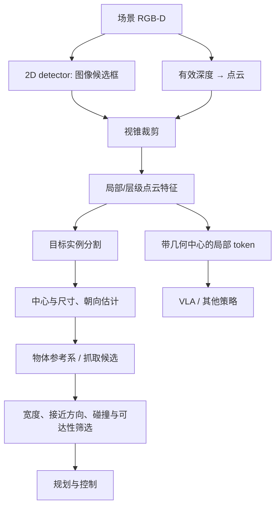
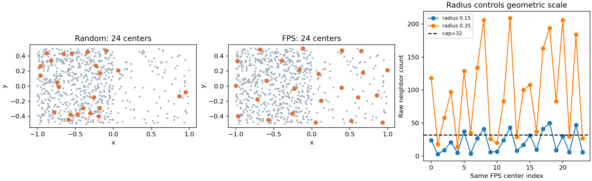
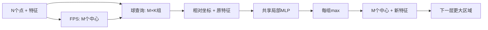
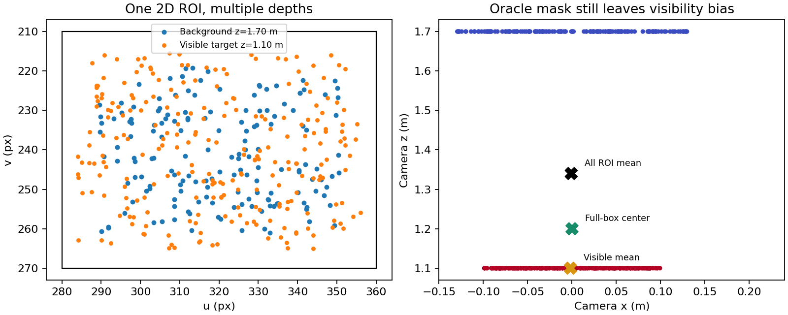
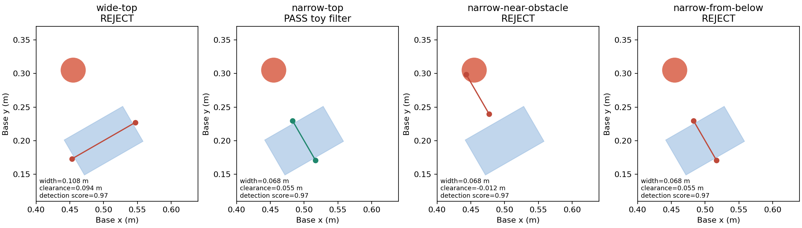

# D16 · 看清局部结构，才知道“框在哪里”和“夹爪怎么放”

[返回学习入口](../_index.md) ｜ [本周原定日程](../P2-深度理解-日程.md) ｜ [上一课 D15](../day15/Daily-Learning-Pack.md) ｜ [下一课 D17](../day17/Daily-Learning-Pack.md) ｜ [完整 CPU 实验](demo.py)

**本课严格对应 W3-D2：PointNet++ 的局部/多尺度表征，Frustum PointNets 的二维到三维联合检测；新增物体位姿到夹爪位姿、开口宽度、接近方向与候选质量。** 原定日期为 2026-09-20，现在补齐材料，课号和学习顺序不变。

昨天的 PointNet 会把所有点压成整体描述。今天问两个更具体的问题：杯口周围有哪些局部结构？图像框里的哪些点真的属于杯子？最后再问：**知道杯子在哪里，是否就知道夹爪应当如何接近？**

<details>
<summary>个人学习记录（由你填写，后续生成不覆盖）</summary>

<!-- learner-notes:start -->
学习日期：

局部邻域和多尺度中仍不理解的地方：

自己的坐标链与抓取候选图：

实验改变量与现象：

自测答案、得分与待补：
<!-- learner-notes:end -->

</details>

<!-- daily-pack-generated:start -->

## 0. 今日目标：把几何、表征和操作连接起来

结束时应能：

- 手写 FPS 和球邻域查询，说明它们与随机采样、kNN 的差别。
- 画出 set abstraction 的 `[B,N,3+C] → [B,M,K,3+C] → [B,M,C']`。
- 解释二维框产生的是视锥，为什么框中还有背景，为什么前景点均值也不等于完整物体中心。
- 写出物体到夹爪的变换链，明确闭合轴、接近轴、开口宽度和预抓取位置。
- 用真实运行结果说明：**检测分数相同，抓取可行性仍可以不同。**

## 1. 宏观：今天三种“缩小范围”，作用各不相同



| 缩小什么范围 | 方法 | 收益 | 不能自动解决什么 |
| --- | --- | --- | --- |
| 特征感受野 | 局部邻域 | 学局部几何，再汇总上下文 | 不自动告诉你哪片是目标 |
| 场景搜索区域 | 2D框到视锥 | 减少三维候选搜索 | 同一视线上的前后景仍混合 |
| 动作候选集合 | 几何/操作筛选 | 去掉明显不适用的抓法 | 未验证接触、摩擦和真实成功率 |

PointNet++ 是点云特征结构，Frustum PointNets 是检测流程，两者不是互相替代的同一级概念。后者可使用 PointNet 或 PointNet++ 变体作为部件。

## 2. 微观一：为什么需要局部邻域？

设一片点云同时包含杯口、杯壁和桌面。原始 PointNet 的共享函数 $h(p_i)$ 在聚合前只看到当前点，随后直接做整体 max。它可以学整体集合函数，却没有显式把“距离近的一组点”先组织起来。

如果我们先选局部中心 $c_j$，再让附近点共同决定一个特征：

$$
f_j=\max_{p_i\in\mathcal N(c_j)}
h_\theta([p_i-c_j,\ f_i])
$$

那么每个 $f_j$ 表示一个区域。再对这些区域做同样操作，就能形成“局部边缘/曲面 → 更大部件 → 整体”的层级。

这里 $p_i-c_j$ 是相对坐标：将整个局部区域平移同一个向量，差值保持不变。但中心 $c_j$ 本身仍需保留，供后续几何定位和动作使用。**对局部特征做平移规范化，不等于丢掉场景位置。**

## 3. FPS：不是取最远的一个点，而是逐步改善覆盖

Farthest Point Sampling，最远点采样，维护每个输入点到**已选中心集合**的最近距离：

$$
d_i^{(m)}=\min_{j\le m}\lVert p_i-c_j\rVert_2
$$

下一个中心取：

$$
c_{m+1}=\arg\max_{p_i}d_i^{(m)}
$$

每次加入新中心，只需更新：

$$
d_i\leftarrow\min(d_i,\lVert p_i-c_{m+1}\rVert_2)
$$

### 3.1 一维手算

输入点 `[0,1,2,8,9]`，首点取0：

1. 到集合 `{0}` 的距离为 `[0,1,2,8,9]`，选9。
2. 到 `{0,9}` 的最近距离为 `[0,1,2,1,0]`，选2。
3. 已有中心 `{0,9,2}`，每个点离某中心至多1。

“每次取离**上一个点**最远的点”会在两端来回跳，和 FPS 完全不同。

### 3.2 FPS保证什么，不保证什么？

它是一种覆盖驱动的贪心采样。朴素实现选 $M$ 个中心、$N$ 个输入点约需 $O(NM)$ 距离更新。它不使用类别标签，因此不会主动识别“最重要的杯把”。离群点也可能因为远而被优先选中。

首点、距离并列的处理、浮点误差会影响选点。若首点固定为数组第0个，重排输入可能改变结果；不能把 D15 的严格置换测试不加条件地套到含离散采样的整个网络上。本课以最小 x 的点为首点，数据没有该位置的并列值；一般实现仍应明确 tie-breaking。

### 3.3 已运行对照：非均匀点云更容易看出区别

实验左半区域600点、右半100点，共700点，同样选24个中心：

| 采样方法 | 右侧稀疏区域中心数 | 最大覆盖半径 |
| --- | --- | --- |
| 一次固定种子随机采样 | 3 | 0.63626 |
| FPS | 12 | 0.24220 |

覆盖半径定义为 $\max_i\min_j\lVert p_i-c_j\rVert$，越小代表这份点集上最差位置离中心越近。**这是一份固定输入的机制对照，不是跨数据集的分类性能结论。**



图左/中比较中心分布；右图在**同一组中心**上只改变球半径。要分别解释“中心在哪里”和“中心周围纳入哪些点”，不能混成一个操作。

## 4. 球邻域、kNN、局部坐标与mask

### 4.1 同样叫“邻居”，控制量不同

| 方法 | 固定什么 | 随密度变化的是什么 | 工程直觉 |
| --- | --- | --- | --- |
| ball query | 空间半径 $r$ | 邻居数量 | 保持局部结构的物理尺度 |
| kNN | 邻居个数 $K$ | 覆盖半径 | 计算形状固定，稀疏区可能跨很远 |

在距离相机远、点很稀疏的位置，用16-NN可能把杯子与桌面远处点连在一起；用半径2 cm的球可能只找到2个点。选择取决于任务与采样分布。

真实实现常同时用球半径和最大数目上限 K。若多于 K，按某种确定/随机规则截断；少于 K，可以重复合法点，或 padding 并加 mask。本课采用距离排序、最多32点、padding+mask，**原始邻居计数在截断前记录**。

### 4.2 本课邻域张量

输入无额外特征时：

```text
points                [700,3]
FPS centers           [24,3]
grouped relative xyz  [24,32,3]
valid mask            [24,32]
pointwise feature     [24,32,7]
max over neighbors    [24,7]
two radii concatenate [24,14]
```

演示逐点函数为：

$$
h(\Delta p)=\mathrm{ReLU}([\Delta x,\Delta y,\Delta z,
-\Delta x,-\Delta y,-\Delta z,\lVert\Delta p\rVert])
$$

这7个维度是人为设置，用来观察相对几何，不是训练出的 PointNet++ 参数。球内有中心自身，因此不会为空；对任意外部查询中心则要明确“空邻域”策略。

### 4.3 把全部坐标放在一起，内存是多少？

若 $B=4,M=128,K=32$，每点输入为3坐标+32特征，grouped tensor 为：

$$
[4,128,32,35]
$$

float32 共 $4\times128\times32\times35=573440$ 个数，约2.19 MiB。后续64维中间特征要约4 MiB，训练还需梯度和保留的激活。这解释了为什么增大半径同时扩大 K 或层级，会实际增加计算与存储。

## 5. PointNet++：局部到整体，以及如何回到逐点预测

一个 **set abstraction（集合抽象）** 层通常有三步：

1. Sampling：从输入点选中心。
2. Grouping：围绕每个中心构建局部区域。
3. Local PointNet：共享小网络+对称池化，得到区域特征。



### 5.1 单尺度与多尺度

单尺度 SSG 对每个中心用一个半径。MSG 在同一个中心处用多个半径提取特征，再拼接：

$$
f_j^{MSG}=[f_j^{r_1},f_j^{r_2},f_j^{r_3}]
$$

小尺度保细节，大尺度提供更多点与上下文。**拼接本身不自动保证“遇到稀疏输入就聪明地选大尺度”**；下游参数需要从训练数据中学会使用这些特征。原论文把非均匀密度和训练时点丢弃作为重要因素；本课只实现多半径结构与计数，不声称学到了密度自适应。[PointNet++ 原论文第3.2—3.3节](https://arxiv.org/pdf/1706.02413)

本次同中心对照：

- 半径0.15：原始邻居数最小/中位/最大为 **3 / 19 / 50**。
- 半径0.35：为 **14 / 90 / 209**。
- cap=32后，超过32的邻域都被截断。扩大半径可能没有扩大实际点数，改变的是候选范围与所选点；必须同时看半径、K、选择规则。

### 5.2 分割怎么把粗特征传播回原点？

层级抽象减少点数，若最终要给原来每个点打标签，需要 feature propagation。一个常见思路是用粗中心附近的特征插值：

$$
f(p)=\frac{\sum_{j\in\mathcal N_k(p)}w_jf_j}
{\sum_{j\in\mathcal N_k(p)}w_j},
\quad
w_j=\frac1{(\lVert p-c_j\rVert+\epsilon)^\alpha}
$$

再拼接对应分辨率的早期特征，经共享 MLP 修正。指数 $\alpha$ 是插值超参数；恰好落在已知中心时应专门处理，避免数值问题。公式解释机制，具体 k、指数及零距离规则以实现为准。

这与图像网络的上采样+skip connection有相似动机：高层提供语义，浅层保留定位细节。但点云不在规则网格，不能直接按像素间距套二维插值。

## 6. 从二维框到三维视锥：减少搜索，不等于分出物体

像素 $(u,v)$ 与深度 $z$ 的反投影：

$$
p^{cam}=zK^{-1}[u,v,1]^\top
$$

给定2D框 $[u_{min},u_{max}]\times[v_{min},v_{max}]$，所有投影落进该框的三维点构成一个沿深度展开的区域；它不是一个固定深度的长方体。若再限制有效深度范围，得到截断的视锥。

### 6.1 一个二维框为什么含有两个物体？

沿同一条相机光线，近物体、后方墙面可能落到同一图像区域。2D框只限制方向，没有独立确定每个点属于哪个实例。

本实验：

- 240个目标可见面点在 $z=1.10$ m。
- 160个背景点在 $z=1.70$ m。
- 400个点都落在同一个 ROI。
- 完整物体真实框中心设在 $z=1.20$ m。

如果直接对全部视锥点求均值，深度均值为：

$$
\bar z_{\mathrm{all}}
=\frac{240\times1.10+160\times1.70}{400}
=1.34\ {\rm m}
$$

比目标完整中心偏14 cm。**2D框存在不等于3D前景已分离。**

### 6.2 有了完美前景mask，中心仍然偏

仅保留目标可见面，$\bar z_{\mathrm{visible}}=1.10$ m，而完整框中心在1.20 m，仍偏10 cm。这不是分割错误，而是单侧可见造成的采样偏差。



左图：二维区域中两组点重叠。右图：全部ROI均值、可见点均值、完整框中心是三个不同量。此处前景用**合成真值标签 oracle mask**提取，以隔离遮挡几何问题，未运行训练过的分割器。横纵坐标随机采样使完整三维误差分别为0.14003 m、0.10003 m，略大于单独的z误差。

## 7. Frustum PointNets：分割、平移校正与框回归

作者方法的关键链条是：

**2D候选 → 视锥点云 → 3D实例分割 → 目标点集 → 中心平移校正 → 完整3D框估计。**

它估计的是 amodal box：包含不可见部分的完整物体框，因此最终中心不是“把观测点平均一下”。实现还利用视锥规范化以及朝向/尺寸的分类与残差表示。[原论文第4节、Figure 2/4/5](https://arxiv.org/pdf/1711.08488)

### 7.1 先记住几种中心

$$
c_{\mathrm{mask}}=\frac1M\sum_{i\in\mathrm{foreground}}p_i
$$

然后网络可以学习中心残差：

$$
c_{\mathrm{final}}
=c_{\mathrm{mask}}+\Delta c_{\mathrm{stage1}}+\Delta c_{\mathrm{box}}
$$

实际坐标变换中的旋转/平移必须按该阶段的参考系组合。这里写成加法是为了表达两阶段残差，不能把不同坐标系的残差直接相加。

本实验监督目标为：

$$
c^*-\bar p_{\mathrm{visible}}
\approx[0.001760,-0.001510,0.100000]\ {\rm m}
$$

**这是训练时希望模型学会的标签，不是模型预测值。** 用真值算残差再加回去，当然可以回到真值，不能据此声称“完成了高精度中心估计”。

### 7.2 框回归到底输出什么？

常见地面场景框可参数化为中心 $c\in\mathbb R^3$、尺寸 $(l,w,h)$ 与 yaw $\theta$。朝向可以分成 H 个方向区间，再预测区间内残差；尺寸可以按类别/尺寸模板分类后预测残差。

一个教学 shape 例子，H=12、S=8：

| 量 | 每个候选的 shape | 含义 |
| --- | --- | --- |
| 中心残差 | `[3]` | 参考中心到框中心的偏移 |
| 朝向区间 logits | `[12]` | 属于哪个方向区间 |
| 每区间角度残差 | `[12]` | 区间中心附近的修正 |
| 尺寸模板 logits | `[8]` | 哪一类尺寸先验 |
| 每模板尺寸残差 | `[8,3]` | 长宽高修正 |

合计 $3+12+12+8+24=59$ 个数。这是头部输出表示，不是物体有59个自由度。推理时先选离散分支，再读对应连续残差。

预测角度 $179^\circ$ 与真值 $-179^\circ$ 物理上只差2°，直接相减却是358°。分桶+残差、周期角度差或正余弦表示，都在处理这种表示问题；仍要考虑物体对称。D19会正式展开。

### 7.3 多任务损失与误差传播

可以概念性写成：

$$
\mathcal L
=\lambda_{\rm seg}\mathcal L_{\rm seg}
+\lambda_c\mathcal L_c
+\lambda_h(\mathcal L_{h,cls}+\mathcal L_{h,res})
+\lambda_s(\mathcal L_{s,cls}+\mathcal L_{s,res})
+\lambda_{\rm corner}\mathcal L_{\rm corner}
$$

每项监督不同输出；米制位置、弧度角度与无量纲交叉熵的尺度不同，不能不看归一化就把系数机械设成1。

故障应按阶段定位：2D漏检→没有视锥；mask混入背景→中心被拉偏；完整形状先验不适用→遮挡后尺寸估错；坐标恢复错误→网络局部数值正确、场景位置仍错。

## 8. 从物体位姿到夹爪位姿：还差一个抓取定义

沿用约定：$T^A_B$ 把 B 系坐标变到 A 系。

若物体位姿来自相机，夹爪模板在物体系中定义：

$$
T^{base}_{grasp}
=T^{base}_{cam}\,T^{cam}_{obj}\,T^{obj}_{grasp}
$$

手眼相机则：

$$
T^{base}_{cam}
=T^{base}_{ee}T^{ee}_{cam}
$$

原理不是记字母顺序，而是让相邻参考系首尾相接。$T^{obj}_{grasp}$ 描述“相对于这个物体，夹爪如何放置”，可有很多候选；物体位姿本身只描述物体，没有替你做这个选择。

### 8.1 抓取坐标系必须约定轴

本课规定：

- grasp $x$：两指的闭合轴。
- grasp $z$：接近时的运动方向。
- grasp $y=z\times x$：补成右手系。
- 原点：两指中间的抓取中心。

检查 $R^\top R=I,\det R=+1$，防止手写轴时拼出反射矩阵。不同夹爪软件可能把接近轴定义为负z，**不要把本课约定当作所有设备规范**。

若已知抓取点 $t_g$、单位接近方向 $a$，距抓取点 $d$ 的预抓取点为：

$$
t_{\rm pre}=t_g-da
$$

因为从预抓取走向抓取的位移是 $+da$。本课 base 的 z 向上，向下接近时 $a=[0,0,-1]^\top$，所以预抓取点比抓取点更高。

### 8.2 别混淆 grasp、TCP、法兰

如果控制器要的是法兰位姿，已知固定工具变换 $T^{flange}_{grasp}$：

$$
T^{base}_{flange}
=T^{base}_{grasp}(T^{flange}_{grasp})^{-1}
$$

若把指尖中心当法兰发送，工具长度会直接变成位置误差。今天不向任何控制器发送数据，只把接口定义清楚。

## 9. 开口宽度、接近方向和质量：为什么检测0.97仍可能抓不了？

### 9.1 宽度来自物体在闭合轴上的投影范围

给定闭合轴单位向量 $e$ 和物体点集：

$$
w_{\rm object}
=\max_i(e^\top p_i)-\min_i(e^\top p_i)
$$

预张开宽度可取：

$$
w_{\rm open}=w_{\rm object}+2\epsilon
$$

但它必须位于夹爪有效范围，也不能仅因多张开一点就撞到环境。

本课矩形长0.10 m、宽0.06 m，闭合轴与长边夹角 $\alpha$，投影宽度：

$$
w(\alpha)=0.10|\cos\alpha|+0.06|\sin\alpha|+0.008
$$

最后8 mm是两侧总余量。沿长边闭合为0.108 m，沿短边闭合为0.068 m；最大开口0.09 m时，前者直接不适用。

### 9.2 质量不是只有一个分数

至少区分：

| 分数/检查 | 在回答什么 |
| --- | --- |
| 检测置信度 | 这是不是目标类别/有效检测？ |
| 抓取网络质量 | 在训练定义下，这个抓取是否更可能好？ |
| 几何约束 | 宽度、接触位置、碰撞与接近是否可行？ |
| 运动学约束 | 机械臂是否能到、途中是否安全？ |
| 闭环成功率 | 实际尝试后是否抓住、抬起、完成任务？ |

某分数高并不代替其他证据。离线质量分更不自动是校准过的成功概率。

### 9.3 接触的直觉：对向接触也有物理条件

平行夹爪常希望两侧接触法向相向，连线落在接触的摩擦锥范围内。简化库仑摩擦模型中，摩擦锥半角 $\phi=\arctan\mu$。例如 $\mu=0.5$ 时约26.6°。

这是局部接触可提供力方向的近似，不能只凭几何点云确定真实摩擦系数。软物体形变、重心偏移、指垫尺寸、接触力上限都会影响抓取。本实验只筛几何，不模拟力闭合或接触动力学。

## 10. 实操：把三段机制跑成可检查的结果

脚本 [demo.py](demo.py) 使用合成数据，CPU执行，不加载学习模型。已运行环境：Python3.11.15、NumPy1.26.4、Matplotlib3.10.9。训练次数0、机器人执行次数0。

在知识库根目录运行：

```bash
python -B 3d_learning/day16/demo.py
```

结果写入 `_assets/3d_learning/day16/`。[完整实验记录](../../_assets/3d_learning/day16/results.json)

### 10.1 起步：手写 FPS 更新

```python
import numpy as np

points = np.array([[0.,0,0], [1,0,0], [2,0,0], [8,0,0], [9,0,0]])
chosen = []
nearest_sq = np.full(len(points), np.inf)
current = 0
for _ in range(3):
    chosen.append(current)
    nearest_sq = np.minimum(nearest_sq,
                            ((points - points[current]) ** 2).sum(axis=1))
    current = int(nearest_sq.argmax())
print(chosen)  # [0,4,2]，即坐标0、9、2
```

### 10.2 真实运行的抓取筛选结果

四个候选共享同一个物体检测分数 **0.97**：

| 候选 | 宽度 m | 简化指尖净空 m | 失败原因或结果 |
| --- | --- | --- | --- |
| wide-top | 0.108 | 0.09444 | 超过0.09 m开口 |
| narrow-top | 0.068 | 0.05458 | 通过本课几何筛选 |
| narrow-near-obstacle | 0.068 | −0.01246 | 指尖碰障碍，中心也偏离目标 |
| narrow-from-below | 0.068 | 0.05458 | 接近方向违反桌面任务设定 |

净空用二维指尖圆与环境圆的距离减半径计算，**没有检查整只手、手臂、自碰撞、IK、3D路径或接触稳定性**。表中的“通过”仅指该简化过滤器，不能说“抓取成功”。



读图时先辨认蓝色物体、红色障碍与两指位置。最后一个候选在俯视图上与正常候选很像，却从下方接近，说明单张俯视图不足以验证完整三维动作。

### 10.3 今日实际任务

1. 复现默认结果，解释为何FPS更覆盖右侧稀疏区。
2. 保持同一云和中心，只把半径0.15改为0.25，记录邻居计数；不要同时改K。
3. 固定全部抓取候选，只把最大开口0.09改为0.12，宽候选是否通过？哪些候选仍失败？
4. 在纸上写 $T^{base}_{obj}T^{obj}_{grasp}$，把一根夹爪轴乘过去，解释图中方向。
5. 写一段错误诊断：如果二维框准、mask也准，三维框中心仍偏10 cm，应优先检查哪个假设？

### 10.4 完整主脚本

> [!note]- 完整 CPU 主脚本（与 demo.py 一致）
>
> ```python
> """D16 CPU mechanisms: FPS/grouping, frustum contamination and grasp contracts.
> No trained PointNet++ / Frustum PointNets model, no robot control.
> """
> from pathlib import Path
> import argparse
> import json
> import platform
> import numpy as np
> import matplotlib
> matplotlib.use('Agg')
> import matplotlib.pyplot as plt
> from matplotlib.patches import Circle, Polygon
>
>
> def fps(points, count):
>     indices = []
>     nearest_sq = np.full(len(points), np.inf)
>     current = int(np.argmin(points[:, 0]))  # Geometric initial point, no ties here.
>     for _ in range(count):
>         indices.append(current)
>         nearest_sq = np.minimum(nearest_sq, ((points - points[current]) ** 2).sum(1))
>         current = int(np.argmax(nearest_sq))
>     return np.array(indices)
>
>
> def grouped_features(points, centroids, radius, cap=32):
>     groups = np.zeros((len(centroids), cap, 3))
>     valid = np.zeros((len(centroids), cap), dtype=bool)
>     raw_counts = []
>     for j, c in enumerate(centroids):
>         d = np.linalg.norm(points - c, axis=1)
>         ids = np.flatnonzero(d <= radius)
>         ids = ids[np.argsort(d[ids])]
>         raw_counts.append(len(ids))
>         ids = ids[:cap]
>         groups[j, :len(ids)] = points[ids] - c
>         valid[j, :len(ids)] = True
>     # Fixed educational pointwise feature; not learned weights.
>     h = np.concatenate([groups, -groups, np.linalg.norm(groups, axis=-1, keepdims=True)], -1)
>     h = np.maximum(h, 0)
>     h[~valid] = -np.inf
>     pooled = h.max(1)
>     assert np.isfinite(pooled).all()  # Every center is itself an input point.
>     return pooled, np.array(raw_counts), groups, valid
>
>
> def cover(points, selected):
>     return float(np.sqrt(((points[:, None] - selected[None]) ** 2).sum(-1).min(1).max()))
>
>
> def Rz(angle):
>     c, s = np.cos(angle), np.sin(angle)
>     return np.array([[c, -s, 0], [s, c, 0], [0, 0, 1.]])
>
>
> def main():
>     p = argparse.ArgumentParser()
>     p.add_argument('--seed', type=int, default=16)
>     p.add_argument('--out-dir', type=Path,
>                    default=Path(__file__).resolve().parents[2] / '_assets/3d_learning/day16')
>     args = p.parse_args()
>     args.out_dir.mkdir(parents=True, exist_ok=True)
>     rng = np.random.default_rng(args.seed)
>     dense = np.column_stack([rng.uniform(-1, 0, 600), rng.uniform(-.5, .5, 600), np.zeros(600)])
>     sparse = np.column_stack([rng.uniform(0, 1, 100), rng.uniform(-.5, .5, 100), np.zeros(100)])
>     cloud = np.concatenate([dense, sparse])
>     fids = fps(cloud, 24)
>     rids = rng.choice(len(cloud), 24, replace=False)
>     centers = cloud[fids]
>     small, ns, groups, valid = grouped_features(cloud, centers, .15)
>     large, nl, _, _ = grouped_features(cloud, centers, .35)
>     msg = np.concatenate([small, large], -1)
>     # Same cloud, centroids and cap; only neighborhood radius changes.
>     assert (nl >= ns).all() and msg.shape == (24, 14)
>     obj = np.column_stack([rng.uniform(-.10, .10, 240), rng.uniform(-.07, .07, 240), np.full(240, 1.10)])
>     background = np.column_stack([rng.uniform(-.13, .13, 160), rng.uniform(-.09, .09, 160), np.full(160, 1.70)])
>     pts = np.concatenate([obj, background])
>     uv = pts[:, :2] / pts[:, 2, None] * 400 + [320, 240]
>     roi = (uv[:, 0] >= 280) & (uv[:, 0] <= 360) & (uv[:, 1] >= 210) & (uv[:, 1] <= 270)
>     truth_mask = np.arange(len(pts)) < len(obj)
>     frustum = pts[roi]
>     foreground = pts[roi & truth_mask]
>     full_center = np.array([0., 0., 1.20])
>     c_all, c_visible = frustum.mean(0), foreground.mean(0)
>     target_residual = full_center - c_visible  # A supervision target, not a prediction.
>     # Candidate coordinates use base z up, independently of optical camera above.
>     T_bo = np.eye(4)
>     T_bo[:3, :3] = Rz(np.deg2rad(30))
>     T_bo[:3, 3] = [.50, .20, .12]
>     specifications = [('wide-top', 0., 0., False), ('narrow-top', np.pi/2, 0., False),
>                       ('narrow-near-obstacle', np.pi/2, .08, False),
>                       ('narrow-from-below', np.pi/2, 0., True)]
>     obstacle = np.array([.455, .305, .018])  # Base x,y and radius; tabletop top view.
>     finger_radius = .008
>     candidates = []
>     for name, angle, offset, below in specifications:
>         # +x of grasp is closing axis; +z is the direction of approach velocity.
>         T_og = np.eye(4)
>         xaxis = np.array([np.cos(angle), np.sin(angle), 0.])
>         zaxis = np.array([0., 0., 1. if below else -1.])
>         yaxis = np.cross(zaxis, xaxis)
>         T_og[:3, :3] = np.column_stack([xaxis, yaxis, zaxis])
>         T_og[:3, 3] = [0., offset, 0.]
>         T_bg = T_bo @ T_og
>         width = .10 * abs(np.cos(angle)) + .06 * abs(np.sin(angle)) + .008
>         c = T_bg[:3, 3]
>         axis = T_bg[:3, 0]
>         fingers = np.stack([c[:2] - axis[:2]*width/2, c[:2] + axis[:2]*width/2])
>         clearance = np.linalg.norm(fingers - obstacle[:2], axis=1).min() - obstacle[2] - finger_radius
>         width_ok, approach_ok = width <= .09, not below
>         center_ok = abs(offset) <= .01  # Template must straddle this centered object.
>         valid_candidate = bool(width_ok and approach_ok and center_ok and clearance > 0)
>         candidates.append({'name': name, 'T_base_grasp': T_bg.tolist(),
>                            'width_m': float(width), 'clearance_m': float(clearance),
>                            'center_ok': center_ok, 'width_ok': bool(width_ok),
>                            'approach_ok': approach_ok, 'valid_in_toy_filter': valid_candidate,
>                            'same_object_detection_score': .97})
>     assert sum(c['valid_in_toy_filter'] for c in candidates) == 1
>     report = {'seed': args.seed, 'python': platform.python_version(), 'numpy': np.__version__,
>               'training_steps': 0, 'point_count': len(cloud),
>               'fps_cover_radius': cover(cloud, cloud[fids]),
>               'random_cover_radius': cover(cloud, cloud[rids]),
>               'fps_sparse_centers': int((centers[:, 0] > 0).sum()),
>               'random_sparse_centers': int((cloud[rids, 0] > 0).sum()),
>               'neighborhood_radius_015_counts_min_median_max': [int(ns.min()), float(np.median(ns)), int(ns.max())],
>               'neighborhood_radius_035_counts_min_median_max': [int(nl.min()), float(np.median(nl)), int(nl.max())],
>               'group_shape': list(groups.shape), 'msg_shape': list(msg.shape),
>               'frustum_point_count': len(frustum), 'oracle_foreground_count': len(foreground),
>               'frustum_mean_center_error_m': float(np.linalg.norm(c_all-full_center)),
>               'visible_mean_center_error_m': float(np.linalg.norm(c_visible-full_center)),
>               'supervision_center_residual_m': target_residual.tolist(),
>               'candidates': candidates,
>               'scope': '2D finger clearance and simple template filters only; no IK, full hand/arm or contact simulation.'}
>     (args.out_dir/'results.json').write_text(json.dumps(report, indent=2)+'\n')
>     fig, axes = plt.subplots(1, 3, figsize=(13, 4), layout='constrained')
>     for ax, ids, title in zip(axes[:2], [rids, fids], ['Random: 24 centers', 'FPS: 24 centers']):
>         ax.scatter(*cloud[:, :2].T, s=4, c='#a0aebb')
>         ax.scatter(*cloud[ids, :2].T, s=35, c='#dc723a')
>         ax.set(xlabel='x', ylabel='y', title=title, aspect='equal')
>     axes[2].plot(ns, 'o-', label='radius 0.15')
>     axes[2].plot(nl, 'o-', label='radius 0.35')
>     axes[2].axhline(32, color='black', ls='--', label='cap=32')
>     axes[2].set(xlabel='Same FPS center index', ylabel='Raw neighbor count', title='Radius controls geometric scale')
>     axes[2].legend(fontsize=8)
>     fig.savefig(args.out_dir/'neighborhoods.png', dpi=160)
>     plt.close(fig)
>     fig, axes = plt.subplots(1, 2, figsize=(10, 4), layout='constrained')
>     axes[0].scatter(uv[len(obj):, 0], uv[len(obj):, 1], s=12, label='Background z=1.70 m')
>     axes[0].scatter(uv[:len(obj), 0], uv[:len(obj), 1], s=9, label='Visible target z=1.10 m')
>     axes[0].add_patch(Polygon([[280,210],[360,210],[360,270],[280,270]], fill=False, color='black'))
>     axes[0].invert_yaxis()
>     axes[0].set(xlabel='u (px)', ylabel='v (px)', title='One 2D ROI, multiple depths')
>     axes[0].legend(fontsize=8)
>     axes[1].scatter(pts[:,0], pts[:,2], c=truth_mask, cmap='coolwarm', s=10)
>     axes[1].scatter([c_all[0], c_visible[0], full_center[0]], [c_all[2],c_visible[2],full_center[2]],
>                     c=['black','#d89512','#178c6b'], marker='X', s=120)
>     for c, label in [(c_all,'All ROI mean'),(c_visible,'Visible mean'),(full_center,'Full-box center')]:
>         axes[1].annotate(label, (c[0],c[2]), xytext=(12,7), textcoords='offset points', fontsize=8)
>     axes[1].set(xlabel='Camera x (m)', ylabel='Camera z (m)', title='Oracle mask still leaves visibility bias')
>     axes[1].set_xlim(-.15,.24)
>     fig.savefig(args.out_dir/'frustum.png', dpi=160)
>     plt.close(fig)
>     fig, axes = plt.subplots(1, 4, figsize=(14, 4), layout='constrained')
>     local_rect = np.array([[-.05,-.03],[.05,-.03],[.05,.03],[-.05,.03]])
>     rect = local_rect @ T_bo[:2,:2].T + T_bo[:2,3]
>     for ax, c in zip(axes, candidates):
>         T = np.array(c['T_base_grasp']); w = c['width_m']
>         axis = T[:2,0]; center = T[:2,3]
>         fingers = np.stack([center-axis*w/2, center+axis*w/2])
>         ax.add_patch(Polygon(rect, color='#99bce0', alpha=.6))
>         ax.add_patch(Circle(obstacle[:2], obstacle[2], color='#dd7560'))
>         ax.plot(*fingers.T, 'o-', color='#20876d' if c['valid_in_toy_filter'] else '#be493a')
>         ax.set(xlim=(.40,.64), ylim=(.11,.37), aspect='equal', xlabel='Base x (m)', ylabel='Base y (m)',
>                title=c['name']+'\n'+('PASS toy filter' if c['valid_in_toy_filter'] else 'REJECT'))
>         ax.text(.405,.115,f"width={w:.3f} m\nclearance={c['clearance_m']:.3f} m\ndetection score=0.97",fontsize=8)
>     fig.savefig(args.out_dir/'grasp-candidates.png', dpi=160)
>     plt.close(fig)
>     print(json.dumps(report, indent=2))
>
>
> if __name__ == '__main__':
>     main()
> ```

## 11. 工程视角：接入RGB-D与ROS时真正要核对什么？

这里是接口设计练习，不启动任何ROS节点或真实机械臂。

| 接口 | 必须保存的字段 | 典型错误 |
| --- | --- | --- |
| RGB→2D框 | 图像分辨率、缩放/裁剪变换、时间戳 | 网络输入缩放后框未映射回原图 |
| 深度→点云 | K、畸变/对齐状态、depth scale、有效mask | 深度未对齐RGB却直接用RGB框裁 |
| 视锥→局部网络 | 原相机坐标、规范化旋转/中心、采样索引 | 得到框后忘记变回场景坐标 |
| 物体→抓取 | 物体参考系、模板变换、米制尺寸、轴定义 | 类别规范坐标被当真实尺度 |
| 抓取→规划 | base参考系、TCP/法兰定义、候选宽度与时间 | 指尖目标当法兰目标发送 |

RealSense等RGB-D设备的彩色/深度视点与分辨率可能不同。只有确认配准关系和内参适用图像后，才能把彩色框映射到深度。点云看起来像物体，并不能替代数值检查。

VLA可以使用局部点云token，也可以在其他视觉表征中隐式学习几何。无论哪条路线，动作落地仍必须满足工具、坐标、可达性和碰撞条件。世界模型若要预测抓取后果，还需动作、接触与历史条件；一张静态完整框不包含未来接触过程。

## 12. 精读任务：只用一手原文做对应

来源核验日期：2026-09-22。

1. [PointNet++ 原论文](https://arxiv.org/pdf/1706.02413)：第3.2节对应FPS/Grouping/Local PointNet；第3.3节与Figure3对应MSG/MRG；附录C.2/C.3回查邻域与采样随机性。产出一张“几何操作—shape—假设”表。
2. [Frustum PointNets 原论文](https://arxiv.org/pdf/1711.08488)：第4.1—4.3节、Figure2/4/5。画出视锥、前景点均值、中心校正和最终框；写清每阶段坐标如何恢复。
3. [作者项目与代码入口](https://stanford.edu/~rqi/frustum-pointnets/)：查找mask gathering与box output解析位置，对照59维教学例子。记录实际配置，别把本课示意参数当成所有实现固定常数。

阅读卡至少回答：它解决了哪个搜索/表征问题？监督信号从哪来？哪一步依赖2D检测？哪些输出对操作还不够？本课实验验证了机制的哪一小部分？

## 13. 回到宏观：今日重点、难点与产出

最值得掌握的五点：

1. **采样与分组分开。** 一个决定中心，一个决定感受野，调参时才知道哪个变量改变了什么。
2. **局部坐标与全局中心一起保存。** 否则特征好用，机器人却不知道目标在哪里。
3. **视锥不是实例。** 2D框只约束方向，仍需要前景分割。
4. **可见均值不是完整中心。** 遮挡偏差需要形状先验与学习/几何约束，不能简单平均解决。
5. **位姿不是动作。** 模板、宽度、接近方向和可行性筛选把感知连接到操作。

今日三个难点：

- 大半径不等于更多有效信息：若混入其他物体或K截断，甚至会更差。
- 完美mask不等于完美中心：只看到了物体的一面。
- 相同俯视夹爪图不等于相同3D接近：z轴正负可能导致完全不同路径。

三句话总结：**PointNet++把局部几何组织成层级表征；Frustum PointNets把二维候选变成三维实例与完整框；抓取还要把物体几何转换成夹爪约束并逐项筛选。**

今日留下：一份FPS/邻域代码，一张Frustum坐标与中心图，一张带宽度/方向/净空的抓取候选表，两张论文卡和以下自测。

## 14. 闭卷自测

1. 对点 `[0,1,2,8,9]` 首点取0，手算前三个FPS中心；为什么不能只看与上一个中心的距离？
2. 同一份非均匀点云，ball query和kNN分别固定什么？各给一个工程失败情形。
3. $B=2,M=64,K=16$，局部输入3坐标+8特征，经MLP输出32维；聚合前后shape是什么？两尺度拼接后呢？
4. 为什么一个2D框中的点会有前后景？为什么oracle mask后点均值仍可能偏？
5. 如果网络在中心化/旋转规范化后的坐标预测中心残差，你怎样恢复到相机坐标？不能省掉哪一项？
6. 物体在base的yaw为30°，夹爪闭合轴在物体系为y轴。该闭合轴在base中是什么方向？
7. 矩形尺寸0.10×0.06 m、总余量0.008 m、最大开口0.09 m。沿长边/短边闭合分别是否可用？为什么检测0.97回答不了它？
8. 一个候选通过本课二维指尖检查。列出在真实机器人执行前仍缺少的至少四种验证，并说明“通过”该怎样命名。

## 15. 未理解问题与下一课

在个人区记录仍不能手算的部分，尤其是FPS最近距离更新、局部坐标恢复、物体到夹爪变换，以及可见/完整中心的区别。

下一课 [D17](../day17/Daily-Learning-Pack.md) 按原计划补齐**检测评价、匹配与误差分析**，并学习**配置空间、RRT/RRT-Connect与二维避障**。今天产生候选，明天开始问“候选怎样算对”和“机器人怎样绕开障碍过去”。

## 16. 参考答案与判分标准

<details>
<summary>作答后展开：每题0 / 1 / 2分，共16分</summary>

1. 0→9→2；用到已选集合的最近距离，避免已被其他中心覆盖的点再次被误认为远。**2分**：顺序与更新解释正确；**1分**：只有顺序；**0分**：0与9来回选。
2. ball固定半径、点数变；kNN固定数目、物理范围变。前者稀疏区点不足，后者可能跨物体或远邻。**2分**：两种和失败例完整；**1分**：只给定义；**0分**：把两者当等价。
3. 输入 `[2,64,16,11]`；MLP后 `[2,64,16,32]`；max后 `[2,64,32]`；两个32维尺度拼接 `[2,64,64]`。**2分**：全对；**1分**：错一处；**0分**：聚合轴理解错。
4. 框只约束投影方向，近远点可共处视锥；可见点只覆盖一部分物体，均值不等于完整形状中心。**2分**：两个问题清楚区分；**1分**：只说背景影响；**0分**：认为正确mask必定给真中心。
5. 先在统一规范化坐标中合并中心与残差，再逆旋转/逆平移恢复；若还缩放，需恢复尺度。不能混加不同坐标系的残差。**2分**：逆变换与顺序合理；**1分**：知道要变回但不具体；**0分**：直接当相机坐标。
6. $R_z(30^\circ)[0,1,0]^\top=[-0.5,\sqrt3/2,0]^\top$。**2分**：向量及闭合轴含义正确；**1分**：方向对但数错；**0分**：仍写物体系y轴。
7. 沿长边0.108 m超限，短边0.068 m可满足开口；检测分数只对应检测任务，不编码夹爪行程和动作约束。**2分**：数值与原因完整；**1分**：只判断可否；**0分**：按分数认为都能抓。
8. 例如完整手/臂/自碰撞、IK和关节限位、全接近路径、时间参数化与控制、摩擦接触与负载、传感器更新/误差。只能称“通过简化二维几何过滤”。**2分**：至少四项并限定结论；**1分**：只两三项；**0分**：称已经验证抓取成功。

建议自验至少13/16分，同时能独立画出坐标链与解释候选失败；当前个人掌握状态仍未评定。

</details>

<!-- daily-pack-generated:end -->

