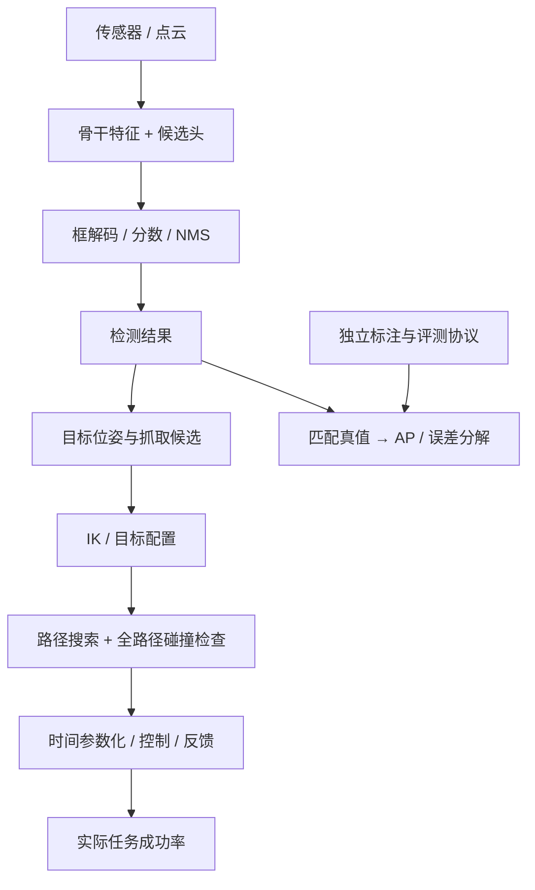
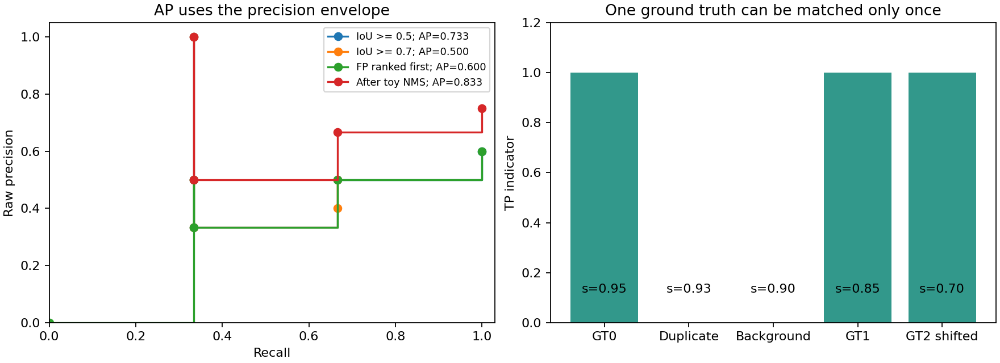
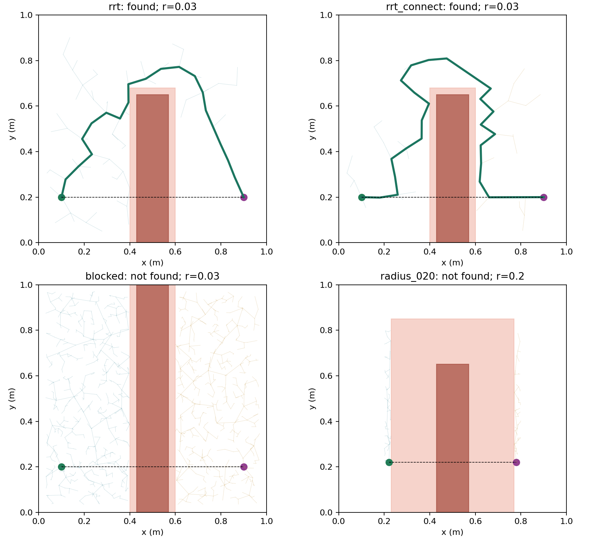

# D17 · 从“检测框看起来对”到“评价可复现、路径可检查”

[返回学习入口](../_index.md) ｜ [本周原定日程](../P2-深度理解-日程.md) ｜ [上一课 D16](../day16/Daily-Learning-Pack.md) ｜ [下一课 D18](../day18/Daily-Learning-Pack.md) ｜ [完整 CPU 实验](demo.py)

**本课对应原计划 W3-D3：检测实现、指标匹配与误差分析、具体数据集协议；新增配置空间、RRT/RRT-Connect和二维避障例。** 原定日期为2026-09-21，本次补写保持课号和原课程顺序。代码验证完成，个人学习与验收仍待你完成。

昨天得到三维物体与抓取候选，今天继续追问：一个框究竟要满足什么才算正确？一条看起来绕过了物体的线，是否真的可供机器人通过？两件事的共同点是：**先定义对象、约束和判定规则，再解释数字与图。**

<details>
<summary>个人学习记录（由你填写，后续生成不覆盖）</summary>

<!-- learner-notes:start -->
学习日期：

我写下的评价协议：

我复现的匹配/AP手算：

规划失败例与判断依据：

未理解问题、自测答案与得分：
<!-- learner-notes:end -->

</details>

<!-- daily-pack-generated:start -->

## 0. 今日学习目标与路线

学完应能：

1. 从候选输出走到解码、分数过滤、NMS、匹配和AP，指出每一步是否使用真值。
2. 手算轴对齐3D IoU、逐预测TP/FP、precision/recall与插值AP。
3. 解释KITTI与nuScenes的匹配协议差异，并写出自己的评测配置卡。
4. 区分工作空间与配置空间，把机器人尺寸转成障碍约束。
5. 手写RRT的采样、最近邻、扩展、整边碰撞检查与回溯，解释RRT-Connect双树为什么不保证最短路径。

阅读顺序：检测系统图 → 框表示与IoU → 匹配/AP → 错误诊断 → 配置空间 → RRT → 对照实验 → 回到闭环。

## 1. 宏观：检测质量与规划成功处在不同层



左侧从检测走向行动；右侧评测支路使用真值。**模型推理不能偷看真值来做NMS或选框；评价可以使用真值判断预测是否正确。**

检测AP高，仍可能因坐标、夹爪、规划或接触失败而抓不到。规划找到几何路径，仍没有验证速度、加速度、力矩或控制跟踪。每层都要有自己的验收边界。

## 2. 微观一：把检测网络输出解码成有物理意义的框

一个常见yaw-only框：

$$
b=(c_x,c_y,c_z,l,w,h,\theta)
$$

附加类别 $k$、分数 $s$、时间戳和参考坐标系。这里尺寸是物理大小，$\theta$是绕约定竖直轴的朝向，7个数不是7个刚体姿态自由度。

### 2.1 模型输出残差，不一定直接输出米

若用锚框/候选先验，教学形式可写为：

$$
c=c_a+\Delta c\odot s_a,\qquad
d=d_a\odot\exp(\Delta d)
$$

其中 $c_a,d_a$ 是参考中心与正尺寸，$s_a$ 是归一化尺度。具体实现可能用对角线长度、特征网格步长、不同编码方式，必须读配置和解码代码。

例：$c_a=[1,2,0]$ m，$s_a=[2,2,1]$ m，$\Delta c=[0.1,-0.2,0.3]$，得到 $c=[1.2,1.6,0.3]$ m。若 $d_a=[1,1,1]$ m、$\Delta d=[\log2,0,0]$，则尺寸为 $[2,1,1]$ m。

```python
import numpy as np

def decode_box(center_anchor, size_anchor, center_delta, log_size_delta):
    center = center_anchor + center_delta * size_anchor
    size = size_anchor * np.exp(log_size_delta)
    return np.concatenate([center, size], axis=-1)
```

这段只演示六个轴对齐框参数的解码；yaw分桶/残差回看D16。不能把网络头输出的归一化残差直接写到ROS坐标消息中。

### 2.2 置信度阈值与NMS阈值不是一回事

- 分数阈值：太不确定的预测是否保留。
- NMS阈值：两个同类预测是否太相似，以至于低分者视为重复。
- 评价匹配阈值：预测与真值够不够接近，能否算TP。

三种阈值回答三个问题，可能数值相同也不能混用。NMS看**预测之间**的重叠；评价看**预测与真值**的匹配。

NMS伪代码：

```text
按分数从高到低排序
while 还有预测:
    取最高分预测 i，加入输出
    删除与 i 同类且重叠超过 NMS 阈值的其他预测
return 输出
```

密集摆放时，两只相邻杯子的框可能很重叠，过强NMS会删掉真物体；重复框太多，过弱NMS又会留下FP。因此要在固定验证集上调参，冻结后再看测试集。

## 3. 3D IoU：先从可手算的轴对齐框开始

本课实验使用6参数轴对齐框 $(c_x,c_y,c_z,l,w,h)$。每个轴上的上下界：

$$
b_{min}=c-\frac d2,\qquad b_{max}=c+\frac d2
$$

相交边长：

$$
\ell_j=\max(0,\min(a_{max,j},b_{max,j})-\max(a_{min,j},b_{min,j}))
$$

相交体积 $V_\cap=\ell_x\ell_y\ell_z$，并集体积 $V_\cup=V_A+V_B-V_\cap$，于是：

$$
IoU_{3D}=\frac{V_\cap}{V_\cup}
$$

### 3.1 单轴平移的手算与敏感性

两个边长1 m的立方体，只有x中心相差 $\delta\in[0,1]$：

$$
V_\cap=1-\delta,\quad
V_\cup=1+\delta,\quad
IoU=\frac{1-\delta}{1+\delta}
$$

$\delta=0.30$ m时：

$$
IoU=\frac{0.70}{1.30}=0.53846
$$

因此在0.5阈值下可匹配，在0.7阈值下不匹配。

更一般地，边长 $L$、同样单轴偏差：

$$
IoU=\frac{L-\delta}{L+\delta}
$$

若要求 $IoU\ge\tau$，允许偏差：

$$
\delta\le L\frac{1-\tau}{1+\tau}
$$

当 $L=0.10$ m、$\tau=0.7$，允许偏差仅约1.765 cm。**相同厘米误差对小物体更严重。** 这也是只报总体AP可能掩盖抓取小零件困难的原因。

### 3.2 BEV IoU与3D IoU不能替换

BEV只比较地面投影面积，两个框即使上下错层，BEV也可能完全重合；3D IoU还要看高度重叠。对于yaw旋转框，不能直接用轴对齐公式；一般需要底面多边形相交，再与高度区间结合。完整三维旋转框还更复杂。

本课 `iou3d` 明确只处理正尺寸的轴对齐框，不能拿它计算官方KITTI旋转框指标，更不能把它用于任意6D姿态框。

## 4. 匹配：一个真实物体只能被一个预测领走

先约定一份透明的教学协议：

- 单帧、单类别，3个真实框。
- 所有预测按置信度降序。
- 对当前预测，在同帧同类**尚未被占用的**真值中找最高IoU。
- 达到阈值记TP，并占用该真值；否则记FP。
- 未匹配真值是FN。
- 暂不包含忽略区域、难例和跨帧，不冒充官方完整评估器。

### 4.1 本课五个预测

| 排序 | 分数 | 几何情况 | IoU阈值0.5时 |
| --- | --- | --- | --- |
| P0 | 0.95 | 与GT0重合 | TP |
| P1 | 0.93 | 与GT0几乎重合 | 重复FP，因为GT0已匹配 |
| P2 | 0.90 | 远处背景框 | FP |
| P3 | 0.85 | 与GT1重合 | TP |
| P4 | 0.70 | GT2沿x偏0.30 m | TP，IoU=0.53846 |

如果每个预测都独立找最大IoU、不记录已占用真值，就会把P0和P1都算TP，甚至出现recall>1。这样的指标再漂亮也没有意义。

### 4.2 多帧多类如何扩展？

不能让A帧预测匹配B帧真值，也不能让“杯子”框匹配“瓶子”。匹配范围由 frame/sample id、类别和评估协议定义。AP通常先逐类汇总得分排序与TP/FP，再按规定平均；不要简单把每一帧的AP平均当成数据集AP。

有些框属于 ignore/don't-care，可能不计作TP，也不计作FP。如何处理低高度、严重遮挡、未标注区域，必须从官方协议读出；随意删除困难真值，会改变任务而不是改善模型。

## 5. Precision、Recall与AP：为什么框没动，AP也会变？

前k个预测的累计量：

$$
P_k=\frac{TP_{1:k}}k,\qquad
R_k=\frac{TP_{1:k}}{N_{GT}}
$$

本例TP序列为 `[1,0,0,1,1]`：

| k | 累计TP | Precision | Recall |
| --- | --- | --- | --- |
| 1 | 1 | 1 | 1/3 |
| 2 | 1 | 1/2 | 1/3 |
| 3 | 1 | 1/3 | 1/3 |
| 4 | 2 | 1/2 | 2/3 |
| 5 | 3 | 3/5 | 1 |

### 5.1 本课使用全点插值AP

先构造precision上包络：

$$
p_{\mathrm{interp}}(r)=\max_{\tilde r\ge r}p(\tilde r)
$$

再对recall增加的区间积分：

$$
AP=\sum_k(R_k-R_{k-1})p_{\mathrm{interp}}(R_k)
$$

本例三个recall增量都为1/3，对应包络精度为 $1,0.6,0.6$：

$$
AP=\frac13(1+0.6+0.6)=0.73333
$$

**不是**把五个precision直接求平均，也不是只在TP处平均未经插值的precision。不同AP协议在插值点、阈值和边界处理上不同，必须报清楚。

### 5.2 单变量对照：只改分数或匹配阈值

实际运行：

| 设置 | 唯一变化 | AP | 最终Recall |
| --- | --- | --- | --- |
| 基线 | IoU≥0.5 | 0.73333 | 1.0 |
| 严格匹配 | IoU阈值改为0.7 | 0.50000 | 0.66667 |
| 错误高置信 | 只把背景P2分数0.90改0.99 | 0.60000 | 1.0 |
| NMS后 | 预测间IoU阈值0.8，移除重复P1 | 0.83333 | 1.0 |

第三行框一个都没动，只是排序变了。最终precision与recall也没变，但高分位置先出现FP，AP下降。**AP同时反映定位/识别是否正确以及分数能否把好预测排在前面。**



左图画原始PR点，表中AP使用其上包络；右图显示重复预测为何不算第二次成功。不要对原始折线肉眼估面积后认为程序错了。

### 5.3 AP不是置信度校准

如果所有分数做严格单调变换，排序不变，且没有改变阈值筛选的预测集合，AP可以完全不变。但“0.9的预测是否约90%正确”可能已经改变。概率校准要另外检查可靠性曲线等量，不能由AP推出。

同理，模型之间分数范围不同，不应直接拼在一起排序，除非有统一评分或校准方案。

## 6. 官方协议核对：名字相同，数字可能不能比

来源核验日期：2026-09-22。

| 项目 | KITTI 3D Object Detection | nuScenes Detection |
| --- | --- | --- |
| 主要匹配依据 | 3D框重叠 | 地面平面上的中心距离 |
| 典型阈值 | Car IoU0.7；Pedestrian/Cyclist 0.5 | 中心距离0.5、1、2、4 m |
| 重要分组 | Easy/Moderate/Hard | 类别、距离范围与官方过滤 |
| 额外注意 | 2019起使用40个recall位置，不能混用旧11点结果 | 除mAP还报告位置/尺度/方向/速度/属性误差与NDS |
| 本课覆盖情况 | 未运行官方评估 | 未运行官方评估 |

依据：[KITTI官方3D评测页](https://www.cvlibs.net/datasets/kitti/eval_object.php?obj_benchmark=3d)、[nuScenes官方devkit检测说明](https://github.com/nutonomy/nuscenes-devkit/blob/master/python-sdk/nuscenes/eval/detection/README.md)。nuScenes还对recall/precision截断和匹配后误差有特定规则，不能把本课积分函数直接换个距离阈值就称为官方实现。

自己的评测卡至少写：

```yaml
dataset_and_version: 明确名称与版本
split: 按场景/对象/序列划分，保存固定ID
classes: 类别映射与忽略类别
box_convention: center, dimension_order, yaw_axis, frame, units
matching: IoU或距离，阈值与一对一规则
score_and_nms: 固定参数
ignore_rules: 明确难例/未标注区域
ap_definition: 官方实现版本或本地教学协议
range_and_visibility: 有效范围、遮挡与距离分桶
reproducibility: 代码版本、种子、模型权重、预处理
```

训练、验证、测试的数据边界不要随结果改动。RGB-D视频相邻帧随机分进训练与测试，会让几乎同一场景泄漏；应按物体实例、场景、采集序列等实际泛化目标划分。

## 7. 误差分解：AP下降后该看哪里？

把错误按原因分桶，比只盯一个数字更能指导修改：

| 现象 | 可能来源 | 应检查的证据 |
| --- | --- | --- |
| 大量高分背景框 | 类别混淆/域偏移 | FP可视化、分数分布、背景类型 |
| 同物体许多框 | 候选重复/NMS不合适 | 预测间IoU与NMS前后 |
| 中心统一偏移 | 外参/同步/坐标恢复 | 三轴残差均值、时间差 |
| 远处误差增大 | 深度误差/稀疏点 | 距离分桶与有效点数 |
| 小物体AP很差 | 分辨率/尺寸敏感性 | 尺寸分桶、厘米误差 |
| 位置对但IoU低 | 尺寸或方向错 | 对齐中心后再分析尺寸/朝向 |
| 近帧测试好、换桌子差 | 数据泄漏/背景依赖 | 按场景隔离的测试集 |

对匹配上的框可看中心误差：

$$
e_c=\lVert\hat c-c\rVert_2
$$

朝向误差在非对称yaw情形可写：

$$
e_\theta=\left|\mathrm{atan2}(\sin(\hat\theta-\theta),
\cos(\hat\theta-\theta))\right|
$$

尺度误差要说明是否已对齐位置与角度。**只统计TP的误差会忽略漏检**：一个模型只输出最容易的10%样本，TP中心误差可能很小，所以应和召回率、覆盖率一起看。

对抓取项目，除了离线框指标，还要保留目标定位成功、候选通过率、规划成功率、真实执行成功率，各自写清分母。不要用后端筛掉失败样本后的小分母美化整个系统。

## 8. 配置空间：把整台机器人变成“一个状态点”

工作空间描述物体在哪里，配置空间描述机器人处于什么状态。

- 平面可平移圆盘：$q=(x,y)$，配置空间二维。
- 平面刚体可转动：$q=(x,y,\theta)$，配置空间三维。
- 6关节机械臂：$q=(q_1,\ldots,q_6)$，配置空间通常6维。
- TCP位置3个数，一般不足以确定机械臂完整配置，更不能覆盖所有自碰撞。

定义：

$$
\mathcal C_{\mathrm{free}}
=\{q:\text{关节限位满足，机器人几何不碰障碍/自身}\}
$$

路径为：

$$
q:[0,1]\to\mathcal C_{\mathrm{free}},
\quad q(0)=q_{\mathrm{start}},\ q(1)=q_{\mathrm{goal}}
$$

参数0到1表示沿路径走到哪里，**还没有规定时间或速度**。

### 8.1 平面圆盘：把机器人尺寸搬到障碍上

若机器人是半径r的圆盘，障碍为集合O，只要圆心距离O小于等于r就发生接触/碰撞。可把障碍做Minkowski膨胀：

$$
\mathcal C_{\mathrm{obs}}=O\oplus(-R)
$$

圆盘关于中心对称，负号对形状无影响。矩形障碍的精确膨胀边界是四边外移且角部圆弧。本课为简化使用**四边外扩r的矩形AABB**，在角部更保守，可能拒绝本来可通过的紧贴圆角路径，但不会因漏膨胀而放过碰撞。

工作区域也需向内缩r，否则圆心没出界、机器人边缘却越界。

### 8.2 一个通道到底能不能过？

工作区 $[0,1]^2$ m，障碍矩形x为0.43—0.57、y为0—0.65。上方物理通道宽0.35 m。

- 圆盘r=0.03 m：直径0.06 m，存在通道。
- 圆盘r=0.20 m：直径0.40 m，大于0.35 m，不能穿过。

这不是“采样不够聪明”，而是配置空间已被分隔。规划前画膨胀障碍常常比盲目增加迭代更有效。

## 9. RRT：随机采样如何长成一棵可回溯的树？

Rapidly-exploring Random Tree 的核心循环：

1. 采样 $q_{\mathrm{rand}}$。
2. 在树中找到最近节点 $q_{\mathrm{near}}$。
3. 朝采样点前进至多步长 $\eta$：

$$
q_{\mathrm{new}}=q_{\mathrm{near}}+
\min\left(1,\frac{\eta}{\lVert q_{\mathrm{rand}}-q_{\mathrm{near}}\rVert}\right)
(q_{\mathrm{rand}}-q_{\mathrm{near}})
$$

4. 检查从near到new的**整条边**，合法才加入树并记录父节点。
5. 合适时尝试连接目标；成功后沿父指针回溯路径。

直觉：已有节点附近有大片尚未覆盖空间时，它更容易成为随机采样点的最近邻，树会倾向向未探索区域长。它不需要预先铺满高维网格。[LaValle 原始RRT报告](https://lavalle.pl/papers/Lav98c.pdf)

### 9.1 三个容易写错的细节

**只检查新节点，不检查边。** 起点和终点在墙两边都合法，直线仍穿墙。步长小只是减少风险，不是碰撞正确性的证明。

**关节距离按普通减法。** 连续转动关节的179°与−179°应按角度环绕理解。不同关节量纲/作用不同，距离度量需设计；本课只有米制二维平移。

**采样空间没有覆盖通路。** 把采样边界设错、全部偏向目标、无法处理窄通道，都会让树困住。加入目标偏置可加速某些问题，但不能设成永远只朝目标冲。

### 9.2 本课为何使用解析整边检测？

线段写成：

$$
p(t)=a+t(b-a),\qquad t\in[0,1]
$$

对矩形每个轴的区间限制，求线段参数t进入/离开该区间的范围，再与其他轴及[0,1]求交。交集非空则碰矩形；平行某轴时单独判断是否位于该轴范围。

这叫slab思路。对本课静态二维AABB场景，它能检测端点之间的穿越与切触，不依赖沿边稀疏采样。对任意机械臂几何不能直接沿用这个二维判定器。

## 10. RRT-Connect：两棵树相向生长

一棵树从起点长，另一棵从目标长。每轮：

1. 树A朝一个随机样本扩展一次。
2. 若成功，树B反复朝A的新节点扩展，直到被挡住或连上。
3. 未连接则交换A/B角色，继续。

扩展返回三种状态：`TRAPPED`（被挡住）、`ADVANCED`（前进但未到）、`REACHED`（到达）。[OMPL RRTConnect官方说明与原论文入口](https://ompl.kavrakilab.org/classompl_1_1geometric_1_1RRTConnect.html)

双树回溯要认清根在哪：一边回溯到start，另一边回溯到goal，然后反转/拼接；否则会得到路径首尾颠倒或连接点重复错误。

### 10.1 “更快找到”与“更短路径”无关

RRT与RRT-Connect基本版以找到可行路径为目标，不保证最短，也不应把它们与渐近最优的RRT*混为一谈。找到路径后可做shortcut/smoothing，但每次改动都必须重新碰撞检查，还要考虑运动学/动力学约束。

随机规划常讨论概率完备性：在可行路径有适当余量、采样覆盖等条件满足时，随采样增多找到解的概率趋近1。**它不表示有限预算没找到就证明无解，更不表示每一次都迅速成功。**

本课RRT-Connect在同一固定种子实例中，迭代更少，却用了更多边检查，且路径更长。迭代计数本身也不是两算法等量工作：Connect一轮可能执行很多次扩展。

## 11. 可运行实验：同一规则下验证成功与失败

脚本 [demo.py](demo.py) 分两部分：透明检测后处理/评价器，以及二维圆盘规划器。它不训练检测模型、不使用真实数据集、不调用机器人。环境已运行：Python3.11.15、NumPy1.26.4、Matplotlib3.10.9。

在知识库根目录运行：

```bash
python -B 3d_learning/day17/demo.py
```

结果保存在 `_assets/3d_learning/day17/`。[完整结果JSON](../../_assets/3d_learning/day17/results.json)

### 11.1 先看整边碰撞的最小反例

```python
import numpy as np
from demo import World

world = World(robot_radius=.03)
start, goal = np.array([.10,.20]), np.array([.90,.20])
assert world.free(start, start)
assert world.free(goal, goal)
assert not world.free(start, goal)  # 两端安全，连线穿墙
```

这一段在day17目录交互执行；完整主脚本已包含相同断言。从知识库根目录运行主脚本不需要调整导入。

### 11.2 已运行的规划结果

固定seed=17，步长0.08 m：

| 场景与算法 | 找到路径 | 采样迭代 | 边检查数 | 路径长度m |
| --- | --- | --- | --- | --- |
| 普通场景，RRT | 是 | 145 | 169 | 1.60103 |
| 普通场景，RRT-Connect | 是 | 116 | 201 | 2.13427 |
| 障碍贯穿工作区，RRT-Connect | 否 | 2500 | 3516 | 无 |
| 同一0.35m通道，圆盘r=0.20m | 否 | 2500 | 2621 | 无 |

边检查数包含起终点合法性与最终路径复核，不等同纯扩展次数。未报告算法时间优越性，也未做多种子性能基准。

为保证“只改半径”的对照成立，另用同一有效起终点 $(0.22,0.22)$、$(0.78,0.22)$，分别取r=0.03和0.20：小圆盘找到1.87047 m路径，大圆盘失败。若仍用x=0.10的旧起点，大圆盘会一开始越界，无法隔离通道宽度的影响。



深红为物理障碍，浅红为膨胀后的配置空间禁区；绿色粗线是找到的路径，细树枝是探索，黑色虚线是碰撞的起终点直连。右下失败不来自随机性：圆盘直径比通道宽，几何上不能穿过。一般场景若没有这种独立几何证据，2500轮失败只能称“预算内未找到”。

### 11.3 今日改变量任务

1. 手工记录五个预测的TP/FP，复算0.73333 AP。
2. 只把P4的x偏差0.30改成0.10，预测严格IoU0.7的匹配会不会变，然后运行验证。
3. 固定场景/半径，只改随机种子，记录找到的路径长度。不要把某次更短误认为算法保证最优。
4. 把 `World.free` 中整边检查临时改成仅新端点检查，画一条穿墙边作为失败例，然后恢复。
5. 给自己的RGB-D检测项目写一页评测协议卡，至少有split、框坐标约定、匹配、NMS与AP定义。

### 11.4 完整主脚本

> [!note]- 完整 CPU 主脚本（与 demo.py 一致）
>
> ```python
> """D17: transparent toy 3D detection evaluation and 2D RRT/RRT-Connect.
> Axis-aligned boxes, one frame/one class, all-points interpolated AP: NOT KITTI AP_R40.
> Planning is CPU-only and has analytic segment/AABB collision checks.
> """
> from pathlib import Path
> import argparse
> import json
> import platform
> import numpy as np
> import matplotlib
> matplotlib.use('Agg')
> import matplotlib.pyplot as plt
> from matplotlib.patches import Rectangle
>
>
> def iou3d(a, b):
>     overlap = np.maximum(0., np.minimum(a[:3]+a[3:]/2, b[:3]+b[3:]/2)
>                          - np.maximum(a[:3]-a[3:]/2, b[:3]-b[3:]/2))
>     intersection = np.prod(overlap)
>     return float(intersection/(np.prod(a[3:])+np.prod(b[3:])-intersection))
>
>
> def evaluate(boxes, scores, gt, threshold):
>     order = np.argsort(-scores, kind='stable')
>     used = np.zeros(len(gt), dtype=bool)
>     tp, matches = [], []
>     for i in order:
>         overlaps = np.array([iou3d(boxes[i], g) for g in gt])
>         overlaps[used] = -1
>         j = int(overlaps.argmax())
>         good = overlaps[j] >= threshold
>         tp.append(int(good)); matches.append(j if good else -1)
>         if good:
>             used[j] = True
>     tp = np.array(tp)
>     recall = np.cumsum(tp)/len(gt)
>     precision = np.cumsum(tp)/np.arange(1,len(tp)+1)
>     r = np.r_[0., recall, 1.]
>     p = np.r_[0., precision, 0.]
>     for i in range(len(p)-2,-1,-1):
>         p[i] = max(p[i],p[i+1])
>     changes = np.flatnonzero(r[1:] != r[:-1])
>     ap = float(np.sum((r[changes+1]-r[changes])*p[changes+1]))
>     return {'threshold': threshold, 'order': order.tolist(), 'tp': tp.tolist(),
>             'matches': matches, 'precision': precision.tolist(), 'recall': recall.tolist(),
>             'ap_all_points': ap, 'final_recall': float(recall[-1]), 'final_precision': float(precision[-1])}
>
>
> def nms(boxes, scores, threshold):
>     remaining = list(np.argsort(-scores, kind='stable'))
>     kept = []
>     while remaining:
>         i = remaining.pop(0); kept.append(i)
>         remaining = [j for j in remaining if iou3d(boxes[i],boxes[j]) <= threshold]
>     return np.array(kept)
>
>
> def hits_rect(a, b, rect):
>     # Exact segment/AABB slab test, including endpoints and tangency as collision.
>     low, high = 0., 1.
>     for k in range(2):
>         d = b[k]-a[k]
>         if abs(d) < 1e-12:
>             if a[k] < rect[k] or a[k] > rect[k+2]:
>                 return False
>         else:
>             t1, t2 = (rect[k]-a[k])/d, (rect[k+2]-a[k])/d
>             low, high = max(low,min(t1,t2)), min(high,max(t1,t2))
>             if low > high:
>                 return False
>     return True
>
>
> class World:
>     def __init__(self, robot_radius=.03, blocked=False):
>         self.radius = robot_radius
>         self.physical = np.array([[.43, 0., .57, 1. if blocked else .65]])
>         self.inflated = self.physical + np.array([-robot_radius,-robot_radius,robot_radius,robot_radius])
>         self.checks = 0
>
>     def free(self, a, b):
>         self.checks += 1
>         if np.any(np.r_[a,b] < self.radius) or np.any(np.r_[a,b] > 1-self.radius):
>             return False
>         return not any(hits_rect(a,b,r) for r in self.inflated)
>
>
> def trace(nodes, parents, index):
>     out = []
>     while index >= 0:
>         out.append(nodes[index]); index = parents[index]
>     return out[::-1]
>
>
> def extend(nodes, parents, target, world, step):
>     arr = np.array(nodes)
>     i = int(np.linalg.norm(arr-target,axis=1).argmin())
>     delta = target-arr[i]; distance = np.linalg.norm(delta)
>     if distance < 1e-10:
>         return 'reached', i
>     q = arr[i]+delta*min(1.,step/distance)
>     if not world.free(arr[i],q):
>         return 'trapped', i
>     nodes.append(q); parents.append(i)
>     return ('reached' if distance <= step else 'advanced'), len(nodes)-1
>
>
> def plan(start, goal, world, seed, bidirectional, budget=2500, step=.08):
>     rng = np.random.default_rng(seed)
>     if not world.free(start,start) or not world.free(goal,goal):
>         return None, [], 0
>     if bidirectional:
>         trees = [([start],[-1]),([goal],[-1])]
>         active = 0
>         for iteration in range(1,budget+1):
>             a,b = trees[active],trees[1-active]
>             sample = rng.uniform(world.radius,1-world.radius,2)
>             status, ia = extend(*a,sample,world,step)
>             if status != 'trapped':
>                 while True:
>                     status_b, ib = extend(*b,a[0][ia],world,step)
>                     if status_b != 'advanced':
>                         break
>                 if status_b == 'reached':
>                     left,right = trace(*a,ia),trace(*b,ib)
>                     path = left + right[-2::-1] if active == 0 else right + left[-2::-1]
>                     return np.array(path), trees, iteration
>             active = 1-active
>         return None,trees,budget
>     nodes,parents = [start],[-1]
>     for iteration in range(1,budget+1):
>         sample = goal if rng.random() < .10 else rng.uniform(world.radius,1-world.radius,2)
>         status, index = extend(nodes,parents,sample,world,step)
>         if status != 'trapped' and np.linalg.norm(nodes[index]-goal) <= step and world.free(nodes[index],goal):
>             nodes.append(goal);parents.append(index)
>             return np.array(trace(nodes,parents,len(nodes)-1)), [(nodes,parents)], iteration
>     return None,[(nodes,parents)],budget
>
>
> def main():
>     parser = argparse.ArgumentParser()
>     parser.add_argument('--seed',type=int,default=17)
>     parser.add_argument('--out-dir',type=Path,
>                         default=Path(__file__).resolve().parents[2]/'_assets/3d_learning/day17')
>     args = parser.parse_args(); args.out_dir.mkdir(parents=True,exist_ok=True)
>     gt = np.array([[0,0,0,1,1,1],[2,0,0,1,1,1],[4,0,0,1,1,1]],dtype=float)
>     boxes = np.array([[0,0,0,1,1,1],[.02,0,0,1,1,1],[8,0,0,1,1,1],
>                       [2,0,0,1,1,1],[4.3,0,0,1,1,1]],dtype=float)
>     scores = np.array([.95,.93,.90,.85,.70])
>     base = evaluate(boxes,scores,gt,.5)
>     strict = evaluate(boxes,scores,gt,.7)
>     rank_scores = scores.copy(); rank_scores[2]=.99
>     bad_rank = evaluate(boxes,rank_scores,gt,.5)
>     keep = nms(boxes,scores,.8)
>     after_nms = evaluate(boxes[keep],scores[keep],gt,.5)
>     assert np.isclose(base['ap_all_points'],11/15)
>     assert base['tp'] == [1,0,0,1,1] and strict['tp'] == [1,0,0,1,0]
>     start,goal = np.array([.10,.20]),np.array([.90,.20])
>     planning, plots = {}, []
>     for name,bidir,blocked,radius in [('rrt',False,False,.03),('rrt_connect',True,False,.03),
>                                       ('blocked',True,True,.03),('radius_020',True,False,.20)]:
>         world = World(radius,blocked)
>         # Radius ablation needs valid endpoints for both robot sizes.
>         s,g = (np.array([.22,.22]),np.array([.78,.22])) if name=='radius_020' else (start,goal)
>         path,trees,iterations = plan(s,g,world,args.seed,bidir,budget=2500)
>         if path is not None:
>             assert np.allclose(path[0],s) and np.allclose(path[-1],g)
>             assert all(world.free(a,b) for a,b in zip(path[:-1],path[1:]))
>         planning[name] = {'found': path is not None, 'iterations': iterations,
>                           'edge_checks':world.checks,'nodes':sum(len(t[0]) for t in trees),
>                           'path_length': None if path is None else float(np.linalg.norm(np.diff(path,axis=0),axis=1).sum()),
>                           'robot_radius':radius}
>         plots.append((name,world,s,g,path,trees))
>     # Controlled radius comparison uses exactly the same start and goal as radius_020.
>     smallworld=World(.03,False)
>     smallpath,_,smalliters=plan(np.array([.22,.22]),np.array([.78,.22]),smallworld,args.seed,True)
>     assert smallpath is not None
>     planning['radius_003_same_endpoints']={'found':True,'iterations':smalliters,
>         'path_length':float(np.linalg.norm(np.diff(smallpath,axis=0),axis=1).sum()),'robot_radius':.03}
>     assert planning['rrt']['found'] and planning['rrt_connect']['found']
>     assert not planning['blocked']['found'] and not planning['radius_020']['found']
>     # Endpoint-only test misses an obstacle between two safe endpoints.
>     testworld=World(.03)
>     assert testworld.free(start,start) and testworld.free(goal,goal) and not testworld.free(start,goal)
>     report={'seed':args.seed,'python':platform.python_version(),'numpy':np.__version__,
>             'protocol':'one frame / one class / axis-aligned 3D IoU / greedy one-to-one / all-points AP',
>             'base':base,'iou_threshold_070':strict,'only_fp_score_changed':bad_rank,
>             'after_nms':after_nms,'nms_kept_prediction_indices':keep.tolist(),
>             'offset_030_iou':iou3d(boxes[-1],gt[-1]),'planning':planning,
>             'scope':'No training; no official dataset evaluation; 2D holonomic disc with conservative AABB inflation.'}
>     (args.out_dir/'results.json').write_text(json.dumps(report,indent=2)+'\n')
>     fig,axes=plt.subplots(1,2,figsize=(11,4),layout='constrained')
>     for data,label in [(base,'IoU >= 0.5'),(strict,'IoU >= 0.7'),(bad_rank,'FP ranked first'),(after_nms,'After toy NMS')]:
>         axes[0].step(data['recall'],data['precision'],where='post',marker='o',label=f"{label}; AP={data['ap_all_points']:.3f}")
>     axes[0].set(xlabel='Recall',ylabel='Raw precision',xlim=(0,1.03),ylim=(0,1.05),title='AP uses the precision envelope')
>     axes[0].legend(fontsize=8)
>     axes[1].bar(np.arange(5),base['tp'],label='TP at IoU=0.5',color='#32988b')
>     for i,s in enumerate(scores):axes[1].text(i,.12,f's={s:.2f}',ha='center')
>     axes[1].set_xticks(np.arange(5),['GT0','Duplicate','Background','GT1','GT2 shifted'])
>     axes[1].set(ylabel='TP indicator',title='One ground truth can be matched only once',ylim=(0,1.2))
>     fig.savefig(args.out_dir/'evaluation.png',dpi=160);plt.close(fig)
>     fig,axes=plt.subplots(2,2,figsize=(10,9),layout='constrained')
>     for ax,(name,world,s,g,path,trees) in zip(axes.flat,plots):
>         for rect in world.inflated:ax.add_patch(Rectangle(rect[:2],*(rect[2:]-rect[:2]),color='#f0b0a1',alpha=.55))
>         for rect in world.physical:ax.add_patch(Rectangle(rect[:2],*(rect[2:]-rect[:2]),color='#a4493c',alpha=.7))
>         for ti,(nodes,parents) in enumerate(trees):
>             for j,parent in enumerate(parents):
>                 if parent>=0:
>                     edge=np.array([nodes[parent],nodes[j]])
>                     ax.plot(*edge.T,lw=.4,color=['#5c9ba9','#c69c4d'][ti%2],alpha=.3)
>         if path is not None:ax.plot(*path.T,color='#1b755f',lw=2.5)
>         ax.plot([s[0],g[0]],[s[1],g[1]],'k--',lw=.7)
>         ax.scatter(*s,c='#207c55',s=60);ax.scatter(*g,c='#913d91',s=60)
>         ax.set(xlim=(0,1),ylim=(0,1),aspect='equal',xlabel='x (m)',ylabel='y (m)',
>                title=f"{name}: {'found' if path is not None else 'not found'}; r={world.radius}")
>     fig.savefig(args.out_dir/'planning.png',dpi=160);plt.close(fig)
>     print(json.dumps(report,indent=2))
>
>
> if __name__=='__main__':
>     main()
> ```

## 12. 工程视角：从检测误差到规划余量

若感知只提供中心和大致尺寸，规划器却假设障碍精确且静止，就把感知误差隐藏了。可对障碍加入合理余量，但余量来源要能解释：

$$
\text{规划占用}=\text{估计几何}+\text{机器人尺寸}+\text{误差/任务余量}
$$

不能简单把AP0.8换成“加20%距离”。AP没有米制误差含义；余量应来自具体空间误差统计、标定/同步误差、场景变化和碰撞模型。

在ROS等系统中，要跟踪检测frame、地图frame、机器人状态时间、规划场景版本。旧图中的通道可行，不保证新障碍移动后仍可行。规划应有有效性复查和反馈更新机制。

### 12.1 抓取链里各模块负责什么

| 模块 | 本课能说明的职责 | 仍需下一步验证 |
| --- | --- | --- |
| 检测 | 目标候选与置信度 | 目标类别/位置是否在独立数据上可靠 |
| 物体/抓取位姿 | 候选末端目标 | 工具轴、尺寸与接近条件 |
| IK | 从末端目标找关节配置 | 关节限位、解分支、自碰撞 |
| 规划 | 连接合法配置 | 全路径碰撞、约束与动态环境 |
| 控制 | 随时间跟踪轨迹 | 速度/加速度/力矩与误差响应 |

VLA直接生成动作时，也不能因为绕过显式检测头就省掉实际执行边界。世界模型预测未来可用于候选评价，但预测误差会进入规划风险；一条“想象里不碰撞”的路径需要具体几何和真实反馈支持。

## 13. 精读与源码阅读任务

1. [KITTI官方协议](https://www.cvlibs.net/datasets/kitti/eval_object.php?obj_benchmark=3d)：读难度、IoU阈值和40 recall位置说明，把“本课评测器缺少的规则”写成一张差异表。
2. [nuScenes官方检测devkit说明](https://github.com/nutonomy/nuscenes-devkit/blob/master/python-sdk/nuscenes/eval/detection/README.md)：读Evaluation metrics、Preprocessing、Average Precision、TP metrics；找出为什么mAP不能与KITTI直接横比。
3. [LaValle 1998 RRT报告](https://lavalle.pl/papers/Lav98c.pdf)：看构树算法与探索图，把每步映射到本课 `extend`、`plan`、`trace`。
4. [OMPL RRTConnect说明](https://ompl.kavrakilab.org/classompl_1_1geometric_1_1RRTConnect.html)：看Detailed Description、GrowState，以及其原始Kuffner/LaValle 2000论文入口。若读源码，定位 `growTree` 和两棵树交换部分，标注与本课简化实现的差异。

产出两张卡：一张评价协议卡，一张规划算法卡。卡上写输入、输出、假设、失败条件和你实际验证过的范围；不要把下载/打开原文标成已精读。

## 14. 回到宏观：今天的五个重点与三个难点

五个重点：

1. **先匹配，再算指标。** 匹配错，后面的AP没有解释价值。
2. **分数排序会影响AP。** 它不是平均IoU，也不是某个固定阈值的precision。
3. **协议是指标的一部分。** 数据划分、类别、忽略规则、坐标与插值方式必须同时固定。
4. **规划的是配置，不只是目标位置。** 机器人尺寸和整条边的碰撞要进入问题定义。
5. **可行不等于最优，失败不总等于无解。** 对随机算法要区分预算证据和几何证明。

三个难点重新解释：

- 一个真值不能算两次成功：重复框会成为FP，不是多一个“检测正确”。
- 两个安全端点间可能隔着墙：节点检查只是必要条件，整边检查才对应运动。
- RRT-Connect迭代少却路径长：它加速寻找连接，不优化路径长度，迭代的工作量也不同。

三句话总结：**检测评测把空间预测转成可复现的匹配统计；配置空间把机器人几何转成状态约束；RRT通过合法扩展连接起终点，仍需后续轨迹与控制。**

今日产出物：检测系统局部流程图、五预测AP手算表、自己的评测协议卡、两张实验图、一条规划失败例与以下自测作答。

## 15. 闭卷自测

1. 分数阈值、NMS阈值、评价IoU阈值分别比较什么？哪一步可以使用真值？
2. 两个边长1 m的轴对齐立方体沿x相差0.3 m，IoU是多少？阈值0.5和0.7时如何判？
3. 真值3个，TP序列 `[1,0,0,1,1]`。写出precision/recall，并算本课全点插值AP。
4. 把背景框分数抬到第一名，框几何没有变化，AP为何会降低？这能说明置信度已校准吗？
5. KITTI与nuScenes主要匹配依据分别是什么？为什么本课 `iou3d` 不能宣称官方3D检测指标？
6. 圆盘机器人半径0.2 m，通道宽0.35 m。为什么增加RRT采样次数解决不了？本课矩形膨胀在哪些地方偏保守？
7. 写出RRT的一次扩展顺序，说明为什么起点和终点都合法仍不能直接连接。
8. RRT-Connect预算用尽未找到路径，能否宣布无解？若找到一条更长路径，它是否算法失败？执行前还缺什么？

## 16. 未理解问题与下一课

请在个人区记录不能独立完成的环节：预测一对一匹配、PR包络、官方忽略规则、配置空间、整边检测或双树回溯。

下一课 [D18](../day18/Daily-Learning-Pack.md) 按原计划学习 **2D→3D投影、BEV、伪雷达与融合，以及IK可达性、自碰撞/环境碰撞、路径与时间参数化**。今天的二维圆盘帮助理解路径搜索；明天继续把它放回真实机器人更完整的表示与执行链。

## 17. 参考答案与判分标准

<details>
<summary>作答后展开：每题0 / 1 / 2分，共16分</summary>

1. 分数阈值筛置信度；NMS比预测之间重叠；评价阈值比预测与真值。只有评价匹配使用真值。**2分**：三者与真值边界完整；**1分**：只区分两者；**0分**：用真值参与推理选框。
2. $0.7/1.3=0.53846$；0.5可匹配，0.7不可。**2分**：相交/并集与判断完整；**1分**：只给正确数值；**0分**：当成0.7。
3. Precision为 `[1,1/2,1/3,1/2,3/5]`，Recall为 `[1/3,1/3,1/3,2/3,1]`；包络对应增加段为1、0.6、0.6，AP=0.73333。**2分**：完整；**1分**：P/R正确但未插值；**0分**：直接平均IoU或五个P。
4. 高分FP使正确检出前的累计precision降低；AP评价排序，不能证明0.9对应90%正确。**2分**：排序与校准都解释；**1分**：只说排序变了；**0分**：认为框不变AP就必不变。
5. KITTI使用3D重叠，nuScenes用平面中心距离；本课只有单帧单类轴对齐框和教学AP，缺官方旋转、过滤、难度、插值等规则。**2分**：依据与边界完整；**1分**：只知不同；**0分**：把所有AP当同一量。
6. 直径0.4>0.35，几何无通道；矩形AABB膨胀在角部覆盖了圆弧外额外空间。**2分**：尺寸与保守性完整；**1分**：只判断不能过；**0分**：认为只需更多采样。
7. 采样→最近邻→限步长扩展→整边碰撞→加节点与父指针；两安全端点间可能穿障碍。**2分**：流程与反例完整；**1分**：漏整边或父指针；**0分**：只查终点。
8. 一般只能称预算内未找到，除非另有无解证明；更长合法路径不违背基本算法目标。执行还需IK/机器人全几何、时间参数化、动态约束与控制反馈等。**2分**：三问完整；**1分**：只答对其中一两项；**0分**：把随机失败当无解或长路径当算法错误。

建议自验至少13/16分，并能独立手算AP与复现穿墙反例。这个目标不代替个人真实作答，当前掌握状态未评定。

</details>

<!-- daily-pack-generated:end -->

