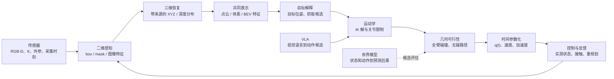
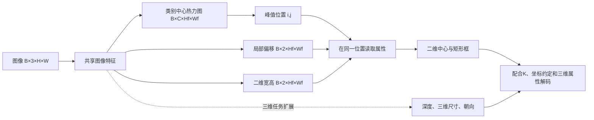
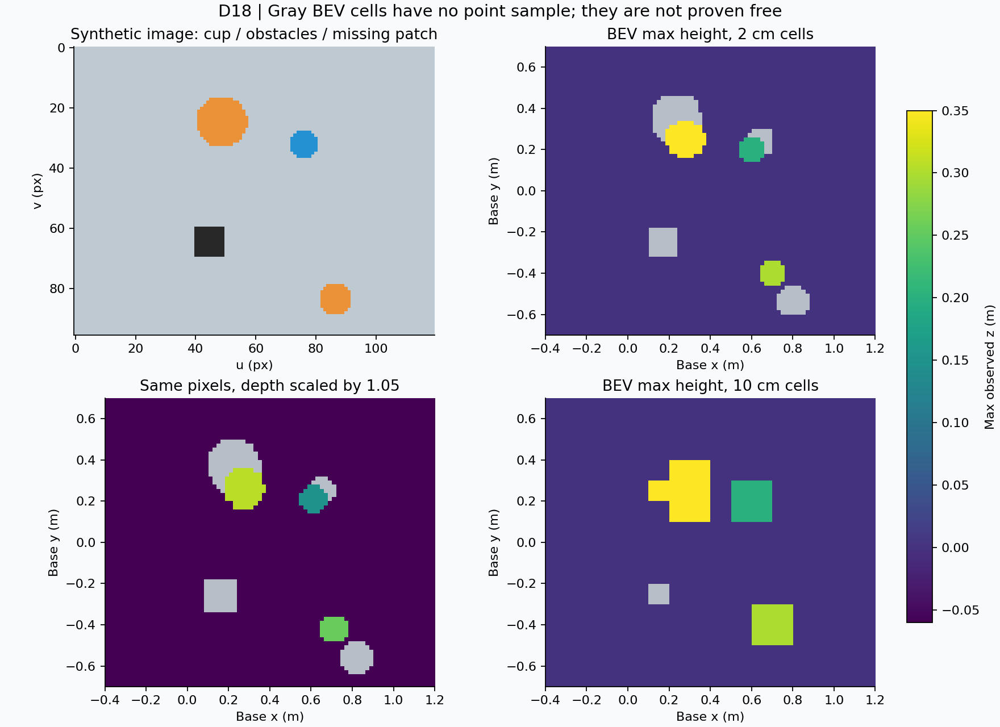
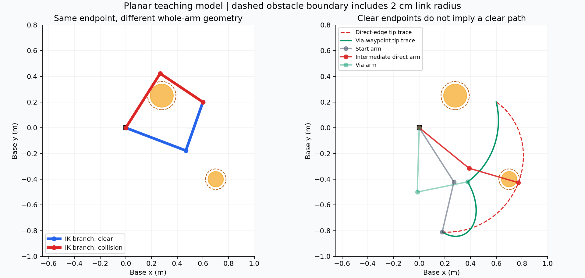
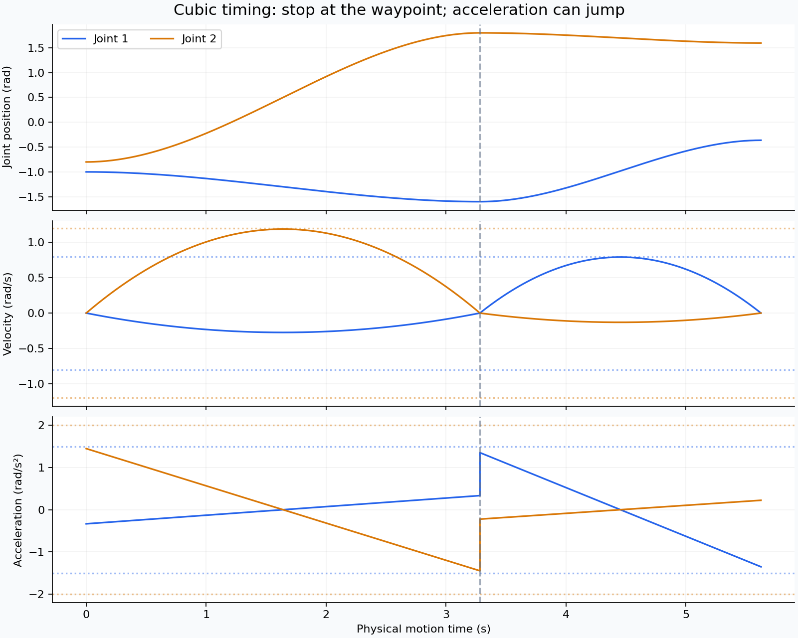
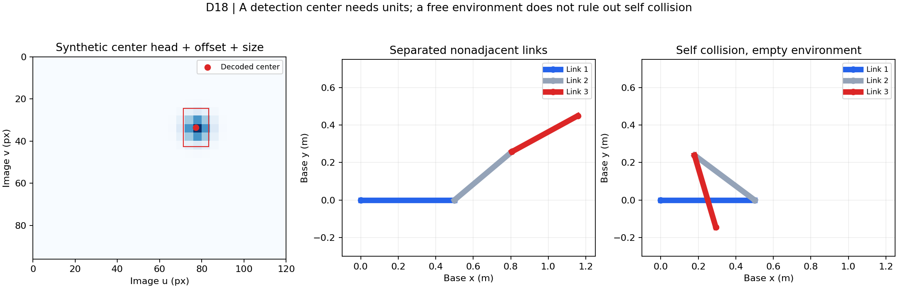

# D18 · 从二维识别到三维表示与可执行轨迹

[返回学习入口](../_index.md) · [P2 本周日程](../P2-深度理解-日程.md) · [上一课 D17](../day17/Daily-Learning-Pack.md) · [前置 D13](../day13/Daily-Learning-Pack.md) · [CPU 实验](demo.py) · [CenterNet与自碰撞实验](center_self_collision.py)

**二维感知告诉机器人“目标在图像哪里”，三维表示把证据放到共同物理空间；逆运动学、碰撞检查与时间参数化，才逐步回答“整条机械臂怎样过去”。这些模块需要连接，但不能互相冒充。**

继续使用 RGB-D 机械臂抓杯子的案例。假设分割模型已经给出了杯子 mask：今天不再主要讨论如何识别杯子，而是讨论这些像素怎样进入点云、BEV 和融合模块，以及目标位置如何变成可检查的机器人运动。

本课是 **P2 / W3-D4 / 全局 Day 18，原定日期 2026-09-22**。上一课 D17 是检测评价、配置空间与 RRT，本课接上表示与操作约束；下一课 D19 将进入 NOCS、6D 位姿、对称性、RANSAC 与 ICP。对照原计划，本课保留 BEV、伪雷达与融合主线，并补全指定的 CenterNet 阅读与自碰撞检查；没有改换课号或提前讲授下一课。

<details>
<summary>个人学习记录（自动更新教材时保留）</summary>

<!-- learner-notes:start -->

- 当前学习状态：尚未验收。
- 我对实验结果的事先预测：
- 我画出的表示与操作管线：
- 我的自测作答及理由：
- 我仍不能独立解释的问题：

<!-- learner-notes:end -->

</details>

<!-- daily-pack-generated:start -->

## 0. 学习目标与路线

完成本课后，你应该能：

1. 从 RGB-D、二维 mask 和标定参数恢复目标表面点，并说明为什么它还不是完整物体位姿。
2. 区分深度图、伪激光雷达、BEV 高度图与 BEV 特征；计算网格索引、分辨率与量化误差。
3. 解释硬深度反投影与深度分布提升的区别，追踪 Lift-Splat 思想中的 feature 和 tensor shape。
4. 比较数据、特征与决策三个层面的融合，指出错误置信度为什么可能让融合更差。
5. 为平面双连杆推导两组 IK 解，并检查关节范围、全臂碰撞和路径中间状态。
6. 把一条几何路径转成满足给定速度、加速度上限的教学轨迹，并说清它尚未保证哪些动力学性质。
7. 解码 CenterNet 的中心、偏移和尺寸，区别环境碰撞与非相邻连杆自碰撞。

| 顺序 | 知识主线 | 需要回答的问题 |
| --- | --- | --- |
| 1 | 宏观：表示连接感知与操作 | 像素、点云、BEV、关节状态分别在什么空间？ |
| 2 | 二维到三维 | 深度从哪里来，像素和内参是否配套？ |
| 3 | 伪激光雷达与 BEV | 换一种表示改善了什么，又没有改善什么？ |
| 4 | 分布提升与融合 | 多个可能深度和多个观测怎样进入共同空间？ |
| 5 | IK、碰撞与路径 | 目标能到达，为什么仍不意味着动作可执行？ |
| 6 | 时间参数化与验证 | 同一条路径怎样走，才满足运动约束？ |

## 1. 宏观：从一个 mask 出发，跨过四种空间

### 1.1 先给每一层的输出命名



图中的每个箭头都需要接口约定。例如：

- mask 的坐标在原始 RGB 图、缩放图还是校正图？
- 点云的长度单位是米还是毫米，在哪个相机帧？
- BEV 原点在哪里，哪个轴对应数组行，未知区域如何编码？
- 目标是物体中心、物体坐标系，还是夹爪的目标位姿？
- 关节数组的顺序、角度单位与物理时间是什么？

这些问题不会因为网络端到端训练而消失。端到端架构可以改变模块边界，但执行端仍然需要与训练标签相符的物理含义。

### 1.2 四种空间不是四种画法

| 空间 | 典型变量 | 距离意味着什么 | 常见误用 |
| --- | --- | --- | --- |
| 图像空间 | $(u,v)$，px | 像素距离 | 把像素邻近当成物理邻近 |
| 任务/工作空间 | $(x,y,z,R)$，m、rad | 物体或末端的物理位姿关系 | 只检查末端，忽略机械臂连杆 |
| BEV 网格空间 | $(i,j,\mathbf f)$ | 网格距离经分辨率换算成米 | 把特征值直接当碰撞占据概率 |
| 配置空间 | $\mathbf q$，rad 或 m | 关节构型差异 | 把关节直线插值当末端直线运动 |

BEV 是一种组织信息的方式，配置空间则描述机器人本身的自由度。**一张清晰的鸟瞰图，不会直接给出机械臂的无碰路径。**

本课实验把问题拆成两个受控模块：第一部分生成合成深度与语义 mask，检查三维和 BEV；第二部分使用恢复出的参考目标平面坐标，加上已知解析障碍，检查双连杆运动。障碍模型来自合成场景设定，没有把未观测区域默认为空，也没有宣称由一张 BEV 自动完成真实抓取。

## 2. 微观：二维输出怎样获得第三个维度

### 2.1 2D 检测框只定义视锥，不定义物体三维框

针孔相机中，一个像素对应：

$$
\mathbf p_c(Z)
=ZK^{-1}
\begin{bmatrix}u\\v\\1\end{bmatrix},
\qquad Z>0.
$$

$K$ 是内参矩阵，$Z$ 是光轴深度。一个二维矩形框包含一组射线，向空间延伸形成视锥。没有深度范围或其他几何约束时，它没有唯一的三维位置、尺寸和朝向。

因此“把二维框四个角反投影”也需要回答：四个角用哪个深度？角点落在物体上还是背景上？一个三维长方体的投影边界也不一定来自同一深度平面。

常见路线分工如下：

| 路线 | 第三个维度的来源 | 得到什么 | 主要边界 |
| --- | --- | --- | --- |
| RGB-D 反投影 | 深度传感器观测 | 当前可见表面点 | 孔洞、遮挡、对齐和深度尺度 |
| 双目/多视角几何 | 对应点与相机关系 | 三角化点或深度 | 小视差、错误匹配、基线及标定 |
| 单目学习深度 | 图像先验与训练监督 | 预测深度或相对结构 | 未见域、尺度和不确定性 |
| 已知平面求交 | 桌面等几何先验 | 射线与指定平面的交点 | 高于平面的杯口不能当桌面点 |
| 对象模型与对应关系 | CAD、类别形状、关键点 | 物体位姿及可能的尺度 | 模型、对称性和对应质量 |

今天重点是前三种输出怎样变成共同表示；对象级位姿将在 D19 深入。

### 2.2 从像素到基座坐标，做一遍完整手算

合成相机参数设为：

$$
K=
\begin{bmatrix}
80&0&60\\
0&80&48\\
0&0&1
\end{bmatrix}.
$$

图像宽 120、高 96，焦距用 px。相机朝下看桌面，基座系 $z$ 向上；相机光学系为 $x$ 右、$y$ 下、$z$ 前。相机到基座变换：

$$
R_{bc}=
\begin{bmatrix}
1&0&0\\0&-1&0\\0&0&-1
\end{bmatrix},
\qquad
\mathbf t_{bc}=
\begin{bmatrix}0.4\\0\\1.2\end{bmatrix}{\rm m}.
$$

$R_{bc}$ 是合法旋转，行列式为 $+1$；这里是绕 $x$ 轴转半圈，不是任意镜像。

杯子顶部中心像素为 $(u,v)=(76,32)$，光轴深度 $Z=1.0m$：

$$
\mathbf p_c=
\begin{bmatrix}
(76-60)\times1/80\\
(32-48)\times1/80\\
1
\end{bmatrix}
=
\begin{bmatrix}0.2\\-0.2\\1.0\end{bmatrix}{\rm m}.
$$

转换后：

$$
\mathbf p_b=R_{bc}\mathbf p_c+\mathbf t_{bc}
=
\begin{bmatrix}0.6\\0.2\\0.2\end{bmatrix}{\rm m}.
$$

这个点位于桌面上方 20 cm。代码对杯子顶部 mask 内的 69 个有效点求均值，也得到相同结果；这是对称合成形状下的构造性质，真实物体受遮挡后的可见点均值一般不是物体中心。

> [!question] 先算
> 如果所有深度都偏大 5%，杯子在基座系中会“变高”还是“变低”？先看相机朝向再判断，不要机械套用“深度大，所以高度大”。

### 2.3 接口约定比一行反投影更长

要使上面的算式成立，需要同时满足：

1. 像素和深度对应同一个物理观测，且使用相匹配的相机模型。
2. 深度是光轴 $Z$，长度单位为米；如果输入是沿射线距离，需要不同的归一化。
3. 图像已满足所用针孔模型的畸变处理约定。
4. 外参方向是 camera → base；动态相机的外参要对应采集时刻。
5. 孔洞、NaN、零深度和无效 mask 已显式处理。

本课合成数据直接满足零畸变、静态相机、同步语义图条件。接入 RealSense 时，需要依据具体流的内参、畸变模型、深度 scale 与对齐语义替换；把 RGB 图 resize 到深度分辨率，不等于完成 RGB-D 几何对齐。

### 2.4 原计划指定方法：CenterNet 的中心点怎样连接二维与三维属性

原计划这里的 CenterNet 指 Zhou 等人的 *Objects as Points*，不是其他同名方法。它以类别中心热力图定位，再读取中心处的 offset 与尺寸；三维检测扩展另有深度、米制尺寸和朝向输出。因此“用点表示检测对象”不等于“已经测出这个对象的三维形状”。[原论文第 3、4、4.1 节](https://arxiv.org/html/1904.07850v2)

把读论文需要追踪的三条支路画出来：



下面是独立构造的接口算例。输出步长为 $s=4$，原图 `120×96`，所以特征图宽 30、高 24。某个对象中心在原图 $\mathbf p=(77.2,33.6)px$，它对应：

$$
\tilde{\mathbf p}=\lfloor\mathbf p/s\rfloor=(19,8),\qquad
\mathbf o=\mathbf p/s-\tilde{\mathbf p}=(0.3,0.4).
$$

解码时 $\mathbf p=s(\tilde{\mathbf p}+\mathbf o)$。若此示例的宽高头约定直接输出原图像素 $(12,18)$，矩形为 $(71.2,24.6,83.2,42.6)$，不能再把宽高额外乘四。另一个实现若将宽高定义在特征尺度，公式必须随其训练标签改变。

若该射线的光轴深度已知为 1 m，沿前面的 $K$、外参反投影得到 $[0.615,0.18,0.2]m$。遗漏 offset 会得到 $[0.6,0.2,0.2]m$，相差 **25 mm**；遗漏 stride 的误差则约 **789 mm**。热力图峰值仍然清晰，但接口的像素尺度已错。

> [!warning] 二维框中心、可见表面点、三维物体中心不能混用
> 在这个教学算例里，深度是人为给定的射线测量。一般情况下，二维框中心不一定落在对象表面，也不等于三维几何中心的投影；读取一处 RGB-D 深度不会自动获得完整对象位姿。单目三维检测还依赖训练数据对深度、尺寸与方向的约束。

训练与推理也要分开：训练时中心热力图、偏移、尺寸等都有各自标签与损失；推理时从热力图取局部峰值，再索引同位置属性。中心热力图不是实例分割 mask，最大分数也不是深度方差，更不是抓取成功概率。若两个同类对象中心落入同一个输出格子，还需要讨论分辨率与表示容量。

第 11.7 节用手工构造的输出头检验解码，不运行预训练网络、不声称复现检测性能。这正好把“网络输出能否被物理接口正确解释”和“网络预测得准不准”分开。

## 3. 微观：伪激光雷达为什么改变了问题的组织方式

### 3.1 先区分来源与表示

Pseudo-LiDAR（伪激光雷达）通常指把视觉估计的深度反投影成三维点云，再交给点云或鸟瞰检测网络。它模仿的是输入表示，不是激光测距的物理过程。

因此下面两句话可以同时成立：

- 换成三维点云，使网络更容易按物理邻域处理信息。
- 原有视觉深度误差仍在，点云不会自动获得真实 LiDAR 的测距精度。

本课代码从合成深度反投影，演示的是这种表示转换的几何核心；它没有训练或运行单目深度网络，不能称为复现完整 Pseudo-LiDAR 检测系统。

### 3.2 图像邻居为什么未必是三维邻居

考虑同一行两个相邻像素：

$$
u_1=60,\ Z_1=1m;\qquad
u_2=61,\ Z_2=3m;\qquad f=80px,\ c_x=60px.
$$

它们在相机系中的横坐标是：

$$
X_1=0,\qquad X_2=\frac{1\times3}{80}=0.0375m.
$$

尽管只差一个像素，深度相差 2 m，三维距离约为 2.00035 m。杯沿和背景在图像上也会出现这种情况。

反过来，同样宽 10 cm 的物体在不同距离具有不同像素宽度：

$$
w_{\rm px}\approx f\frac{w_{\rm physical}}{Z}.
$$

在 $f=80px$ 时，1 m 处约 8 px，2 m 处约 4 px。固定大小的图像卷积感受野对应的物理区域会随距离变化。

米制点云和 BEV 可以把相近的物理位置放到相近的表示位置。这个几何先验改变了网络学习的便利程度，但它不是“点云永远胜过图像”的定理；颜色、纹理、遮挡和任务监督仍然重要。

Wang 等人在 CVPR 2019 的 Pseudo-LiDAR 工作中，将视觉深度转换为点云，并比较其与图像平面表示的下游检测效果。阅读时应同时看表示对照与深度条件，不把特定数据集的结果扩展为所有传感器的定论。[原论文](https://arxiv.org/pdf/1812.07179)

### 3.3 换表示不会消除系统偏差

令深度被乘以 $s$，同一像素的相机点也被乘以 $s$：

$$
\hat{\mathbf p}_c=s\mathbf p_c.
$$

但是基座中的点是：

$$
\hat{\mathbf p}_b=R_{bc}(s\mathbf p_c)+\mathbf t_{bc},
$$

因此误差：

$$
\delta\mathbf p_b
=(s-1)R_{bc}\mathbf p_c.
$$

它是相对**相机中心**缩放，而不是把基座位置整体乘以 $s$。

对刚才的杯子点，$s=1.05$：

$$
\hat{\mathbf p}_b=[0.61,0.21,0.15]^\top{\rm m},
$$

$$
\|\delta\mathbf p_b\|
=\sqrt{0.01^2+0.01^2+0.05^2}
\approx51.96mm.
$$

同一组二维像素和 mask，重建后杯子横向偏移、顶部降低。增大点数或重新栅格化都不会自动修正这个共同尺度偏差。

## 4. 微观：BEV 是共同坐标网格，信息由通道决定

### 4.1 BEV 不是“把 RGB 从上方看一眼”

BEV（Bird's-Eye View，鸟瞰表示）通常在地面或机器人基座的水平平面上建立米制网格，把高度、密度、语义或学习特征聚合到格子里。

本课定义：

$$
x\in[-0.4,1.2),\qquad
y\in[-0.7,0.7),\qquad
\Delta x=\Delta y=0.02m.
$$

网格尺寸为：

$$
N_x=80,\qquad N_y=70.
$$

物理点 $(x,y)$ 的列、行索引：

$$
i=\left\lfloor\frac{x-x_{\min}}{\Delta x}\right\rfloor,\qquad
j=\left\lfloor\frac{y-y_{\min}}{\Delta y}\right\rfloor.
$$

本课数组使用 `grid[j,i]`，即第一个轴对应 $y$，第二个轴对应 $x$。视觉图上使用 `origin="lower"` 让更大的行号朝上显示；这只是显示约定，不能偷偷改变物理坐标。

例如点 $(0.613,0.217)m$：

$$
i=\lfloor1.013/0.02\rfloor=50,\qquad
j=\lfloor0.917/0.02\rfloor=45.
$$

对应格子中心为 $(0.610,0.210)m$。点到中心的平面误差约为 7.62 mm。

范围是半开区间，点刚好处于 $x_{\max}$ 时应排除。把所有越界点 clip 到边缘格子，会制造虚假的边界障碍或语义密度。

### 4.2 同一个格子，可以保存哪些量

令 $\mathcal P_{ij}$ 是落入格子的点集合：

$$
n_{ij}=\#\mathcal P_{ij},\qquad
h_{ij}=\max_{\mathbf p\in\mathcal P_{ij}}z.
$$

若每个点有杯子标签 $m_k\in\{0,1\}$：

$$
r_{ij}=
\frac{\sum_{k\in\mathcal P_{ij}}m_k}{n_{ij}}
\quad(n_{ij}>0).
$$

这里 $r_{ij}$ 是该格子**采样点中**杯子标签的比例，不自动等于这个格子的占据概率，也不是物体存在概率。

典型输出可以是：

```text
BEV = [count, max_height, cup_sample_fraction, observed_mask, ...]
shape = [C_bev, N_y, N_x]
```

计数、最大值、均值、sum pooling（求和聚合）各有不同含义。均值对采样数的直接影响较小，但可能把多种表面混在一起；求和保留累积证据强度，却更容易随可见相机数量或点密度改变；最大值适合记录最高观测表面，却会受异常高点影响。

实现时 `np.maximum.at` 与 `np.add.at` 能处理同一个格子被多次索引的情况：

```python
np.add.at(count, (j, i), 1)
np.maximum.at(height, (j, i), z)
height[count == 0] = np.nan
```

没有落点的格子保存为未知，而不是将高度置零后宣称没有障碍。

### 4.3 分辨率是几何选择，也有计算代价

若将每个点用所在格子的中心替代，单轴最大误差为半个格子，二维最大误差为：

$$
e_{\max}\le
\frac12\sqrt{\Delta x^2+\Delta y^2}.
$$

方格边长为 $\Delta$ 时：

$$
e_{\max}\le\frac{\Delta}{\sqrt2}.
$$

因此：

- 2 cm 网格的中心替代误差上界约 14.14 mm。
- 10 cm 网格的上界约 70.71 mm。

这是**量化造成的点到格心误差**，不是整个网络定位误差的上界；若网络输出格内连续偏移，可以减小这项误差，仍需单独验证。

分辨率缩小为一半，固定区域内的二维格子数约变成四倍。三维体素在三个方向都加倍分辨率时，格子数约变成八倍。更细的格子也可能更稀疏，不会凭空补上被遮挡的表面。

### 4.4 高度压缩后还能不能做碰撞检测

只保存每格最大高度时，下面两种场景可能得到同样的 $h_{ij}$：

1. 从地面到 0.5 m 的实心立柱。
2. 下方悬空、最高点同样为 0.5 m 的架子横梁。

机器人能否从下方穿过，答案可能不同。最大高度没有记录垂直方向上的空隙。

这里需要分清三件事：

- **BEV 坐标网格**不强制你丢弃全部高度信息；可以堆叠多个高度层或保存更丰富通道。
- **单层最大高度图**确实无法恢复完整垂直结构。
- **学习得到的 BEV 特征**可能编码形状线索，但不能未经验证就作为完整的碰撞几何。

对精细抓取，通常仍需合适的三维占据、距离场、网格或几何体模型，并保留未知区域策略。仅凭“这一格没有点”，不能推断手臂可以穿过去。



左上是合成语义图，蓝色杯子、橙色障碍，黑色为人为设置的深度缺测区域。右上是 2 cm 网格的最大观测高度；左下只把深度放大 5%；右下改用 10 cm 网格。

灰色格子没有点样本，来源包括缺测、投影遮挡和采样分布。粗网格中部分灰色区域消失，只表示邻近落点被聚合到同一大格子，**不表示系统重新观测到了原来被遮挡的空间**。

## 5. 微观：从一个硬深度，到沿射线分布的特征

### 5.1 为什么不能总把不确定深度先压成一个均值

假设同一像素有两个同样可信的深度假设：

$$
P(Z=0.6m)=0.5,\qquad P(Z=1.4m)=0.5.
$$

均值是：

$$
\mathbb E[Z]=1.0m.
$$

但这里 $1.0m$ 并不是任何一个有支持的深度假设。把均值当成确定表面，会在两个可能表面之间制造一个中间位置。

对本课归一化射线 $[0.2,-0.2,1]^\top$，转换到基座后，两个假设为：

$$
\mathbf p_b^{(1)}=[0.52,0.12,0.60]^\top,\qquad
\mathbf p_b^{(2)}=[0.68,0.28,-0.20]^\top.
$$

均值点是 $[0.60,0.20,0.20]^\top$，恰好落在中间。第二个假设低于本合成桌面，因此若已知桌面约束，可以进一步排除；这个分布例故意只研究图像深度歧义，并没有使用桌面先验。

关键不是“均值永远不可用”，而是**均值保留不了多峰结构**。如果下游要决策应当避让哪个空间位置，需要考虑整个不确定区域或有根据的约束。

### 5.2 Lift-Splat 的基本计算

Lift-Splat-Shoot（LSS）提供了一种代表思路：每个图像位置输出上下文特征 $\mathbf c$ 和离散深度权重 $\boldsymbol\alpha$；沿深度假设把特征放入空间，再聚合到 BEV。其基本 lift 操作为：

$$
\mathbf f_d=\alpha_d\mathbf c,\qquad
\alpha_d\ge0,\quad\sum_d\alpha_d=1.
$$

例如 $\mathbf c=[2,1]^\top$，两个深度权重为 $[0.25,0.75]$，对应特征为 $[0.5,0.25]$ 与 $[1.5,0.75]$。它保留了沿不同深度分配证据的方式，不先选定唯一的深度。

Splat 阶段用已知相机几何将这些特征位置统一，再按网格聚合。**网络中的深度权重或特征强度不自动是经过校准的物理占据概率。** 这是方法机制与安全几何之间的重要边界。[LSS 原论文，第 3.1–3.2 节](https://www.ecva.net/papers/eccv_2020/papers_ECCV/papers/123590188.pdf)

### 5.3 把计算写成 shape，就不容易混淆“深度通道”和“特征通道”

设 batch 为 $B$，相机数 $V$，特征图尺寸 $H_f,W_f$，离散深度数 $D$，特征维数 $C$：

| 量 | 教学约定 shape | 用途 |
| --- | --- | --- |
| 图像特征 | `[B,V,C,H_f,W_f]` | 每像素的上下文 |
| 深度权重 | `[B,V,D,H_f,W_f]` | 沿射线分配 |
| 提升后特征 | `[B,V,D,H_f,W_f,C]` | 每个深度假设的加权特征 |
| 对应三维位置 | `[B,V,D,H_f,W_f,3]` | 由几何映射得到 |
| BEV 聚合结果 | `[B,C_bev,N_y,N_x]` | 共同参考系中的表示 |

下面是用于理解广播维度的独立伪代码，并非可直接替代官方实现：

```python
# context: [B,V,Hf,Wf,C]; depth_logits: [B,V,D,Hf,Wf]
alpha = softmax(depth_logits, axis=2)
lifted = alpha[..., None] * context[:, :, None, :, :, :]
# lifted: [B,V,D,Hf,Wf,C]
# xyz = geometric_unprojection(pixel_locations, depth_bins, K, T)
# bev = masked_scatter_sum(lifted, grid_indices(xyz))
```

例如 $B=1,V=2,D=32,H_f=24,W_f=32,C=16$，提升后的 float32 特征包含 786,432 个数，单这一个 tensor 约 3 MiB。真实训练还有梯度、骨干网络中间特征、优化器状态及其他张量，不能拿这个数字当整体显存估算。

可沿官方代码中的 `CamEncode.get_depth_feat`、`get_geometry`、`voxel_pooling` 追踪上述三段：图像增强的坐标恢复、相机到共同帧的变换、格子聚合分别在哪里。[作者代码](https://github.com/nv-tlabs/lift-splat-shoot/blob/master/src/models.py)

这里的硬网格索引不是对坐标处处可微的操作；固定几何分配下，聚合仍可对输入特征和深度权重传播梯度。“可端到端训练”不能被简化成“每一个索引选择都对所有变量光滑可微”。

### 5.4 训练和推理分别需要什么

从图像生成 BEV 语义，需要为目标任务提供监督，例如 BEV 语义标签；目标函数作用于最终预测，梯度再影响特征与深度分配。推理阶段输入图像和相机几何，输出对应任务的 BEV 结果。

LSS 原方法并不要求把真实深度作为所有训练样本的必需输入。其论文还研究了在预测代价图上给候选车辆轨迹评分；那不是一个可以直接套到机械臂全臂碰撞检查的模块。[作者项目页](https://research.nvidia.com/labs/toronto-ai/lift-splat-shoot/)

本课只用手设深度假设解释核心计算，没有训练 LSS、下载权重或声称实现了其论文性能。

## 6. 微观：融合首先要对齐“同一个东西”

### 6.1 数据、特征、决策三个层面

| 融合位置 | 典型做法 | 它解决什么问题 | 它依赖什么 |
| --- | --- | --- | --- |
| 数据层 | 多相机点云变换后合并 | 统一几何覆盖 | 内外参、时间、单位、遮挡与重复观测 |
| 特征层 | 对齐格子的特征拼接、求和或注意力 | 合并几何与语义证据 | 位置对应、有效 mask、训练信号 |
| 决策层 | 匹配不同来源的目标，再合并估计 | 汇总已经完成的检测/跟踪 | 数据关联、误差模型、对重复信息的处理 |

“把两个 feature concat”只是张量操作。若两部分特征对应不同物理位置，它会把不相关的东西拼在一起。一个网络可能学会部分容忍偏移，但不能因此省略对齐条件的说明。

对于颜色与点云特征，可以先把同一个三维点投影到图像，取对应的图像特征，再组合：

$$
\mathbf f_{\rm fused}
=\operatorname{MLP}\bigl(
[\mathbf f_{\rm 3D},\mathbf f_{\rm image},m_{\rm valid}]
\bigr).
$$

MLP 是多层感知机；$m_{\rm valid}$ 表示这一路观测是否有效。投影落入图像内并不自动保证该点在该视角可见，还需要考虑深度遮挡和时间对齐。

对齐后也不能假定“两个相机看到了两份独立真相”：它们可能使用同一误差标定、共享深度网络，或观察到同一种反光失败。

### 6.2 有明确误差模型时，怎样做一个可手算的融合

假定两路估计测量同一个标量 $x$：

$$
z_1=x+\epsilon_1,\qquad z_2=x+\epsilon_2,
$$

噪声独立、零均值，方差分别为 $\sigma_1^2,\sigma_2^2$。最小化加权平方误差：

$$
L(x)=\frac{(x-z_1)^2}{\sigma_1^2}
+\frac{(x-z_2)^2}{\sigma_2^2}.
$$

对 $x$ 求导并令其为零：

$$
\hat x=
\frac{z_1/\sigma_1^2+z_2/\sigma_2^2}
{1/\sigma_1^2+1/\sigma_2^2},
\qquad
\sigma_f^2=
\frac1{1/\sigma_1^2+1/\sigma_2^2}.
$$

若 $\sigma_1=0.01m,\sigma_2=0.04m$，权重分别约为 0.9412、0.0588，融合标准差预测为 9.701 mm。标准差较大的观测贡献较小。

三维向量形式可以用协方差矩阵代替标量方差：

$$
\Sigma_f=(\Sigma_1^{-1}+\Sigma_2^{-1})^{-1},\qquad
\boldsymbol\mu_f=
\Sigma_f(\Sigma_1^{-1}\boldsymbol\mu_1+
\Sigma_2^{-1}\boldsymbol\mu_2).
$$

它要求估计在同一坐标系，协方差可逆，并满足所用独立误差假设。像素语义置信度、神经网络 logit 和米制位置标准差不是可以直接互换的权重。

### 6.3 错误置信度会让融合“更自信地错”

本实验做两组各 5,000 次的合成测量：

| 条件 | 第二路实际噪声 | 第二路声明标准差 | 第二路偏差 | 融合 RMSE | 公式声称的标准差 |
| --- | --- | --- | --- | --- | --- |
| 独立、无偏、方差正确 | 40 mm | 40 mm | 0 | 9.772 mm | 9.701 mm |
| 第二路有偏且过度自信 | 40 mm | 5 mm | +80 mm | **71.891 mm** | **4.472 mm** |

第二组的融合均值偏差约为 **+64.060 mm**。误差模型错了，公式算得再精确，也只是在传播错误前提。

> [!warning] 融合前要能回答
> 两路数据真的是同一目标、同一时刻、同一参考系吗？  
> “高 confidence”是分类分数，还是经过验证的位置方差？  
> 同一个信息源是否被当成多个独立观测重复累计？

置信度校准、跨场景验证和失效检测，是后续多模态项目需要单独测量的内容，不能用简单平均或注意力图可视化代替。

## 7. 微观：IK 把目标点转换成哪些关节构型

### 7.1 先说清楚本课求解的目标

真实六自由度抓取需要夹爪位姿、开口宽度、接近方向和接触条件。本课的运动学实验只取杯子表面中心的平面坐标：

$$
(x_g,y_g)=(0.6,0.2)m,
$$

让平面双连杆的末端到达该点。它忽略垂直运动和末端姿态，因此只是**可达性与路径约束的缩小实验**。

双连杆长度：

$$
l_1=0.5m,\qquad l_2=0.4m,
$$

两个关节角为 $q_1,q_2$，$q_2$ 是第二连杆相对第一连杆的角度。正运动学：

$$
x=l_1\cos q_1+l_2\cos(q_1+q_2),
$$

$$
y=l_1\sin q_1+l_2\sin(q_1+q_2).
$$

这使“相同末端点，不同肘部位置”成为可能。我们要检查整个连杆几何，而不仅是末端。

### 7.2 用余弦定理求逆解

两式平方相加：

$$
x^2+y^2=l_1^2+l_2^2+2l_1l_2\cos q_2.
$$

定义：

$$
c_2=
\frac{x^2+y^2-l_1^2-l_2^2}{2l_1l_2}.
$$

若 $|c_2|>1$，目标不在这组长度的几何可达范围；只有微小浮点越界才适合裁剪。把明显不可达的目标强行 clip 到 $[-1,1]$，会伪造解。

一般位置有两支：

$$
q_2=\pm\arccos c_2,
$$

$$
q_1=\operatorname{atan2}(y,x)
-\operatorname{atan2}(l_2\sin q_2,l_1+l_2\cos q_2).
$$

对 $(0.6,0.2)m$：

$$
c_2=\frac{0.36+0.04-0.25-0.16}{0.4}=-0.025.
$$

两组结果为：

$$
\mathbf q^{(A)}\approx[-0.362713,\ 1.595799]^\top{\rm rad},
$$

$$
\mathbf q^{(B)}\approx[1.006215,\ -1.595799]^\top{\rm rad}.
$$

代回 FK 都能达到目标，数值误差接近机器精度。但两个肘部位置不同：

$$
\mathbf e_A\approx[0.467469,-0.177406]^\top m,
$$

$$
\mathbf e_B\approx[0.267531,0.422406]^\top m.
$$

### 7.3 可达、有限位、远离奇异与无碰撞是不同条件

几何可达半径满足：

$$
|l_1-l_2|\le\sqrt{x^2+y^2}\le l_1+l_2.
$$

本例为 $0.1m\le r\le0.9m$。但关节限位会进一步缩小工作空间；实验使用 $|q_i|\le2.8rad$。

平面位置雅可比：

$$
J=
\begin{bmatrix}
-l_1\sin q_1-l_2\sin(q_1+q_2)&-l_2\sin(q_1+q_2)\\
l_1\cos q_1+l_2\cos(q_1+q_2)&l_2\cos(q_1+q_2)
\end{bmatrix}.
$$

其行列式为：

$$
\det J=l_1l_2\sin q_2.
$$

接近完全伸直或折叠时，某些末端方向的速度可能需要很大的关节速度。**有位置解，不代表局部速度性能良好。**

一般机械臂常用数值 IK，需要初值、迭代停止条件和关节约束；今天使用解析解，便于完整看到两个分支，并不代表真实六轴、七轴问题都有这样简单的闭式答案。

## 8. 微观：碰撞检查必须看全臂，还必须看路径中间

### 8.1 用一个明确的几何模型做检查

实验把每条连杆近似成平面胶囊：线段中心线加半径 $r_{\rm link}=0.02m$。环境中的两个圆障碍为：

$$
O_1=(0.28,0.25,\ 0.09)m,\qquad
O_2=(0.70,-0.40,\ 0.06)m,
$$

三个数分别是圆心 $x,y$ 与半径。它们与视觉场景中的两个障碍使用相同的平面位置；碰撞模块直接使用这些已知解析参数，没有从颜色或 BEV 格子反推完整实体。

对连杆线段端点 $\mathbf a,\mathbf b$ 与圆心 $\mathbf c$，最近点参数：

$$
\lambda=
\operatorname{clip}\left(
\frac{(\mathbf c-\mathbf a)^\top(\mathbf b-\mathbf a)}
{\|\mathbf b-\mathbf a\|^2},\,0,\,1
\right).
$$

最近点与间隙：

$$
\mathbf p_{\rm near}=\mathbf a+\lambda(\mathbf b-\mathbf a),
$$

$$
d_{\rm clear}=
\|\mathbf c-\mathbf p_{\rm near}\|-r_{\rm obstacle}-r_{\rm link}.
$$

正值表示该模型中有分离间隙，零为接触，负值表示几何相交。对所有连杆与障碍取最小值。

这个近似没有检查机械臂基座、末端夹具、附着物体、自碰撞或三维高度分离。实验中的“通过”都限定在这个模型内。

### 8.2 两组 IK 解，一组会碰撞

实测：

| 目标构型 | FK 位置误差 | 全臂对圆障碍的最小间隙 |
| --- | --- | --- |
| 分支 A | 数值上为 0 | +208.49 mm |
| 分支 B | 约 $2.8\times10^{-17}m$ | **−7.22 mm** |

分支 B 的末端落点没错，问题出在连杆靠近第一个障碍。因此只在目标位置放一个“末端点”，会漏掉这类碰撞。

真实系统通常在包含机器人模型、环境几何和当前状态的 planning scene（规划场景）中检查碰撞与约束。MoveIt 的文档也将自碰撞、环境碰撞和状态约束分开处理。[官方规划场景示例](https://moveit.picknik.ai/main/doc/examples/planning_scene/planning_scene_tutorial.html)

### 8.3 起点和终点都无碰，不保证连接它们的边无碰

设置起点：

$$
\mathbf q_{\rm start}=[-1.0,-0.8]^\top,
$$

选用无碰撞的目标分支 A。关节直线边：

$$
\mathbf q(s)=(1-s)\mathbf q_{\rm start}
+s\mathbf q_{\rm goal},\qquad s\in[0,1].
$$

起点和终点都通过检查，但中间连杆会扫过第二个障碍。201 个等间距样本中有 **25 个构型相交**，最小采样间隙为 **−79.12 mm**。

这就是配置空间规划中的“边检查”：RRT 找到一个合法新节点，仍需检查连接边；RRT-Connect 也不会因为名字里有 connect 就自动跳过中间构型。

本课手工提供一个经验证的绕行点：

$$
\mathbf q_{\rm via}=[-1.6,1.8]^\top.
$$

路径改为 start → via → goal。它用于解释一条可行路径是什么，不是完整路径搜索算法，也不保证最短或最优。



左图两个分支共享同一目标点，红色分支的连杆进入膨胀障碍。右图红色虚线是直接插值的末端轨迹，绿色是绕行路径的末端轨迹；碰撞判断实际使用整条连杆，图中的末端曲线本身不是完整验证。

### 8.4 有限采样会漏碰撞，怎样给本例一个可计算的余量

只说“201 个点都没碰”仍不足以保证点之间没有碰撞。对本例的关节直线段，我们还能推导一个简单连续下界。

令 $\Delta\mathbf q=\mathbf q_b-\mathbf q_a$。任意连杆材料点沿路径参数 $s$ 的运动速度，可由：

$$
M=(l_1+l_2)|\Delta q_1|+l_2|\Delta q_2|
$$

统一上界。单位是每单位 $s$ 的米。直觉是：第一关节转动至多带动总臂长，第二关节转动至多带动第二连杆长度。

若均匀采样 $N_s$ 个构型，任意 $s$ 到最近样本的距离最多为：

$$
\Delta s_{\max}=\frac1{2(N_s-1)}.
$$

点到固定障碍集合的距离随点位置变化至多变化同样的量，因此：

$$
d_{\rm continuous}\ge
\min_k d_{\rm sample}(s_k)
-\frac{M}{2(N_s-1)}.
$$

只要右侧为正，就可以对这个静态二维胶囊模型中的整条边给出无碰证据，而不只是在采样点上猜测。

| 绕行段 | 最小采样间隙 | 扣除采样间隔运动上界后 |
| --- | --- | --- |
| start → via | 221.52 mm | **217.57 mm** |
| via → goal | 141.34 mm | **138.35 mm** |

这个下界依赖精确静态几何、指定连杆模型和线性关节路径。它不覆盖漏建模的夹爪、动态障碍、感知不确定性或控制跟踪误差。

> [!note] 一个值得保留的工程习惯
> “采样没有发现问题”与“在明确假设下有连续界”是不同强度的证据。无法建立连续界时，也应明确采样步长、运动幅度和余量，而不是只写一个布尔值。

### 8.5 自碰撞：环境里没有障碍，机器人仍可能撞到自己

环境碰撞检查集合为“机器人几何 × 环境几何”；自碰撞检查集合则是“机器人几何 × 机器人几何”的需要检查的配对。两者不能互相替代。二连杆主实验只有环境碰撞，下面增加三连杆算例，明确检验非相邻的第 1、3 连杆。

令平面三连杆长度为 $[0.5,0.4,0.4]m$，每根胶囊半径为 $r=0.025m$。用累计角 $\theta_i=\sum_{k=1}^{i}q_k$ 做前向运动学：

$$
\mathbf p_0=(0,0),\qquad
\mathbf p_i=\mathbf p_{i-1}+l_i
\begin{bmatrix}\cos\theta_i\\\sin\theta_i\end{bmatrix}.
$$

第 1 根中心线为 $[\mathbf p_0,\mathbf p_1]$，第 3 根为 $[\mathbf p_2,\mathbf p_3]$。胶囊间隙为：

$$
g_{13}=\min_{s,t\in[0,1]}
\left\|(\mathbf p_0+s(\mathbf p_1-\mathbf p_0))
-(\mathbf p_2+t(\mathbf p_3-\mathbf p_2))\right\|-2r.
$$

平面线段若相交，中心线最短距离为零；否则比较端点到对方线段的距离。不能只量关节中心间距离，因为相交处可能位于两根连杆内部。

| 构型（rad） | 第 1、3 连杆间隙 | 环境碰撞 | 自碰撞 |
| --- | --- | --- | --- |
| $[0,0.7,-0.2]$ | +350 mm | 无：本例无环境障碍 | 无 |
| $[0,2.5,2.5]$ | −50 mm | 无：本例无环境障碍 | 有：非相邻中心线相交 |

第二组的关节端点约为 $(0,0)$、$(0.5,0)$、$(0.17954,0.23939)$、$(0.29301,-0.14418)$。第 3 段从正 $y$ 穿到负 $y$，穿越第 1 段所在位置；环境地图再精确也无法替代自碰撞配对检查。

相邻连杆在真实机构的关节处可能有预期接触或简化几何重叠，因此需要根据机器人模型定义允许检查/忽略的配对；不能不加区分地把所有相邻重叠判成非法，也不能因其相邻就忽略所有远离关节处的相交。实际系统可利用碰撞矩阵和接触允许规则，但规则必须对应真实结构及任务阶段。[MoveIt 规划场景与允许碰撞矩阵](https://moveit.picknik.ai/main/doc/examples/planning_scene/planning_scene_tutorial.html)

本例只检查指定非相邻连杆对，不含关节壳体、基座、线缆或夹爪。它补全原计划的自碰撞概念与可执行算例，不把二维胶囊测试升级成真机安全结论。

## 9. 微观：路径加上时间，才成为轨迹

### 9.1 路径与轨迹分别回答什么

路径：

$$
\mathbf q=\mathbf q(s),\qquad s\in[0,1].
$$

轨迹：

$$
\mathbf q(t)=\mathbf q(s(t)).
$$

$s$ 是无量纲进度，$t$ 是物理时间。路径决定经过哪些构型，时间规律决定何时到达、移动多快、加速多大。

链式法则：

$$
\dot{\mathbf q}
=\frac{d\mathbf q}{ds}\dot s,
$$

$$
\ddot{\mathbf q}
=\frac{d^2\mathbf q}{ds^2}\dot s^2
+\frac{d\mathbf q}{ds}\ddot s.
$$

第一项说明：即便进度速度 $\dot s$ 恒定，弯曲路径也会产生关节加速度。不能只给每个 waypoint 附上相同时间间隔，就宣称约束已经满足。

### 9.2 从四个端点条件推导三次时间缩放

对一条关节直线：

$$
\mathbf q(s)=\mathbf q_0+\Delta\mathbf q\,s.
$$

希望持续时间为 $T$，在端点从静止到静止：

$$
s(0)=0,\quad s(T)=1,\quad \dot s(0)=0,\quad\dot s(T)=0.
$$

令 $s(t)=a_0+a_1t+a_2t^2+a_3t^3$，由前两个零时刻条件得 $a_0=a_1=0$；另外两个条件为：

$$
a_2T^2+a_3T^3=1,\qquad
2a_2T+3a_3T^2=0.
$$

解得：

$$
\boxed{s(t)=3\tau^2-2\tau^3},\qquad \tau=t/T.
$$

导数：

$$
\dot s=\frac{6\tau-6\tau^2}{T},\qquad
\ddot s=\frac{6-12\tau}{T^2}.
$$

因此每个关节的峰值为：

$$
\max_t|\dot q_i|=\frac{1.5|\Delta q_i|}{T},
\qquad
\max_t|\ddot q_i|=\frac{6|\Delta q_i|}{T^2}.
$$

系数 1.5 来自 $\tau=0.5$ 处的速度峰值，系数 6 来自两端的加速度大小。这是对本节直线路径加三次时间缩放的解析结果，不是任意轨迹的通用公式。

### 9.3 用约束反过来选择持续时间

给定速度上限 $v_i^{\max}$ 和加速度上限 $a_i^{\max}$，需满足：

$$
T\ge
\max_i\left(
\frac{1.5|\Delta q_i|}{v_i^{\max}},
\sqrt{\frac{6|\Delta q_i|}{a_i^{\max}}}
\right).
$$

本课每段再乘 1.01 作为很小的数值余量。两关节设置：

$$
\mathbf v^{\max}=[0.8,1.2]\ {\rm rad/s},
\qquad
\mathbf a^{\max}=[1.5,2.0]\ {\rm rad/s^2}.
$$

第一段 $\Delta\mathbf q=[-0.6,2.6]$，第二关节速度约束要求：

$$
T\ge1.5\times2.6/1.2=3.25s.
$$

它的加速度约束要求 $T\ge\sqrt{6\times2.6/2}\approx2.793s$，所以这段由速度限制主导。加入余量后 $T_1=3.2825s$。

第二段计算得到 $T_2\approx2.3431s$，整条教学轨迹总物理时长约 **5.6256 s**。这些秒数是机器人运动变量，与课程学习时间无关。



三行分别是关节位置、速度和加速度，点线为上下限，竖虚线为中间 waypoint。程序同时用解析峰值检查限制，不能只依赖曲线上几个采样点看起来没越界。

### 9.4 平滑到什么程度，还缺哪些条件

本例在每个 waypoint 停下，因此关节位置和速度连续，但加速度可能跳变。三次缩放也在起止时刻产生加速度突变。若要求端点加速度为零，可以考虑五次缩放：

$$
s(\tau)=10\tau^3-15\tau^4+6\tau^5.
$$

改用它后必须重新检查峰值与时长，不能沿用三次缩放的全部常数。Modern Robotics 第 9.1–9.2 节比较了这些时间缩放及其平滑性条件。[官方教材讲解](https://modernrobotics.northwestern.edu/nu-gm-book-resource/9-1-and-9-2-point-to-point-trajectories-part-2-of-2/)

还有四个边界：

1. 满足速度、加速度限制，不等于满足电机力矩、接触力或 jerk（加加速度）限制。
2. 对静态障碍，单调重定时不改变已经检查过的几何路径；动态障碍的碰撞关系会随时间改变。
3. 若后处理还改变路径形状，必须重新检查碰撞，不能沿用原路径结果。
4. 控制器实际插值、跟踪误差、超时和停止行为仍要验证；规划轨迹不是执行完成记录。

## 10. 回到宏观：把表示选择与操作结果联系起来

### 10.1 四种“成功”，不要合成一个布尔值

| 检查层 | 本课证据 | 失败时更可能需要修哪里 |
| --- | --- | --- |
| 感知与坐标 | 表面中心、深度尺度、有效点 mask | 观测、标定、反投影或目标选择 |
| 运动学 | FK 回代、关节限制、IK 分支 | 目标、姿态要求、机械结构或求解器 |
| 几何路径 | 全臂间隙、边检查、连续余量 | 场景模型、候选选择、路径规划 |
| 时间与执行 | 速度/加速度界，后续实测反馈 | 时间参数化、控制器、动力学与延迟 |

BEV 改善的是信息组织和某些下游预测，不能自动替代后面三层的判断。相反，规划失败也不一定说明感知错了：真实可达空间或通道可能确实不允许当前目标姿态。

### 10.2 VLA 在这条链里放哪里

VLA 可以根据视觉和语言生成动作、目标或动作序列。若要用本课的几何工具核查其输出，首先要知道动作的定义：

- 关节目标可以直接生成机器人几何状态，再检查约束。
- 末端目标通常还需要 IK，且要考虑可能存在的多个解。
- 增量位姿或速度必须结合当前状态、参考系和执行周期，恢复要检查的实际运动。
- 动作 chunk 需要检查整段中间状态，不只是最后一帧。

这说明几何模块既可以属于模块化策略，也可以作为学习策略的执行适配与核查工具。是否能这样组合，取决于控制接口；不是所有策略都输出同一种七维数组。

视觉或 BEV 编码器也可以成为策略的输入。例如 `[B,C,N_y,N_x]` 的 BEV 特征经池化或分块编码成 token，再与语言和本体状态结合。但编码后的 token 保留了哪些尺度和可见性信息，应通过任务实验检验，不能凭模型名称推定。

### 10.3 世界模型怎样利用 BEV，又为什么 BEV 本身不是世界模型

静态 BEV 只表示某一时刻的观测或推断：

$$
b_t=E(o_t).
$$

动作条件预测还需要：

$$
\hat b_{t+1}=F(b_t,a_t,\Delta t),
$$

或者用历史构建潜状态。若要给抓取候选打分，需要用与实际执行相符的动作和时长预测后果，再定义目标、碰撞或接触代价。

一个仅有最高表面的 BEV 可能区分不了桌下空间，也可能看不到杯子内部与接触状态。这样的信息缺失会使后继预测不唯一，需要更多观测、历史或合适的潜状态，而不只是加深预测网络。

**在静态 BEV 代价图上给候选路径求和，不自动等于训练了动作条件世界模型。** 前者可以完全没有环境状态转移模型。

### 10.4 Learning 五格卡：把结构、目标与监督分开

| 五格 | 视觉深度到点云 | 图像到 BEV 语义 | 行为克隆策略 |
| --- | --- | --- | --- |
| 数据从哪来 | 图像与深度标签/几何监督 | 多视角图像、几何及 BEV 标签 | 对齐观测、语言、本体与演示动作 |
| 学什么 | 深度预测；反投影本身可为解析式 | 共同空间中的语义特征与输出 | 观测条件下的动作映射 |
| 改善信号 | 深度、视差或重投影等误差 | 语义或其他下游任务损失 | 与演示动作的匹配目标 |
| 训练与推理 | 训练深度网络，推理再反投影 | 训练编码与 BEV 任务头，推理输出地图 | 训练策略，执行时适配控制接口 |
| 泛化怎样测 | 距离、材质、相机和新场景 | 新布局、标定偏差、缺失视角 | 新目标、初态、干扰与执行条件 |

CNN、Transformer、BEV 是架构或表示相关术语；监督来源和训练目标是另一条分类轴。换上 Transformer 不会自动把静态检测变成强化学习，也不会自动获得动作反馈。

## 11. 动手：从合成 RGB-D 到路径和轨迹的可复查实验

### 11.1 文件与环境

- [demo.py](demo.py)：完整 CPU 主实验，只依赖 NumPy。
- [plot_demo.py](plot_demo.py)：读取实验产物，生成三张图，需要 Matplotlib。
- [结果与参数](../../_assets/3d_learning/day18/results.json)：包含误差、IK、碰撞、时间参数和真实运行环境。
- 数组附件 (not exported: excluded by publication policy)：图像、点、BEV、关节轨迹等，用 `numpy.load` 读取。
- [深度比例单变量对照](../../_assets/3d_learning/day18/depth-scale-ablation.json)：从 1.05 改为 1.10 的结果。

**已验证环境：** macOS CPU，Python 3.11.15、NumPy 1.26.4、Matplotlib 3.10.9。使用已有环境完成，无模型下载，无 ROS 运行，无相机和机器人连接。

新环境需要的依赖：

```bash
python -m pip install numpy matplotlib
```

选择装有这些库的 Python，从 vault 根目录运行：

```bash
python -B 3d_learning/day18/demo.py
MPLCONFIGDIR=/tmp/day18-mpl python -B 3d_learning/day18/plot_demo.py
```

脚本以自身位置定位附件；`-B` 避免产生缓存文件。默认运行会刷新本课生成的结果和图片，不修改个人作答。

### 11.2 先预测四件事

1. 深度偏大 5% 时，俯视相机重建的杯顶高度会怎样变？
2. BEV 网格从 2 cm 变成 10 cm，灰色未知格变少能否说明观测更充分？
3. 两组 IK 都能精确达到目标，为什么只保留一组？
4. 路径起终点没有碰撞，直接用三次时间缩放能否修复中间碰撞？

先写到个人记录区，再运行。第四题尤其重要：时间缩放改变“何时经过”，静态场景中不会把已经穿过障碍的几何路径变成另一条路。

### 11.3 阅读结果，不只看脚本是否退出

| 实验项 | 默认结果 | 应如何解释 |
| --- | --- | --- |
| 有效深度 | 11,420 / 11,520 像素 | 100 个像素人为缺测；没有静默填成自由空间 |
| 杯顶 mask | 69 点 | 已给定语义，未测试真实分割能力 |
| 深度比例 1.05 | 表面中心误差 51.96 mm | 原二维 mask 不变，米制几何仍会错 |
| 细/粗网格 | 最大格心替代误差 14.14 / 70.71 mm | 仅量化项，不是完整检测误差 |
| IK | 2 个位置解，1 个通过当前碰撞模型 | 不能称为 50% 抓取成功率 |
| 直接路径 | 25 / 201 采样构型碰撞 | 起终点通过仍不能接受这条边 |
| 绕行路径 | 2 / 2 段连续间隙下界为正 | 限定在静态平面胶囊与圆障碍模型 |
| 时间参数化 | 2 / 2 段解析速度、加速度界通过 | 不包括力矩、jerk 或真实跟踪验收 |

本次 IK、三条边检查及三次时间采样的合计本机耗时约 **26.80 ms**。它不含图像获取、网络推理、传输和控制，不能当端到端实时性能。随机种子为 18；融合每组 5,000 次；相机采集时刻设为合成时间 0 s；障碍静止，机器人初始关节为 $[-1,-0.8]rad$；训练步数和真实机器人交互次数均为 0。

当前仿真没有真正闭环执行。输出的轨迹是经过本课模型检查的数学产物，“已验证脚本”与“用户完成学习”“机器人完成抓取”分开记录。

### 11.4 单变量对照：让深度偏差从 5% 变成 10%

```bash
python -B 3d_learning/day18/demo.py \
  --depth-scale 1.10 \
  --out-dir /tmp/day18-depth110
```

本次已执行，杯顶估计从 $[0.61,0.21,0.15]m$ 变成 $[0.62,0.22,0.10]m$，位置误差从 **51.96 mm** 变成 **103.92 mm**。

两次运行的运动学模块故意都使用未偏置的参考目标，以单独对照深度表示误差。因此这里没有声称“已测出感知偏差下真实规划成功率”。下一步可以在自己的实验副本中将 `wrong_target[:2]` 接入 IK，再比较目标误差与碰撞状态，并保留这个变量变更记录。

第二个思考实验：将三次轨迹每段持续时间减半。几何路径完全不变，但峰值速度变为两倍、峰值加速度变为四倍。你可以直接用第 9 节公式判断是否越界，不需要先接一台机械臂。

### 11.5 读代码时先抓住六个函数

| 函数 | 对应知识 | 输入到输出 |
| --- | --- | --- |
| `unproject` | 像素与深度到物理空间 | `depth[H,W] → xyz[N,3] + valid[H,W]` |
| `bev` | 栅格索引和聚合 | 点与标签 → 计数、高度、比例、未知掩码依据 |
| `ik` / `fk` | 目标与关节的双向关系 | 平面目标 ↔ 关节与连杆节点 |
| `clearance` | 全臂几何检查 | 关节 → 当前模型最小有符号间隙 |
| `edge_check` | 中间构型与连续余量 | 两端构型 → 采样检查及下界 |
| `timed_path` | 时间参数化 | waypoint → 时间、位置、速度、加速度 |

主脚本保留了不可信输入检查、解析回代和预期失败案例。教学用断言是对固定合成条件的核对，不是通用规划器的完整测试集。

### 11.6 完整可复制主脚本

> [!note]- 完整 CPU 主脚本（与 demo.py 一致）
>
> ```python
> """D18 CPU laboratory: RGB-D/BEV, depth ambiguity, fusion, IK and trajectories.
>
> NumPy only. All inputs are synthetic. No robot, ROS, network or model is used.
> """
> import argparse
> import json
> import platform
> import time
> from pathlib import Path
>
> import numpy as np
>
>
> LENGTHS = np.array([.5, .4])
> LINK_RADIUS = .02
> OBSTACLES = np.array([[.28, .25, .09], [.70, -.40, .06]])
>
>
> def scene():
>     """Ideal top surfaces: table, cup top and two obstacle tops; optical Z."""
>     h, w, f, cx, cy = 96, 120, 80., 60., 48.
>     v, u = np.mgrid[:h, :w]
>     depth = np.full((h, w), 1.2)
>     label = np.zeros((h, w), dtype=np.int64)
>     objects = [(.60, .20, .06, .20, 1), (.28, .25, .09, .35, 2),
>                (.70, -.40, .06, .30, 2)]
>     for x, y, radius, height, category in objects:
>         z = 1.2 - height
>         bx, by = .4 + (u-cx)*z/f, -(v-cy)*z/f
>         hit = ((bx-x)**2+(by-y)**2 <= radius**2) & (z < depth)
>         depth[hit], label[hit] = z, category
>     depth[60:70, 40:50] = np.nan  # unobserved patch; never silently set to zero
>     rgb = np.array([[190, 201, 210], [35, 145, 210], [235, 145, 55]])[label]
>     rgb[~np.isfinite(depth)] = [40, 40, 40]
>     return depth, label, rgb.astype(np.uint8)
>
>
> def unproject(depth):
>     v, u = np.indices(depth.shape)
>     valid = np.isfinite(depth) & (depth > 0)
>     z = depth[valid]
>     cam = np.c_[(u[valid]-60)*z/80., (v[valid]-48)*z/80., z]
>     # T_base_camera: R=diag(1,-1,-1), t=(0.4,0,1.2), all lengths in m.
>     base = cam @ np.diag([1., -1., -1.]).T + [.4, 0., 1.2]
>     return base, valid
>
>
> def bev(points, labels, resolution=.02):
>     """Count/max-height/semantic-ratio; zero count means no sample, NOT free."""
>     lo = np.array([-.4, -.7])
>     hi = np.array([1.2, .7])
>     n = np.rint((hi-lo)/resolution).astype(int)  # x,y dimensions
>     inside = np.all((points[:, :2] >= lo) & (points[:, :2] < hi), axis=1)
>     p, lab = points[inside], labels[inside]
>     ij = np.floor((p[:, :2]-lo)/resolution).astype(int)
>     # Explicitly reject boundaries; do not clip off-grid evidence into edge cells.
>     keep = np.all((ij >= 0) & (ij < n), axis=1)
>     p, lab, ij = p[keep], lab[keep], ij[keep]
>     count = np.zeros((n[1], n[0]), dtype=np.int64)
>     cup_count = np.zeros_like(count)
>     height = np.full(count.shape, -np.inf)
>     np.add.at(count, (ij[:, 1], ij[:, 0]), 1)
>     np.add.at(cup_count, (ij[:, 1], ij[:, 0]), lab == 1)
>     np.maximum.at(height, (ij[:, 1], ij[:, 0]), p[:, 2])
>     height[count == 0] = np.nan
>     fraction = np.divide(cup_count, count, out=np.zeros_like(height), where=count > 0)
>     center = lo+(ij+.5)*resolution
>     return {
>         "height": height, "count": count, "cup_fraction": fraction,
>         "xy_extent": np.array([lo[0], hi[0], lo[1], hi[1]]),
>         "max_sample_quantization_error_m": float(np.max(
>             np.linalg.norm(center-p[:, :2], axis=1))),
>         "empty_cells": int(np.sum(count == 0)),
>     }
>
>
> def fk(q):
>     elbow = LENGTHS[0]*np.array([np.cos(q[0]), np.sin(q[0])])
>     tip = elbow+LENGTHS[1]*np.array([np.cos(q.sum()), np.sin(q.sum())])
>     return np.array([[0., 0.], elbow, tip])
>
>
> def ik(xy):
>     c2 = (xy @ xy - LENGTHS @ LENGTHS)/(2*np.prod(LENGTHS))
>     if c2 < -1-1e-12 or c2 > 1+1e-12:
>         return []
>     c2 = np.clip(c2, -1., 1.)  # only numerical roundoff, not unreachable targets
>     answers = []
>     for sign in [1, -1]:
>         q2 = sign*np.arccos(c2)
>         q1 = np.arctan2(xy[1], xy[0])-np.arctan2(
>             LENGTHS[1]*np.sin(q2), LENGTHS[0]+LENGTHS[1]*np.cos(q2))
>         q = np.array([q1, q2])
>         if np.all(abs(q) <= 2.8):  # illustrative joint limits in rad
>             answers.append(q)
>     return answers
>
>
> def clearance(q):
>     """Signed clearance of two planar capsules against known circular obstacles."""
>     joints = fk(q)
>     distances = []
>     for ox, oy, radius in OBSTACLES:
>         center = np.array([ox, oy])
>         for a, b in zip(joints[:-1], joints[1:]):
>             ab = b-a
>             fraction = np.clip((center-a) @ ab / (ab @ ab), 0., 1.)
>             distances.append(np.linalg.norm(center-a-fraction*ab)-radius-LINK_RADIUS)
>     return float(min(distances))
>
>
> def edge_check(a, b, samples=201):
>     configurations = np.linspace(a, b, samples)
>     values = np.array([clearance(q) for q in configurations])
>     # Any link point moves at most M*ds along this straight joint-space edge.
>     dq = abs(b-a)
>     M = LENGTHS.sum()*dq[0]+LENGTHS[1]*dq[1]
>     bound = float(values.min()-M/(2*(samples-1)))
>     return {"sample_min_clearance_m": float(values.min()),
>             "continuous_lower_bound_m": bound, "samples": samples,
>             "certified_in_toy_model": bool(bound > 0),
>             "colliding_samples": int(np.sum(values <= 0))}
>
>
> def timed_path(waypoints):
>     """Cubic time scaling on each straight edge, stopping at each waypoint."""
>     vmax, amax = np.array([.8, 1.2]), np.array([1.5, 2.])
>     records, segments, offset = [], [], 0.
>     for a, b in zip(waypoints[:-1], waypoints[1:]):
>         dq = b-a
>         duration = 1.01*max(float(np.max(1.5*abs(dq)/vmax)),
>                             float(np.max(np.sqrt(6*abs(dq)/amax))))
>         tau = np.linspace(0, 1, 201)
>         s = 3*tau**2-2*tau**3
>         sd = (6*tau-6*tau**2)/duration
>         sdd = (6-12*tau)/duration**2
>         q = a+s[:, None]*dq
>         qd, qdd = sd[:, None]*dq, sdd[:, None]*dq
>         analytic_v = 1.5*abs(dq)/duration
>         analytic_a = 6*abs(dq)/duration**2
>         assert np.all(analytic_v <= vmax) and np.all(analytic_a <= amax)
>         records.append(np.c_[offset+tau*duration, q, qd, qdd])
>         segments.append({"duration_s": duration, "max_speed_rad_s": analytic_v.tolist(),
>                          "max_accel_rad_s2": analytic_a.tolist()})
>         offset += duration
>     # At internal waypoints there are two one-sided acceleration samples.
>     return np.concatenate(records), {
>         "segments": segments, "total_duration_s": offset,
>         "velocity_limits_rad_s": vmax.tolist(), "accel_limits_rad_s2": amax.tolist(),
>         "acceleration_continuous_at_waypoints": False,
>         "torque_limits_verified": False,
>     }
>
>
> def main():
>     ap = argparse.ArgumentParser()
>     ap.add_argument("--depth-scale", type=float, default=1.05)
>     ap.add_argument("--seed", type=int, default=18)
>     ap.add_argument("--out-dir", type=Path, default=(
>         Path(__file__).resolve().parents[2]/"_assets/3d_learning/day18"))
>     args = ap.parse_args()
>     if not np.isfinite(args.depth_scale) or args.depth_scale <= 0:
>         ap.error("depth-scale must be finite and positive")
>     rng = np.random.default_rng(args.seed)
>     depth, label, rgb = scene()
>     xyz, valid = unproject(depth)
>     biased, _ = unproject(depth*args.depth_scale)
>     labs = label[valid]
>     target = xyz[labs == 1].mean(axis=0)
>     wrong_target = biased[labs == 1].mean(axis=0)
>     np.testing.assert_allclose(target, [.6, .2, .2], atol=1e-12)
>     fine, coarse = bev(xyz, labs), bev(xyz, labs, .10)
>     bias_bev = bev(biased, labs)
>     # Learned-depth ambiguity example: manually specified distribution, no learning.
>     depths = np.array([.6, 1.4])
>     masses = np.array([.5, .5])
>     hypotheses = np.array([.4, 0., 1.2])+depths[:, None]*[.2, .2, -1.]
>     mean_point = masses @ hypotheses
>     assert np.isclose(masses.sum(), 1.)
>
>     fusion = []
>     eps = rng.normal(size=(5000, 2))
>     for name, bias, reported_sigma in [
>         ("independent_unbiased", 0., .04),
>         ("biased_overconfident_second_source", .08, .005),
>     ]:
>         values = 1.+eps*np.array([.01, .04])+np.array([0., bias])
>         precision = 1/np.array([.01, reported_sigma])**2
>         weights = precision/precision.sum()
>         fused = values @ weights
>         fusion.append({"case": name, "weights": weights.tolist(),
>                        "trials": len(fused), "actual_second_noise_std_m": .04,
>                        "reported_second_std_m": reported_sigma,
>                        "bias_m": float(np.mean(fused-1)),
>                        "rmse_m": float(np.sqrt(np.mean((fused-1)**2))),
>                        "claimed_std_m": float(np.sqrt(1/precision.sum()))})
>
>     begin = time.perf_counter()
>     solutions = ik(target[:2])
>     assert len(solutions) == 2
>     branches = []
>     for q in solutions:
>         error = float(np.linalg.norm(fk(q)[-1]-target[:2]))
>         assert error < 1e-12
>         branches.append({"q_rad": q.tolist(), "fk_error_m": error,
>                          "clearance_m": clearance(q)})
>     assert sum(x["clearance_m"] > 0 for x in branches) == 1
>     assert not ik(np.array([1.1, 0.]))
>     goal = solutions[0]
>     start, via = np.array([-1., -.8]), np.array([-1.6, 1.8])
>     direct = edge_check(start, goal)
>     detour = [edge_check(start, via), edge_check(via, goal)]
>     assert clearance(start) > 0 and clearance(goal) > 0
>     assert direct["colliding_samples"] > 0
>     assert all(x["certified_in_toy_model"] for x in detour)
>     waypoints = np.array([start, via, goal])
>     motion, timing = timed_path(waypoints)
>     np.testing.assert_allclose(motion[0, 1:3], start, atol=1e-12)
>     np.testing.assert_allclose(motion[-1, 1:3], goal, atol=1e-12)
>     planning_ms = (time.perf_counter()-begin)*1000
>     report = {
>         "metadata": {"date": "2026-09-22", "python": platform.python_version(),
>             "numpy": np.__version__, "device": "CPU", "seed": args.seed,
>             "data": "synthetic optical depth + supplied semantic masks",
>             "length_unit": "m", "angle_unit": "rad", "time_unit": "s",
>             "capture_time_s": 0., "obstacles_static": True,
>             "camera_to_base": {"R": np.diag([1,-1,-1]).tolist(), "t": [.4,0,1.2]},
>             "training_steps": 0, "robot_interactions": 0,
>             "planning_checks_elapsed_ms": planning_ms,
>             "latency_scope": "IK, three edges, cubic samples; no sensor/inference/control"},
>         "perception": {"cup_surface_center_m": target.tolist(),
>             "biased_surface_center_m": wrong_target.tolist(), "depth_scale": args.depth_scale,
>             "center_error_m": float(np.linalg.norm(wrong_target-target)),
>             "valid_pixels": int(valid.sum()), "total_pixels": int(valid.size),
>             "cup_pixels": int(np.sum(labs == 1)),
>             "fine_empty_cells": fine["empty_cells"],
>             "fine_quantization_max_m": fine["max_sample_quantization_error_m"],
>             "coarse_quantization_max_m": coarse["max_sample_quantization_error_m"]},
>         "depth_ambiguity": {"depths_m": depths.tolist(), "masses": masses.tolist(),
>             "hypotheses_base_m": hypotheses.tolist(), "mean_point_m": mean_point.tolist(),
>             "mean_is_a_supported_hypothesis": False},
>         "fusion": fusion,
>         "planning": {"link_lengths_m": LENGTHS.tolist(), "link_radius_m": LINK_RADIUS,
>             "obstacles_x_y_radius_m": OBSTACLES.tolist(), "ik_branches": branches,
>             "start_q_rad": start.tolist(), "goal_q_rad": goal.tolist(),
>             "via_q_rad": via.tolist(), "direct": direct, "detour": detour,
>             "planner": "manually supplied waypoint, not RRT or a complete planner",
>             "collision_scope": "planar link capsules vs circles; no self/base/tool/payload check",
>             "timing": timing},
>     }
>     args.out_dir.mkdir(parents=True, exist_ok=True)
>     (args.out_dir/"results.json").write_text(
>         json.dumps(report, indent=2, ensure_ascii=False), encoding="utf-8")
>     np.savez_compressed(args.out_dir/"arrays.npz", depth=depth, rgb=rgb, label=label,
>         points=xyz, fine_height=fine["height"], count=fine["count"],
>         coarse_height=coarse["height"], biased_height=bias_bev["height"],
>         extent=fine["xy_extent"], motion=motion, waypoints=waypoints)
>     print(json.dumps({"output": str(args.out_dir), "perception": report["perception"],
>         "ik_branches": branches, "direct": direct, "detour": detour,
>         "timing": timing}, ensure_ascii=False, indent=2))
>
>
> if __name__ == "__main__":
>     main()
> ```

### 11.7 补全原任务：中心解码与自碰撞两个独立检查

[完整补充脚本 center_self_collision.py](center_self_collision.py) 使用 NumPy 与 Matplotlib，无模型权重、无 ROS 依赖。运行：

```bash
MPLCONFIGDIR=/tmp/day18-mpl python -B 3d_learning/day18/center_self_collision.py
```

先预测：移除 center offset 会偏多少米？环境障碍列表为空时，能否省略自碰撞检查？脚本实际执行热力图峰值定位、原图坐标恢复、已知深度反投影，以及两组 3R 构型的非相邻胶囊检查。

```python
# heatmap: [Hf,Wf]；本例只构造一个类别和一个已知中心。
row, col = np.unravel_index(np.argmax(heatmap), heatmap.shape)
pixel = stride * (np.array([col, row]) + offset)
# 真实多对象解码要做局部峰值提取，不能用一次全局 argmax 代替。
# self_clearance = distance(link1_centerline, link3_centerline) - radius1 - radius3
# 环境检查和自碰撞检查分别输出，再与关节限制等条件组合。
```



左图把特征图显示回原图像素范围，红框来自尺寸解码；中、右图展示同一组三连杆长度的两个构型。线宽只用于识别连杆，数值判定使用 25 mm 半径的胶囊距离，不从屏幕线宽计算。

已验证结果：正确解码误差为 0；遗漏 offset 为 25 mm，遗漏 stride 为约 789.33 mm；两构型的自碰撞间隙分别为 +350 mm、−50 mm。完整参数见 [结果 JSON](../../_assets/3d_learning/day18/center-self-collision.json)。这两个独立的小实验分别对应 CenterNet 接口理解、自碰撞概念；不与主实验拼成未经验证的全机器人闭环。

## 12. 工程接入：让离线实验与真实系统的边界清楚

### 12.1 感知侧应交出什么

一个能给操作模块使用的目标包，至少应明确：

```yaml
target:
  kind: observed_surface_point
  frame: base
  position_unit: m
  timestamp: capture_time_in_shared_clock
  source: instance_mask_plus_optical_depth
  uncertainty: estimated_or_unavailable
scene:
  representation: point_cloud_with_visibility_mask
  unknown_space_policy: explicitly_defined
  calibration_version: recorded
```

这里的 `kind` 刻意写成表面点；如果实际输出的是对象位姿或抓取位姿，应换成相应类型，并补充旋转、对称约定、尺度或夹爪定义。错误类型不能靠给数组换个名字修复。

真实多相机还需记录时间同步状态。把不同时刻的物体点融合到同一个 BEV，可能把运动物体拉成两份；这与标定偏移造成的重影需要分开诊断。

### 12.2 规划侧需要比目标点更多的信息

操作模块通常还需要：

- 当前实测关节状态与机器人模型。
- 目标夹爪姿态、接近方向、预抓取位置与开口条件。
- 障碍物及未知区域、允许接触关系、附着物体几何。
- 关节和运动限制、轨迹输出单位、执行周期与反馈条件。

抓取后物体成为随末端运动的附着几何，原先仅对空夹爪检查过的路径可能不再适用。接触允许也应精确限定对象和阶段，不能把“忽略碰撞”当通用解决方案。

### 12.3 失败归因要能对应到一项可修改的输入

| 现象 | 第一组检查 | 一项可隔离原因的实验 |
| --- | --- | --- |
| 目标在图像中对，基座位置偏 | 深度尺度、外参方向、图像变换 | 已知物理点的投影与反投影核对 |
| BEV 边缘有一圈假障碍 | 越界索引是否被 clip | 将视野外点排除后比较 |
| 更粗的图看起来更完整 | count、未知 mask 与高度聚合 | 保留原有效样本数量，比较而非填满未知 |
| 多传感器融合后更差 | 关联、时间、偏差与置信度 | 固定同一场景，分别关闭一路 |
| IK 成功但连杆擦碰 | 全臂碰撞、附着几何 | 同一目标比较不同 IK 分支 |
| 两端无碰但执行途中碰撞 | 边检查、插值方式、场景更新 | 画出中间构型与最小间隙 |
| 路径没变，执行变得急促 | 周期、时间缩放、实际约束 | 比较同一物理时长下的速度与加速度 |

只比较最后一个任务成功率，往往不知道该修感知、表示、规划还是控制。保留这些中间证据，才能做公平的模块对照。

## 13. 精读任务：表示改变了什么，证据又覆盖到哪里

### 13.1 Pseudo-LiDAR：图像深度如何进入三维检测

**来源：** Wang 等，*Pseudo-LiDAR from Visual Depth Estimation: Bridging the Gap in 3D Object Detection for Autonomous Driving*，CVPR 2019。[原文与补充材料版本](https://arxiv.org/pdf/1812.07179)

阅读第 3 节 **Approach** 中深度估计、点云生成与表示讨论；再看第 4.2 节的数据和深度模型设置、第 4 节 Table 2 的表示对照。以下任务用自己的话和本课数值完成：

1. 画出“图像 → 深度 → 点云 → 检测”的输入输出，逐步标出学习模块和解析变换。
2. 用第 3 节的相邻像素算例说明图像邻域与三维邻域的区别。
3. 对照实验是否固定深度来源、训练数据和检测结构？哪些差异不能全部归功于表示？
4. 原文第 4.2 节提到深度训练数据与检测验证集的重叠问题；写出自己使用预训练深度模型时应检查的数据来源。

最后一项说明：网络不是你本次训练的，也可能把上游数据重叠带入下游评估。记录为检查项，而不是未经核验就断言任何具体模型存在泄漏。

### 13.2 Lift-Splat-Shoot：沿射线分配特征，再形成共同网格

**来源：** Philion、Fidler，*Lift, Splat, Shoot*，ECCV 2020。[原论文](https://www.ecva.net/papers/eccv_2020/papers_ECCV/papers/123590188.pdf) · [作者实现](https://github.com/nv-tlabs/lift-splat-shoot/blob/master/src/models.py)

阅读第 3.1 节 Lift、第 3.2 节 Splat、第 3.3 节 Shoot，结合 Figure 3、Figure 4。实现只需定位前文列出的三个函数，不需要安装整个历史环境。

1. 手算 $\alpha_d\mathbf c$，解释它与“先取深度均值再反投影”的不同。
2. 追踪深度维、通道维与相机维，说明哪一步将多个来源汇入共同网格。
3. 解释哪些参数来自标定，哪些由训练优化。
4. 说明论文的候选车辆轨迹评分与本课机械臂全臂几何检查的区别。

### 13.3 原计划指定：Objects as Points / CenterNet

**来源：** Zhou、Wang、Krähenbühl，*Objects as Points*，2019。[原文](https://arxiv.org/html/1904.07850v2)

按第 3 节的热力图/偏移、第 4 节二维框、第 4.1 节三维属性、Figure 4 和附录 E 的误差分析阅读。完成以下卡片：

1. 独立画出热力图、offset、尺寸三个头的 shape，并手算第 2.4 节的中心恢复。
2. 区分输出步长、图像 resize/crop 变换与米制尺度，标注每一步在哪个空间。
3. 列出三维扩展相比二维框增加的量；说明原图像平面中心表示与 BEV 表示为什么不是同一概念。
4. 设计一个“保持其他头不变，仅替换一个头为真值”的诊断实验，解释它与重新训练模型的区别。

**今天的产出边界：** 原定 CenterNet 精读卡、Pseudo-LiDAR 与 Lift-Splat 补充卡，以及相关公式和函数追踪；没有复现论文完整网络或排行榜结果，也不自动增加“用户已完成精读”的计数。

## 14. 今日总结：表示、构型、路径、时间各自承担一层责任

三句话带走：

1. 从图像进入点云和 BEV，是把证据放进更适合几何任务的坐标组织；错误尺度、遮挡和未知区域仍然需要处理。
2. 一个目标可以有多个 IK 解，解的末端位置相同，整条机械臂的碰撞情况却不同；起终点合法也不能替代边检查。
3. 无碰路径需要再配上满足限制的时间规律，规划结果还需要真实执行反馈才能成为任务完成证据。

### 14.1 最值得掌握的五个点

- **三维来源与表示分开。** 它防止把伪激光雷达当成新传感器，也便于定位误差究竟来自观测还是组织方式。
- **BEV 的格子、通道与未知语义。** 同样是鸟瞰图，能回答的问题取决于保存了什么；精细操作不能只靠一张漂亮颜色图。
- **融合的关联和误差前提。** 多一路数据不等于多一路可信证据，错误置信度会掩盖更大的误差。
- **IK、构型碰撞与路径碰撞分层。** 这让“求解成功”变成可以追踪的多个判据，而不是一个含糊返回值。
- **$\mathbf q(s)$ 与 $\mathbf q(t)$。** 它直接解释改变时长为何会改变速度、加速度，也解释静态碰撞为何不能靠减速消除。

### 14.2 最容易混淆的三个边界

1. **没有点样本，不等于已确认自由空间。** 灰格消失可能只是聚合变粗。
2. **低 FK 误差，不等于该构型或路径无碰。** 肘部和扫过区域都必须检查。
3. **位置、速度平滑，不等于动力学可执行。** 加速度跳变、力矩上限、接触与控制误差需要各自的模型。

### 14.3 今天应该留下的东西

- 一张从二维 mask 到轨迹的接口图，标清单位、参考系、有效性与时间。
- 默认实验结果、一次深度比例对照，以及 CenterNet 中心解码实验，包含运行环境与自己的预测。
- 三类具体反例：BEV 未知被粗化掩盖；IK/终点正确但中间路径碰撞；环境无障碍但机械臂自碰撞。
- 原定 CenterNet 精读卡、Pseudo-LiDAR 与 Lift-Splat 补充卡，区分原文结论、自己的推导与实际运行证据。
- 自测作答和未理解问题。生成讲义与运行脚本不代表这些个人产出已经完成。

## 15. 自测：从表示选择走到操作判断

每题 0/1/2 分，共 18 分。先回答，最后再展开参考。

1. **概念。** 为什么二维框不能唯一确定三维框？RGB-D 点云与伪激光雷达在哪个维度相似，在哪个维度仍可能不同？
2. **手算。** 使用本课 $K,R_{bc},t_{bc}$，将像素 $(76,32)$、深度 $1m$ 变成基座点。若深度乘 1.05，新的点和位置误差是多少？
3. **BEV。** 2 cm 方格中用格心替代一个点，二维最大量化误差是多少？粗网格里原来的未知格不见了，为什么不代表重新观测到了空间？
4. **分布。** 一个像素的深度概率在 0.6 m、1.4 m 各为 0.5。均值反投影丢掉什么信息？若已知某个假设位于桌面以下，应如何利用这条额外证据？
5. **融合。** 一路噪声 10 mm，另一路实际噪声 40 mm 且有 +80 mm 偏差，却声称标准差 5 mm。按独立无偏公式融合后为什么可能更差？语义 confidence 能直接作为米制位置方差吗？
6. **IK 与碰撞。** 本课目标有两组 FK 都正确的 IK 解，为什么只选择其中一组？如果选定构型无碰，下一步还必须检查什么？环境里没有障碍能否省略自碰撞？
7. **轨迹。** 对一维关节位移 $1rad$，速度上限 $0.5rad/s$、加速度上限 $1rad/s^2$，采用本课三次缩放，最小满足这些峰值限制的 $T$ 是多少？再把 $T$ 减半会怎样？
8. **迁移。** 一个 VLA 根据 BEV 输出末端动作 chunk，你准备让真实机械臂抓杯子。请按感知、动作语义、运动学、几何路径、时间和反馈六个层面，列出还需要的关键信息。

9. **中心解码。** 输出步长 4、峰值格坐标 (19,8)、offset (0.3,0.4)，原图中心是多少？仅遗漏 offset，在本课焦距 80 px、已知深度 1 m 时，会引入多少三维位置误差？

## 16. 未理解问题与下一课

| 如果还有疑问 | 本课先补哪里 | 后续课程连接 |
| --- | --- | --- |
| 点云更密为什么不代表更准 | 第 3 节共同尺度偏差 | W4 重建误差与表示比较 |
| BEV 能否直接作为碰撞地图 | 第 4 节高度压缩与未知空间 | W4 几何重建，P3 系统场景模型 |
| 多峰深度为何不能只取均值 | 第 5 节两个假设的手算 | W4 潜状态、预测和部分可观测性 |
| 为什么一个目标有多个 IK 解 | 第 7 节余弦定理与肘部位置 | D19 位姿与后续抓取候选筛选 |
| 三次缩放为什么有加速度跳变 | 第 9 节端点条件与导数 | W5 控制，P3 轨迹执行与反馈 |

下一课 D19 将把“目标表面点”升级为“对象坐标系与 6D 位姿”，学习 NOCS、旋转与对称、RANSAC/ICP，以及绝对和增量动作的坐标关系。

第一步先写清：**杯子上一个可见点、杯子的物体位姿、夹爪抓取位姿，分别缺少哪些信息。** 这个区分会决定后续 ICP、位姿指标与 BC 动作标签应该怎样使用。

个人掌握状态独立记录；不因为材料已经补齐或进入 D18 就自动勾选前置验收。需要回查时，按学习入口的原课号阅读。

## 17. 自测核对答案与判分标准

> [!note]- 完成作答后展开：参考答案与评分
> **1.** 二维框定义视锥中的射线集合，缺深度、尺寸和朝向等约束。两类点云可以共享 XYZ 表示，但测量/估计来源、尺度、噪声与缺测模式不同。0 分：认为框直接给三维；1 分：只提缺深度；2 分：同时区分表示与来源及其误差。
>
> **2.** 相机点 $[0.2,-0.2,1]m$，基座点 $[0.6,0.2,0.2]m$；偏置后为 $[0.61,0.21,0.15]m$，误差约 51.96 mm。0 分：坐标或尺度错误；1 分：原始点正确；2 分：偏置点、误差与“相机中心缩放”均清楚。
>
> **3.** $\sqrt{2}\times0.01m\approx14.14mm$。粗格合并了样本和无样本子区域，未获得新增观测。0 分：将未知当自由；1 分：只答对量化或未知之一；2 分：两者正确且说明是格心替代误差。
>
> **4.** 均值 1 m 不是分布中的有支持假设，多峰结构被抹平；可信桌面几何可用于过滤或重新约束假设，再归一化，而不是忽略额外证据。0 分：均值等同真实表面；1 分：认识多峰；2 分：还说明如何使用先验及先验需可信。
>
> **5.** 错误方差使第二路获得 0.8 权重，产生约 64 mm 的期望偏差，公式还会低估实际误差。语义分数与位置方差不是同一量。0 分：认为融合必更好；1 分：指出有偏或过度自信；2 分：解释权重、偏差与置信度语义。
>
> **6.** 两支的连杆几何不同，其中 B 的最小间隙为负；选定构型后还要检查起点到目标的整条边/路径，包括中间全臂状态和其他约束。环境无障碍也不能排除非相邻连杆相撞，需独立检查自碰撞。0 分：只看 FK；1 分：只提终点碰撞；2 分：包括全臂、分支与路径层。
>
> **7.** $T\ge\max(1.5/0.5,\sqrt{6/1})=\max(3,\sqrt6)=3s$。减半后峰值速度乘 2、加速度乘 4；原 $T=3s$ 的峰值分别为 $0.5rad/s$ 与 $2/3rad/s^2$，减半后均越界。0 分：只按平均速度算；1 分：正确求得 $T$；2 分：两种峰值变化也正确。
>
> **8.** 感知需几何、未知空间、目标类型与时间；动作需参考系、单位、绝对/增量/速度、chunk 周期及反归一化；运动学需机器人模型、当前关节、IK 分支和限制；路径需全臂/夹爪/附着物体碰撞及中间状态；时间需速度、加速度等约束和实际插值；反馈需实际执行状态、接触与成功判据。0 分：直接下发数组；1 分：覆盖部分接口但缺路径或反馈；2 分：六层均有关键内容，且不把预测当执行结果。
>
> **9.** 原图中心为 4×((19,8)+(0.3,0.4))=(77.2,33.6) px；遗漏偏移产生 (1.2,1.6) px 的差，三维误差为 sqrt(1.2²+1.6²)/80=0.025 m。0 分：忽略输出步长；1 分：中心正确；2 分：还能计算 25 mm 并说明已知深度假设。
>
> **建议自检线：** 至少 15/18，第 3、6、7、9 题各至少 1 分；能运行默认实验和一个单变量对照，并解释两类故意失败案例。该标准只用于本课自检，不代表 P2 或个人学习已经验收。

<!-- daily-pack-generated:end -->
