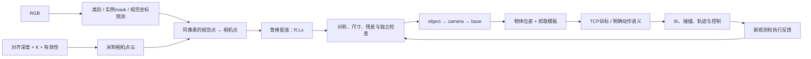
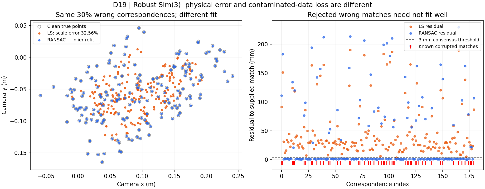
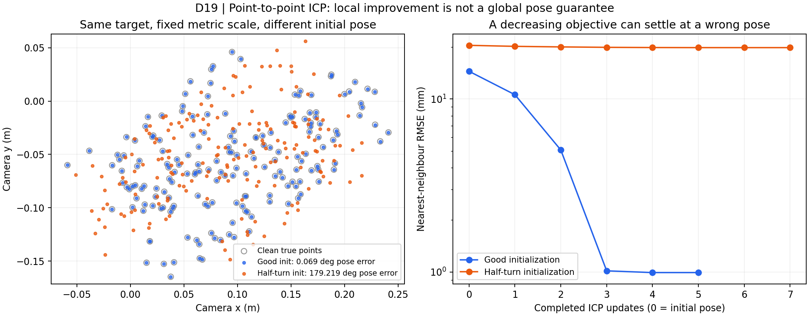
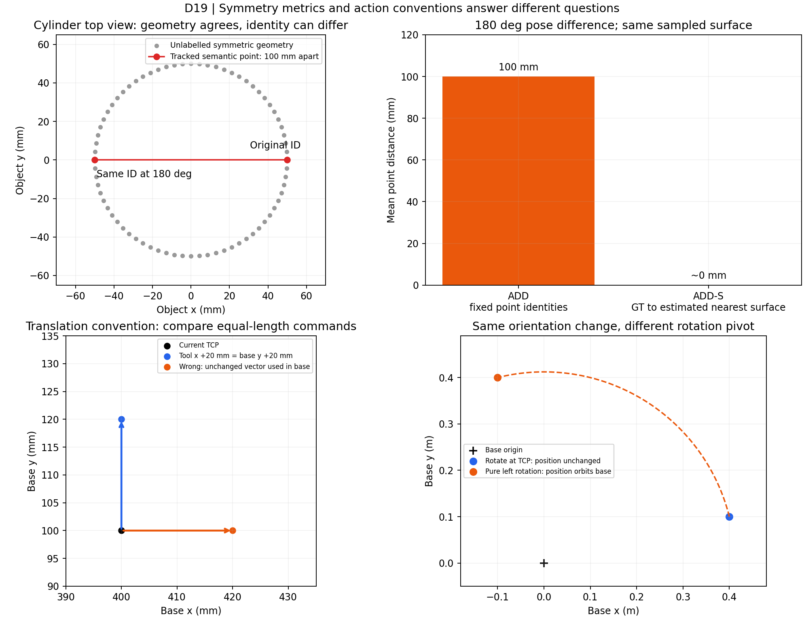

# D19 · 从规范物体坐标到可执行的位姿目标

[返回学习入口](../_index.md) ｜ [本周日程](../P2-深度理解-日程.md) ｜ [上一课 D18](../day18/Daily-Learning-Pack.md) ｜ [CPU 实验](demo.py) ｜ [绘图脚本](plot_demo.py)

**检测告诉机器人“目标在哪一片区域”，位姿估计则建立“物体自身的三根轴怎样放在相机与机器人空间里”的关系。只有把形状、尺度、对称性和动作语义一起说清，感知结果才能成为可信的操作目标。**

本课是 P2 / W3-D5 / 全局 Day19，保持原定日期与主题。D18 已经把图像中心、点云和 BEV 接到碰撞与轨迹；今天继续处理 NOCS、6D 位姿、旋转、对称、RANSAC/ICP，以及绝对和增量动作。下一课 D20 会组合检测、投影和位姿，并引入 ACT、Diffusion Policy 的动作 chunk。

贯穿案例仍是 RGB-D 机械臂抓杯子：你已经分出了杯子表面，但杯口朝哪、杯把在哪、杯子多大、夹爪应落在哪个坐标系中，仍是不同问题。今天用可手算的几何和合成实验逐一连接它们。

<details>
<summary>个人学习记录（由你填写，后续生成保留）</summary>

<!-- learner-notes:start -->

- 我能独立推导的公式：
- 我的坐标约定与动作卡：
- 改变量前的预测、实测与解释：
- 自测作答、分数和未理解问题：

<!-- learner-notes:end -->

</details>

<!-- daily-pack-generated:start -->

## 0. 学习目标与知识路线

学完本课，应能做到：

1. 区分物体的 6DoF 位姿、旋转的 6D 表示、相似变换的尺度，以及三轴物体尺寸。
2. 从 NOCS 与深度的像素对应关系，推导中心化、SVD、尺度与平移的求解过程。
3. 解释 RANSAC 为什么能抵抗部分错配、ICP 为什么可能在错误位姿处获得低残差。
4. 为对称物体选择合理的误差定义，说明几何等价为何不自动等于抓取任务等价。
5. 手算绝对目标、工具系增量与空间系增量，识别旋转中心不一致的错误。
6. 跑通 CPU 配准实验，分别报告拟合残差、真实姿态误差与算法未覆盖的边界。

| 顺序 | 知识主线 | 需要回答的问题 |
| --- | --- | --- |
| 宏观 | 感知到动作的接口 | 位姿究竟补充了什么信息？ |
| 几何表示 | SO(3)、四元数、旋转6D | 哪些数字是自由度，哪些只是编码？ |
| 规范与配准 | NOCS、深度、相似对齐 | 未见过的同类物体怎样建立对应与尺度？ |
| 鲁棒与精化 | RANSAC、ICP、可观测性 | 错配、局部最优和退化各在哪里出现？ |
| 评价与动作 | 对称误差、动作更新、BC标签 | “看起来对”和“接口可用”怎样分别验收？ |
| 实操与总结 | 合成实验、改变量、自测 | 哪些结论已经被本课证据支持？ |

## 1. 宏观：从一片表面到一个对象参考系



今天的核心输出是对象到参考系的几何关系，不是夹爪控制器。下游仍需要 D16 的夹爪模板与开口、D17 的配置空间、D18 的可达性/碰撞/时间参数化。

| 输出 | 能回答的问题 | 不能单独回答的问题 |
| --- | --- | --- |
| 2D框或mask | 图像里哪些像素属于目标？ | 目标真实深度、完整形状和朝向 |
| 目标点云 | 看到了哪些米制表面？ | 不可见部分、统一对象原点和完整姿态 |
| 物体位姿 $T^{cam}_{obj}$ | 物体系如何放在相机系中？ | 应从哪一侧抓、夹爪是否能到 |
| 尺寸/形状 | 几何范围与比例是什么？ | 单靠几何是否满足摩擦与任务条件 |
| 抓取位姿 $T^{base}_{grasp}$ | 一个候选抓法如何放在机器人空间？ | 轨迹是否无碰、执行是否成功 |

并非所有抓取都必须显式估计物体位姿，直接预测抓取也是一条路线。但在定向放置、装配、绕杯把操作、对象状态跟踪中，稳定的对象参考系很有价值。它让“沿杯子的轴移动”成为可计算的命令，而不是随相机视角变化的口头描述。

### 1.1 先把今天的符号固定下来

全篇使用列向量约定：

$$
p_A=R^A_Bp_B+t^A_B,
\qquad
T^A_B=\begin{bmatrix}R^A_B&t^A_B\\0&1\end{bmatrix}.
$$

$T^A_B$ 把 B 系坐标变到 A 系；上标是目的地，下标是来源。组合遵循：

$$
T^A_C=T^A_BT^B_C.
$$

程序把 N 个点按行保存在 `[N,3]` 中，因此同一个变换写成 `points @ R.T + t`。**代码出现转置不意味着我们改变了变换方向，只是数组存储布局不同。**

平移和深度统一使用米；角度公式用弧度，展示结果时可转成度；规范坐标无量纲。未特别说明时，物体变换是 object→camera，而非相机在物体系中的位置。

## 2. “6D”有两个完全不同的含义

### 2.1 6DoF位姿：三维平移加三维旋转

刚体位姿 $T\in SE(3)$ 有 6 个局部自由度：平移 3 个，旋转 3 个。矩阵虽有 16 个存储位置，其中很多受约束或固定，不能据元素个数数自由度。

物体尺寸一般不是刚体位姿的一部分。把同一模型放大两倍是尺度变化；把它旋转或移动是位姿变化。对于已知 CAD 的实例级任务，尺寸通常由模型提供；对于类别级新实例，尺寸还需估计或从规范形状恢复。

| 概念 | 常见存储 | 自由度或含义 |
| --- | --- | --- |
| 刚体位姿 | $R\in\mathbb R^{3\times3},t\in\mathbb R^3$ | 旋转3 + 平移3 |
| 四元数位姿 | 4个四元数分量 + 3个平移分量 | 仍是6DoF，不是7DoF |
| 旋转6D表示 | 两个三维向量 | 只编码旋转，不包含平移 |
| 正尺度相似变换 | $s,R,t$ | 统一尺度1 + 旋转3 + 平移3 |
| 地面场景检测框 | 中心3 + 尺寸3 + yaw1 | 常见7参数框，不等于完整6DoF姿态 |

把旋转6D的前3个数当位置、后3个数当欧拉角，是接口语义错误；网络输出 shape 正好相同也救不了它。

### 2.2 旋转矩阵的三列是什么

$$
SO(3)=\{R:R^\top R=I,\det R=+1\}.
$$

三列是物体系 x、y、z 轴在参考系中的方向。正交性保证长度和夹角不变；行列式 +1 排除镜像反射。[Modern Robotics：旋转矩阵](https://modernrobotics.northwestern.edu/nu-gm-book-resource/3-2-1-rotation-matrices-part-1-of-2/)

绕 z 轴正向旋转90°：

$$
R_z(\pi/2)=
\begin{bmatrix}0&-1&0\\1&0&0\\0&0&1\end{bmatrix}.
$$

第一列为 $(0,1,0)^\top$：原来的 x 方向变成参考系的 y 方向。把 $(0.02,0,0)$ m 乘过去得到 $(0,0.02,0)$ m。这个20 mm算例会在动作章节再次出现。

对**方向或位移向量**只乘 R，对**空间点**还要加 t。一个20 mm方向被加上机器人当前位置后，会变成另一个空间点，不能继续当增量命令。

## 3. 旋转怎样编码：方便学习和方便执行是不同问题

### 3.1 欧拉角与轴角：三个数不代表没有约定

若约定 $R=R_z(\psi)R_y(\theta)R_x(\phi)$，列向量先经历右侧的 x 旋转，再经历 y、z。换乘法顺序会得到不同姿态。还必须说明角度属于固定轴还是随体轴，不能只写 `roll,pitch,yaw` 就认为接口已经完整。

欧拉角的某些位置存在万向节锁，局部参数方向退化；角度还会跨越 $\pm\pi$。例如 179° 与 −179° 只相差2°，分量直接相减却得到358°。

轴角使用单位轴 $n$ 和角度 $\theta$，旋转向量为 $\omega=\theta n$。令 $[n]_\times v=n\times v$，Rodrigues公式为：

$$
R=I+\sin\theta[n]_\times+(1-\cos\theta)[n]_\times^2.
$$

它可看成将向量分成平行于 n 的不变分量，以及垂直平面中的二维旋转。小角度时 $R\approx I+[\omega]_\times$，后面点到平面ICP的线性化就使用这个局部近似。

旋转向量不是三个独立欧拉角；把三分量分别送入 roll/pitch/yaw 接口一般不等价。大角度附近的参数选择也需要处理，不能把局部线性关系扩展成全局相加规则。

### 3.2 四元数：q与−q是同一个旋转

本节用标量在前的顺序：

$$
q=(w,x,y,z)=\left(\cos\frac\theta2,\ n\sin\frac\theta2\right),
\quad\|q\|=1.
$$

同一个旋转满足 $R(q)=R(-q)$。因此对标签做普通分量MSE，可能把完全相同的朝向罚得很重。若将 q 和 −q 直接平均，会得到零向量，归一化也无从进行。

可用符号不变的损失：

$$
\mathcal L_q=\min(\|\hat q-q^*\|^2,\|\hat q+q^*\|^2),
$$

或比较两旋转的夹角：

$$
d_R=2\arccos\bigl(\operatorname{clip}(|\hat q^\top q^*|,0,1)\bigr).
$$

前提是两个四元数都已正确归一化。不同库的顺序并不统一：例如 SciPy 的默认输入是 xyzw；这里的 wxyz 公式不能不经重排就交给它。[SciPy官方说明](https://docs.scipy.org/doc/scipy/reference/generated/scipy.spatial.transform.Rotation.from_quat.html)

固定 $w\ge0$ 有助于统一部分符号，但不能因此声称在整个旋转空间上不存在表示连续性问题。

### 3.3 旋转6D：让两根轴先独立预测，再恢复正交关系

网络输出两个向量 $a_1,a_2\in\mathbb R^3$，采用**列约定**进行Gram–Schmidt：

$$
b_1=\frac{a_1}{\|a_1\|},\qquad
v_2=a_2-(b_1^\top a_2)b_1,
$$
$$
b_2=\frac{v_2}{\|v_2\|},\qquad b_3=b_1\times b_2,
\qquad R=[b_1\ b_2\ b_3].
$$

第一步决定一根单位轴；第二步去掉另一向量沿第一根轴的分量；叉积补出右手系。这六个输入数允许网络使用有冗余的编码，最终得到的仍是3自由度旋转。[Zhou等，2019，§4.2 Case3与式(6)–(7)](https://arxiv.org/pdf/1812.07035)

> [!question] 先算：两根预测向量是否足够？
> $a_1=(1,0,0)$、$a_2=(2,1,0)$ 时恢复什么旋转？如果第二个向量改成 $(2,0,0)$ 呢？

第一种得到 $b_1=(1,0,0),b_2=(0,1,0),b_3=(0,0,1)$，即单位旋转。第二种的 $v_2=0$，没有唯一第二根轴。**往分母加epsilon只能避免部分数值异常，不能保证退化输入自动变成合法SO(3)。** 接近平行时，微小输入噪声也会被明显放大。

实现卡应写：输入 `[B,6]`；解码后 `[B,3,3]`；零范数/共线阈值；行列约定；$R^\top R$ 与 det 的检查。当前 PyTorch3D 的这组转换函数按行排列，不能把它的编码器与本课按列解码器混用。[官方实现](https://pytorch3d.readthedocs.io/en/latest/_modules/pytorch3d/transforms/rotation_conversions.html)

### 3.4 评价旋转时回到几何量

不考虑对称时，矩阵形式的旋转误差为：

$$
e_R=\arccos\left(\operatorname{clip}
\left(\frac{\operatorname{tr}(\hat R R^{*\top})-1}{2},-1,1\right)\right).
$$

clamp防止浮点舍入把反余弦输入推出定义域。这个误差应作用于真正的旋转矩阵：若某实现把 $sR$ 填进矩阵的左上角，应先分离尺度，不能直接代入。

位姿误差通常还报告 $e_t=\|\hat t-t^*\|$。度与米不能不加说明地相加；训练中的加权目标需要明确单位、权重和任务尺度。对称物体的 e_R 还需进一步修正，见第8节。

## 4. NOCS：把不同杯子放进共同的规范坐标空间

### 4.1 实例级与类别级，已知条件不同

已知一个具体零件CAD时，可以把模型特征与观测建立对应，再求位姿。类别级任务面对的是训练类别中的新实例：你知道它属于杯子类，却未必拥有这只杯子的精确CAD。NOCS学习的是类别内的规范坐标关系，帮助建立这种对应；它不是对任意未知类别都成立的万能物体坐标器。[NOCS作者项目页](https://geometry.stanford.edu/projects/NOCS_CVPR2019/)

“测试时不要求该实例CAD”也不等于“训练完全没有模型”。原方法使用合成形状和真实数据监督。数据、类别范围、实例划分仍决定泛化的含义。

### 4.2 规范化保留形状比例，而不是各轴拉伸成一样长

设对象模型点 x 的紧包围盒中心为 c，三轴尺寸为 $d=(d_x,d_y,d_z)$，对角线长度为：

$$
s_{obj}=\|d\|_2.
$$

原方法统一缩放使该对角线为1，并把对象居中放入 $[0,1]^3$。可写成：

$$
n=\frac{x-c}{s_{obj}}+\frac12\mathbf1,
\qquad q=n-\frac12\mathbf1.
$$

这里 n 是NOCS坐标，q是中心化规范坐标，两者无量纲。三轴共用一个分母，所以长宽高比例保留；并不是分别把每轴最小值映到0、最大值映到1。[原论文§3、Figure2](https://arxiv.org/pdf/1901.02970)

手算：一个模型尺寸为 $(0.06,0.12,0.12)$ m，则对角线为0.18 m，规范尺寸是 $(1/3,2/3,2/3)$，仍然长宽不同。若分别除以各轴长度，会把比例信息删掉，之后就不能只用一个统一尺度恢复原形状。

网络中的规范轴还承担语义：什么是向上、什么是杯把方向，需要类别对齐和监督约定。坐标预测的RGB颜色图只是把xyz映成颜色，不是相机真正观测到的表面颜色。

### 4.3 规范坐标怎样接上米制深度

同一个前景像素 $(u_i,v_i)$ 提供两类点：

$$
q_i=n_i-0.5,\qquad
p_i^{cam}=Z_iK^{-1}[u_i,v_i,1]^\top.
$$

对每个有效像素，将预测规范点与真实深度反投影点配成一对。待估关系是：

$$
\boxed{p_i^{cam}=sRq_i+t+\epsilon_i.}
$$

$R$ 是规范对象轴到相机轴的旋转，t是规范对象原点在相机中的位置，s是统一米制尺度，$\epsilon_i$汇集深度、规范预测和配准误差。

例如 $q=(0.1,0,0)$、$s=0.2$ m、$R=R_z(90^\circ)$、$t=(0.4,0.1,0.8)$ m，则 $p^{cam}=(0.4,0.12,0.8)$ m。若忘记减0.5，所有点多出一个经旋转缩放的常量，求得的“原点”会偏移，不能继续当对象中心使用。

关键前提是RGB与深度已经对齐，mask选的是同一实例，K对应这张深度图，深度沿光轴且单位正确。错误像素关联不是增大RANSAC迭代次数就必然能解决的。

### 4.4 原版网络预测什么，几何求解又做什么

原NOCS网络分支使用RGB产生类别、实例mask与规范坐标；深度进入后续几何配准。它与“把RGB和Depth一起喂进同一个编码器”是不同架构。

下面记录的是作者发布配置的形状含义，M为最终实例数，N_roi为候选数量，K_cls包含背景：

| 环节 | 代表shape | 含义 |
| --- | --- | --- |
| RGB输入 | `[B,3,H,W]`教学表示 | 原图视觉证据；实际库可能通道后置 |
| 一个坐标轴的分类head | `[B,N_roi,28,28,7,32]` | 每类、每ROI位置的32个坐标区间 |
| 选类并解码后三轴 | 每ROI `[28,28,3]` | 无量纲xyz，尚非米制点 |
| 恢复原图后的坐标 | `[H,W,M,3]` | 与实例mask `[H,W,M]` 配对 |
| 筛选有效深度 | 两份 `[N,3]` | 中心化规范点与相机点一一对应 |
| 相似对齐 | `R[3,3], t[3], s[]` | 旋转、米制平移、统一尺度 |

这些数目来自原实现配置，不是NOCS概念必须固定的输入分辨率。[作者训练配置](https://github.com/hughw19/NOCS_CVPR2019/blob/master/train.py) · [坐标head与恢复原图的代码](https://github.com/hughw19/NOCS_CVPR2019/blob/master/model.py)

学习过程可用五格卡理解：RGB及规范坐标标签来自哪里；学的是像素到规范坐标的映射；分类式坐标使用交叉熵、回归变体使用平滑回归损失；训练更新参数，推理预测坐标后再做几何；泛化要按未见实例、材质、遮挡和真实场景测。仅在已见物体的新视角上成功，不能直接推出类别内新实例也成功。

本课CPU实验提供合成规范对应，**没有加载或训练NOCS网络**。它验证后半段几何与失败机制，不提供前半段坐标预测精度的证据。

## 5. 相似对齐：用一次SVD同时求方向、尺度和位置

### 5.1 先写目标，再消去容易的未知量

给定N对对应点 $x_i=q_i$、$y_i=p_i^{cam}$：

$$
\min_{s>0,R\in SO(3),t}
\frac1N\sum_i\|y_i-(sRx_i+t)\|^2.
$$

对t求导，令梯度为零：

$$
t=\bar y-sR\bar x.
$$

因此先中心化 $\tilde x_i=x_i-\bar x$、$\tilde y_i=y_i-\bar y$，就把平移从旋转/尺度问题中分离了。中心化不等于把NOCS原点改成可见点均值；最后的公式会把两者之间的差恢复进去。

### 5.2 SVD怎样给出最佳旋转

定义目标乘源的交叉协方差：

$$
H=\frac1N\sum_i\tilde y_i\tilde x_i^\top
=U D V^\top,
\qquad
D=\operatorname{diag}(\sigma_1,\sigma_2,\sigma_3).
$$

展开中心化目标，其中与R有关的部分要求最大化 $\operatorname{tr}(R^\top H)$。若直接取 $UV^\top$，噪声或镜像对应可能产生行列式−1。加上反射修正：

$$
S=\operatorname{diag}(1,1,\det(UV^\top)),
\qquad R=USV^\top.
$$

这让解位于SO(3)。若代码将H定义成源乘目标的转置，U/V顺序也要跟着变化，不能只记一个脱离协方差定义的“万能SVD公式”。

### 5.3 再求统一尺度与平移

令 $\sigma_x^2=N^{-1}\sum_i\|\tilde x_i\|^2$，对s求导得到：

$$
s=\frac{\operatorname{tr}(DS)}{\sigma_x^2},
\qquad t=\bar y-sR\bar x.
$$

它属于Umeyama式最小二乘相似对齐。若x无量纲、y为米，则s的单位是米/规范单位，t为米。作者实现也使用统一尺度，而不是三个自由缩放因子。[NOCS的相似对齐代码](https://github.com/hughw19/NOCS_CVPR2019/blob/master/aligning.py)

教学伪代码：

```python
x0, y0 = x - x.mean(0), y - y.mean(0)  # [N,3]
H = y0.T @ x0 / len(x)
U, singular, Vt = np.linalg.svd(H)
S = np.diag([1., 1., np.linalg.det(U @ Vt)])
R = U @ S @ Vt
s = np.sum(singular * np.diag(S)) / np.mean(np.sum(x0*x0, axis=1))
t = y.mean(0) - s * (R @ x.mean(0))
```

这段只展示主公式。实际还需拒绝非有限输入、零方差、退化样本、非正尺度，并检查残差。均匀最小二乘把每对对应看得一样重要，少量巨大错配就可能把解拖走；下一节处理这个问题。

### 5.4 三轴尺寸从哪里恢复

若规范形状的三轴范围为 $d_{n}$，实际尺寸为 $d_{metric}=s d_n$。原实现用预测坐标相对0.5的范围估计规范包围盒；其中包含了形状信息，不是只靠一个s猜出长宽高。[作者尺寸与对齐实现](https://github.com/hughw19/NOCS_CVPR2019/blob/master/utils.py)

遮挡时，可见点范围未必等于完整模型范围。网络的规范预测与类别先验可能帮助恢复信息，但仅对可见点取max/min仍可能低估完整尺寸。不要把训练时完整形状的规范范围、测试时局部可见点的范围和真实物体尺寸混作一个量。

还要分开两个矩阵：刚体位姿 $[R,t;0,1]$ 与相似变换 $[sR,t;0,1]$。机器人姿态字段需要前者的R；把含尺度的矩阵直接转换成四元数，会破坏旋转约束。

### 5.5 “共面”不能一律判成失败

对于本节已知对应的三维相似对齐，三个**不共线**的点可以提供最小几何约束；三个点本来就共面。真正需要拒绝的是重合、共线或近共线导致方向不可辨/不稳定的样本。

这与后面的“单平面点到平面ICP无法约束平面内运动”并不矛盾：前者知道每个点的对应身份，后者主要用点到平面的法向距离，使用的信息不同。

## 6. RANSAC：不要让错误对应拥有和正确对应一样的投票权

### 6.1 假设、评分、重拟合是三个步骤

RANSAC（随机采样一致性）反复从少量对应构造候选，再让全部对应检验它：

1. 抽取三个不退化的三维点对，估计候选 $(s,R,t)$。
2. 对全部对应计算 $r_i=\|y_i-(sRx_i+t)\|$。
3. 把 $r_i<\tau$ 的点作为该候选的内点，比较内点数及残差。
4. 用最佳内点集合重新拟合，再重新核验内点与模型。

本课 $\tau$ 使用米，因为残差在相机三维空间里。像素RANSAC的阈值与三维RANSAC的阈值不能直接复用同一个数值。


RANSAC不是给每个点永久贴上“真/假”标签。内点是相对于当前模型与阈值的判断；大量背景可能对另一个物体形成更强一致性，错误规范轴也可能让全部点共同支持一个错误但自洽的模型。

### 6.2 抽多少次才够：概率不是性能保证

假定内点率为w，每次抽m个样本，近似一次全内点概率为 $w^m$。K次独立抽样均未成功的概率为 $(1-w^m)^K$，希望至少一次达到概率p，则：

$$
K\ge\left\lceil\frac{\log(1-p)}{\log(1-w^m)}\right\rceil.
$$

例如 w=0.5、m=3、p=0.99，至少35次。三点法每次只需很少点，但当内点率继续下降，尝试数会快速增加。[Open3D的RANSAC停止条件说明](https://www.open3d.org/docs/release/python_api/open3d.pipelines.registration.RANSACConvergenceCriteria.html)

有限集合内无放回抽样时，一次全内点概率更精确地是 $\binom{I}{m}/\binom{N}{m}$。上述公式还没有保证采样点几何分布良好、噪声足够小、阈值合适或最终物体选对。因此 `confidence=0.99` 不能翻译成“抓取成功率99%”。

### 6.3 一个阈值为什么不能包治所有深度

阈值太小会把真实但有噪声的对应排除；太大会让错误对应加入重拟合。RGB-D误差通常还随距离、材质、入射角变化，一个固定米制阈值只能覆盖预先定义的工作范围。

工程中可先按有效深度、边缘/遮挡、规范置信等筛选，再在明确误差模型下使用权重或自适应阈值；最后报告保留数量、空间分布和拒绝情况。只剩集中在一小块表面的“高质量内点”，也可能不足以稳定约束全部姿态。

## 7. ICP：不知道对应时，交替寻找对应与变换

### 7.1 ICP和NOCS配准的已知条件不同

NOCS给出同像素的规范点与深度点对应。ICP（迭代最近点）通常只有两份点集，还要自己猜对应。在当前位姿 $R_k,t_k$ 下：

$$
c_k(i)=\arg\min_j\|R_kx_i+t_k-y_j\|,
$$

固定这些对应后，求新的刚体变换：

$$
(R_{k+1},t_{k+1})=
\arg\min_{R,t}\sum_i\|Rx_i+t-y_{c_k(i)}\|^2.
$$

这就是点到点ICP的核心交替。固定对应的一步又可以使用SVD，但这里通常已知米制尺度，令s=1，不能偷偷通过缩放对象去降低误差。

若代码拟合的是**当前已变换点**到目标的增量 $(\Delta R,\Delta t)$，组合应为 $R_{new}=\Delta R R$、$t_{new}=\Delta R t+\Delta t$。若拟合的是原始源点到目标，则直接替换全局R,t。两种实现都可以，不能把全局结果再重复乘一次。

### 7.2 为什么残差下降了，姿态仍可能错

初始位置离正确解远时，最近邻可能落在错误物体、重复结构或另一侧表面。此后的SVD会认真地优化这些错误对应，最后停在局部极小值。

在精确、固定点到点目标及规范的交替步骤下，目标值具有下降性质；但实际加入距离截断、裁剪、近似邻居、法向过滤后，参与目标的点集会变化，不能凭一条“inlier RMSE持续降低”的曲线证明全部几何越来越准。

应同时报告：匹配距离、有效匹配比例、重叠范围、初值、变换变化，以及有独立真值时的R/t误差。低重叠情况下，少数点贴得很好尤其容易造成误判。[Open3D ICP教程](https://www.open3d.org/docs/release/tutorial/pipelines/icp_registration.html)

### 7.3 点到平面：只罚法向距离，方向信息也会变少

目标点单位法向为n，点到平面目标是：

$$
E=\sum_i\left[n_{c(i)}^\top(Rx_i+t-y_{c(i)})\right]^2.
$$

它近似问“离目标表面还有多远”，在好初值和可靠法向下常能高效精化。对当前变换点p施加小的左侧旋转和平移，$\delta p\approx\delta\omega\times p+\delta v$，单残差雅可比为：

$$
J_i=\begin{bmatrix}(p_i\times n_i)^\top&n_i^\top\end{bmatrix},
$$

参数顺序为 $[\delta\omega,\delta v]$。它把D10的雅可比思想用到了配准：残差变化与小动作之间建立线性关系。

若目标是一张无限平面，全部法向为z，沿平面x/y平移和绕z旋转不会被法向距离直接惩罚。观察到“平面贴上了”不代表六个自由度都被恢复。有限边界、纹理对应或其他方向的表面能增加约束，但必须实际进入算法。

### 7.4 RANSAC和ICP怎样组合才合理

| 环节 | 主要作用 | 仍需要什么 |
| --- | --- | --- |
| 对应预测/描述子匹配 | 提供跨视图或模型对应 | 正确语义、覆盖与域适配 |
| RANSAC | 从部分错误对应中建立鲁棒初值 | 足够内点、非退化分布、合理阈值 |
| ICP | 在相近位置上利用表面精化 | 好初值、重叠、正确尺度/表面模型 |
| 独立验收 | 判断最终结果能否用于任务 | 真值、对称协议、尺寸与操作要求 |

“先RANSAC再ICP”是一种常见组合，不是保证成功的定理。普通ICP也不等于带全局搜索的Go-ICP；后者是在不同算法条件下讨论全局配准。[Go-ICP原论文](https://arxiv.org/abs/1605.03344)

## 8. 对称性：一个物体可能没有唯一可观测的朝向

### 8.1 几何对称、外观对称与任务对称

没有标记的理想圆柱绕自身轴旋转，表面集合保持不变；加上标签，RGB外观可能打破等价；加上杯把，几何本身也可能打破等价。即使图像暂时看不到把手，操作任务仍可能要求避开它。

令模型点集为M，对称变换集合为 $\mathcal S$。若 $SM=M$，那么 $T$ 与 $TS$ 在该几何模型下可产生相同表面集合。可观测的对象常是等价类 $\{TS:S\in\mathcal S\}$，不一定是一组唯一欧拉角。

如果网络被要求给同一外观输出两个相差180°的标签，普通分量回归可能学到中间值；中间姿态却未必是任何有效解。解决方向包括对称感知损失、明确规范分支、多假设、额外视角或任务相关观测。任意强行固定一个标签并不会增加传感器信息。

### 8.2 ADD固定对应，ADD-S允许逐点找最近邻

本节模型点已在米制物体系中。ADD定义为：

$$
ADD=\frac1{|M|}\sum_{x\in M}\|\hat T x-T^*x\|.
$$

同一个模型点必须和自身的真值位置比较。对旋转对称表面，几何完全重合时某些有身份的模型点仍移动很远，所以ADD可能很大。

本课ADD-S采用BOP工具箱ADI的方向约定：

$$
ADD\text{-}S=\frac1{|M|}\sum_{x\in M}
\min_{y\in M}\|T^*x-\hat T y\|.
$$

它从**真值点到估计表面**找最近邻，取单向均值。它不是双向Chamfer，也不是先选一个全局旋转再保持固定点对应。有限采样、遮挡和不均匀点密度时，方向与取样方式都可能影响数值。[BOP官方误差实现：add/adi](https://github.com/thodan/bop_toolkit/blob/master/bop_toolkit_lib/pose_error.py)

手算半径r的圆柱侧面绕自身轴转180°：每个有身份的点移到对面，位移为2r；但无标签的表面集合重合。r=0.05 m时，ADD=0.10 m，而理想ADD-S为0。

### 8.3 一个全局对称变换与每点各选最近邻不同

使用显式对称集合时，可以对整个模型选**同一个**S，再计算误差。例如BOP2019讨论的MSSD为：

$$
MSSD=\min_{S\in\mathcal S}\max_{x\in M}
\|\hat T x-T^*Sx\|.
$$

如果某处需要S=0°才能对齐、另一处需要S=180°，不能分别取最小后声称整物体匹配。MSPD把类似比较放到投影像素中；VSD利用可见表面及深度容差。它们回答的误差问题不同，不应把所有版本的BOP总分视为同一种ADD阈值。[BOP2019评价说明](https://bop.felk.cvut.cz/challenges/bop-challenge-2019/)

| 检查 | 主要关注 | 今天需要记住的边界 |
| --- | --- | --- |
| 平移/旋转误差 | 原点与朝向 | 对称可能让唯一朝向不存在 |
| ADD | 固定模型点对应 | 可能惩罚几何等价姿态 |
| ADD-S/ADI | 单向最近邻平均距离 | 不保持一个共同的全局对应 |
| 对称集合上的误差 | 在合法等价变换中比较 | 对称集合与对象参考系必须正确 |
| 抓取任务验收 | 夹爪、接触和任务是否完成 | 几何等价不一定操作等价 |

### 8.4 NOCS中的对称规则，要分训练与评估

原实现的对称训练对整份ROI汇总损失后选择一个共同旋转；不能让每个像素各自选择最有利的旋转。其bottle/bowl/can训练分支使用绕规范y轴的离散方向；评估中，把手不可见的mug与把手可见的mug又采用不同的旋转处理。[训练对称分支](https://github.com/hughw19/NOCS_CVPR2019/blob/master/model.py) · [把手可见性与评价分支](https://github.com/hughw19/NOCS_CVPR2019/blob/master/utils.py)

这些是数据和协议约定，不应简化为“所有杯子都忽略yaw”。本课圆柱实验绕**物体z轴**，仅为方便画图的教学约定，与NOCS数据的规范y轴分开记录。

对实时跟踪，可在等价类中选与上一帧接近的分支，以减少输出跳变；这只是表示连续性的选择。若任务要求把手方向，应该补充可区分观测，不能把“输出平滑”当成“已经看到了把手”。

## 9. 平面目标：信息来源决定哪些位姿量可辨

已知平面模型的度量坐标 $(X,Y,0)$、相机K及像素对应时：

$$
\lambda[u,v,1]^\top
=K[r_1\ r_2\ t][X,Y,1]^\top.
$$

通过单应性及旋转约束可以建立平面位姿初值，再做重投影优化。它使用了带身份的角点、模型尺度和透视关系，因此与只有无纹理平面法向的ICP不同。

近正视、目标投影很小或透视变化弱时，姿态候选在图像上可能很接近，噪声会让某些旋转分量不稳定。需要检查正深度、多个候选、额外视角及时间连续性；不能仅凭一个返回值为true就认定姿态唯一可靠。

OpenCV的IPPE要求共面对象点，`solvePnPGeneric`可以在支持的方法中返回多个解；正方形专用IPPE还规定了角点顺序。这里依据官方说明理解接口，**本课CPU实验未执行平面PnP**，不新增“已完成真实平面位姿验证”的记录。[OpenCV PnP官方说明](https://docs.opencv.org/4.x/d5/d1f/calib3d_solvePnP.html)

> [!warning] 原阅读条目的来源待核
> 原计划题名“6D Pose Estimation for Objects with Planar Surfaces”所配的1902.04070实际是高能物理论文 *Standard Model Physics at the HL-LHC and HE-LHC*。[链接核验](https://arxiv.org/abs/1902.04070)
> 本课保留平面位姿这一知识任务，用已核验的几何与接口解释；原题名对应文献仍待确认，不把这条错链或另一篇文章记为已经完成原文精读。

## 10. 从物体位姿到动作：同一组数字可能要求完全不同的运动

### 10.1 先生成抓取目标，再谈控制器的表达方式

若相机到基座关系、物体位姿和物体系抓取模板已知：

$$
T^{base}_{grasp}
=T^{base}_{cam}T^{cam}_{obj}T^{obj}_{grasp}.
$$

这里三个矩阵均应是合适单位的刚体变换。物体尺寸用于选抓取位置和开口，不能把含尺度的 $sR$ 当成手眼旋转混进刚体链。若抓取模板使用规范坐标，先按物体尺度转换其平移量，再明确旋转轴。

检测出一个旋转对称物体，可以产生多个几何等价抓取候选；每个候选仍需检查夹爪、碰撞、IK与任务要求。坐标链只生成目标，不会替代这些筛选。

### 10.2 绝对目标：直接指定下一状态

令当前 $T=T^{base}_{tcp}=[R,p]$。绝对目标定义为：

$$
T_{new}=T_{target}.
$$

例如绝对位置 $(0.4,0.12,0.3)$ m 是希望TCP到达的基座位置，不是要再移动这么远。它还缺姿态、执行时序、TCP定义等字段；仅凭三个坐标不构成完整运动命令。

### 10.3 工具系相对位姿：右乘

工具系增量定义为：

$$
T_{new}=T\Delta T_b,
\qquad
R_{new}=R\Delta R_b,
\qquad p_{new}=p+R\Delta p_b.
$$

下标b在此表示body（随体/工具），不是base。为避免代码歧义，脚本使用 `tool_delta` 等完整名称。

当前 $R=R_z(90^\circ)$、$p=(0.4,0.1,0.3)$ m，沿工具x移动20 mm，即 $\Delta p_b=(0.02,0,0)$ m。基座增量为 $(0,0.02,0)$ m，绝对目标为 $(0.4,0.12,0.3)$ m。

若把相同的三个数误当基座增量，就得到 $(0.42,0.1,0.3)$ m，偏差：

$$
\sqrt{0.02^2+(-0.02)^2}=0.028284\ \mathrm m.
$$

**原始数字没有变化，参考系解释变化就造成28.28 mm误差。** 这类错误不会通过调检测阈值或重新训练一个分类头自动消失。

### 10.4 空间系左作用：旋转还会改变TCP的位置

真正的空间系增量为：

$$
T_{new}=\Delta T_sT,
\qquad
R_{new}=\Delta R_sR,
\qquad
p_{new}=\Delta R_sp+\Delta p_s.
$$

注意平移公式包含 $\Delta R_sp$。纯粹左乘绕基座原点的旋转，会把TCP位置也绕原点转动。[Modern Robotics：齐次变换的左乘/右乘](https://modernrobotics.northwestern.edu/nu-gm-book-resource/3-3-1-homogeneous-transformation-matrices/)

如果控制接口的实际意思是“基座轴表示的平移 $\delta p$，同时绕**当前TCP**改变方向”，通常应直接定义：

$$
p_{new}=p+\delta p,\qquad R_{new}=\Delta R_sR.
$$

要把它写成等价左乘矩阵，其平移部分必须补偿旋转中心：

$$
\Delta T_{equiv}=
\begin{bmatrix}
\Delta R_s&p+\delta p-\Delta R_sp\\0&1
\end{bmatrix}.
$$

手算本课位置 $(0.4,0.1,0.3)$ m，纯左乘90° z旋转、平移部分为0，位置变成 $(-0.1,0.4,0.3)$ m；若意图绕当前TCP转动，位置应不变。二者相差583.10 mm。

> [!warning] “base delta pose”仍可能没有说完整
> 除了参考系，还要说明旋转中心及位移/旋转的组合语义。不能把任何“基座表达的增量”都机械翻译成 $[\Delta R,\delta p]T$。

### 10.5 同一物理动作的两种增量如何转换

若 $T\Delta T_b=\Delta T_sT$，则：

$$
\Delta T_s=T\Delta T_bT^{-1}.
$$

这称为共轭变换。纯平移且无旋转增量时退化成 $\Delta p_s=R\Delta p_b$；包含旋转时，平移还与旋转中心相关，不能只旋转三个平移分量就算完成整个位姿增量变换。

从两帧已知TCP位姿恢复标签：

$$
\Delta T_b=T_t^{-1}T_{t+1},
\qquad
\Delta T_s=T_{t+1}T_t^{-1}.
$$

两者不是同一个矩阵，但按各自的更新规则应恢复同一个 $T_{t+1}$。这提供了一项很强的动作数据验收：**编码→解码→下一姿态回代**。

## 11. Learning与VLA连接：先把模仿标签定义成物理动作

### 11.1 BC学到什么，取决于标签到底代表什么

行为克隆BC从观测到演示动作学习映射 $\hat a_t=\pi_\theta(o_t)$。但“动作”可以是关节角、TCP绝对位姿、随体增量、基座平移与姿态更新，或者速度。它们的shape、单位和执行规则都不同。

| 五格 | 本课的具体内容 |
| --- | --- |
| 数据从哪里来 | 同步视觉、本体状态、演示动作、时间戳；区分命令与实际反馈 |
| 学什么 | 给定观测/任务后，在一个明确动作空间中产生目标 |
| 目标函数 | 平移损失、旋转损失、夹爪目标损失；说明尺度与权重 |
| 训练与推理 | 训练更新参数；推理解码、反归一化、转换参考系后交执行器 |
| 泛化怎样测 | 按轨迹/物体/场景隔离，检查新初态和闭环结果 |

例如位置用 `[B,3]`，旋转6D用 `[B,6]`，另有夹爪标量，可形成10个输出数。但这是一个**示例动作设计**，并非所有VLA都输出10维。四元数位姿或离散动作token有其他shape。

学习损失可示意为：

$$
\mathcal L=\lambda_p\|\hat p-p^*\|^2
+\lambda_R d_R(\hat R,R^*)^2
+\lambda_g\mathcal L_g.
$$

平移项的单位为米平方，旋转项为弧度平方，夹爪项取决于任务。权重应说明归一化和任务容差，不能仅为让三条曲线看起来一样高就宣称物理上合理。

### 11.2 差分标签会放大部分测量噪声

设绝对位置观测 $\hat p_t=p_t+\epsilon_t$。差分标签噪声为：

$$
\hat\Delta p-\Delta p=\epsilon_{t+1}-\epsilon_t.
$$

若一维两帧噪声独立、方差都为 $\sigma^2$，则差分方差为 $2\sigma^2$；有相关性时：

$$
\operatorname{Var}(\epsilon_{t+1}-\epsilon_t)
=\sigma_{t+1}^2+\sigma_t^2-2\operatorname{Cov}(\epsilon_{t+1},\epsilon_t).
$$

若再除以采样周期 $\Delta t$ 得速度，标准差会再除以 $\Delta t$。例如位置噪声1 mm、周期0.1 s，独立差分速度噪声约14.14 mm/s。这个例子暂不包含旋转和时间戳误差，只解释差分这一操作本身。

因此更高采样率、更多增量标签并不自动让监督更干净。要考虑滤波是否引入延迟、动作与观测是否对齐、相关噪声来自哪里。删掉所有困难转折又可能改变任务分布，必须用固定评估验证。

### 11.3 反归一化与时间字段不能省略

若训练标签为 $\tilde a=(a-\mu)/\sigma$，推理要用同一版本的统计恢复 $a=\sigma\tilde a+\mu$。统计量只从训练数据拟合，维度顺序、单位和动作模式都要一致。

20 mm增量与0.2 m/s速度只有在明确0.1 s作用周期及相应执行假设时才可对应。把一个10 Hz的每步增量原样在50 Hz重复执行，会改变总体运动，不能说“只是控制更细”。

世界模型使用的转移样本同样需要 $(o_t,a_t,\Delta t,o_{t+1})$ 或明确状态表示。若相同动作数值在不同参考系/周期下产生不同后果，模型看到的是相互冲突的监督；不能先把接口混合，再期待预测器自动理解未记录的条件。

今天只把单步契约固定。D20再将它延伸到动作序列与chunk；序列中的每个增量是相对上一步、相对首帧还是相对滚动观测，都需要重新明确。

## 12. 工程组合：位姿交付应是一份有条件的结果

一个可接入ROS/机器人系统的位姿结果，除了R/t，还应携带实例身份、frame、观测时间、对象原点、尺寸、有效性、对称约定和估计证据。不能把检测置信度直接填成米制位置方差。

| 检查层 | 需要保留的证据 | 出错时的典型现象 |
| --- | --- | --- |
| 传感器 | RGB/深度对齐、K、scale、有效mask | 表面轮廓重影、边缘错配 |
| 对象表征 | 类别、实例、规范轴、原点与尺寸 | 同类不同物体方向不一致 |
| 配准 | 内点数/覆盖、阈值、尺度、残差 | 错配收缩尺寸、局部贴合 |
| 姿态评价 | R/t误差、对称集合、独立真值 | 圆柱方向被无意义惩罚或误放宽 |
| 动作转换 | TCP、参考系、模式、旋转中心、周期 | 数字看似合理但运动方向错误 |
| 执行反馈 | IK/碰撞、轨迹、跟踪与接触结果 | 目标几何正确但操作失败 |

腕部相机还需要使用图像时刻的 $T^{base}_{ee}(t)$。对象位姿本身正确，却乘上另一个时刻的机器人变换，依然会把目标放错。今天的合成实验没有这些时序、控制和接触环节，实际接入时需逐项加入证据。

建议的离线接入动作是：用一份已有RGB-D记录核对尺寸和对象轴，输出可视化与动作契约；在真正授权和完成系统检查前，不向机械臂发送本课数组。这里的例子是接口设计与数值验证，没有执行真实运动。

## 13. 动手：先预测，再运行与改变一个变量

### 13.1 起步与可复现范围

文件：[完整主脚本](demo.py) · [绘图脚本](plot_demo.py) · [真实运行结果](../../_assets/3d_learning/day19/results.json)。在知识库根目录、已有依赖的Python环境中运行：

```bash
python -B 3d_learning/day19/demo.py
python -B 3d_learning/day19/plot_demo.py
```

依赖仅NumPy和Matplotlib。已运行环境：Python3.11.15、NumPy1.26.4、Matplotlib3.10.9，CPU，seed19；训练步数0，机器人交互0。主数值实验本次约39.97 ms，不含解释器启动、绘图或真实数据读取，不能用这个数宣称实际感知系统帧率。

基础形状是**带缺口盒子的内部随机点**，不是相机采集的表面。180个点按紧包围盒中心及对角线规范化；真实尺度s=0.32 m，$R=R_z(35^\circ)R_y(-20^\circ)$，$t=(0.1,-0.04,0.8)$ m。每坐标加入0.6 mm独立噪声，再人为打乱54组对应。

普通LS和RANSAC使用同一份污染对应。RANSAC阈值3 mm、300次采样。随后ICP单独使用同一份完整目标云和真值尺度，比较两个初始位姿；它没有运行NOCS网络，也没有模拟遮挡、实际RGB-D成像或真实物体检测。

### 13.2 鲁棒配准：哪一个“误差小”才符合目标

> [!question] 运行前预测
> 若54个点都被配到其他点，直接最小二乘会怎样改变尺度？更好的真值姿态是否一定让全部污染对应的残差也更小？

| 量 | 普通LS | RANSAC + 内点重拟合 |
| --- | --- | --- |
| 估计尺度 | 0.215806 m | 0.319775 m |
| 尺度相对误差 | 32.5606% | 0.07036% |
| 旋转误差 | 1.55847° | 0.12105° |
| 平移误差 | 6.13762 mm | 0.03726 mm |
| 对无噪声真值对应的点RMSE | 28.2662 mm | 0.1650 mm |
| 对全部污染对应的点RMSE | 63.9268 mm | 69.8746 mm |

RANSAC找到126/126个真内点，纳入假内点0个。这是本次固定合成场景的计数，不是跨真实数据的召回率保证。无噪声、无错配时，相似对齐最大点误差约 $4.48\times10^{-16}$ m，只验证公式和实现的数值一致性。



图左比较估计点云与无噪声真值的位置和形状，图右显示对所给污染对应的残差；真值误差见上表。普通LS为了照顾错配，倾向收缩形状，因此它对**全部污染对应**的残差反而更低。RANSAC改变了拟合证据的选择，目的是找可信几何，不能只拿被污染的原始目标值给它判分。

这种对照不意味着任何残差上升都值得接受。必须说明忽略了哪些点、为什么忽略、在什么独立真值上改进；否则也可能只是随意丢掉难例。

### 13.3 ICP：换一个初始位姿，收敛到不同答案

两个运行保持点云、尺度、最近邻规则及迭代上限相同，仅更换初始**位姿**。好初值含小旋转和平移扰动；坏初值为半转并按质心放置。不能把它描述成只改变一个旋转分量的实验。

| 量 | 好初值 | 半转初值 |
| --- | --- | --- |
| 实际更新次数 | 5 | 7 |
| 最近邻RMSE | 0.9918 mm | 19.8206 mm |
| 旋转真值误差 | 0.06917° | 179.2194° |
| 平移真值误差 | 0.04322 mm | 32.8031 mm |
| 已知真值对应的点RMSE | 0.1114 mm | 162.8658 mm |



最近邻可以换身份，所以坏初值的19.82 mm并不等于相同物体点的位置只差19.82 mm；真实对应误差超过160 mm。好初值的最近邻目标带0.6 mm每坐标噪声，而真值对应列使用无噪声点，因此两列的数值大小不同也完全合理。

实验说明局部初值的重要性；没有测试真实表面、部分重叠、法向估计、遮挡过滤或点到平面ICP。这些应进入后续系统验证，不能由本例自动外推。

### 13.4 对称与动作：数值一致，也要问一致的是什么

圆柱使用72个角度×9个高度，共648个侧面点，半径50 mm、高度120 mm。绕物体z轴180°后，ADD=100 mm，ADD-S约 $1.70\times10^{-17}$ m；如果某个点带有必须追踪的语义身份，它仍移动了100 mm。



图中的工具系平移、基座系误解释以及绕不同中心旋转，使用同一个当前TCP。真实数值为：

| 检查 | 输出或误差 |
| --- | --- |
| 工具x方向20 mm的基座增量 | $(0,0.02,0)$ m |
| 对应绝对目标 | $(0.4,0.12,0.3)$ m |
| 把工具增量直接当基座增量 | 目标偏28.284 mm |
| 把增量当点，又重复加当前位置 | 目标偏509.902 mm |
| 绕基座原点与绕当前TCP转90° | 位置相差583.095 mm |
| 按两列编码/解码旋转6D | 最大矩阵元素误差 $1.11\times10^{-16}$ |
| 零向量/共线6D输入 | 两个测试均被拒绝 |

### 13.5 自己完成一次真正的改变量实验

先复现默认结果，再用新输出目录保存修改结果。不要覆盖自己已经写下的预测。

**任务A：仅改RANSAC阈值。** 以下短代码复用完全相同的点云与污染对应，只改变阈值，随机采样使用同一seed：

```python
import importlib.util
import numpy as np
spec = importlib.util.spec_from_file_location("d19", "3d_learning/day19/demo.py")
m = importlib.util.module_from_spec(spec)
spec.loader.exec_module(m)
a = np.load("_assets/3d_learning/day19/arrays.npz")
for threshold in (0.0005, 0.0015, 0.003, 0.03):
    try:
        fit, mask = m.robust_align(a["canonical"], a["contaminated"],
                                  np.random.default_rng(19), threshold=threshold)
        pred = m.apply(a["canonical"], *fit)
        error = np.sqrt(np.mean(np.sum((pred-a["camera_clean"])**2, axis=1)))
        false_inliers = int(np.sum(mask & ~a["known_inlier"]))
        print(threshold, int(mask.sum()), false_inliers, error)
    except (ValueError, RuntimeError) as exc:
        print(threshold, "fit rejected:", exc)
```

上面重新使用seed19会与默认主程序消耗随机数后的RANSAC序列不同，但四个阈值之间的采样起点相同。先预测小阈值与大阈值的内点数、假内点和真值误差，再解释；不预填这份改变量作业的结果。

**任务B：仅改动作表达。** 固定物理目标，把工具增量换成等价基座增量，再按两种规则恢复下一位姿，核对矩阵相同。随后加入旋转，使用 $T\Delta T_bT^{-1}$，观察为何只旋转平移向量不够。

**任务C：写一份失败卡。** 在RANSAC、ICP、圆柱对称三个案例中任选一个，写清：输入假设、优化目标、评价指标、失败现象、增加哪种信息才能判断。不要将“换个更大模型”当作对信息缺失的完整解释。

### 13.6 完整可复制主脚本

下方与同目录 `demo.py` 一致。正文中的示意片段帮助理解公式；完整脚本包含合成输入、实际结果保存和机制断言。

> [!note]- 完整CPU主脚本（与demo.py一致）
>
> ```python
> """Day19: Sim(3), robust correspondences, ICP, symmetry, and action frames.
> 
> CPU synthetic geometry only. Row arrays implement y = s * (x @ R.T) + t.
> x is dimensionless centered NOCS-like coordinates (NOCS - 0.5), not network
> output. R maps object to camera. Scale is metres per canonical coordinate unit.
> """
> from pathlib import Path
> import argparse
> import json
> import platform
> import time
> import numpy as np
> 
> 
> def rz(angle):
>     c, s = np.cos(angle), np.sin(angle)
>     return np.array([[c, -s, 0.], [s, c, 0.], [0., 0., 1.]])
> 
> 
> def ry(angle):
>     c, s = np.cos(angle), np.sin(angle)
>     return np.array([[c, 0., s], [0., 1., 0.], [-s, 0., c]])
> 
> 
> def apply(x, scale, rotation, translation):
>     return scale * (x @ rotation.T) + translation
> 
> 
> def align(x, y, estimate_scale=True):
>     """Umeyama: H=mean(y_centered x_centered.T), H=U diag(d) V.T."""
>     xc, yc = x - x.mean(axis=0), y - y.mean(axis=0)
>     if len(x) < 3 or np.linalg.matrix_rank(xc, tol=1e-10) < 2:
>         raise ValueError("Need at least three non-collinear source points")
>     h = yc.T @ xc / len(x)
>     u, d, vt = np.linalg.svd(h)
>     sign = np.ones(3)
>     sign[-1] = 1. if np.linalg.det(u @ vt) >= 0 else -1.
>     rotation = (u * sign) @ vt
>     variance = np.mean(np.sum(xc * xc, axis=1))
>     scale = float(np.sum(d * sign) / variance) if estimate_scale else 1.
>     if scale <= 0:
>         raise ValueError("Positive object scale required")
>     translation = y.mean(axis=0) - scale * rotation @ x.mean(axis=0)
>     return scale, rotation, translation
> 
> 
> def robust_align(x, y, rng, threshold=.003, trials=300):
>     best_mask, best_score = None, (-1, -np.inf)
>     for _ in range(trials):
>         ids = rng.choice(len(x), 3, replace=False)
>         try:
>             fit = align(x[ids], y[ids])
>         except ValueError:
>             continue
>         residual = np.linalg.norm(apply(x, *fit) - y, axis=1)
>         mask = residual < threshold
>         if mask.sum() < 3:
>             continue
>         score = (int(mask.sum()), -float(np.median(residual[mask])))
>         if score > best_score:
>             best_mask, best_score = mask, score
>     if best_mask is None:
>         raise RuntimeError("No valid RANSAC consensus")
>     for _ in range(5):
>         fit = align(x[best_mask], y[best_mask])
>         mask = np.linalg.norm(apply(x, *fit) - y, axis=1) < threshold
>         if np.array_equal(mask, best_mask):
>             break
>         if mask.sum() < 3:
>             raise RuntimeError("Consensus lost during refinement")
>         best_mask = mask
>     fit = align(x[best_mask], y[best_mask])
>     final_mask = np.linalg.norm(apply(x, *fit) - y, axis=1) < threshold
>     return fit, final_mask
> 
> 
> def nearest(x, y):
>     """Brute-force nearest neighbours; suitable only for these small clouds."""
>     squared = np.sum((x[:, None, :] - y[None, :, :]) ** 2, axis=2)
>     ids = np.argmin(squared, axis=1)
>     return ids, np.sqrt(squared[np.arange(len(x)), ids])
> 
> 
> def icp(x_metric, y_metric, rotation, translation, iterations=80):
>     """Point-to-point ICP, fixed scale 1; no outlier gate or visibility model."""
>     rotation, translation = rotation.copy(), translation.copy()
>     history = []
>     for _ in range(iterations):
>         transformed = apply(x_metric, 1., rotation, translation)
>         ids, distances = nearest(transformed, y_metric)
>         history.append(float(np.sqrt(np.mean(distances ** 2))))
>         _, dr, dt = align(transformed, y_metric[ids], estimate_scale=False)
>         rotation, translation = dr @ rotation, dr @ translation + dt
>         if np.linalg.norm(dr - np.eye(3)) + np.linalg.norm(dt) < 1e-10:
>             break
>     _, distances = nearest(apply(x_metric, 1., rotation, translation), y_metric)
>     history.append(float(np.sqrt(np.mean(distances ** 2))))
>     return rotation, translation, np.array(history)
> 
> 
> def rotation_error_deg(estimated, truth):
>     return float(np.rad2deg(np.arccos(np.clip((np.trace(estimated @ truth.T)-1)/2, -1, 1))))
> 
> 
> def rotation_from_6d(columns, eps=1e-10):
>     """Zhou-style two-column convention; reject zero/collinear input."""
>     first, second = columns[:3], columns[3:]
>     if np.linalg.norm(first) < eps:
>         raise ValueError("First rotation column is zero")
>     b1 = first / np.linalg.norm(first)
>     projected = second - (b1 @ second) * b1
>     if np.linalg.norm(projected) < eps:
>         raise ValueError("Rotation columns are collinear")
>     b2 = projected / np.linalg.norm(projected)
>     return np.column_stack((b1, b2, np.cross(b1, b2)))
> 
> 
> def pose(rotation, translation):
>     t = np.eye(4)
>     t[:3, :3], t[:3, 3] = rotation, translation
>     return t
> 
> 
> def main():
>     parser = argparse.ArgumentParser()
>     parser.add_argument("--seed", type=int, default=19)
>     parser.add_argument("--out-dir", type=Path,
>                         default=Path(__file__).resolve().parents[2] / "_assets/3d_learning/day19")
>     args = parser.parse_args()
>     args.out_dir.mkdir(parents=True, exist_ok=True)
>     rng = np.random.default_rng(args.seed)
>     begin = time.perf_counter()
>     # Interior samples of a notched box; partial asymmetry, not a mesh surface.
>     candidates = rng.uniform([-.42, -.24, -.16], [.42, .24, .16], (400, 3))
>     raw_shape = candidates[~((candidates[:, 0] > .12) & (candidates[:, 1] > .02))][:180]
>     bbox_min, bbox_max = raw_shape.min(axis=0), raw_shape.max(axis=0)
>     # One common normalization scale: tight canonical bounding-box diagonal = 1.
>     canonical = (raw_shape - (bbox_min+bbox_max)/2) / np.linalg.norm(bbox_max-bbox_min)
>     assert np.isclose(np.linalg.norm(np.ptp(canonical, axis=0)), 1.)
>     scale_true = .32
>     rotation_true = rz(np.deg2rad(35.)) @ ry(np.deg2rad(-20.))
>     translation_true = np.array([.10, -.04, .80])
>     camera_clean = apply(canonical, scale_true, rotation_true, translation_true)
>     exact = align(canonical, camera_clean)
>     assert abs(exact[0] - scale_true) < 1e-12
>     np.testing.assert_allclose(exact[1], rotation_true, atol=1e-12)
>     np.testing.assert_allclose(exact[2], translation_true, atol=1e-12)
>     camera_noisy = camera_clean + rng.normal(0., .0006, camera_clean.shape)
>     contaminated = camera_noisy.copy()
>     bad_ids = rng.choice(len(canonical), 54, replace=False)
>     contaminated[bad_ids] = camera_noisy[np.roll(bad_ids, 1)]
>     known_inlier = np.ones(len(canonical), dtype=bool)
>     known_inlier[bad_ids] = False
>     least_squares = align(canonical, contaminated)
>     robust, mask = robust_align(canonical, contaminated, rng)
>     alignment = {}
>     for name, fit in [("ordinary_ls", least_squares), ("ransac_refit", robust)]:
>         pred = apply(canonical, *fit)
>         alignment[name] = {
>             "scale_m_per_unit": fit[0], "scale_relative_error_percent": 100*abs(fit[0]/scale_true-1),
>             "rotation_error_deg": rotation_error_deg(fit[1], rotation_true),
>             "translation_error_m": float(np.linalg.norm(fit[2]-translation_true)),
>             "clean_correspondence_rmse_m": float(np.sqrt(np.mean(np.sum((pred-camera_clean)**2, axis=1)))),
>             "observed_correspondence_rmse_m": float(np.sqrt(np.mean(np.sum((pred-contaminated)**2, axis=1)))),
>         }
>     assert np.sum(mask & ~known_inlier) == 0
>     assert np.sum(mask & known_inlier) >= 120
>     assert alignment["ransac_refit"]["clean_correspondence_rmse_m"] < .001
>     source_metric = scale_true * canonical
>     r_good = rotation_true @ rz(np.deg2rad(8.)) @ ry(np.deg2rad(-4.))
>     r_bad = rotation_true @ rz(np.pi)
>     t_bad = camera_noisy.mean(axis=0) - r_bad @ source_metric.mean(axis=0)
>     icp_records, icp_arrays = {}, {}
>     for name, r0, t0 in [("good_initialization", r_good, translation_true + [.008, -.005, .006]),
>                          ("half_turn_initialization", r_bad, t_bad)]:
>         r, t, history = icp(source_metric, camera_noisy, r0, t0)
>         pred = apply(source_metric, 1., r, t)
>         icp_records[name] = {
>             "updates": len(history)-1, "nn_rmse_m": float(history[-1]),
>             "rotation_error_deg": rotation_error_deg(r, rotation_true),
>             "translation_error_m": float(np.linalg.norm(t-translation_true)),
>             "known_correspondence_rmse_m": float(np.sqrt(np.mean(np.sum((pred-camera_clean)**2, axis=1)))),
>         }
>         icp_arrays[name+"_history"] = history
>         icp_arrays[name+"_points"] = pred
>     assert icp_records["good_initialization"]["known_correspondence_rmse_m"] < .001
>     # Separate exact-symmetry example: 72 angular samples x 9 height samples.
>     theta, z = np.meshgrid(np.arange(72)*2*np.pi/72, np.linspace(-.06, .06, 9))
>     cylinder = np.c_[.05*np.cos(theta.ravel()), .05*np.sin(theta.ravel()), z.ravel()]
>     cylinder_rotated = cylinder @ rz(np.pi).T
>     add = float(np.mean(np.linalg.norm(cylinder_rotated-cylinder, axis=1)))
>     _, sym_distances = nearest(cylinder, cylinder_rotated)  # Ground truth -> estimate.
>     adds = float(sym_distances.mean())
>     assert np.isclose(add, .10) and adds < 1e-12
>     current = pose(rz(np.pi/2), [.4, .1, .3])
>     local_delta = np.array([.02, 0., 0.])
>     tool_increment = pose(np.eye(3), local_delta)
>     correct = current @ tool_increment
>     base_delta = current[:3, :3] @ local_delta
>     equivalent = pose(np.eye(3), base_delta) @ current
>     wrong_left = tool_increment @ current
>     wrong_point_as_delta = current[:3, 3] + current[:3, :3] @ local_delta + current[:3, 3]
>     rotation_delta = pose(rz(np.pi/2), np.zeros(3))
>     left_rotated = rotation_delta @ current  # Rotate the whole pose about base origin.
>     around_tcp = pose(rotation_delta[:3, :3] @ current[:3, :3], current[:3, 3])
>     np.testing.assert_allclose(correct, equivalent, atol=1e-12)
>     np.testing.assert_allclose(correct[:3, 3], [.4, .12, .3], atol=1e-12)
>     sixd = np.r_[rotation_true[:, 0], rotation_true[:, 1]]
>     rebuilt = rotation_from_6d(sixd)
>     np.testing.assert_allclose(rebuilt, rotation_true, atol=1e-12)
>     rejected = 0
>     for degenerate in [np.zeros(6), np.array([1.,0.,0.,2.,0.,0.])]:
>         try:
>             rotation_from_6d(degenerate)
>         except ValueError:
>             rejected += 1
>     assert rejected == 2
>     report = {
>         "metadata": {"verified_date": "2026-09-23", "seed": args.seed,
>                      "python": platform.python_version(), "numpy": np.__version__, "device": "CPU",
>                      "elapsed_ms": 1000*(time.perf_counter()-begin), "training_steps": 0, "robot_interactions": 0},
>         "data": {"N": len(canonical), "coordinate_definition": "centered NOCS x = nocs - 0.5; bounding-box center=0 and diagonal=1, dimensionless",
>                  "scale_true_m_per_canonical_unit": scale_true, "R_camera_object": rotation_true.tolist(),
>                  "t_camera_object_m": translation_true.tolist(), "coordinate_noise_std_m": .0006,
>                  "permuted_correspondences": len(bad_ids), "ransac_threshold_m": .003, "ransac_trials": 300},
>         "exact_alignment_max_error_m": float(np.max(np.linalg.norm(apply(canonical, *exact)-camera_clean, axis=1))),
>         "alignment": alignment,
>         "ransac_consensus": {"count": int(mask.sum()), "true_positives": int(np.sum(mask & known_inlier)),
>                              "false_positives": int(np.sum(mask & ~known_inlier)), "true_inliers": int(known_inlier.sum())},
>         "icp": icp_records,
>         "symmetry": {"points": len(cylinder), "radius_m": .05, "height_m": .12,
>                      "rotation_difference_deg": 180., "axis": "object z (teaching convention, not NOCS dataset symmetry-axis convention)",
>                      "ADD_m": add, "ADD_S_m": adds, "ADD_S_direction": "ground-truth points -> estimated surface, one-sided mean",
>                      "tracked_semantic_point_error_m": float(np.linalg.norm(cylinder[0]-cylinder_rotated[0])),
>                      "scope": "Unlabelled discrete cylindrical side samples; no handle, label, grasp or tool geometry"},
>         "action": {"current_T_base_tcp": current.tolist(), "tool_delta_m": local_delta.tolist(),
>                    "base_delta_m": base_delta.tolist(), "absolute_base_target_m": correct[:3, 3].tolist(),
>                    "wrong_left_translation_target_m": wrong_left[:3, 3].tolist(),
>                    "wrong_left_translation_error_m": float(np.linalg.norm(wrong_left[:3, 3]-correct[:3, 3])),
>                    "wrong_point_as_delta_target_m": wrong_point_as_delta.tolist(),
>                    "wrong_point_as_delta_error_m": float(np.linalg.norm(wrong_point_as_delta-correct[:3, 3])),
>                    "pure_left_rotation_position_m": left_rotated[:3, 3].tolist(),
>                    "rotate_about_current_tcp_position_m": around_tcp[:3, 3].tolist(),
>                    "rotation_pivot_position_difference_m": float(np.linalg.norm(left_rotated[:3, 3]-around_tcp[:3, 3]))},
>         "rotation_6d": {"convention": "concatenated first two COLUMNS of R", "degenerate_inputs_rejected": rejected,
>                         "roundtrip_max_entry_error": float(np.max(np.abs(rebuilt-rotation_true)))},
>         "limits": ["No NOCS network: correspondence oracle plus artificial mismatches",
>                    "RANSAC assumes one isotropic positive scale and a rigid object",
>                    "ICP uses full clouds, known fixed metric scale and nearest neighbours; no occlusion or outlier rejection",
>                    "Nearest-neighbour fit quality is separate from pose error; symmetry can make the pose unidentifiable",
>                    "No robot, collision, kinematic or dynamic validation of action examples"],
>     }
>     (args.out_dir / "results.json").write_text(json.dumps(report, indent=2)+"\n")
>     np.savez_compressed(args.out_dir / "arrays.npz", canonical=canonical, camera_clean=camera_clean,
>         contaminated=contaminated, known_inlier=known_inlier, ransac_mask=mask,
>         ordinary_ls_points=apply(canonical, *least_squares), ransac_points=apply(canonical, *robust),
>         cylinder=cylinder, cylinder_rotated=cylinder_rotated, **icp_arrays)
>     print(json.dumps(report, indent=2))
> 
> 
> if __name__ == "__main__":
>     main()
> ```

## 14. 原文精读与源码定位

今天的阅读应留下自己的问题/机制/证据/边界卡，不把本文或已经生成的答案自动当成个人精读记录。

1. **NOCS，Wang等，CVPR2019。** 阅读[原文](https://arxiv.org/pdf/1901.02970)§3的规范定义与Figure2/3，§5.1网络及§5.2几何恢复；再查看第6节的评估说明。画出RGB分支与深度分支，解释统一尺度、同像素对应及实例泛化条件。
2. **源码追踪：规范坐标如何变成尺度和位姿。** 在[aligning.py](https://github.com/hughw19/NOCS_CVPR2019/blob/master/aligning.py)定位 `estimateSimilarityUmeyama`；在[utils.py](https://github.com/hughw19/NOCS_CVPR2019/blob/master/utils.py)定位 `align`。逐步标出减0.5、尺度、毫米/米、矩阵转置及坐标翻转。先以本课的列向量公式回代验证，不照抄一个4×4矩阵就接入ROS。
3. **旋转连续表示，Zhou等，CVPR2019。** 阅读[原文§4.2 Case3、式(6)–(7)](https://arxiv.org/pdf/1812.07035)，写出两向量解码过程与被排除的退化输入。说明“更适合网络学习的编码”不等于多了旋转自由度。
4. **配准与评价回查。** 在[Open3D ICP教程](https://www.open3d.org/docs/release/tutorial/pipelines/icp_registration.html)对照两种目标，在[BOP误差实现](https://github.com/thodan/bop_toolkit/blob/master/bop_toolkit_lib/pose_error.py)对照 `add` 与 `adi` 查询方向。写出一例“指标很好但当前任务仍不能接受”的情况。

原平面位姿文献题名对应来源继续保持待核，不计入已精读篇数。以上一手资料核验日期为2026-09-23；历史实现配置用于理解原方法，不声称是当前最佳模型或最新排行榜结果。

## 15. 回到宏观：今天要留下的判断能力

三句话带走：

1. 物体位姿连接对象参考系与机器人空间，形状、尺度和旋转编码必须分别解释。
2. 对应、初值和对称性决定估计是否可辨；低残差只说明某个目标下贴合，不能独立证明物理姿态正确。
3. 位姿接到策略前，必须固定参考系、旋转中心、绝对/增量/速度及时间语义，再核对编码和执行恢复的是同一个目标。

最值得掌握的五点：

- **NOCS到米制点的 $sRq+t$。** 它把预测语义坐标与度量深度连接起来，也清楚暴露尺度从哪里来。
- **SVD公式与对应条件一起记。** 这让你判断“求解器实现错”与“输入关系不成立”，不会仅靠换API排障。
- **鲁棒目标、ICP残差与真值误差分开。** 同一组错误对应可能支持低残差、错误尺度或错误局部解。
- **对称协议是任务定义的一部分。** 它决定哪些旋转差异有意义，以及还需要什么可区分证据。
- **动作更新按矩阵回代。** 它能在发送命令前发现单位、方向与旋转中心错误，也是BC标签的基本验收。

三个最易混淆的边界：旋转6D不含位置；相似矩阵的sR不等于旋转R；基座表达的平移加姿态更新不总等于直接左乘齐次增量。

今日产出物应有：一页“像素→规范坐标→相机位姿→基座抓取目标”图；默认实验及一次阈值改变量记录；一张对称评价比较卡；一张动作契约与编码回代卡；自测作答。脚本已验证不代表这些个人产出已经完成。

## 16. 自测：先独立作答

1. **表示。** 6DoF位姿、旋转6D表示与相似变换分别包含哪些量？6D解码的两向量共线时，为什么不能只加epsilon就宣布得到合法旋转？
2. **坐标。** $q=(0.1,0,0)$、s=0.2 m、$R=R_z(90^\circ)$、$t=(0.4,0.1,0.8)$ m，求相机点。如果把q当米制点直接用R/t，错在哪一层？
3. **尺度。** 物体三轴尺寸为6、12、12 cm，NOCS统一缩放的分母是多少？规范尺寸是多少？为什么逐轴拉满单位范围会改变问题？
4. **拟合。** 本课RANSAC的全部污染对应RMSE高于普通LS，为什么仍更接近真实物体？实际部署没有真值时还应保留哪些证据？
5. **RANSAC。** 内点率0.5、最小集3点、希望99%概率至少抽到一次全内点，近似需要多少次？为什么这不是99%的位姿或抓取成功保证？
6. **ICP。** 所有目标法向为z，点到平面残差为0，能否证明六个自由度都正确？这与三个不共线的已知三维对应可求相似变换是否矛盾？
7. **对称。** 半径50 mm的无标签圆柱半转后ADD与本课ADD-S是多少？若任务要求追踪一个标签位置，哪个信息在无标签几何中缺失？
8. **动作。** 当前 $R=R_z(90^\circ)$、p=(0.4,0.1,0.3) m，工具x增量20 mm对应什么基座增量和绝对目标？给出从两帧位姿恢复工具增量的公式。
9. **旋转中心。** 保持同一个p，纯左乘基座z轴90°旋转会让p变成什么？如果要求绕当前TCP旋转且不平移，应如何写p与R的更新？
10. **Learning迁移。** 两帧位置噪声各为1 mm且独立，周期0.1 s，差分速度噪声标准差是多少？给一个将演示数据改为另一种动作空间前必须通过的回代检查，并说明训练/测试应如何隔离。

## 17. 未理解问题与下一课第一步

把仍不确定的内容记成可以检查的问题：物体原点来自完整模型中心还是可见点均值？当前对象到底绕哪根规范轴对称？ICP用的是相机表面还是完整CAD？动作接口的旋转中心在哪里？尺度统计、参考系和采样周期在演示中是否一致？

本周后续D20会用这些契约解释ACT与Diffusion Policy动作chunk，D21收束系统应用、抓取筛选和周验收。W6–W8再把类别级/实例级数据条件、标准评价、真实RGB-D与抓取接口放进项目；未验证的真实设备能力不在今天提前勾选。

下一课第一步：用本课 $T_t^{-1}T_{t+1}$ 写出连续三个动作标签，再说明它们是每步相对、相对首帧还是绝对目标。先确定这个语义，才能讨论预测一整段动作的模型。

## 18. 参考答案与判分标准

> [!note]- 作答后展开：每题0 / 1 / 2分，共20分
> 0分：结论或关键方向错误；1分：能说出结论但缺单位、假设或机制；2分：结论、推理和适用边界完整。建议至少16分，尺度/参考系/旋转中心题不应为0；这里没有替你记录成绩。
>
> 1. 位姿为R+t共6DoF；旋转6D只编码R；正尺度相似变换多一个s。共线时第二正交轴无定义，加epsilon未创造缺失方向，也不保证正交单位矩阵。
> 2. $(0.4,0.12,0.8)$ m。q无量纲，遗漏s是规范坐标到物理尺度的转换错误。
> 3. 分母18 cm；规范尺寸$(1/3,2/3,2/3)$。逐轴缩放改变长宽高比例，之后一个统一s不能恢复原比例。
> 4. 普通LS照顾错配并收缩模型，RANSAC在可信内点上拟合；要报告阈值、内点数/覆盖、拒绝、尺度、独立观测或其他物理检查。没有真值时不能伪造真值误差。
> 5. $\lceil\log(0.01)/\log(0.875)\rceil=35$。全内点仍可退化或有噪声；阈值、模型、目标身份与后续执行都未被这个概率保证。
> 6. 不能，平面内x/y平移及绕z旋转没有直接法向约束；已知身份的三维对应提供了额外切向信息，所以不矛盾。
> 7. ADD=100 mm，ADD-S理想为0、实测仅浮点误差。无标签表面没有标签身份/角度观测；任务等价不能仅由表面集合决定。
> 8. 基座增量$(0,0.02,0)$ m，目标$(0.4,0.12,0.3)$ m；$\Delta T_b=T_t^{-1}T_{t+1}$，回代$T_t\Delta T_b=T_{t+1}$。
> 9. 左乘后p=$(-0.1,0.4,0.3)$ m；绕当前TCP则$p_{new}=p$、$R_{new}=R_z(90^\circ)R$。要写成左乘，还需旋转中心补偿平移$p-R_zp$。
> 10. $\sqrt2\times1/0.1=14.14$ mm/s。编码后按目标接口解码，应恢复同一个下一TCP位姿；按轨迹/实例/场景等部署目标划分，统计只在训练集拟合，不能把邻帧重叠当新场景泛化。

<!-- daily-pack-generated:end -->
