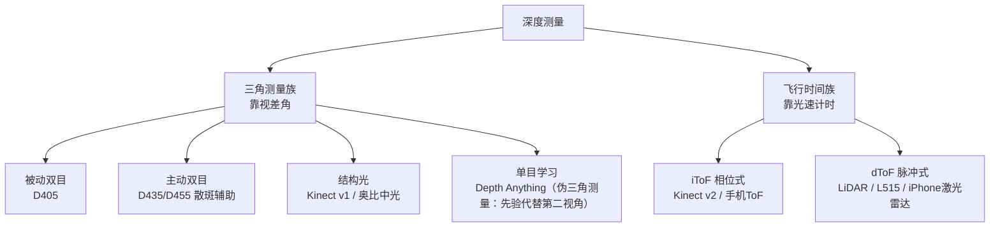

# D2 讲义 · 传感器与深度获取

[返回 3D Learning](../_index.md)

> 用法：通读讲义（1.8h 内含思考停顿）→ 跑 [P1-D2-动手-相机标定任务.py](P1-D2-动手-相机标定任务.py)（0.4h）→ 填 [传感器选型决策表](传感器选型决策表.md)（0.3h）。
> 你昨天在 D1 讲义里自己补的 D405 被动双目分析已经超前覆盖了今天一部分内容，所以本讲义把重心放在**统一框架和误差模型**上——这是选型决策表真正的依据。

---

## 一、统一视角：所有深度测量只有两种物理原理

市面上传感器名词很多（双目/结构光/ToF/LiDAR/散斑/iToF/dToF……），但物理原理只有两族：

**这张图比记参数表有用**，因为两族的误差模型天差地别：

### 三角测量族：误差随距离平方增长

从视差公式 $z = \dfrac{f_x B}{d}$ 对视差 $d$ 求导：

$$\delta z = \frac{\partial z}{\partial d}\,\delta d = -\frac{z^2}{f_x B}\,\delta d$$

匹配误差 $\delta d$ 基本是常数（好的算法能做到 0.1 px 亚像素级），所以**深度误差 ∝ z²**，且基线 B 和焦距 f 越大误差越小。这一个公式解释了一堆现象：

- D405 近距（7cm–50cm）表现好、远了急剧变差——z² 的必然
- 为什么手机双摄测距不准——基线太小
- 为什么基线不能无限加大——近处盲区变大（两目视野不重叠）+ 遮挡区增多，这是**基线的根本权衡**
- 为什么你的 fx·B 自标定配方有效——fx·B 作为一个整体常数直接决定了深度标尺

### 飞行时间族：误差近似与距离无关

$z = \frac{c \cdot \Delta t}{2}$，误差主要来自计时/相位测量精度，**基本不随距离恶化**（直到信噪比撑不住）。所以远距离 LiDAR 完胜三角测量。但有自己的死穴：

- **iToF（相位式）**：相位缠绕（超过一个波长的距离产生歧义）、**多径干扰**（墙角处光走了两条路，深度值被平均成一个不存在的位置——凹角处系统性凸出）
- **dToF（脉冲式）**：需要 SPAD 等高速探测器，分辨率低、成本高

---

## 二、四条路线的原理与失效场景

### 1. 被动双目（D405）

匹配左右图中同一物理点 → 视差 → 深度。**深度质量 = 对应问题求解质量**。

失效场景（本质全是"对应关系找不到或找错"）：无纹理表面（白墙、纯色桌面——无东西可匹配）、重复纹理（栅栏、键盘——匹配到错误周期）、反光/高光（两目看到的亮斑位置不同——违反亮度恒定假设）、透明物体（光穿过去了，匹配到的是背后的东西）、过曝/欠曝。

### 2. 主动方案：散斑辅助双目 vs 结构光（常被混为一谈，机制不同）

- **主动双目**（D435/D455）：投射器打随机红外散斑，只是给无纹理表面**人造纹理**，匹配仍然是"左图 vs 右图"。投射器被阳光淹没时，退化成被动双目还能凑合工作。
- **结构光**（Kinect v1、奥比中光、iPhone FaceID）：投射**已知编码**图案，匹配是"相机图 vs 参考图案"，等效于投影仪当了一只"眼睛"。精度可以很高（编码是设计出来的，解码可靠），但阳光下图案被淹没就**彻底失效**，且多台设备图案互相干扰。
- 室外阳光是三角测量主动方案的公敌：太阳的红外辐照度轻松压过投射器几个数量级。

### 3. LiDAR

dToF 的规模化形态。机械旋转式（360° 扫描、线数 16/32/64/128 决定垂直分辨率——**线数就是点云稀疏度**，64 线在 50m 外两线间隔已有半米，小物体直接漏检）vs 固态（MEMS 微镜 / Flash 泛光 / OPA，无运动件、车规友好）。失效：雨雾雪（气溶胶散射产生鬼点）、黑色吸光材质（回波太弱）、镜面（光弹走了，那个方向"没有东西"）。

### 4. 单目深度估计

透视投影丢掉了尺度：**大物体在远处和小物体在近处成像完全相同**，单张图在几何上无解。网络能输出深度靠的是**先验**（物体的典型尺寸、地面假设、纹理梯度），所以：

- 输出天然是**相对深度**（affine-invariant），Depth Anything 的默认输出不能直接拿来抓取
- Metric 版本（Depth Anything V2 的 metric head、ZoeDepth）靠特定相机内参 + 度量数据集微调，**换相机/换域就漂**
- 但它无视纹理缺失、反光、透明（靠语义先验"认得"这是杯子）——恰好补双目的死穴。**融合两者是当前的工程热点**，也是你 P3 项目一的评测点之一。

---

## 三、相机模型：K 的物理含义与畸变

针孔模型就是相似三角形：$x_{img} = f \cdot \dfrac{X}{Z}$。写成矩阵即 D1 的 $K$。今天补物理含义：

- $f_x = f / p_x$：**光学焦距（mm）除以像元宽度（mm/px）**，单位是像素。所以同一颗镜头，分辨率减半则 fx 减半——内参和分辨率绑定，换流分辨率必须换 K（你读 EEPROM 时会看到每档分辨率一套内参）。
- $f_x \ne f_y$ 的原因：像元不是正方形，或 ISP 做了非等比缩放。
- $c_x, c_y$：光轴穿过图像的位置。理想是几何中心，实际差 1–5 px（装配公差）。它错 1 px，反投影的点云整体歪一个小角度。

**畸变**不在 K 里，是投影前的非线性弯折：

- 径向 $k_1, k_2, k_3$：透镜边缘折射更强 → 直线拍成弧线（桶形 $k_1<0$ / 枕形 $k_1>0$），越靠视场边缘越严重
- 切向 $p_1, p_2$：镜片与传感器没装平行
- 管线位置：**先去畸变，再谈针孔模型**。D405 机内输出的深度图和对齐后的彩色图已做过去畸变（所以 EEPROM 里深度流的畸变系数近似为 0），但拿原始 `ir_left/ir_right` 自己跑立体匹配时，**去畸变+极线校正是你自己的责任**——这正是你们 FFS 管线里 rectify 那一步存在的理由。

---

## 四、标定在干什么

### 内参标定：本质是一次非线性最小二乘

棋盘格提供一批"已知世界坐标 ↔ 检测到的像素坐标"对应，求使**重投影误差**最小的 $K$、畸变系数和每张图的位姿：

$$\min_{K, dist, \{T_i\}} \sum_i \sum_j \left\| \pi(K, dist, T_i, X_j) - x_{ij} \right\|^2$$

张氏标定的贡献是用单应约束给出闭式初值，再非线性精化（完整推导 P2 第 2 周）。今天只需要会**读结果**：

- 重投影误差 < 0.5 px 算好，> 1 px 该重拍
- **低误差 ≠ 好标定**：图片没覆盖视场边缘（畸变系数没被约束到）、棋盘格姿态单一（fx 和 z 耦合解不开），都会给出"误差很小但参数错误"的过拟合结果。检查覆盖图比看误差数字重要。
- D405 出厂已标（你昨天补的 EEPROM 那段是对的），自己标的意义：**验证出厂参数、检测跌落/温漂、以及手眼标定无人替你做**。

### 手眼标定：AX = XB

机械臂动两个位姿，相机各看一次固定的标定板，得经典方程：

$$A_i X = X B_i$$

其中 $A_i$ = 两次末端位姿之差（机械臂正运动学给出），$B_i$ = 两次相机位姿之差（PnP 对标定板解出），$X = T^{ee}_{cam}$ 就是要求的手眼矩阵。多组运动联立求解（Tsai-Lenz 等方法，OpenCV `calibrateHandEye` 直接可用）。

- **eye-in-hand**（你的配置）：相机固定在末端，求相机↔末端；标定板固定在世界
- **eye-to-hand**：相机固定在世界，求相机↔基座；标定板拿在末端
- 采集要诀：旋转激励要充分（各轴都转到），纯平移的运动对旋转部分无约束

### 误差传导：一个必须内化的量级直觉

手眼的**旋转误差经杠杆臂放大成平移误差**：$e \approx r \cdot \theta$。

$$0.5° = 0.0087\ \text{rad},\quad \times\ 200\text{mm 工作距离} \approx 1.7\ \text{mm}$$

也就是说：手眼旋转差半度，20cm 外的目标点就偏 1.7mm——**mm 级抓取的误差预算瞬间被一项吃光**。这就是为什么手眼标定是"机器人操作的第一道坎"。

---

## 五、今日核心问题

> [!question] 机械臂抓取要 mm 级精度，你会选哪个传感器？手眼标定误差会怎么传导到抓取失败？
> 先自己写：①选型+理由（用误差模型说话，不要用"经验上"）；②列出从传感器到抓取点的完整误差链，估每项量级。

> [!note]- 参考答案（先写再看）
> **选型**：近场操作（<50cm）选短基线双目（D405 类）或结构光。依据是三角测量误差 ∝ z²/(fB)：z 小的时候这一族误差可以压到亚毫米，而 iToF 在任何距离都有 ±2–5mm 的底噪 + 多径干扰，近场反而没优势；LiDAR 分辨率不够看小物体。无纹理/反光物体多的场景，结构光或主动双目优于被动。
>
> **误差链**（20cm 工作距离的典型量级）：
> | 环节 | 典型误差 | 备注 |
> |---|---|---|
> | 深度测量 | 0.5–2 mm | ∝ z²，D405 近场标称 <2% |
> | 内参误差 | 0.5–1 mm | 反投影歪斜，视场边缘最大 |
> | 手眼旋转 0.3–0.5° | 1–1.7 mm | ×杠杆臂，通常是**最大项** |
> | 手眼平移 | 0.5–1 mm | 直接叠加 |
> | 机械臂重复定位 | 0.02–0.1 mm | 工业臂很小，协作臂稍大 |
> | 位姿估计算法 | 1–5 mm | 物体级，往往反超前面所有 |
>
> 各项近似独立 → RSS 合成 √(Σe²) ≈ 2–3 mm。**结论**：mm 级抓取不能只堆传感器精度，手眼标定和位姿算法才是大头；以及为什么真实系统靠**力控/阻抗**兜底最后几毫米（D5 会回答这个）。

---

## 六、疑问清单种子

- 张氏标定为什么至少需要 3 个不同姿态的平面 → P2 第 2 周
- AX=XB 的求解为什么要先解旋转再解平移 → P2 第 2 周
- 亚像素匹配凭什么能到 0.1 px → P2 第 4 周（cost volume 的 soft-argmin 就是答案之一）
- iToF 多径干扰有没有算法解 → 疑问清单挂着，遇到再说

明天 D3（3D 感知任务地图）：你昨天自己整理的"七大板块"已经是 D3 的雏形，明天在它基础上补任务的**输入/输出/指标**三要素。

→ 动手：[P1-D2-动手-相机标定任务.py](P1-D2-动手-相机标定任务.py) ｜ 产出：[传感器选型决策表](传感器选型决策表.md)
