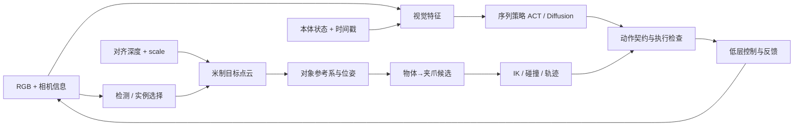
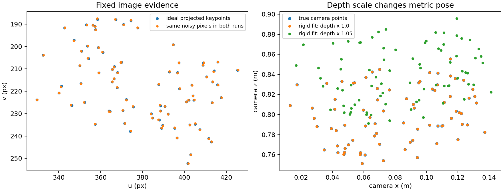
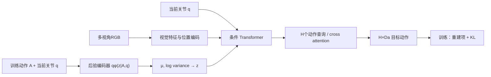
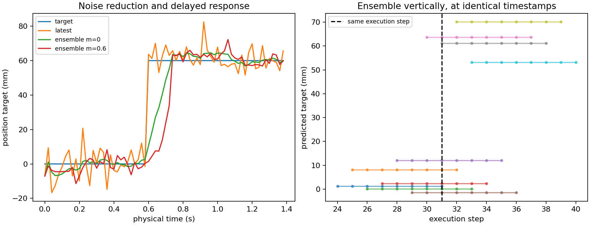
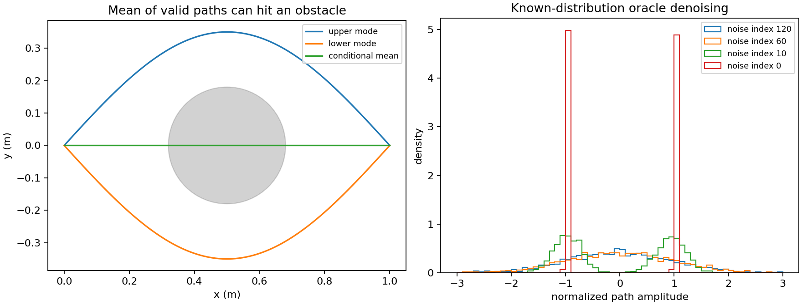

# D20 · 把检测、位姿与动作序列接成可检查的系统

[返回学习入口](../_index.md) ｜ [本周日程](../P2-深度理解-日程.md) ｜ [上一课 D19](../day19/Daily-Learning-Pack.md) ｜ [下一课 D21](../day21/Daily-Learning-Pack.md) ｜ [CPU 实验](demo.py)

**一个模块输出正确的数组，还不足以说明系统做出了正确的动作。今天把“找到目标、恢复米制几何、生成夹爪目标、安排未来动作”连起来，逐个核对它们共享的对象、坐标、尺度与时间。**

本课保持原路线 **P2 / W3-D6 / 全局 Day20，原定 2026-09-24**；于 2026-09-29 补写，不改变课号。原任务是检测收尾、投影与位姿综合实验和系统分析；新增 ACT、Diffusion Policy 的动作 chunk。D19 的 NOCS、RANSAC、ICP 是前置，D21 进一步审计实际系统与抓取筛选。新增策略知识不替代本周 PointNet 实现、投影笔记、旋转对比或系统框图。

<details>
<summary>个人学习记录（后续生成保留）</summary>

<!-- learner-notes:start -->

- 我的几何接口图与动作时间轴：
- 运行前预测 / 改变量结果 / 原因：
- 我实际阅读的论文段落：
- 自测作答与仍不理解的问题：

<!-- learner-notes:end -->

</details>

<!-- daily-pack-generated:start -->

## 0. 学习目标：从局部正确走向条件明确的系统正确

完成今天内容后，应能：

1. 为检测、投影、位姿和抓取目标定义输入、输出、单位、参考系、时间与失败信号。
2. 解释为什么同一组像素能支持多个米制点云，为什么低重投影误差不能独立证明深度尺度。
3. 区分已知尺度 PnP、刚性三维配准与 NOCS 相似配准所使用的信息。
4. 把动作预测长度、实际执行长度、重规划频率和去噪迭代次数分开。
5. 读懂 ACT 的条件潜变量、序列解码、padding 与时间集成；读懂扩散动作的训练和推理路径。
6. 用可运行实验解释：平均动作可能不可行；平滑可以减噪，也可能延迟响应；单变量检查比“换一个大模型”更能定位接口错误。

今天的路线是：**几何管线 → 误差证据 → 动作序列 → ACT → 多峰动作与扩散 → 综合工程接口 → 实验与总结**。

| 层次 | 今天追踪的量 | 最终要解释 |
| --- | --- | --- |
| 感知与几何 | 像素、深度、R/t、任务点误差 | 为什么图像正确仍会给出错误米制目标 |
| 时间与策略 | 观测历史、预测块、执行前缀 | 哪一步动作使用了哪个时刻的信息 |
| 学习机制 | 潜变量、重建、噪声恢复 | 训练和推理分别知道什么 |
| 工程与验收 | 契约、误差表、单变量对照 | 本课证据证明了什么，还缺什么 |

## 1. 宏观：两条路线可以共存，但证据不能互相冒领



上面的几何路线显式恢复对象结构；下面的视觉策略可以直接学习观测到动作。图表示接口位置，不表示论文已经把两个路线融合成同一个模型。选择哪条路线，需要看对象知识、演示数据、接触复杂度与可解释性要求。

例如把零件放入有明确尺寸的治具，CAD、定位基准和误差预算很有价值；打开软包装时，单靠静态刚体位姿难以表达接触变形，演示策略可能更合适。**两类方法都不能省略执行端的关节顺序、坐标、单位、控制模式和观测时刻。**

| 层 | 一个具体输出 | 必须带着走的条件 | 独立验收 |
| --- | --- | --- | --- |
| 检测 | 实例 ID、框、mask、分数 | 类别、图像尺寸、resize/crop、时间 | 匹配协议、FP/FN、遮挡子集 |
| 投影 | `[N,3]` 目标点 | K、深度单位、有效像素、camera frame | 已知点的往返与米制检查 |
| 位姿 | `[4,4]` object→camera | 模型原点、尺度、对称约定 | R/t 与点误差，不只拟合残差 |
| 抓取 | `[G,4,4]` object→grasp 模板 | 开口、接近方向、接触假设 | 可达、无碰、任务相关性 |
| 策略 | `[B,H,Da]` 动作序列 | 每维含义、目标时刻、归一化 | 行为结果、越界、延迟 |
| 控制 | 关节/末端跟踪 | 控制频率、限位、反馈 | 跟踪、接触与真实任务结果 |

检测置信度是检测分支给出的排序依据；位姿分数、抓取质量和执行成功率都需要自己的定义。一个 `confidence` 字段不能穿过整条链后突然变成“成功概率”。

## 2. 微观：先完成检测与几何接口，再讨论策略

### 2.1 收尾检测模块，要检查对象身份与评价协议

回看 [D17 的匹配与 AP](../day17/Daily-Learning-Pack.md)。多目标系统至少有三种 ID：数据集类别、当前帧检测序号、跨帧跟踪实例。它们不能互换。若两只杯子的 mask 都准确，却把左杯的位姿交给右杯的操作目标，像素指标仍可能很高。

一个离线记录可以这样设计；这是本课示例结构，不是 ROS 固定消息定义：

```python
record = {
    "instance_id": "object_7", "class_name": "cup",
    "source_stamp_s": 12.340, "frame_id": "camera_optical",
    "image_shape_hw": [480, 640],
    "bbox_xyxy_px": [270., 160., 390., 310.],
    "det_score": 0.93, "depth_unit": "m",
    "model_origin": "declared_object_frame",
    "valid": True, "failure_reason": None,
}
```

真正组装时还要保存模型/标定版本、mask 对应关系和观测有效性。框裁剪以后，如果把局部像素当成全图像素反投影，错误出在坐标接口，未必出在检测网络。

对一个检测器的收尾，不以“输出了 `[N,7]`”为标准，而以以下证据为标准：固定数据划分与匹配协议；保留漏检、重复检测、定位偏差；区分类别错误与几何错误；能用单个样例从输入追到最终评分。今天提供几何集成实验，**没有训练或复现完整三维检测器**；D15 的 PointNet 核心模块仍是原要求中的实际实现。

### 2.2 从像素到点：光轴深度与内参必须属于同一图像

列向量约定仍为 $p_A=R^A_Bp_B+t^A_B$。经去畸变的像素与光轴深度满足：

$$
p_c=zK^{-1}[u,v,1]^T
=z\begin{bmatrix}(u-c_x)/f_x\\(v-c_y)/f_y\\1\end{bmatrix}.
$$

若 $u=380,v=215,z=0.8m$，$f_x=600,f_y=610,c_x=320,c_y=240$，则 $x=0.08m$、$y\approx-0.03279m$。换成 800 mm 但忘记单位转换，所有位置会放大千倍。

对裁剪偏移 $(u_0,v_0)$，局部坐标为 $(u-u_0,v-v_0)$，新主点必须变成 $(c_x-u_0,c_y-v_0)$；再 resize 时焦距与主点一起按轴缩放。数值相同的 `K` 并不适用于所有版本的图像。

**往返检查的能力边界：** 对任意正数 $\lambda$，$\pi(\lambda p)=\pi(p)$。把反投影后的整条射线放大 5%，再投回去仍是同一个像素。因此“反投影—重投影误差接近零”主要检查公式、索引与轴，不独立检查米制尺度。

### 2.3 三类位姿问题到底相差在哪里

| 方法 | 已知对应 | 尺度来源 | 求解量 |
| --- | --- | --- | --- |
| PnP | 已知物体米制点 ↔ 图像像素 | 物体模型尺寸 | $R,t$ |
| 刚性配准 | 已知物体米制点 ↔ 深度反投影点 | 模型与深度都已定标 | $R,t$ |
| NOCS 式相似配准 | 无量纲规范点 ↔ 米制深度点 | 深度与规范定义 | $s,R,t$ |

已知 CAD 的刚性配准不会自由放大模型；深度尺度写错时，模型和测量之间出现尺寸矛盾。NOCS 中的统一尺度自由度则可以吸收一部分缩放，因此错误可能以“对象变大了”表现出来。这个差异来自问题定义，不能据一个残差数字跨方法比较可靠性。

### 2.4 将 D19 的对齐公式放到综合实验里

给定行存储点 $X,Y\in\mathbb R^{N\times3}$，最小化：

$$
\min_{R\in SO(3),t}\sum_i\|Rx_i+t-y_i\|^2.
$$

中心化后 $H=\sum_i(y_i-\bar y)(x_i-\bar x)^T=U\Sigma V^T$，于是：

$$
R=U\operatorname{diag}(1,1,\det(UV^T))V^T,
\qquad t=\bar y-R\bar x.
$$

不做行列式修正，可能得到镜像；若把 $H$ 的方向写反却不相应改解，可能得到逆旋转。今天脚本采用 `x @ R.T + t`，与上述列向量约定一致。

本课故意令模型质心为零。若所有深度乘 $\lambda$、图像像素保持不变，则所有相机点同乘 $\lambda$。理想条件下旋转不变，平移约变成 $\lambda t$；固定模型的形状误差则表现为配准残差。因而：

$$
\|\Delta t\|\approx|\lambda-1|\,\|t\|.
$$

对于 $t=(0.08,-0.03,0.8)m$、$\lambda=1.05$，预期平移误差约 **40.23 mm**。这是一项可以在运行前算出来的预测。

### 2.5 位姿误差怎样抵达夹爪

固定对象内抓取偏移 $g_o$，相机系目标是 $g_c=Rg_o+t$。再接机器人外参：

$$
T^{base}_{grasp}=T^{base}_{cam}T^{cam}_{obj}T^{obj}_{grasp}.
$$

小旋转误差的一阶影响约为 $\delta g\approx\delta t+\delta\theta\times(Rg_o)$。所以同样的角度误差，离对象原点越远的接触位置可能偏得越多。若偏移 80 mm、角误差 1°，单独旋转造成的最大一阶位置偏差约 $80\pi/180=1.40mm$。

“对象中心误差合格”不等于“杯把插入位置合格”；今天的综合验收必须在任务关心的位置上检查误差。

## 3. 实验一：同一幅图像，尺度变了，抓取目标也变了

脚本生成 80 个已知对应的非共面模型点、真实 $R,t,K$，给像素加入每坐标 0.15 px 噪声。两个条件**只改变深度比例 1.00→1.05**，其余点、像素噪声与拟合过程相同。模型点是合成内部点，不是真实表面，不包含检测、遮挡和错配。

| 实测量 | 正确深度比例 | 深度放大 5% |
| --- | --- | --- |
| 平移真值误差 | 0.01680 mm | 40.22638 mm |
| 旋转真值误差 | 0.02041° | 0.02041° |
| 刚性拟合点 RMSE | 0.29626 mm | 2.37670 mm |
| 80 mm 对象内偏移处抓取目标误差 | 0.01750 mm | 40.22628 mm |
| 测量点云重投影误差 | $4.56\times10^{-14}$ px | $4.16\times10^{-14}$ px |



左图两次运行使用同一份像素；右图展示相机系点云拟合的位置差异。这里的近零重投影列是**测量点云投影回它自己的输入像素**，不是物体模型重投影误差，不能混称。

用同一组像素和已知米制模型执行 OpenCV `solvePnP`，本次平移误差为 **0.75673 mm**。这并不证明 PnP 一般不如 RGB-D 配准：本构造的深度无独立随机噪声，而两种方法的信息条件不同。它提供的是另一条不依赖该深度比例的诊断证据。API 以 [OpenCV 官方 PnP 文档](https://docs.opencv.org/4.x/d5/d1f/calib3d_solvePnP.html)为准，本机使用 4.10.0。

当真实系统出现类似矛盾，排查顺序应是深度单位/scale、K 与图像变换、模型尺寸、对应关系、求解器；只有这些条件清楚后，才有依据比较模型能力。

## 4. 动作从一个向量变成一个块，会增加哪些契约

### 4.1 四个不同的“长度”

设当前物理时刻为 $t$，观测历史长度 $T_o$，预测动作长度 $T_p$，每轮实际执行长度 $T_a$，扩散推理迭代数 $K_d$。这是四个不同变量：

$$
O_t=[o_{t-T_o+1},\ldots,o_t],\qquad
A_t=[a_{t|t},a_{t+1|t},\ldots,a_{t+T_p-1|t}].
$$

$a_{j|t}$ 表示“依据 t 时刻信息，给执行时刻 j 的预测”。可预测 16 步，只执行前 4 步后读取新观测。50 Hz 动作流每步 20 ms，那么一次承诺 4 步对应 80 ms；推理耗时、消息延迟与低层跟踪又是额外量。

`T_p=16` 不意味着闭环频率就是 $50/16$ Hz；这还取决于实际执行前缀。`K_d=20` 也不意味着机器人执行 20 步，那是网络把噪声变成一段动作所做的计算次数。

### 4.2 shape 必须和轴语义同时写

一个教学示例：`B=4, To=2, Tp=16, Da=10`。动作维包括平移3、旋转6D表示6、夹爪1，只是示例接口。

| 张量 | 示例 shape | 解释 |
| --- | --- | --- |
| 多相机观测 | `[B,To,V,3,H,W]` | 相机、历史与通道轴分开 |
| 本体状态 | `[B,To,Dq]` | 观测值，不是未来标签 |
| 完整预测块 | `[4,16,10]` | 16个物理目标时刻 |
| 去噪中的动作块 | `[4,16,10]` | shape不变，噪声等级变化 |
| 执行前缀 | `[4,4,10]` | 只承诺最近4步 |
| padding mask | `[4,16]` | 序列尾部无标签的位置 |

序列尾部的零可以是合法静止动作，也可以是填充。必须用独立布尔 mask 区分，不能按“元素非零”推断有效性。D15 点集 padding 的问题在时间轴上再次出现。

### 4.3 绝对目标、相邻增量与首帧增量不能混合

若预测的是每步基座增量，$p_{t+j}=p_t+\sum_{i=0}^{j-1}\Delta p_{t+i}$；若预测的是相对首帧的目标偏移，则 $p_{t+j}=p_t+\delta p_j$，不再累加。若预测绝对关节目标，则每个 $a_j$ 直接由关节控制器解释。三个序列都可以存成 `[H,D]`，shape 无法帮你选择语义。

旋转增量还要指定左乘还是右乘。对跨不同原点的位姿，不能直接平均 4×4 矩阵；对四元数要处理 $q$ 与 $-q$，对旋转6D还需解码和退化检查。

## 5. ACT：用条件潜变量组织演示中的动作序列

### 5.1 原论文真正学的是什么

ACT 在 ALOHA 设置中从多视角 RGB 与当前关节状态预测未来目标关节位置。它将动作 chunk 与条件 VAE 结合；训练时有读取专家动作的编码器，推理时移除该编码器并把潜变量设为先验均值零。[Zhao 等原论文 §IV、Figure 3](https://arxiv.org/html/2304.13705v1)

请区分两种 encoder：视觉/策略侧编码器在推理仍然需要；读取未来专家动作的 **CVAE 后验编码器**只在训练使用。把“移除编码器”理解成“推理不用处理图像”，是混淆名称。



潜变量 z 可在训练中帮助解释不同演示风格，但原版零潜变量推理不是“每次从不同风格随机采样”。因此不能仅凭 ACT 有 VAE，就断言其部署必然随机生成多个安全抓法。

### 5.2 训练目标的两部分各做什么

用教学记号写为：

$$
\mathcal L=\mathbb E_{q_\phi(z|A,q)}[\mathcal L_{rec}(\hat A,A)]
+\beta D_{KL}(q_\phi(z|A,q)\|\mathcal N(0,I)).
$$

对角高斯的正 KL 为：

$$
\frac12\sum_j(\mu_j^2+\sigma_j^2-1-\log\sigma_j^2).
$$

第一项要求动作重建；第二项约束潜变量分布，使训练后验和推理使用的先验有关联。增大 $\beta$ 会改变这个权衡，不能解释为直接增加碰撞惩罚。

核对实现时，本次官方 `ACTPolicy` 使用逐元素 **L1 加 KL**；论文 v1 的 Algorithm 1 写的是 MSE，而实现段落与代码需要一起阅读。代码先将 padding 位置置零，再对完整张量求均值，所以其归一化分母与“仅除有效元素数”的变体不同。做复现要写明所遵循的版本，不能自行改变分母却称完全相同。[官方 policy.py](https://github.com/tonyzhaozh/act/blob/main/policy.py)

### 5.3 注意力在这里连接什么

视觉 token 提供“看到了哪里”，关节 token 提供“机器人当前在哪里”，动作 query 则标记“要输出哪个未来步”。cross attention 的 query 和 key/value 可以来自不同序列长度；动作长度不必等于图像 token 数。

原 ALOHA 示例中四幅图像和14维关节状态最终预测 `[B,H,14]`。这个14维来自具体双臂接口，不是 ACT 的普遍常数，也不代表14个空间自由度。网络内部 embedding 维度则是特征宽度，不能拿来解释机械结构。具体配置可追 [官方训练/推理入口](https://github.com/tonyzhaozh/act/blob/main/imitate_episodes.py)。

### 5.4 Temporal ensembling：聚合的是同一个执行时刻

假设 t=10，现在可用的三个预测分别是 $a_{10|8}$、$a_{10|9}$、$a_{10|10}$。应聚合这三个值，而不是把已执行的 $a_8,a_9$ 与当前 $a_{10}$ 当作同一目标平均。

按原 ACT 实现的时间顺序，将最旧预测编号为 i=0：

$$
\bar a_t=\frac{\sum_i e^{-mi}a_{t|t_i}}{\sum_i e^{-mi}}.
$$

**这份原实现中，m 增大更偏向旧预测；不能套用“指数衰减必然给新数据最大权重”的直觉。** 如果自行改成按年龄排序，公式意义会变，必须把索引写出来。代码中的数组行按发起预测的时间顺序排列。[官方推理时间聚合分支](https://github.com/tonyzhaozh/act/blob/main/imitate_episodes.py)

例如旧、中、新预测为 $[0,0,60]mm$，m=0时输出20 mm；m较大时，新值权重更低，输出更接近旧值。这样可能减小抖动，也可能让突然变化更慢被采纳。实际行为必须用响应与噪声一起评价。

## 6. 实验二：同一份 noisy observation，平滑与迟滞一起出现

教学预测器把当前有噪声的位置目标重复成未来8步，它不是 ACT 网络。目标在第30步从0跳到60 mm；所有比较使用相同观测序列，**只改变同一时间聚合规则**。采样周期20 ms。

| 规则 | 静止区 RMSE（第8–27步） | 阶跃后首次越过30 mm的延迟 |
| --- | --- | --- |
| 只用最新预测 | 8.0339 mm | 0步 / 0 ms |
| 8步内等权聚合，m=0 | 1.7027 mm | 3步 / 60 ms |
| 旧预测权重大，m=0.6 | 4.3988 mm | 6步 / 120 ms |



右图每条短线属于一次预测，竖虚线相交的值才是同一执行时刻的候选。左图则同时呈现噪声和阶跃响应。m=0.6 的静止误差也并非单调优于等权：有效参与平均的样本权重更集中，所以不能只凭“更平滑”三个字下结论。

本例没有机器人动力学；位置曲线是**目标值**，不是实际跟踪位置。也没有验证整个 ACT，只验证时间索引与聚合规则。

## 7. 为什么一个“最合理的平均动作”可能撞进障碍

### 7.1 均方误差回归学习的是条件均值

给定同一观测 o，用平方误差训练确定性动作 f(o)：

$$
\arg\min_f\mathbb E[\|A-f(o)\|^2\mid o]=\mathbb E[A\mid o].
$$

推导只需把 A 减去均值后展开，交叉项期望为零。它说明目标函数喜欢均值，**不说明均值处于可行集合**。若可行集合非凸，两条可行轨迹的中点可以不可行。

构造从 $(0,0)$ 到 $(1,0)$ 的二维路径：

$$
x(s)=s,\qquad y(s)=a\sin(\pi s),\quad s\in[0,1],
\quad a\in\{-0.35,+0.35\}m.
$$

障碍圆心 $(0.5,0)$、半径0.18 m。向上、向下都绕行，等概率均值 a=0 则直穿障碍。序列每个时刻单独掷硬币选正负也不等同于生成完整路线，它可能在两种模式间反复跳转。

这里的“多模态动作分布”指**多个概率峰**，与“RGB、深度、触觉多模态传感器”是两个不同意思。

### 7.2 分布表达不是可行性证明

混合高斯、离散分类、潜变量和扩散都可以表达比单一均值丰富的分布。它们仍受演示覆盖、模型误差与场景变化影响。训练数据有两条安全路，不保证面对新障碍生成的所有样本安全；采样后仍需要任务与执行条件检查。

## 8. Diffusion Policy：在动作空间迭代去噪

### 8.1 训练时制造一个有答案的恢复问题

将归一化后的干净动作序列记为 $A^0$，扩散噪声等级 k 与物理时刻 t 分开。设 $\alpha_k=1-\beta_k$，$\bar\alpha_k=\prod_{j=1}^k\alpha_j$：

$$
A^k=\sqrt{\bar\alpha_k}A^0+\sqrt{1-\bar\alpha_k}\epsilon,
\quad\epsilon\sim\mathcal N(0,I).
$$

用观测条件 c、噪声动作与噪声等级预测噪声：

$$
\mathcal L_{noise}=\mathbb E_{A^0,c,k,\epsilon}
\|\epsilon-\epsilon_\theta(A^k,k,c)\|^2.
$$

这段公式只说明常见噪声预测参数化。不同 scheduler 可以选择不同预测目标和更新方式，不能拿“做了去噪”作为实现完全一致的依据。[Diffusion Policy 原文 §2、Figure 2](https://arxiv.org/html/2303.04137v5)

输入和输出的动作 shape 一样，例如 `[B,16,10]`。网络学的是每个动作元素上的噪声估计，不是把噪声等级 k 当成机器人下一步要执行的动作。

### 8.2 推理时没有专家动作

推理从 $A^K\sim\mathcal N(0,I)$ 开始，反复运行网络和 scheduler，得到动作块后反归一化，再截取执行前缀。以标准 DDPM 噪声参数化为例：

$$
\mu_k=\frac1{\sqrt{\alpha_k}}
\left(A^k-\frac{\beta_k}{\sqrt{1-\bar\alpha_k}}
\epsilon_\theta(A^k,k,c)\right),
\quad
A^{k-1}=\mu_k+\sqrt{\tilde\beta_k}\xi.
$$

最后一步通常不再添加随机噪声。视觉条件可以预先编码一次，再供多次动作去噪使用；这不等于每一步都重新采集未来图像。

工程读源码时追三处即可：`conditional_sample` 的采样循环、`compute_loss` 的加噪/目标、`predict_action` 的反归一化与切片。本次官方低维实现的动作起点还受 `oa_step_convention` 影响，可能是 `To` 或 `To-1`。因此不能只凭变量名猜测动作与观测对齐关系。[官方 DiffusionUnetLowdimPolicy](https://github.com/real-stanford/diffusion_policy/blob/main/diffusion_policy/policy/diffusion_unet_lowdim_policy.py)

### 8.3 用一维已知分布看清去噪原理

完整动作扩散涉及大网络，今天先把路径振幅归一化成 $x_0\in\{-1,+1\}$。前向噪声为 $x_k=\sqrt{a}x_0+\sqrt{1-a}\epsilon$，其中 $a=\bar\alpha_k$。等概率两峰的后验对数比为：

$$
\log\frac{P(x_0=1\mid x_k)}{P(x_0=-1\mid x_k)}
=\frac{2\sqrt a\,x_k}{1-a}.
$$

因为 $P(+1)-P(-1)=\tanh(\text{对数比}/2)$，得到：

$$
\mathbb E[x_0\mid x_k]
=\tanh\left(\frac{\sqrt a\,x_k}{1-a}\right),
\quad
\mathbb E[\epsilon\mid x_k]
=\frac{x_k-\sqrt a\,\mathbb E[x_0\mid x_k]}{\sqrt{1-a}}.
$$

这是从已知两点分布推出来的 **oracle 噪声预测器**，没有训练网络。它让我们把“噪声预测—反向更新—最终多峰”的数值过程独立检查。真实策略需要从数据学习这个条件关系，而且动作空间远不止一个振幅。

脚本采用有限步的高斯反向更新，并从近似标准高斯的终端分布起步；解析噪声条件均值正确，不等于有限步采样对任意分布都精确。这组容易分开的两峰只是机制诊断，不提供通用采样误差保证。

### 8.4 实验三：分布的两个峰与中间的不可行均值

脚本采样2000条振幅，使用120级线性噪声表，最终前向 $\bar\alpha_K\approx7.10\times10^{-5}$。本次正模式占49.55%，结果落在 ±1 两峰附近。按二维路径301个采样点检查，生成样本最小间隙约 **165.91 mm**；均值路线间隙 **−180 mm**。



图左说明“平均”的几何风险，右图是噪声等级逐渐降低后的振幅直方图。直方图验证采样机制，不代表学习到了图像条件，也没有测实际 Diffusion Policy 成功率。路径碰撞只在固定301个采样点检查；这里有很大正间隙，但该实现不能当一般连续碰撞检测器。

## 9. 回到系统：ACT、扩散策略、VLA、世界模型各在哪一层

| 概念 | 主要输出 | 与今天关系 | 不能直接推断 |
| --- | --- | --- | --- |
| ACT | 条件动作块 | chunk、CVAE、Transformer、时间集成 | 不是默认含语言的 VLA |
| Diffusion Policy | 条件动作分布的样本 | 去噪、序列一致性、执行前缀 | 不是自动保证碰撞约束的规划器 |
| VLA | 视觉与语言条件下的动作 | 可以采用序列/扩散等动作头 | 动作头类型不决定语义泛化水平 |
| 世界模型 | 给定状态/观测与动作后的未来 | 可辅助评估动作后果 | 单独预测未来动作不是世界模型 |

ACT 和 Diffusion Policy 在这里都是从演示学习行为的路线；“生成”描述输出分布，“模仿”描述学习信号，两者不冲突。策略能生成未来动作，不意味着已预测碰撞、力或目标是否移动。

一个动作块交给执行端前，可用以下接口表自查：

| 字段 | 为什么需要 |
| --- | --- |
| `observation_stamp`、`generation_stamp`、每步目标时刻 | 判断动作是否已过时，跳过还是重算 |
| 关节顺序或 TCP、参考系、绝对/增量模式 | 保持物理含义一致 |
| action normalization 版本与单位 | 恢复训练时的数据尺度 |
| `prediction_horizon`、`execution_horizon`、`dt` | 明确预测与承诺的区别 |
| valid mask、实例/任务 ID | 防止执行填充或旧目标的片段 |
| 越界、碰撞、观测失效处理 | 将失败转成显式状态，而非悄悄继续 |

对于腕部相机，要把位姿和 `T_base_ee` 对齐到图像时刻。对于序列策略，要决定计算期间已经过去的动作怎样处理。队列变长并不是“更稳定”，也可能只是不断执行过期信息。

## 10. 动手：把本课的三个检查全部留下来

已验证环境：Python 3.11.15、NumPy 1.26.4、OpenCV 4.10.0、Matplotlib 3.10.9，CPU。训练步数0，模型下载0，机器人交互0。结果见 [results.json](../../_assets/3d_learning/day20/results.json)。在知识库根目录运行：

```bash
python -B 3d_learning/day20/demo.py
```

主脚本同时生成三张图。先预测，再运行；对照文件中的误差、聚合延迟和分布结果。以下核心骨架足以独立开始几何接口练习：

```python
uv_h = np.column_stack([uv, np.ones(len(uv))])  # [N,3]
points_c = (uv_h @ np.linalg.inv(K).T) * z[:, None]
R, t = rigid_fit(points_o, points_c)
grasp_c = R @ grasp_offset_o + t
# 单位均为m；grasp_offset_o是物体系偏移；模型点对应由本例提供。
```

**改变量任务：** 保持模型与像素随机数不变，将深度比例改为1.02，先算 $0.02\|t\|$；然后只把 `horizon=8` 改成4，重新测同样的静止误差和阶跃延迟。两项实验分开改，不要同时改变噪声幅度和窗口。保存自己的预测与结果，不把“曲线更漂亮”作为唯一依据。

**源码任务：** 阅读官方 ACT 时间聚合分支，给数组两轴写上“生成时刻/目标时刻”；再阅读 Diffusion Policy 的动作切片，说明为什么 `To-1` 是否正确取决于数据约定。这是源码阅读，不运行其真机入口。

### 10.1 完整主脚本

<!-- embedded-demo:start -->

> [!note]- 完整CPU主脚本（与demo.py一致）
>
> ```python
> """Day20: geometry integration, time-aligned chunks, and oracle 1-D diffusion.
>
> Synthetic CPU diagnostics, not ACT/Diffusion Policy training or deployment.
> The diffusion example knows a two-point data distribution analytically.
> """
> from pathlib import Path
> import json
> import platform
> import numpy as np
> import cv2
> import matplotlib
> matplotlib.use("Agg")
> import matplotlib.pyplot as plt
>
>
> def rigid_fit(x, y):
>     xc, yc = x.mean(0), y.mean(0)
>     u, _, vt = np.linalg.svd((y-yc).T @ (x-xc))
>     fix = np.eye(3)
>     fix[-1, -1] = np.linalg.det(u @ vt)
>     r = u @ fix @ vt
>     return r, yc-r @ xc
>
>
> def project(p, k):
>     q = p @ k.T
>     return q[:, :2] / q[:, 2:]
>
>
> def backproject(uv, z, k):
>     rays = np.column_stack([uv, np.ones(len(uv))]) @ np.linalg.inv(k).T
>     return rays * z[:, None]
>
>
> def temporal_ensemble(chunks, valid, decay):
>     length, horizon = chunks.shape
>     out = np.zeros(length)
>     for t in range(length):
>         starts = np.arange(max(0, t-horizon+1), t+1)
>         offsets = t-starts
>         keep = valid[starts, offsets]
>         values = chunks[starts[keep], offsets[keep]]
>         # Chronological order: index zero is the OLDEST prediction.
>         weights = np.exp(-decay*np.arange(len(values)))
>         out[t] = weights @ values / weights.sum()
>     return out
>
>
> def oracle_diffusion(rng, count=2000, steps=120):
>     # Data x0 is +1 or -1 with equal probability; amplitude = 0.35*x0 metres.
>     beta = np.linspace(0.001, 0.15, steps)
>     alpha = 1-beta
>     abar = np.cumprod(alpha)
>     x = rng.normal(size=count)
>     snapshots = {steps: x.copy()}
>     for t in range(steps-1, -1, -1):
>         a = abar[t]
>         # E[x0|xt] for the known equal-weight two-point mixture.
>         x0_mean = np.tanh(np.sqrt(a)*x/(1-a))
>         eps = (x-np.sqrt(a)*x0_mean)/np.sqrt(1-a)
>         mean = (x-beta[t]/np.sqrt(1-a)*eps)/np.sqrt(alpha[t])
>         previous = abar[t-1] if t > 0 else 1.
>         var = beta[t]*(1-previous)/(1-a)
>         x = mean + np.sqrt(var)*rng.normal(size=count) if t > 0 else mean
>         if t in (60, 10, 0):
>             snapshots[t] = x.copy()
>     return x, snapshots, float(abar[-1])
>
>
> def main():
>     out = Path(__file__).resolve().parents[2]/"_assets/3d_learning/day20"
>     out.mkdir(parents=True, exist_ok=True)
>     rng = np.random.default_rng(20)
>     # Known asymmetric model points; correspondences are supplied, not detected.
>     obj = rng.uniform(-1, 1, (80, 3))*[0.06, 0.035, 0.045]
>     obj -= obj.mean(0)
>     r, _ = cv2.Rodrigues(np.array([0.15, -0.25, 0.4]))
>     t = np.array([0.08, -0.03, 0.8])
>     cam = obj @ r.T+t
>     k = np.array([[600., 0, 320], [0, 610, 240], [0, 0, 1]])
>     uv = project(cam, k)
>     pixel_noise = rng.normal(0, 0.15, uv.shape)
>     measured_uv = uv+pixel_noise
>     cam_good = backproject(measured_uv, cam[:, 2], k)
>     chain = []
>     estimates = []
>     tcp_offset = np.array([0.0, 0.0, 0.08])
>     for factor in (1.0, 1.05):
>         cloud = backproject(measured_uv, factor*cam[:, 2], k)
>         rh, th = rigid_fit(obj, cloud)
>         fit = obj @ rh.T+th
>         grasp = rh @ tcp_offset+th
>         truth = r @ tcp_offset+t
>         chain.append(dict(depth_factor=factor,
>             translation_error_mm=float(1000*np.linalg.norm(th-t)),
>             rotation_error_deg=float(np.degrees(np.arccos(np.clip((np.trace(rh@r.T)-1)/2, -1, 1)))),
>             fit_rmse_mm=float(1000*np.sqrt(np.mean(np.sum((fit-cloud)**2, axis=1)))),
>             grasp_error_mm=float(1000*np.linalg.norm(grasp-truth)),
>             cloud_reprojection_rmse_px=float(np.sqrt(np.mean(np.sum((project(cloud, k)-measured_uv)**2, axis=1))))))
>         estimates.append(fit)
>     ok, rv, tv = cv2.solvePnP(obj, measured_uv, k, None, flags=cv2.SOLVEPNP_ITERATIVE)
>     assert ok
>     pnp_error = float(1000*np.linalg.norm(tv[:, 0]-t))
>     assert np.max(np.abs(backproject(uv, cam[:, 2], k)-cam)) < 1e-12
>
>     length, horizon = 70, 8
>     target = np.where(np.arange(length) >= 30, 0.06, 0.)
>     observation = target+rng.normal(0, 0.008, length)
>     chunks = np.repeat(observation[:, None], horizon, axis=1)
>     valid = np.arange(length)[:, None]+np.arange(horizon)[None, :] < length
>     smooth0 = temporal_ensemble(chunks, valid, 0.)
>     smooth6 = temporal_ensemble(chunks, valid, 0.6)
>     temporal = []
>     for name, pred in (("latest", observation), ("ensemble_m0", smooth0), ("ensemble_m0.6", smooth6)):
>         cross = np.flatnonzero(pred[30:] >= 0.03)[0]
>         temporal.append(dict(method=name, stationary_rmse_mm=float(1000*np.sqrt(np.mean(pred[8:28]**2))), half_step_delay_samples=int(cross)))
>     zeros = temporal_ensemble(np.zeros((4, 2)), np.ones((4, 2), bool), 0.1)
>     assert np.all(zeros == 0), "Zero is a valid action; never use nonzero as validity."
>
>     samples, snapshots, end_alpha = oracle_diffusion(np.random.default_rng(2020))
>     x_path = np.linspace(0, 1, 301)
>     def clearance(amplitudes):
>         y = amplitudes[:, None]*np.sin(np.pi*x_path[None, :])
>         return np.min(np.sqrt((x_path[None, :]-0.5)**2+y*y), axis=1)-0.18
>     mean_clearance = float(clearance(np.array([0.]))[0])
>     candidate_clearance = clearance(0.35*samples)
>     results = dict(environment=dict(python=platform.python_version(), numpy=np.__version__, opencv=cv2.__version__, matplotlib=matplotlib.__version__, device="CPU"), seed=20,
>         geometry=chain, pnp_translation_error_mm=pnp_error, temporal=temporal,
>         oracle_diffusion=dict(samples=len(samples), steps=120, final_forward_alpha_bar=end_alpha,
>             positive_fraction=float(np.mean(samples > 0)), mean_action_path_clearance_m=mean_clearance,
>             sample_min_clearance_m=float(candidate_clearance.min()), sampled_path_collision_fraction=float(np.mean(candidate_clearance < 0)),
>             max_abs_mode_error=float(np.max(np.abs(np.abs(samples)-1)))),
>         boundary="Provided correspondences; no detector, ACT or DP network trained; oracle scalar diffusion; no robot interaction.")
>     (out/"results.json").write_text(json.dumps(results, indent=2), encoding="utf-8")
>
>     fig, ax = plt.subplots(1, 2, figsize=(11, 4.2), layout="constrained")
>     ax[0].scatter(uv[:, 0], uv[:, 1], s=12, label="ideal projected keypoints")
>     ax[0].scatter(measured_uv[:, 0], measured_uv[:, 1], s=8, label="same noisy pixels in both runs")
>     ax[0].invert_yaxis(); ax[0].set(xlabel="u (px)", ylabel="v (px)", title="Fixed image evidence")
>     ax[0].legend(fontsize=8)
>     ax[1].scatter(cam[:, 0], cam[:, 2], s=15, label="true camera points")
>     for fac, cloud in zip((1., 1.05), estimates):
>         ax[1].scatter(cloud[:, 0], cloud[:, 2], s=10, label=f"rigid fit: depth x {fac}")
>     ax[1].set(xlabel="camera x (m)", ylabel="camera z (m)", title="Depth scale changes metric pose")
>     ax[1].legend(fontsize=8); fig.savefig(out/"geometry-chain.png", dpi=160); plt.close(fig)
>     fig, ax = plt.subplots(1, 2, figsize=(11, 4.2), layout="constrained")
>     for name, pred in (("target", target), ("latest", observation), ("ensemble m=0", smooth0), ("ensemble m=0.6", smooth6)):
>         ax[0].plot(np.arange(length)*0.02, pred*1000, label=name)
>     ax[0].set(xlabel="physical time (s)", ylabel="position target (mm)", title="Noise reduction and delayed response")
>     ax[0].legend(fontsize=8)
>     for start in range(24, 34):
>         future = np.arange(start, start+horizon)
>         ax[1].plot(future, chunks[start]*1000, marker=".", alpha=0.6)
>     ax[1].axvline(31, color="black", linestyle="--", label="same execution step")
>     ax[1].set(xlabel="execution step", ylabel="predicted target (mm)", title="Ensemble vertically, at identical timestamps")
>     ax[1].legend(fontsize=8); fig.savefig(out/"chunk-timing.png", dpi=160); plt.close(fig)
>     fig, ax = plt.subplots(1, 2, figsize=(11, 4.2), layout="constrained")
>     for amp, label in ((.35, "upper mode"), (-.35, "lower mode"), (0., "conditional mean")):
>         ax[0].plot(x_path, amp*np.sin(np.pi*x_path), label=label)
>     ax[0].add_patch(plt.Circle((.5, 0), .18, color="gray", alpha=.35))
>     ax[0].set(xlabel="x (m)", ylabel="y (m)", title="Mean of valid paths can hit an obstacle", aspect="equal")
>     ax[0].legend(fontsize=8)
>     for step in (120, 60, 10, 0):
>         ax[1].hist(snapshots[step], bins=np.linspace(-3, 3, 61), density=True, histtype="step", label=f"noise index {step}")
>     ax[1].set(xlabel="normalized path amplitude", ylabel="density", title="Known-distribution oracle denoising")
>     ax[1].legend(fontsize=8); fig.savefig(out/"multimodal-actions.png", dpi=160); plt.close(fig)
>     print(json.dumps(results, indent=2))
>
>
> if __name__ == "__main__":
>     main()
> ```

<!-- embedded-demo:end -->

## 11. 精读材料：今天需要真正回答的问题

1. **ACT：** [原论文 §IV-A/IV-B、Figure 3/4](https://arxiv.org/html/2304.13705v1)。画出训练专用的后验路径；解释 why chunk、为什么集成同一时刻；对照上面的官方 `policy.py` 与 `imitate_episodes.py`，记录论文和代码的重建损失口径。产出一张带 shape 的结构卡。
2. **Diffusion Policy：** [原论文 §2、§3.1、§4.1/4.3、Figure 2](https://arxiv.org/html/2303.04137v5)。标出物理时间轴与扩散等级；解释为何输出动作序列有利于整段行为一致；对照官方低维策略类的去噪、反归一化与切片。产出训练/推理两条箭头链。
3. **实际系统预读：** [FoundationPose 官方仓库的 model-based demo](https://github.com/NVlabs/FoundationPose)。确认模型、RGB-D、初始mask这些输入是什么；D21会逐层追踪其实现并分析上游检测、下游抓取。今天未运行该系统，不登记复现成绩。

原计划中“6D Pose Estimation for Objects with Planar Surfaces”所附 `1902.04070` 错链已在D19标注；不能拿这条链接作为已读位姿论文，不能为凑本周验收悄悄替换题目。

## 12. 总结：今天最值得掌握的五点与三个难点

1. **几何残差需要独立尺度证据。** 反投影往返会继承输入尺度，实际目标误差才直接影响操作。
2. **位姿与抓取目标有不同误差。** 对象内偏移让旋转误差通过杠杆臂变成位置误差。
3. **chunk是一份时间契约。** 预测、执行、重规划和去噪步数分开，才能解释延迟与闭环。
4. **平均值不必可行。** 非凸障碍环境使多峰动作的均值可能落在危险位置。
5. **生成策略仍有数据与接口边界。** 本课验证了机制算子，没有验证真实感知、接触或训练泛化。

最容易混淆的三点是：把同像素往返误差当米制精度；把 ACT 中最旧优先的指数权重误读为最新优先；把扩散“未来动作”当成世界模型“未来世界”。分别回看第2.2、5.4、9节，用具体变量再讲一次。

**今日产出：** 一张带单位和时间的检测—位姿—动作图；一次深度比例对照；一次时间聚合对照；ACT和扩散各一张结构卡；一页解释多峰均值为何不可行的技术笔记。脚本生成这些素材，不代表你已经完成独立解释与个人验收。

## 13. 自测：先作答，不看最后的核对

1. 为什么把全部深度乘1.05，点云重投影仍能几乎零误差？哪一项独立量能暴露问题？
2. 物体中心的旋转误差很小，为什么距原点较远的抓取点仍可能偏得明显？
3. 已知CAD的PnP、刚性三维配准与NOCS相似配准分别从哪里获得尺度？
4. `To=2,Tp=16,Ta=4,Kd=20,dt=0.02s`分别意味着什么？一次执行前缀覆盖多久？
5. 三个预测分别是 $a_{12|10}$、$a_{12|11}$、$a_{13|12}$，可以直接一起做时间集成吗？
6. 原ACT权重最旧预测编号0，增大m会更快还是更慢接受新预测？CVAE后验编码器推理时还读取专家动作吗？
7. 两条安全轨迹的逐点均值为什么可能不安全？独立地为每个时间点选择一个模式又有什么问题？
8. 扩散动作的噪声等级k与物理时刻t有什么区别？训练知道的噪声，在推理时从哪里来？
9. 本课oracle去噪最终两峰非常清楚，能否说明Diffusion Policy在真实图像上已经训练成功？至少指出三个缺失环节。
10. 上游检测AP提高，抓取目标却偏40 mm。请给一条有顺序、可验证的排查链。

## 14. 未理解问题与下一课

把仍有疑问的问题具体写成变量：不清楚哪个frame、不知道哪个时间轴、哪个误差没有独立真值。避免只写“ACT没懂”。如果你能画出训练与推理两张图，指出 `A^k` 的两种索引，已经抓住今天最重要的结构。

[D21](../day21/Daily-Learning-Pack.md) 将用官方实际系统完成本周应用分析，继续筛选夹爪候选，收束 PointNet、投影、旋转表示和系统框图四项原产出。之后D22进入SfM，开始讨论多个相机视图怎样共同约束场景。


## 15. 自测核对答案与判分

> [!note]- 展开参考答案；每题0/1/2分，共20分
> **1.** 投影只保留射线方向，统一缩放抵消；已知物体尺寸、独立距离或任务点米制真值能暴露。0分只称数值误差；1分说尺度；2分含独立证据。
>
> **2.** $\delta g\approx\delta t+\delta\theta\times Rg_o$；位置影响与杠杆臂有关。0分只看中心；1分能解释；2分给公式/数例。
>
> **3.** PnP从CAD米制点获得尺度；刚性配准两侧都已度量化；NOCS规范点无量纲，通过米制深度估计统一尺度。0分混淆；1分两项正确；2分全对。
>
> **4.** 观测2步、预测16步、执行4步、计算去噪20级、动作间隔20ms；执行前缀80ms，未包含额外延迟。0分混轴；1分多数正确；2分含延迟边界。
>
> **5.** 前两者执行时刻12，第三个是13，不能当同一物理目标直接聚合。0分可以；1分发现时刻；2分明确两个索引。
>
> **6.** 更偏旧预测，通常更慢采纳新变化；推理不用未来专家动作，后验编码器移除、原版z设0，视觉编码仍在。0分相反；1分部分正确；2分均正确。
>
> **7.** 可行集合非凸，均值可穿障碍；逐步独立切换可形成不连续或不一致序列。0分均值必安全；1分一个问题；2分两者含例。
>
> **8.** k是去噪计算等级，t是环境时间；训练人为采样噪声并知道它，推理从随机初始动作开始，由网络估计各级噪声。0分混淆；1分能区分；2分含训练/推理。
>
> **9.** 不能；本例没有视觉编码、演示训练、全维动作、实际环境闭环/动力学。0分宣称复现；1分指出一项；2分至少三项。
>
> **10.** 先确认对象身份，再核对RGB-D对齐、单位/scale、K/crop、模型尺寸、变换方向与时刻，最后比较配准/任务点误差；每次只改一个条件。0分直接换网络；1分列检查；2分有顺序与独立证据。

<!-- daily-pack-generated:end -->
