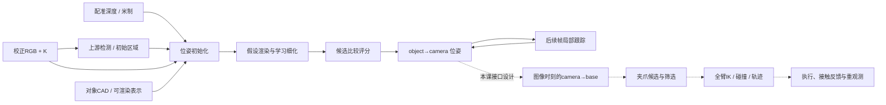
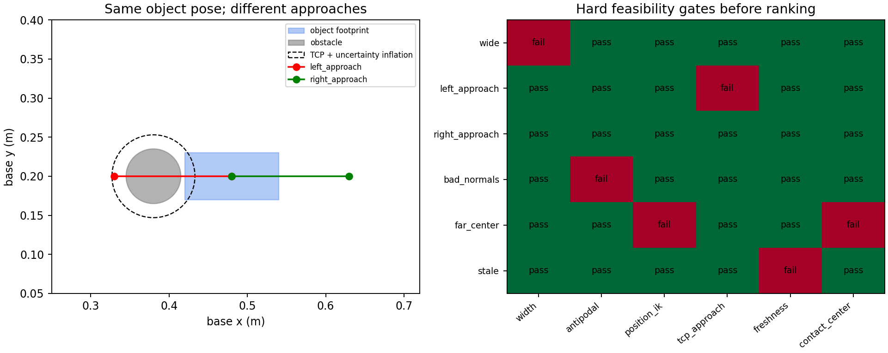
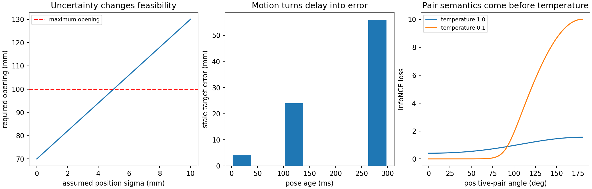

# D21 · 实际位姿系统、抓取筛选与 W3 闭环验收

[返回学习入口](../_index.md) ｜ [本周日程](../P2-深度理解-日程.md) ｜ [上一课 D20](../day20/Daily-Learning-Pack.md) ｜ [下一课 D22](../day22/Daily-Learning-Pack.md) ｜ [CPU 实验](demo.py)

**本周的终点不是记住几种网络，而是能沿一份真实系统的输入和代码，把“图像中的目标”追到“带参考系和证据的位姿”，再说明它离一个可执行抓取还差什么。**

本课为 **P2 / W3-D7 / 全局 Day21，原定 2026-09-25**，于 2026-09-29 补写。保留原任务：实际3D检测/位姿系统完整应用分析及本周原产出验收；新增抓取筛选、对比与生成学习五格卡。D20 已把投影、位姿与动作序列接起来；D22 按原顺序进入 SfM，不因补课跳过周总结。

<details>
<summary>个人学习记录（后续生成保留）</summary>

<!-- learner-notes:start -->

- 我独立画出的系统图与关键接口：
- PointNet / 投影 / 旋转 / 系统四项产出位置：
- 我运行的实验、预测与解释：
- W3自测成绩、未通过项与回补证据：

<!-- learner-notes:end -->

</details>

<!-- daily-pack-generated:start -->

## 0. 学习目标：能审计一个系统，而不是只描述一个模型

本课结束后，应能：

1. 解释真实 FoundationPose 系统对 RGB-D、对象模型/参考图、初始区域、相机参数的要求，区分检测、位姿初始化和跟踪。
2. 沿官方源码追踪假设生成、细化、评分、坐标还原和跨帧状态，指出结果可信度与模型原点问题。
3. 从物体位姿构造夹爪候选，以开口、接触法向、可达性、接近路径与时效分别筛选。
4. 推导一个简化摩擦锥条件、一个位置IK条件及一个时延误差界，并说明其不足。
5. 用五格卡区分监督、对比、生成与行为克隆；知道哪些增强会破坏位姿任务需要的信息。
6. 对 W3 四项原产出逐项验收，不把“文件已经生成”或“模型曾在论文中成功”记为自己的完成。

| 顺序 | 知识层 | 要解决的问题 |
| --- | --- | --- |
| 宏观 | 官方实际系统与证据边界 | 哪些模块已经由作者实现，哪些是本课下游设计 |
| 微观 | 输入、假设、细化、评分与跟踪 | 位姿数字从哪里来，原点和时效如何保留 |
| 操作 | 宽度、接触、IK、路径与不确定性 | 为什么最高分候选会被拒绝 |
| Learning | 对比关系与生成目标 | 表征保留什么，输出分布又意味着什么 |
| 收束 | 原四项产出、自测与下一周 | 能否独立把检测、几何和操作连接起来 |

## 1. 宏观：选择一个真实系统，把边界画出来

### 1.1 本课案例与证据层级

案例使用 **FoundationPose 官方实现及 Isaac ROS 的 FoundationPose 集成文档**。它是可核实的实际位姿系统：官方 Python 示例用模型和 RGB-D 做首次注册，之后跟踪；ROS 示例还给出 RealSense 与 RT-DETR 接入方式。[FoundationPose 官方仓库](https://github.com/NVlabs/FoundationPose) · [Isaac ROS 官方集成](https://nvidia-isaac-ros.github.io/repositories_and_packages/isaac_ros_pose_estimation/isaac_ros_foundationpose/index.html)

这里必须区分三层：

| 层 | 本课证据 | 能得出的结论 |
| --- | --- | --- |
| 作者系统 | 官方论文、仓库、示例及接口 | 作者公开系统如何组织、需要什么输入 |
| 本地已验证 | 本课NumPy筛选与数值图 | 所写几何条件、时延关系和损失计算成立于指定算例 |
| 我的机器人应用 | 待接入实际传感器和机器人 | 真实位姿精度、全臂无碰、接触稳定与任务成功尚待测量 |

**本机没有运行 FoundationPose、RT-DETR、ROS 或真机；没有下载权重。** 今天完成的是一手材料支持的应用分析与独立CPU机制实验。主线不是某个库的安装教程，也不把网站历史榜单分数当作你的机器人性能。

### 1.2 系统全景图：实线是已核实的感知流程，虚线是本课下游设计



这张图没有把完整操作控制器归给 FoundationPose。其位姿输出只是下游的输入。跟踪回路也不是夹爪控制回路：前者利用连续图像更新对象状态，后者通过执行动作改变机器人与环境。

## 2. 真实输入条件：新物体，不等于不需要物体知识

### 2.1 模型已知与参考图设置

FoundationPose 原论文支持提供 CAD 的 model-based 设置，以及通过参考图构建可渲染对象表示的 model-free 设置。两者共享后续 render-and-compare 路线；“新物体无需重训位姿网络”不等于没有对象模型、参考采集或建模过程。[原论文 §3.2、Figure 2](https://arxiv.org/html/2312.08344v2)

这和 D19 的 NOCS 类别级问题不同：NOCS 依赖训练类别的规范表示；FoundationPose 的新物体设置以对象CAD或参考数据提供对象知识。都在估计6D位姿，但先验、对象范围与准备成本不同。比较时要把输入条件放进表格，而不是只比较“支持未知物体”一句话。

| 设置 | 部署时主要对象先验 | 典型优势 | 需要追问 |
| --- | --- | --- | --- |
| 已知实例模型+几何方法 | 米制CAD/点云及对应 | 尺度与对象坐标明确 | 特征/对应、遮挡和初始化 |
| NOCS 类别级 | 训练类别与规范化规则 | 同类新实例可估尺寸/位姿 | 类别外泛化、规范轴和对称 |
| FoundationPose模型路线 | 新对象的可渲染CAD | 复用预训练位姿模块 | 模型尺度、纹理、初始区域 |
| FoundationPose参考图路线 | 对象参考采集与神经表示 | 无显式CAD时建立渲染桥梁 | 建模数据质量与参考覆盖 |

### 2.2 输入shape和语义先对齐

下面是接口层形状，不把它当成所有后端的固定内存布局：

| 数据 | 概念shape | 单位与语义 |
| --- | --- | --- |
| RGB | `[H,W,3]` | 确认RGB/BGR、校正与预处理 |
| depth | `[H,W]` | 光轴深度，进入几何前统一为m |
| K | `[3,3]` | 与当前RGB/深度像素网格对应 |
| 对象区域 | `[H,W]` | 指定目标，不代表全图所有实例 |
| mesh顶点/法向 | `[Nv,3]` / `[Nv,3]` | 顶点m、法向无量纲，对象坐标已声明 |
| 位姿候选 | `[Nh,4,4]` | 每个候选的object→camera变换 |
| 最终位姿 | `[4,4]` | 不是3D框尺寸，也不是夹爪目标 |

一个RGB检测框转换成矩形mask，只能表达ROI，不能变成精确实例分割。框内仍可能含桌面、邻物和空洞。官方ROS入口提供 `launch_bbox_to_mask`，说明区域生成是可配置的上游接口；不要把该转换的结果称为已经逐像素分出了目标。其输入包括图像、深度、相机信息与区域，输出有3D检测消息和位姿矩阵。[官方API的 Usage 与 Topics](https://nvidia-isaac-ros.github.io/repositories_and_packages/isaac_ros_pose_estimation/isaac_ros_foundationpose/index.html#api)

### 2.3 模型原点是一个真实接口，不是画图习惯

假设 mesh 原点在底面中心，而某个中间算法把包围盒中心作为原点。对象高0.12 m，两个原点相差60 mm。即使旋转完全正确，直接把中间平移当最终物体位置也会给夹爪引入60 mm偏移。

若 $c$ 为原始模型中心，居中点为 $x'=x-c$，内部位姿满足 $p=Rx'+t'$，则对原始点：

$$
p=Rx+(t'-Rc),\qquad
T_{original}=T_{centered}\begin{bmatrix}I&-c\\0&1\end{bmatrix}.
$$

这就是为什么要追踪对象的规范化与最终反变换，而不是只看一个 `pose` 变量名。官方估计器有居中模型和还原变换函数，最终返回值要按其对象原点解释。[官方 estimater.py](https://github.com/NVlabs/FoundationPose/blob/main/estimater.py)

## 3. 沿官方实现追踪一次初始化与一次跟踪

### 3.1 初始区域提供位置线索，旋转仍需要搜索

初始平移可以从目标区域的图像范围、合法深度统计与K获得粗估计。但可见部分的中心不一定是物体真实中心；它只用于给后续候选提供合理起点。旋转在多个方向和面内角上提出假设，然后再用图像与几何证据修正。

粗定位解决“先在哪附近找”，局部细化解决“向哪里改”，评分解决“保留哪个候选”。这是三个作用不同的模块。把它们都叫“位姿网络”会掩盖故障发生的位置。

### 3.2 Render-and-compare 的计算直觉

给定候选 $T_i$，把模型渲染到相机中，产生预测外观和几何，再和真实观测的对应区域比较。若候选向右偏，渲染轮廓与真实轮廓不重合；若朝向错，纹理、可见面或深度结构可能不一致。

可以用以下教学抽象描述：

$$
(\hat I_i,\hat D_i)=\operatorname{Render}(M,K,T_i),
\qquad
\Delta_i=f_\theta(\operatorname{Crop}(I,D),
\operatorname{Crop}(\hat I_i,\hat D_i)),
\quad T_i\leftarrow\operatorname{Update}(T_i,\Delta_i).
$$

这是接口抽象，`Update` 的平移/旋转参数化应按作者具体实现读取，不能把本式当作原论文未经说明的左乘公式。原方法的学习细化与候选选择并不是 D19 的最近邻ICP；二者都能“迭代改位姿”，但输入特征、更新模型和优化条件不同。[原论文 §3.3–3.4](https://arxiv.org/html/2312.08344v2)

对候选批量处理时，额外的 `Nh` 轴表示多种假设，而不是多台相机。训练/推理中的图像裁剪要保持渲染与观测一致，深度反投影后的XYZ和RGB也不能被同一种归一化规则随意替代。

### 3.3 评分高意味着在候选中被选中

当候选全部很差，排序仍然能给出第一名。因而“最高分”与“达到了任务容差”必须分开。候选相对评分可用于选择，但如果没有额外校准，不应直接把它解释为旋转在1°内的概率或抓取成功率。

**工程推断：** 可以为下游建立独立验收条件，例如有效深度覆盖、与观测的一致性、相邻帧跳变、任务允许的位姿范围。具体阈值需要真实数据校验；本课没有给出能保证FoundationPose可靠性的通用阈值。

### 3.4 代码中首次注册与后续跟踪的区别

官方 `run_demo.py` 首帧读取mask后调用 `register`，后续帧调用 `track_one`，并保存object-in-camera矩阵。`register` 经候选细化和评分选择输出；`track_one` 从上一帧状态做局部更新。阅读时分别标出这些状态变化。[官方 run_demo.py](https://github.com/NVlabs/FoundationPose/blob/main/run_demo.py)

下面是教学伪代码，省略作者内部实现，也没有可执行的真机调用：

```python
if need_initialization:
    hypotheses = propose_from_region_depth_and_model(...)
    refined = refine_rendered_vs_observed(hypotheses, ...)
    pose_internal = choose_by_pose_score(refined, ...)
else:
    pose_internal = refine_from_previous(previous_pose_internal, ...)
pose_for_original_mesh = restore_model_origin(pose_internal)
publish_with_observation_stamp(pose_for_original_mesh)
```

这里最后的发布时间戳封装是本课工程建议。原始Python示例不能自动代表你需要的全部ROS状态机，尤其不能假设每一条应用都有相同的失效检测与重初始化规则。

### 3.5 静止测试、跟踪测试和任务测试要分开

静止物体上平滑的坐标曲线只反映一种条件。对象快速运动、遮挡后重现、相机运动、同类实例相邻时，需要分别记录失败。跟踪使用上一帧状态，可能提高连续性，也可能延续错误。

本课建议一份离线验收记录包含：初始化成功/失败、每帧有效性、丢失到重建的间隔、位姿真值误差、对象ID切换、端到端延迟。最后才接任务成功与失败原因。不要只报告“平均FPS”和一段最好看的视频。

## 4. 从感知系统到机器人系统：时效也进入误差预算

### 4.1 位姿的时间不是消息到达时间

如果对象以0.2 m/s匀速移动，120 ms前的位姿即使在当时精确无误，当前也已相差24 mm：

$$
e_{delay}=\|v\|\Delta t.
$$

在不知道运动方向、但有速度上界 $v_{max}$ 时，这给出位置漂移的上界项；若还有加速度上界，可以加入 $\frac12a_{max}\Delta t^2$。真实旋转、相机运动和预测误差需要另列。

几何误差不必总用标量相加。若各误差独立零均值，可传播协方差；若要保守保证或存在未知系统偏差，应按边界处理。不能一边用标准差，一边把未建模偏置也塞进同一个“高斯噪声”假设。

### 4.2 一个完整但仍简化的输出契约

```python
pose_result = {
    "object_id": "target_1", "model_frame": "mesh_original",
    "reference_frame": "camera_optical", "stamp_s": 8.420,
    "T_reference_object": "4x4 matrix",
    "model_scale_unit": "m", "symmetry_convention": "declared separately",
    "status": "tracking", "valid": True,
    "pose_score": "method-specific ranking value",
    "covariance": None,  # 未估计就明确未知，不能用检测分数填充。
}
```

下游按图像时刻读取相机到基座的变换，将物体位姿与对象内抓取模板组合。若对象已移动，则需要新观测或有依据的预测；换一个frame并不能消除陈旧观测。

### 4.3 VLA与世界模型在这张实际系统图中的位置

VLA可以直接从图像和语言产生动作，也可以把显式对象状态作为上下文；这些属于额外架构选择。不能因为FoundationPose训练数据生成用过语言模型，就把它称为在线语言动作策略。

世界模型可以预测“执行这个动作以后对象可能在哪里”，辅助挑候选或决定是否重观测。它仍需要清楚的对象身份、动作坐标、作用周期和历史状态。一个只做当前位姿跟踪的模块不自动成为动作条件世界模型。

## 5. 抓取筛选：先定义候选，再讨论质量

### 5.1 一个平行夹爪候选应该包含什么

一个候选 $g$ 可含 $T^{obj}_{grasp}$、开口w、接近距离d、候选接触点与法向、任务限制。变到基座系：

$$
T^{base}_{grasp}=T^{base}_{cam}T^{cam}_{obj}T^{obj}_{grasp}.
$$

若夹爪局部z轴定义为朝物体的接近方向，预抓取可写为沿该轴反向退d；如果机器人定义相反，符号就必须更改。不要只画一根箭头而不声明方向。

**候选生成和候选筛选是不同阶段。** 网络分数可以为候选排序，几何模板可以生成候选，但开口不够、接触不对或无法到达的候选不能因为分数高就变得可执行。

### 5.2 宽度检查：一个可以手算的边界

若物体在闭合方向上的跨度为 $w_o$，两侧名义余量合计10 mm，位置不确定性启发式每侧再留 $3\sigma$：

$$
w_{req}=w_o+0.010+6\sigma.
$$

短边60 mm、$\sigma=1mm$，需要76 mm开口；最大100 mm时通过。若 $\sigma=8mm$，需要118 mm，无法通过。

这是本课明确规定的**保守余量规则**，不是从完整接触概率推出来的99.7%三维成功保证。各轴误差、相关性、姿态不确定性与实际夹爪几何都可能改变需要的余量。它的价值是让“考虑不确定性”变成能计算、能反驳的条件。

对于有旋转的物体，闭合轴在物体系的方向 $b_o$ 决定投影跨度：

$$
w_o=\max_i b_o^Tx_i-\min_i b_o^Tx_i.
$$

轴对齐盒子的长短边只是这个公式的特例；不能永远把检测框的某个固定尺寸字段当成夹爪开口。

### 5.3 接触法向与摩擦锥：对向并不只指两个点分开

设接触点 $c_1,c_2$，从点1指向点2的单位向量为 $d=(c_2-c_1)/\|c_2-c_1\|$；表面外法向为 $n_1,n_2$。理想点接触、库仑摩擦模型中，接触力应落在以**内法向**为轴的摩擦锥内，锥半角：

$$
\theta_{max}=\arctan\mu.
$$

简化antipodal条件为：

$$
(-n_1)^Td\ge\cos\theta_{max},
\qquad
(-n_2)^T(-d)\ge\cos\theta_{max}.
$$

当 $\mu=0.5$，半角约26.565°。候选最大法向偏角40°时，这项简化条件不满足。今天脚本直接给出“两侧最大偏角”这个合成输入，没有从噪声点云估计法向。

摩擦锥与接触力条件可对照 [Modern Robotics §12.2.1](https://modernrobotics.northwestern.edu/nu-gm-book-resource/12-2-1-friction/)；完整力闭合需要考虑可产生的合力与力矩，见 [§12.2.3](https://modernrobotics.northwestern.edu/nu-gm-book-resource/12-2-3-force-closure/)。

该条件帮助分析夹持方向，不等于完整三维力闭合或负载能力证明；两点摩擦接触、软指接触、接触面和外部重力矩有不同约束。机器人仍要知道材质、夹持力、滑移、质心与任务中的外力。

### 5.4 可达性：IK分支是候选，仍不是轨迹

本课用平面二连杆位置IK做可达性示例，长度 $l_1=0.45m,l_2=0.40m$。目标 $p=(x,y)$：

$$
\cos q_2=\frac{x^2+y^2-l_1^2-l_2^2}{2l_1l_2}.
$$

右侧不在[-1,1]时无实数解；在范围内通常有肘上/肘下分支，再分别求 $q_1$。可达圆环为 $|l_1-l_2|\le\|p\|\le l_1+l_2$。

$(0.48,0.20)m$距离约0.52 m，位置可达；$(1.2,0.2)m$距离约1.217 m，超过0.85 m。今天的IK不约束完整夹爪朝向，也未检查关节限位或全臂碰撞，所以只能称“位置IK通过”。完整系统还要接上 [D17配置空间](../day17/Daily-Learning-Pack.md) 和 [D18路径、自碰撞与轨迹](../day18/Daily-Learning-Pack.md)。

### 5.5 接近路径：终点安全不代表路上安全

简化TCP为半径15 mm的二维圆盘，障碍为半径35 mm圆，预抓取到抓取是一条线段 $a\rightarrow b$。圆心到线段距离可解析计算：

$$
u=\operatorname{clip}_{[0,1]}
\frac{(o-a)^T(b-a)}{\|b-a\|^2},
\quad
g=\|o-(a+u(b-a))\|-r_{obs}-r_{tcp}-3\sigma.
$$

$g>0$表示在这个膨胀圆模型下有正间隙；$g\le0$则拒绝。该公式检查整条直线段，不只检查端点。本例前后点不重合；通用实现需要额外处理零长度线段。

它仍不是全夹爪或全机械臂的碰撞检查。TCP圆盘可以通过，手指、手腕、肘部仍可能相撞。这些几何不能用扩大一点TCP半径随意替代。

## 6. 实验：六个候选，一张可以解释每次拒绝的表

对象俯视尺寸120×60 mm、中心 $(0.48,0.20)m$；障碍圆心 $(0.38,0.20)m$。候选中心、法向偏角、分数等均人为构造，目的是检查筛选逻辑。候选评分只作为排序数，不宣称来自检测网络或具有概率校准。

基线 $\sigma=1mm$、最大开口100 mm、时效阈值100 ms：

| 候选 | 示例分数 | 所需开口 | 接近间隙 | 主要结果 |
| --- | --- | --- | --- | --- |
| wide | 0.99 | 136 mm | +47 mm | 开口不足 |
| left_approach | 0.98 | 76 mm | −53 mm | 接近路线穿过障碍 |
| right_approach | 0.93 | 76 mm | +47 mm | 六项教学条件均通过 |
| bad_normals | 0.97 | 76 mm | +47 mm | 40°超过摩擦锥26.565° |
| far_center | 0.96 | 76 mm | +767 mm | 无位置IK且接触中心不在目标 |
| stale | 0.95 | 76 mm | +47 mm | 位姿年龄280 ms，超过门限 |



左图把障碍按TCP半径和余量膨胀，右图显示六项条件。最低示例分数0.93的候选被选中，是因为只有它在这组候选中通过全部规定条件，**不是因为低分更值得信任**。

筛选顺序可写为：

$$
\mathcal G_{feasible}=\{g:c_1(g)\land\cdots\land c_m(g)\},
\qquad
g^*=\arg\max_{g\in\mathcal G_{feasible}}q(g).
$$

若集合为空，应输出明确的“本条件下无可用候选”，而不是从不合格候选中强行选最高分。重观测、改接近方向或换夹具是可能的后续策略，需要新的证据。

### 6.1 单变量对照一：只增加不确定性

保持物体、障碍、候选、分数、时效完全相同，将 $\sigma$ 从1 mm改成8 mm。原本可用的短边候选开口需求从76增到118 mm，全部候选被拒绝。**变化的是余量假设，不是物体真的变大了。**

### 6.2 单变量对照二：只翻转分数

保持全部几何与阈值，将每个候选分数 q 改成1−q。脚本断言每个候选的可行性布尔值完全不变。这个对照验证“硬条件”与“排序”在实现中确实分开，而非只在文字上说分开。

### 6.3 位姿时效对照

保持运动速度0.2 m/s，仅改变年龄20、120、280 ms，陈旧位置误差分别为4、24、56 mm。实际系统如果目标静止，这个特定误差项为零；相机自身运动则要按相应变换建模。不能把同一个速度假设套到所有记录。



左图显示余量怎么越过硬件开口上限，中图显示时间误差变成位置误差，右图将在下一节解释。它们分别对应几何、时间与学习目标，不应该被合并成一个不透明总分。

## 7. Learning扫盲：对比学习在学“哪些东西应该接近”

### 7.1 表征、任务输出和学习信号分开

给图像或点云编码 $h=f_\theta(x)$，投影头得到归一化表示 $z=g_\phi(h)/\|g_\phi(h)\|$。向量余弦相似度为 $z_i^Tz_j$。对比目标的重点是正负关系如何定义，而不是“有两张图就叫对比学习”。

SimCLR 通过同一图像的随机增强构造正样本，使用归一化温度缩放的对比目标；表示编码器与训练中的投影头应分开理解。[Chen 等原论文](https://arxiv.org/abs/2002.05709) · [作者项目与实现](https://github.com/google-research/simclr)

今天只用一个anchor、一个positive、两个negative的简化InfoNCE：

$$
\mathcal L_i=-\log\frac{\exp(s_{i+}/\tau)}
{\exp(s_{i+}/\tau)+\sum_{j\in neg}\exp(s_{ij}/\tau)}.
$$

它不是完整SimCLR batch双向目标的逐行复现，但保留了相似度、温度和归一化比较这三个基本机制。分母里包含正样本；anchor自身不被当作普通候选。

### 7.2 一次手算：温度改变比较的尖锐程度

固定anchor为 $(1,0)$；正样本与anchor夹角5°，两个负样本夹角90°、180°。相似度约为 $[0.99619,0,-1]$。

| 温度 | 正样本归一化权重 | 损失 |
| --- | --- | --- |
| $\tau=1$ | 0.664393 | 0.408881 |
| $\tau=0.1$ | 0.99995284 | 0.00004716 |

同一组已经分得很开的向量，低温让正确项更占优势。它没有凭空让编码器更好，因为本课没有更新任何模型参数。右侧图改变正样本角度，展示当正样本相似度反而很差时，低温会带来更强的惩罚。

把5°正样本换成180°，保持另外两负项相同，$\tau=0.1$的损失约10.00009。这是对指定关系的数值压力，不表示180°旋转的对象永远“不相似”。是否应该接近，要由下游任务决定。

### 7.3 为什么3D任务不能照搬任意图像增强

若目标是物体类别，旋转同一杯子通常不改变类别；若目标是杯把朝向，强制所有旋转后的表示相同可能抹掉任务需要的方向信息。分类不变性和位姿等变性要分开。

对于点云旋转 $RX$，位姿任务可能希望特征或输出按可解释规则变换，而不是强制 $f(RX)=f(X)$。对称物体又需要按真实对称集合定义等价类；带把手杯子的几何/语义对称性与无把手圆柱不同。

正负样本也可能设错：同一实例在不同视角下可能是正样本；两只外观相同但任务身份不同的对象，是否应当拉近取决于任务。把“所有别的图片”都当负例可能引入假负样本。

**工程选择：** 先声明表征要保留类别、实例、朝向、尺寸还是接触部位，再设计增强和配对。不能先把关键变量消掉，再指望下游线性层把信息找回来。

## 8. 生成学习与对比学习：用五格卡避免术语混堆

### 8.1 两个学习问题的输出不同

对比学习常用于构造有用表示，生成学习则建模或采样数据的分布。一个完整系统可以先对比预训练视觉编码器，再用行为克隆训练动作生成器，两种训练目标并不互斥。

生成输出也不只限图像：点云、动作序列、未来状态都可以是生成对象。D20 的Diffusion Policy在动作空间去噪；若模型条件是当前状态和动作，输出未来观测，那才进入动作条件世界模型的问题。

| 五格 | 对比表征示例 | ACT动作生成 | Diffusion动作生成 | 动作条件世界模型示例 |
| --- | --- | --- | --- | --- |
| 输入 | 同一对象的视图/增强与其他样本 | RGB、本体状态；训练另有演示chunk | 历史观测、带噪动作、噪声等级 | 当前/历史状态、动作与作用周期 |
| 可学习参数 | 编码器与投影头 | 视觉/Transformer/潜变量相关网络 | 条件编码器与去噪网络 | 编码、转移与解码模型 |
| 监督信号 | 正负关系 | 专家未来动作 | 专家动作加噪后的已知目标 | 实际执行后的未来观测/状态 |
| 训练目标 | 对比损失 | 动作重建+KL | 噪声或其他参数化的恢复损失 | 状态/观测预测或生成目标 |
| 输出与验证 | 表征；验证下游任务与泛化 | 动作块；验证闭环任务 | 动作分布样本；验证闭环与一致性 | 未来分布；验证多步误差与可用于决策程度 |

表中ACT和扩散的具体机制见 [D20](../day20/Daily-Learning-Pack.md)。世界模型列是任务抽象，不指某篇论文的完整结构。预测loss低还需要检查是否保留与行动有关的信息，以及自由rollout是否累积错误。

### 8.2 三个不能从训练loss推出的结论

低对比loss不等于所有位姿信息都被保留；低动作重建loss不等于新场景会闭环成功；低一步预测误差不等于模型适合长时规划。三者分别缺少下游、分布变化和滚动误差的验证。

联系本周：PointNet是结构，对比是目标，BC是从专家动作学习的方式，扩散是分布建模/采样机制。它们不是同一张“算法类别”表中的互斥格子。

## 9. W3原产出一：PointNet核心实现必须有可检查证据

原要求保留在 [D15讲义](../day15/Daily-Learning-Pack.md) 与 [核心模块脚本](../day15/demo.py)。回查四件事：

1. 逐点共享映射 $h_i=\phi(x_i)$，shape 从 `[B,N,3]` 到 `[B,N,C]`；共享权重不等于每个点有独立MLP。
2. 对称聚合 $g_c=\max_i h_{ic}$，得到 `[B,C]`；输入点重新排列，分类结果应保持不变。
3. 分割将点特征与广播全局特征拼接，逐点输出；输入重排后输出应相应重排，即等变。
4. padding用有效mask，随机初始化实验只能验证结构性质；不能把随机输出当训练分类精度。

**个人验收动作：** 不看代码写出这四个shape；在现有脚本中指出哪一行完成对称聚合；解释为什么平移不变性不由“max pooling”自动提供。若说不清，回到D15，不用更大的模型掩盖概念缺口。

## 10. W3原产出二：投影笔记必须从公式连到表示选择

本周 [D18](../day18/Daily-Learning-Pack.md) 已讲CenterNet、伪雷达、BEV与融合，[D20](../day20/Daily-Learning-Pack.md) 已做尺度对照。请把投影笔记整理成以下闭环：

$$
(u,v,z)\xrightarrow{K^{-1}}p_c
\xrightarrow{T^b_c}p_b
\xrightarrow{\text{grid / pooling}}\text{BEV}.
$$

点云只是存储位置的方式，是否来自真实LiDAR、RGB-D或单目深度由来源决定；BEV压缩高度时可能丢掉碰撞需要的信息。多模态融合要先对齐空间、时间、分辨率与有效性，再决定融合层级。

CenterNet的中心、offset与尺寸也要保留：原图像素中心与输出格点之间有stride，局部偏移与尺寸标签具有明确单位；2D框中心并不自动等于3D对象中心。

**个人验收动作：** 给出一个裁剪后的K；手算一个RGB-D点到基座的位置；解释同像素回投为何不能验收深度尺度；给一个BEV高度压缩导致信息不足的例子。这四点构成几何理解笔记，不只贴一张pipeline截图。

## 11. W3原产出三：旋转表示对比要写到可用与失效

旋转的局部自由度是3，不随存储元素数变化。下面是本周需要留下的对比分析：

| 表示 | 存储数 | 优点 | 约束与常见坑 | 合理检查 |
| --- | --- | --- | --- | --- |
| 欧拉角 | 3 | 与指定轴顺序易对应 | 顺序/内外禀必须声明；奇异位置；周期跳变 | 重建R后比较，别直接逐角相减 |
| 单位四元数 | 4 | 紧凑，便于插值与组合 | 单位范数；$q\sim-q$；分量顺序 | 归一化与符号等价，旋转角误差 |
| 旋转矩阵 | 9 | 作用点与组合直观 | $R^TR=I,\det R=1$；9数不是9自由度 | 正交性、行列式、方向 |
| 旋转6D编码 | 6 | 用两个向量解码正交基，适合部分学习输出 | 零向量/共线退化；两列/两行约定 | 解码后R合法性与测地误差 |

误差可以使用：

$$
\theta=\arccos\left(\operatorname{clip}_{[-1,1]}
\frac{\operatorname{tr}(R_{pred}R_{gt}^T)-1}{2}\right).
$$

若有真实旋转对称群 $\mathcal S$，可以按任务定义取 $\min_{S\in\mathcal S}d(R_{pred},R_{gt}S)$；但带语义标记、把手或定向装配目标时，需要重新检查该等价是否仍成立。[D19旋转与对称实验](../day19/Daily-Learning-Pack.md) 已提供具体反例。

**个人验收动作：** 写出一个90°旋转的矩阵和四元数，声明分量顺序；解释为何四元数变号不改变姿态；构造一对共线6D输入并说明应拒绝；指出“6D位姿”和“旋转6D向量”不是同一个输出。

## 12. W3原产出四：系统框图必须带关键模块解析

第1节提供了可核实的实际系统图，但你应另写一段自己的分析：每个模块为什么存在、交付什么、最可能失败在哪里、用什么证据判定。建议按下面的故障表补齐：

| 现象 | 优先检查 | 有用证据 | 不能只做什么 |
| --- | --- | --- | --- |
| 框看着对，模型偏到桌面 | 框内背景、深度有效性、模型尺度 | ROI深度分布、叠加点云 | 单纯提高检测阈值 |
| 姿态每帧很平滑，却始终偏 | 原点、外参、尺度、系统偏置 | 已知标志点/任务位置误差 | 用平滑程度证明准确 |
| 首次定位可用，遮挡后漂移 | 跟踪失效与重初始化 | 状态机、丢失时刻、独立真值 | 一直延续旧位姿 |
| 6D位姿正确，但抓取失败 | 抓取模板、宽度、接触、路径、时效 | 每项筛选与执行反馈 | 将失败全归感知模型 |
| 离线动作loss低，真机动作失配 | 数据与部署单位/模式/周期 | 动作契约与时间对齐 | 仅继续训练更久 |

### 12.1 本周验收表：材料已具备，个人完成仍待作答

| 原任务产出 | 本周入口 | 通过条件 | 当前个人状态 |
| --- | --- | --- | --- |
| PointNet核心模块 | D15代码、D16局部特征对照 | 独立解释共享MLP/聚合；重排验证；指出训练边界 | 未评估 |
| 投影几何理解笔记 | D18、D20 | 写对单位、K变换、frame、BEV信息损失与尺度反例 | 未评估 |
| 旋转表示对比 | D19、本课第11节 | 给出四种表示、合法性、误差与对称任务边界 | 未评估 |
| 实际系统框图与模块分析 | 本课第1–4、12节 | 对应官方来源；注明输入条件、初始化/跟踪、下游限制 | 未评估 |
| 原论文精读 | PointNet/++/Frustum、CenterNet、NOCS | 留下实际阅读段落、推导、问题与证据，非只收藏链接 | 未评估 |
| 新增操作与学习卡 | D16–20、本课第5–8节 | 候选筛选、路径/IK区分、chunk与五格卡 | 未评估 |

原计划那条“6D Pose Estimation for Objects with Planar Surfaces”所附链接与标题不匹配；D19已记录。这一来源核对项继续保留为待确认，不计入已精读，也不以本课FoundationPose阅读替换原任务而不说明。

## 13. 实操与精读：把“知道系统”变成可检查的产出

### 13.1 运行本课CPU实验

已验证环境：Python3.11.15、NumPy1.26.4、Matplotlib3.10.9，CPU。无随机训练、无模型推理、无机器人交互。结果见 [results.json](../../_assets/3d_learning/day21/results.json)。在知识库根目录：

```bash
python -B 3d_learning/day21/demo.py
```

脚本保存两张图和逐候选筛选结果。先解释为什么score=0.99被拒绝，再看默认结果；随后只改 $\sigma$、最大开口、摩擦系数或位姿年龄中的一个。当前摩擦系数写在 `evaluate` 中，改动时记录原值和预测。

筛选的起步结构是：

```python
checks = {
    "width": required_opening <= max_opening,
    "contact": contact_geometry_valid,
    "position_ik": bool(ik_solutions),
    "approach": clearance > 0,
    "freshness": age_s <= allowed_age_s,
}
feasible = all(checks.values())
# 每项检查及失败原因都保留；不要只返回一个不透明总分。
```

**必须同时写实验边界：** 二维俯视、点位IK、TCP圆盘直线接近、手工接触偏角与中心条件；没有全臂、完整夹爪、摩擦动力学、传感器误差分布或实际成功测试。这些限制不妨碍机制学习，却决定结论不能外推到哪里。

### 13.2 精读官方源码，不执行部署入口

按三个明确问题阅读：

1. [FoundationPose `run_demo.py`](https://github.com/NVlabs/FoundationPose/blob/main/run_demo.py)：首帧从哪里获得mask，何时调用`register`，何时切到`track_one`，保存的是哪个方向的矩阵？原脚本涉及GPU与文件目录操作，本课只读其控制流。
2. [FoundationPose `estimater.py`](https://github.com/NVlabs/FoundationPose/blob/main/estimater.py)：追踪模型居中、候选、refiner、scorer和原点还原；为每个中间位姿标记对象原点，避免复制代码时丢掉最后的变换。
3. [Isaac ROS API](https://nvidia-isaac-ros.github.io/repositories_and_packages/isaac_ros_pose_estimation/isaac_ros_foundationpose/index.html#api)：标出图像、深度、区域、相机信息四个输入，输出消息/矩阵以及检测与跟踪节点边界。网页为可变文档，本课核对日期2026-09-29；未验证本机兼容安装或吞吐。

另外读 [FoundationPose论文 Figure2、§3.2–3.4、§4.2](https://arxiv.org/html/2312.08344v2) 对应系统结构和评价，再读 [SimCLR 原论文 §2、Figure2与目标函数](https://arxiv.org/abs/2002.05709) 核对增强、投影头与正负关系。每份材料都留下一个“该证据还没有证明什么”的问题。

### 13.3 完整主脚本

<!-- embedded-demo:start -->

> [!note]- 完整CPU主脚本（与demo.py一致）
>
> ```python
> """Day21: auditable grasp filters, latency, and a tiny contrastive calculation.
>
> Planar TCP-disc sweeps and position-only 2R IK; not full-hand/arm collision,
> force closure, FoundationPose inference, or a physical grasp success test.
> """
> from pathlib import Path
> import json
> import platform
> import numpy as np
> import matplotlib
> matplotlib.use("Agg")
> import matplotlib.pyplot as plt
>
>
> def segment_distance(point, a, b):
>     edge = b-a
>     u = np.clip(np.dot(point-a, edge)/np.dot(edge, edge), 0., 1.)
>     return float(np.linalg.norm(point-(a+u*edge)))
>
>
> def ik_2r(p, lengths=(0.45, 0.4)):
>     l1, l2 = lengths
>     cosine = (p @ p-l1*l1-l2*l2)/(2*l1*l2)
>     if not -1 <= cosine <= 1:
>         return []
>     results = []
>     for q2 in (np.arccos(cosine), -np.arccos(cosine)):
>         q1 = np.arctan2(p[1], p[0])-np.arctan2(l2*np.sin(q2), l1+l2*np.cos(q2))
>         results.append([float(q1), float(q2)])
>     return results
>
>
> def evaluate(candidate, sigma):
>     center = np.array(candidate["center"])
>     pre = center+np.array(candidate["pre_offset"])
>     obstacle = np.array([0.38, 0.2])
>     margin = 3*sigma
>     required_width = candidate["span"]+0.01+2*margin
>     clearance = segment_distance(obstacle, pre, center)-0.035-0.015-margin
>     friction_limit = np.degrees(np.arctan(0.5))
>     branches = ik_2r(center)
>     checks = dict(width=0.005 <= required_width <= 0.1,
>         antipodal=candidate["normal_angle_deg"] <= friction_limit,
>         position_ik=len(branches) > 0,
>         tcp_approach=clearance > 0,
>         freshness=candidate["age_s"] <= 0.1,
>         contact_center=np.linalg.norm(center-[0.48, 0.2]) < 0.01)
>     checks = {key: bool(value) for key, value in checks.items()}
>     return dict(name=candidate["name"], score=candidate["score"], required_width_m=required_width,
>         approach_clearance_m=clearance, ik_branches=len(branches), checks=checks,
>         feasible=all(checks.values()))
>
>
> def info_nce(positive_angle_deg, tau):
>     angles = np.radians([positive_angle_deg, 90, 180])
>     logits = np.cos(angles)/tau
>     shifted = logits-logits.max()
>     prob = np.exp(shifted)/np.exp(shifted).sum()
>     return float(-np.log(prob[0])), prob
>
>
> def main():
>     out = Path(__file__).resolve().parents[2]/"_assets/3d_learning/day21"
>     out.mkdir(parents=True, exist_ok=True)
>     common = dict(center=[.48, .2], span=.06, pre_offset=[.15, 0.], normal_angle_deg=0., age_s=.02)
>     candidates = []
>     for name, score, changes in [
>         ("wide", .99, dict(span=.12)),
>         ("left_approach", .98, dict(pre_offset=[-.15, 0.])),
>         ("right_approach", .93, {}),
>         ("bad_normals", .97, dict(normal_angle_deg=40.)),
>         ("far_center", .96, dict(center=[1.2, .2])),
>         ("stale", .95, dict(age_s=.28)),
>     ]:
>         candidates.append(dict(common, name=name, score=score) | changes)
>     baseline = [evaluate(c, .001) for c in candidates]
>     uncertain = [evaluate(c, .008) for c in candidates]
>     selected = max((x for x in baseline if x["feasible"]), key=lambda x:x["score"])
>     assert selected["name"] == "right_approach"
>     assert not any(x["feasible"] for x in uncertain)
>     # Same geometry, one independent contrast: only candidate score changes.
>     reversed_scores = [{**c, "score": 1-c["score"]} for c in candidates]
>     score_control = [evaluate(c, .001) for c in reversed_scores]
>     assert [x["feasible"] for x in baseline] == [x["feasible"] for x in score_control]
>
>     contrast = []
>     for tau in (1., .1):
>         loss, prob = info_nce(5., tau)
>         contrast.append(dict(tau=tau, loss=loss, positive_probability=float(prob[0])))
>     bad_loss, _ = info_nce(180., .1)
>     delays = np.array([.02, .12, .28])
>     stale_error_mm = 1000*.2*delays
>     results = dict(environment=dict(python=platform.python_version(), numpy=np.__version__, matplotlib=matplotlib.__version__, device="CPU"),
>         baseline_sigma_m=.001, candidates=baseline, selected=selected["name"],
>         high_uncertainty_sigma_m=.008, high_uncertainty_feasible=[x["name"] for x in uncertain if x["feasible"]],
>         high_uncertainty_required_width_m=uncertain[2]["required_width_m"],
>         score_flip_feasibility_unchanged=True,
>         latency=dict(velocity_m_s=.2, age_s=delays.tolist(), stale_error_mm=stale_error_mm.tolist()),
>         contrastive=contrast, inappropriate_positive_loss=bad_loss,
>         boundary="No trained model; independent synthetic filter demo. No full arm/hand collision, contact dynamics, actual detection or pose inference.")
>     (out/"results.json").write_text(json.dumps(results, indent=2), encoding="utf-8")
>     fig, ax = plt.subplots(1, 2, figsize=(11.3, 4.5), layout="constrained")
>     ax[0].add_patch(plt.Rectangle((.42,.17), .12,.06, color="cornflowerblue", alpha=.5, label="object footprint"))
>     ax[0].add_patch(plt.Circle((.38,.2), .035, color="gray", alpha=.6, label="obstacle"))
>     ax[0].add_patch(plt.Circle((.38,.2), .035+.015+.003, fill=False, linestyle="--", label="TCP + uncertainty inflation"))
>     for c, color in ((candidates[1], "red"), (candidates[2], "green")):
>         center = np.array(c["center"]); pre = center+np.array(c["pre_offset"])
>         ax[0].plot([pre[0], center[0]], [pre[1], center[1]], color=color, marker="o", label=c["name"])
>     ax[0].set(xlim=(.25,.72), ylim=(.05,.4), xlabel="base x (m)", ylabel="base y (m)", aspect="equal", title="Same object pose; different approaches")
>     ax[0].legend(fontsize=7)
>     keys = list(baseline[0]["checks"])
>     grid = np.array([[int(x["checks"][key]) for key in keys] for x in baseline])
>     ax[1].imshow(grid, cmap="RdYlGn", vmin=0, vmax=1, aspect="auto")
>     ax[1].set_xticks(range(len(keys)), keys, rotation=40, ha="right", fontsize=8)
>     ax[1].set_yticks(range(len(candidates)), [c["name"] for c in candidates], fontsize=8)
>     for i in range(len(candidates)):
>         for j in range(len(keys)):
>             ax[1].text(j,i,"pass" if grid[i,j] else "fail",ha="center",va="center",fontsize=8)
>     ax[1].set_title("Hard feasibility gates before ranking")
>     fig.savefig(out/"grasp-filters.png",dpi=170); plt.close(fig)
>     fig, ax = plt.subplots(1,3,figsize=(12.2,3.9),layout="constrained")
>     sigmas = np.linspace(0,.01,101)
>     ax[0].plot(sigmas*1000, (.06+.01+6*sigmas)*1000)
>     ax[0].axhline(100,color="red",linestyle="--",label="maximum opening")
>     ax[0].set(xlabel="assumed position sigma (mm)",ylabel="required opening (mm)",title="Uncertainty changes feasibility")
>     ax[0].legend(fontsize=8)
>     ax[1].bar(delays*1000, stale_error_mm,width=35)
>     ax[1].set(xlabel="pose age (ms)",ylabel="stale target error (mm)",title="Motion turns delay into error")
>     angles=np.linspace(0,180,181)
>     for tau in (1.,.1):
>         ax[2].plot(angles,[info_nce(a,tau)[0] for a in angles],label=f"temperature {tau}")
>     ax[2].set(xlabel="positive-pair angle (deg)",ylabel="InfoNCE loss",title="Pair semantics come before temperature")
>     ax[2].legend(fontsize=8)
>     fig.savefig(out/"uncertainty-latency-learning.png",dpi=170); plt.close(fig)
>     print(json.dumps(results,indent=2))
>
>
> if __name__ == "__main__":
>     main()
> ```

<!-- embedded-demo:end -->

## 14. 今日重点与难点：把一周知识收束为判断能力

最重要的五点：

1. **真实系统的输入条件决定比较是否公平。** CAD、参考视图、mask与深度都是信息，不能只比较最终R/t。
2. **对象原点与消息时间是位姿的一部分。** 丢掉它们，合法矩阵也可能产生错误物理目标。
3. **筛选与评分承担不同责任。** 先留下满足条件的候选，再排序；空集合是有意义的结果。
4. **学习目标定义保留哪些信息。** 对比关系和增强必须服务类别、实例、位姿或动作任务，而非套用名称。
5. **原四项产出共同构成W3。** PointNet实现、投影、旋转和系统分析相互连接，任何一项不能被新策略知识替代。

三个难点需要重新用反例解释：

- **可见表面中心≠对象原点。** 一只杯子只露出半边，局部点云质心随遮挡变化，对象自身的参考系却不应随之乱跳。
- **可达≠可抓≠可执行。** 二连杆能把TCP放到目标，只解决位置方程；夹爪朝向、开口、路径、自碰撞和接触条件仍是独立检查。
- **低loss≠下游可用。** 把杯子的不同旋转强制映射到同一个表示，对分类可能有帮助，对把手定向可能破坏信息。

**今日产出：** 一张有来源和边界的实际系统图；一张六候选筛选表及单变量对照；对比/生成学习五格卡；W3四项原产出验收记录。材料和脚本已经准备，个人理解与验收状态由你的实际作答决定。

## 15. W3闭卷自测：先完成自己的答案

1. FoundationPose所说的新物体为什么不等于“什么对象资料都不需要”？与NOCS类别级任务的输入边界有何区别？
2. 为什么把检测框转成矩形mask不能当作精确实例分割？它会怎样影响深度与位姿初始化？
3. 已知内部点为 $x'=x-c$、内部位姿为 $(R,t')$，原模型坐标对应的平移是多少？
4. 初始化和跟踪分别依赖什么先验？为什么跟踪更平滑不等于更准确？
5. 物体跨度60 mm、名义总余量10 mm、每侧不确定性余量3σ，最大开口100 mm。σ=1和8 mm时分别能否通过？
6. μ=0.5时摩擦锥半角是多少？满足本课antipodal条件能否证明完整三维力闭合与真实抓取成功？
7. 两个抓取候选终点相同、分数分别0.98和0.93，为什么后者可能是唯一可用的？若所有候选不合格应返回什么？
8. 对象速度0.2 m/s，位姿年龄120 ms。陈旧观测引入多少位置偏差？把frame改成base是否能消除这项误差？
9. 为什么“同类对象的所有旋转都作为正样本并强制完全不变”可能妨碍位姿任务？对比loss下降还能缺什么验证？
10. 不看讲义，画一张从RGB-D到操作的系统图，并列出本周四项原产出及各自一个不能省略的验收条件。

## 16. 未理解问题与 D22 衔接

若某个问题答不出来，回到对应变量与证据：不知道mask边界就画像素；不清楚原点就写变换；不理解筛选就只改变一个候选条件。先形成可以复查的失败解释，再增加复杂度。

下一课 [D22](../day22/Daily-Learning-Pack.md) 进入 **SfM**：从多幅图像恢复相机与场景结构。今天我们把相机K、对象模型和对应关系当作输入；后面会问这些几何如何从跨视图约束中建立，以及为什么单目重建存在尺度自由度。D20的“投影不能独立证明尺度”将再次成为关键前置。


## 17. 自测核对答案与判分

> [!note]- 展开参考答案；每题0/1/2分，共20分
> **1.** 仍需CAD或对象参考数据等先验；NOCS依赖已训练类别与规范坐标，二者对象知识不同。0分完全无先验；1分只指出一项；2分比较清楚。
>
> **2.** 矩形内含背景/邻物，不是精确目标像素；影响深度统计、初始位置与后续证据。0分等同；1分指出背景；2分连接到位姿。
>
> **3.** $t=t'-Rc$，或 $T_{orig}=T_{centered}[I,-c;0,1]$。0分符号错；1分直觉正确；2分式子正确且说清方向。
>
> **4.** 初始化用对象知识、当前区域/深度与多假设；跟踪用上一帧位姿做局部更新。平滑也能延续偏置/错误。0分混同；1分区分输入；2分含失败边界。
>
> **5.** 76 mm通过，118 mm超过100 mm拒绝；这是给定余量规则，不是成功率保证。0分算错；1分算对；2分含边界。
>
> **6.** 约26.565°；不能，简化摩擦锥尚未覆盖完整力矩、接触模型、力限、重力和实际材料。0分宣称保证；1分数值或边界；2分两者全。
>
> **7.** 接近路线可能不同，0.98可能穿障碍；空集合应显式无可用候选，触发另行处理而非强选。0分只看高分；1分一个条件；2分含空集合。
>
> **8.** 24 mm；frame变换仅改变表达，不能补回未来物体运动。0分错误；1分数值正确；2分两者正确。
>
> **9.** 可能抹掉朝向/语义部位信息；需验证下游姿态精度、任务语义和跨场景泛化。0分认为不变总好；1分指出信息损失；2分含验证。
>
> **10.** 图中至少含目标选择、投影、位姿、坐标链、抓取筛选、IK/碰撞/轨迹、反馈；四项是PointNet模块、投影理解、旋转对比、实际系统图。0分遗漏主线；1分四项齐；2分每项有条件明确的验收。

<!-- daily-pack-generated:end -->
