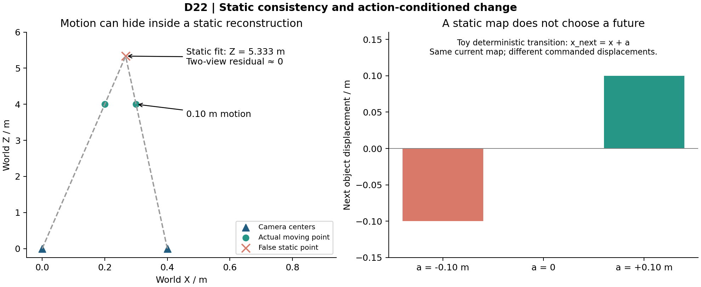
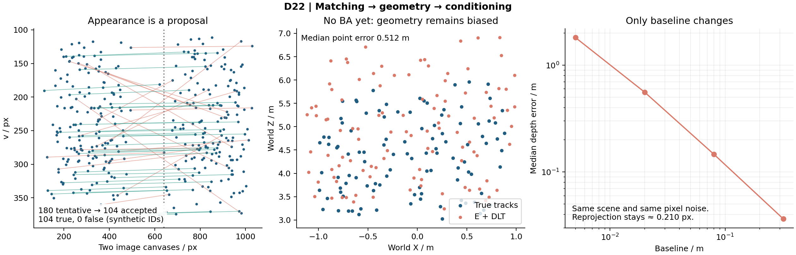

# D22 · 从多张照片到共同的三维世界

[返回学习入口](../_index.md) ｜ [阶段日程](../P2-深度理解-日程.md) ｜ [上一课 D21](../day21/Daily-Learning-Pack.md) ｜ [下一课 D23](../day23/Daily-Learning-Pack.md) ｜ [CPU 实验](demo.py) ｜ [绘图](plot_demo.py)

**SfM 把“这些像素可能是同一个点”变成“这些相机和这些三维点，可以共同解释这些照片”。它建立静态空间的一致性；动作条件模型则进一步追问：机器人做出不同动作后，这个空间会怎样变化？**

本课属于原计划 **P2 / W4-D1 / 全局 Day22**，对应 **2026-09-26**，于 **2026-09-29 补写**；课程编号、顺序和原定主题保持不变。D21 把抓取候选放进可达性、碰撞、执行反馈的系统筛选；今天回到三维地图的生成过程。D23 将手写 Bundle Adjustment（BA），回答“已经拼起来的相机与点，怎样一起调得更一致”。材料与实验已验证，不代表你的学习已经验收。

<details>
<summary>个人学习记录（由你填写，后续生成保留）</summary>

<!-- learner-notes:start -->

- 我能独立画出的 SfM 数据流：
- 我最容易弄反的相机变换：
- 单变量实验：预测 / 实测 / 解释：
- 自测答案、分数、尚未理解的问题：

<!-- learner-notes:end -->

</details>

<!-- daily-pack-generated:start -->

## 0. 今天要建立的能力

读完并完成实践，应能独立解释以下链条：

1. 特征点、描述子、候选匹配、几何内点和跨图像 track 为什么是五种不同的数据。
2. 两视图相对位姿如何给三角化提供相机，三维点又如何为第三视图 PnP 提供约束。
3. 增量 SfM 与全局 SfM 各在什么时候组织共同约束；“全局”为什么不等于“保证全局最优”。
4. 为什么单目无法凭空获得米制尺度，为什么很小的重投影误差仍可能伴随很大的深度误差。
5. 为什么静态地图可以服务抓取，却不能独自预测推动、滑动、遮挡之后的状态。

最终留下一个可运行的最小三视图实验、一张管线图、一份基线与深度误差对照，以及一条“地图不能回答的动作问题”。

## 1. 宏观闭环：SfM 在机器人系统中的位置


这里存在两种不同的“运动”。SfM 的 Motion 通常是拍摄相机在不同视角间的运动，基本模型假设被重建场景静止；机器人操作时物体也会运动，那是场景动力学问题。把这两种运动混在同一个静态重建模型里，可能得到看似稳定、实际错误的几何。

| 模块 | 主要未知量 | 已知或输入 | 输出用途 |
| --- | --- | --- | --- |
| 两视图几何 | 相机相对旋转、平移方向 | 2D–2D对应、内参 | 初始化相机关系 |
| 三角化 | 三维点 | 两个以上相机和2D观测 | 建立地图点 |
| PnP | 新相机位姿 | 地图3D点与当前2D对应 | 把新图像接入地图 |
| BA | 一组相机参数与三维点 | 多视图观测图 | 联合减小重投影误差 |
| MVS | 更稠密的表面/深度 | 图像、已估相机 | 弥补稀疏特征覆盖 |
| 动作条件预测 | 下一状态或其分布 | 当前状态估计、动作 | 比较未来与规划动作 |

RGB-D 通常已经携带米制深度信息，但仍需外参、同步、动态物体处理和多帧融合。单目 SfM 解决的是另一种信息条件：深度和相机关系都要从多视图约束中估计。

**稀疏 SfM 点云不能直接当完整碰撞地图。** 点之间的空白常常只是“没有重建”，不等于自由空间；透明杯壁、白色桌面和黑色线缆可能恰好是匹配最薄弱、机器人却最不能忽略的地方。

## 2. 先统一约定，再讨论算法

设世界点是列向量 $X_j\in\mathbb R^3$，第 $i$ 台相机的世界到相机变换为：

$$
q_{ij}=R_iX_j+t_i,\qquad
T_{cw,i}=\begin{bmatrix}R_i&t_i\\0&1\end{bmatrix}.
$$

针孔投影：

$$
\tilde u_{ij}\sim K_i[R_i\mid t_i]\tilde X_j,
\qquad
\pi(q)=
\begin{bmatrix}
f_xq_x/q_z+c_x\\
f_yq_y/q_z+c_y
\end{bmatrix}.
$$

相机中心 $C_i$ 在世界系中的坐标满足 $R_iC_i+t_i=0$，所以：

$$
\boxed{C_i=-R_i^\top t_i},\qquad t_i=-R_iC_i.
$$

$t_i$ 不是相机在世界中的位置。相机向世界 $+x$ 平移 $0.4$ m，姿态不变时，$C=(0.4,0,0)$，而世界到相机的 $t=(-0.4,0,0)$。

| 变量 | 本课 shape | 单位/含义 |
| --- | --- | --- |
| `images` | `[M,H,W,3]` | 图像；实验不生成真实纹理图 |
| `keypoints[i]` | `[N_i,2]` | 像素 $(u,v)$ |
| `descriptors[i]` | `[N_i,D]` | 外观编码；本实验 $D=32$ 的合成向量 |
| `matches_ij` | `[K,2]` | 两张图的关键点索引 |
| `R,t` | `[M,3,3]`、`[M,3]` | 世界→相机，平移单位米 |
| `points` | `[P,3]` | 世界点，单位米 |
| `observations` | 不规则列表 `(camera_id,point_id,u,v)` | 一条记录对应一条投影约束 |

实际图像应先采用正确相机模型处理畸变，或在投影函数中显式建模畸变。用畸变像素配无畸变针孔模型，优化器可能用错误姿态和弯曲结构“解释”镜头效应。

代码把点按行保存，`X @ R.T + t` 与上面列向量公式等价。以 OpenCV 风格的相机坐标为例，$z$ 轴向前；是否在相机前方用 $q_z>0$ 判断。

## 3. 外观匹配：先提出假设，不能直接宣布同一物理点

### 3.1 特征点与描述子各负责什么

关键点检测器选出可重复定位的图像位置，例如角点、纹理结构；描述子把附近外观编码成向量，便于跨图像比较。关键点坐标是几何量，描述子是相似性表示。两个描述子很接近，不意味着它们必然来自同一个螺丝孔：重复纹理可能比真实对应更相似。

设图 A 描述子 $d_i$ 与图 B 描述子的距离中，最近两个是 $d_1,d_2$。比率筛选使用：

$$
\frac{d_1}{d_2}<\tau.
$$

如果最近邻和次近邻差不多，匹配缺乏区分度。还可加双向检查：A 的 $i$ 选择 B 的 $j$，B 的 $j$ 也选择 A 的 $i$。

两者仍不是证明。今天特意构造“非常自信但错误”的描述子：把部分点的身份循环错置。比率和双向检查都能通过，几何验证才有机会揭示问题。

### 3.2 图像对筛选与特征点匹配不是一个规模问题

有 $M$ 张照片，穷举图像对需要 $M(M-1)/2$ 个候选。每对图像内部还要搜索特征匹配。图像检索先找可能有共同场景的照片，是减少外层组合；近邻索引减少的是内层描述子搜索。

小场景可以穷举；连续视频可优先匹配邻近时间与回环候选；无序照片可用检索提议候选。跳过大量图像对能节省时间，但漏掉关键连接，可能把同一场景拆成两个无法对齐的分量。

这也是工程上不能只统计“提取了多少特征”的原因。还要看匹配是否跨视角、是否覆盖图像、是否连接不同区域。

## 4. 几何验证：E、F、H 分别承诺什么

### 4.1 从世界到两台相机的相对关系

将相机 $i$ 坐标变到相机 $j$：

$$
q_j=R_{ji}q_i+t_{ji},
\quad R_{ji}=R_jR_i^\top,
\quad t_{ji}=t_j-R_jR_i^\top t_i.
$$

归一化像平面点 $x_i=K_i^{-1}\tilde u_i$ 满足：

$$
x_j^\top E_{ji}x_i=0,\qquad E_{ji}=[t_{ji}]_\times R_{ji}.
$$

像素坐标中的关系是：

$$
\tilde u_j^\top F_{ji}\tilde u_i=0,
\qquad F_{ji}=K_j^{-\top}E_{ji}K_i^{-1}.
$$

$E$ 适用于已标定坐标，约束含相机内参信息；$F$ 描述像素域的对极关系。它们都不能凭空确定平移的绝对长度。

对极约束只给出一条线，而不是线上的唯一位置。因此，一个错误匹配偶然落在对极线附近，也可能被接受。必须继续用 track 一致性、三角化、第三视图和后续优化验证。

### 4.2 RANSAC 的结果是共识集合

RANSAC 重复抽小样本、估模型、给全部对应打分，选择有较好一致支持的模型，再用内点重估。它能抑制部分错配，但要求正确模型在数据中具有足够支持，并且抽样和几何没有严重退化。

理想独立采样下，内点比例 $w$、最小样本数 $s$、目标成功率 $p$ 对应：

$$
N\ge\frac{\log(1-p)}{\log(1-w^s)}.
$$

如果 $w=0.7,s=5,p=0.999$，约需 38 次抽样。这只描述“至少抽到一次全内点样本”的概率模型，不保证该样本的几何条件良好，也不保证最终模型误差小。

本实验用 OpenCV 的 E-RANSAC 提供初始共识，再用共识对应做一个可读的八点线性重估。对归一化坐标构建设计矩阵 $A\in\mathbb R^{N\times9}$，每行是 $x_jx_i^\top$ 展平；求 $Ae\simeq0$ 的最小奇异向量，将 $E$ 的奇异值投影为 $(s,s,0)$。它只是轻量线性精化，仍不等价于多视图非线性 BA。

### 4.3 为什么还需要 H

纯旋转时，相机中心没有移动；一般三维点之间仍有图像映射：

$$
\tilde u_j\sim K_jR_{ji}K_i^{-1}\tilde u_i.
$$

场景点若都落在同一平面，也可能由单应矩阵 $H$ 很好解释。大量 H 内点证明图像间有结构，不证明已经获得可靠的空间深度。纯旋转不产生三角化基线；平面场景也需要警惕两视图分解的歧义与条件数。

本课代码没有实现 H/E 自动模型选择；真实 SfM 初始化需考虑这一层。对机器人的实际提示是：只原地转动相机，照片看起来变化很大，却未必新增可用的深度信息。

## 5. 从一对照片走到三维点：三角化与尺度

### 5.1 DLT 是怎样得到四行线性方程的

投影矩阵 $P=K[R\mid t]\in\mathbb R^{3\times4}$，齐次点 $\tilde X=(X,Y,Z,1)^\top$。有：

$$
u=\frac{P_1\tilde X}{P_3\tilde X},
\qquad
v=\frac{P_2\tilde X}{P_3\tilde X}.
$$

交叉相乘：

$$
(uP_3-P_1)\tilde X=0,\qquad
(vP_3-P_2)\tilde X=0.
$$

两台相机提供四行：

$$
A\tilde X=0,\qquad A\in\mathbb R^{4\times4}.
$$

用 SVD 取最小奇异值对应的右奇异向量，最后除以第四维。代码中的 `triangulate` 手写了这个过程。多视图可继续堆行，但线性 DLT 的代数误差并不等于最终像素重投影误差；它通常用于初始化。

得到数字后还需验证：齐次分母是否接近零、两相机深度是否为正、射线夹角是否足够、重投影是否合理。负深度、远到离谱的点、低夹角点不能只靠“函数返回了数组”就收进地图。

### 5.2 一个可手算的基线例子

平行双目、相同焦距、水平基线 $b$：

$$
d=u_L-u_R=\frac{fb}{Z},\qquad Z=\frac{fb}{d}.
$$

设 $f=700$ px，$b=0.08$ m，$Z=4$ m，则视差为 $14$ px。若视差误差是 $0.5$ px，一阶深度误差近似：

$$
|\delta Z|\approx\frac{Z^2}{fb}|\delta d|
=\frac{16}{56}\times0.5\approx0.143\text{ m}.
$$

基线改为 $0.32$ m，其余相同，误差近似为 $0.036$ m。放大基线提高几何灵敏度，但真实照片中还会引入遮挡、外观变化和共同可见区域减少；不能无限扩大。

### 5.3 小残差不等于精确深度

当两条视线几乎平行，交点沿深度方向移动很远，也只使像素移动很少。这是弱约束方向。于是几组非常不同的深度，都能获得相似的小重投影误差。

今天的单变量实验会看到：基线从 5 mm 到 320 mm，深度中位误差从约 1.815 m 下降到 0.0364 m，而中位重投影残差始终约 0.210 px。**优化拟合指标和几何可靠性是两张不同的验收单。**

### 5.4 为什么单目 SfM 只有任意尺度

对任意正数 $s$：

$$
R_i(sX_j)+st_i=s(R_iX_j+t_i).
$$

透视除法会消掉共同的 $s$，所以把整个场景、所有相机平移一起放大 3 倍，投影完全一样。更多照片通常能改善结构，却不会在没有外部信息时自动产生米这个单位。

米制锚可以来自已知双目基线、可信深度、已知尺寸或其他经过校准的传感信息。代码把第一对相机的已知基线 **作为外部尺度信息** 注入，不把它伪装成从像素估计出来的结果。

## 6. Track：把两两关系升级为多视图约束

图像 A 的点 17 ↔ B 的点 52，B 的点 52 ↔ C 的点 8，可以形成：

```text
track_0042 = [(image_A, keypoint_17),
              (image_B, keypoint_52),
              (image_C, keypoint_8)]
```

这个 track 假设三条观测来自同一物理点，未来应关联到同一个 `point3D_id`。但传递闭包不是物理真相；只要混入一条错误边，就可能把两个不同物体上的特征合并。

因此 track 通常需要处理：

- 同一个 track 内出现同一张图中的两个关键点：身份冲突。
- 可见点被遮挡后误接到背景：跨时间身份断裂。
- 重复窗户之间的错误桥接：局部几何看似合理，整体身份错误。
- track 很长却几乎没有基线：观测多，深度约束仍弱。

今天的三视图 demo 通过合成描述子维护身份，再把 A–B 与 A–C 对应连接；它没有实现通用大图 track 合并和冲突清理。工程代码至少应为每条观测保留图像 ID、关键点 ID、像素、三维点 ID、质量和来源，便于追溯。

## 7. 增量 SfM：让相机和点交替帮助对方

### 7.1 两视图初始化

选择具有足够共同特征、良好分布、适度基线的图像对。固定第一相机为世界参考：

$$
R_0=I,\quad t_0=0.
$$

从 E 分解得到候选旋转和平移方向，用正深度条件选择可见解，再建立初始三维点。单目平移长度可先设为 1，所得点也处于同一任意尺度。

最多内点的图像对不一定最好：两张几乎同一位置的照片可能拥有极多匹配，却给出很差深度。初始化应综合共同覆盖和几何条件。

### 7.2 新图像注册

设新图像与现有地图点建立 2D–3D 对应：

$$
\{(X_j,u_j)\}_{j=1}^{N}.
$$

PnP 求：

$$
(R,t)\approx\arg\min_{R,t}\sum_j\|\pi(RX_j+t)-u_j\|^2.
$$

RANSAC 可抵抗错对应；优化可精化已有位姿。空间分布广、覆盖图像的对应，比集中在一小角落的同等数量对应更有价值。

注意：PnP 的“已知3D点”其实也是前面估计的，带有误差。如果初始地图被拉伸，PnP 可能通过扭动相机继续适配它。只看新图像的投影残差，不能确认地图无偏。

### 7.3 扩点、局部 BA 与全局 BA

新图像注册后，可以把与已注册视图共同看到的新 track 三角化，扩展地图。局部 BA 优化新相机及邻域点；阶段性全局 BA 让更大范围的约束共同调整。随后剔除错误点/观测，重试此前失败的注册。

```text
verify_matches_and_build_tracks()
initialize_two_views()
while an image can be registered:
    choose_next_image()
    pose = robust_PnP(existing_3D_to_new_2D)
    triangulate_new_tracks()
    local_BA()
    filter_bad_observations()
periodic_or_final_global_BA()
```

这解释了为什么 BA 不是最后给点云“磨皮”：前面每轮相机与点的误差会互相传播，联合调整本身参与地图成长。下一课将把 `local_BA` 里面真正发生的矩阵运算拆开。

## 8. 全局 SfM：同时协调相机关系，不等于无条件更好

令每条图像边提供相对旋转测量 $\hat R_{ji}$。在世界到相机约定下，理想关系是：

$$
R_jR_i^\top=\hat R_{ji}.
$$

旋转平均寻找一组 $R_i$，让许多边同时一致，而不是沿一条路径逐个连乘。例如一个闭环 $0\to1\to2\to0$，理想旋转复合为 $I$；噪声使闭环不闭合，全局估计要在多条边之间分配修正。

得到旋转后，平移方向可转换到共同世界系。若 $\hat d_{ij}$ 表示世界系中相机中心 $C_i\to C_j$ 的单位方向，则约束为：

$$
C_j-C_i\approx\lambda_{ij}\hat d_{ij},\qquad \lambda_{ij}>0.
$$

未知 $\lambda_{ij}$ 是每条边的长度。把每条方向都当成“长度1”的向量直接相加，会制造错误的场景比例。只靠连通性也不够，方向图仍可能缺乏足够几何约束，例如近共线相机布局。

| 维度 | 增量组织 | 全局组织 |
| --- | --- | --- |
| 起步 | 可靠初始子集 | 先建立较完整图像关系图 |
| 位姿估计 | 接入一张/一批新图像 | 联合协调很多相机关系 |
| 三维点 | 随注册逐步增长 | 常在全局相机估计附近联合/后续求解 |
| 优化开销 | 反复局部/全局精化 | 较集中地求解大系统 |
| 常见风险 | 初值、顺序、误差累积 | 错误边传播、方向/尺度退化 |

这是一种组织层面的比较，不能简化成“增量一定准、全局一定差”。GLOMAP 的具体路线还将相机和点的位置放入共同的定位问题，而非把所有系统都硬塞进“先平移平均、再三角化”的模板。[原论文 §2–3：Global Structure-from-Motion Revisited](https://arxiv.org/html/2407.20219v2)

## 9. 新增：静态地图为什么还不是动作条件世界模型

### 9.1 地图回答空间关系，转移模型回答改变

用 $M$ 表示静态地图，$T_t$ 表示相机位姿。一个观测模型可以写成：

$$
o_t\sim p(o_t\mid M,T_t).
$$

给定地图和相机，预测现在会看到什么。操作任务还需要状态 $s_t$ 和动作 $a_t$：

$$
s_{t+1}\sim p(s_{t+1}\mid s_t,a_t),
\qquad o_{t+1}\sim p(o_{t+1}\mid s_{t+1}).
$$

同一张桌面地图，向左推杯子、向右推杯子、不接触杯子，后续位置不应相同。几何地图可以是状态的一部分，但状态还可能需要速度、接触、关节、夹爪状态，以及不可直接看到的物理属性。

最简单的教学转移：

$$
x_{t+1}=x_t+a_t.
$$

这里动作 $a_t$ 被**定义为已经实现的世界系位移**，单位米。真实机器人给的是目标/力/速度命令，接触和摩擦会使实际位移不同，不能把这个等式直接当推动控制器。

### 9.2 反例：动态点竟然能拥有零静态重投影误差

两次拍摄相机基线 $b=0.4$ m，焦距 $f=700$ px。物体真深度 $Z=4$ m，但两次拍摄之间沿 $x$ 方向移动 $\Delta x=0.1$ m。它的视差变成：

$$
d=\frac{f(b-\Delta x)}{Z}
=\frac{700(0.4-0.1)}4=52.5\text{ px}.
$$

强行假设物体静止，会得到：

$$
\hat Z=\frac{fb}{d}
=\frac{280}{52.5}=5.333\text{ m}.
$$

两条射线确实可以相交在这个假点上，因此两视图重投影误差近乎零。它没有违反优化目标；被违反的是目标背后的静态场景假设。



左图绿色点是两个时刻的真实位置，红叉是静态模型构造的假点。图中 X/Z 轴显示比例不同，射线角度只作结构示意。右图使用显式位移动作说明：相同当前几何对应多个动作条件未来，没有训练任何世界模型。

### 9.3 工程上怎样处理

给静态建图和动态对象维护不同状态。相机定位尽量由可靠背景提供；运动物体用分割、跟踪、多体几何或时序状态估计建模。机械臂自身的运动部件也可能污染背景地图。

对 VLA 来说，图像编码器可把几何、语义与历史压到 token 里，但“网络看见了点云”不自动代表它知道动作后果。策略预测动作与世界模型预测状态转移是不同训练目标，可以组合，也可以独立存在。

## 10. 本课精读：读到模块边界，而不是背系统名字

1. **COLMAP 官方教程：Terminology、Structure-from-Motion、Feature Extraction / Matching / Geometric Verification、Sparse Reconstruction。** 对照自己的流程图标出 SfM 与 MVS 的输入输出；确认特征匹配与几何验证分属不同步骤。教程给出实际系统分工，本课实验只演示其中最小接口。[COLMAP 官方教程](https://colmap.github.io/tutorial.html)
2. **Schönberger & Frahm, CVPR 2016, Structure-from-Motion Revisited：图2、§2.1、§2.2；进一步定位 §4.2–4.3。** 重点阅读“新图像注册”和“三角化”之间如何互相提供条件；用一句话解释为什么 BA 要联合改相机与点。图像选择和鲁棒三角化是进一步检验“点多就好”的具体入口。[原论文 PDF](https://demuc.de/papers/schoenberger2016sfm.pdf)
3. **Pan 等, ECCV 2024, Global Structure-from-Motion Revisited：§2.2 与 §3.2。** 对照相对方向与全局位置，找出尺度未知在哪一步出现；区分传统平移平均与论文的相机/点联合定位。本课只讲这条结构关系，不复述论文性能榜单。[原论文](https://arxiv.org/html/2407.20219v2)

精读产出：在自己的管线图上写出每条箭头传递的对象、单位、一个会使该箭头失效的假设。尚未读完原文时，不把“讲义阅读完成”记成“论文精读完成”。

## 11. CPU 实操：完整跑通、先预测、再改一个变量

### 11.1 已实现的实验范围

`demo.py` 使用固定种子 22、180 个非共面合成点、已知 K、三个相机和像素高斯噪声。描述子是人工生成的 32 维身份向量，第一对中有 54 个身份错置。**没有运行图像检测器、真实图像 SfM、COLMAP 或神经网络。**

脚本执行：

```text
合成关键点 / 描述子
→ 比率 + 双向最近邻
→ E-RANSAC + 共识八点重估 + 正深度选择
→ 外部已知基线定尺度
→ 手写 DLT
→ 连接第三视图对应
→ PnP-RANSAC
→ 几何真值误差 / 基线对照 / 尺度不变性 / 动态反例
```

环境已确认：现有 CPU Python，NumPy 1.26.4、OpenCV 4.10.0、Matplotlib 3.10.9；无需安装依赖。以 vault 根目录为工作目录：

```bash
python -B 3d_learning/day22/demo.py
python -B 3d_learning/day22/plot_demo.py
```

脚本只输出本课实验附件。运行前选择具备上述依赖的 Python 环境；命令不依赖本机用户目录。

### 11.2 2026-09-29 实跑结果

[完整结果 JSON](../../_assets/3d_learning/day22/results.json) ｜ 实验数组 (not exported: excluded by publication policy)

| 项目 | 实测 |
| --- | ---: |
| 候选匹配 / 真实对应 / 注入错配 | 180 / 126 / 54 |
| 验证后 track / 其中真 / 假 | 104 / 104 / 0 |
| 相对旋转误差 | 0.6190° |
| 平移方向误差 | 0.7465° |
| 外部已知基线 | 0.450444 m |
| 三维点中位欧氏误差 | 0.511657 m |
| 第三视图 PnP 内点 | 102 / 104 |
| 第三相机旋转 / 中心误差 | 1.1940° / 0.026310 m |
| 无噪声、真相机 DLT 最大点误差 | $1.70\times10^{-14}$ m |
| 整体尺度×3，最大投影变化 | $1.99\times10^{-13}$ px |

不要把 104/104 的匹配精度和 0.512 m 点误差混为一谈。匹配身份正确，仍会受像素噪声、共识筛选、相对位姿误差和三角化条件影响。本例仅有线性 E 精化、DLT、PnP，没有 BA；结果恰好提醒我们下一课为什么必需，而不是证明系统已达到机器人操作精度。



左图绿色表示最终保留，红色表示拒绝；显示抽样连线。中图在同一米制锚下对比真点与估计点，可见系统偏差。右图只改变基线，其余点和像素噪声完全相同。

| 基线 | 深度中位绝对误差 | 正深度比例 | 中位重投影误差 |
| ---: | ---: | ---: | ---: |
| 0.005 m | 1.8150 m | 89.44% | 0.209913 px |
| 0.020 m | 0.5584 m | 100% | 0.209786 px |
| 0.080 m | 0.1463 m | 100% | 0.209781 px |
| 0.320 m | 0.0364 m | 100% | 0.209781 px |

这组基线对照使用真实相机投影矩阵，只隔离三角化的几何敏感性；不能把它与上面含 E 估计误差的主管线当成同一个误差来源。小基线一项包含负深度失败点，表中深度误差没有先删掉这些失败。

### 11.3 你需要实际完成的一次修改

先在个人区写出预测：

- 把基线列表整体扩大 2 倍，同像素噪声下深度误差大致怎样变化？
- 为什么重投影残差未必跟着同比下降？
- 把 `p1 = p0 + [.1, 0, 0]` 改为 `p1 = p0 + [0, 0, 0]` 后，假深度应变成多少？

本次只选其中一个修改，运行后记录变化。不要同时改噪声、焦距和基线，否则很难知道是谁造成结果。脚本固定随机种子，让同一实验可复现；OpenCV 数值细节可能随版本变化，精确小数不是跨平台合格标准。

验收标准：能说明 E/PnP 来自库、DLT/描述子筛选来自本课代码；能区分输入的真值尺度与估计出来的方向；无噪声 DLT 断言通过；修改预测与实测有解释。主管线几何误差较大已经如实报告，不应因匹配内点多就宣布可部署。

### 11.4 完整主脚本

> [!note]- 完整 CPU 主脚本（与 demo.py 一致）
>
> ```python
> """D22: synthetic sparse SfM interfaces; no real image detector/COLMAP run.
> Column-vector convention q=R_cw X_w+t_cw; metres and pixels. Seed 22.
> """
> from pathlib import Path
> import json
> import cv2
> import numpy as np
> 
> OUT = Path(__file__).resolve().parents[2] / "_assets/3d_learning/day22"
> K = np.array([[700., 0, 320], [0, 700., 240], [0, 0, 1]])
> 
> 
> def project(X, R, t):
>     q = X @ R.T + t
>     h = q @ K.T
>     return h[:, :2] / h[:, 2:3]
> 
> 
> def triangulate(uv0, uv1, P0, P1):
>     """Handwritten homogeneous DLT: four rows per two-view track."""
>     points = []
>     for (u, v), (a, b) in zip(uv0, uv1):
>         A = np.stack([u * P0[2] - P0[0], v * P0[2] - P0[1],
>                       a * P1[2] - P1[0], b * P1[2] - P1[1]])
>         _, _, Vt = np.linalg.svd(A)
>         h = Vt[-1]
>         points.append(h[:3] / h[3])
>     return np.array(points)
> 
> 
> def match_descriptors(a, b, ratio=0.8):
>     """Euclidean ratio test + mutual nearest neighbour, not a detector."""
>     dist = np.linalg.norm(a[:, None, :] - b[None, :, :], axis=2)
>     order = np.argsort(dist, axis=1)
>     pairs = [(i, j) for i, (j, k) in enumerate(order[:, :2])
>              if dist[i, j] < ratio * dist[i, k] and dist[:, j].argmin() == i]
>     return np.asarray(pairs, dtype=int)
> 
> 
> def rot_error(R, truth):
>     return float(np.degrees(np.arccos(np.clip((np.trace(R @ truth.T)-1)/2, -1, 1))))
> 
> 
> def refit_essential(a, b):
>     """Calibrated eight-point fit on the consensus, enforce singular values (s,s,0)."""
>     ah = np.column_stack([a, np.ones(len(a))]) @ np.linalg.inv(K).T
>     bh = np.column_stack([b, np.ones(len(b))]) @ np.linalg.inv(K).T
>     design = np.einsum("ni,nj->nij", bh, ah).reshape(-1, 9)
>     _, _, vt = np.linalg.svd(design, full_matrices=False)
>     u, s, vt = np.linalg.svd(vt[-1].reshape(3, 3))
>     return u @ np.diag([np.mean(s[:2]), np.mean(s[:2]), 0.]) @ vt
> 
> 
> def run():
>     OUT.mkdir(parents=True, exist_ok=True)
>     rng = np.random.default_rng(22)
>     cv2.setRNGSeed(22)
>     n = 180
>     X = rng.uniform([-1., -.7, 3.], [1., .7, 6.], (n, 3))
>     R = np.stack([np.eye(3), cv2.Rodrigues(np.array([0., -.04, .01]))[0],
>                   cv2.Rodrigues(np.array([.02, -.07, -.01]))[0]])
>     C = np.array([[0., 0, 0], [.45, .02, 0], [.85, -.08, .03]])
>     t = -np.einsum("nij,nj->ni", R, C)
>     uv = np.array([project(X, r, tt) for r, tt in zip(R, t)])
>     noisy = uv + rng.normal(0, .30, uv.shape)
>     desc = rng.normal(size=(n, 32))
>     desc /= np.linalg.norm(desc, axis=1, keepdims=True)
>     descriptors = np.array([desc + rng.normal(0, .01, desc.shape) for _ in range(3)])
>     # Confident but wrong appearance: first 54 identities are cyclically permuted.
>     descriptors[1, :54] = np.roll(descriptors[1, :54], 1, axis=0)
>     pairs = match_descriptors(descriptors[0], descriptors[1])
>     a, b = noisy[0, pairs[:, 0]], noisy[1, pairs[:, 1]]
>     E, mask = cv2.findEssentialMat(a, b, K, method=cv2.RANSAC, prob=.999,
>                                  threshold=0.6)
>     if E is None or E.shape != (3, 3):
>         raise RuntimeError("No unique essential matrix returned")
>     E = refit_essential(a[mask.ravel()!=0], b[mask.ravel()!=0])
>     _, Rest, tunit, front = cv2.recoverPose(E, a, b, K, mask=mask.copy())
>     keep = front.ravel() != 0
>     accepted = pairs[keep]
>     # Translation norm is unavailable to monocular images. This known baseline is
>     # an EXTERNAL metric anchor in this experiment, also used to report metre errors.
>     baseline = float(np.linalg.norm(C[1] - C[0]))
>     test = tunit.ravel() * baseline
>     P0 = K @ np.column_stack([np.eye(3), np.zeros(3)])
>     P1 = K @ np.column_stack([Rest, test])
>     Xest = triangulate(a[keep], b[keep], P0, P1)
>     pair02 = dict(match_descriptors(descriptors[0], descriptors[2]).tolist())
>     ids = np.array([k for k, (i, _) in enumerate(accepted) if i in pair02])
>     uv2 = np.array([noisy[2, pair02[accepted[k, 0]]] for k in ids])
>     ok, rv2, tv2, pnp_in = cv2.solvePnPRansac(Xest[ids], uv2, K, None,
>         iterationsCount=1000, reprojectionError=2., confidence=.999,
>         flags=cv2.SOLVEPNP_EPNP)
>     if not ok:
>         raise RuntimeError("Third-view PnP failed")
>     R2est = cv2.Rodrigues(rv2)[0]
>     C2est = -R2est.T @ tv2.ravel()
>     known_good = accepted[:, 0] == accepted[:, 1]
>     errors = np.linalg.norm(Xest[known_good] - X[accepted[known_good, 0]], axis=1)
>     # Single variable: change baseline only. Same points and exact same pixel noise.
>     pixel_noise = rng.normal(0, .4, (2, n, 2))
>     baseline_rows, depth_errors = [], []
>     for base in [.005, .02, .08, .32]:
>         pr = K @ np.column_stack([np.eye(3), [-base, 0, 0]])
>         left = project(X, np.eye(3), np.zeros(3)) + pixel_noise[0]
>         right = project(X, np.eye(3), [-base, 0, 0]) + pixel_noise[1]
>         xb = triangulate(left, right, P0, pr)
>         err = np.abs(xb[:, 2] - X[:, 2])
>         depth_errors.append(err)
>         reproj = np.linalg.norm(project(xb, np.eye(3), [-base, 0, 0])-right, axis=1)
>         baseline_rows.append(dict(baseline_m=base, median_abs_depth_error_m=float(np.median(err)),
>             positive_depth_fraction=float(np.mean(xb[:, 2] > 0)),
>             median_reprojection_px=float(np.median(reproj))))
>     scaled = project(3. * X, R[2], 3. * t[2])
>     scale_invariance = float(np.max(np.abs(scaled-uv[2])))
>     exact = triangulate(uv[0], uv[1], P0, K @ np.column_stack([R[1], t[1]]))
>     exact_error = float(np.max(np.linalg.norm(exact-X, axis=1)))
>     # Moving along the stereo baseline can mimic a static point at a false depth.
>     p0 = np.array([[.2, .1, 4.]])
>     p1 = p0 + [.1, 0, 0]
>     u0 = project(p0, np.eye(3), np.zeros(3))
>     u1 = project(p1, np.eye(3), [-.4, 0, 0])
>     xf = triangulate(u0, u1, P0, K @ np.column_stack([np.eye(3), [-.4, 0, 0]]))
>     dynamic_residual = float(np.linalg.norm(project(xf, np.eye(3), [-.4, 0, 0])-u1))
>     result = dict(seed=22, scope="synthetic descriptors and geometry, no detector or COLMAP",
>         units="world/camera metres; image pixels", points=n, mismatched_identities=54,
>         tentative_matches=len(pairs), tentative_true=int(np.sum(pairs[:, 0] == pairs[:, 1])),
>         accepted_tracks=len(accepted), accepted_true=int(known_good.sum()),
>         accepted_false=int((~known_good).sum()), external_baseline_m=baseline,
>         relative_rotation_error_deg=rot_error(Rest, R[1]),
>         translation_direction_error_deg=float(np.degrees(np.arccos(np.clip(
>             np.dot(test, t[1]) / (np.linalg.norm(test)*np.linalg.norm(t[1])), -1, 1)))),
>         triangulated_median_error_m=float(np.median(errors)), pnp_tracks=len(ids),
>         pnp_inliers=int(len(pnp_in)), third_rotation_error_deg=rot_error(R2est, R[2]),
>         third_camera_center_error_m=float(np.linalg.norm(C2est-C[2])),
>         exact_dlt_max_error_m=exact_error, scale3_projection_max_difference_px=scale_invariance,
>         baseline_control=baseline_rows, moving_point_true_z_m=4.,
>         moving_point_static_estimated_z_m=float(xf[0, 2]),
>         moving_point_static_reprojection_px=dynamic_residual)
>     assert exact_error < 1e-10 and scale_invariance < 1e-10
>     assert result["accepted_false"] <= 2 and result["accepted_true"] >= 100
>     np.savez(OUT / "arrays.npz", truth=X, estimated=Xest, accepted=accepted,
>              uv=noisy, pairs=pairs, keep=keep, cameras=C,
>              baseline_errors=np.array(depth_errors), moving_reconstruction=xf)
>     (OUT / "results.json").write_text(json.dumps(result, indent=2), encoding="utf-8")
>     print(json.dumps(result, indent=2))
> 
> 
> if __name__ == "__main__":
>     run()
> ```

## 12. 今日重点与最容易误解的地方

**最值得掌握的五点：**

1. **把外观、几何和身份分开。** 它们分别回答“像不像”“是否符合投影”“是否同一物理点”，也是定位错误来源的三个层次。
2. **相机与点互相约束。** PnP 使用地图，三角化使用相机；误差会形成反馈，所以需要联合 BA。
3. **尺度必须有来源。** 单目投影不能决定米制长度，尺度错误会直接影响抓取距离、碰撞阈值和速度。
4. **小重投影残差不能代替几何条件检查。** 低基线和动态反例都能让图像指标漂亮、空间结果错误。
5. **静态解释与动作预测是不同问题。** 地图是世界模型可能使用的表示，不自动包含推动后的状态转移。

三个难点再用对比巩固：

- **相机中心 vs 平移参数：** $C=-R^\top t$；相机向右，世界到相机的平移通常向左。画一台相机和一个固定点，判断谁相对谁在移动。
- **真匹配 vs 真三维：** 同一个螺丝孔匹配正确，只说明身份没错；相机角度偏一点，交会深度仍可能错很多。
- **全局组织 vs 全局最优：** 同时使用整张关系图是变量组织方式；非线性目标仍可能有局部解、错误连接和弱约束。

## 13. 自测：先作答，再打开最末答案

每题 0–2 分，总分 20 分。定义和结论各讲对一层只能得部分分，尽量给推导或反例。

1. 特征点、描述子、候选匹配和 track 分别存什么？为什么不能把 `matches` 直接当点云？
2. 相机姿态 $R=I$，世界相机中心为 $(0.4,0,0)$ m，求世界到相机的 $t$。世界点 $(0.6,0,4)$ 在相机系哪里？
3. $E$ 与 $F$ 使用什么坐标？两者怎样通过 K 关联？哪一个能够单独恢复米制平移？
4. 写出两视图 DLT 的四行矩阵。为什么最后要除以齐次第四维？
5. $f=700$ px、$b=0.08$ m、$d=14$ px，深度是多少？视差误差 0.5 px 对应的一阶深度误差约多少？
6. 把全场景和所有相机平移同时放大三倍，哪些投影变化？这对机器人抓取意味着什么？
7. 第三图像怎样利用前两图的结果注册？为什么注册之后还应 BA，而不是只给新相机做 PnP？
8. 全局 SfM 中，为什么不能把每条相对平移方向都按长度 1 相加？为什么图连通不保证几何可解？
9. 本次基线对照中，深度误差变化很大而重投影约 0.210 px 不变，这说明什么？哪个指标应决定能否安全抓取？
10. 移动点的真实深度 4 m、基线 0.4 m、同向移动 0.1 m，为什么静态重建会得到 5.333 m？世界模型需要增加什么条件才能讨论动作后果？

## 14. 今日产出、未理解问题与下一课

请留下：

- 一张有数据类型、单位和失败条件的 SfM 管线图。
- 一份 `demo.py` 运行结果及一次单变量修改的前后对照。
- 一页“匹配内点、重投影误差、三维误差、尺度来源”四项验收卡。
- 对动态点反例的独立推导，明确哪条模型假设被破坏。

个人区可优先记这三个未理解问题：E 分解的四个候选如何由正深度选择；纯旋转和小基线为什么不是同一种退化；为什么错误地图也能让 PnP 有许多内点。无法解释的地方保留为待学习，不以“实验成功运行”替代掌握。

**下一课 D23：** 固定匹配关系以后，对相机与点一起求导、线性化、消元、更新；同时学习观测与隐藏状态的区别。今天的“静态模型缺失运动”会变成明天的“同一位置可能有不同速度”。

<details>
<summary>自测答案与 0 / 1 / 2 分判分标准（作答后展开）</summary>

统一规则：0分＝核心结论错误或未作答；1分＝结论基本正确但缺关键解释/公式；2分＝包含以下关键要点且单位、方向正确。

1. 关键点是像素位置，描述子是外观向量，匹配是两图索引关系，track 是多图同一物理点假设；缺相机与三角化，索引不能成为三维坐标。
2. $t=(-0.4,0,0)$ m，点在相机系为 $(0.2,0,4)$ m；必须区分 $C$ 和 $t$。
3. E 用归一化坐标，F 用像素；$F=K_j^{-\top}EK_i^{-1}$；二者都不能单独给米制平移。
4. $A=[u_0P_{0,3}-P_{0,1};v_0P_{0,3}-P_{0,2};u_1P_{1,3}-P_{1,1};v_1P_{1,3}-P_{1,2}]$；SVD 得到比例不定的齐次点，除第四维恢复有限欧氏坐标，并应检查分母。
5. $Z=4$ m；$|\delta Z|\approx Z^2|\delta d|/(fb)\approx0.143$ m。0.5 px 是视差误差，不是直接的米制误差。
6. 投影不变；抓取距离却被缩放，所以需要可信的米制锚及坐标校验。
7. 由 track 把第三图2D点接到现有3D点，PnP估相机；地图点也含误差，多图联合BA可共同修正，单独PnP不会修复整个地图。
8. 相对平移只有方向，不同边长度未知；近共线布局、弱连接、错误边等可使位置与尺度不稳定，图论连通不等于几何约束充分。
9. 小基线导致沿深度方向弱约束；重投影只是拟合指标，抓取还要米制精度、不确定性、覆盖和任务容差，没有本题中某个单一指标足够。
10. $d=f(b-\Delta x)/Z$，静态模型误用 $Z=fb/d$；动作预测至少要动作与能预测变化的状态信息，常还需速度、接触、物理属性/不确定性，不能只给一张静态地图。

</details>

<!-- daily-pack-generated:end -->

