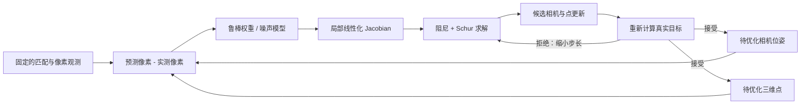
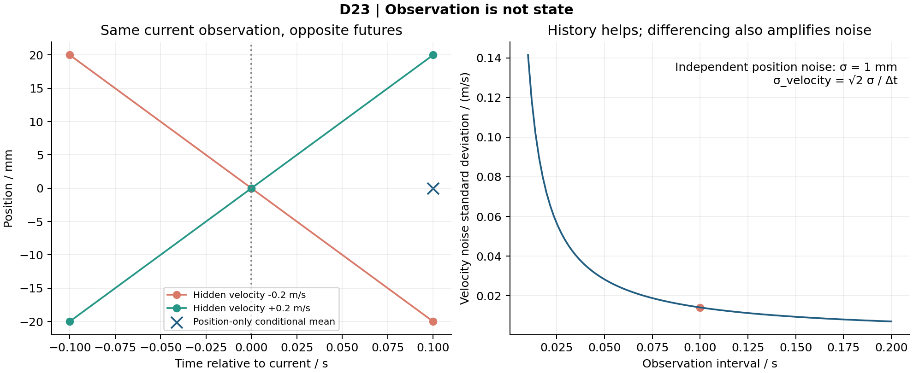
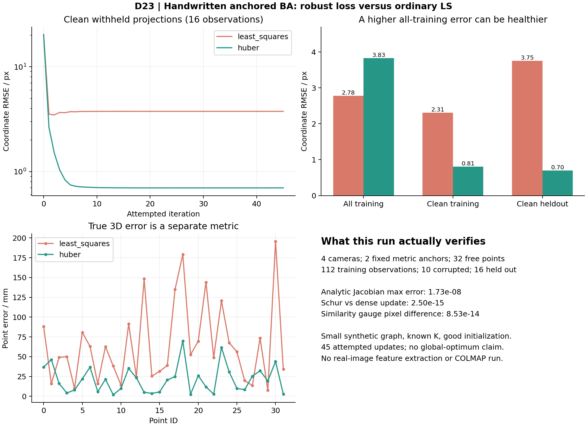

# D23 · 联合优化相机与点，以及看不见的状态

[返回学习入口](../_index.md) ｜ [阶段日程](../P2-深度理解-日程.md) ｜ [上一课 D22](../day22/Daily-Learning-Pack.md) ｜ [下一课 D24](../day24/Daily-Learning-Pack.md) ｜ [CPU 主脚本](demo.py) ｜ [绘图脚本](plot_demo.py)

**BA 做的事情是：让一组相机与三维点，共同解释已匹配的像素观测。它会利用现有约束，却不能凭优化创造缺失的尺度、运动信息或真实对应。理解它的能力与边界，也是在理解世界模型为何需要历史、隐藏状态和不确定性。**

本课属于原计划 **P2 / W4-D2 / 全局 Day23**，对应 **2026-09-27**，于 **2026-09-29 补写**。保留原定 BA 推导与 *Building Rome in a Day* 论文精读，新增部分可观测状态的知识。D22 已建立 SfM 的匹配、相机、三角化管线；今天手写其中的优化核心。D24 将转入 NeRF 体渲染与一步预测。

<details>
<summary>个人学习记录（由你填写，后续生成保留）</summary>

<!-- learner-notes:start -->

- 我能独立写出的投影、Jacobian 与 Schur 推导：
- 我对坐标约定、规范自由度和锚定的理解：
- 改变量前的预测 / 实际结果 / 解释：
- 论文精读完成范围、自测分数与未理解问题：

<!-- learner-notes:end -->

</details>

<!-- daily-pack-generated:start -->

## 0. 今日学习目标

本课结束后，应能：

1. 从二维重投影残差推导相机与点的 Jacobian，解释一次 Gauss–Newton/阻尼更新。
2. 写出 BA 正规方程的分块结构，亲手消去点增量，再回代恢复点更新。
3. 用一个相似变换证明单目 BA 的规范自由度，区分选坐标系与增加真实外部约束。
4. 解释鲁棒损失的作用，并用保留观测和几何真值检查“拟合是否更可信”。
5. 阅读 Rome 原论文指定段落，明确大规模系统怎样处理图像冗余和求解开销。
6. 用同位置、不同速度的反例解释观测、状态、历史和潜状态的区别。

实操不是调用 `least_squares` 后等待结果。本课的投影导数、加权残差、阻尼、Schur 消元和更新都可在主脚本中逐行追踪，是 P2 手写核心模块 BA 的一个最小版本。

## 1. 宏观：同一张照片可以被很多组参数解释

D22 的三角化先接受相机位姿，PnP 又接受三维点。假如相机角度有一点误差，三角化会把点放错；新相机再对这些点做 PnP，就可能继续适应错误地图。

BA 把二者放回同一个问题：



这里的“固定匹配”非常关键。标准 BA 不会自动把“窗户A错配到窗户B”改成正确身份，也不会把静态点参数自动升级为移动物体轨迹。它只调整当前模型允许调整的连续变量。匹配筛选、模型选择、优化求解、独立验收是相邻但不同的工作。

机器人接口上的位置是：

```text
多视图 / RGB-D / 里程计
→ 数据关联与初始几何
→ BA / 其他状态估计
→ 坐标明确且有可信度的几何状态
→ 抓取 / 路径 / 动作规划
→ 控制与新观测
```

重建后还要把相机坐标与机器人 base / tool 系对齐；BA 的低损失不保证手眼标定正确，也不保证没有动态物体或完整碰撞表面。

## 2. 先把优化问题写清楚

### 2.1 参数、观测和预测

沿用 D22 世界到相机的约定：

$$
q_{ij}=R_iX_j+t_i,\qquad q_{ij,z}>0.
$$

已观测像素为 $u_{ij}\in\mathbb R^2$，预测像素为 $\hat u_{ij}=\pi(q_{ij})$，定义：

$$
\boxed{r_{ij}=\hat u_{ij}-u_{ij}}.
$$

本课残差是“预测减观测”。如果改为“观测减预测”，Jacobian 的符号也要一起改，不能只换一边。

设 $\mathcal O$ 为真正存在的观测集合：

$$
\min_{\{R_i,t_i\},\{X_j\}}
\frac12\sum_{(i,j)\in\mathcal O}\|r_{ij}\|_2^2.
$$

没有看到的点不应该填一个 `(0,0)` 像素参与目标。遮挡是缺观测，不是零观测。

若每条观测有协方差 $\Sigma_{ij}$，可以最小化白化残差：

$$
\bar r_{ij}=L_{ij}r_{ij},
\qquad L_{ij}^\top L_{ij}=\Sigma_{ij}^{-1}.
$$

这样不同噪声尺度才有可比较权重。今天假定像素噪声近似同尺度，直接使用像素残差；Huber 阈值因此也按像素解释。

### 2.2 为什么不直接把 R 的九个元素当自由变量

旋转矩阵必须满足 $R^\top R=I,\det R=+1$。直接任意加一个 $3\times3$ 矩阵，可能把刚体旋转改成缩放、剪切甚至反射。

本课用三维小旋转 $\delta\omega\in\mathbb R^3$，构造：

$$
Q=\exp([\delta\omega]_\times).
$$

采用以下局部更新：

$$
R_i'=QR_i,\qquad t_i'=Qt_i+\delta v.
$$

它是合法的局部位姿更新：先在当前相机坐标中施加小旋转，再加局部平移。这里把平移增量直接写成 $\delta v$，是与代码一致的一阶 retraction；不要把它与完整 SE(3) 指数映射中包含左 Jacobian 的有限平移表达混为一谈。

对足够小的增量，$Q\simeq I+[\delta\omega]_\times$，因此：

$$
q' \simeq q+[\delta\omega]_\times q+\delta v
=q-[q]_\times\delta\omega+\delta v.
$$

这一行决定了后面的相机 Jacobian；换成其他左/右更新约定，导数也必须跟着换。

## 3. 从投影函数推导 Jacobian

### 3.1 投影对相机点的导数

对于 $q=(x,y,z)$：

$$
\pi(q)=
\begin{bmatrix}
f_xx/z+c_x\\
f_yy/z+c_y
\end{bmatrix}.
$$

所以：

$$
J_\pi=
\frac{\partial\pi}{\partial q}
=
\begin{bmatrix}
f_x/z&0&-f_xx/z^2\\
0&f_y/z&-f_yy/z^2
\end{bmatrix}
\in\mathbb R^{2\times3}.
$$

$z$ 越小，导数可能越大；$z$ 接近零时透视除法不稳定。优化器不能不加检查地把点从相机前面跨到背面，再把奇怪投影当正常像素。

### 3.2 对相机位姿与世界点求导

按局部参数顺序 $\delta c=(\delta\omega_x,\delta\omega_y,\delta\omega_z,\delta v_x,\delta v_y,\delta v_z)$：

$$
\boxed{A_{ij}=\frac{\partial r_{ij}}{\partial\delta c_i}
=J_\pi\begin{bmatrix}-[q_{ij}]_\times&I\end{bmatrix}}
\in\mathbb R^{2\times6}.
$$

世界点采取欧氏更新 $X_j'=X_j+\delta X_j$，于是：

$$
\boxed{B_{ij}=\frac{\partial r_{ij}}{\partial\delta X_j}=J_\pi R_i}
\in\mathbb R^{2\times3}.
$$

一条观测只碰到一个相机块和一个点块：

$$
r_{ij}'\simeq r_{ij}+A_{ij}\delta c_i+B_{ij}\delta X_j.
$$

这既是求导结果，也是稀疏结构的来源。不是因为“矩阵里碰巧有很多零”，而是因为一个像素观测根本不直接依赖另一个不相关的点。

### 3.3 手算一次微小位移的像素影响

取 $f_x=f_y=650$ px，$q=(0.2,0.1,4)$ m：

$$
J_\pi=
\begin{bmatrix}
162.5&0&-8.125\\
0&162.5&-4.0625
\end{bmatrix}\ \text{px/m}.
$$

若只在相机系 $x$ 方向增加 $1$ mm，预测 $u$ 增加：

$$
\delta u\simeq162.5\times0.001=0.1625\text{ px}.
$$

若只把点的相机深度增加 $1$ cm：

$$
\delta u\simeq-8.125\times0.01=-0.08125\text{ px},
\quad
\delta v\simeq-0.040625\text{ px}.
$$

同样是米制扰动，像素对不同方向的敏感度不相同；这也是深度方向可能弱约束的直观原因。该算例只使用 $J_\pi$，若改动的是世界点，还需先乘 $R$。

### 3.4 不相信手写导数，怎样检查

对每个参数用中心差分：

$$
J_{:,k}^{num}\approx
\frac{r(\theta\boxplus\epsilon e_k)-r(\theta\boxplus(-\epsilon e_k))}{2\epsilon}.
$$

这里必须用与优化相同的 `apply_step` 约定，而不是直接给 R 的某个元素加 $\epsilon$。本实验在一条非退化观测上检查全部 6 个相机局部参数与 3 个点参数，$\epsilon=10^{-6}$，最大绝对差为 $1.73\times10^{-8}$。

这能检出符号、坐标系和链式法则错误；它不是对所有输入情况的数学证明，也不能替代对正深度和极端数值的边界检查。

## 4. 从残差到一次参数更新

### 4.1 Gauss–Newton 线性系统

把所有残差堆为 $r\in\mathbb R^{2N_o}$，Jacobian 为 $J\in\mathbb R^{2N_o\times N_\theta}$：

$$
r(\theta\boxplus\delta)\simeq r+J\delta.
$$

在当前位置最小化局部二次近似：

$$
\min_\delta\frac12\|r+J\delta\|^2.
$$

对 $\delta$ 求导并令零：

$$
J^\top(r+J\delta)=0
\quad\Rightarrow\quad
\boxed{J^\top J\,\delta=-J^\top r}.
$$

记 $H=J^\top J,g=J^\top r$，就得到 $H\delta=-g$。本课代码 `g` 是正的 $J^\top r$，右端显式取负；别与某些库把 `g` 直接定义为负梯度的写法混淆。

### 4.2 为什么不能算出步长就无条件接受

局部线性化只在附近可信。初始位姿偏差大、点接近相机、错误对应多时，完整 GN 步可能让真实目标更差。

本课加入对角阻尼：

$$
H_\lambda=J^\top J+\lambda D,
\qquad D_{kk}=\max(H_{kk},1).
$$

求 $H_\lambda\delta=-g$ 后，用新的非线性投影重新算目标：

- 真实目标下降且观测点保持正深度，接受，并减小 $\lambda$。
- 真实目标不降或几何无效，拒绝，并增大 $\lambda$。

这是可读的阻尼 GN / LM 风格教学实现。完整求解器通常还使用模型预测下降与实际下降的比例、收敛条件、缩放和更完善的信赖域策略。本代码最多尝试 45 次更新，没有宣称获得全局最优或严格收敛证书。

正规方程会平方 Jacobian 的条件数，适合本课小系统理解结构；更大、更病态的工程问题需考虑 QR、稀疏分解或迭代法。[Ceres 官方求解文档：Levenberg–Marquardt、Linear Solvers](https://ceres-solver.readthedocs.io/latest/nnls_solving.html)

## 5. Schur 补：先把点的影响折回相机

### 5.1 为什么分块后很好处理

把增量按相机、点排列：

$$
\delta=
\begin{bmatrix}\delta c\\\delta p\end{bmatrix},
\quad
H=
\begin{bmatrix}U&W\\W^\top&V\end{bmatrix},
\quad
g=\begin{bmatrix}g_c\\g_p\end{bmatrix}.
$$

其中 $V$ 是点块对角矩阵，因为普通 BA 的一条残差不同时依赖两个不同三维点。每个点块只有 $3\times3$。一个点被多台相机看见，会在 $W$ 中同时连接那些相机。

加入本课的对角阻尼后仍保留这个结构。下面的 $U,V$ 可理解为已经含相应阻尼。

两组方程：

$$
U\delta c+W\delta p=-g_c,
$$

$$
W^\top\delta c+V\delta p=-g_p.
$$

由第二式：

$$
\delta p=-V^{-1}(g_p+W^\top\delta c).
$$

代入第一式：

$$
\boxed{
(U-WV^{-1}W^\top)\delta c
=-g_c+WV^{-1}g_p
}.
$$

先解这个相机系统，再回代得到各点增量。消元没有把点丢掉；点的约束通过 $WV^{-1}W^\top$ 影响相机。

### 5.2 一个一维块算例

假设简化系统：

$$
\begin{bmatrix}4&1\\1&2\end{bmatrix}
\begin{bmatrix}\delta c\\\delta p\end{bmatrix}
=-\begin{bmatrix}1\\2\end{bmatrix}.
$$

点消元给出：

$$
S=4-1\cdot\tfrac12\cdot1=3.5,
\quad b=-1+1\cdot\tfrac12\cdot2=0.
$$

因此 $\delta c=0$，$\delta p=-\tfrac12(2+0)=-1$。代回原方程得到 $(-1,-2)^\top$，一致。这个例子表达的是：像素误差有时可以主要通过点更新解释，不必同时推着相机乱动。

### 5.3 稀疏性会怎样传播

如果相机 A、B 都看到点 $X_7$，消掉这个点后，相机 A、B 之间出现耦合。很多长 track 会让相机 Schur 系统变密。因此“点块对角”不意味着消元后的相机矩阵永远稀疏；场景观察图决定结构。

工程实现一般逐点分解小块、累加到相机系统，不构造巨大的全矩阵逆。本课为便于对照显式保存小型 `Vinv`，但每个 $3\times3$ 块通过 `solve` 求解；规模只有 32 点。生产系统应利用稀疏存储、合适排序、预条件和线性求解器。

本实验第一步 Schur 解与直接解完整阻尼系统的最大分量差为 $2.50\times10^{-15}$。这验证两种求解路线在当前小系统一致，不意味着 Schur 在所有布局都数值稳定。

## 6. 规范自由度：坐标系不唯一不等于程序坏了

### 6.1 直接证明投影的不变性

对于任意正尺度 $s$、旋转 $Q$ 和平移 $b$，做全局变换：

$$
X_j'=sQX_j+b,
\quad
R_i'=R_iQ^\top,
\quad
t_i'=st_i-R_iQ^\top b.
$$

则：

$$
R_i'X_j'+t_i'
=R_iQ^\top(sQX_j+b)+st_i-R_iQ^\top b
=s(R_iX_j+t_i).
$$

透视除法消掉 $s$，每个像素完全相同。因而在一般、连通、非退化的标定单目重建中，至少有整体旋转3、平移3、尺度1，共7个规范自由度。特殊退化会带来额外不可观测方向。

未固定规范时，Jacobian 在这些方向上不提供约束，$J^\top J$ 秩亏或接近秩亏。加阻尼能让某次线性系统可解，但它没有创造物理信息；结果仍依赖任意坐标选择和数值正则。

### 6.2 选坐标系与提供尺度是两件事

固定第一相机 $R_0=I,t_0=0$ 可以指定世界朝向和原点，但整体尺度还在。还需固定一个尺度规范，或加入真实尺度信息。

要区分：

- **纯规范选择：** 把首段基线规定为1。结果有内部单位，不因此成为米。
- **外部约束：** 已标定双目基线为0.7 m。这给出物理单位，约束有真实来源。
- **过多锁死估计：** 把本来不准确的多台相机都固定，优化可能只能扭曲三维点去迁就错误相机。

本实验固定前两台相机的**完整真值位姿**，其基线为 0.7 m，作为已知米制锚；只优化后两台相机和全部三维点。固定12个位姿参数超过消除7维规范的最小需求，是有意增加的信息，能让最小代码聚焦 BA 结构。不能把该结果声称为“完全无先验、所有相机自由的单目 BA 精度”。

### 6.3 不是所有弱约束都叫规范自由度

规范自由度是整个问题的等价变换，例如整体平移不改变像素。小基线、近共线布局、少观测、远点，则可能让某些局部几何方向很不敏感。它们都能造成病态，但处理方法不同：

- 规范问题：选参考系、固定尺度或加入有来源的先验。
- 观测不足：增加合适视角、观测或传感信息。
- 数据错误：修正匹配、标定和动态假设。
- 数值问题：缩放、稳定分解和步长控制。

不能统一用“把阻尼调大”替代上述判断。

## 7. 鲁棒误差：拒绝让少数错误像素控制整张地图

### 7.1 为什么平方误差容易受离群点影响

2D 残差范数从1 px变成20 px，平方代价放大400倍。十几个严重错观测可能推动相机和许多点一起偏移，换来对坏像素的更好拟合。

本课对每条二维观测的**整体范数** $e=\|r_{ij}\|$ 使用 Huber：

$$
\rho_\delta(e)=
\begin{cases}
\frac12e^2,&e\le\delta,\\
\delta(e-\frac12\delta),&e>\delta.
\end{cases}
$$

小残差用二次代价，较大残差的增长趋于线性。这里 $\delta=1$ px。若先对白化残差做鲁棒化，$\delta$ 应按白化后的无量纲尺度选，不能直接照搬像素阈值。

### 7.2 IRLS 的权重从哪里来

在当前参数处固定权重：

$$
w(e)=\frac{\rho'(e)}{e}
=
\begin{cases}
1,&e\le\delta,\\
\delta/e,&e>\delta.
\end{cases}
$$

用：

$$
\tilde r=\sqrt w\,r,\qquad
\tilde J=\sqrt w\,J
$$

构造加权局部最小二乘。每条二维残差共享同一个权重，代码将 $\sqrt w$ 重复两次以对应 u/v 两行。

为什么是平方根？因为 $\|\sqrt w\,r\|^2=w\|r\|^2$。若直接把残差乘 $w$ 再平方，实际权重变成 $w^2$，求解的就不是这里推导的近似。

候选步是否接受，使用重新计算的真实 Huber 目标，而不是继续沿用旧权重的局部二次值。鲁棒权重会随参数更新变化，且错误初值可能让很多真点也呈大残差；鲁棒损失不替代可靠初始化。

### 7.3 怎样判断“更好”

需要分开报告：

1. 对全部训练观测的残差：知道优化在拟合什么。
2. 对干净训练观测的残差：仅在合成真值或人工确认时可获得。
3. 对保留观测的预测误差：这些像素从未进入优化。
4. 相机和点的真值误差：合成实验可以计算，真实系统需要独立参考。

本实验 Huber 的全部训练 RMSE 比 LS 更高，但干净保留观测更好。这符合它主动减少离群点影响的目标；不能拿不同目标的最终 loss 数值直接排名。

“保留观测”也不等于完全新场景泛化：本例留出的是已见点在部分相机中的投影，点本身仍被其他视图约束。它检验多视图一致性，不证明跨设备或跨物体能力。

## 8. 原计划精读：Building Rome in a Day

**来源：** Sameer Agarwal、Noah Snavely、Ian Simon、Steven M. Seitz、Richard Szeliski，ICCV 2009，*Building Rome in a Day*。[项目主页](https://grail.cs.washington.edu/projects/rome/) ｜ [原论文 PDF](https://grail.cs.washington.edu/projects/rome/rome_paper.pdf)

本次核对的是 2009 年原论文；主页还列有后续匹配和大规模 BA 工作，不把不同论文的贡献混在一起。

### 8.1 带着三个问题精读指定段落

| 原文位置 | 精读问题 | 你需要写出的自己的解释 |
| --- | --- | --- |
| 图1、2.2节：Image Matching | 候选提议为什么要和几何验证分开？ | 画出“缩小搜索空间”和“验证一致性”两种工作 |
| 2.4节：Geometric Estimation | 大量近重复照片给优化增加了什么、又未必增加什么？ | 区分数据量、覆盖、基线和图连接 |
| 2.4.1节：Bundle Adjustment | 消去点后，为什么还可能算不动？ | 根据 Schur 大小、稀疏性与分解开销解释 |
| 第4节 Discussion | 哪些步骤仍受大连通分量支配？ | 说明“分布式前端”不等于所有后端无限扩展 |

### 8.2 对原文的有限摘要

论文将图像匹配分为提议和验证，并通过图连接组织后续工作；重建先使用保留重要连接的 skeletal set，再补入其余图像和点。BA 部分强调：消元能缩小系统，稠密相机求解仍会成为瓶颈，因此利用稀疏结构，并在不同规模下使用精确或近似线性步。[原论文 2.2、2.4、2.4.1节](https://grail.cs.washington.edu/projects/rome/rome_paper.pdf)

### 8.3 把阅读迁移到你的机器人项目

下面是本课自己的工程推论，不是论文对机器人性能的结论：

- 手持相机连拍200张几乎相同照片，可能只增加重复观测和计算，没有提供200份独立的深度信息。用图像覆盖、视差、轨迹分布衡量采集质量更合理。
- 若一台机器人只在桌子一侧采集，增加同侧图片不能补齐背面遮挡。优化器不能用更多同类约束创造未观测表面。
- 并行提取特征的速度提升，不能抵消糟糕的匹配图或不恰当的线性求解。应按数据流找瓶颈，而不是只换更大GPU。
- 真正缩小问题之前，先确认删掉的是冗余，而不是跨区域的关键连接；否则算得快的可能是两个无法接上的局部地图。

阅读产出不是抄论文摘要，而是标注自己的 SfM 图：“哪些变量被消元”“哪些图像被暂时省略”“被保留的连接承担什么约束”。本课不运行原论文的大规模系统，也不把历史集群速度当成本机基准。

## 9. 新增：观测为什么不是状态

### 9.1 状态是预测需要的信息，观测是传感器给的信息

设真实环境状态为 $s_t$，动作是 $a_t$，观测是 $o_t$：

$$
s_{t+1}\sim p(s_{t+1}\mid s_t,a_t),
\qquad o_t\sim p(o_t\mid s_t).
$$

如果 $s_t$ 已充分描述系统，给定它和动作后，预测下一状态不再需要更早历史，这就是 Markov 状态的含义。观测却可能只包含状态的一部分。

| 概念 | 例子 | 是否天然充分 |
| --- | --- | --- |
| 单帧观测 $o_t$ | RGB、深度、当前检测位置 | 通常不能恢复速度、遮挡和物理属性 |
| 工程状态 $s_t$ | 位置、速度、接触、机器人关节状态 | 取决于模型与任务是否遗漏变量 |
| 历史 $h_t$ | $o_{0:t},a_{0:t-1}$ | 可能包含辨别隐藏变量所需线索 |
| belief $b_t$ | 给定历史对状态的概率分布 | 用分布表示尚未消除的歧义 |
| 潜状态 $z_t$ | 网络从历史压缩得到的向量 | 需要训练与检验，不能由名字保证充分 |

“更大图像分辨率”能改善位置观测，却不一定回答杯子正向左滑还是向右滑。那是信息类型不同，不只是像素不够多。

### 9.2 同一个当前位置，可以有相反的下一步

考虑一维匀速运动：

$$
s_t=\begin{bmatrix}x_t\\v_t\end{bmatrix},
\quad
x_{t+1}=x_t+v_t\Delta t.
$$

当前都观测到 $x_t=0$，但一种情形 $v_t=+0.2$ m/s，另一种 $v_t=-0.2$ m/s，取 $\Delta t=0.1$ s，则下一位置分别为 $+0.02$ m 和 $-0.02$ m。

只输入当前位置的确定性函数 $f(x_t)$ 对同一个0只能给出一个数。若两种情况等概率，最小均方误差预测是0；这个均值恰好不是任何一种实际未来，每种情形都偏20 mm。

这不是模型一定“没训练好”，而是输入把两个不同状态压成了同一个观测。可以输出多模态分布、加入历史或其他传感器，但不能要求一个没有信息的单值预测同时正确。

### 9.3 历史怎样恢复速度

若前一位置也可见，匀速、同步、无噪声假设下：

$$
\hat v_t=\frac{x_t-x_{t-1}}{\Delta t}.
$$

上例的前一位置分别是 $-0.02$ m 与 $+0.02$ m，历史能区分两个速度。

如果两个位置测量的独立噪声标准差都是 $\sigma_x$：

$$
\sigma_v=\frac{\sqrt2\,\sigma_x}{\Delta t}.
$$

$\sigma_x=1$ mm、$\Delta t=0.1$ s 时，$\sigma_v\approx0.01414$ m/s。时间间隔越短，数值差分越容易放大位置噪声；有加速度时，间隔太长又会使匀速近似失真。滤波、平滑和动力学模型是在处理这个权衡。



左图两个轨迹在当前时刻重合，历史与未来却不同。右图只计算独立位置噪声的一阶传播；它不包含时间戳误差、相关噪声、加速度和掉帧。该图说明历史有价值，也有噪声代价。

## 10. 潜状态、历史编码与 VLA / World Model 的接口

### 10.1 一个可以落到 tensor 的结构

常见的抽象递推：

$$
z_t=\operatorname{encode}(z_{t-1},o_t,a_{t-1}),
\qquad
\hat z_{t+1}=\operatorname{transition}(z_t,a_t).
$$

`encode` 用新观测更新状态估计，`transition` 在尚未看到下一帧时预测。二者不能通过读入同一个未来图像来“作弊”。

| 对象 | 示例 shape | 应明确的语义 |
| --- | --- | --- |
| 历史 RGB-D | `[B,T,4,H,W]` | 第4通道深度的单位、无效值、同步 |
| 关节/机器人状态 | `[B,T,D_q]` | 关节位置、速度是否都存在 |
| 历史动作 | `[B,T-1,D_a]` | 绝对/增量、参考系、采样间隔 |
| 潜状态 | `[B,D_z]` | 由哪些历史估计、是否含不确定性 |
| 动作候选 | `[B,H,D_a]` | 预测时域H与控制频率 |
| 预测潜轨迹 | `[B,H,D_z]` | 是滚动预测，还是每步都拿到真观测 |

这些 shape 是接口示例，不指定某个现成模型的唯一实现。

仅用当前图像训练自编码器，使图像重建好，不保证潜变量保留速度和接触。要让表示服务行动预测，训练目标、时间信息和数据覆盖必须把这些因素约束进去。潜变量也不一定可直接解释为某个物理量；应通过下游预测、干预与失败案例验证用途。

### 10.2 一个正式方法的入口

PlaNet 的 RSSM 把历史记忆与随机潜变量结合，并区分基于动作的转移先验与加入当前观测后的状态估计。这为“历史如何压缩、未知未来如何表达”提供具体模型入口。[Hafner 等：Learning Latent Dynamics for Planning from Pixels，第3节、图1、式2与式4](https://arxiv.org/html/1811.04551v5)

本课精读到上述结构即可：先在式子里圈出过去动作、当前观测、用于预测的状态；不要求今天实现整套模型，也不把本课的两条匀速轨迹称为训练了 RSSM。

### 10.3 在操作系统中应该记住什么

一个被夹爪暂时遮住的杯子，可能仍在原位置、已被推动、或随夹爪移动。只看当前 RGB-D 缺口，无法直接确定哪种情况。需要过去位姿、接触/夹爪信号和执行动作来更新状态估计。

策略可以写成 $a_t\sim\pi(a_t\mid z_t,\text{语言任务})$，世界模型可以写成 $p(z_{t+1}\mid z_t,a_t)$。前者选择行动，后者预测行动后果。VLA 可能直接使用历史视觉与机器人状态，也可能与显式世界模型结合；不能从“用了 Transformer”就推断它已经有可靠物理模型。

BA 则提供几何状态估计的一部分：把多视图观测整合成空间关系。它与潜状态学习都在处理“多个观测约束隐藏变量”，但 BA 的变量、投影模型和优化目标明确，不应把它们视为同一种算法。

## 11. CPU 实操：亲自看见鲁棒性、消元和可观测性

### 11.1 实验约定与张量规模

固定种子23，4台相机、32个非共面点、已知内参，前两台真值位姿固定。优化变量：

$$
N_\theta=2\times6+32\times3=108.
$$

总共128条可能的相机–点观测，保留16条干净投影不参与优化，剩112条训练观测。训练中的10条在两个自由相机里被加上 $(18,-12)$ px 偏差，其余叠加0.3 px标准差的高斯噪声。

| 数组/块 | shape |
| --- | --- |
| 训练残差二维形式 / 展平 | `[112,2]` / `[224]` |
| Jacobian | `[224,108]` |
| 相机块 U | `[12,12]` |
| 相机–点块 W | `[12,96]` |
| 点块 V | `[96,96]`，32个3×3块 |
| Schur 相机系统 | `[12,12]` |
| 保留观测残差 | `[16,2]` |

保留点的其他视图观测仍参与训练；初值由真值附近加扰动产生，是局部收敛的教学设置。前两台相机真实已知的强锚，是本实验的重要条件。

### 11.2 运行前先预测

先写下：

1. 平方损失和 Huber，谁更容易把相机拉向那10个坏像素？
2. Huber 的“全部训练像素 RMSE”是否必然更低？
3. 如果同时变换整张场景与相机坐标，投影应该改变多少？
4. 只给当前位置0，一个确定性预测器能否判断速度正负？

然后从 vault 根目录运行：

```bash
python -B 3d_learning/day23/demo.py
python -B 3d_learning/day23/plot_demo.py
```

已实跑环境：CPU，NumPy 1.26.4、Matplotlib 3.10.9。没有调用 SciPy 优化器、COLMAP、真实相机或机器人；绘图使用记录的结果。脚本中的 `project`、`jacobians`、`linearize`、`schur_step`、`apply_step`、`optimize` 对应正文六个机制。

### 11.3 2026-09-29 已实跑的比较

本课统一使用**坐标 RMSE**：

$$
\operatorname{RMSE}_{coord}
=\sqrt{\frac1{2N}\sum_{k=1}^N(r_{k,u}^2+r_{k,v}^2)}.
$$

若有人按每条二维误差范数报告 RMS，值会多一个 $\sqrt2$ 因子；必须先统一定义再比较。

[结果 JSON](../../_assets/3d_learning/day23/results.json) ｜ 实验数组 (not exported: excluded by publication policy)

| 指标 | 普通 LS | Huber，$\delta=1$ px |
| --- | ---: | ---: |
| 全部训练观测坐标 RMSE | 2.7791 px | 3.8297 px |
| 干净训练观测坐标 RMSE | 2.3068 px | 0.8069 px |
| 干净保留观测坐标 RMSE | 3.7531 px | 0.6984 px |
| 三维点中位欧氏误差 | 51.30 mm | 20.04 mm |
| 两自由相机中心平均误差 | 171.38 mm | 22.63 mm |
| 两自由相机旋转平均误差 | 1.7931° | 0.2291° |
| 尝试更新次数 | 45 | 45 |

初始保留观测坐标 RMSE 是20.3149 px。两个方法都改善了初始化，但 Huber 在这个固定离群设置下保留了更好的几何一致性。**它仍有约20 mm的点中位误差和约23 mm的相机中心误差，不能因此宣称满足精密抓取或装配要求。**



左上显示从未进入优化的16条投影误差；右上展示“全部训练残差更小”与“干净预测更准”的区别；左下是每个点的真实三维误差。折线横轴是尝试更新，包括可能的拒绝步；曲线平台不是全局最优证明。

数值一致性检查：

| 检查 | 结果 | 实际支持的结论 |
| --- | ---: | --- |
| 解析 Jacobian vs 中心差分最大绝对差 | $1.73\times10^{-8}$ | 当前点/相机上的9个局部导数一致 |
| Schur vs 直接线性解最大分量差 | $2.50\times10^{-15}$ | 同一阻尼系统的解一致 |
| 相似变换前后最大像素差 | $8.53\times10^{-14}$ px | 未施加固定锚前的投影规范不变性 |
| 同位置两种速度的下一位置 | $-20$ mm、$+20$ mm | 当前位置不足以确定未来 |
| 1 mm位置噪声、0.1 s间隔的速度标准差 | 0.01414 m/s | 独立差分噪声传播公式 |

### 11.4 一次有意义的单变量修改

主实验两组的唯一开关是 `robust=False/True`，共享同一观测、初值、锚和更新次数。

你可再选一个修改：

- 只把 Huber 阈值 `delta = 1.` 改为 `2.`：预测离群点权重怎样变，保留误差怎样变；结果未必严格单调。
- 只改变异常像素偏移幅值：从 `[18., -12.]` 改为一半；比较 LS 与 Huber 的差距。
- 只把状态示例的 `dt` 从0.1改为0.05：手算下一位置和速度噪声，再验证结果。报告中的位置误差与速度噪声均由当前 `dt` 计算，无需额外修改统计量。

不要把固定锚删除后直接期待原程序仍可解：参数布局、规范处理和观测秩都需要同时设计，那是一个独立扩展实验。保留观测也不能在调参时无限反复使用后仍称最终独立测试集；本课用它解释诊断原则，不建立模型榜单。

验收：能指出每个 Jacobian 非零块的来源；能独立回代 Schur；能解释 Huber 全训练残差更高；能说清本实验的锚、初始化和保留策略。已运行只说明材料可执行，你的掌握需要作答和改变量证据。

### 11.5 完整主脚本

> [!note]- 完整 CPU 主脚本（与 demo.py 一致）
>
> ```python
> """D23 handwritten anchored BA: analytic Jacobians, IRLS, damped Schur step.
> No scipy optimizer and no COLMAP. First two camera poses are known metric anchors.
> T_cw maps world to camera; q=R X+t. Metres, pixels, radians. Seed 23.
> """
> from pathlib import Path
> import json
> import numpy as np
> 
> OUT = Path(__file__).resolve().parents[2] / "_assets/3d_learning/day23"
> F, CX, CY = 650., 320., 240.
> 
> 
> def skew(v):
>     x, y, z = v
>     return np.array([[0., -z, y], [z, 0., -x], [-y, x, 0.]])
> 
> 
> def exp_so3(w):
>     angle = np.linalg.norm(w)
>     W = skew(w)
>     if angle < 1e-8:
>         return np.eye(3) + W + .5 * W @ W
>     return np.eye(3) + np.sin(angle)/angle*W + (1-np.cos(angle))/angle**2*W@W
> 
> 
> def project(q):
>     return np.array([F*q[0]/q[2]+CX, F*q[1]/q[2]+CY])
> 
> 
> def jacobians(R, t, X):
>     q = R @ X + t
>     x, y, z = q
>     P = np.array([[F/z, 0, -F*x/z**2], [0, F/z, -F*y/z**2]])
>     # Local pose retraction: R'=Exp(dw)R, t'=Exp(dw)t+dv.
>     # This is a first-order SE(3) retraction; dv is local camera translation.
>     return P @ np.column_stack([-skew(q), np.eye(3)]), P @ R
> 
> 
> def residuals(R, t, X, observations):
>     return np.array([project(R[i]@X[j]+t[i])-uv for i, j, uv in observations])
> 
> 
> def cost_and_weights(r, robust):
>     norms = np.linalg.norm(r, axis=1)
>     if not robust:
>         return float(.5*np.sum(norms**2)), np.ones(len(r))
>     delta = 1.
>     costs = np.where(norms <= delta, .5*norms**2, delta*(norms-.5*delta))
>     return float(np.sum(costs)), np.minimum(1., delta/np.maximum(norms, 1e-15))
> 
> 
> def linearize(R, t, X, obs, robust):
>     ncam = 6*(len(R)-2)
>     J = np.zeros((2*len(obs), ncam+3*len(X)))
>     r = residuals(R, t, X, obs)
>     cost, weights = cost_and_weights(r, robust)
>     for k, (i, j, _) in enumerate(obs):
>         A, B = jacobians(R[i], t[i], X[j])
>         if i >= 2:
>             J[2*k:2*k+2, 6*(i-2):6*(i-1)] = A
>         J[2*k:2*k+2, ncam+3*j:ncam+3*j+3] = B
>     sqrtw = np.repeat(np.sqrt(weights), 2)
>     return cost, J*sqrtw[:, None], r.ravel()*sqrtw
> 
> 
> def schur_step(J, r, ncam, damping):
>     H, g = J.T@J, J.T@r
>     H += np.diag(damping*np.maximum(np.diag(H), 1.))
>     U, W, V = H[:ncam, :ncam], H[:ncam, ncam:], H[ncam:, ncam:]
>     gc, gp = g[:ncam], g[ncam:]
>     # V is block diagonal: each observation touches exactly one 3D point.
>     Vinv = np.zeros_like(V)
>     for j in range(0, len(V), 3):
>         Vinv[j:j+3, j:j+3] = np.linalg.solve(V[j:j+3, j:j+3], np.eye(3))
>     dc = np.linalg.solve(U-W@Vinv@W.T, -gc+W@Vinv@gp)
>     dp = -Vinv@(gp+W.T@dc)
>     return np.r_[dc, dp], H, g
> 
> 
> def apply_step(R, t, X, step):
>     rr, tt = R.copy(), t.copy()
>     ncam = 6*(len(R)-2)
>     for i in range(2, len(R)):
>         delta = step[6*(i-2):6*(i-1)]
>         Q = exp_so3(delta[:3])
>         rr[i], tt[i] = Q@R[i], Q@t[i]+delta[3:]
>     return rr, tt, X+step[ncam:].reshape(-1, 3)
> 
> 
> def optimize(R, t, X, obs, heldout, robust):
>     R, t, X = R.copy(), t.copy(), X.copy()
>     damping, history = 1e-3, []
>     for iteration in range(45):
>         cost, J, r = linearize(R, t, X, obs, robust)
>         history.append([iteration, cost, np.sqrt(np.mean(residuals(R,t,X,heldout)**2))])
>         step, _, _ = schur_step(J, r, 6*(len(R)-2), damping)
>         nr, nt, nx = apply_step(R, t, X, step)
>         positive = all((nr[i]@nx[j]+nt[i])[2] > .1 for i,j,_ in obs)
>         newcost = cost_and_weights(residuals(nr, nt, nx, obs), robust)[0] if positive else np.inf
>         if newcost < cost:
>             R, t, X = nr, nt, nx
>             damping = max(damping/3, 1e-9)
>             if np.linalg.norm(step) < 1e-9:
>                 break
>         else:
>             damping = min(damping*10, 1e10)
>     history.append([iteration+1, cost_and_weights(residuals(R,t,X,obs),robust)[0],
>                     np.sqrt(np.mean(residuals(R,t,X,heldout)**2))])
>     return R, t, X, np.array(history)
> 
> 
> def run():
>     OUT.mkdir(parents=True, exist_ok=True)
>     rng = np.random.default_rng(23)
>     X = rng.uniform([-.9, -.7, 3.5], [.9, .7, 5.5], (32,3))
>     C = np.array([[0.,0,0],[.7,0,0],[.25,.4,.05],[.95,.3,-.05]])
>     R = np.array([exp_so3(np.array(w)) for w in [[0,0,0],[0,-.03,0],
>                   [.03,-.015,0],[-.02,.02,.01]]])
>     t = -np.einsum("nij,nj->ni", R, C)
>     obs, heldout, outlier_flags = [], [], []
>     for i in range(4):
>         for j in range(len(X)):
>             uv = project(R[i]@X[j]+t[i])
>             if i >= 2 and j % 4 == i-2:
>                 # Clean withheld projections, NEVER passed to the optimizer.
>                 heldout.append((i,j,uv))
>             else:
>                 bad = i >= 2 and j in [6,11,18,23,30]
>                 z = uv+rng.normal(0,.3,2)
>                 if bad:
>                     z += np.array([18.,-12.])
>                 obs.append((i,j,z))
>                 outlier_flags.append(bad)
>     Xi = X+rng.normal(0,.05,X.shape)
>     Ri, ti = R.copy(), t.copy()
>     for i in range(2,4):
>         Q = exp_so3(rng.normal(0,.018,3))
>         Ri[i], ti[i] = Q@R[i], Q@t[i]+rng.normal(0,.04,3)
>     # Central finite differences validate the same local update used by the solver.
>     i,j,eps = 2,3,1e-6
>     A,B = jacobians(Ri[i],ti[i],Xi[j])
>     numerical = []
>     for k in range(9):
>         v = np.zeros(9); v[k] = eps
>         values = []
>         for sign in [1,-1]:
>             Q = exp_so3(sign*v[:3])
>             q = Q@Ri[i]@(Xi[j]+sign*v[6:])+Q@ti[i]+sign*v[3:6]
>             values.append(project(q))
>         numerical.append((values[0]-values[1])/(2*eps))
>     jac_error = float(np.max(np.abs(np.column_stack([A,B])-np.array(numerical).T)))
>     _, J, r = linearize(Ri, ti, Xi, obs, True)
>     step,H,g = schur_step(J,r,12,1e-3)
>     schur_error = float(np.max(np.abs(step-np.linalg.solve(H,-g))))
>     # Full similarity gauge leaves every pixel unchanged before anchors are applied.
>     scale, Q, offset = 2.3, exp_so3(np.array([.2,-.1,.05])), np.array([.2,.1,-.3])
>     Xg = scale*(X@Q.T)+offset
>     Rg = np.array([rr@Q.T for rr in R])
>     tg = scale*t-np.einsum("nij,j->ni", Rg, offset)
>     gauge_error = float(np.max(np.abs(residuals(Rg,tg,Xg,heldout)-residuals(R,t,X,heldout))))
>     metrics, arrays = {}, dict(truth=X, initial=Xi, train_outliers=np.array(outlier_flags))
>     for label, robust in [("least_squares",False),("huber",True)]:
>         rr,tt,xx,history = optimize(Ri,ti,Xi,obs,heldout,robust)
>         cc = -np.einsum("nji,nj->ni",rr,tt)
>         clean = [o for o,bad in zip(obs,outlier_flags) if not bad]
>         angles = [np.degrees(np.arccos(np.clip((np.trace(rr[k]@R[k].T)-1)/2,-1,1))) for k in [2,3]]
>         metrics[label] = dict(train_all_coordinate_rmse_px=float(np.sqrt(np.mean(residuals(rr,tt,xx,obs)**2))),
>             train_clean_coordinate_rmse_px=float(np.sqrt(np.mean(residuals(rr,tt,xx,clean)**2))),
>             heldout_clean_coordinate_rmse_px=float(np.sqrt(np.mean(residuals(rr,tt,xx,heldout)**2))),
>             median_point_error_m=float(np.median(np.linalg.norm(xx-X,axis=1))),
>             mean_free_camera_center_error_m=float(np.mean(np.linalg.norm(cc[2:]-C[2:],axis=1))),
>             mean_free_rotation_error_deg=float(np.mean(angles)), iterations=len(history)-1)
>         arrays[label+"_points"], arrays[label+"_history"] = xx,history
>     # Same observed position, two hidden velocities: deterministic observation is non-Markov.
>     dt, velocities = .1, np.array([-.2,.2])
>     previous, current, next_pos = -velocities*dt, np.zeros(2), velocities*dt
>     reconstructed_v = (current-previous)/dt
>     result = dict(seed=23, scope="anchored synthetic BA, first two camera poses fixed",
>         cameras=4, free_camera_pose_parameters=12, points=len(X), point_parameters=3*len(X),
>         training_observations=len(obs), heldout_observations=len(heldout),
>         injected_outliers=int(sum(outlier_flags)), huber_delta_px=1.,
>         initial_heldout_coordinate_rmse_px=float(np.sqrt(np.mean(residuals(Ri,ti,Xi,heldout)**2))),
>         analytic_jacobian_max_abs_error=jac_error, schur_dense_step_max_abs_difference=schur_error,
>         similarity_gauge_max_pixel_difference=gauge_error, optimizers=metrics,
>         partial_observation=dict(dt_s=dt,current_position_m=current.tolist(),
>             previous_position_m=previous.tolist(),hidden_velocity_m_s=velocities.tolist(),
>             next_position_m=next_pos.tolist(),history_recovered_velocity_m_s=reconstructed_v.tolist(),
>             position_only_mean_predictor_abs_error_m=float(np.mean(np.abs(next_pos))),
>             velocity_noise_std_at_position_sigma_1mm_m_s=float(np.sqrt(2)*.001/dt)))
>     assert jac_error < 1e-6 and schur_error < 1e-8 and gauge_error < 1e-10
>     assert metrics["huber"]["heldout_clean_coordinate_rmse_px"] < metrics["least_squares"]["heldout_clean_coordinate_rmse_px"]
>     np.savez(OUT/"arrays.npz", **arrays)
>     (OUT/"results.json").write_text(json.dumps(result,indent=2),encoding="utf-8")
>     print(json.dumps(result,indent=2))
> 
> 
> if __name__ == "__main__":
>     run()
> ```

## 12. 今日重点：为什么这五点最值得掌握

1. **残差、参数更新和 Jacobian 必须共享同一约定。** 很多优化“发散”实际来自一个符号或坐标系错误；这比换求解器更先解决。
2. **Schur 来自观测图的局部依赖。** 读懂一条观测连接一个相机和一个点，就能理解大系统为什么可以消元，以及为什么相机间会产生耦合。
3. **规范自由度不是误差，也不是信息。** 选参考系让数值有唯一表达，真实米制精度仍需要有来源的尺度和约束。
4. **鲁棒拟合要配独立检查。** 更低训练残差可能是对错误数据更忠实，保留投影与几何真值帮助识别这一点。
5. **当前观测可能缺失预测所需状态。** 世界模型/VLA 的历史输入不是形式上的堆帧，而是为了推断速度、接触、遮挡等隐变量。

## 13. 今日难点：再换一个角度理解

**难点一：消掉点是不是不优化点？**  
不是。像把一组联立方程中的变量代入另一组；相机系统先得到考虑点响应后的更新，之后还要回代所有点。省略回代才是真的把点更新丢了。

**难点二：固定相机是不是作假？**  
如果本来就有可信已知相机，它是合法外部信息；如果只是为了选坐标系，应只称规范选择。实验明确固定两台真值相机属于强锚；把它隐藏后宣传无先验精度，才会误导。

**难点三：历史是否总能恢复真正状态？**  
匀速位置例子中两帧够用，但未接触过的摩擦系数、始终被遮挡的结构、不同物理参数的同观测轨迹，可能仍有歧义。历史压缩成向量也可能丢信息，需要 belief、不确定性或主动获取观测。

## 14. 自测：从定义到工程判断

每题0–2分，总分20分，先作答再看末尾答案。

1. BA 同时调整什么？哪些量在本课目标中固定？为什么一条错误匹配不会自动改成正确身份？
2. 定义 $r=\pi(RX+t)-u$，写出 $J_\pi$。在 $q=(0.2,0.1,4)$、$f=650$ 时，相机点沿x增加1 mm，u近似变化多少？
3. 按 $R'=QR,t'=Qt+\delta v$，推导相机块 $A$ 和点块 $B$；为什么其中是 $-[q]_\times$？
4. 从 $\min_\delta\frac12\|r+J\delta\|^2$ 写出正规方程。阻尼可以处理什么，不能创造什么？
5. 写出 Schur 相机系统和点回代公式。为什么普通 BA 的V按点块对角？什么会使相机 Schur 系统变密？
6. 用 $(s,Q,b)$ 写出整体相似变换，证明投影不变。固定第一相机后还缺什么规范？规定基线=1是否意味着1 m？
7. 残差范数20 px、Huber阈值1 px时，IRLS权重是多少？为什么残差/J乘的是权重平方根？
8. Huber 全训练 RMSE 3.83 px大于LS的2.78 px，能否因此说Huber更差？结合本次保留观测和几何误差说明。
9. Rome 原论文中 skeletal set 与 BA 的 Schur 消元分别缩减什么？为什么两者都不能理解为“随便扔掉大部分数据”？
10. 当前位置为0、速度可能±0.2 m/s、时间步0.1 s，下一位置可能是什么？加入前一位置能提供什么？一个潜状态向量是否自动等价于完整物理状态？

## 15. 今日产出、未理解问题与下一课

今日应留下：

- 手写一页从投影残差到 Jacobian、正规方程、Schur 回代的推导。
- 一份 LS/Huber 的同输入对照，明确所有误差定义与保留观测范围。
- 一张规范选择、真实先验、局部退化三者的区分卡。
- 一页 Rome 指定段落的个人解释，标明实际读完的位置。
- 同位置异速度反例与对历史/潜状态的边界说明。

仍不清楚时优先记录：为什么不同位姿更新有不同Jacobian；点观测很少时V为何不稳定；“训练残差下降”怎样与几何错误同时发生；未来预测究竟缺了哪个隐变量。个人记录保持未验收状态，直到你真正完成作答。

**下一课 D24：** NeRF 将场景表示为可查询的密度与颜色，并沿射线做体渲染；同时进入一步状态预测。今天的两个问题继续有效：观测模型怎样生成像素，状态模型怎样生成未来？能渲染场景，与能预测推动后的状态，依然需要区分。

<details>
<summary>自测答案与 0 / 1 / 2 分判分标准（作答后展开）</summary>

统一标准：0分＝核心错误/未作答；1分＝结论正确但关键推导、假设或单位不完整；2分＝达到以下要点。

1. 调整相机位姿和三维点，本课K、关联和两台锚相机固定；目标只在已有身份关系下优化连续参数，不搜索新的匹配身份。
2. $J_\pi=[[f_x/z,0,-f_xx/z^2],[0,f_y/z,-f_yy/z^2]]$，本例$\delta u=0.1625$ px。
3. $\delta q=-[q]_\times\delta\omega+\delta v+R\delta X$，所以$A=J_\pi[-[q]_\times,I],B=J_\pi R$；负号来自$\delta\omega\times q=-q\times\delta\omega$。
4. $J^\top J\delta=-J^\top r$；阻尼约束局部步并改善求解稳定性，不能补真实尺度、修复关联或消除观测歧义。
5. $(U-WV^{-1}W^\top)\delta c=-g_c+WV^{-1}g_p$；$\delta p=-V^{-1}(g_p+W^\top\delta c)$。一条残差只含一个点，V按点块对角；共视点会让相机产生耦合，广泛共视可能增加密度。
6. $X'=sQX+b,R'=RQ^\top,t'=st-RQ^\top b$使相机点整体乘s而投影不变；首相机固定后尺度仍在；基线1只是内部单位，除非物理测量为1 m。
7. $w=1/20=0.05$；乘$\sqrt w$后平方才得到权重w。两像素分量共享由二维范数决定的权重。
8. 不能。Huber主动降低坏观测影响；本次干净保留RMSE0.698 vs3.753 px、相机中心误差22.6 vs171.4 mm支持当前设置下的改进，但不证明所有离群分布和初始化都更好。
9. skeletal set选择保留重要结构/连接的图像子集，并可补入其余图像；Schur是当前线性系统中解析消去点再回代，不等于删除其观测。两者必须保留有用约束。
10. 下一位置±0.02 m；前一位置在匀速同步条件下给出速度线索。潜状态是学习的压缩表示，是否充分取决于信息、训练和任务；不自动恢复所有物理量。

</details>

<!-- daily-pack-generated:end -->

