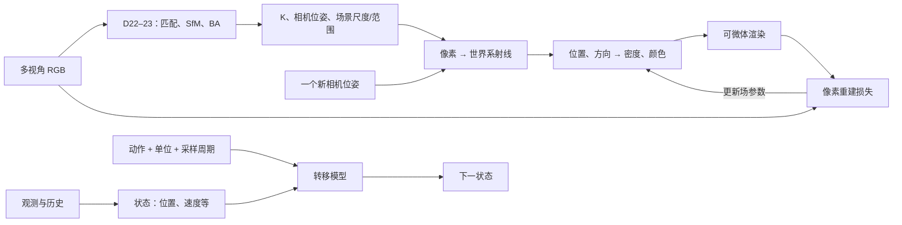
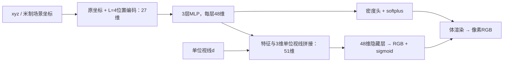
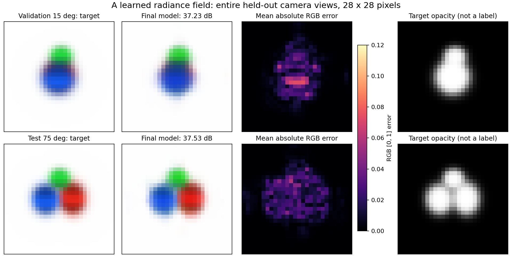
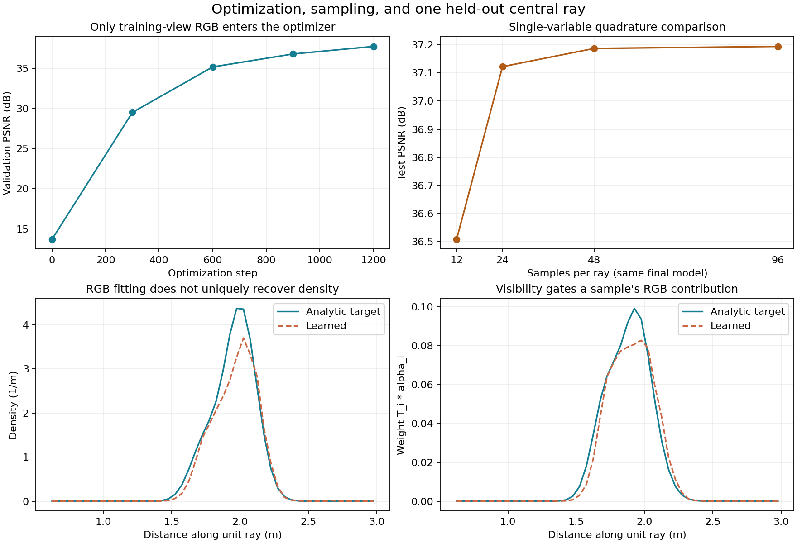
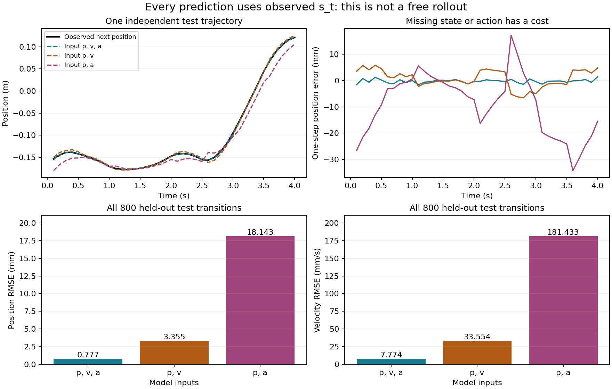

# D24 · 从一条相机射线到可学习的辐射场

[返回学习入口](../_index.md) ｜ [本周日程](../P2-深度理解-日程.md) ｜ [上一课 D23](../day23/Daily-Learning-Pack.md) ｜ [下一课 D25](../day25/Daily-Learning-Pack.md) ｜ [CPU 实验](demo.py) ｜ [绘图脚本](plot_demo.py)

**NeRF 把场景写成一个可查询的位置—方向函数，再用可微体渲染把它变成图像。训练时用照片约束这个函数，推理时换一个相机视角重新渲染。动作条件模型则学习另一条关系：给定当前状态和动作，下一状态怎样变化。**

本课为 P2 / W4-D3 / 全局 Day 24，保留原定 2026-09-28 的课号和主题，于 2026-09-29 补写。原任务是 NeRF、隐式与显式表示、体渲染推导和可训练重建实验；新增任务是转移样本、一阶位置/速度动力学及一步预测器。D23 的 BA 提供相机几何，历史观测帮助恢复速度；D25 再比较 Instant-NGP / 3DGS，并检验一步模型递推到 5、10 步后的变化。

贯穿案例是为机器人记录桌面上的物体：第一件事是回答“从另一侧看会是什么样”；第二件事是回答“执行某个动作以后会怎样”。前者需要场景表示与渲染，后者还需要状态、动作和时间。今天把两个模型都做出来，并把它们各自能证明的能力说清楚。

<details>
<summary>个人学习记录（由你填写，后续生成保留）</summary>

<!-- learner-notes:start -->

- 我能独立推导的射线与体渲染公式：
- 我对密度、透明度、权重、深度的区分：
- 我的改变量预测、实际结果与解释：
- 我的状态—动作契约、五格卡与自测成绩：
- 仍未理解、需要回到源码检查的问题：

<!-- learner-notes:end -->

</details>

<!-- daily-pack-generated:start -->

## 0. 今日目标与知识路线

学完后应能做到：

1. 区分显式几何、显式采样场、神经隐式场、SDF 与辐射场，避免把“用了神经网络”当成表示定义。
2. 从内外参生成世界系射线，说明射线参数、距离、相机 z 深度与场景缩放的关系。
3. 从透射率的微分方程推到 $\alpha_i$、$T_i$、$w_i$，手算遮挡和背景的 RGB 合成。
4. 写清位置编码与小型 NeRF 的 tensor shape，解释像素 RGB 怎样反向约束三维密度与颜色。
5. 训练一个真正通过射线 RGB 损失更新的神经辐射场，分别报告训练、验证、测试视角和前景误差。
6. 用独立轨迹拟合 $(s,a,s')$ 一步模型，验证速度和动作的作用，明确动作单位、周期和已知边界。

| 先后 | 主线 | 要回答的问题 |
| --- | --- | --- |
| 宏观 | 几何、表示、渲染、动态预测 | 哪个模型正在回答哪个问题？ |
| 微观一 | 相机射线、密度与体渲染 | 一个像素的颜色从哪里来？ |
| 微观二 | 编码、网络、损失与视角划分 | 没有逐点密度标签，场如何学出来？ |
| 微观三 | 状态转移、动作契约与一步拟合 | 模型究竟预测哪一个时刻的什么量？ |
| 实验与总结 | 合成场、保留视角、输入消融 | 什么证据成立，什么仍需要后续验证？ |

## 1. 宏观：先把“换视角”与“改变世界”画在不同位置



相机移动时，静态场景中的物体可以完全不动。渲染器改变的是“从哪些射线查询同一个场”。手爪推动物体时，即使相机不动，物体位置、接触状态和未来图像也可能变化；这需要动作影响世界的转移规律。

可以把两个接口并列写成：

$$
\hat I=\operatorname{Render}(F_\theta,K,T^{world}_{cam}),
\qquad
\hat s_{t+1}=f_\phi(s_t,a_t;\Delta t).
$$

前一个函数的查询条件是相机几何；后一个函数的条件是当前状态、动作和时间间隔。未来图像预测可以把两者连接起来，但还要处理对象移动、遮挡变化、接触和状态到场景的映射。**单独训练一份静态 NeRF，并没有自动学到推动、抓取或掉落的后果。**

### 1.1 在机器人栈里各解决什么问题

| 模块 | 对 RGB-D / 机器人系统的作用 | 本课不额外赋予它的能力 |
| --- | --- | --- |
| SfM / BA | 建立多相机与场景的几何一致性 | 单目相对重建没有天然米制尺度 |
| 辐射场 | 融合多视角外观，合成新视角，提供可查询场景表示 | 高 PSNR 不自动等于可碰撞检查的精确表面 |
| 深度/几何约束 | 为尺度、表面位置与重建提供额外观测 | 深度噪声、遮挡和标定误差仍要处理 |
| 动作条件转移模型 | 预测给定动作后的状态变化 | 一步准确不自动等于长程或接触预测准确 |
| VLA / 策略 | 从观测、语言或目标选择动作 | 预测图像的模型不会自行定义任务目标 |
| 控制与反馈 | 按接口执行动作，用真实反馈纠偏 | 不能把渲染误差当作控制误差直接替代 |

## 2. 表示：从“存一张表”到“查询一个函数”

### 2.1 显式和隐式描述的到底是什么

显式网格直接保存顶点与面；显式体素场在空间格点或体素中存储密度、颜色或特征。查询体素场时常要插值，因此“显式”也可以输出连续结果。

神经隐式场主要把空间信息分布在网络参数中：给一个任意连续坐标，网络计算该处的值。这里的“隐式”强调场景内容没有逐点列在一张巨大表里，不是说这个函数不能写成公式或不能直接求值。

| 表示 | 主要存储 | 查询结果 | 后续怎样形成图像或几何 |
| --- | --- | --- | --- |
| Mesh | 顶点、三角形、纹理 | 表面交点、法向、纹理 | 光栅化或光线追踪 |
| 点云 | 离散三维点及属性 | 邻域、表面采样 | 投影、点渲染或表面重建 |
| 密度体素 | 空间网格上的数值 | 插值密度/颜色 | 沿射线积分 |
| SDF | $f(x)$ 的网络或网格参数 | 到表面的有符号距离 | 零水平集、求交或特定体渲染转换 |
| 辐射场 | 网络参数，或网格/混合表示 | $\sigma(x)$ 与 $c(x,d)$ | 体渲染 |

同一种“场”可以用不同数据结构实现。辐射场并不天然等于 MLP；SDF 也不天然等于神经网络。D25 的加速讨论建立在这个分层上：改变表示、查询和渲染方式，不必改变“从多视角建立可渲染场景”的任务。

### 2.2 SDF、occupancy 与 NeRF 密度不是同一个物理量

- **SDF** 的输出有长度单位，零点定义表面；正负号约定必须声明。
- **Occupancy** 通常描述位置属于内部或被占据的程度。它可能被当作概率，但要看监督目标和校准方式。
- **体密度 $\sigma$** 是沿长度的消光/终止率。在米制坐标中单位为 $\mathrm{m}^{-1}$，不是一个被限制在 $[0,1]$ 的数。
- **区间透明度的补量 $\alpha$** 才是给定区间内发生终止的条件概率式量。它不仅依赖密度，还依赖穿过多长的一段。

因此不能把网络的 `sigma=12` 解释成“1200% 占据”；也不能直接把 `sigma>0.5` 定义为有物体，仿佛它是统一阈值的二分类输出。从密度提取表面时阈值会受场景尺度、学习目标和表示影响。

### 2.3 为什么说它是一个 5D 场

原始 NeRF 的输入可记为三维位置加二维球面方向，输出为 RGB 与密度。工程中方向经常保存为三维单位向量 $d$，其三个分量满足单位长度约束，因此方向仍只有两个自由度。[NeRF 项目页：方法概览](https://www.matthewtancik.com/nerf)

$$
\sigma=\sigma_\theta(x),\qquad c=c_\theta(x,d),\qquad \|d\|=1.
$$

密度仅依赖位置，用来约束不同视角共享空间结构；颜色可以依赖方向，用来拟合随视角变化的外观。给密度也输入方向会增加绕开几何一致性的机会。反过来，颜色完全不输入方向可能难以表达高光，但这不意味着网络已经分解出了真实材质、光照和 BRDF。

本课把方向固定为**从相机沿射线进入场景的单位向量**。若另一份实现把方向定义成场景点朝相机，二者相差负号；训练与渲染必须使用同一约定。

## 3. 射线：先把每一个米和每一个坐标系对齐

### 3.1 从像素到世界系射线

延续前课列向量约定：$T^A_B$ 将 B 系点变到 A 系。给定像素 $\tilde u=(u,v,1)^\top$，去畸变后：

$$
\tilde d_{cam}=K^{-1}\tilde u,
\quad d_{cam}=\frac{\tilde d_{cam}}{\|\tilde d_{cam}\|},
\quad d_{world}=R^{world}_{cam}d_{cam},
\quad o_{world}=t^{world}_{cam}.
$$

$$
r(t)=o_{world}+t\,d_{world},\qquad t\in[t_n,t_f].
$$

本课使用相机 x 向右、y 向下、z 向前，输入的 $T^{world}_{cam}$ 是 camera-to-world。若 BA 导出的是 $T^{cam}_{world}$，必须先求逆；不能只把旋转转置、保留原平移。示例程序用 `points @ R.T` 对应行存储，含义仍与列向量公式一致。

### 3.2 单位方向、射线距离与 z 深度

本课令 $\|d\|=1$，所以 t 是从相机沿射线走过的实际距离。相机 z 深度为：

$$
Z=t\,d_{cam,z}.
$$

例：$\tilde d_{cam}=(0.6,0,1)$，长度 $\sqrt{1.36}\approx1.16619$。若 RGB-D 测得轴向深度 $Z=1$ m，沿射线距离是 $t=1.16619$ m，而不是1 m。直接用轴向深度乘单位方向，会把离轴像素的位置缩短。

有的实现保留未归一化的 $\tilde d$，令参数 $\tau$ 按另一种方式变化。它也可以正确，但体渲染中相邻位置的物理间距必须是：

$$
\delta_i=\|\tilde d\|(\tau_{i+1}-\tau_i).
$$

作者实现的 `raw2outputs` 正是把参数差乘以射线方向的范数；同一实现另行归一化用于颜色分支的 `viewdirs`。射线步长用哪个向量、颜色查询用哪个向量，不能仅凭变量名判断。[原实现：run_nerf.py](https://github.com/bmild/nerf/blob/master/run_nerf.py)

**重参数化反例：** 同一段长度0.2 m，密度2 $\mathrm{m}^{-1}$。单位方向配参数差0.2，或长度为2的方向配参数差0.1，都应得到光学厚度0.4。如果第二种漏乘方向范数，会错算为0.2，透明度发生变化，尽管物理射线没有变化。

### 3.3 归一化场景坐标也要改变密度的数值解释

设 $x'=x/L$，L 为长度尺度，则 $\delta'=\delta/L$。保持相同光学厚度需要：

$$
\sigma'\delta'=\sigma\delta
\quad\Rightarrow\quad
\sigma'=L\sigma.
$$

一份在单位盒中训练的密度不能不经尺度说明就当成每米密度。相机平移、near/far、射线采样、深度输出和几何阈值也应使用同一坐标约定。D23 的单目尺度自由度会延续到这里；把图像重建得好看，不会自动消除这项自由度。

## 4. 体渲染：一个像素怎样汇总一整条射线

### 4.1 从微小长度的生存率开始

从 near 出发，令 $T(t)$ 表示光线传播到 t 仍未被前方介质终止的比例。穿过一个很小的 $dt$，若当地密度为 $\sigma(t)$：

$$
T(t+dt)\approx T(t)[1-\sigma(t)dt].
$$

移项、除以 $dt$ 并取极限：

$$
\frac{dT}{dt}=-\sigma(t)T(t),\qquad T(t_n)=1.
$$

解为：

$$
T(t)=\exp\left(-\int_{t_n}^{t}\sigma(r(s))ds\right).
$$

在位置 t 附近贡献颜色的权重，是“成功走到这里”乘以“在这一小段终止”：$T(t)\sigma(r(t))dt$。加入有限远边界外的背景色：

$$
C(r)=\int_{t_n}^{t_f}T(t)\sigma(r(t))c(r(t),d)dt
+T(t_f)c_{bg}.
$$

这是本课的发射—吸收式成像模型，不模拟完整的多次散射和全局光照。NeRF 使用可学习的方向颜色拟合外观，也不能据此直接解释为真实光照物理参数已被辨识。[NeRF 论文 §3–4、式(1)–(3)](https://arxiv.org/html/2003.08934v2)

### 4.2 分段常值近似：三个量各负责一件事

把射线切成小区间，每段用一个样本的密度和颜色代表。在第 i 段长度 $\delta_i$ 内，令 $\sigma_i$ 近似为常数：

$$
\tau_i=\sigma_i\delta_i,
\qquad
\alpha_i=1-e^{-\tau_i}.
$$

$\tau_i$ 是无量纲光学厚度；$\alpha_i$ 表示已进入该段时，在该段终止的比例。前方各段留下的透射率为：

$$
T_i=\exp\left(-\sum_{j<i}\sigma_j\delta_j\right)
=\prod_{j<i}(1-\alpha_j),\qquad T_1=1.
$$

真正乘到该段颜色上的权重是：

$$
w_i=T_i\alpha_i,
\qquad
\hat C=\sum_iw_ic_i+T_{N+1}c_{bg}.
$$

| 量 | 是否只看当前段 | 取值/单位 | 应该怎样理解 |
| --- | --- | --- | --- |
| $\sigma_i$ | 是 | 非负，$\mathrm{m}^{-1}$ | 每单位长度的终止率 |
| $\alpha_i$ | 是，但还要看段长 | $[0,1]$ | 在当前段终止的条件比例 |
| $T_i$ | 否，看前面所有段 | $[0,1]$ | 能走到本段起点的比例 |
| $w_i$ | 否 | $[0,1]$ | 当前段对像素的实际贡献权重 |

后方有很高密度，也不一定对最终像素有很大贡献，因为前面可能已经挡住了大部分射线。把 $\alpha$ 直接当作最终颜色权重，就删除了遮挡顺序。

### 4.3 为什么权重和通常小于1

由 $T_{i+1}=T_i(1-\alpha_i)$ 得：

$$
w_i=T_i-T_{i+1}.
$$

于是望远镜求和：

$$
\sum_iw_i=1-T_{N+1},\qquad
\sum_iw_i+T_{N+1}=1.
$$

最后仍透过来的部分属于背景。不要为了“像概率”就把所有 $w_i$ 除以权重和再渲染；这会把未命中的部分强行分给前景。若前景只有0.1的不透明度，归一化后看起来完全不透明，任务已被改写。

同样，N 次查询不等于对 N 个颜色做平均。体渲染权重依赖密度、物理距离和从近到远的顺序。

### 4.4 手算：红色薄层、蓝色薄层和白背景

两段都长0.2 m，前段密度2 $\mathrm{m}^{-1}$、颜色红 $(1,0,0)$；后段密度3 $\mathrm{m}^{-1}$、颜色蓝 $(0,0,1)$；背景为白 $(1,1,1)$。

$$
\begin{aligned}
\alpha_1&=1-e^{-0.4}=0.329680,\\
T_2&=e^{-0.4}=0.670320,\\
\alpha_2&=1-e^{-0.6}=0.451188,\\
w_2&=0.670320\times0.451188=0.302441,\\
T_3&=e^{-1}=0.367879.
\end{aligned}
$$

因此：

$$
\hat C=(0.329680,0,0)+(0,0,0.302441)
+(0.367879,0.367879,0.367879)
$$

$$
\boxed{\hat C=(0.697559,\ 0.367879,\ 0.670320).}
$$

绿色通道虽然两个前景颜色里都为0，最终仍不为0，因为白背景透过来了。这个例子同时检查了背景、遮挡顺序和权重和。

### 4.5 采样间隔怎样进入实际实现

本课实验把 $[0.6,3.0]$ m 分成 N 个**等宽且互不重叠的区间**，每段宽 $\delta=2.4/N$。训练时在每段随机取一个查询点，推理时取中点；查询值代表所在区间，积分宽度始终取该区间宽度。

这是一个有限边界的分段近似。原 NeRF 的常见代码按相邻采样位置差构造距离，并对最后区间作特殊处理。本课没有把最后区间设成无限长，剩余透射率显式合成白背景。不要把这两种边界规则混用，也不要因为查询点加了抖动就把本课区间宽度误写成随机点之间的间隔。

## 5. 为什么像素损失能训练三维场

### 5.1 网络没有看到密度标签，梯度仍有路径

训练数据是图片、内参、相机位姿和有效场景范围。每个像素的目标 RGB 是监督信号；射线上哪些地方有密度、局部是什么颜色，通常不是直接给定的标签。

$$
\mathcal L_{RGB}=\frac1{3B}\sum_{b=1}^B
\|\hat C(r_b)-C^*(r_b)\|_2^2.
$$

反向路径为：

```text
像素残差
  → 合成颜色对各样本颜色/密度的导数
  → 网络输出层
  → 共享网络参数
  → 下一次查询时的三维场
```

颜色的梯度最容易看懂：$\partial\hat C/\partial c_i=w_iI_3$。前方已遮住的点权重很小，单条射线对其颜色的约束也很弱。

密度更有意思：它既增加自己的贡献，也遮挡后方。设 $C_{behind}$ 是从本段之后开始、将剩余场与背景合成的条件颜色，则：

$$
\hat C=C_{front}+T_i[\alpha_i c_i+(1-\alpha_i)C_{behind}].
$$

固定其余样本，有：

$$
\frac{\partial\hat C}{\partial\sigma_i}
=T_i\delta_i e^{-\sigma_i\delta_i}(c_i-C_{behind}).
$$

这个式子说明，增大密度不是单纯“让颜色更亮”；它把原本来自后方的颜色替换成当前颜色。如果当前段与后方颜色相同，单条射线对密度变化可能不敏感。遮挡后方、纯色区域和有限视角共同形成了重建的不确定性。

### 5.2 多视角共享有帮助，但不等于唯一解

同一位置被多个相机查询，网络参数又共享，因此不能完全独立地给每张图随意画一个答案。但有限图片仍可能由多种密度/颜色组合解释，尤其在空白背景、透明物体、反光表面、遮挡和视角覆盖不足时。

本课训练只用 RGB，解析场密度仅在绘图时用于对照。你会看到测试视角已经相似，但中心射线上的预测密度峰值与解析真值仍不完全一致。这是一个具体证据：**低像素误差与几何恢复误差是不同验收指标。**

### 5.3 深度图从权重得到，但要说明归一化和无命中

常见量为：

$$
D_{raw}=\sum_iw_it_i,
\qquad
D_{cond}=\frac{\sum_iw_it_i}{\sum_iw_i},
\quad \sum_iw_i>0.
$$

$D_{raw}$ 是有限前景贡献的一阶矩，未包含背景终止位置；$D_{cond}$ 是以命中前景为条件的期望距离。若不透明度很小，条件深度即使算出一个数字，也不应当作可靠表面。程序中的 epsilon 只是避免除零，不能创造观测证据。

此外，多个半透明层的期望距离可能落在层与层之间。用于抓取或碰撞时，通常还需要深度一致性、有效性、表面提取和不确定性检查。离轴射线的期望距离也仍要按第3节变成 z 深度，才能与轴向深度图直接比较。

## 6. 位置编码、网络结构与 tensor shape

### 6.1 位置编码增加的是输入函数的频率成分

对一个归一化标量 q，定义：

$$
\gamma(q)=\big[\sin(\pi q),\cos(\pi q),\ldots,
\sin(2^{L-1}\pi q),\cos(2^{L-1}\pi q)\big].
$$

对 x、y、z 分别编码。只保留正余弦时维数为 $6L$；本课额外拼入原始坐标，所以维数是 $3+6L$。取 L=4，得到27维位置特征，而不是12维或24个空间点。

这些特征不存储相机帧号，也没有把射线上的样本次序当作词序。它们把连续坐标映射到多频率函数基，帮助小型 MLP 表达空间上的快速变化。频率更高不必然更好：视角覆盖、图像分辨率、空间采样和抗混叠都可能成为限制。

论文式(4)带 $\pi$；作者公开 `Embedder` 将原始输入拼入编码，并直接使用 $2^k$ 的频率。复现时应把频率尺度、是否拼原坐标、输入归一化一起记录，不能只报告“用了L层位置编码”。本课明确使用带 $\pi$ 的公式和原坐标拼接。[论文 §5.1](https://arxiv.org/html/2003.08934v2) · [作者 Embedder](https://github.com/bmild/nerf/blob/master/run_nerf_helpers.py)

### 6.2 一个能真正训练的最小结构

本课实现：



密度不取决于方向，颜色头才看到方向。`softplus` 保证密度非负；`sigmoid` 把显示 RGB 限在 $[0,1]$。已知场景边界 $|x|,|y|,|z|\le0.75$ m 外密度设为0，这是明示的场景支持范围先验；不是由模型自行发现了全部空闲空间。

### 6.3 本课一次训练批次的 shape

| 阶段 | 本课形状 | 含义 |
| --- | --- | --- |
| 起点、单位方向 | `[B,3]` = `[96,3]` | 96条像素射线 |
| 每条射线的采样参数 | `[B,N]` = `[96,48]` | 每条48段 |
| 三维采样位置 | `[B,N,3]` | 广播 $o+td$ |
| 拉平查询点 | `[B*N,3]` = `[4608,3]` | MLP逐点计算 |
| 位置编码 | `[4608,27]` | 3个原坐标与24个频率分量 |
| 共享空间特征 | `[4608,48]` | 三层MLP输出 |
| 密度 | `[4608,1]` → `[B,N]` | 体渲染所需非负标量 |
| RGB头输入 | `[4608,51]` | 48维特征与3维方向 |
| 样本RGB | `[B,N,3]` | 每个查询点的方向颜色 |
| alpha、T、weights | `[B,N]` | 沿N轴累计与合成 |
| 最终像素RGB | `[B,3]` | 与目标RGB计算MSE |

这里的 batch 是射线数，不是相机数。B×N才是该批网络实际处理的查询点数。训练时 `reshape` 与渲染时的还原必须保持射线和采样点顺序，否则网络输出会被接到别的像素上。

### 6.4 原 NeRF 比本课多出的关键机制

原论文使用更大的位置网络、方向编码，以及 coarse/fine 两个网络。粗网络的权重告诉细采样阶段哪些位置可能贡献较大；将权重归一化形成采样分布，在这些区域增加查询，再合并采样位置进行细渲染。[NeRF 论文 §5.2–5.3](https://arxiv.org/html/2003.08934v2)

注意：**为重要性采样归一化权重**与**为最终颜色强制归一化权重**是两件事。前者构造提议采样分布；后者会错误丢掉背景透射率。

本课省略分层采样、skip connection和大网络，保留位置/方向输入、可学习密度与颜色、可微体渲染、像素监督及保留视角检验。它是实际训练的小型 NeRF 原理实现，不能记为已经跑通完整官方 Instant-NGP 或 threestudio 工程。

## 7. 学习的是一个场景，验证的是哪一种泛化

### 7.1 数据条件比换一个优化器更优先

每个训练像素需要与相机几何对应。内参错、畸变未处理、位姿方向错、物体在采集期间移动、曝光变化或时间不同步，都会让不同图像对同一个静态场提出互相矛盾的要求。

网络可能通过模糊密度、漂浮物或方向颜色吸收部分误差。训练损失下降并不能排除这些问题。D23 的 BA 解决的是相机和点的几何一致性；今天是在已有几何条件下学习场景，而非假定渲染网络可以自动修好所有相机误差。

### 7.2 视角划分：不能把同一张图的像素分成“新视角测试”

本课同一静态场景使用12个训练相机，方位角为0°、30°、……、330°；验证视角15°、135°；测试视角75°、255°。每个视角为完整的28×28图片，仰角与相机距离保持一致。

- 随机抽训练图像的射线，是优化批次的构造方式。
- 保留整张未训练相机图像，才是在此协议下检验新视角。
- 这些视角仍属于同一个场景、同一相机环上的插值位置，不是新物体、新光照或任意高度的泛化证据。

训练步数固定为1200，不按测试结果挑checkpoint。验证曲线用来观察学习过程，最终数字均来自预先固定的最后一步。测试视角没有参与梯度更新；测试时改变采样数的对照也不反过来选择训练模型。

### 7.3 PSNR要连同区域和动态范围一起报告

RGB在 $[0,1]$ 中时：

$$
\mathrm{MSE}=\frac1{3HW}\sum_{u,v,c}(\hat I-I)^2,
\qquad \mathrm{PSNR}=-10\log_{10}\mathrm{MSE}.
$$

若动态范围为255，分子应相应变为 $255^2$；同一物理图像使用一致比例后PSNR不应凭空变化。本课直接在浮点 $[0,1]$ 上计算。

白背景占大部分像素时，全图PSNR可能掩盖物体内部的误差。因此额外报告目标不透明度大于0.1区域内的前景PSNR。这个mask只用于合成实验评价，未进入训练损失；真实数据里不能凭空得到同样的解析密度mask。

多个视角的总体PSNR由合并像素的MSE计算，不是简单平均各视角dB。两者不等价，因为对数在求平均之外。

## 8. 从重建转向转移：一条样本必须包含什么

### 8.1 $(s_t,a_t,s_{t+1})$ 是带时间和单位的关系

设一维状态为：

$$
s_t=\begin{bmatrix}p_t\\v_t\end{bmatrix},
\quad p_t\text{单位m},\quad v_t\text{单位m/s}.
$$

动作 $a_t$ 是在 $[t,t+\Delta t)$ 内保持的**命令加速度**，单位 $\mathrm{m/s^2}$；周期固定 $\Delta t=0.1$ s。状态记录是动作施加前，标签是该周期结束后。这个任务既不是预测专家动作，也不是把任意相邻图片配成一对。

真实机器人还要说明坐标轴、命令发出时刻、执行延迟、实际生效动作、限幅、控制器内部行为与反馈时间。若数据记录的是目标位置，不能将同一串数字交给本课的加速度模型。

### 8.2 本课可检验的动力学

合成系统使用：

$$
\begin{aligned}
u_t&=\operatorname{clip}(a_t,-1,1)\quad[\mathrm{m/s^2}],\\
v_{t+1}&=0.94v_t+\Delta t(u_t-0.6p_t)+\epsilon_t,\\
p_{t+1}&=p_t+\Delta t\,v_{t+1},\\
\epsilon_t&\sim\mathcal N(0,0.008^2)\quad[\mathrm{m/s}].
\end{aligned}
$$

0.94是此周期下的速度保留系数；0.6带有 $\mathrm{s^{-2}}$ 单位，是位置回复项系数。最后一行位置用的是**更新后的速度**，所以这是本课明确选择的离散更新方式，不要擅自换成旧速度或精确连续时间解析式。

本课命令全在 $[-0.6,0.6]$ 内，执行器限幅未激活。模型只凭这些数据无法识别超过 $\pm1$ 后会发生的饱和；这项边界留给D25的分布外动作实验。

忽略噪声且未饱和时，代入 $\Delta t=0.1$：

$$
\begin{bmatrix}p_{t+1}\\v_{t+1}\end{bmatrix}
=
\begin{bmatrix}0.994&0.094\\-0.06&0.94\end{bmatrix}
\begin{bmatrix}p_t\\v_t\end{bmatrix}
+\begin{bmatrix}0.01\\0.1\end{bmatrix}a_t.
$$

这不是声称真实机械臂按这个二维模型运动；我们选择可推导、可拟合的系统，集中检验“条件有没有齐、单位有没有对、学习证据有没有泄漏”。

### 8.3 手算与缺状态反例

取 $p=0.2$ m、$v=0.1$ m/s、$a=0.4$ m/s²，忽略噪声：

$$
v'=0.94\times0.1+0.1(0.4-0.6\times0.2)=0.122\ \mathrm{m/s},
$$

$$
p'=0.2+0.1\times0.122=0.2122\ \mathrm{m}.
$$

保持p和a不变，只将当前速度改成 $-0.1$ m/s，则 $v'=-0.066$ m/s、$p'=0.1934$ m。同一个位置和同一个动作，却对应不同的下一位置；只输入 $(p,a)$ 的确定性模型必须在这类冲突里做折中。

D23 的“观测不等于状态”在这里变成了可测结果。若只看单帧位置，历史可以用于估计速度；如果直接给出可靠速度，就不需要为了形式而强制加一个大时序模型。

### 8.4 一步预测器怎样从数据拟合

构造设计矩阵每行为 $x_t=[p_t,v_t,a_t,1]$，标签为 $y_t=[p_{t+1},v_{t+1}]$：

$$
X\in\mathbb R^{M\times4},\quad Y\in\mathbb R^{M\times2},\quad
\hat Y=XW,\quad W\in\mathbb R^{4\times2}.
$$

$$
W^*=\arg\min_W\|XW-Y\|_F^2.
$$

程序使用 `np.linalg.lstsq` 求解，不显式计算 $(X^TX)^{-1}$，避免把病态问题再通过法方程放大。噪声很小时系数应接近上面的解析更新；模型输出的两个列分别带有位置与速度语义。

若改为共享参数的神经网络，位置平方误差与速度平方误差带不同单位，通常应做训练集统计归一化或使用有明确单位解释的权重。这里线性模型的两列独立优化，对各列乘正的常数权重不会改变各自的最小二乘解；但评价仍必须分别报告m和m/s，不能只报一个混合单位的平均RMSE。

### 8.5 独立轨迹划分与噪声下限

生成120条独立初始状态和噪声序列，每条40次转移：80条训练、20条验证、20条测试。动作每5步刷新一次，范围固定 $[-0.6,0.6]$；划分以整条轨迹ID为单位，不把同轨迹相邻窗口随机分到三边。

训练、验证、测试转移数分别为3200、800、800。它们测试的是同一动力学、同一采样机制下的新轨迹；尚未覆盖新摩擦、时延、接触、周期和分布外命令。

噪声先进入速度，再通过位置更新传播。因此下一位置噪声标准差是 $\Delta t\sigma_v=0.0008$ m，速度噪声标准差为0.008 m/s；二者高度相关，不是两份独立传感器噪声。若学习的条件均值已很准确，一步误差仍不会趋于0。本课测试有限样本RMSE略低于或高于理论标准差都正常，不应把这点差异解释为突破噪声下限。

## 9. Learning 五格卡：两种模型放在同一张学习地图上

| 五格 | 静态小型 NeRF | 一步动作条件预测器 |
| --- | --- | --- |
| 输入与输出 | 查询位置/方向 → 密度和RGB，经渲染得到像素 | 当前位置/速度/命令 → 下一位置/速度 |
| 结构与表示 | 编码坐标的MLP与体渲染；一个场景一组参数 | 含偏置的线性映射，$W:[4,2]$ |
| 监督从哪来 | 已知相机几何下的训练图像RGB | 合成系统记录的 $(s_t,a_t,s_{t+1})$ |
| 损失与更新 | 射线RGB MSE，Adam反向传播 | 下一状态最小二乘，数值分解求解 |
| 验收与边界 | 完整保留视角、前景误差、场/渲染约定 | 独立轨迹的一步位置/速度误差；未覆盖多步/OOD |

这两个实验都属于“从观测目标学习映射”，但输出任务不同。一个拟合静态场景外观，一个拟合动作影响下的状态变化。神经网络不是 Learning 的必要条件；最小二乘同样是在根据数据估计参数。

若把第二个模型的输入改成当前状态、输出改成专家动作，才转成类似BC的目标。把它输出的未来状态放进代价函数，可以辅助动作选择；但“能预测”不意味着已经具备策略、奖励定义和安全执行。

## 10. CPU 实操：一份可训练场与一份一步模型

### 10.1 运行与文件

在 vault 根目录使用已有的 Python 环境，依赖为 NumPy、PyTorch、Matplotlib。完整默认实验不下载数据、不加载外部模型、不连接相机或机器人。

```bash
python -B 3d_learning/day24/demo.py
python -B 3d_learning/day24/plot_demo.py
```

本次实际运行环境：Python 3.11.15、NumPy 1.26.4、PyTorch 2.13.0.dev20260423；训练使用CPU与2线程。默认模型实验执行约4.22秒，此时间只记录本机实测，不是跨设备性能承诺。

| 文件 | 内容 |
| --- | --- |
| [demo.py](demo.py) | 相机射线、解析体场、NeRF训练、体渲染、一步动力学拟合 |
| [plot_demo.py](plot_demo.py) | 从已保存结果生成三张图，不重新训练 |
| [results.json](../../_assets/3d_learning/day24/results.json) | 版本、随机种子、所有正文引用数值 |
| radiance.npz (not exported: excluded by publication policy) | 相机射线、目标/预测图像、视角划分、PSNR曲线 |
| small_nerf.pt (not exported: excluded by publication policy) | 本课训练得到的场参数及结构配置 |
| dynamics.npz (not exported: excluded by publication policy) | 独立轨迹、动作、下一状态、拟合参数及一步预测 |

重复运行会更新这些自动生成的实验附件。个人学习记录保留在本文开头的独立区域。修改参数前先记录自己的预测和原始数值，不把一次偶然变好当成普遍结论。

### 10.2 NeRF实验究竟训练了什么

目标场是三个不同位置、尺度与颜色的平滑密度团，带空间颜色变化和一个弱方向项。用解析体场渲染128段采样的目标图片，再仅将训练相机的RGB交给神经网络。解析密度、解析颜色和不透明度没有作为训练标签。

模型有8740个参数，使用96条射线的批次、每条48段、1200次参数更新。训练样本带区间内位置扰动；验证和测试使用区间中点。模型没有下载权重，也没有利用测试图像微调。

| 评价区域 | 本次最终结果 |
| --- | --- |
| 12个训练视角全图 | 37.932 dB |
| 2个验证视角全图 | 37.705 dB |
| 2个独立测试视角全图 | 37.187 dB |
| 2个测试视角的前景区域 | 30.982 dB |



上排为验证15°，下排为测试75°。从左到右依次是目标、预测、逐像素平均绝对RGB误差和解析目标的不透明度。图内PSNR是单个视角的数值，因此与上表两个视角合并的PSNR不同。误差图使用同一色标，便于判断误差集中在何处。

这验证了一个小型场能通过像素监督学习，并合成未训练视角。目标本身是平滑半透明体场、分辨率只有28×28、相机完全准确、背景固定；它不支持“真实杯子的表面已被准确恢复”或“已达到原论文性能”的结论。

### 10.3 单变量实验：只改变推理时每条射线的采样数

训练权重、两个测试视角、目标图片、near/far和渲染背景全部固定。只改变推理的区间数：

| 每条射线采样数 | 两测试视角合并PSNR |
| --- | --- |
| 12 | 36.509 dB |
| 24 | 37.122 dB |
| 48 | 37.187 dB |
| 96 | 37.194 dB |

在这一个场和检查点上，12到24的收益较明显，48到96收益很小。更多采样提高积分分辨率，却不能自动消除已学场的表示误差、数据误差或不可辨识性。不要将该表解释成所有场景都在48段饱和，也不要将它当作不同模型的训练效率比较。



左上只显示验证曲线：13.725 → 29.503 → 35.159 → 36.769 → 37.705 dB；训练更新没有使用这些验证像素。右上是固定场的单变量采样对照。下排是测试75°中间附近一条射线：解析密度与学习密度仍有差异，终止权重还被前面的累积透射率重新调制。

**你的改变量任务：** 先预测将默认推理采样48改成12会影响哪种误差，再对照表解释。随后选择一个训练参数，例如 `--steps 600`，保持其他默认参数，重新运行并记录验证PSNR。不要同时改步数、宽度、训练视角与采样数，否则无法判断哪个因素造成变化。

### 10.4 一步预测实验：只删除一类条件信息

同一数据划分、同一标签、同一种线性拟合方法，对比三个输入集合。完整模型输入 $(p,v,a)$；另两个模型分别删除速度、删除动作。

| 输入 | 测试下一位置RMSE | 测试下一速度RMSE |
| --- | --- | --- |
| p、v、a | 0.777 mm | 7.774 mm/s |
| p、v（无动作） | 3.355 mm | 33.554 mm/s |
| p、a（无速度） | 18.143 mm | 181.433 mm/s |

完整模型已接近该合成系统的一步噪声尺度。删除速度的模型失去当前运动方向；删除动作的模型只能按数据中其他变量与动作的关联猜测。后者不是“没有动作还理解了动作因果”，更不能据离线相关性认定其支持任意动作干预。



上排画测试轨迹ID100的逐步预测及误差；下排统计全部800个测试转移。**每个点都以该时刻的真实当前状态为输入**，没有把前一时刻的预测递推回来，所以这不是自由rollout。D25才会控制这个条件，检查误差积累。

完整模型学到的矩阵，按行依次对应p、v、a、偏置，按列对应下一p与下一v：

$$
W\approx\begin{bmatrix}
0.994030&-0.059703\\
0.093990&0.939903\\
0.010022&0.100220\\
-0.000041&-0.000412
\end{bmatrix}.
$$

与解析无噪声系数逐项比较，比只说“loss很低”更有信息。偏置较小但不严格为0，有限噪声数据的拟合会出现这种差异。

### 10.5 立即可用的数据接口与验收

`dynamics.npz` 的核心字段：

| key | shape / 含义 |
| --- | --- |
| `states` / `next_states` | `[120,40,2]`，顺序为p、v |
| `actions` | `[120,40,1]`，命令加速度 |
| `trajectory_ids` | `[120]` |
| `split` | `[120]`，0训练、1验证、2测试 |
| `coef_full` | `[4,2]`，下一状态 = `[p,v,a,1] @ W` |
| `coef_position_only` / `coef_no_action` | `[3,2]`，输入分别为`[p,a,1]` / `[p,v,1]` |
| `dt` / `noise_std` | 标量，分别0.1 s与0.008 m/s |

可直接开始的一步预测：

```python
import numpy as np
data = np.load("_assets/3d_learning/day24/dynamics.npz")
W = data["coef_full"]
state = np.array([0.2, 0.1])   # m, m/s
action = 0.4                 # m/s^2, held for dt=0.1 s
next_state = np.r_[state, action, 1.0] @ W
print(next_state)             # 约 [0.2122 m, 0.122 m/s]
```

验收应包括：手算权重和加背景等于1；完整保留视角没有进入优化；图像维度与所有射线顺序一致；动力学划分不共享轨迹；每个预测都能回到动作和时间契约。三张图已实际生成并检查，结果中的训练完成不代表你个人已完成本课。

### 10.6 完整主实验代码

<details>
<summary>展开完整 demo.py：与附件脚本一致，可直接保存运行</summary>

```python
"""Day 24: CPU neural radiance field and independently split one-step dynamics.

Run from the vault root: python -B 3d_learning/day24/demo.py
Only synthetic data; no downloads, pretrained weights, or hardware access.
"""
import argparse
import json
import math
import platform
import time
from pathlib import Path

import numpy as np
import torch
from torch import nn
from torch.nn import functional as F

ASSETS = Path(__file__).resolve().parents[2] / "_assets/3d_learning/day24"
NEAR, FAR = 0.6, 3.0  # metres along a unit camera ray


def camera_rays(azimuth_deg, size=28):
    """OpenCV camera axes: right, down, forward; c2w maps camera to world."""
    theta = math.radians(float(azimuth_deg))
    origin = torch.tensor([1.8 * math.cos(theta), 1.8 * math.sin(theta), 0.45])
    forward = F.normalize(-origin, dim=0)
    right = F.normalize(torch.linalg.cross(forward, torch.tensor([0., 0., 1.])), dim=0)
    down = torch.linalg.cross(forward, right)
    rotation = torch.stack([right, down, forward], dim=1)
    v, u = torch.meshgrid(torch.arange(size), torch.arange(size), indexing="ij")
    focal = size * 1.1
    dirs_cam = torch.stack([(u - (size - 1) / 2) / focal,
                            (v - (size - 1) / 2) / focal, torch.ones_like(u)], -1)
    directions = F.normalize(dirs_cam.float() @ rotation.T, dim=-1).reshape(-1, 3)
    return origin.expand_as(directions), directions


def encoding(x, levels):
    # Includes raw coordinates. Frequencies follow the paper's pi convention.
    features = [x]
    for k in range(levels):
        features.extend([torch.sin((2 ** k) * math.pi * x),
                         torch.cos((2 ** k) * math.pi * x)])
    return torch.cat(features, dim=-1)


class SmallNeRF(nn.Module):
    def __init__(self, width=48, levels=4):
        super().__init__()
        self.levels = levels
        self.trunk = nn.Sequential(nn.Linear(3 * (1 + 2 * levels), width), nn.ReLU(),
                                   nn.Linear(width, width), nn.ReLU(),
                                   nn.Linear(width, width), nn.ReLU())
        self.density = nn.Linear(width, 1)
        self.color = nn.Sequential(nn.Linear(width + 3, width), nn.ReLU(),
                                   nn.Linear(width, 3))
        nn.init.constant_(self.density.bias, -1.)

    def forward(self, points, directions):
        h = self.trunk(encoding(points, self.levels))
        support = (points.abs().amax(dim=-1) <= 0.75).float()
        sigma = F.softplus(self.density(h)[..., 0]) * support
        rgb = torch.sigmoid(self.color(torch.cat([h, directions], dim=-1)))
        return sigma, rgb


def analytic_field(points, directions):
    """Known continuous density and color, not a mesh or a path-traced dataset."""
    centers = points.new_tensor([[-.23, -.06, -.02], [.21, .04, .02], [0., .03, .30]])
    radii = points.new_tensor([[.19, .24, .24], [.18, .21, .20], [.15, .16, .14]])
    q = ((points[..., None, :] - centers) / radii).square().sum(-1)
    lobes = 24. * torch.exp(-2. * q)
    support = (points.abs().amax(dim=-1) <= .75).float()
    sigma = lobes.sum(-1) * support
    colors = points.new_tensor([[.92, .16, .10], [.08, .36, .95], [.12, .86, .22]])
    rgb = (lobes[..., None] * colors).sum(-2) / (lobes.sum(-1, keepdim=True) + 1e-8)
    stripe = .80 + .20 * torch.cos(18. * points[..., 2:3])
    # A modest direction-dependent term is part of the synthetic target.
    rgb = (rgb * stripe + .04 * directions[..., 2:3].square()).clamp(0., 1.)
    return sigma, rgb


def render(field, origins, directions, samples=48, stratified=False):
    """Finite, equal-width bins; each query represents its whole bin.

    Unit rays make t and delta lengths in metres. We use bin widths (not
    distances between jittered query locations), a deliberate quadrature choice.
    """
    count = len(origins)
    offsets = torch.rand(count, samples) if stratified else torch.full((count, samples), .5)
    delta = (FAR - NEAR) / samples
    t = NEAR + (torch.arange(samples)[None] + offsets) * delta
    points = origins[:, None, :] + directions[:, None, :] * t[..., None]
    dirs = directions[:, None, :].expand_as(points)
    sigma, colors = field(points.reshape(-1, 3), dirs.reshape(-1, 3))
    sigma, colors = sigma.reshape(count, samples), colors.reshape(count, samples, 3)
    optical = sigma * delta
    alpha = -torch.expm1(-optical)
    prefix = torch.cat([torch.zeros(count, 1), optical.cumsum(-1)[:, :-1]], -1)
    transmittance = torch.exp(-prefix)
    weights = transmittance * alpha
    background_weight = torch.exp(-optical.sum(-1))
    rgb = (weights[..., None] * colors).sum(1) + background_weight[:, None]
    opacity = weights.sum(-1)
    conditional_depth = (weights * t).sum(-1) / opacity.clamp_min(1e-8)
    return rgb, opacity, conditional_depth


@torch.no_grad()
def render_batches(field, origins, directions, samples=48, chunk=256):
    pieces = [render(field, origins[i:i + chunk], directions[i:i + chunk], samples)
              for i in range(0, len(origins), chunk)]
    return tuple(torch.cat([part[k] for part in pieces]) for k in range(3))


def psnr(prediction, target):
    return float(-10. * torch.log10((prediction - target).square().mean().clamp_min(1e-12)))


def fit_radiance_field(steps, size, samples):
    torch.manual_seed(24)
    torch.set_num_threads(2)
    train_angles = np.arange(0., 360., 30.)
    val_angles = np.array([15., 135.])
    test_angles = np.array([75., 255.])
    angles = np.concatenate([train_angles, val_angles, test_angles])
    splits = np.array([0] * 12 + [1] * 2 + [2] * 2)
    rays = [camera_rays(angle, size) for angle in angles]
    origins = torch.stack([pair[0] for pair in rays])
    directions = torch.stack([pair[1] for pair in rays])
    truths = [render_batches(analytic_field, o, d, samples=128) for o, d in rays]
    target = torch.stack([v[0] for v in truths])
    target_opacity = torch.stack([v[1] for v in truths])
    field = SmallNeRF()
    optimizer = torch.optim.Adam(field.parameters(), lr=2e-3)
    train_o, train_d = origins[:12].reshape(-1, 3), directions[:12].reshape(-1, 3)
    train_y = target[:12].reshape(-1, 3)
    history = []
    checkpoints = {0, steps // 4, steps // 2, 3 * steps // 4, steps}
    for step in range(steps + 1):
        if step in checkpoints:
            val_pred = torch.stack([render_batches(field, *rays[k], samples=samples)[0]
                                    for k in [12, 13]])
            history.append([step, psnr(val_pred, target[12:14])])
            print(f"step={step:4d} validation_psnr={history[-1][1]:.3f} dB", flush=True)
        if step == steps:
            break
        indices = torch.randint(len(train_o), (96,))
        prediction = render(field, train_o[indices], train_d[indices], samples, stratified=True)[0]
        loss = F.mse_loss(prediction, train_y[indices])
        optimizer.zero_grad()
        loss.backward()
        optimizer.step()
        for group in optimizer.param_groups:
            group["lr"] = 2e-3 * (0.2 ** ((step + 1) / steps))
    # All image metrics use the final, fixed-budget checkpoint; no test selection.
    predicted = torch.stack([render_batches(field, o, d, samples=samples)[0] for o, d in rays])
    per_view = [psnr(predicted[k], target[k]) for k in range(len(angles))]
    sample_sweep = {}
    for n in [12, 24, 48, 96]:
        pred = torch.stack([render_batches(field, *rays[k], samples=n)[0] for k in [14, 15]])
        sample_sweep[str(n)] = psnr(pred, target[14:16])
    foreground = target_opacity[14:16] > .1
    data = dict(angles=angles, split=splits, origins=origins.numpy(), directions=directions.numpy(),
                target=target.numpy(), predicted=predicted.numpy(), target_opacity=target_opacity.numpy(),
                validation_history=np.array(history), per_view_psnr=np.array(per_view),
                size=np.array(size), samples=np.array(samples), near=np.array(NEAR), far=np.array(FAR))
    np.savez_compressed(ASSETS / "radiance.npz", **data)
    torch.save({"state_dict": field.state_dict(), "width": 48, "levels": 4,
                "near": NEAR, "far": FAR, "samples": samples, "size": size}, ASSETS / "small_nerf.pt")
    return dict(steps=steps, ray_batch=96, samples=samples, size=size,
                parameters=sum(p.numel() for p in field.parameters()), seed=24,
                train_views=train_angles.tolist(), validation_views=val_angles.tolist(),
                test_views=test_angles.tolist(), target_samples=128,
                train_psnr=psnr(predicted[:12], target[:12]),
                validation_psnr=psnr(predicted[12:14], target[12:14]),
                test_psnr=psnr(predicted[14:16], target[14:16]),
                test_foreground_psnr=psnr(predicted[14:16][foreground], target[14:16][foreground]),
                per_view_psnr=per_view, fixed_model_samples_test_psnr=sample_sweep,
                validation_history=history)


def true_step(state, action, dt=.1, noise=0.):
    """Command acceleration is clipped at +/-1 m/s^2; scalar or array input."""
    p, v = np.asarray(state)[..., 0], np.asarray(state)[..., 1]
    v_next = .94 * v + dt * (np.clip(action, -1., 1.) - .6 * p) + noise
    return np.stack([p + dt * v_next, v_next], axis=-1)


def design_matrix(state, action, mode="full"):
    state, action = np.asarray(state), np.asarray(action)
    if action.shape == state.shape[:-1]:
        action = action[..., None]
    ones = np.ones_like(action)
    if mode == "full":
        return np.concatenate([state, action, ones], axis=-1)
    if mode == "position_only":
        return np.concatenate([state[..., :1], action, ones], axis=-1)
    if mode == "no_action":
        return np.concatenate([state, ones], axis=-1)
    raise ValueError(mode)


def dynamics_experiment():
    rng = np.random.default_rng(2401)
    dt, noise_std = .1, .008
    states = np.empty((120, 40, 2))
    actions = np.empty((120, 40, 1))
    next_states = np.empty_like(states)
    for trajectory in range(120):
        state = rng.uniform([-.6, -.4], [.6, .4])
        action = 0.
        for step in range(40):
            if step % 5 == 0:
                action = rng.uniform(-.6, .6)
            next_state = true_step(state, action, dt, rng.normal(0., noise_std))
            states[trajectory, step] = state
            actions[trajectory, step, 0] = action
            next_states[trajectory, step] = next_state
            state = next_state
    split = np.array([0] * 80 + [1] * 20 + [2] * 20)
    report, coefficients, predictions = {}, {}, {}
    for mode in ["full", "position_only", "no_action"]:
        design = design_matrix(states, actions, mode)
        coef = np.linalg.lstsq(design[split == 0].reshape(-1, design.shape[-1]),
                               next_states[split == 0].reshape(-1, 2), rcond=None)[0]
        pred = design @ coef
        coefficients[f"coef_{mode}"] = coef
        predictions[f"pred_{mode}"] = pred
        report[mode] = {}
        for name, value in [("train", 0), ("validation", 1), ("test", 2)]:
            rmse = np.sqrt(np.mean((pred[split == value] - next_states[split == value]) ** 2,
                                   axis=(0, 1)))
            report[mode][name] = {"position_rmse_m": float(rmse[0]),
                                   "velocity_rmse_m_s": float(rmse[1])}
    np.savez_compressed(ASSETS / "dynamics.npz", states=states, actions=actions,
                        next_states=next_states, trajectory_ids=np.arange(120), split=split,
                        dt=np.array(dt), noise_std=np.array(noise_std),
                        **coefficients, **predictions)
    report.update(seed=2401, dt_s=dt, velocity_noise_std_m_s=noise_std,
                  trajectories={"train": 80, "validation": 20, "test": 20},
                  transitions_per_trajectory=40, command_acceleration_range_m_s2=[-.6, .6],
                  actuator_limit_m_s2=1., coef_full=coefficients["coef_full"].tolist())
    return report


def hand_check():
    sigma = np.array([2., 3.])
    delta = np.array([.2, .2])
    alpha = -np.expm1(-sigma * delta)
    transmittance = np.exp(-np.r_[0., np.cumsum(sigma * delta)[:-1]])
    weights = transmittance * alpha
    background = np.exp(-np.sum(sigma * delta))
    color = weights @ np.array([[1., 0., 0.], [0., 0., 1.]]) + background * np.ones(3)
    assert np.isclose(weights.sum() + background, 1.)
    # Reparameterizing a ray cannot change physical opacity.
    correct = 1. - np.exp(-2. * .2)
    missing_direction_norm = 1. - np.exp(-2. * .1)
    return dict(alpha=alpha.tolist(), transmittance=transmittance.tolist(),
                weights=weights.tolist(), background_weight=float(background),
                white_background_rgb=color.tolist(),
                correct_alpha=float(correct), missing_norm_alpha=float(missing_direction_norm))


def main():
    parser = argparse.ArgumentParser()
    parser.add_argument("--steps", type=int, default=1200)
    parser.add_argument("--size", type=int, default=28)
    parser.add_argument("--samples", type=int, default=48)
    args = parser.parse_args()
    if args.steps < 1 or args.size < 4 or args.samples < 2:
        parser.error("steps>=1, size>=4 and samples>=2 are required")
    ASSETS.mkdir(parents=True, exist_ok=True)
    start = time.perf_counter()
    report = {"verified_date": "2026-09-29", "device": "cpu", "python": platform.python_version(),
              "numpy": np.__version__, "torch": torch.__version__, "hand_check": hand_check()}
    report["dynamics"] = dynamics_experiment()
    print("Saved independent dynamics trajectories and fitted coefficients.", flush=True)
    report["radiance"] = fit_radiance_field(args.steps, args.size, args.samples)
    report["elapsed_s"] = time.perf_counter() - start
    (ASSETS / "results.json").write_text(json.dumps(report, indent=2), encoding="utf-8")
    print(json.dumps(report, indent=2))


if __name__ == "__main__":
    main()
```

</details>

## 11. 原论文与源码：按问题精读，而不是记住名字

**已核验来源：** Ben Mildenhall 等，*NeRF: Representing Scenes as Neural Radiance Fields for View Synthesis*，ECCV 2020。[项目页](https://www.matthewtancik.com/nerf) · [论文记录与PDF入口](https://arxiv.org/abs/2003.08934) · [论文HTML](https://arxiv.org/html/2003.08934v2) · [作者代码库](https://github.com/bmild/nerf)

| 阅读位置 | 阅读时要主动回答的问题 | 今天应留下的笔记 |
| --- | --- | --- |
| 论文§3、图2 | 密度和颜色各接收哪些输入？ | 画两个分支，不把方向送入密度 |
| 论文§4、式(1)–(3) | 连续积分怎样变成遮挡有序的权重？ | 独立推导 $w=T\alpha$ 与背景项 |
| 论文§5.1、式(4) | 编码维数、频率、坐标尺度分别是什么？ | 写一张shape卡并与代码核对 |
| 论文§5.2–5.3 | 归一化权重用于哪里？训练射线怎样选？ | 区分提议采样分布与最终合成权重 |
| `run_nerf.py` 的 `raw2outputs` | 非单位方向、最后区间、白背景如何处理？ | 对比本课有限等宽区间的边界约定 |
| `run_nerf_helpers.py` 的 `Embedder` / `get_rays` | 是否拼原坐标？相机轴朝哪？ | 列出与本课π频率和OpenCV轴的差别 |

阅读源码时不要直接照抄其相机负z轴约定到本课正z轴相机中。相同shape不能验证坐标一致；应生成一条中心射线，看它是否朝向场景，再做投影回代。

今天已完成的是小型训练机制实验。原计划后续完整框架、较真实数据和几何约束实验仍应在原路线继续推进，不以本课的合成小场代替全部NeRF工程实践。D25讨论加速表示时也要区分“原理演示”与“完整官方实现已运行”。

## 12. 今日重点、难点与产出

最值得掌握的五点：

1. **射线参数必须和长度单位一致。** 一个漏掉的方向范数就能改变透明度，后面的学习无法替你恢复原接口含义。
2. **密度、alpha、透射率、权重各有角色。** 它们把局部物质、有限段长与前方遮挡连接起来，是理解任何体渲染加速的前置。
3. **RGB好看与几何准确分别验收。** 梯度公式和密度对照图已经说明某些场参数可以缺乏充分约束。
4. **验证视角和验证轨迹是样本组织问题。** 随机拆像素、拆邻帧不能自动获得部署时需要的泛化证据。
5. **一步模型需要状态、动作、周期的完整语义。** 今天学到的是明确范围内的条件转移，后续rollout与规划都要保留这个接口。

最容易踩的三个坑：把轴向深度当作沿单位射线的距离；为了让权重和为1而删除背景；将同一条图上按真实状态重算的逐步预测称作多步自由预测。分别用第3节离轴像素、第4节两层颜色、第10节轨迹图回查。

今日应留下：一页体渲染推导，包含单位与背景；一张27→48→密度/颜色的shape图；默认实验和一个单变量修改记录；NeRF与一步模型两张五格卡；一张动作—时间—数据划分契约；自测作答与疑问。没有Git仓库也可完成，不需要为了产出初始化仓库。

## 13. 自测：先独立作答

1. **任务。** 静态NeRF换相机后生成新图片，与执行推动动作后预测下一状态，输入和输出有何差别？何时可以把两者连接起来？
2. **表示。** SDF的数值、体密度sigma、区间alpha分别是什么单位/含义？为什么`σ=12`不是1200%占据？
3. **射线。** 未归一化方向$(0.6,0,1)$，轴向深度1 m。单位方向射线的参数t是多少？若把方向长度变成2、参数差改成0.1，同一段2 $\mathrm{m}^{-1}$密度的alpha是多少？
4. **体渲染。** 红蓝两段例子中，为什么第二段alpha更大，但最终权重比第一段更小？权重和为何不是1？白背景下绿色通道为何不为0？
5. **梯度与几何。** 若一个样本的颜色与其后方合成颜色完全相同，提高该样本密度对本射线RGB的一阶影响是什么？为什么不能只靠该像素唯一恢复密度？
6. **Shape。** B=96、N=48、位置编码L=4并保留原坐标，拉平位置编码是多少shape？颜色头拼入48维特征与3维方向后是多少shape？batch中的96是什么？
7. **评价。** 将一张训练图随机留20%像素，能否称为未见视角？本课全图37.187 dB而前景30.982 dB说明什么，是否足以证明毫米级表面重建？
8. **动力学。** 本课p=0.2 m、v=0.1 m/s、a=0.4 m/s²、dt=.1 s时，忽略噪声求下一状态。保持p/a不变，速度反号时结果怎样变化？
9. **数据与噪声。** 为什么按整条轨迹划分？速度创新噪声标准差.008 m/s时，下一位置噪声标准差是多少？两个输出的噪声是否独立？
10. **工程边界。** 一步模型只见过±.6 m/s²命令，能否识别±1的执行器限幅？为什么本课按每帧真实状态预测的轨迹图，不能证明10步自由rollout准确？

## 14. 未理解问题与下一课衔接

把仍不确定的点写成具体检查：我的near/far是米还是归一化单位？方向究竟指向相机还是离开相机？密度不透明度是否因缩放而被误读？高PSNR是否主要来自背景？当前状态中的速度从何而来？动作记录覆盖的生效区间是哪一段？测试轨迹是否与训练共享窗口或初始化？

下一课D25沿原顺序比较 Instant-NGP 与 3DGS：从“场存在哪里、怎样查询、怎样把查询变成像素”理解速度差异，继续原NeRF实验。新增内容则把今天的一步预测器递推起来，比较teacher forcing与自由rollout的1/5/10步误差，并检查分布外动作。

进入D25前先画两条递推：第一条下一次输入使用真实 $s_{t+1}$，第二条使用自己的 $\hat s_{t+1}$。只改变这个输入来源，就能解释为什么同一模型可能出现不同的误差曲线；不要提前把今天的一步结果写成长程成功结论。

## 15. 参考答案与判分标准

> [!note]- 作答后展开：每题0 / 1 / 2分，共20分
> 0分：核心关系、单位或条件错误；1分：结论正确但缺机制/边界；2分：结论、推导和适用条件完整。建议至少16分，射线单位、权重、动作周期题不应为0；个人成绩尚未填写。
>
> 1. 渲染条件是静态场与相机几何，输出图像；转移条件是状态、动作和周期，输出下一状态。若另有状态到动态场景及渲染的明确映射，可组合预测未来观测；静态NeRF本身未学会动作后果。
> 2. SDF为有符号长度；sigma为每单位长度的非负终止率；alpha为有限区间内终止的条件比例。sigma要乘长度进入指数，不能直接当概率。
> 3. t=$\sqrt{1.36}\approx1.16619$ m。第二问段长$2\times.1=.2$ m，alpha=$1-e^{-.4}\approx.329680$；漏掉方向范数会得到.181269。
> 4. 第二段还要乘前段的透射率.670320，因此w₂=.302441<w₁=.329680。两段权重和.632121，剩余.367879来自背景；白背景给绿色通道同样的.367879。
> 5. 导数$T_i\delta_i e^{-\sigma_i\delta_i}(c_i-C_{behind})$为0。不同密度可留下同样RGB，需其他视角、几何观测或先验约束；一个像素不充分。
> 6. `[4608,27]`与`[4608,51]`；96是射线数，48是每条查询的段数，不是96张图片。
> 7. 不能，同一相机仍是已见视角。背景较容易拟合，前景更难；PSNR只度量指定RGB区域误差，不能推出毫米级几何精度。
> 8. $(p',v')=(.2122\mathrm{m},.122\mathrm{m/s})$。速度改成−.1时为$(.1934,-.066)$，说明p/a相同仍需要速度信息。
> 9. 避免相关邻帧、重叠窗口和同轨迹信息跨分区，检验新轨迹。位置噪声标准差$.1\times.008=.0008$ m=0.8 mm；与速度创新来自同一噪声，不独立。
> 10. 不行，训练命令未触发限幅，同一区间里线性与饱和系统可给相同输出。真实状态每步重新输入会消除前次预测状态的累积影响；自由rollout以预测状态继续，需要独立检验误差传播与OOD。

<!-- daily-pack-generated:end -->
