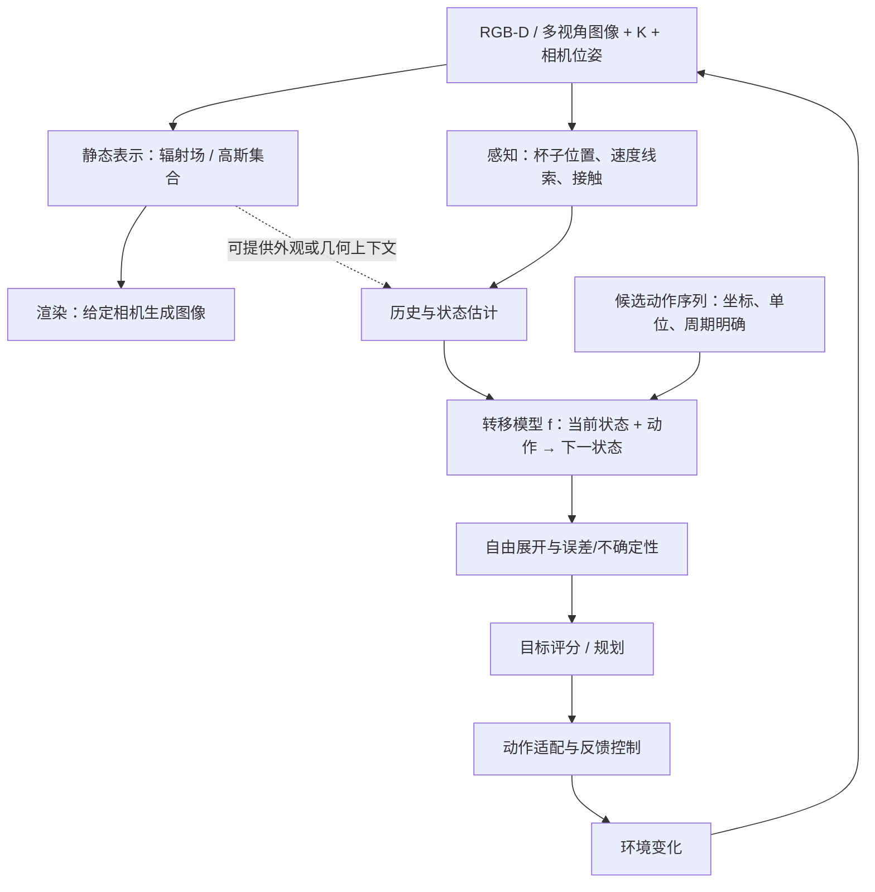
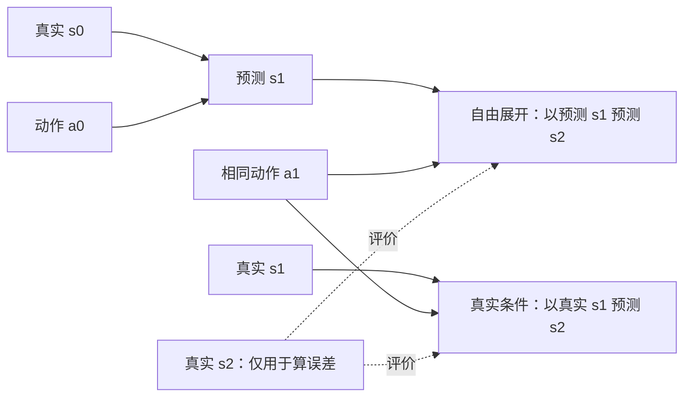
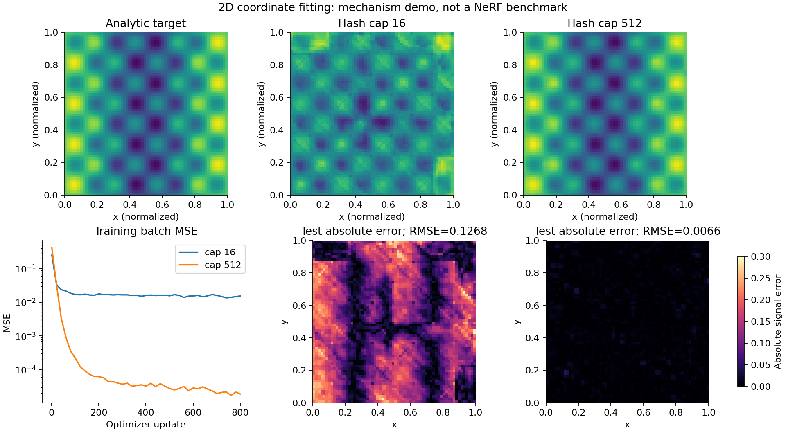
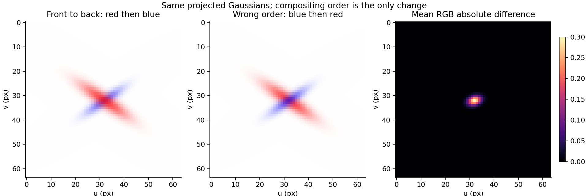
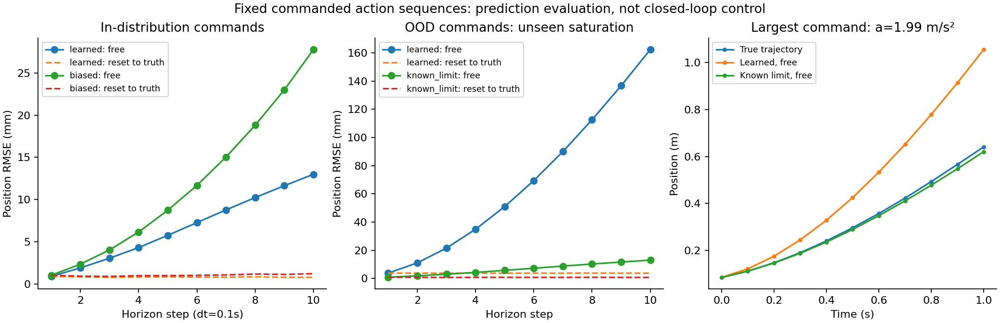

# D25 · 从快速重建到可信的多步预测

[返回学习入口](../_index.md) ｜ [本周日程](../P2-深度理解-日程.md) ｜ [上一课 D24](../day24/Daily-Learning-Pack.md) ｜ [CPU实验](demo.py) ｜ [绘图脚本](plot_demo.py)

**一个场景可以渲染得很快，却不能预测杯子受推后的运动；一个模型可以把下一步预测得很准，却在十步后偏离目标。今天分别解释“表示怎样加速”和“误差怎样累积”，再把两条线接回机器人。**

D24把NeRF的采样、密度、透射率和像素颜色连接起来，也训练了位置—速度的一步预测器。本课是P2 / W4-D4：原路线继续Instant-NGP、3D Gaussian Splatting（3D高斯泼溅）与NeRF实验；新增内容是teacher forcing（用真实历史作条件）、自由rollout（递归展开）、1/5/10步误差和分布外动作。D26再把预测用于MPC候选评分，区分规划与Dreamer式想象训练。

贯穿案例：机械臂已经得到杯子周围的多视角图像。要快速浏览重建场景，需要合适的表示和渲染器；要判断推杯子的后果，还需要状态、动作、动力学与评价协议。这些模块可以合作，但它们学习的对象并不相同。

<details>
<summary>个人学习记录（后续生成保留）</summary>

<!-- learner-notes:start -->

- 我的表示—渲染—转移模型对照图：
- 先算结果与实验结果的差别：
- 我修改的单个变量、预测与解释：
- 自测作答、分数和未理解问题：

<!-- learner-notes:end -->

</details>

<!-- daily-pack-generated:start -->

## 0. 学习目标与知识路线

学完后应能：

1. 手算一层网格插值，并解释多分辨率哈希特征怎样让小MLP表达局部细节。
2. 从三维高斯的均值、旋转和尺度，写出二维投影协方差与像素合成公式。
3. 区别场景表示、渲染算法、训练目标和硬件实现，解释为什么“用了哈希表”不自动得到论文速度。
4. 用相同初态和动作序列比较真实条件的一步预测与自由展开，分别报告位置、速度在1/5/10步的误差。
5. 识别未见过的动作饱和、采样周期错误和随机扰动，避免把全部误差归因于网络容量。
6. 跑通三组CPU实验，明确本课证据能支持什么、还未复现什么。

| 顺序 | 知识主线 | 要回答的问题 |
| --- | --- | --- |
| 宏观 | 表示、渲染与状态转移 | 快速看见一个场景，与预测一个场景有什么联系？ |
| 空间表示 | 哈希编码和高斯参数 | 信息存在网络里、表里，还是显式基元里？ |
| 渲染机制 | 投影、覆盖、排序、合成 | 为什么颜色相同，前后顺序不同仍会改变图像？ |
| 时间展开 | 真实条件、预测条件、递归误差 | 为什么一步准不能推出十步准？ |
| 工程与实操 | 对照、指标、失效定位 | 哪个实验能排除哪个解释？ |
| 总结 | 能力边界与下一课 | 什么预测结果才值得交给规划器？ |

## 1. 宏观：空间查询与时间推进是两种计算

### 1.1 先把“快”拆成四个问题

对于一张由R条射线构成的图像，每条射线采S个点，朴素NeRF大致执行R×S次空间场查询。即使每次MLP不大，乘上像素数和采样数后仍会形成大量计算。加速可以发生在不同位置：

- **表示端**：把部分场景细节放入可训练的局部特征，让每次查询所需MLP更小。
- **采样端**：少查空区域，把预算集中在有贡献的地方。
- **渲染端**：改变组织方式，把空间基元直接投到像素并合成。
- **实现端**：减少显存往返、中间张量和启动开销，让算法匹配硬件。

这四项互相配合。只拿Python重写一个哈希公式，不能推导出完整GPU系统的训练或渲染速度。本课的运行时间只说明教学脚本在本机跑通。

### 1.2 把重建分支与动态分支画在同一张图上



静态场输入的是空间坐标与观察方向；动作条件转移输入的是当前状态与动作。相机绕杯子移动，可能只改变观察；夹爪推杯子，则改变物理状态。如果相机装在手腕上，一个动作可以同时改变视角与物体状态，建模时更要把两种变化分开。

> [!question] 先判断
> 已知杯子的静态NeRF，能否渲染另一台相机看到的杯子？能否仅凭同一个函数预测“向右推2cm以后杯子会不会翻倒”？

前者仍需有效相机参数和足够视角覆盖；后者还缺动作作用、接触、动力学与状态信息。加入时间索引的场可以拟合一段录像，也未必支持未见过动作的反事实预测。

## 2. 微观：多分辨率哈希编码把局部细节放在哪里

### 2.1 固定位置编码与可训练特征的差别

D24的正弦位置编码先把坐标映射成固定频率，再由MLP学习哪些频率怎样组合。哈希编码则为不同空间位置存储**可训练特征向量**。坐标负责寻址和插值，特征与MLP一起通过图像损失更新。

把场写成：

$$
(\sigma,\mathbf c)=F_\theta(\gamma_\phi(\mathbf x),\mathbf d)
$$

这里$\theta$是网络参数，$\phi$是网格表参数；$\mathbf x$为空间位置，$\mathbf d$为方向。密度通常仍只由位置分支决定，颜色再结合方向。编码后的数不是RGB，也没有必然的“第1维代表边缘”解释。

Instant-NGP的核心组合是多尺度可训练哈希特征、小网络及高效实现；本课使用的是这类编码的教学化形式。原计划中的2201.05989应以正式题名 *Instant Neural Graphics Primitives with a Multiresolution Hash Encoding* 阅读。[原论文](https://arxiv.org/abs/2201.05989)、[作者项目](https://nvlabs.github.io/instant-ngp/)

### 2.2 从一个二维方格推到三维体素

先把工作区域归一化到$[0,1]^d$。第$l$层分辨率为$N_l$，定义：

$$
\mathbf q_l=N_l\mathbf x,\qquad
\mathbf i_l=\lfloor\mathbf q_l\rfloor,\qquad
\mathbf u_l=\mathbf q_l-\mathbf i_l.
$$

$\mathbf i_l$是格子左下/低坐标角；$\mathbf u_l$是格内相对位置。三维格子有8个角，逐角取特征并三线性插值：

$$
\mathbf e_l(\mathbf x)=\sum_{\mathbf b\in\{0,1\}^3}
\left[\prod_{j=1}^{3}u_{lj}^{b_j}(1-u_{lj})^{1-b_j}\right]
\phi_l[h_l(\mathbf i_l+\mathbf b)].
$$

权重非负且和为1。用最近顶点替代插值，会让输出在格子边界出现跳跃；线性插值使特征连续，但一般不保证跨边界的空间导数连续。若要从场梯度取法向，不能把“颜色连续”当作“法向平滑”。

**手算二维例。** 四个角的单通道特征按$(00,10,01,11)$为$(0,1,2,3)$，局部位置为$(0.25,0.6)$。四个权重是$(0.30,0.10,0.45,0.15)$，插值得：

$$0\times0.30+1\times0.10+2\times0.45+3\times0.15=1.45.$$

训练时若这个值需要增加，梯度按上述权重流向四个角。三维完全同理，只把4角变成8角。实现中同一个表项被多个角或样本引用时，梯度要累加，不能最后一次写入覆盖前面的贡献。

### 2.3 为什么需要哈希，又为什么需要多层

高分辨率三维密集网格的参数量随$N^3$增长。用容量为T的表存储特征，可以把每层上界压到$T\times F$个标量。整数角坐标通过散列函数映射到槽位，不同角可能共享一个槽位，这叫**哈希冲突**。

本课二维教学实现：

```python
index = (ix ^ (iy * 2654435761)) % table_size
```

`^`是整数逐位异或。哈希寻址过程不需要对离散索引求导；可训练的是被取出的特征，以及格内连续插值权重关联的后续计算。用于训练网络参数时，这已经足够；涉及相机或坐标优化时，还需理解格边界的分段可导性质。

对于粗层，若全部顶点数不超过T，可直接用唯一索引；对于细层再使用哈希。把多层特征拼接：

$$\gamma_\phi(\mathbf x)=[\mathbf e_0;\mathbf e_1;\dots;\mathbf e_{L-1}]\in\mathbb R^{LF}.$$

粗层提供稳定背景，细层补局部变化。两个位置即使在一个细层冲突，也可能在其他层得到不同表示。但**多层不是消除冲突的数学保证**：表太小、多个位置的编码难以区分，或数据约束不足时，细节仍会受损。

本课故意把T降到16，此时连最粗的二维9×9顶点网格也放不下，是用来观察极端容量约束的反例；不是论文推荐配置。改变T同时改变冲突结构与可训练参数量，所以实验不能把改善全部归为单一“冲突率”因素。

### 2.4 张量形状、内存和单位

| 量 | 三维查询的形状例 | 含义 |
| --- | --- | --- |
| 坐标 | `[B,3]` | AABB内归一化位置 |
| 角索引 | `[B,L,8]` | 每层8个角对应的表项 |
| 表特征 | 每层`[T_l,F]` | 参数；$T_l=\min(T,(N_l+1)^3)$ |
| 角特征 | `[B,L,8,F]` | 可按层计算，避免全部同时驻留 |
| 插值后 | `[B,L,F]` | 每层局部特征 |
| 拼接 | `[B,L*F]` | 小MLP输入 |
| 密度、颜色 | `[B,1]`、`[B,3]` | 后续沿射线积分 |

单纯计算特征表参数，上界为LTF。例如L=16、T=$2^{19}$、F=2，FP16参数上界约32MiB；这**不包括**优化器状态、主参数副本、MLP、梯度和渲染缓存。训练显存不能按这个数直接承诺。

场景归一化也有物理后果。若坐标变成$\mathbf x'=k\mathbf x$，射线段长变成$\delta'=k\delta$，则同样的光学厚度要求$\sigma'=\sigma/k$，使$\sigma'\delta'=\sigma\delta$。这里$k>0$，密度的数值取决于所用长度单位。机器人使用米制地图时必须保存归一化到世界坐标的逆变换，不能把归一化网格坐标直接发给控制器。

## 3. 微观：3D高斯是带方向和尺寸的基元

### 3.1 一个点与一个高斯差在哪里

普通点云只给一个采样位置，可能再附颜色和法向。3D高斯还描述围绕中心的空间影响范围：

$$
G(\mathbf x)=\exp\left[-\tfrac12(\mathbf x-\boldsymbol\mu)^\top\Sigma^{-1}(\mathbf x-\boldsymbol\mu)\right].
$$

$\boldsymbol\mu\in\mathbb R^3$是中心，$\Sigma$是三维协方差；若坐标为米，协方差单位为平方米。用于泼溅的这个核不要求按概率密度归一化，不能随手添加$1/\sqrt{(2\pi)^3\det\Sigma}$后还期待相同的透明度意义。

用正尺度和旋转构造协方差：

$$
\Sigma=R\operatorname{diag}(s_x^2,s_y^2,s_z^2)R^\top.
$$

$s_j>0$可以由指数变换实现，旋转可由单位四元数构成。优化任意9个矩阵元素则可能失去对称正定性，导致“椭球”没有合法几何意义。优化器参数与物理量也不一定相同：存的是log-scale或opacity logit，使用前要经过对应变换。

当某个尺度很小，高斯可以贴近一个薄表面；各向异性使它不用堆大量同半径小球就表达细长结构。但高斯椭球不是经过认证的实体碰撞包络，颜色优化可能留下漂浮基元或拉长的伪影。

### 3.2 从三维椭球投影到二维椭圆

约定$T_{cw}$把世界坐标转到相机坐标：

$$
\boldsymbol\mu_c=R_{cw}\boldsymbol\mu_w+\mathbf t_{cw},\qquad
\Sigma_c=R_{cw}\Sigma_wR_{cw}^\top.
$$

透视投影不是全局线性的。对中心$(x,y,z)$处做一阶近似，针孔相机的像素雅可比为：

$$
J=\begin{bmatrix}
f_x/z&0&-f_xx/z^2\\
0&f_y/z&-f_yy/z^2
\end{bmatrix},\quad
\Sigma_{uv}\approx J\Sigma_cJ^\top.
$$

J单位是像素/米，故$\Sigma_{uv}$单位是像素平方。它描述屏幕上朝哪个方向铺开，以及铺开多少。这个公式是小范围线性化；巨大的高斯、靠近相机或穿过近裁剪面时，近似会变差，实际渲染器需要裁剪和稳定化。

**手算。** 高斯中心在光轴上z=2m，焦距f=400px，横向标准差0.01m。投影标准差约$400/2\times0.01=2$px，方差4px²。移动到4m且保持物理尺寸不变，标准差变成1px，方差1px²。注意“距离翻倍”对应标准差减半、协方差缩为四分之一。

3DGS从三维协方差到屏幕椭圆、再按可见性合成；其原方法还联合优化位置、透明度、球谐外观，并交替调整基元密度。[原论文§4–6](https://arxiv.org/html/2308.04079v1)、[作者项目](https://repo-sam.inria.fr/fungraph/3d-gaussian-splatting/)

### 3.3 方向相关颜色并不意味着动态物理

球谐函数可以把观察方向映射到颜色变化：

$$\mathbf c_i(\mathbf d)=\sum_{l=0}^{L}\sum_{m=-l}^{l}\mathbf k_{ilm}Y_{lm}(\mathbf d).$$

每个高斯有一组RGB系数。这里方向$\mathbf d$改变，是观察者换了位置；不是杯子受了什么力。本课固定红、蓝颜色，只展示投影与合成，不训练球谐外观，也不复现原方法完整优化器。

| 参数 | N个高斯的典型存储 | 约束 |
| --- | --- | --- |
| 均值 | `[N,3]` | 世界坐标 |
| log-scale | `[N,3]` | 指数后得到正尺度 |
| 四元数 | `[N,4]` | 使用前归一化，明确分量顺序 |
| opacity logit | `[N,1]` | sigmoid后在0与1之间 |
| 球谐系数 | `[N,(L+1)^2,3]` | 与方向基函数及颜色实现约定一致 |
| 屏幕协方差 | `[N,2,2]` | 投影计算得到，不独立代表真实深度 |

## 4. 微观：像素颜色为什么取决于前后顺序

### 4.1 从射线积分回到透明度合成

D24中一个体采样的透明度为$\alpha_i=1-e^{-\sigma_i\delta_i}$。高斯泼溅则先在像素$\mathbf u$处计算核影响：

$$
\alpha_i(\mathbf u)=o_i\exp[-\tfrac12(\mathbf u-\bar{\mathbf u}_i)^\top
\Sigma_{uv,i}^{-1}(\mathbf u-\bar{\mathbf u}_i)],
$$

$o_i$是基元的透明度参数。两种路径都可以按从前到后的顺序合成：

$$
\mathbf C(\mathbf u)=\sum_i\left[\alpha_i(\mathbf u)\prod_{j<i}(1-\alpha_j(\mathbf u))\right]\mathbf c_i
+\left[\prod_i(1-\alpha_i(\mathbf u))\right]\mathbf c_{bg}.
$$

第二项不能随意丢掉，它是剩余透射率乘背景颜色。3DGS使用投影与排序近似组织可见性；这不是对任意三维高斯交叠进行完全精确的体积分。排序稳定性与近似误差也是工程边界。

### 4.2 两个像素核的手算反例

同一像素上红色$(1,0,0)$、蓝色$(0,0,1)$透明度分别0.75和0.60，白背景：

- 红在前：红权重0.75，蓝权重$0.25\times0.60=0.15$，背景0.10，颜色为$(0.85,0.10,0.25)$。
- 蓝在前：蓝权重0.60，红权重$0.40\times0.75=0.30$，背景0.10，颜色为$(0.40,0.10,0.70)$。

透明度总量相同，颜色却不同。交换顺序不是一个可忽略的小实现细节。

```python
rgb = 0
transmittance = 1
for alpha, color in front_to_back:
    rgb += transmittance * alpha * color
    transmittance *= 1 - alpha
rgb += transmittance * background
```

### 4.3 训练、增密和光栅化分别负责什么

**训练**让渲染图像接近输入图像。原3DGS用像素L1与结构相似项组合，更新连续参数。**增密/删除**改变表示容量和分布；误差大并不自动意味着所有点都要复制，基元尺寸及梯度等信息参与选择。**光栅化**则把投影影响组织到像素区域，借助分块、排序和提前终止减少工作量。

看源码时应画出“哪些张量可求导、哪些离散操作改变了集合、何时重建索引”的三条线。把增密写成一次普通梯度更新，或把可微渲染理解为每个排序操作都处处连续，都会产生误解。

## 5. 回到宏观：三种表示的选择不是排名题

| 维度 | 原始NeRF式MLP | Instant-NGP式编码场 | 原始3DGS |
| --- | --- | --- | --- |
| 主要可训练信息 | 网络参数 | 多层特征表与较小网络 | 显式高斯参数与方向外观 |
| 查询/渲染 | 沿射线采样，评估场 | 沿射线查询编码与场，配合空区跳过 | 投影基元，组织覆盖与顺序并合成 |
| 提高局部容量 | 改网络或编码 | 提高分辨率/表容量等 | 调整高斯数量、尺寸与分布 |
| 共同输入条件 | 图像与相机几何 | 图像与相机几何 | 图像、相机几何，常以SfM点初始化 |
| 共同失效来源 | 未观测区域、位姿错误、动态物体和外观歧义 | 同左，还需看网格与哈希容量 | 同左，还需看基元形状与排序近似 |
| 能否直接给动力学 | 不能仅凭静态场获得 | 不能仅凭编码加速获得 | 不能仅凭有三维基元获得 |

帧率比较至少固定分辨率、场景覆盖、硬件、训练预算和质量目标。高PSNR是像素误差证据，不是米制表面误差、碰撞精度或控制成功率。背景占比大时，整图PSNR还可能掩盖杯把处的重要错误。

官方Instant-NGP路径依赖NVIDIA/CUDA；官方3DGS优化器也使用CUDA扩展。本次没有安装或运行这些官方完整实现。D24已有CPU最小NeRF训练，本课继续验证编码与渲染机制；原计划的官方实现复现仍作为后续重建实验的待完成项，在具备对应环境时单独记录版本、数据与结果。[Instant-NGP官方要求](https://github.com/NVlabs/instant-ngp)、[3DGS官方实现](https://github.com/graphdeco-inria/gaussian-splatting)

## 6. 原NeRF实验继续：如何读上一课的结果而不越界

打开[D24讲义与实验](../day24/Daily-Learning-Pack.md)，重新定位五项量：训练视角、验证视角、独立测试视角、每条射线采样数、前景与全图误差。保持已训练场固定，只改变采样数，这样改变的是积分近似，而不是同时换了模型与训练数据。

检查顺序：

1. 先确认相机外参的方向与射线方向定义；坐标翻转不能靠增加采样解决。
2. 固定网络参数和射线，比较较少与较多样本。若变化显著，可能是积分还不充分。
3. 如果增加样本已趋于饱和，但测试视角仍错，检查训练视角覆盖、模型容量、位姿和外观假设。
4. 分别看杯子前景与背景。不能用大量容易拟合的背景像素稀释关键区域误差。
5. 即使图像误差下降，也要另测几何或接触问题，不能直接宣布抓取更稳。

本课二维哈希拟合只隔离“坐标→可训练特征→标量”的表示机制；高斯示例只隔离“协方差→投影→合成”。它们不是新的完整NeRF或3DGS排行榜结果。**机制实验、端到端重建复现、真实操作评价应留下三份不同证据。**

## 7. 时间轴：一步模型到底看到了什么

### 7.1 先定义动作，而不是先定义网络

沿用D24的合成系统，状态为$\mathbf s_t=[p_t,v_t]^\top$，位置单位m，速度m/s；命令动作$a_t$是加速度，单位m/s²，采样周期$\Delta t=0.1$s。真实执行器限幅为$[-1,1]$m/s²：

$$
u_t=\operatorname{clip}(a_t,-1,1),
$$

$$
v_{t+1}=0.94v_t+0.1(u_t-0.6p_t)+\epsilon_t,
\qquad p_{t+1}=p_t+0.1v_{t+1}.
$$

这里$\epsilon_t\sim\mathcal N(0,0.008^2)$，单位m/s。0.94是当前离散周期的速度衰减系数；0.6对应回复项系数，量纲应使$0.6p$成为加速度。动作换成位置增量或周期换成0.02s时，这个模型不能原样使用。

若训练动作始终在$[-0.6,0.6]$内，限幅从未激活，训练数据无法告诉学习器在$a=2$时会怎样。它观察到的是线性区段，不是完整执行器特性。

### 7.2 拟合接口与状态shape

用最小线性模型隔离评价机制：

$$\hat{\mathbf s}_{t+1}=[p_t,v_t,a_t,1]W,\qquad W\in\mathbb R^{4\times2}.$$

理想无噪声、未饱和情况下，行向量实现的系数矩阵是：

$$
W_*=\begin{bmatrix}
0.994&-0.06\\
0.094&0.94\\
0.01&0.1\\
0&0
\end{bmatrix}.
$$

第一列输出位置，第二列输出速度。可以由先算$v'$再代入$p'$逐项得到，不能只盯着形状“4×2”不检查物理量。

训练张量为`state [B,2]`、`action [B,1]`、`next_state [B,2]`。自由展开时，初态是`[B,2]`，命令序列`[B,H,1]`，输出`[B,H+1,2]`。零时刻的状态被包括在输出里，指标却只评价1至H步，避免把初始零误差算进平均数。

本课用每个输出独立的最小二乘求解，不需要把米和米/秒相加得到一个有物理含义的“总体RMSE”。换成共享神经网络的联合损失时，应明确归一化尺度或各项权重，并在原单位上报告指标。

## 8. 真实条件与自由展开：画线时不能偷喂答案

### 8.1 真实条件的一步评价

给模型每个时刻的真实状态：

$$\hat{\mathbf s}_{t+1}^{TF}=f_\theta(\mathbf s_t^{true},a_t).$$

在自回归学习中，这类训练条件常称teacher forcing。本课把同样的真实历史输入方式用于**诊断性评价**：即使上一时刻预测错了，下一次也从真实状态重新开始。它隔离局部转移误差，却没有测量连续使用自己输出的后果。

### 8.2 自由展开

只在起点给真值，之后递归使用自己的预测：

$$
\hat{\mathbf s}_{t}=\mathbf s_t^{true},\qquad
\hat{\mathbf s}_{t+k+1}=f_\theta(\hat{\mathbf s}_{t+k},a_{t+k}).
$$

未来动作序列对两种评价都已知且相同；“自由”指状态不被真值重置，不是动作也随机自由变化。第1步的两种预测应一致，若不一致，先查起点、动作索引、归一化和模型模式。



把未来真实状态悄悄传进rollout循环，画出来的预测线通常很好看，但已改变所测问题。相反，部署时确实周期性收到新观测并纠偏，也应另称闭环状态更新，注明观测频率、延迟与噪声。

### 8.3 小算例：0.1步误差如何变成更大偏差

取一个无量纲例：真实系统$s_{k+1}=s_k+1$，模型$\hat s_{k+1}=\hat s_k+1.1$，初态相同。真实条件每次误差0.1；自由展开到第k步误差$0.1k$，第10步为1.0。不是模型在第10次调用时“突然坏了”，而是小偏差被反复继承。

若模型还有状态依赖，如$\hat s_{k+1}=1.05\hat s_k+1$，偏差也可能被放大。不能把所有多步误差都想成固定线性累加。另一方面，稳定系统、误差抵消、状态重估可能使某些误差下降，所以“每步必然单调变差”也不是定理。

## 9. 为什么误差增长：偏差、噪声与不熟悉的状态

### 9.1 局部误差递推

令$\mathbf e_k=\hat{\mathbf s}_k-\mathbf s_k$，在真实轨迹附近做一阶展开：

$$
\mathbf e_{k+1}\approx J_f(\mathbf s_k,a_k)\mathbf e_k+\mathbf b_k-\boldsymbol\eta_k.
$$

$J_f$是模型对状态的雅可比，$\mathbf b_k$是局部模型偏差，$\boldsymbol\eta_k$是实际过程噪声。三者分别回答：之前的误差怎样传播、本次模型引入什么偏差、现实发生了什么不可预测扰动。

若在明确归一化后的状态范数内有$\|J_f\|\le L$，且每步新增误差上界为b，可以得到：

$$
\|\mathbf e_H\|\le L^H\|\mathbf e_0\|+b\sum_{j=0}^{H-1}L^j.
$$

这是一种条件上界，不是实测曲线，也不能从单个验证样本估出全局L后宣称安全。原始位置与速度有不同单位，直接混合做范数会让界依赖任意单位选择，必须先说明尺度。

### 9.2 三类原因怎样分开

| 现象 | 可能原因 | 有区分力的对照 |
| --- | --- | --- |
| 分布内一步误差已大 | 模型不足、监督噪声、缺状态或动作 | 去/加速度输入；核对标签时间；原单位残差 |
| 一步小、自由展开逐渐偏 | 偏差积累、过程噪声传播、模型状态偏离训练区 | 同一轨迹真实条件与自由展开；已知参数扰动 |
| 大动作突然失败 | 训练未覆盖饱和/接触/限速，动作语义不匹配 | 固定系统，只改变动作支持范围 |
| 改采样频率后失败 | 模型把特定dt的转移当成通用规律 | 同一连续系统按不同dt采样，显式输入或重新离散化 |

本课还加入“已知限幅”适配：先把命令clip到物理执行范围，再送入已学到的线性区模型。改善说明这个**已知先验**在当前合成系统有效，不表示模型从未见过饱和的数据中学会了饱和。

Scheduled Sampling论文讨论了训练时真实历史与生成历史之间的条件差异。它是一种相关训练思路，不保证解决机器人动力学中的动作分布外、接触突变或不可观测问题；本课没有训练该方法。[Bengio等，2015](https://arxiv.org/abs/1506.03099)

## 10. 评价协议：1、5、10步必须可比较

### 10.1 指标定义

对N条独立测试轨迹，在相同预测距离h计算位置RMSE：

$$
E_p(h)=\sqrt{\frac1N\sum_{n=1}^{N}(\hat p_{n,h}-p_{n,h})^2},\qquad h\in\{1,5,10\}.
$$

速度同理，单位m/s。这里是“第h步端点误差”，不是“前h步平均误差”。两种都可以报告，但不能混着比较。dt=0.1s时三列对应0.1、0.5、1秒；更改dt后相同h不再代表相同物理时间。

### 10.2 划分单位应当是轨迹

同一条轨迹的邻近窗口高度相关。把滑动窗口随机分到训练与测试，会让模型见到几乎相同状态历史。先按轨迹或场景划分，再生成窗口；归一化参数只从训练数据估计。

本课使用独立随机生成的训练轨迹与评价轨迹。固定种子方便重现，不代表统计置信度；正式结论仍应报告多种种子/环境/物体，必要时按轨迹重采样估计区间。

### 10.3 必须冻结的比较条件

比较模型时固定初态、动作序列、时间步、观测来源和评价真值。若模型A使用真值状态，模型B使用相机估计状态，差异包含感知误差，不能只归因模型结构。比较规划策略时还需固定任务成功标准、交互预算和控制约束；本课固定动作预测没有执行规划，因此不产生抓取成功率。

## 11. 动手：把三种“看起来不错”拆开验证

### 11.1 运行入口与范围

依赖Python、NumPy、PyTorch、Matplotlib；已有CPU环境即可，不下载数据或权重。在笔记库根目录运行：

```bash
python -B 3d_learning/day25/demo.py
python -B 3d_learning/day25/plot_demo.py
```

默认生成[结果JSON](../../_assets/3d_learning/day25/results.json)、数组和下方三张图。再次运行会更新该实验的结果附件；个人学习记录不受影响。若要保留一次改变量结果，用`--output`指定另一个实验目录，绘图脚本用`--input`指向它。

**已确认：2026-09-29实际执行。** Python3.11.15、NumPy1.26.4、PyTorch2.13.0.dev20260423、Matplotlib3.10.9，CPU单线程，种子25。默认三组计算约1.81秒，不含Python启动和绘图；这个小规模耗时不用于评价论文加速。没有连接真实机器人，没有运行官方NGP/3DGS完整系统。

### 11.2 实验A：容量不足时，局部编码会丢掉哪些信息

目标是二维解析信号：

$$y(x,y)=0.5+0.2\sin(8\pi x)\sin(8\pi y)+0.2\cos(2\pi x).$$

4096个随机坐标用于训练；64×64像素中心构成独立坐标评价网格。四层分辨率8/16/32/64，每表项2个特征，头部`8→32→32→1`。两种表容量各训练800次Adam更新，每次512个坐标；数据与批次序列相同。初始化使用相同种子，但因参数表尺寸不同，不保证各层初始权重逐项一致。

| 每层容量上限T | 编码参数 | 总参数 | 独立坐标RMSE |
| --- | --- | --- | --- |
| 16 | 128 | 1505 | 0.12678 |
| 512 | 2788 | 4165 | 0.00656 |



上排比较目标和两个预测，下排显示训练批次MSE与独立坐标绝对误差。较小表仍可拟合部分低频变化，却无法稳定保留全部局部结构。结论限定于这个信号、模型与预算；较大表不在任何数据规模和噪声条件下都更好。

**先预测再改变量：** 把脚本中的容量列表增加128，其他参数不动，单独输出结果。先写下你预计的误差位置，再核对图；不要只记录最终标量。若要研究过拟合，应改变训练点数量并保留原评价坐标，而不是拿训练坐标自己评分。

### 11.3 实验B：只交换合成顺序

两个三维高斯中心在相机光轴上1.5m和2m；焦距80px，主点(32,32)，尺度(0.15,0.035,0.04)m，绕z轴分别35°、−35°，红蓝透明度0.75、0.60。保持所有几何和颜色不变，只反转合成顺序。



中心像素实测正确顺序RGB为(0.85,0.10,0.25)，反序为(0.40,0.10,0.70)，与手算一致。屏幕协方差特征值分别约(3.4844,64.0)、(1.9600,36.0)px²；开平方才是两条主轴的标准差。

整图平均RGB绝对差仅0.001187，因为大部分像素是相同背景。这个数字很小，却不代表重叠区域的遮挡错误很小。**关注局部任务区域**是图像重建与机器人感知都需要的习惯。

改变量任务：把蓝色透明度改成0.2，先手算中心两种顺序差别，再修改对应断言运行。几何、相机、颜色和红色透明度都保持不变。不要把本例中心深度排序推广为任意大高斯交叠的精确可见性。

### 11.4 实验C：同一模型的1/5/10步评价

本课为保证单独可运行，使用与D24相同的物理方程和噪声，**重新采样并拟合**，不复用D24权重。训练300条、每条30次转移，初态位置在±0.4m、速度在±0.2m/s，命令在±0.6m/s²。每条轨迹保持命令恒定，方便隔离持续偏差。评价200条独立轨迹，各10步。

三个模型条件：

- `learned`：用训练转移拟合的线性模型。
- `biased`：在同一已拟合模型中把速度保留系数增加0.04，并把位置列对应增加0.004；这是人为参数误差，不是另一次训练结果。
- `known_limit`：同一模型的输入先按已知执行器范围限幅；只改变接口先验。

下表只列自由展开的**位置端点RMSE，单位mm**：

| 条件 | 1步 | 5步 | 10步 |
| --- | --- | --- | --- |
| 分布内命令，learned | 0.895 | 5.759 | 13.000 |
| 分布内命令，biased | 1.025 | 8.739 | 27.793 |
| 分布外命令±2，learned | 3.821 | 51.021 | 162.413 |
| 分布外命令±2，known_limit | 0.897 | 5.784 | 13.042 |

分布内learned真实条件的第10次一步误差约0.779mm，而自由展开到第10步约13mm。即使模型近似正确，也不知道未来独立过程噪声，误差会通过速度和位置积分传播。人为系数偏差进一步增大长期误差。

分布外测试中48.5%的命令超过执行器范围。未加限幅模型认为大命令继续线性起效，实际上动作已饱和；其第10步速度RMSE约0.25646m/s，不能把这个数与162.413mm相加。带已知限幅条件的速度RMSE约0.01788m/s，仍有过程噪声与拟合误差。



左图固定分布内动作，隔离参数偏差；中图固定分布外动作，比较已知限幅；右图选择测试集中绝对命令最大的那条轨迹，展示具体偏离。右图是用于解释的样例，不是总体均值，评价结论应看200条轨迹汇总。

**改一个变量：** 将真实执行器上限从1改为0.8，先只改真实系统、不改输入适配。预计`known_limit`会出现什么新偏差？再把适配范围也改成0.8。两次结果分别保存，解释“先验准确”和“先验过期”为什么不同。正式机器人接口还要区分发送命令与实际执行日志。

### 11.5 完整最小脚本

以下与[demo.py](demo.py)一致；绘图由独立[plot_demo.py](plot_demo.py)完成。长代码折叠，正文上方已解释关键计算。

> [!note]- 完整CPU实验代码
>
> ```python
> """Day25: hash features, projected Gaussian splats, and rollout evaluation.
> 
> CPU teaching experiments, not the official Instant-NGP or 3DGS implementation.
> The dynamics have state [position(m), velocity(m/s)], command acceleration(m/s^2),
> dt=0.1s and actuator clipping at +/-1m/s^2. No robot or network access.
> """
> from pathlib import Path
> import argparse
> import json
> import platform
> import time
> import numpy as np
> import torch
> from torch import nn
> 
> 
> class Hash2D(nn.Module):
>     """Four bilinearly interpolated feature grids, capped by a hash table."""
>     def __init__(self, capacity, features=2):
>         super().__init__()
>         self.resolutions = [8, 16, 32, 64]
>         self.capacity = capacity
>         self.tables = nn.ParameterList([
>             nn.Parameter(torch.empty(min((n + 1)**2, capacity), features))
>             for n in self.resolutions])
>         for table in self.tables:
>             nn.init.uniform_(table, -1e-3, 1e-3)
>         self.head = nn.Sequential(nn.Linear(4 * features, 32), nn.ReLU(),
>                                   nn.Linear(32, 32), nn.ReLU(), nn.Linear(32, 1))
> 
>     def forward(self, xy):
>         encoded = []
>         for n, table in zip(self.resolutions, self.tables):
>             scaled = xy.clamp(0., 1. - 1e-7) * n
>             lower = scaled.floor().long()
>             fraction = scaled - lower
>             value = torch.zeros((len(xy), table.shape[1]), dtype=xy.dtype)
>             for dx, dy in [(0, 0), (0, 1), (1, 0), (1, 1)]:
>                 corner = lower + lower.new_tensor([dx, dy])
>                 if (n + 1)**2 <= self.capacity:
>                     index = corner[:, 0] + (n + 1) * corner[:, 1]
>                 else:
>                     index = (corner[:, 0] ^ (corner[:, 1] * 2654435761)) % len(table)
>                 wx = fraction[:, 0] if dx else 1. - fraction[:, 0]
>                 wy = fraction[:, 1] if dy else 1. - fraction[:, 1]
>                 value = value + (wx * wy)[:, None] * table[index]
>             encoded.append(value)
>         return self.head(torch.cat(encoded, dim=-1))[:, 0]
> 
> 
> def signal(xy):
>     x, y = xy[:, 0], xy[:, 1]
>     return .5 + .2 * torch.sin(8 * torch.pi * x) * torch.sin(8 * torch.pi * y) + .2 * torch.cos(2 * torch.pi * x)
> 
> 
> def fit_hash(steps, seed):
>     torch.manual_seed(seed)
>     train = torch.rand(4096, 2)
>     target = signal(train)
>     axis = (torch.arange(64, dtype=torch.float32) + .5) / 64
>     yy, xx = torch.meshgrid(axis, axis, indexing='ij')
>     test = torch.stack([xx.flatten(), yy.flatten()], dim=1)
>     truth = signal(test)
>     arrays = {'hash_truth': truth.numpy().reshape(64, 64)}
>     records = {}
>     for capacity in [16, 512]:
>         torch.manual_seed(seed + 1)
>         model = Hash2D(capacity)
>         optimizer = torch.optim.Adam(model.parameters(), lr=.01)
>         batch_generator = torch.Generator().manual_seed(seed + 2)
>         losses = []
>         start = time.perf_counter()
>         for i in range(steps):
>             ids = torch.randint(len(train), (512,), generator=batch_generator)
>             loss = (model(train[ids]) - target[ids]).square().mean()
>             optimizer.zero_grad()
>             loss.backward()
>             optimizer.step()
>             if i % 20 == 0 or i == steps - 1:
>                 losses.append([i + 1, loss.item()])
>         with torch.no_grad():
>             prediction = model(test)
>             rmse = torch.sqrt((prediction - truth).square().mean()).item()
>         arrays[f'hash_{capacity}'] = prediction.numpy().reshape(64, 64)
>         arrays[f'loss_{capacity}'] = np.array(losses)
>         records[str(capacity)] = {
>             'test_rmse': rmse, 'encoding_parameters': sum(t.numel() for t in model.tables),
>             'all_parameters': sum(p.numel() for p in model.parameters()),
>             'training_seconds': time.perf_counter() - start}
>     return records, arrays
> 
> 
> def rotation_z(degrees):
>     angle = np.deg2rad(degrees)
>     c, s = np.cos(angle), np.sin(angle)
>     return np.array([[c, -s, 0.], [s, c, 0.], [0., 0., 1.]])
> 
> 
> def project_gaussian(mean, covariance, focal=80., center=32.):
>     x, y, z = mean
>     if z <= 0:
>         raise ValueError('Gaussian center must be in front of the camera')
>     uv = np.array([focal * x / z + center, focal * y / z + center])
>     jacobian = np.array([[focal/z, 0., -focal*x/z**2],
>                          [0., focal/z, -focal*y/z**2]])
>     return uv, jacobian @ covariance @ jacobian.T
> 
> 
> def splat_demo():
>     yy, xx = np.mgrid[:64, :64]
>     pixels = np.stack([xx, yy], axis=-1)
>     means = [np.array([0., 0., 1.5]), np.array([0., 0., 2.])]
>     colors = [np.array([1., 0., 0.]), np.array([0., 0., 1.])]
>     opacities = [.75, .6]
>     alphas, covariances = [], []
>     for mean, angle, opacity in zip(means, [35., -35.], opacities):
>         rotation = rotation_z(angle)
>         covariance = rotation @ np.diag(np.array([.15, .035, .04])**2) @ rotation.T
>         uv, cov2 = project_gaussian(mean, covariance)
>         covariances.append(cov2)
>         offset = pixels - uv
>         squared = np.einsum('...i,ij,...j->...', offset, np.linalg.inv(cov2), offset)
>         alphas.append(opacity * np.exp(-.5 * squared))
>     def composite(order):
>         rgb = np.zeros((64, 64, 3))
>         transmittance = np.ones((64, 64))
>         for i in order:
>             rgb += (transmittance * alphas[i])[..., None] * colors[i]
>             transmittance *= 1 - alphas[i]
>         return rgb + transmittance[..., None]  # White background.
>     correct, reversed_order = composite([0, 1]), composite([1, 0])
>     assert np.allclose(correct[32, 32], [.85, .1, .25])
>     assert np.allclose(reversed_order[32, 32], [.4, .1, .7])
>     return {'front_to_back_center_rgb': correct[32, 32].tolist(),
>             'reversed_center_rgb': reversed_order[32, 32].tolist(),
>             'image_mean_absolute_difference': float(abs(correct-reversed_order).mean()),
>             'covariance_eigenvalues_px2': [np.linalg.eigvalsh(c).tolist() for c in covariances]}, {
>             'splat_correct': correct, 'splat_wrong_order': reversed_order,
>             'splat_alpha_red': alphas[0], 'splat_alpha_blue': alphas[1]}
> 
> 
> def true_step(state, command, rng, noise_std=.008):
>     p, v = state[..., 0], state[..., 1]
>     velocity = .94 * v + .1 * (np.clip(command, -1., 1.) - .6 * p)
>     velocity = velocity + rng.normal(0., noise_std, size=velocity.shape)
>     return np.stack([p + .1 * velocity, velocity], axis=-1)
> 
> 
> def trajectories(rng, count, length, amplitude):
>     states = np.empty((count, length + 1, 2))
>     states[:, 0] = rng.uniform([-.4, -.2], [.4, .2], size=(count, 2))
>     # Constant commands per episode expose the unobserved actuator saturation.
>     commands = rng.uniform(-amplitude, amplitude, size=(count, 1))
>     commands = np.broadcast_to(commands, (count, length)).copy()
>     for k in range(length):
>         states[:, k+1] = true_step(states[:, k], commands[:, k], rng)
>     return states, commands
> 
> 
> def features(state, action):
>     return np.concatenate([state, action[..., None], np.ones_like(action[..., None])], axis=-1)
> 
> 
> def dynamics_demo(seed):
>     training, actions = trajectories(np.random.default_rng(seed), 300, 30, .6)
>     x = features(training[:, :-1], actions).reshape(-1, 4)
>     y = training[:, 1:].reshape(-1, 2)
>     coef, *_ = np.linalg.lstsq(x, y, rcond=None)
>     # Controlled parameter perturbation; this is not another fitted model.
>     biased = coef.copy()
>     biased[1, 1] += .04
>     biased[1, 0] += .004
>     summary, arrays = {'coefficient_rows_p_v_a_bias': coef.tolist()}, {}
>     for distribution, amplitude in [('id', .6), ('ood', 2.)]:
>         states, commands = trajectories(np.random.default_rng(seed + 50), 200, 10, amplitude)
>         arrays[f'{distribution}_truth'] = states
>         arrays[f'{distribution}_actions'] = commands
>         summary[distribution] = {}
>         for label, matrix, clip_input in [('learned', coef, False), ('biased', biased, False),
>                                           ('known_limit', coef, True)]:
>             inputs = np.clip(commands, -1., 1.) if clip_input else commands
>             teacher = features(states[:, :-1], inputs) @ matrix
>             rollout = np.empty_like(states)
>             rollout[:, 0] = states[:, 0]
>             for k in range(10):
>                 rollout[:, k+1] = features(rollout[:, k], inputs[:, k]) @ matrix
>             teacher_rmse = np.sqrt(np.mean((teacher-states[:, 1:])**2, axis=0))
>             rollout_rmse = np.sqrt(np.mean((rollout[:, 1:]-states[:, 1:])**2, axis=0))
>             summary[distribution][label] = {
>                 'teacher_position_rmse_m_at_1_5_10': teacher_rmse[[0, 4, 9], 0].tolist(),
>                 'free_position_rmse_m_at_1_5_10': rollout_rmse[[0, 4, 9], 0].tolist(),
>                 'free_velocity_rmse_mps_at_1_5_10': rollout_rmse[[0, 4, 9], 1].tolist()}
>             arrays[f'{distribution}_{label}_teacher_rmse'] = teacher_rmse
>             arrays[f'{distribution}_{label}_free_rmse'] = rollout_rmse
>             arrays[f'{distribution}_{label}_rollout'] = rollout
>         summary[distribution]['saturated_command_fraction'] = float((abs(commands)>1.).mean())
>     assert np.allclose(arrays['id_learned_free_rmse'][0], arrays['id_learned_teacher_rmse'][0])
>     return summary, arrays
> 
> 
> def main():
>     parser = argparse.ArgumentParser()
>     parser.add_argument('--output', type=Path, default=Path(__file__).resolve().parents[2]/'_assets/3d_learning/day25')
>     parser.add_argument('--steps', type=int, default=800)
>     parser.add_argument('--seed', type=int, default=25)
>     args = parser.parse_args()
>     if args.steps < 1:
>         parser.error('--steps must be positive')
>     torch.set_num_threads(1)
>     args.output.mkdir(parents=True, exist_ok=True)
>     start = time.perf_counter()
>     hash_result, arrays = fit_hash(args.steps, args.seed)
>     splat_result, extra = splat_demo()
>     arrays.update(extra)
>     dynamic_result, extra = dynamics_demo(args.seed)
>     arrays.update(extra)
>     results = {'environment': {'python': platform.python_version(), 'numpy': np.__version__,
>                'torch': torch.__version__, 'device': 'cpu', 'threads': 1},
>                'seed': args.seed, 'hash_steps': args.steps, 'hash': hash_result,
>                'splat': splat_result, 'dynamics': dynamic_result,
>                'total_seconds_excluding_plot': time.perf_counter()-start,
>                'scope': 'Synthetic mechanisms only; no official NGP/3DGS, real data or robot.'}
>     np.savez_compressed(args.output/'arrays.npz', **arrays)
>     (args.output/'results.json').write_text(json.dumps(results, indent=2)+'\n')
>     print(json.dumps(results, indent=2))
> 
> 
> if __name__ == '__main__':
>     main()
> ```

## 12. 工程组合：什么时候让预测参与机器人决策

假设感知给出杯子位置，历史提供速度估计，世界模型预测若干候选动作的未来。把它接入机器人之前，要让每种量都有明确所有者：

| 接口 | 应明确记录 | 不足时的后果 |
| --- | --- | --- |
| 相机→表示 | K、畸变、T方向、尺度、时间戳、有效深度 | 静态图像能拟合，米制目标却偏移 |
| 表示→状态 | 位置/速度/接触、估计置信度、历史长度 | 同一外观对应不同未来 |
| 命令→模型 | 位置/速度/力语义、参考系、dt、限幅、延迟 | 训练与部署不是同一种动作 |
| 模型→评分 | 预测距离、误差协议、OOD边界 | 一步指标被误当作远期保证 |
| 评分→控制 | 只执行多少步、何时重新观察、失败条件 | 误差在长开环执行中累积 |

对一个真实抓杯系统，模型能否在接触前可靠地预测小位移，与能否预测滑动、碰撞、翻倒，属于不同覆盖范围。预测场景图像还可能被纹理主导，而任务真正关心的是杯把间隙、夹爪碰撞和接触状态。

D26会在短时域内生成候选、预测代价、只执行第一段并重规划。这样利用反馈缩短开环距离，但不会自动消除坏模型。今天的实验已经给出一个必须带去规划器的问题：**当评分器相信执行器没有限幅时，它可能偏爱哪些实际上做不到的动作？**

## 13. Learning五格卡与今日总结

| 五格 | 哈希神经场/3DGS重建 | 动作条件转移模型 |
| --- | --- | --- |
| 数据从哪来 | 多视角图像及相机几何；本课用合成机制例 | 同步的状态、命令/实际动作、下一状态 |
| 学什么 | 一个场景的外观与空间表示 | 给定状态和动作的转移关系 |
| 改善信号 | 渲染图像与目标图像误差等 | 一步或多步预测损失，评价原单位误差 |
| 训练与推理 | 优化场景参数；给新相机渲染 | 拟合转移；对动作序列递归展开 |
| 泛化怎样测 | 保留视角；新场景通常需另建表示 | 保留轨迹/物体/动作范围，明确ID与OOD |

这里的“学习”并不总意味着学到跨场景通用能力。对单一场景优化高斯参数也是从数据学习，但不能因此声称模型理解所有杯子。同样，最小二乘也是学习方法；它的简单形式有助于把数据边界与网络规模问题分开。

**三句话收束：** 局部可训练表示改变信息的存储与查询成本。可见性与相机几何决定这些信息如何形成图像。动作条件模型还必须经受递归误差和分布变化的检验，才能考虑用于规划。

今天最值得掌握的五点：

1. **表示与实现分层。** 这让你知道加速瓶颈在哪里，不把一个编码公式当成完整系统。
2. **协方差与像素合成。** 这是从三维参数读懂3DGS图像效果的最短可计算路径。
3. **真实条件与自由展开分开。** 两条曲线分别揭示局部转移与递归使用的质量。
4. **动作支持范围是模型契约。** 未观察到的饱和/接触，不能从小动作误差反推出可靠性。
5. **原单位、原距离、原初态。** 否则指标好坏甚至不是在比较同一个问题。

最容易混淆的三处：网格分辨率高不等于真实空间分辨率高；可微外观优化不等于几何处处准确；每一步重置真值的十个预测不等于一条十步自由预测。

今日产出：一张表示/渲染/转移关系图，一页高斯投影与alpha合成手算，三组实验结果与一次受控改变量记录，一张带单位的1/5/10步误差表。个人学习完成仍以你自己的解释、改变量结果与自测为准。

## 14. 原论文精读：带着可核对的问题阅读

1. **Instant-NGP（Müller等，2022）**：[原论文](https://arxiv.org/html/2201.05989v2)。读§3、图3、§4、§5.4与附录E。分别画出编码、网络、采样加速、实现优化的位置；用本课二维插值检查你是否能讲清特征梯度更新。不要把所有提速归给哈希函数。
2. **3DGS（Kerbl等，2023）**：[原论文](https://arxiv.org/html/2308.04079v1)。读§4–6，重点看协方差、投影、alpha合成与密度控制；再读局限性部分，说明巨大基元/欠观察区域为什么可能出错。复核§4的协方差映射与你自己的$R_{cw}$、J维度是否一致。
3. **官方实现接口**：[Instant-NGP](https://github.com/NVlabs/instant-ngp)、[3DGS](https://github.com/graphdeco-inria/gaussian-splatting)。各记录输入数据、相机约定、硬件条件、输出表示和一项未运行的复现步骤。不因为网页可读就写“官方模型已验证”。
4. **真实历史与生成历史的差别**：[Scheduled Sampling，2015](https://arxiv.org/abs/1506.03099)。阅读问题定义和训练条件说明，写出它与你本课自由展开测试的联系与区别；无需把它扩大为今日必做的大模型训练。

以上是明确的阅读任务与来源入口，不代表你的个人精读记录已完成；本课的数值和图来自附带的自编合成实验。

## 15. 自测：先写答案，再展开最后一节

1. 一个静态哈希辐射场输入位置与观察方向，输出密度与颜色。为何它还不能回答“施加动作a之后杯子去哪”？
2. 二维插值的四角特征为(0,1,2,3)，局部坐标(0.25,0.6)。给出权重与结果，并说明训练梯度怎样分配。
3. 表容量T从16变到512后误差下降。能否说“已经严格证明只有哈希冲突率影响误差”？为什么？
4. 光轴上的高斯z=2m、f=400px、横向标准差0.01m，投影标准差和方差分别多少？z变4m呢？
5. 红/蓝透明度0.75/0.60、白背景，分别求两种顺序的中心像素。为什么背景权重相同而颜色不同？
6. 初态相同、动作相同，真实条件与自由展开第1步不同。你优先查哪三项实现问题？
7. 模型$\hat s'=\hat s+1.1$，真实$s'=s+1$。第10步真实条件与自由展开误差分别多少？这例说明了什么、没说明什么？
8. dt为0.1s时第10步误差代表多远的未来？把dt改成0.02s仍用原离散模型和“10步”指标有哪些问题？
9. 在分布外测试中先clip动作后预测更准，是否证明模型学会了饱和？如何区分模型知识与接口先验？
10. 重建整图PSNR很高，世界模型分布内一步RMSE很低。若要据此让机械臂推杯子，还缺哪几类独立证据？

## 16. 未理解问题与次日衔接

把当前疑问写成可检验句子，例如：“我还不能解释为什么空间连续不保证法向连续”“我还不能从T_cw推出屏幕协方差”“我的rollout误差主要来自未观测速度还是执行器限幅”。每条配一个最小反例或待查看的代码位置。

哈希/高斯的真实重建效率和几何可靠性，在W4后续重建实验继续核对；接触、滑移与动作执行语义在W5进一步展开；跨环境动态模型与策略评价在W12–14项目中完成。原计划的官方NeRF实现复现尚未在本课完成，需要另记环境、版本和结果。

下一课D26仍按原顺序学习几何约束重建、碰撞几何、MPC候选评分与Dreamer想象训练。第一步：取本课分布外动作反例，先判断一个相信“命令越大位移越大”的评分模型会选错哪条候选，再设计受控实验。

## 17. 折叠答案与判分

> [!note]- 参考答案与自查标准（每题0/1/2分，总20分）
> 0分：结论或接口错误；1分：结论正确但解释不完整；2分：计算、假设与工程边界都能说明。建议达到16分且第4、6、9题无关键错误后继续；这是建议线，不是你的实际成绩。
>
> 1. 缺少状态转移、动作作用与接触/动力学信息；换视角渲染不等于动作导致的物理变化。能举出“相机绕行”和“推杯”对照得2分。
> 2. 权重0.30/0.10/0.45/0.15，结果1.45；对四角特征的梯度按权重分配，共享槽位累加。
> 3. 不能。参数量、冲突结构和随机初始化具体值等也改变；此实验只支持在固定数据/预算下两种容量配置的结果差异。
> 4. z=2时标准差2px、方差4px²；z=4时1px、1px²。需要说明小范围透视线性化。
> 5. 红前(0.85,0.10,0.25)，蓝前(0.40,0.10,0.70)；剩余透射率都是0.10，但前后颜色权重不同。
> 6. 先查初态是否同一、动作是否错一帧、归一化/反归一化与模型eval模式是否一致；还可查输出是否包含初始时刻。
> 7. 第10次真实条件预测误差0.1，自由展开误差1.0；说明持续偏差积累，不证明所有非线性系统都线性增长或单调增长。
> 8. 原先1秒，改后0.2秒；既改变评价时域又破坏原离散系数对应周期。必须重新离散化或适配dt，并在相同物理时域比较。
> 9. 没有。限幅由外部已知规则提供；冻结权重、只切换适配器是验证先验作用的对照，不能记成模型自动发现未见机制。
> 10. 需几何/坐标/尺度误差、感知状态质量、动作接口与实际执行、目标时域自由展开、OOD与接触覆盖、约束检查和受控闭环成功证据；图像/一步数字只覆盖其中一小部分。

<!-- daily-pack-generated:end -->
