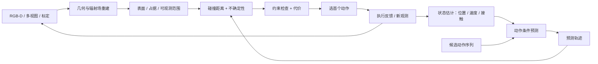
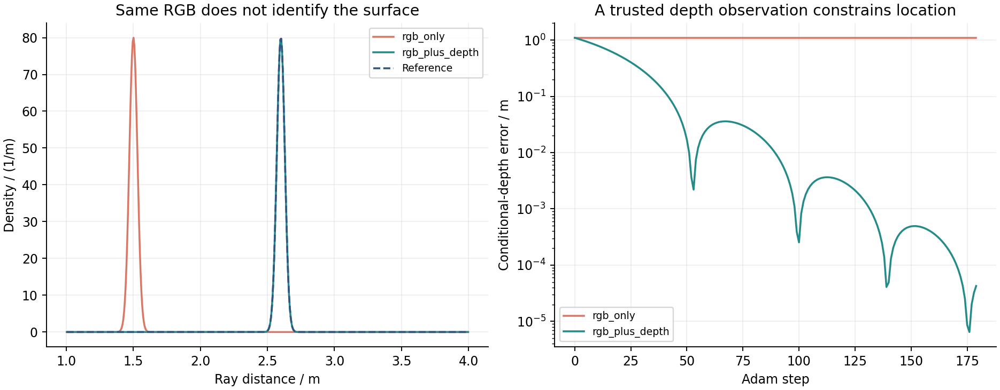
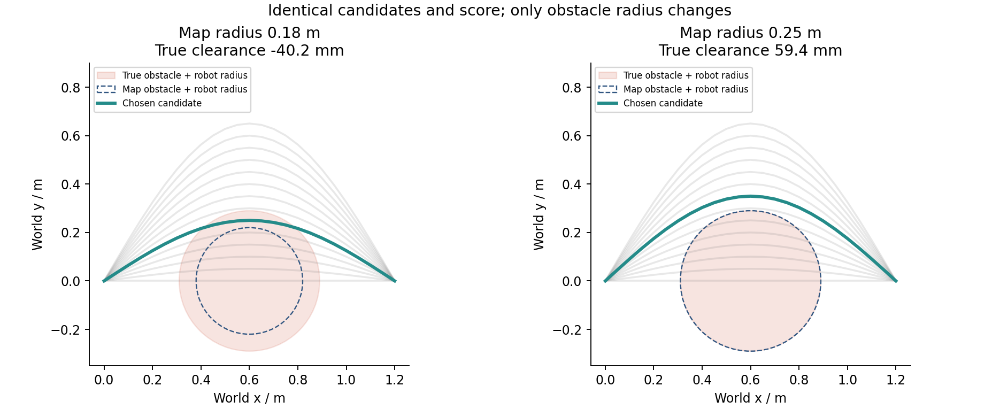

# D26 · 几何约束怎样把可看场景变成可用地图

[返回学习入口](../_index.md) ｜ [本周日程](../P2-深度理解-日程.md) ｜ [上一课 D25](../day25/Daily-Learning-Pack.md) ｜ [下一课 D27](../day27/Daily-Learning-Pack.md) ｜ [完整 CPU 实验](demo.py)

**能渲染出正确颜色，不等于表面在正确位置；能预测若干动作的后果，也不等于已经学会一个策略。今天把几何约束、碰撞检查、候选动作评分与想象中的策略学习拆开，再接成一条可验收的机器人管线。**

本课保留原定 **P2 / W4-D5 / Day26：几何约束重建**，课程日期为 **2026-09-30**，于 **2026-10-09 补写**。D25 讨论加速表示与多步预测；今天继续增加深度、表面、自由空间等约束，并连接碰撞几何与动作选择。没有改变原课程顺序。实验验证只说明资料可运行，你的学习进度仍待个人验收。

<details>
<summary>个人学习记录（后续生成保留）</summary>

<!-- learner-notes:start -->

- 我能解释的几何约束及其测量来源：
- 我给碰撞地图写出的单位、未知区域与时间戳：
- 改变量之前的预测 / 实际结果 / 解释：
- 自测答案与尚未理解的问题：

<!-- learner-notes:end -->

</details>

<!-- daily-pack-generated:start -->

## 0. 今天要形成的能力与产出

你应能从体渲染公式解释颜色与几何之间的歧义；把深度约束写成单位一致的损失；区分密度、SDF、TSDF和占据；从重建误差推导碰撞裕量；明确 MPC 每次求的是动作序列，而 Dreamer 的行为学习更新的是策略参数。

今天留下：一份几何约束卡、一份碰撞地图接口、一段候选评分实验，以及“重建损失低但动作仍失败”的数值反例。原定几何重建实操在本课落实为**实际优化一个可微的射线密度位置，并观察深度监督对结果的作用**；完整大型重建网络不在本次运行范围。

| 顺序 | 知识主线 | 需要回答的问题 |
| --- | --- | --- |
| ① | 颜色与几何约束 | 为什么RGB正确而深度仍可错1.1 m？ |
| ② | 场表示与碰撞几何 | 密度、距离、占据和未知分别是什么？ |
| ③ | 净空与误差界 | 地图误差怎样吞掉安全裕量？ |
| ④ | 候选评分与策略学习 | MPC和Dreamer分别优化什么？ |
| ⑤ | 单变量实操 | 加深度约束、改地图半径后什么变化？ |

## 1. 宏观闭环：机器人需要四种不同的可信信息



重建模块回答“目前空间里有什么”；碰撞模块回答“指定几何体沿轨迹会不会相交”；动力学回答“给定动作后状态怎样变化”；规划器比较这些变化是否符合任务。四者输入输出相邻，但不能用一个指标替代所有模块。

例如图像中的杯子轮廓正确，杯壁可能仍在三维中偏了30 mm；路径查询使用这份地图，就会给错误位置留出空间。即使动力学模型精确预测了夹爪运动，也无法补救错误的障碍表面。

| 信息 | 典型单位 | 在操作中解决什么问题 |
| --- | --- | --- |
| 颜色/特征 | 无量纲向量 | 身份、语义、图像一致性 |
| 表面/深度 | m | 抓取位置、几何尺寸 |
| 距离/占据 | m / 概率或布尔值 | 净空、碰撞与未知区域 |
| 动作条件转移 | 状态与动作各自的单位 | 预测推动、移动、接触后的状态 |

## 2. 为什么颜色可以对，而几何仍错

### 2.1 先回到体渲染

单位方向射线：

$$
x(t)=o+td,\qquad \|d\|=1.
$$

此时 $t,\Delta t$ 的单位是米。离散密度 $\sigma_i$ 单位是 $\mathrm m^{-1}$：

$$
\alpha_i=1-e^{-\sigma_i\Delta_i},\quad
T_i=e^{-\sum_{j<i}\sigma_j\Delta_j},\quad
w_i=T_i\alpha_i.
$$

颜色：

$$
\hat C=\sum_iw_ic_i+T_{\mathrm{end}}C_{\mathrm{bg}}.
$$

假设这一小段物体所有采样点具有相同颜色 $c$，则：

$$
\hat C=(1-T_{\mathrm{end}})c+T_{\mathrm{end}}C_{\mathrm{bg}}.
$$

只要总光学厚度 $\sum_i\sigma_i\Delta_i$ 相同，密度沿射线放前一些还是后一些，就可能产生相同颜色。单条射线的RGB监督没有足够信息辨别这两者。

多视图和纹理能减少歧义，但稀疏视角、弱纹理、遮挡、镜面反射、错位相机等仍会让几何约束薄弱。“增加网络容量”不能保证把缺失信息补回来，反而可能更容易适配错误的外观解释。

### 2.2 深度并非只有一种定义

常用的条件期望深度是：

$$
\hat D=\frac{\sum_iw_it_i}{\sum_iw_i}.
$$

它是“射线发生终止这一条件下，终止位置的加权期望”。如果有多个密度峰，期望可以落在两个峰之间；它不自动等于第一个实体表面、最大密度位置或SDF零面。

代码的密度峰中心是2.6 m，但真值条件深度约2.5640 m，因为靠前部分已经消耗了透射率。若拿2.6作为期望深度真值，会人为制造约36 mm的定义误差。

RGB-D 深度还常指相机 $Z$，而渲染器可能使用单位射线距离 $t$。两者关系是：

$$
Z=t\,d_z,\qquad t=Z/d_z.
$$

中心射线 $d_z=1$ 时二者相同；倾斜射线必须转换。比如 $d_z=0.8$、传感器 $Z=1.6$ m，对应射线距离2 m。把1.6直接监督到 $t$，不是“小噪声”，是系统性几何错误。

## 3. 加几何约束之前，先问“约束来自哪里”

### 3.1 深度监督：不是再加一个没有单位的系数

若可信深度观测为 $D_k$，有效掩码 $m_k$：

$$
L_D=\frac{\sum_km_k\,\rho((\hat D_k-D_k)/s_k)}
{\sum_km_k+\epsilon}.
$$

$s_k$ 可以是测量标准差或明确的参考长度，使残差无量纲；$\rho$ 可以是平方或Huber。对缺测位置，$m_k=0$，不能填零深度去强迫场景贴到相机。

总损失的教学形式：

$$
L=L_{\mathrm{rgb}}+\lambda_DL_D+\lambda_NL_N+\lambda_EL_E.
$$

如果深度项直接用平方米，而RGB误差无量纲，$\lambda_D$ 隐含 $\mathrm m^{-2}$ 的尺度。今天代码写成 $100(\hat D-D)^2$，等价于把深度残差除以0.1 m再平方；100不是适用于所有场景的魔法参数。

深度来源的可信度不同：

- 标定良好的RGB-D：有米制来源，但有反光、透明、边界混合和同步问题。
- SfM稀疏点：受基线、相机误差和尺度规范影响；不能默认米制。
- 单目网络深度：可能只提供相对结构，需核实尺度与偏移；跨域误差不能靠增加损失权重消除。
- 深度补全：密集区域里有推断成分，不应把整张预测图当成独立传感真值。

深度先验及其不确定性可以帮助稀疏视角的场景拟合；实际方法还需处理先验之间的冲突。[Roessle等，Dense Depth Priors for Neural Radiance Fields from Sparse Input Views，第3.1–3.2节](https://arxiv.org/pdf/2112.03288)

### 3.2 法向约束：告诉表面“朝向”，不直接告诉“在哪里”

隐式表面 $f(x)=0$ 的法向：

$$
n(x)=\frac{\nabla f(x)}{\|\nabla f(x)\|+\epsilon}.
$$

有方向一致的法向真值时，可以使用：

$$
L_N=1-n^\top n^*.
$$

若法向只知道无向轴，则用 $1-|n^\top n^*|$，但这会丢失内外方向信息。两张平行桌面即使相隔10 cm，法向也能完全相同；法向监督不能独自解决位置偏差。

从深度计算法向需要邻域，而邻域跨过物体边缘时可能把桌面与杯壁平均。必须考虑深度不连续、有效掩码、邻域尺度和坐标系。

### 3.3 多视图一致性与自由空间

把视图i的深度反投影到三维，再投到视图j：

$$
X_i=D_iK_i^{-1}\tilde u_i,\quad
X_j=R_{ji}X_i+t_{ji},\quad
\hat u_j=\pi(K_jX_j).
$$

这里的三维点为3维列向量，$R_{ji}$是3×3旋转、$t_{ji}$是3维平移；若使用4×4的$T_{ji}$，必须先把点补成齐次4维。$D_i$采用相机Z深度。可比较预测深度和视图j实际深度，但只在对应点对j确实可见时进行。被遮挡点不应被要求等于前景表面的深度。

一条可信的第一表面深度，还支持“从相机到表面前的一段空间为空”的约束。若表面在2 m，1 m处不应有显著遮挡密度；表面后方却不一定为空，因为射线被挡住了。**观测到表面不等于观测到它背后的全部空间。**

## 4. 密度、SDF、TSDF、占据：怎样选碰撞查询的表示

### 4.1 密度不是碰撞概率

NeRF密度描述沿射线衰减；一个体素的 $\sigma=10$ 不意味着“占据概率10”，甚至不同步长下 $\alpha$ 都不同：

$$
\alpha=1-e^{-\sigma\Delta}.
$$

$\sigma=10\,\mathrm m^{-1}$、$\Delta=0.01$ m时，$\alpha\approx0.0952$；$\Delta=0.1$ m时，$\alpha\approx0.6321$。改变离散步长不会让实体突然变软或变硬，但会改变这段积分的透明度。

从密度等值面提取几何可以作为工程近似，阈值、分辨率、薄结构、浮点伪影与未知范围都要验证；不能只见一张漂亮渲染图就设固定阈值部署。

### 4.2 SDF 是米制距离，前提是它真像距离函数

采用外正内负：

$$
f(x)=
\begin{cases}
+\operatorname{dist}(x,\partial\Omega),&x\notin\Omega,\\
-\operatorname{dist}(x,\partial\Omega),&x\in\Omega.
\end{cases}
$$

表面是 $f=0$，理想距离场在可微处满足：

$$
\|\nabla f(x)\|=1.
$$

因此可用 Eikonal 正则：

$$
L_E=\mathbb E_x(\|\nabla f(x)\|-1)^2.
$$

它鼓励距离函数的局部性质，不是碰撞正确性的保证：表面整体偏移后仍可能满足梯度范数为1。NeuS将表面定义为SDF零面并连接体渲染；本课仅学习这个表示关系，没有复现其完整渲染推导与训练。[NeuS 原论文](https://arxiv.org/abs/2106.10689)

### 4.3 TSDF 与“未知”

截断距离通常只记录表面附近：

$$
\operatorname{TSDF}(x)=\operatorname{clip}(d(x)/\mu,-1,1)
$$

或直接存米制截断距离，取决于实现。必须保存截断距离 $\mu$、归一化约定和观测权重。

常见RGB-D融合得到的是沿相机射线的投影距离近似，不自动等于欧氏SDF。没有被观测的体素需要独立的 `observed/weight` 标记：数值0可能意味着表面，也可能只是数组初始化，二者不能混用。

| 表示 | 查询适合什么 | 主要缺口 |
| --- | --- | --- |
| 点云 | 局部表面与近邻 | 点之间无数据不代表空 |
| 三角网格 | 表面相交、距离 | 孔洞、法向、非封闭拓扑 |
| 占据网格 | 已占据/已自由/未知 | 分辨率与概率校准 |
| SDF/ESDF | 距离及局部梯度 | 米制校准、未知区域和表面正确性 |
| 辐射场密度 | 渲染积分 | 无天然碰撞阈值 |
| 特征场 | 语义/任务相似度 | 数值相似不等于米制几何距离 |

## 5. 从几何误差到碰撞裕量

### 5.1 点机器人、有限半径与配置空间

点沿路径经过 $p$，圆形障碍中心 $c$、半径 $r_o$，机器人半径 $r_r$：

$$
d_{\mathrm{clear}}(p)=\|p-c\|-r_o-r_r.
$$

大于0表示分离，小于0表示重叠。把机器人收缩成点、同时把障碍膨胀 $r_r$，就是一个简单的配置空间构造。

若还要求安全裕量 $m$：

$$
d_{\mathrm{clear}}(p)\ge m.
$$

对真实机械臂，不能只用TCP球：需要连杆、夹爪张开状态、抓起的物体、自碰撞、桌边等几何，并在关节配置空间检查。

### 5.2 地图误差如何吞掉余量

若估计距离 $\hat d$ 与真实距离差的绝对值有可信界 $\epsilon$：

$$
d\ge\hat d-\epsilon.
$$

想保证真实净空至少 $m$，必须要求 $\hat d\ge m+\epsilon$。这个推导依赖误差界确实覆盖几何、标定、跟踪等来源；把一个平均误差当最坏界是不成立的。

本课障碍半径低估70 mm，预测净空约29.8 mm；真实净空等于预测净空减70 mm，变成约−40.2 mm。路径优化器没有违反它看到的约束，它拿到的地图错了。

### 5.3 为什么不能只检查几个路点

两个端点都在障碍外，连接线段仍可能穿过障碍。对于线段 $p+\alpha v,\alpha\in[0,1]$，到圆心的最近位置：

$$
\alpha^*=
\operatorname{clip}\left(\frac{(c-p)^\top v}{v^\top v},0,1\right).
$$

用 $p+\alpha^*v$ 检查距离，本实验对每段都这样做，不只检查25个采样点。真实高维机器人连续碰撞检测更复杂；降低采样间隔只是近似，必须结合速度、几何和插值方式判断漏检风险。

## 6. MPC：每次根据当前状态重新比较候选未来

### 6.1 先写预测模型与动作契约

本课教学模型是二维位置积分器：

$$
p_{k+1}=p_k+\Delta t\,u_k.
$$

$p$单位m，$u$单位m/s，$\Delta t=0.1$ s，参考系固定为世界系。它不是机械臂动力学，不含加速度、接触或执行滞后。

动作序列：

$$
U=(u_0,\ldots,u_{H-1})\in\mathbb R^{H\times2}.
$$

预测得到 $H+1$ 个状态，再评价目标、平滑和碰撞：

$$
J(U)=\sum_{k=0}^{H-1}
\ell(p_k,u_k)+\ell_f(p_H),
\quad
d_{\mathrm{clear}}(p_k)\ge m.
$$

不同代价有不同量纲。位置偏差平方、控制幅值平方、动作变化平方应按参考尺度归一化，或者给权重明确单位；否则“调权重”可能只是在补单位不匹配。

### 6.2 一次评分与完整MPC循环的区别

```text
读取当前观测 → 更新状态和地图
→ 生成/优化一批候选动作序列
→ 预测每条轨迹 → 排除不满足约束的候选
→ 选代价最低者 → 只执行第一个动作
→ 获取新观测 → 下一轮重新规划
```

MPC 的关键是滚动时域与反馈。今天的代码只运行其中“一次候选预测和选择”，并返回第一步速度；没有闭环执行、没有真实扰动恢复，因此准确称为 **MPC候选评分核心的教学实验**。

本例所有候选终点相同，终点代价都是0，只比较归一化路径长度与速度变化，并施加速度和净空约束。如果没有可行候选，返回失败/停止，不能把 `argmin` 选出的第一条无穷大代价轨迹当可用方案。

### 6.3 学习模型的评分可能怎样被利用

规划会主动搜索高分动作。如果动力学模型在训练外动作上过于乐观，规划器可能恰好选择模型最不可信的区域。例如模型以为施加两倍速度可以瞬间跨过障碍，真实控制器却限速，轨迹不再对应预测。

因此需要训练覆盖、动作边界、不确定性、模型误差验证以及执行反馈。增大候选数量只改进“在当前模型下找解”，不保证模型更真实。

## 7. Dreamer：在想象轨迹中更新策略，和在线枚举候选不同

设潜状态转移 $z_{t+1}\sim p_\theta(z_{t+1}\mid z_t,a_t)$，策略 $a_t\sim\pi_\phi(a_t\mid z_t)$，奖励模型 $\hat r_\theta(z_t,a_t)$，价值模型 $V_\psi(z_t)$。

一个简化的有限时域行为目标可写为：

$$
\max_\phi\mathbb E\left[
\sum_{k=0}^{H-1}\gamma^k\hat r(z_k,a_k)
+\gamma^HV_\psi(z_H)\right].
$$

这里更新的是共享策略参数 $\phi$，从许多起点的想象轨迹中学习“遇到这种潜状态通常采取什么动作”。价值模型估计时域以外的回报。实际Dreamer还涉及RSSM、回报目标、价值训练等细节，上式是帮助定位模块的简化，不是逐字算法替代。

| 比较项 | 在线MPC候选评分 | Dreamer式行为学习 |
| --- | --- | --- |
| 本轮直接优化什么 | 当前状态下的动作序列U | 策略参数与价值参数 |
| 模型的用途 | 推演候选后果并评分 | 产生想象经验用于行为学习 |
| 执行动作如何得到 | 选中序列的首动作 | 由已学习策略输出 |
| 价值函数 | 可以有，也可以不用 | 用于更长时域的行为学习 |
| 共同风险 | 模型偏差、观测缺失、分布外动作 | 同样存在，且可能写入策略 |

Dreamer原论文第2–3节、图3和算法1明确分开动力学学习、想象中的行为学习、真实交互三个阶段。[Dream to Control: Learning Behaviors by Latent Imagination](https://arxiv.org/pdf/1912.01603.pdf)

“用了世界模型”不能直接推出“它是Dreamer”；“循环比较候选”也不能宣称“学到了策略”。两条路线可以结合，例如策略提供MPC初值，但需要明确每个模块在训练和推理时实际做什么。

## 8. 工程接口：地图怎么交给动作系统

建议为每份可操作地图保留：

```text
frame_id: base
length_unit: metre
timestamp: observation_time
geometry_type: sdf / occupancy / mesh / points
observed_mask: 与几何索引一致
distance_sign: outside_positive
distance_valid_range: 已核验范围
uncertainty: 误差定义与来源，不只一个无解释score
robot_geometry_version: 连杆/夹爪/携带物体的几何版本
```

对于一个候选，结果至少有 `feasible`、`min_clearance_m`、`goal_error_m`、`model_support`、`reason`。推理输出必须区分“低代价但未知区域”“满足当前几何约束”“已真实执行成功”。

在ROS/RealSense工程中，先检查深度单位、color/depth对齐、采样时刻、TF方向与外参，再把复杂优化器接上去。若机器人在运动时把不同时间的图像和关节姿态拼在一起，几何监督可能变成彼此冲突的约束。

## 9. CPU实操：先预测，运行，再只改一个变量

### 9.1 实验范围

代码独立运行，不读取Day24 checkpoint：

- 一条单位射线、512个采样、固定高斯密度形状，只优化密度中心；
- 比较RGB监督与RGB+可信条件深度监督；
- 同一批14条二维候选、同一评分、同一速度限制，只改变地图障碍半径；
- 精确检查候选折线段到膨胀圆障碍的最小距离。

这是几何约束与规划接口的可控实验，没有训练完整NeRF、NeuS、Dreamer或真实机械臂控制器。

运行前先写预测：密度整体前移1.1 m而颜色和积分厚度不变，RGB会发生什么？加入正确深度会约束哪个参数？障碍半径低估70 mm，预测30 mm净空是否足够？

```bash
python -B 3d_learning/day26/demo.py
```

已实跑环境：CPU，NumPy 1.26.4、PyTorch 2.13.0.dev20260423、Matplotlib 3.10.9；未安装新依赖。

### 9.2 2026-10-09实际结果

[结果JSON](../../_assets/3d_learning/day26/results.json) ｜ 原始数组 (not exported: excluded by publication policy)

| 重建对照 | RGB-only | RGB+depth |
| --- | ---: | ---: |
| 密度中心 | 1.500000 m | 2.599948 m |
| 条件深度 | 1.464014 m | 2.563963 m |
| RGB MSE | $8.22\times10^{-33}$ | $8.22\times10^{-33}$ |
| 条件深度绝对误差 | 1.100000 m | 0.0000516 m |

真值密度中心2.6 m，真值条件深度2.564014 m。两组颜色几乎机器精度一致，只有深度监督识别了中心位置。0.052 mm是无噪声、单参数、完全正确模型的合成优化误差，绝不是RGB-D设备或真实神经重建精度。



左图两种解都能解释同一颜色，但密度位置不同；右图深度监督减小几何误差，Adam中途有越过目标后的振荡，不能把每次迭代都解释成单调改进。

| 地图半径 | 0.18 m | 0.25 m |
| --- | ---: | ---: |
| 可行候选数 | 9 | 7 |
| 选中弧线振幅 | 0.25 m | 0.35 m |
| 预测最小净空 | 29.77 mm | 59.37 mm |
| 真实最小净空 | **−40.23 mm** | **59.37 mm** |
| 首个世界系速度 | $(0.500,0.326)$ m/s | $(0.500,0.457)$ m/s |

真实障碍半径0.25 m，机器人半径0.04 m，净空要求0.01 m，速度上限1 m/s。右组使用真障碍参数，因此预测和真净空一致；它不证明地图未知时一定安全。



红色区域是按真实机器人半径膨胀后的障碍；蓝虚线是地图认为的膨胀障碍；绿色是所选路径。左组在自己的模型下合法，但穿入真实障碍。

### 9.3 一次单变量修改

任选其一，先写预测：

1. 仅给训练用目标条件深度加0.05 m偏置：先另存未加偏置的独立真值，再分开报告对有偏观测的残差和对真值的误差。预期优化会忠实地学到错误深度。若只直接覆盖脚本的target_depth，现有误差/断言也会跟着使用有偏目标，可能仍通过；这恰好说明必须保留独立真值，不能把拟合观测好当成真实几何好。
2. 仅把 `map_radius` 的0.18改成0.22：手算对同一路径的净空增加/减少方向，再看候选是否切换。
3. 仅改变净空要求0.01→0.05 m：比较可行候选、所选路径和代价，解释保守性与可行性的取舍。

验收以解释为主：能说清两组比较固定了什么、变化了什么，能区分射线期望深度与硬表面，能指出当前代码只执行一次规划评分。

### 9.4 完整主脚本

> [!note]- 完整 CPU 主脚本（与 demo.py 一致）
>
> ```python
> """D26: geometric constraints in a tiny rendered field and candidate scoring.
> Independent CPU toy experiment, not NeuS, a full NeRF, MPC deployment, or Dreamer.
> Run from the vault root: python -B 3d_learning/day26/demo.py
> """
> import os
> os.environ.setdefault("MPLCONFIGDIR", "/tmp/day26-mpl")
> from pathlib import Path
> import json
> import numpy as np
> import torch
> import matplotlib
> matplotlib.use("Agg")
> import matplotlib.pyplot as plt
> 
> OUT = Path(__file__).resolve().parents[2] / "_assets/3d_learning/day26"
> torch.set_num_threads(2)
> torch.set_default_dtype(torch.float64)
> 
> 
> def render(center):
>     # Unit ray; t and bin width are metres; density is 1/metre.
>     t = (torch.arange(512)+.5)*(3./512)+1.
>     sigma = 80.*torch.exp(-.5*((t-center)/.03)**2)
>     optical = sigma*(3./512)
>     trans = torch.exp(-torch.cat([torch.zeros(1), optical.cumsum(0)[:-1]]))
>     weights = trans*(-torch.expm1(-optical))
>     rgb = weights.sum()*torch.tensor([.2,.6,.9]) + torch.exp(-optical.sum())
>     depth = (weights*t).sum()/weights.sum()
>     return rgb, depth, sigma, t
> 
> 
> def fit(use_depth, target_rgb, target_depth):
>     center = torch.tensor(1.5, requires_grad=True)
>     opt = torch.optim.Adam([center], lr=.03)
>     history = []
>     for step in range(180):
>         rgb, depth, _, _ = render(center)
>         color_loss = (rgb-target_rgb).square().mean()
>         loss = color_loss + (100.*(depth-target_depth).square() if use_depth else 0.)
>         opt.zero_grad(); loss.backward(); opt.step()
>         history.append([step,float(center.detach()),float(color_loss.detach()),
>                         float((depth-target_depth).abs().detach())])
>     rgb,depth,sigma,t = render(center.detach())
>     return dict(center_m=float(center.detach()), conditional_depth_m=float(depth),
>                 color_mse=float((rgb-target_rgb).square().mean()),
>                 depth_abs_error_m=float((depth-target_depth).abs())), np.array(history), sigma.numpy()
> 
> 
> def segment_clearance(path, center, obstacle_radius, robot_radius=.04):
>     # Exact minimum for each straight segment, not merely sampled waypoints.
>     p, v = path[:-1], np.diff(path, axis=0)
>     alpha = np.clip(np.sum((center-p)*v,axis=1)/np.sum(v*v,axis=1),0,1)
>     closest = p+alpha[:,None]*v
>     return float(np.min(np.linalg.norm(closest-center,axis=1))-obstacle_radius-robot_radius)
> 
> 
> def score_candidates():
>     amplitudes = np.arange(0.,.651,.05)
>     x = np.linspace(0,1.2,25)
>     paths = np.array([np.c_[x,a*np.sin(np.pi*x/1.2)] for a in amplitudes])
>     center = np.array([.6,0.])
>     dt = .1
>     controls = np.diff(paths,axis=1)/dt  # m/s, integrator p_next=p+dt*u
>     smooth_cost = np.sum(np.diff(controls,axis=1)**2,axis=(1,2))
>     length = np.linalg.norm(np.diff(paths,axis=1),axis=2).sum(1)
>     rows=[]
>     for map_radius in [.18,.25]:
>         clearance=np.array([segment_clearance(p,center,map_radius) for p in paths])
>         # Costs are normalized by specified reference units, so sum is dimensionless.
>         cost=length/1.2+.02*smooth_cost/(1.**2)
>         feasible=(clearance>=.01)&(np.linalg.norm(controls,axis=2).max(1)<=1.)
>         masked=np.where(feasible,cost,np.inf)
>         if not np.any(feasible):
>             raise RuntimeError("No feasible candidate; must stop or replan")
>         best=int(np.argmin(masked))
>         rows.append(dict(map_obstacle_radius_m=map_radius, feasible_candidates=int(feasible.sum()),
>             chosen_amplitude_m=float(amplitudes[best]), chosen_index=best,
>             predicted_clearance_m=float(clearance[best]),
>             true_clearance_m=segment_clearance(paths[best],center,.25),
>             first_velocity_m_s=controls[best,0].tolist(), cost=float(masked[best])))
>     return rows,paths
> 
> 
> def main():
>     OUT.mkdir(parents=True,exist_ok=True)
>     np.random.seed(26);torch.manual_seed(26)
>     target_rgb,target_depth,target_sigma,t=render(torch.tensor(2.6))
>     target_rgb,target_depth=target_rgb.detach(),target_depth.detach()
>     rows,arrays={},{}
>     for name,depth_on in [("rgb_only",False),("rgb_plus_depth",True)]:
>         rows[name],arrays[name+"_history"],arrays[name+"_sigma"]=fit(depth_on,target_rgb,target_depth)
>     planner,paths=score_candidates()
>     result=dict(seed=26,scope="one-ray parametric density fit plus one finite-horizon planning call",
>         units="metres, seconds, m/s; renderer density 1/m; RGB [0,1]",
>         versions=dict(numpy=np.__version__,torch=torch.__version__,matplotlib=matplotlib.__version__),
>         reference_density_center_m=2.6, reference_conditional_depth_m=float(target_depth),
>         reconstruction=rows,planning=planner,
>         boundary="No closed-loop MPC rollout, learned policy, or neural scene network was trained.")
>     assert rows["rgb_plus_depth"]["depth_abs_error_m"]<.001
>     assert rows["rgb_only"]["depth_abs_error_m"]>1.
>     assert planner[0]["true_clearance_m"]<0<planner[1]["true_clearance_m"]
>     (OUT/"results.json").write_text(json.dumps(result,indent=2),encoding="utf-8")
>     np.savez(OUT/"arrays.npz",**arrays,t=t.numpy(),target_sigma=target_sigma.numpy(),paths=paths)
>     plt.rcParams.update({"font.size":10,"axes.spines.top":False,"axes.spines.right":False})
>     fig,axs=plt.subplots(1,2,figsize=(11,4.3),layout="constrained")
>     for name,c in [("rgb_only","#d87967"),("rgb_plus_depth","#248b89")]:
>         axs[0].plot(t.numpy(),arrays[name+"_sigma"],label=name,c=c)
>         axs[1].semilogy(arrays[name+"_history"][:,0],arrays[name+"_history"][:,3],label=name,c=c)
>     axs[0].plot(t.numpy(),target_sigma.numpy(),"--",label="Reference",c="#315681")
>     axs[0].set(xlabel="Ray distance / m",ylabel="Density / (1/m)",title="Same RGB does not identify the surface")
>     axs[1].set(xlabel="Adam step",ylabel="Conditional-depth error / m",title="A trusted depth observation constrains location")
>     for ax in axs:ax.legend(fontsize=8);ax.grid(alpha=.2)
>     fig.savefig(OUT/"geometry_constraint.png",dpi=170);plt.close(fig)
>     fig,axs=plt.subplots(1,2,figsize=(11,4.5),layout="constrained")
>     for ax,row in zip(axs,planner):
>         for p in paths:ax.plot(p[:,0],p[:,1],c="gray",alpha=.18)
>         ax.add_patch(plt.Circle((.6,0),.29,color="#d87967",alpha=.2,label="True obstacle + robot radius"))
>         ax.add_patch(plt.Circle((.6,0),row["map_obstacle_radius_m"]+.04,fill=False,
>                               ls="--",edgecolor="#315681",label="Map obstacle + robot radius"))
>         p=paths[row["chosen_index"]];ax.plot(p[:,0],p[:,1],c="#248b89",lw=2.5,label="Chosen candidate")
>         ax.set(xlabel="World x / m",ylabel="World y / m",aspect="equal",
>                title=f"Map radius {row['map_obstacle_radius_m']:.2f} m\nTrue clearance {1000*row['true_clearance_m']:.1f} mm")
>         ax.legend(fontsize=7,loc="upper left");ax.set_ylim(-.35,.9)
>     fig.suptitle("Identical candidates and score; only obstacle radius changes")
>     fig.savefig(OUT/"collision_scoring.png",dpi=170);plt.close(fig)
>     print(json.dumps(result,indent=2))
> 
> 
> if __name__=="__main__":
>     main()
> ```

## 10. 关键阅读与本课边界

- **Dense Depth Priors，方法第3.1–3.2节、消融第4.4节。** 找到深度先验、逐像素不确定性和渲染约束各自位置；思考先验有偏时应怎样验证。不要把本课的单项平方深度损失当作论文完整方法。[原论文](https://arxiv.org/pdf/2112.03288)
- **NeuS，摘要与方法的SDF/体渲染关系。** 先掌握零水平集与密度表示的差别，再判断提取表面需要哪些约束。[原论文](https://arxiv.org/abs/2106.10689)
- **Dreamer，第2–3节、图3、算法1。** 用三种颜色分别标出模型参数、策略参数、价值参数在何时更新；解释它与一次在线动作搜索的区别。[原论文](https://arxiv.org/pdf/1912.01603.pdf)

本课不依赖旧材料中未核准的几何方法名称或错链；原“几何约束重建”主题通过明确可核查的基础公式、上述原始来源与本地实验落实。

## 11. 总结：最值得掌握的五个连接

1. **颜色监督→几何歧义。** 看懂积分不唯一，才能解释为什么低RGB误差仍需深度与多视图验证。
2. **几何损失→测量来源。** 加约束不是免费增加真相，尺度、偏置、可见性与不确定性决定它是否有帮助。
3. **场表示→碰撞接口。** 密度、距离和未知区域有不同语义，不能只靠数组shape接线。
4. **几何误差→净空。** 地图偏差可以直接吞掉安全裕量，平均误差也不能当最坏界。
5. **预测→动作选择/策略学习。** MPC与Dreamer利用模型的方式不同，训练声明和运行证据必须对应。

三个易混点：条件深度不是密度峰位置；SDF正则不是几何真值；“选到了动作”不是“已经学会策略”。分别回看第2、4、7节的反例，尝试不用术语复述。

## 12. 自测：10题，先作答

1. 为什么把恒定颜色的密度峰沿射线移动，RGB可能不变？公式里哪些量消掉了位置信息？
2. 密度单位是什么？$\sigma=10\,\mathrm m^{-1},\Delta=0.01$ m时，$\alpha$约多少？
3. 条件深度与密度峰位置为何不同？相机Z深度和单位射线距离如何转换？
4. 深度有50 mm偏置时，把深度损失权重放大是否必然改善真实几何？你会记录哪两个误差？
5. Eikonal约束是什么？一张整体偏移的平面能否仍满足它？
6. 地图净空30 mm、可信距离误差界70 mm，真实净空下界是多少？为何平均误差不足以代入这个界？
7. 写出线段到圆心最近点的参数式。为什么只检查端点会漏碰撞？
8. 本课动作单位、采样周期和预测模型是什么？代码哪里尚未构成完整MPC闭环？
9. MPC候选优化与Dreamer行为学习分别调整什么变量？两者是否都需要模型误差检查？
10. 给抓取系统交付一份SDF，除了数值数组还至少需要哪五项语义？未知区域应该怎样处理？

## 13. 今日产出、疑问与下一课

保存几何约束卡、地图接口卡、一份单变量实验记录和自测答案。待理解问题优先写：如何判断深度先验有偏；如何把非封闭点云变成可用碰撞表示；距离误差界如何获得；未来模型偏差怎样影响候选排序。没有独立回答时维持未验收。

**D27** 保留原重建实验，并加入2D/3D特征融合：同一三维点怎样从多视图拿到正确特征，遮挡为什么不能靠平均解决；随后区分V-JEPA 2无动作预训练与V-JEPA 2-AC动作条件阶段。

<details>
<summary>参考答案与0/1/2分标准（作答后展开）</summary>

每题0分＝核心错误/空白；1分＝结论正确但缺公式、假设或单位；2分＝达到以下要点。共20分，代码运行不计作答分。

1. 恒定颜色时只依赖总透射率/光学厚度，平移峰而保持积分不变可得到同RGB；多视图和非恒定颜色会增加约束。
2. $\mathrm m^{-1}$；$\alpha=1-e^{-0.1}\approx0.0952$，不是占据概率的直接阈值。
3. 前方吸收改变权重，期望不等于峰；$Z=td_z$，故$t=Z/d_z$。
4. 不必然；可能更强地拟合错误测量。分别报告对深度观测的残差与对独立几何真值的误差。
5. $(\|\nabla f\|-1)^2$；平面位置偏移不改变梯度范数，故仍可满足。
6. 至少$30-70=-40$ mm；平均量不覆盖最坏偏差，不能提供保守保证。
7. $\alpha^*=\mathrm{clip}((c-p)^\top v/(v^\top v),0,1)$；端点外部不能排除中间穿过障碍。
8. 世界系m/s，0.1 s，$p'=p+\Delta t u$；只评分一次，没有执行、观测与重规划循环。
9. 当前动作序列U vs共享策略/价值参数；都可能利用模型错误，需要支持范围、独立验证和反馈。
10. 坐标系、米制单位、符号、时间戳、观测掩码、误差定义、机器人几何版本等；未知不直接标成自由，应保守检查或补观测。

</details>

<!-- daily-pack-generated:end -->

