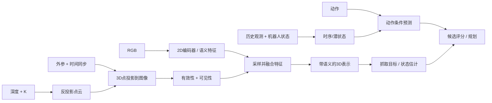
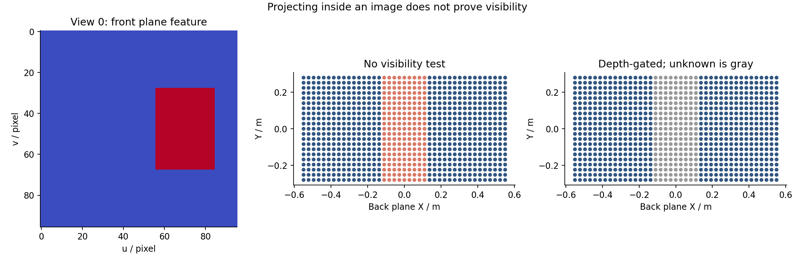
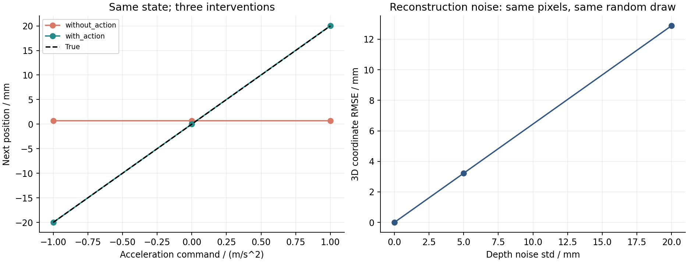

# D27 · 重建几何、融合特征，再区分观察与行动

[返回学习入口](../_index.md) ｜ [本周日程](../P2-深度理解-日程.md) ｜ [上一课 D26](../day26/Daily-Learning-Pack.md) ｜ [下一课 D28](../day28/Daily-Learning-Pack.md) ｜ [完整 CPU 实验](demo.py)

**给三维点加上图像特征，关键不是把向量拼起来，而是证明它们指向同一时刻、同一表面；给视频表示加上行动能力，关键不是把“预测”改个名字，而是让模型知道具体执行了什么动作。**

本课保留原定 **P2 / W4-D6 / Day27：重建实验与2D/3D特征融合**，课程日期 **2026-10-01**，于 **2026-10-09 补写**。D26已经区分颜色、几何与碰撞；今天实际反投影合成RGB-D、融合可见特征，并学习V-JEPA 2与V-JEPA 2-AC的阶段边界。D28对本周表示、重建和动态评价做统一验收。

<details>
<summary>个人学习记录（后续生成保留）</summary>

<!-- learner-notes:start -->

- 我的2D→3D数据接口和可见性条件：
- 对“未观测”与“分类错误”的区分：
- V-JEPA 2与2-AC各用了什么监督：
- 实验预测、改单变量记录、自测和疑问：

<!-- learner-notes:end -->

</details>

<!-- daily-pack-generated:start -->

## 0. 今天的能力目标

完成本课后，应能：

1. 从深度图生成米制点，解释噪声与体素化如何影响重建。
2. 把世界点投到特征图，处理分辨率、插值、遮挡和时间同步。
3. 实现带观测计数的多视图特征融合，保留未知点。
4. 区分重建/语义表示与能回答动作干预的状态转移。
5. 解释V-JEPA 2的无动作预训练，以及2-AC为何需要机器人状态/动作信号。
6. 用独立轨迹划分比较有动作/无动作输入，并明确小实验没有复现大型模型。

今天的实操有三个独立部分：RGB-D反投影噪声对照、2D/3D可见性融合、动作条件预测。它们共用“接口要说明信息来源”的原则，不把三段代码包装成一个未真正运行的端到端系统。

| 顺序 | 知识主线 | 需要回答的问题 |
| --- | --- | --- |
| ① | RGB-D重建 | 深度噪声怎样传播到米制点和体素？ |
| ② | 2D/3D特征融合 | 同一个像素真的对应当前三维点吗？ |
| ③ | 观察与行动 | 相同状态的不同动作后果怎样区分？ |
| ④ | V-JEPA两阶段 | 预训练和2-AC分别输入什么、学习什么？ |
| ⑤ | 三项实操 | 正确率、覆盖率和动作误差如何一起验收？ |

## 1. 宏观：几何、语义与动态表示各保留什么



一个点有“红色杯子”的特征，能帮助从多个物体中选出目标；它的米制位置支持夹爪定位；它的速度、接触和过去动作支持预测下一时刻。这些可以放在统一接口里，但不能认为某个高维向量天然包含全部信息。

| 表示 | 最擅长保存 | 需要额外核验 |
| --- | --- | --- |
| RGB特征图 | 纹理、语义、局部外观 | 深度、坐标、遮挡 |
| 点云/网格 | 已观测表面的位置 | 身份、不可见面、动态 |
| 融合点特征 | 空间位置对应的语义证据 | 可见性、视角冲突、置信度 |
| 时序潜状态 | 历史的任务相关摘要 | 是否保留速度/动作后果 |
| 动作条件模型 | 状态与动作到下一状态 | 动作支持范围、滚动误差 |

## 2. 原定重建实操：先生成正确的点，再谈特征

### 2.1 反投影和坐标链

深度图若存相机Z深度：

$$
X_c=ZK^{-1}\begin{bmatrix}u\\v\\1\end{bmatrix}
=
\begin{bmatrix}
(u-c_x)Z/f_x\\
(v-c_y)Z/f_y\\
Z
\end{bmatrix}.
$$

外参把相机点变到世界：

$$
X_w=R_{wc}X_c+t_{wc}.
$$

深度单位先统一到米，再执行刚体变换。若深度是毫米、外参平移是米，公式shape完全正确也会得到错误场景。

本实验相机平行，只有世界x位置不同；因此 $R=I$，$X_w=X_c+(C_x,0,0)$。场景有 $Z=1$ m的前景平面和 $Z=1.5$ m的背景平面，由解析几何生成深度图。所有相机内参与外参都是真值，这使我们能隔离融合与噪声机制。

### 2.2 深度噪声如何进入三维

令归一化射线 $r=K^{-1}\tilde u$，这里 $r_z=1$，不要求其单位长度。若深度误差为 $\delta Z$：

$$
\delta X_c=r\,\delta Z.
$$

所以同样的Z噪声，在偏离主点的位置还会产生更大的横向误差。三维坐标RMSE定义：

$$
\operatorname{RMSE}_{xyz}
=\sqrt{\frac1{3N}\sum_i\|\hat X_i-X_i\|^2}.
$$

它与欧氏距离的RMS差一个 $\sqrt3$ 因子，不能把二者都叫“点云误差”然后直接比较。

本实验保持同一组随机噪声方向，仅改变深度噪声标准差0、5、20 mm；结果坐标RMSE分别0、3.222、12.888 mm。关系呈线性，是因为这里外参、像素坐标和深度投影模型固定，没有进行鲁棒融合或复杂优化。

### 2.3 体素化压缩与重建质量不是同一个指标

网格边长 $h$，体素索引：

$$
k=\left\lfloor\frac{X-o}{h}\right\rfloor\in\mathbb Z^3.
$$

同体素可按权重平均位置和特征：

$$
\bar X_k=\frac{\sum_{i\in k}w_iX_i}{\sum_{i\in k}w_i},
\qquad
\bar f_k=\frac{\sum_{i\in k}w_if_i}{\sum_{i\in k}w_i}.
$$

体素数增加可能是新结构被观察，也可能只是噪声把原来同格的点抖到相邻格。本课记录25 mm格子的非空数量，说明“更多体素”不能当质量提升。代码只计数体素占用，不声称完成了TSDF融合或网格提取。

## 3. 从三维点取二维特征：先写投影，再写shape

### 3.1 投影链

世界点 $X_w$ 在相机i中：

$$
X_{c,i}=R_{cw,i}X_w+t_{cw,i},
\qquad u_i=\pi(K_iX_{c,i}).
$$

采样特征：

$$
f_i(X_w)=F_i(u_i),
\qquad F_i\in\mathbb R^{H_f\times W_f\times C}.
$$

如果特征图比原图缩小了8倍，原像素坐标不能原封不动用于索引。还需说明卷积/resize是否采用像素中心对齐。常见连续坐标的一种约定是：

$$
u_f=(u+0.5)/s-0.5,
$$

但要与具体预处理和采样API一致，不能只凭网络stride猜完整映射。

| 对象 | 常见shape | 本实验 |
| --- | --- | --- |
| 深度 | `[V,H,W]` | `[2,96,96]` |
| 图像特征 | `[V,H,W,C]` | `[2,96,96,2]` |
| 待附特征的世界点 | `[N,3]` | `[1116,3]` |
| 每视图可见掩码 | `[V,N]` | 由Z一致性判断 |
| 融合特征 | `[N,C]` | `[1116,2]` |
| 观测数/有效标记 | `[N]` | 保留0次观测点 |
| 重建云 | `[V H'W',3]` | 每隔4像素取点，共1152点 |

本实验两通道特征是由解析表面标签生成的理想one-hot向量：背景 $(1,0)$、前景 $(0,1)$。没有运行CNN、分割模型或视频编码器；理想特征便于把投影/遮挡问题从分类误差中分离。

### 3.2 双线性采样和边界

若特征坐标 $u=i+\alpha,v=j+\beta$，双线性采样为：

$$
f(u,v)=(1-\alpha)(1-\beta)F_{j,i}
+\alpha(1-\beta)F_{j,i+1}
+(1-\alpha)\beta F_{j+1,i}
+\alpha\beta F_{j+1,i+1}.
$$

它使采样对坐标局部可微，但物体边缘可能混合两个不同表面特征。语义得分可软融合，实例ID不能直接按数值平均。

本课代码采用最近邻采样，使可见性反例易于逐像素检查。输入是96×96原分辨率特征，没有额外缩放；换成真实多尺度网络后必须补齐上述映射。

### 3.3 点特征拼接不是几何替代

PointPainting提出把点投到图像语义输出，再把类别得分附到点上，交给点云检测器处理。[PointPainting 原论文摘要与方法入口](https://arxiv.org/abs/1911.10150)

一般接口可以是：

$$
\tilde X_i=[X_i,\mathrm{intensity}_i,f_i,\mathrm{valid}_i].
$$

其中位置仍需独立保持米制；特征得分不改变点的物理坐标。这个结构帮助语义识别，但不会修复错误外参，也不会自动补齐遮挡面。

## 4. 可见性：投影落在图内，只是第一关

### 4.1 三个必要检查

对点 $X_c=(x,y,z)$：

1. $z>0$，在相机前方。
2. 投影在图像/特征图有效范围内。
3. 该点与图像该像素看到的表面一致。

若有Z深度图：

$$
m_i(X)=
\mathbf1[z>0]\,
\mathbf1[u_i\in\text{image}]\,
\mathbf1[|z-D_i(u_i)|<\tau_z]\,
\mathbf1[D_i\text{有效}].
$$

$\tau_z$应根据深度噪声、配准误差与距离设置，不能全场景照搬。本实验使用0.02 m，两个平面相隔0.5 m，因此在理想数据下很容易区分。

手算：一个背景点投影到前景区域，点的相机深度为1.5 m，深度图为1.0 m，差0.5 m。它在图内，但其表面被挡住，不能拿前景特征涂到背景上。

### 4.2 未观测不是背景类别

多视图都看不到一个背景点时，正确结论是“当前没有这个点的图像特征证据”，不是“它属于背景”，也不是“它属于挡住它的物体”。

本课用观测数 `count=0` 和类别 `-1` 表示未知。特征数值可以暂存零向量，但必须伴随有效掩码；否则后续模型会把“缺信息”和“真实零响应”混为一谈。

这个原则也适用于碰撞地图：没看见的空间不自动自由。对VLA输入的缺失摄像头、失效深度、padding token也同样需要明确标记。

## 5. 多视图融合：平均之前先筛选证据

带可见性与质量权重的融合：

$$
f(X)=
\frac{\sum_i m_i(X)w_i(X)f_i(X)}
{\sum_i m_i(X)w_i(X)+\epsilon}.
$$

权重可以考虑测量方差、视角、距离、分割置信度，但置信度高不等于对应正确。错误外参会把非常自信的类别采到错误位置，平均只会让错误更稳定。

一份可解释的融合记录应有：

```text
xyz_m: [N,3]
feature: [N,C]
observed_count: [N]
feature_valid: [N]
source_camera_ids / timestamps
extrinsic_version
depth_consistency_threshold_m
```

视角差异还会改变纹理、反光和特征响应；直接平均不同语义空间的向量也没有意义。两个编码器即使都输出768维，不代表坐标轴有相同含义，必要时需要已训练的投影或对齐模块。

### 5.1 合成对照具体说明了什么

本课1116个真值表面点中，927个在至少一台相机可见，189个被遮挡。无门控方案给全部点赋标签，把189个不可见背景点涂成前景；门控方案将它们保留为未知。

在那927个可见点上，两个方法的正确率都为100%。这不是“门控提高了已观测分类精度”，而是**门控阻止了对无证据点的错误赋值**。这个区别比只报一个更高的百分比更重要。

人为给相机x外参增加50 mm偏差，门控覆盖率从83.06%降到80.38%；在两组共同可见的855点上，类别仍100%正确。理想两平面+one-hot太简单，不能用这个结果声称融合对50 mm标定误差普遍鲁棒。

### 5.2 真实系统还要考虑时间

一个点在 $t$ 时刻属于移动杯子，特征图却来自 $t-\Delta t$，相机外参再准确也可能采到桌面。空间配准和时间同步共同决定对应。

机器人腕部相机还需要曝光时间对应的关节/TF，而不是程序读图时的最新TF。对动态对象可引入运动补偿或对象轨迹，但必须记录估计误差，不能把几何投影公式当作同步问题的解法。

## 6. 从空间特征到时序特征：什么信息才能回答“若我这样做”

### 6.1 观察到的未来和动作条件未来不同

无动作条件预测可以概括为：

$$
p(o_{t+1}\mid h_t)
=\int p(o_{t+1}\mid h_t,a)\,p(a\mid h_t)\,da,
$$

其中 $h_t$ 是已观察历史，数据中隐含许多动作。它可能学到典型发生过程，但没有显式区分“同一状态执行左推”和“同一状态执行右推”。

动作条件模型给出：

$$
p(o_{t+1}\mid h_t,a_t).
$$

这提供比较候选动作的接口，但仅仅加上动作输入也不自动满足因果辨识：若训练数据始终只在某一种状态执行某种动作，模型仍可能依赖相关性。需要足够的状态–动作覆盖、明确控制量与独立验证。

### 6.2 小算例：同一位置，三种加速度

本课教学离散转移：

$$
x_{t+1}=x_t+\Delta t\,v_t+\tfrac12\Delta t^2a_t,
$$

$$
v_{t+1}=0.95v_t+\Delta t\,a_t.
$$

这是显式定义的简化模型：位置更新使用当前速度和加速度项，速度额外带阻尼；不把它声称为某个连续阻尼系统的精确积分。$\Delta t=0.2$ s，$a$单位m/s²。

当 $x=v=0$，动作 $a=-1,0,+1$ 时，下一位置为：

$$
x'=-0.02,\ 0,\ +0.02\text{ m}.
$$

一个只接受 $(x,v)$ 的确定性预测器，三次输入完全相同，只能给相同输出。平方误差训练下，它倾向预测训练动作混合后的均值；有动作输入才有表达三种后果的条件。

## 7. V-JEPA 2：先从视频学表示，再添加动作条件

### 7.1 第一阶段：无动作的表征预测

V-JEPA 2预训练使用视频/图像的遮挡表征预测：编码可见token，预测被遮挡位置的目标特征；目标来自EMA编码器，使用特征空间损失。这个阶段不要求机器人动作标签。[V-JEPA 2 原论文第2节、图2](https://arxiv.org/html/2506.09985v1)

用一个通用JEPA结构理解：

$$
z_{\mathrm{ctx}}=E_\theta(x_{\mathrm{visible}}),\quad
\hat z_{\mathrm{mask}}=P_\phi(z_{\mathrm{ctx}},\mathrm{mask\ position}),
$$

$$
L_{\mathrm{pred}}=\frac1{|\mathcal M|}
\sum_{j\in\mathcal M}
\|\hat z_j-\operatorname{sg}(E_{\bar\theta}(x)_j)\|_1.
$$

`sg`表示停止该目标分支的梯度，EMA参数形如
$\bar\theta\leftarrow\tau\bar\theta+(1-\tau)\theta$。这里重点是“预测目标在表示空间”；EMA不是可以脱离架构与训练设计、单独保证不塌缩的通用证明。

遮挡可以涉及空间和时间区域，因此不能把第一阶段简单说成“给前一帧预测下一帧像素”。编码器学的是视频中可预测的结构，而不是输出一幅逐像素的未来电影。

### 7.2 第二阶段：V-JEPA 2-AC

官方实现将V-JEPA 2与V-JEPA 2-AC分开：后者是在预训练表示上，用机器人交互数据得到的动作条件模型。[官方代码库的V-JEPA 2 / 2-AC说明](https://github.com/facebookresearch/vjepa2)

原论文的2-AC阶段冻结视频编码器，学习新的动作条件预测器；输入除视觉表示外还含动作和末端状态，使用因果的时序结构预测后续表示。论文中的“unlabeled”不表示没有动作/状态信号，而是没有额外任务名称、奖励或成功标签。[原论文第3.1节](https://arxiv.org/html/2506.09985v1)

| 第一阶段 | 第二阶段 |
| --- | --- |
| 丰富的自然视频提供观测规律 | 机器人交互建立动作–后果关系 |
| 目标是遮挡部分的特征 | 目标是动作条件的后续特征 |
| 不直接输入机器人控制动作 | 必须明确控制量与机器人状态 |
| 得到可复用的视频表示 | 得到可用于候选推演的转移接口 |

“大量无动作视频”有价值，因为能学习对象、运动和上下文表示；“少量有动作交互”仍重要，因为它告诉模型机器人真正能施加什么改变。前者不是后者的替代，也不能把二者的数据需求简单相加后宣称无需机器人数据。

### 7.3 规划阶段不是语言策略的同义词

公开研究使用目标图像和动作条件模型做规划，并将其放入机器人控制流程；官方项目页明确区分视频预训练与机器人数据阶段。[Meta项目页](https://ai.meta.com/research/vjepa/)

可用通用目标表示代价理解：

$$
J(U)=d\!\left(\hat z_{t+H}(z_t,U),z_{\mathrm{goal}}\right)
+\lambda\,C_{\mathrm{action}}(U).
$$

这里是根据预测特征与目标特征的距离选动作。它不自动具备碰撞约束，也不自动是接收自然语言输出动作的VLA；如果要加入语言、几何或安全筛选，需明确新增模块和训练目标。

特征距离也需要验收：画面相似可能来自相机移动，而非物体达到目标；小距离可能忽略细小接触差异。图像目标、相机布置、规划时域与任务范围都属于研究边界，不能从“zero-shot新环境”扩展成任意机器人、任意相机和任意任务。

## 8. 实现视角：一套可接到RGB-D机器人上的数据合同

假设使用多视图点特征和时序动作预测，可把数据拆为两层：

```text
几何层:
  point_xyz_m [N,3]
  point_feature [N,C]
  feature_valid [N]
  frame_id, timestamp, source_views

时序层:
  visual_tokens [B,T,Nv,D]
  proprioception [B,T,Dq]
  actions [B,T-1,Da]
  valid_time_mask [B,T]
  control_period_s
  action_frame_and_units
```

动作是末端位移、关节位置、速度还是力，不能靠 `Da=7` 判断。姿态是轴角、四元数还是6D旋转表示，也必须单独约定。记录动作时，明确它是从 $t$ 作用到 $t+1$，还是对应到达 $t$ 的命令。

训练切分要先按轨迹、场景或对象分组，再构造时序窗口。同一个轨迹的相邻窗口随机分到训练和测试，会使背景、状态和动作高度重复，难以证明未见序列上的预测能力。

本课没有实现训练视频编码器，下面线性模型只检验“显式动作是否带来可区分后果”，不作为V-JEPA结构或性能的复现。

## 9. CPU实验：先预测再运行

### 9.1 实验一：可见性融合

先想：背景点投在前景像素内，不做深度检查会被赋什么标签？两个相机都看不到的点，能否通过平均创造正确证据？

代码生成两平面深度与理想特征，分别实现无门控、Z一致性门控、外参偏差三个条件。1116个真值表面点用于检查“给定几何如何附特征”；另一组1152个点由深度图真实反投影，用于独立检查重建噪声。两组用途不同，不混成一项精度。

### 9.2 实验二：只改变深度噪声

两张96×96深度图，每隔4像素反投影。同一随机噪声张量乘0、5、20 mm标准差；记录三维坐标RMSE与25 mm体素的非空格数。

预测：误差是否约线性变化？噪声增加后非空格数可能增加，是否意味着重建了更多真实结构？

### 9.3 实验三：有动作与无动作预测

80条独立轨迹，每条12步，前56条训练、后24条测试。两个线性最小二乘预测器共享同一训练数据、目标与测试划分，只有输入是否含动作不同：

$$
\hat s'=W^\top[x,v,1]
\quad\text{对比}\quad
\hat s'=W^\top[x,v,a,1].
$$

位置和速度分别计算误差，避免把m和m/s直接混成一个没有解释的RMS。目标加了标准差0.001的分量噪声，各分量按自己的单位解释。

```bash
python -B 3d_learning/day27/demo.py
```

CPU已实跑：NumPy 1.26.4、Matplotlib 3.10.9，无下载、无需前一天checkpoint、不访问硬件。脚本同时写结果和两张图。

### 9.4 2026-10-09实跑结果与诚实解读

[结果JSON](../../_assets/3d_learning/day27/results.json) ｜ 原始数组 (not exported: excluded by publication policy)

| 融合检查 | 结果 |
| --- | ---: |
| 总表面点 | 1116 |
| 至少一视图可见 | 927，83.06% |
| 未观测点 | 189 |
| 无门控全点正确率 | 83.06% |
| 两方法在可见点上的正确率 | 均100% |
| x外参偏差50 mm后覆盖率 | 80.38% |
| 两种外参条件共同可见点 | 855 |
| 偏差条件在共同点的正确率 | 100% |



中、右图只显示背景平面。红色表示被涂成前景，蓝色表示背景，灰色表示未知。门控没有恢复被遮挡内容，它只是拒绝用错误的前景像素替代该内容。

| 深度噪声标准差 | 三维坐标RMSE | 25 mm非空体素数 |
| ---: | ---: | ---: |
| 0 mm | 0 mm | 1082 |
| 5 mm | 3.222 mm | 1120 |
| 20 mm | 12.888 mm | 1138 |

点数一直为1152；体素数增加来自噪声跨格，不是新视角、新结构或更高完整度。

| 独立测试轨迹 | 无动作输入 | 有动作输入 |
| --- | ---: | ---: |
| 下一位置RMSE | 11.735 mm | 0.996 mm |
| 下一速度RMSE | 0.11687 m/s | 0.00104 m/s |
| 相同零状态、动作−1/0/+1的预测位置 | 三次均约0.718 mm | −19.993 / 0.025 / 20.042 mm |



这支持当前线性、状态已知、动作独立采样的实验中，动作输入解除部分预测歧义；不证明无动作视频预训练没用，也不证明简单线性模型能代替V-JEPA 2-AC。

### 9.5 单变量修改与验收

选一个改动，先记预测：

- 将Z一致性阈值从0.02 m放宽到0.6 m：两个平面相差0.5 m，会发生什么？结果应暴露门控失效，而不是以更高覆盖率为“成功”。
- 将深度噪声标准差5 mm改为10 mm：比较同一随机噪声下的坐标RMSE和体素数，后者未必严格单调。
- 仅把动作列打乱后训练有动作模型：预测它是否还能区分动作后果；保留测试动作和目标的正确关系。
- 仅改变采样周期0.2→0.1 s：零状态、相同加速度下位移应变为原来的四分之一，不是二分之一。

验收必须同时报告正确率与覆盖率，说明未知点没有被“猜对”；确认轨迹级划分；指出哪些图像/几何是合成真值、哪些参数由数据拟合。

### 9.6 完整主脚本

> [!note]- 完整 CPU 主脚本（与 demo.py 一致）
>
> ```python
> """D27 independent CPU RGB-D backprojection, visibility-gated feature fusion,
> and a linear action-conditioned prediction control. Not a V-JEPA implementation.
> Run: python -B 3d_learning/day27/demo.py
> """
> import os
> os.environ.setdefault("MPLCONFIGDIR","/tmp/day27-mpl")
> from pathlib import Path
> import json
> import numpy as np
> import matplotlib
> matplotlib.use("Agg")
> import matplotlib.pyplot as plt
> 
> OUT=Path(__file__).resolve().parents[2]/"_assets/3d_learning/day27"
> SIZE,F,CX=96,80.,47.5
> 
> 
> def camera_image(camera_x):
>     v,u=np.mgrid[:SIZE,:SIZE]
>     # Parallel cameras; foreground plane z=1, background plane z=1.5.
>     front_x=(u-CX)/F+camera_x
>     front_y=(v-CX)/F
>     foreground=(np.abs(front_x)<.18)&(np.abs(front_y)<.25)
>     depth=np.where(foreground,1.,1.5)
>     features=np.stack([~foreground,foreground],-1).astype(float)
>     return depth,features
> 
> 
> def scene_points():
>     x,y=np.meshgrid(np.linspace(-.55,.55,41),np.linspace(-.28,.28,21))
>     back=np.c_[x.ravel(),y.ravel(),np.full(x.size,1.5)]
>     x,y=np.meshgrid(np.linspace(-.16,.16,17),np.linspace(-.23,.23,15))
>     front=np.c_[x.ravel(),y.ravel(),np.ones(x.size)]
>     return np.r_[back,front],np.r_[np.zeros(len(back),int),np.ones(len(front),int)]
> 
> 
> def fuse(points,cameras,depths,features,gate=True,extrinsic_bias=0.):
>     total=np.zeros((len(points),2)); counts=np.zeros(len(points))
>     for cam,depth,feature in zip(cameras,depths,features):
>         q=points-np.array([cam+extrinsic_bias,0,0])
>         uv=np.rint(F*q[:,:2]/q[:,2:3]+CX).astype(int)
>         inside=(q[:,2]>0)&(uv[:,0]>=0)&(uv[:,0]<SIZE)&(uv[:,1]>=0)&(uv[:,1]<SIZE)
>         u,v=np.clip(uv[:,0],0,SIZE-1),np.clip(uv[:,1],0,SIZE-1)
>         valid=inside & ((np.abs(q[:,2]-depth[v,u])<.02) if gate else True)
>         total+=valid[:,None]*feature[v,u]
>         counts+=valid
>     fused=total/np.maximum(counts[:,None],1)
>     labels=np.where(counts>0,fused.argmax(1),-1)  # -1 means unobserved, not background.
>     return labels,counts,fused
> 
> 
> def true_step(state,action,dt=.2):
>     x,v=state[...,0],state[...,1]
>     return np.stack([x+dt*v+.5*dt*dt*action,.95*v+dt*action],-1)
> 
> 
> def design(s,a,use_action):
>     return np.c_[s,a,np.ones(len(s))] if use_action else np.c_[s,np.ones(len(s))]
> 
> 
> def main():
>     OUT.mkdir(parents=True,exist_ok=True)
>     rng=np.random.default_rng(27)
>     cameras=np.array([-.28,.28])
>     depths,features=zip(*(camera_image(c) for c in cameras))
>     depths,features=np.array(depths),np.array(features)
>     points,truth=scene_points()
>     naive,ncount,_=fuse(points,cameras,depths,features,False)
>     gated,gcount,gfeat=fuse(points,cameras,depths,features,True)
>     biased,bcount,_=fuse(points,cameras,depths,features,True,.05)
>     common=(gcount>0)&(bcount>0)
>     fusion=dict(points=len(points),visible_points=int((gcount>0).sum()),
>         coverage=float(np.mean(gcount>0)),unknown_points=int((gcount==0).sum()),
>         naive_accuracy_all=float(np.mean(naive==truth)),
>         naive_accuracy_on_visible=float(np.mean(naive[gcount>0]==truth[gcount>0])),
>         gated_accuracy_on_visible=float(np.mean(gated[gcount>0]==truth[gcount>0])),
>         extrinsic_bias_m=.05,biased_coverage=float(np.mean(bcount>0)),
>         common_visible_points=int(common.sum()),
>         biased_accuracy_common=float(np.mean(biased[common]==truth[common])))
>     # Real backprojection of synthetic depth images, noise level is the only variable.
>     yy,xx=np.mgrid[0:SIZE:4,0:SIZE:4]
>     pixel_noise=rng.normal(size=(2,)+xx.shape)
>     backprojection=[]
>     for sigma in [0.,.005,.02]:
>         clouds=[];truths=[]
>         for i,cam in enumerate(cameras):
>             z=depths[i,yy,xx];zn=z+sigma*pixel_noise[i]
>             rays=np.stack([(xx-CX)/F,(yy-CX)/F,np.ones_like(xx)],-1)
>             clouds.append((rays*zn[...,None]+[cam,0,0]).reshape(-1,3))
>             truths.append((rays*z[...,None]+[cam,0,0]).reshape(-1,3))
>         cloud=np.concatenate(clouds); reference=np.concatenate(truths)
>         voxel_keys=np.floor(cloud/.025).astype(int)
>         voxels=len(np.unique(voxel_keys,axis=0))
>         backprojection.append(dict(depth_noise_std_m=sigma,points=len(cloud),voxels_25mm=voxels,
>             point_coordinate_rmse_m=float(np.sqrt(np.mean((cloud-reference)**2)))))
>     # 80 independent trajectories; fit on first 56, evaluate last 24.
>     states=[];actions=[];targets=[]
>     for episode in range(80):
>         s=rng.uniform([-.3,-.2],[.3,.2])
>         ss=[];aa=[];tt=[]
>         for _ in range(12):
>             a=rng.uniform(-1,1)
>             nxt=true_step(s,a)
>             ss.append(s);aa.append(a);tt.append(nxt+rng.normal(0,.001,2))
>             s=nxt
>         states.append(ss);actions.append(aa);targets.append(tt)
>     S,A,Y=np.array(states),np.array(actions),np.array(targets)
>     train=(S[:56].reshape(-1,2),A[:56].ravel(),Y[:56].reshape(-1,2))
>     test=(S[56:].reshape(-1,2),A[56:].ravel(),Y[56:].reshape(-1,2))
>     controls=np.array([-1.,0.,1.]);query=np.zeros((3,2));predictions={}
>     model_metrics={}
>     for name,act in [("without_action",False),("with_action",True)]:
>         weight=np.linalg.lstsq(design(train[0],train[1],act),train[2],rcond=None)[0]
>         pred=design(test[0],test[1],act)@weight
>         predictions[name]=design(query,controls,act)@weight
>         model_metrics[name]=dict(test_position_rmse_m=float(np.sqrt(np.mean((pred[:,0]-test[2][:,0])**2))),
>             test_velocity_rmse_m_s=float(np.sqrt(np.mean((pred[:,1]-test[2][:,1])**2))),
>             probe_next_positions_m=predictions[name][:,0].tolist())
>     result=dict(seed=27,versions=dict(numpy=np.__version__,matplotlib=matplotlib.__version__),
>         scope="analytic two-plane RGB-D and linear prediction; no learned video backbone",
>         fusion=fusion,backprojection=backprojection,
>         trajectory_split=dict(train=56,test=24,steps=12,dt_s=.2),prediction=model_metrics,
>         probe_actions_m_s2=controls.tolist(),probe_true_next_positions_m=true_step(query,controls)[:,0].tolist())
>     assert fusion["gated_accuracy_on_visible"]==1.
>     assert model_metrics["with_action"]["test_position_rmse_m"]<.002
>     (OUT/"results.json").write_text(json.dumps(result,indent=2),encoding="utf-8")
>     np.savez(OUT/"arrays.npz",points=points,truth=truth,naive=naive,gated=gated,depths=depths,
>              gated_count=gcount,features=features,actions=controls,**predictions)
>     plt.rcParams.update({"font.size":10,"axes.spines.top":False,"axes.spines.right":False})
>     fig,axs=plt.subplots(1,3,figsize=(13,4.2),layout="constrained")
>     axs[0].imshow(features[0,...,1],cmap="coolwarm",vmin=0,vmax=1)
>     axs[0].set(title="View 0: front plane feature",xlabel="u / pixel",ylabel="v / pixel")
>     for ax,label,title in zip(axs[1:],[naive,gated],["No visibility test","Depth-gated; unknown is gray"]):
>         back=points[:,2]>1.2
>         colors=np.where(label[back]<0,"#999999",np.where(label[back]==0,"#315681","#d87967"))
>         ax.scatter(points[back,0],points[back,1],c=colors,s=12)
>         ax.set(title=title,xlabel="Back plane X / m",ylabel="Y / m",aspect="equal")
>     fig.suptitle("Projecting inside an image does not prove visibility")
>     fig.savefig(OUT/"feature_visibility.png",dpi=170);plt.close(fig)
>     fig,axs=plt.subplots(1,2,figsize=(11,4.2),layout="constrained")
>     for name,c in [("without_action","#d87967"),("with_action","#248b89")]:
>         axs[0].plot(controls,1000*predictions[name][:,0],"o-",label=name,c=c)
>     axs[0].plot(controls,1000*true_step(query,controls)[:,0],"k--",label="True")
>     axs[0].set(xlabel="Acceleration command / (m/s^2)",ylabel="Next position / mm",
>                title="Same state; three interventions")
>     axs[0].legend(fontsize=8)
>     xs=[r["depth_noise_std_m"]*1000 for r in backprojection]
>     ys=[r["point_coordinate_rmse_m"]*1000 for r in backprojection]
>     axs[1].plot(xs,ys,"o-",c="#315681")
>     axs[1].set(xlabel="Depth noise std / mm",ylabel="3D coordinate RMSE / mm",
>                title="Reconstruction noise: same pixels, same random draw")
>     for ax in axs:ax.grid(alpha=.2)
>     fig.savefig(OUT/"action_and_reconstruction.png",dpi=170);plt.close(fig)
>     print(json.dumps(result,indent=2))
> 
> 
> if __name__=="__main__":
>     main()
> ```

## 10. 精读路线：只读今天真正需要的部分

1. **PointPainting：摘要与投影拼接方法。** 画出点、图像语义分数和融合点向量的维度；另列“论文融合思想”与“本课深度门控补充”两个来源，避免把自己的工程设计误认为论文原实现。[原论文](https://arxiv.org/abs/1911.10150)
2. **V-JEPA 2：第2节、图2。** 标记可见token、mask token、EMA目标和特征损失，解释为什么这不是逐像素重建。[原论文](https://arxiv.org/html/2506.09985v1)
3. **V-JEPA 2-AC：第3.1–3.2节与第4.3节。** 重点找动作/末端状态输入、预测与规划的关系、相机和长时域限制。阅读“unlabeled”定义后，用自己的话说明它没有缺少哪些信号。[同一原论文](https://arxiv.org/html/2506.09985v1)
4. **官方实现README：V-JEPA 2 / 2-AC条目。** 当前仓库还包含后续2.1内容；本课固定讨论2和2-AC，不把新版说明混入原阶段。[官方代码](https://github.com/facebookresearch/vjepa2)

大型预训练、公开机器人模型完整推理、真实机器人规划均未运行；资料阅读与本地原理验证分开记录。

## 11. 今日重点与难点

五个重点及理由：

1. **反投影保留单位。** 几何融合中单位错误会在所有视图一致传播，不能靠平均消失。
2. **投影后还要证明可见。** 这是防止前景特征穿透到背景的关键，尤其影响碰撞和对象身份。
3. **未知状态要显式保存。** 把缺证据当类别或自由空间，会给下游虚假的确定性。
4. **动作是预测条件，不只是附加标签。** 同状态的多个后果需要明确区分，才能比较控制候选。
5. **预训练和动作条件阶段各有职责。** 一个学习可复用表示，一个建立机器人可施加动作的后果接口，评价也应分别设计。

三个难点：两个768维特征不一定能直接平均；可见点准确率100%不意味着全部空间已理解；“unlabeled机器人数据”不等于“只有视频、没有动作或状态”。用第5节、结果表和第7节各自的反例重述一次。

## 12. 自测：10题

1. 写出Z深度反投影公式。相同5 mm深度噪声为何会引起横向位置噪声？
2. 点云的坐标RMSE与欧氏误差RMS差什么因子？比较结果前为什么必须明确？
3. 原图位置 $(u,v)$ 取低分辨率特征时要补哪些映射？直接除stride为什么可能还不够？
4. 一个1.5 m深度点投影到1.0 m前景像素，阈值20 mm时是否取特征？理由是什么？
5. 写出带有效性掩码的多视图特征融合公式；分母为0时应该输出什么语义？
6. 本次无门控和门控在可见点上都100%，门控究竟改善了什么？为何必须同时报告覆盖率？
7. 非空体素从1082增到1138，为什么不能宣布重建更加完整？
8. $\Delta t=0.2$ s、零位置零速度、加速度1 m/s²时，本课模型下一位置与速度是多少？若不输入动作能区分反向动作吗？
9. V-JEPA 2无动作预训练预测什么？2-AC额外使用什么信号、训练什么模块？
10. “zero-shot新环境”为什么不自动等于任意机器人可用？你会列出哪些部署接口与独立检查？

## 13. 今日产出、未理解问题与下一课

请留下反投影噪声表、2D/3D融合接口、带未知点的可视化、轨迹级预测对照，以及V-JEPA两阶段的结构图。个人区记录：遮挡与深度噪声同时存在时阈值怎样选；稀疏深度怎样判断可见；特征距离怎样与任务成功对应；数据中未尝试的动作如何验证。

**D28** 将把W4的SfM、BA、神经场、加速表示、几何约束与特征融合汇到同一评价框架，并检验静态重建分数与动态/控制成功之间的边界。这里的个人学习状态保持未验收，直到你完成产出和自测。

<details>
<summary>参考答案与0/1/2分标准（作答后展开）</summary>

0分＝核心错误或未答；1分＝基本结论正确但缺假设/推导/单位；2分＝包含下列关键点，共20分。

1. $X_c=ZK^{-1}\tilde u$；横向分量也乘Z，$\delta X=r\delta Z$，离主点越远横向系数越大。
2. 欧氏距离RMS等于坐标RMSE的$\sqrt3$倍；两者分母不同，必须统一定义与单位。
3. 原图预处理、裁剪、缩放、像素中心、特征stride、采样约定和畸变；只除stride可能忽略中心偏移。
4. 不取；差0.5 m远大于0.02 m，它被前景挡住。
5. $f=\sum m_iw_if_i/(\sum m_iw_i+\epsilon)$；无有效观测时保留unknown/valid=false，不宣布背景或真实零特征。
6. 避免给189个不可见点赋错误前景标签；覆盖率83.06%，并没有恢复其真实特征。
7. 相同1152点受噪声跨格，格数增加并无新观测，完整度要对独立参考或覆盖区域验收。
8. $x'=0.02$ m、$v'=0.2$ m/s；无动作且状态相同的确定性预测器无法区分。
9. 预测遮挡位置的EMA目标特征；2-AC使用动作与末端状态，在冻结预训练编码器上学习新的因果动作条件预测器。缺任务/奖励标签不等于缺控制信号。
10. 机器人运动学、动作单位/坐标、相机布置、时序、目标格式、模型支持范围、碰撞与执行反馈等仍需匹配与测试。

</details>

<!-- daily-pack-generated:end -->

