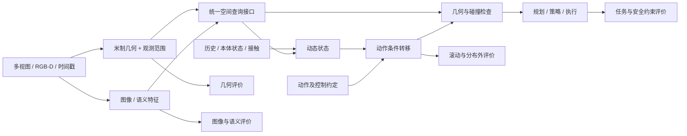
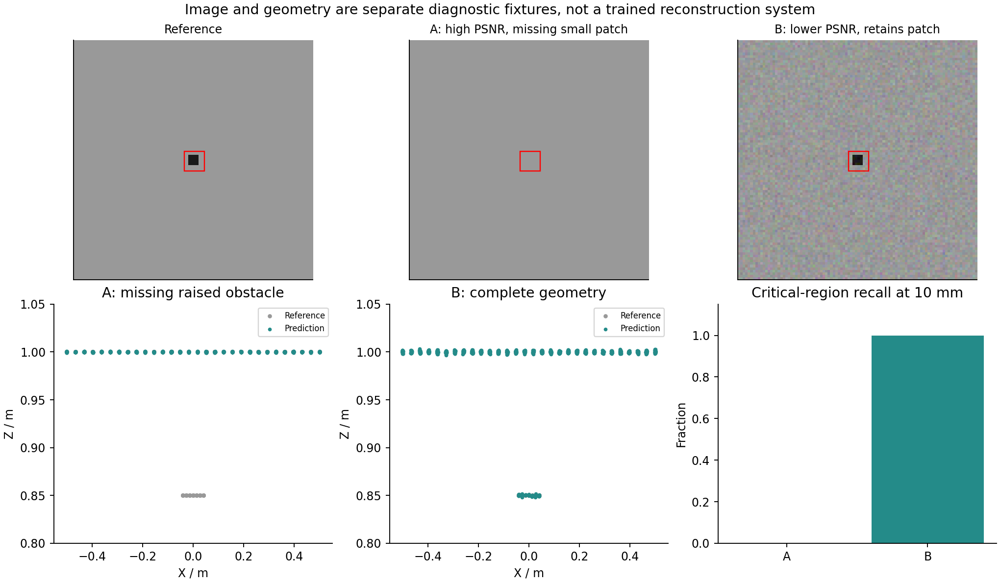
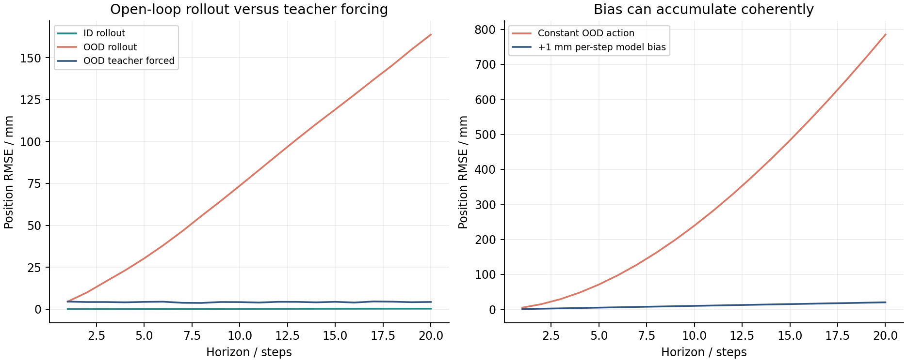

# D28 · 统一表示与重建、动态模型的验收边界

[返回学习入口](../_index.md) ｜ [本周日程](../P2-深度理解-日程.md) ｜ [上一课 D27](../day27/Daily-Learning-Pack.md) ｜ [下一课 D29](../day29/Daily-Learning-Pack.md) ｜ [完整 CPU 实验](demo.py)

**同一份表示可以连接图像、几何、语义和动作，但它能做什么，最终取决于接口和验收证据。高图像分数不能替代关键区域几何完整性；低单步误差不能替代多步、分布外或闭环表现。**

本课保留原定 **P2 / W4-D7 / Day28：统一表示、重建与动态评价边界、W4验收**，课程日期 **2026-10-02**，于 **2026-10-09 补写**。D22–27已经串起SfM、BA、辐射场、几何约束和特征融合；今天把它们收束到可检查的系统接口与证据链。材料实跑通过不等于你已经掌握；本页个人验收仍由你完成。

<details>
<summary>个人学习记录（后续生成保留）</summary>

<!-- learner-notes:start -->

- 我的统一表示接口和坐标/单位约定：
- 本周最有代表性的失败反例：
- 几何、动态、任务三类验收的实际结果：
- 自测得分、尚未理解的内容及下一步：

<!-- learner-notes:end -->

</details>

<!-- daily-pack-generated:start -->

## 0. 今天的能力目标

完成本课后，应能：

1. 说明点云、网格、SDF、辐射场、特征场与动态潜状态保存了哪些信息。
2. 给“统一表示”写出坐标、尺度、时间、可见性和能力边界明确的接口。
3. 手算重投影尺度歧义、双向表面距离、阈值召回和PSNR。
4. 区分单步预测、teacher forcing、自由滚动、分布外压力测试与真实闭环。
5. 解释误差如何随预测长度累积，用实验反例拒绝不充分的成功结论。
6. 为W4留下可复查的运行记录、几何验收卡和动态验收卡。

| 顺序 | 知识主线 | 需要回答的问题 |
| --- | --- | --- |
| ① | 统一接口 | 表示统一了哪些信息？哪些信息仍然未知？ |
| ② | 重建评价 | 图像、表面距离和关键区域覆盖能否相互替代？ |
| ③ | 动态评价 | 单步拟合好，为什么20步还会偏离？ |
| ④ | 独立对照实验 | 只改变动作幅值或模型偏置，会发生什么？ |
| ⑤ | W4验收 | 每条“已完成”主张应附什么证据？ |

## 1. 宏观：统一表示是共享坐标与查询语义



“统一”不要求把所有东西硬塞进一个向量。一个实用方案是：几何地图提供米制空间锚点，特征场提供任务相关语义，时序状态保留运动与历史，再用明确的查询协议连接它们。

例如 `query(X_world, time)` 返回局部几何距离、语义向量、是否观测、地图版本；`predict(state, action, dt)` 返回下一状态及预测有效范围。它们可以共享编码器或特征，也可以是不同模块。共享参数是实现选择，**共享坐标和可核验的输入输出才是系统契约**。

### 1.1 本周各表示的职责

| 表示 | 典型数据与shape | 能直接回答 | 不能仅凭该表示保证 |
| --- | --- | --- | --- |
| 点云 | `xyz[N,3]`，m | 已采样表面在哪里 | 表面之间是否封闭、未见区是否空闲 |
| 网格 | `vertices[N,3], faces[M,3]` | 连续三角面、法向、射线相交 | 拓扑正确、厚度可靠、动态响应 |
| SDF | `d(X)[N,1]`，m | 到约定表面的有符号距离 | 训练结果一定满足真实距离性质 |
| TSDF | 截断距离及融合权重 | 观测附近的表面融合 | 截断带外都已知、内部/未知无歧义 |
| 占据地图 | 概率/布尔值和已观测掩码 | 栅格是否被认为占据 | 有精确表面距离、概率已校准 |
| 辐射场 | `sigma[N,1], rgb[N,3]` | 已建模视角下的体渲染 | 密度就是实体、几何尺度正确 |
| 特征场 | `feature[N,C]` | 在空间位置查询语义证据 | 特征相似就空间邻近、碰撞可行 |
| 动态潜状态 | `z[B,D]`或时空token | 历史的压缩与预测条件 | 可解码全部物理状态、对动作外推可靠 |

SDF中的正负方向必须写明，例如“物体外为正”。TSDF中的零值可能来自真实表面，也可能来自初始化；必须结合观测权重判断。特征维度128并不表示128个可解释物理量；潜状态维度大也不自动消除部分可观测性。

### 1.2 “未观测”应是独立字段

假设某体素没有任何深度射线经过。把它初始化为占据概率0.5，与把它标记为已观测且确有0.5的不确定占据，不是同一件事。

建议分开保存：

```python
SpatialQuery = {
    "frame_id": "base",
    "timestamp_s": 0.0,
    "map_version": 12,
    "xyz_m": "... [N, 3]",
    "distance_m": "... [N, 1], only valid if supported",
    "observed_mask": "... [N], bool",
    "semantic_feature": "... [N, C]",
    "support_count": "... [N], number of valid observations",
}
```

`support_count`多不一定意味着独立证据多：相邻视频帧强相关，重复融合同一个视角不会补出背面。`observed_mask`为真也只说明按当前观测模型看过，不代表没有标定、遮挡或动态误差。

## 2. 先把尺度和坐标验收好，才有可比的指标

### 2.1 单目重投影为什么不能确定米制尺度

投影为：

$$
u=\pi\!\left(K(RX+t)\right).
$$

若同时把世界点与平移放大 $s>0$：

$$
X'=sX,\quad t'=st,
$$

则：

$$
\pi\!\left(K(RX'+t')\right)
=\pi\!\left(sK(RX+t)\right)
=\pi\!\left(K(RX+t)\right).
$$

齐次归一化消掉了正比例因子。所有图片像素可以完全相同，地图却整体放大两倍。本课脚本对三个点做2倍尺度变换，最大像素差为 **0 px**。

单目SfM因此通常只有相似变换意义下的结构，需已知基线、RGB-D、物体尺寸或其他米制来源固定尺度。D23实验使用已知相机约束来排除规范自由度；不能把“固定相机”的结论推广到未经锚定的单目系统。

### 2.2 对齐能去掉什么，也会掩盖什么

评估重建点云常先对齐：

- 只对齐SE(3)：去掉刚体坐标差，保留尺度误差。
- 对齐Sim(3)：同时去掉尺度差，用于观察形状恢复能力。
- 完全不对齐：测部署到规定坐标系后的整体误差。

三者回答不同问题。机器人要在 `base` 坐标下抓取10 cm宽物体，Sim(3)对齐后的低误差不能证明部署尺度正确。应同时报告“形状对齐后误差”和“米制/坐标误差”；后者可能正是执行失败原因。

如果模型用完整测试点云求Sim(3)，再报告该测试点云的拟合误差，也应明确这是评估时的对齐步骤。不能把测试真值参与的对齐描述成部署时无需真值就具备的定位能力。

### 2.3 最小坐标检查卡

每次输出点或位姿，写清：

| 项目 | 示例 | 未写清的后果 |
| --- | --- | --- |
| 坐标系 | `camera_optical`或`base` | 点正确但抓取落错位置 |
| 长度单位 | m；传感器原始深度另有scale | mm/m导致1000倍差 |
| 深度定义 | 相机Z还是沿单位射线的距离 | 离光轴越远误差越明显 |
| 位姿方向 | $T_{bc}$把相机点变到基座 | 逆变换误用 |
| 时间 | 相机曝光时间、状态采样时间 | 动态物体产生系统偏差 |
| 对齐协议 | SE(3)/Sim(3)/无对齐 | 不同报告失去可比性 |

这张卡比单独增加一个综合分数更能定位系统问题。

## 3. 重建评价：准确、完整和关键区域必须分开

### 3.1 两个方向的最近邻距离

设预测表面采样点 $P=\{p_i\}_{i=1}^{N}$，参考点 $G=\{g_j\}_{j=1}^{M}$，单位均为米。

预测到真值：

$$
d_{P\to G}(p_i)=\min_{g\in G}\|p_i-g\|_2.
$$

参考到预测：

$$
d_{G\to P}(g_j)=\min_{p\in P}\|g_j-p\|_2.
$$

前一个方向检验“你生成的点有多准”；后一个方向检验“真实表面有多少被覆盖”。只重建最容易的一小块平面，可以让第一个方向很好，而第二个方向很差。

本课明确采用**非平方距离、两个方向均值再取平均**：

$$
\operatorname{CD}_{\rm mean}(P,G)
=\frac12\left[
\frac1N\sum_i d_{P\to G}(p_i)
+\frac1M\sum_j d_{G\to P}(g_j)
\right].
$$

其单位是 **m**。其他实现可能不除2、使用平方距离或不同归一化；平方版本单位是 $\mathrm m^2$。看到“Chamfer=0.01”而不知道定义与单位，没有足够信息判断质量。

本课代码计算：

```python
distances = np.linalg.norm(
    pred[:, None, :] - truth[None, :, :], axis=-1
)  # [N, M], m
accuracy = distances.min(axis=1)       # [N], pred -> reference
completeness = distances.min(axis=0)   # [M], reference -> pred
chamfer = 0.5 * (accuracy.mean() + completeness.mean())
```

这里 `accuracy_mean_m`是“准确性距离”，**越低越好**，不是分类正确率。稠密点集真实工程中应用KD-tree或空间索引；本实验约千点，直接距离矩阵可读且可运行。

### 3.2 阈值分数需要阈值，也需要区域定义

给定容忍阈值 $\tau=0.01\ \mathrm m$：

$$
P_\tau=\frac{\#\{p:d_{P\to G}(p)<\tau\}}{N},\qquad
R_\tau=\frac{\#\{g:d_{G\to P}(g)<\tau\}}{M},
$$

$$
F_\tau=\frac{2P_\tau R_\tau}{P_\tau+R_\tau}.
$$

本课严格使用 $<\tau$，没有等号。这里的precision/recall是几何容忍阈值下的表面指标，并没有真实负类，因此不能直接套用分类混淆矩阵中的所有含义。

如果物体的抓取边缘只占参考点的5%，遗漏它对全局recall的影响最多也只有约5%；任务却可能完全失败。于是再定义关键区域掩码 $G_{\rm critical}$：

$$
R_{\tau,\rm critical}
=\frac{\#\{g\in G_{\rm critical}:d_{G\to P}(g)<\tau\}}
{|G_{\rm critical}|}.
$$

关键区域应按实际任务提前定义，例如夹爪接触区域、必经通道、细杆或障碍边缘。不能看完模型结果后只选择它表现好的区域再称为关键区。

### 3.3 一个真实可复算的反例

参考由900个平面点和49个凸起区域点组成，共949点。

- A只重建平面，位置噪声标准差0.3 mm，漏掉全部凸起。
- B重建全部区域，位置噪声标准差1 mm。
- 凸起是独立的诊断几何，用来代表任务中不可漏掉的小障碍；本课没有执行真实碰撞动作。

| 指标 | A：精确但缺失 | B：较噪但完整 |
| --- | ---: | ---: |
| 预测→真值均值 | 0.475 mm | 1.598 mm |
| 真值→预测均值 | 8.236 mm | 1.598 mm |
| 本课Chamfer均值 | 4.356 mm | 1.598 mm |
| Precision@10 mm | 100% | 100% |
| Recall@10 mm | 94.837% | 100% |
| F-score@10 mm | **97.350%** | 100% |
| 关键区域Recall@10 mm | **0%** | **100%** |

A没有生成离真实表面很远的点，所以precision仍是100%。其高F-score也没有消除“关键区域完全漏掉”的事实。此时需要解决的是覆盖缺失，单纯让已有平面更平滑并不修复主要问题。

这些指标依赖采样分布。若把平面点数加十倍而关键点仍为49，均值会进一步掩盖关键缺失。因此正式评价还应记录采样密度、可见表面范围以及区域加权方式。

## 4. 图像评价为何不能代替几何评价

像素已归一化到 $[0,1]$，设参考图 $I$ 与输出图 $\hat I$ shape均为 `[H,W,3]`：

$$
\operatorname{MSE}=\frac{1}{3HW}\sum_{h,w,c}(\hat I_{hwc}-I_{hwc})^2,
$$

$$
\operatorname{PSNR}=-10\log_{10}(\operatorname{MSE}).
$$

若使用0–255数值且未归一化，应写 $10\log_{10}(255^2/\operatorname{MSE})$。同一个数值结果不能跨不同像素范围直接比较。

本课参考图为96×96、背景0.6，中间4×4小区域为0.1。A把整张图都预测为0.6。仅16个像素的三个通道有0.5的偏差：

$$
\operatorname{MSE}_A
=\frac{16}{96^2}\times 0.5^2
=\frac{1}{2304},
$$

$$
\operatorname{PSNR}_A=10\log_{10}(2304)
\approx33.625\ \mathrm{dB}.
$$

B保留该小区域，但全图加入标准差0.035的噪声，实际PSNR约29.160 dB。A的全图PSNR更高，关键小区域却消失了。

**这两张图是专门构造的图像诊断样例，上一节点云是另一个几何诊断样例；它们不是同一套训练重建系统的渲染输出。** 本实验支持“全局平均指标可以忽略局部缺失”这一机制，不支持“A/B是两种真实重建算法的性能排名”。



上排看图像均值如何弱化小区域的重要性；下排看A漏掉凸起、B保留凸起；右下的关键区域recall让被全局平均掩盖的问题变得明确。图像与点云是不同诊断夹具，不能从上排的像素直接计算下排几何距离。

NeRF的原始任务以已知相机姿态的图像训练辐射场，再渲染新视角；这支持把新视角图像表现当作一项核心评价，但并不自动给出操作所需的米制碰撞保证。参见[NeRF原论文](https://arxiv.org/abs/2003.08934)。本课没有运行完整NeRF训练或与公开数据集榜单比较。

## 5. 动态评价：你测的是哪一种“预测”

### 5.1 状态和动作的最小接口

本课真实合成状态：

$$
s_t=\begin{bmatrix}x_t\\v_t\end{bmatrix},
\quad
x:\mathrm m,\quad v:\mathrm{m/s},\quad
a:\mathrm{m/s^2},\quad\Delta t=0.1\ \mathrm s.
$$

动作经过执行器饱和：

$$
\bar a_t=\operatorname{clip}(a_t,-1,1),
$$

$$
v_{t+1}=0.95v_t+\Delta t\bar a_t,\qquad
x_{t+1}=x_t+\Delta t v_{t+1}.
$$

这是本课明确规定的离散系统，不是声称对任意真实机器人精确积分。注意位置用了**更新后的速度**；因此无饱和区域矩阵是：

$$
s_{t+1}
=
\underbrace{\begin{bmatrix}1&0.095\\0&0.95\end{bmatrix}}_A s_t
+
\underbrace{\begin{bmatrix}0.01\\0.1\end{bmatrix}}_B a_t.
$$

$A$的上右元素包含时间单位，$B$第一项包含时间平方；状态不同分量不能省略单位后盲目混合。

学习模型是线性回归：

$$
\hat s_{t+1}
=
[x_t,\ v_t,\ a_t,\ 1]W,\qquad W\in\mathbb R^{4\times2}.
$$

训练使用1200个独立单步样本，动作仅在 $[-0.5,0.5]\ \mathrm{m/s^2}$，目标的两个分量分别加标准差0.0005的噪声：位置为0.0005 m，速度为0.0005 m/s。它们数值相同，量纲不同。实验的解析线性回归拟合两列输出，不把这两个误差当成可不加权相加的物理代价。

### 5.2 单步与teacher forcing

单步评价给模型真实 $s_t$，比较 $\hat f(s_t,a_t)$ 与真实 $s_{t+1}$。

teacher forcing在连续测试轨迹每一步重新提供真实上一步状态：

$$
\hat s_{t+h}^{\rm teacher}=f_\theta(s_{t+h-1}^{\rm true},a_{t+h-1}).
$$

虽然能画出横轴为1–20步的曲线，但它不是20步自主预测。每一项都只跨一步，先前预测误差没有进入下一次输入。

这种评价有用途：它隔离局部转移拟合误差。如果部署时有同等准确度的状态估计反馈，也可能更接近短反馈周期中的某个子模块。但是，**把teacher forcing结果叫“20步开环精确预测”是错误结论**。

### 5.3 自由滚动

从同一个初始状态出发：

$$
\hat s_{t+h}=f_\theta(\hat s_{t+h-1},a_{t+h-1}),\quad
\hat s_t=s_t.
$$

后续只吃自己的预测，不读取测试真值修正。对120条独立测试轨迹，在第 $h$ 步的**位置**误差：

$$
E_h=\sqrt{\frac{1}{120}\sum_{b=1}^{120}
(\hat x_{b,t+h}-x_{b,t+h})^2}.
$$

这里没有混入速度误差，也不是从1到 $h$ 的平均误差。若报告一条数值，必须写清它是末步、全时段均值、最大误差还是失败率。

### 5.4 分布外到底改了什么

本实验固定初始状态、动作符号与时序，把同一批动作整体乘4：

$$
a^{\rm OOD}_{b,t}=4a^{\rm ID}_{b,t}.
$$

训练动作范围是±0.5；OOD测试范围扩为±2，超出真实执行器的±1饱和边界。无饱和训练数据无法告诉线性模型“超过1后不再线性增大”。因此OOD失败来自明确的模型结构与训练支持范围，不是仅给难例贴一个标签。

ID只表示动作处于本实验训练范围；并不自动代表真实机器人的完整部署分布都已覆盖。本课测试使用新的起始状态与动作，模型在测试前冻结，没有用测试结果继续拟合。

## 6. 为什么很小的一步偏差会变成很大的末步误差

### 6.1 线性化的误差传播

设真实转移是 $f$，学习模型是 $\hat f$，误差 $e_t=\hat s_t-s_t$。在真实轨迹附近：

$$
e_{t+1}\approx \hat A_t e_t+b_t,
$$

其中：

$$
\hat A_t=\frac{\partial \hat f}{\partial s}(s_t,a_t),
\quad
b_t=\hat f(s_t,a_t)-f(s_t,a_t).
$$

固定线性化矩阵、固定偏差时：

$$
e_h\approx \hat A^he_0+\sum_{k=0}^{h-1}\hat A^k b.
$$

当误差方向与系统中接近积分器的方向一致时，偏差会逐步累积。随机零均值噪声和相同符号的系统偏置也不一样：前者可能部分抵消，后者会持续把预测推向同一侧。

本课真实位置状态的 $A_{11}=1$，拟合模型的对应系数接近1，因此每步固定加1 mm位置偏置，会接近每步累加。实际20步位置RMSE从基准 **0.253 mm**升到 **20.203 mm**。不能因为一步只有约1 mm就认为20步仍是1 mm。

### 6.2 动作饱和的手算

从相同初始状态出发，连续输入 $a=1.5$。真实执行器取1，训练得到的线性模型近似仍用1.5。理想无噪声线性拟合下：

$$
\delta v_{k+1}=0.95\delta v_k+0.1(1.5-1)
=0.95\delta v_k+0.05.
$$

初始差为0，解为：

$$
\delta v_k=1-0.95^k\quad(\mathrm{m/s}).
$$

位置采用更新后速度，因此：

$$
\delta x_H
=0.1\sum_{k=1}^{H}\delta v_k
=0.1\left[H-\frac{0.95(1-0.95^H)}{0.05}\right]\ \mathrm m.
$$

这解释了为什么恒定越界动作在20步时能产生接近0.8 m的偏差。本课拟合还含训练噪声和微小参数误差，实际值为 **0.785 m**；应区分解析理想情况与真实拟合结果，不把两者写成精确相等。

### 6.3 实际曲线和边界

| 条件；位置RMSE | 第1步 | 第5步 | 第10步 | 第20步 |
| --- | ---: | ---: | ---: | ---: |
| ID自由滚动 | 0.029 mm | 0.083 mm | 0.141 mm | 0.253 mm |
| ID teacher forcing | 0.029 mm | 0.028 mm | 0.027 mm | 0.030 mm |
| OOD自由滚动 | 4.476 mm | 30.232 mm | 73.576 mm | **163.716 mm** |
| OOD teacher forcing | 4.476 mm | 4.310 mm | 4.191 mm | **4.267 mm** |
| 恒定1.5的OOD自由滚动 | 5.138 mm | 70.890 mm | 239.115 mm | **784.773 mm** |
| ID模型另加1 mm位置偏置 | 1.012 mm | 5.051 mm | 10.100 mm | **20.203 mm** |



左图中蓝线每步得到真值状态，红线则必须依靠自身预测继续前进，两者不能当作同一种预测协议比较高低。右图展示两个独立压力测试：持续越界动作和固定位置偏置。二者是特意隔离的机制对照，没有把所有变量同时改掉。

这些结果来自一个二维状态的合成线性模型，不是Dreamer或V-JEPA 2的性能评价，也不代表线性模型总是差。在线性且训练覆盖的区域，线性回归恰好适合这个系统；失败发生在它未建模的饱和非线性与持续偏差上。

## 7. 动态误差之外，还缺哪几层证据

### 7.1 表征预测误差并不自动等于物理误差

潜状态预测可能优化：

$$
\|\hat z_{t+1}-z_{t+1}\|_1
\quad\text{或}\quad
\|\hat z_{t+1}-z_{t+1}\|_2^2.
$$

若编码器对任务关键的小障碍不敏感，低特征误差也可能漏掉碰撞风险。反过来，相机光照变化引起较大特征差，也不一定对应大的物理位移。

需要一条任务相关的验证链：特征差能否支持目标到达判断？模型是否保留速度、接触和被遮挡对象？预测错误主要来自编码器遗漏信息、转移模型，还是解码/标定？

D27的V-JEPA 2-AC使用动作条件表示预测进行图像目标规划。它说明特征空间可以为动作搜索提供代价，不能据此跳过具体环境的动作覆盖、滚动误差和任务验证。[V-JEPA 2原论文](https://arxiv.org/html/2506.09985v1)

### 7.2 开环预测和闭环控制是两个实验

开环：给固定动作序列，未来不校正。

闭环：实际执行一段动作，读取新观测，更新状态，再规划或选择动作。

闭环反馈可以纠正一部分累积误差，但可能受感知延迟、状态估计误差、执行器约束和不可逆接触影响。不能把“将来可以用闭环纠正”当成当前预测实验已经通过的证据。

Dreamer在学到的模型中想象轨迹来学习行为；它的策略与价值学习目标涉及任务回报。仅测试状态预测RMSE，不等于测试了学得策略的任务表现。参见[Dreamer原论文](https://arxiv.org/pdf/1912.01603.pdf)。本周微型实验没有训练Dreamer策略，也没有机器人闭环成功率。

### 7.3 不确定性应通过覆盖率核验

若模型声称下一位置落在区间 $[\ell_t,u_t]$ 内的概率为90%，应在独立样本统计：

$$
\widehat{\operatorname{coverage}}
=\frac1N\sum_i
\mathbf1\{x_i\in[\ell_i,u_i]\}.
$$

接近90%的覆盖率只是校准的一部分；还要看区间宽度。给出整个工作空间那么宽的区间，覆盖率虽高，却难以帮助规划。

本课demo**没有输出概率区间，也没有验证不确定性校准**。这里定义的是后续工程验收项目。不要把多个确定性模型的分歧或一个网络的置信度直接当成已经校准的失误概率。

### 7.4 分层工程验收表

| 层 | 至少记录什么 | 不能据此宣称什么 |
| --- | --- | --- |
| 输入与标定 | 时间、K、外参、单位、深度有效范围 | 所有动态时刻均无误差 |
| 表示 | 观测掩码、尺度、支持范围、查询语义 | 未观测区域已正确补全 |
| 图像/语义 | 新视角划分、局部区域、类别分布 | 几何或碰撞必然正确 |
| 几何 | 双向距离、阈值、关键区、尺度 | 运动过程无需动力学 |
| 动态 | 状态/动作单位、预测长度、ID/OOD | 学会了闭环操作策略 |
| 任务 | 到达、碰撞、失败原因、重复试验 | 在所有新环境泛化 |

## 8. 实操：先预测，再运行，再改一个变量

### 8.1 运行前写下你的预测

先不看结果文件，回答：

1. A只重建平面，precision会低吗？recall和关键区域recall分别怎样？
2. 图像的小区域只占16/9216，漏掉它会让PSNR跌到很低吗？
3. 训练动作没超过0.5，模型能仅凭数据辨认1.0的饱和阈值吗？
4. OOD的teacher forcing与自由滚动，20步哪个更大？原因是新的噪声还是误差反馈？
5. 每步1 mm恒定位置偏置，20步大致是1、20还是400 mm？写下依据。

### 8.2 独立运行，不依赖前课checkpoint

在vault根目录运行：

```bash
python -B 3d_learning/day28/demo.py
```

依赖NumPy与Matplotlib，无需下载数据或模型。2026-10-09已在CPU环境验证：NumPy **1.26.4**、Matplotlib **3.10.9**。脚本固定seed28，生成：

- [机器可读结果](../../_assets/3d_learning/day28/results.json)
- 数组与完整误差曲线 (not exported: excluded by publication policy)
- [重建诊断图](../../_assets/3d_learning/day28/reconstruction_audit.png)
- [动态诊断图](../../_assets/3d_learning/day28/dynamics_audit.png)

脚本自带的断言检查：图像PSNR反例成立、A关键区召回为0、B为1、尺度不改变投影。这些是资料的一致性检查，不是机器人部署验收。动态曲线写入结果供分析，没有把单个固定种子的数值当成普遍性能阈值。

### 8.3 只改一个变量，保留原始结果作对照

选一项；修改前先复制结果到你的个人实验目录，或记录表格，避免默认脚本覆盖后失去对照。

**实验A：几何容忍阈值。** 把 `tolerance=.01` 改为 `.002`。先预测B的recall是否仍为100%。此时函数里的字段名称仍写 `at_10mm`，也必须改成准确的阈值名称，或把阈值做成单独metadata；不能只改算法数值却留下错误标签。判断改变来自质量还是评价标准。默认脚本对B关键区100%的断言也需要重新解释：该断言属于原10 mm夹具，不能当成2 mm新实验仍必须通过的结论。

**实验B：动作幅值。** 仅把 `actions_ood=4.*actions_id` 的倍数改为2。新动作范围为±1，刚好没有越过饱和界。先预测20步误差会大幅降低还是保持原值，再运行。这个实验验证的是“训练范围外但仍在同一线性机制内”与“越过未建模非线性”并不相同。

**实验C：偏置符号。** 仅将模型位置截距增加量从0.001改为−0.001。预测位置偏离方向会翻转，但RMSE是否仍近似20 mm？图中RMSE丢弃符号；需要另输出有符号均值误差才能验证方向。

**实验D：关键区采样权重。** 仅增加平面采样密度，保持49个关键点和几何不变。预期全局recall/Chamfer可能显得更好，关键区recall仍为0。记录这说明评价采样分布怎样影响结论，不要把点数变化当成几何变好了。

### 8.4 完整主脚本

> [!note]- 完整 CPU 主脚本（与 demo.py 一致）
>
> ```python
> """D28: independent reconstruction/dynamics audit, synthetic data only.
> Run: python -B 3d_learning/day28/demo.py
> Distances are metres; symmetric Chamfer is half the sum of unsquared means.
> """
> import os
> os.environ.setdefault("MPLCONFIGDIR","/tmp/day28-mpl")
> from pathlib import Path
> import json
> import numpy as np
> import matplotlib
> matplotlib.use("Agg")
> import matplotlib.pyplot as plt
> 
> OUT=Path(__file__).resolve().parents[2]/"_assets/3d_learning/day28"
> 
> 
> def surface_metrics(pred,truth,critical_mask,tolerance=.01):
>     distances=np.linalg.norm(pred[:,None,:]-truth[None,:,:],axis=-1)
>     accuracy=distances.min(1);completeness=distances.min(0)
>     precision=float(np.mean(accuracy<tolerance));recall=float(np.mean(completeness<tolerance))
>     return dict(chamfer_mean_m=float(.5*(accuracy.mean()+completeness.mean())),
>         precision_at_10mm=precision,recall_at_10mm=recall,
>         fscore_at_10mm=float(2*precision*recall/max(precision+recall,1e-12)),
>         critical_region_recall=float(np.mean(completeness[critical_mask]<tolerance)),
>         accuracy_mean_m=float(accuracy.mean()),completeness_mean_m=float(completeness.mean()))
> 
> 
> def true_step(s,a,dt=.1):
>     acceleration=np.clip(a,-1,1)
>     v=.95*s[...,1]+dt*acceleration
>     return np.stack([s[...,0]+dt*v,v],-1)
> 
> 
> def design(s,a):
>     return np.c_[s,np.asarray(a),np.ones(len(s))]
> 
> 
> def simulate(s,actions,model=None,teacher=False):
>     true=s.copy();pred=s.copy();errors=[]
>     for a in actions.T:
>         nxt=true_step(true,a)
>         if model is None:
>             estimate=true_step(pred,a)
>         else:
>             estimate=design(true if teacher else pred,a)@model
>         errors.append(np.sqrt(np.mean((estimate[:,0]-nxt[:,0])**2)))
>         true,pred=nxt,estimate
>     return np.array(errors)
> 
> 
> def main():
>     OUT.mkdir(parents=True,exist_ok=True)
>     rng=np.random.default_rng(28)
>     x,y=np.meshgrid(np.linspace(-.5,.5,30),np.linspace(-.5,.5,30))
>     plane=np.c_[x.ravel(),y.ravel(),np.ones(x.size)]
>     x,y=np.meshgrid(np.linspace(-.04,.04,7),np.linspace(-.04,.04,7))
>     obstacle=np.c_[x.ravel(),y.ravel(),np.full(x.size,.85)]
>     truth=np.r_[plane,obstacle]
>     critical=np.r_[np.zeros(len(plane),bool),np.ones(len(obstacle),bool)]
>     # A is precise where it reconstructs, but omits a collision-critical region.
>     pred_a=plane+rng.normal(0,.0003,plane.shape)
>     pred_b=truth+rng.normal(0,.001,truth.shape)
>     reference=np.full((96,96,3),.6);reference[46:50,46:50]=.1
>     image_a=np.full_like(reference,.6)
>     image_b=np.clip(reference+rng.normal(0,.035,reference.shape),0,1)
>     rows={}
>     for name,pred,img in [("A_incomplete",pred_a,image_a),("B_complete_noisy",pred_b,image_b)]:
>         rows[name]=surface_metrics(pred,truth,critical)
>         rows[name]["image_psnr_db"]=float(-10*np.log10(np.mean((img-reference)**2)))
>     # Exact projection-scale invariance; image fit cannot determine metric scale.
>     X=np.array([[.1,.2,1.5],[-.2,.1,2.],[.3,-.1,2.5]])
>     t=np.array([.1,0,.05])
>     project=lambda q:600*q[:,:2]/q[:,2:3]+np.array([320,240])
>     scale_error=float(np.max(np.abs(project(X+t)-project(2*(X+t)))))
>     # Train on independent one-step samples in action range [-.5,.5].
>     s=rng.uniform([-.3,-.2],[.3,.2],(1200,2));a=rng.uniform(-.5,.5,1200)
>     y=true_step(s,a)+rng.normal(0,.0005,(len(s),2))
>     weight=np.linalg.lstsq(design(s,a),y,rcond=None)[0]
>     starts=rng.uniform([-.2,-.1],[.2,.1],(120,2))
>     actions_id=rng.uniform(-.5,.5,(120,20))
>     # Same initial states, same action signs/timing; only action amplitude changes.
>     actions_ood=4.*actions_id
>     curves={}
>     for name,actions in [("in_distribution",actions_id),("outside_action_range",actions_ood)]:
>         curves[name+"_rollout"]=simulate(starts,actions,weight)
>         curves[name+"_teacher"]=simulate(starts,actions,weight,teacher=True)
>     # Fixed-direction stress test makes bias accumulation directly visible.
>     coherent=np.full((120,20),1.5)
>     curves["constant_ood_rollout"]=simulate(starts,coherent,weight)
>     # A 1 mm constant per-step position bias: one-step versus twenty-step checks.
>     biased_weight=weight.copy();biased_weight[-1,0]+=.001
>     curves["position_bias_rollout"]=simulate(starts,actions_id,biased_weight)
>     dynamics={name:{str(h):float(curve[h-1]) for h in [1,5,10,20]} for name,curve in curves.items()}
>     result=dict(seed=28,versions=dict(numpy=np.__version__,matplotlib=matplotlib.__version__),
>         metric_definition="Chamfer: half sum of unsquared directed means; metres",
>         reference_points=len(truth),critical_points=len(obstacle),surface=rows,
>         image_scope="Two diagnostic synthetic images, not renderings of the point clouds",
>         scale2_projection_max_error_px=scale_error,
>         dynamics=dict(dt_s=.1,training_action_range=[-.5,.5],true_acceleration_clip=[-1,1],
>             train_samples=1200,test_trajectories=120,position_rmse_m=dynamics),
>         protocol="Frozen model; no heldout feedback in rollout; teacher uses true previous state.")
>     assert rows["A_incomplete"]["image_psnr_db"]>rows["B_complete_noisy"]["image_psnr_db"]
>     assert rows["A_incomplete"]["critical_region_recall"]==0
>     assert rows["B_complete_noisy"]["critical_region_recall"]==1
>     assert scale_error<1e-12
>     (OUT/"results.json").write_text(json.dumps(result,indent=2),encoding="utf-8")
>     np.savez(OUT/"arrays.npz",truth=truth,pred_a=pred_a,pred_b=pred_b,critical=critical,
>              reference_image=reference,image_a=image_a,image_b=image_b,**curves)
>     plt.rcParams.update({"font.size":10,"axes.spines.top":False,"axes.spines.right":False})
>     fig,axs=plt.subplots(2,3,figsize=(12,7),layout="constrained")
>     for ax,img,title in zip(axs[0],[reference,image_a,image_b],["Reference","A: high PSNR, missing small patch","B: lower PSNR, retains patch"]):
>         ax.imshow(img);ax.set_title(title,fontsize=10);ax.set_xticks([]);ax.set_yticks([])
>         ax.add_patch(plt.Rectangle((44,44),8,8,fill=False,edgecolor="red",lw=1))
>     for ax,pred,title in zip(axs[1,:2],[pred_a,pred_b],["A: missing raised obstacle","B: complete geometry"]):
>         ax.scatter(truth[:,0],truth[:,2],c="#999999",s=7,label="Reference")
>         ax.scatter(pred[:,0],pred[:,2],s=5,c="#248b89",label="Prediction")
>         ax.set(title=title,xlabel="X / m",ylabel="Z / m",ylim=(.8,1.05));ax.legend(fontsize=7)
>     ax=axs[1,2]
>     names=["A","B"];vals=[rows[k]["critical_region_recall"] for k in rows]
>     ax.bar(names,vals,color=["#d87967","#248b89"])
>     ax.set(title="Critical-region recall at 10 mm",ylabel="Fraction",ylim=(0,1.15))
>     fig.suptitle("Image and geometry are separate diagnostic fixtures, not a trained reconstruction system")
>     fig.savefig(OUT/"reconstruction_audit.png",dpi=170);plt.close(fig)
>     fig,axs=plt.subplots(1,2,figsize=(11,4.4),layout="constrained")
>     steps=np.arange(1,21)
>     for key,label,c in [("in_distribution_rollout","ID rollout","#248b89"),
>         ("outside_action_range_rollout","OOD rollout","#d87967"),
>         ("outside_action_range_teacher","OOD teacher forced","#315681")]:
>         axs[0].plot(steps,curves[key]*1000,label=label,c=c)
>     for key,label,c in [("constant_ood_rollout","Constant OOD action","#d87967"),
>                         ("position_bias_rollout","+1 mm per-step model bias","#315681")]:
>         axs[1].plot(steps,curves[key]*1000,label=label,c=c)
>     for ax in axs:ax.set(xlabel="Horizon / steps",ylabel="Position RMSE / mm");ax.legend(fontsize=8);ax.grid(alpha=.2)
>     axs[0].set_title("Open-loop rollout versus teacher forcing")
>     axs[1].set_title("Bias can accumulate coherently")
>     fig.savefig(OUT/"dynamics_audit.png",dpi=170);plt.close(fig)
>     print(json.dumps(result,indent=2))
> 
> 
> if __name__=="__main__":
>     main()
> ```

## 9. W4收束：把本周七课压成一条证据链

| 原课程 | 本周必须能解释的机制 | 至少可检查的产出 |
| --- | --- | --- |
| [D22 SfM](../day22/Daily-Learning-Pack.md) | 匹配→几何验证→相机关系→三角化；增量/全局流程与尺度 | 一张SfM图、尺度/退化说明 |
| [D23 BA](../day23/Daily-Learning-Pack.md) | 重投影残差、规范自由度、雅可比、Schur消元、鲁棒误差 | 能运行的最小优化、固定锚与保留观测记录 |
| [D24 NeRF](../day24/Daily-Learning-Pack.md) | 射线、密度、透射率、权重与颜色；单步状态预测 | 体渲染公式及实验输出、预测接口 |
| [D25 加速表示与预测](../day25/Daily-Learning-Pack.md) | 表示效率与信息含义；一步到多步预测的边界 | 表示对照、滚动误差记录 |
| [D26 几何约束](../day26/Daily-Learning-Pack.md) | 颜色歧义、深度约束、碰撞几何、动作候选评分 | 几何误差反例、地图误差导致净空错误 |
| [D27 重建与融合](../day27/Daily-Learning-Pack.md) | 反投影、可见性、2D/3D特征；无动作与动作条件阶段 | 含未知掩码的融合输出、轨迹划分实验 |
| D28 统一评价 | 坐标/尺度、图像/几何/动态分层、关键区和OOD | 三张验收卡与失败案例说明 |

### 9.1 三张验收卡，不用一句“整体效果好”代替

**卡1：几何与重建。**

- 列出输入、坐标、单位、固定尺度的来源。
- 写出准确性距离、完整性距离、阈值和关键区域。
- 指定训练/新视角划分，以及是否使用评估真值对齐。
- 至少解释一个“像素正确但几何错误”或“全局高分但关键缺失”的反例。

**卡2：动态与动作。**

- 状态、动作、控制周期和执行器限制。
- 训练动作范围，测试是否来自新轨迹/新起点。
- 第1/5/10/20步误差，明确teacher forcing或自由滚动。
- 一个只改单变量的分布外或偏置对照。
- 明确是否真正运行了规划、策略学习或闭环执行。

**卡3：系统与任务。**

- 画出sensor→perception→representation→prediction/planning→control。
- 每条箭头写一个具体shape或消息结构，以及frame/time/unit。
- 指明一处信息不足时应返回unknown/reject，而不是默认成功。
- 记录尚未执行的真实数据、硬件或大型模型环节。

### 9.2 自己验收“会用”而不是只验收文件存在

- [ ] 不看正文推导体渲染权重与几何尺度歧义。
- [ ] 从demo定位一处计算图或优化变量，说明它由什么观测约束。
- [ ] 独立运行至少一课几何代码与一课动态代码，解释真实输出。
- [ ] 完成一次单变量修改，比较预测与结果，记录反例。
- [ ] 给一条机器人动作写清坐标/单位/反馈接口。
- [ ] 能明确说出本周没有验证的能力。

以上是你的学习验收项，材料生成不会自动勾选。若某项暂时不会，保留它作为复习入口；无需用“全部看过”覆盖具体的理解缺口。

## 10. 今天最值得记住的五点

1. **统一表示先统一坐标、时间和查询语义。** 否则向量能拼接，物理信息却对不上。
2. **距离方向和单位决定指标含义。** 预测到真值测准确，真值到预测测覆盖；平方与非平方也不是同一个量。
3. **关键区域应单独验收。** 本课F-score97.35%仍完全漏掉关键区，平均数会遮住任务失败。
4. **teacher forcing不能证明长时滚动。** 本课OOD第20步约4.27 mm与163.72 mm的差异来自评价协议，而非两个不同模型。
5. **训练支持范围和系统非线性必须写清。** 本课饱和之外的线性外推导致大误差；“有动作输入”并不自动意味着可任意外推。

## 11. 自测：先作答，最后看判分

1. 统一空间接口为什么至少需要frame、单位、timestamp和observed_mask？分别给一个错误例子。
2. 证明把单目重建的 $X$ 与 $t$ 同乘正数 $s$ 不改变投影。机器人部署还需要什么信息？
3. 只输出真实大平面、漏掉小障碍，为什么预测→真值距离很好，而真值→预测距离变差？
4. 本课Chamfer单位是什么？如果改为平方距离，单位和对离群点的敏感性怎样改变？
5. 手算96×96图漏掉16个像素、每通道差0.5时的MSE和PSNR。
6. A的F-score约97.35%，关键区recall为0。能够宣称“几何可用于安全避障”吗？还缺什么证据？
7. 写出本课无饱和动力学的 $A,B$，并解释为何 $B$ 的位置分量是0.01。
8. 为什么OOD teacher forcing误差维持约4 mm，而自由滚动在20步达到约164 mm？两者分别喂了什么状态？
9. 如果把OOD动作倍数由4改为2，为什么训练范围之外也可能仍预测良好？这推翻“模型不能外推”吗？
10. 一份报告只有PSNR、潜状态一步损失、几条成功视频。请补出最少四项具体评价信息，才能判断重建与动态模块是否可靠。

## 12. 未理解的问题、今日产出与下一课

今天留下：

- 一张统一表示接口图，写清坐标、单位、时间和未知区域。
- 一份 `results.json` 对照笔记，至少解释两项容易误读的指标。
- 一次单变量修改记录，含运行前预测、改动、输出、原因。
- 三张W4验收卡和自测得分，保留真实的未完成项。

如果仍分不清“状态预测准”和“动作执行好”，回到本课第5、7节：前者固定动作检查模型，后者还包含动作选择、观测反馈与任务约束。若几何指标仍混乱，先只画 $P\to G$ 与 $G\to P$ 两组箭头，不急着记缩写。

下一课进入W5多模态感知与触觉主线。今天保留的坐标、时间、状态与可观测性接口，会用来判断新增传感器究竟补上了哪种信息。课程顺序继续按原定Day编号推进。

> [!note]- 自测参考答案与0/1/2分判分（共20分）
> 每题0分：关键机制错误或未答；1分：结论基本正确但缺推导/工程边界；2分：含本题列出的核心依据。
>
> 1. frame避免坐标错用；单位避免米毫米差；timestamp避免把不同时刻状态拼接；observed_mask区分未知与确认为空。每项能给具体例子为2分。
> 2. $K(RsX+st)=sK(RX+t)$，齐次归一化消去$s$。部署还需米制尺度锚与到机器人坐标的变换；仅像素误差不够。
> 3. 已输出的点都贴近真实平面，前向距离低；真实障碍找不到对应预测点，反向距离高。需要覆盖方向/关键区域指标。
> 4. 本课非平方版本为m；平方为m²，并更强调大误差。还必须注明是否两个方向求和再除2。
> 5. MSE=$16/9216\times0.25=1/2304$；PSNR=$10\log_{10}2304\approx33.625$ dB，假设像素范围[0,1]。
> 6. 不能。关键障碍漏检已是反证；还需观测范围、米制误差、机器人几何与安全裕量、连续路径/闭环验证。高全局F-score不提供碰撞保证。
> 7. $A=[[1,.095],[0,.95]], B=[.01,.1]^\top$；先更新速度再位置，动作对位置的系数为$\Delta t^2=.01$，不是另一积分约定中的$0.5\Delta t^2$。
> 8. teacher每步输入真实上一状态，自由滚动输入自己预测；前者不累积先前状态偏差，后者会传播偏差。不是“20步都准确”的等价证据。
> 9. 动作±1仍落在同一未饱和线性机制内，线性模型可能外推良好；这不证明跨非线性、接触或任意分布都可泛化。需区分超出数据范围与超出机制有效范围。
> 10. 至少四项：坐标尺度/单位与对齐；独立视角或轨迹划分；双向几何与关键区召回；自由滚动长度/误差；动作支持范围及OOD；真实任务成功/碰撞统计与失败案例。每项应写可执行协议，不能只列“更多测试”。

<!-- daily-pack-generated:end -->

