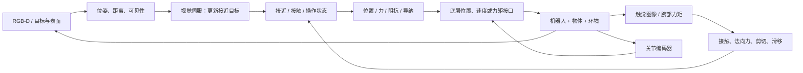
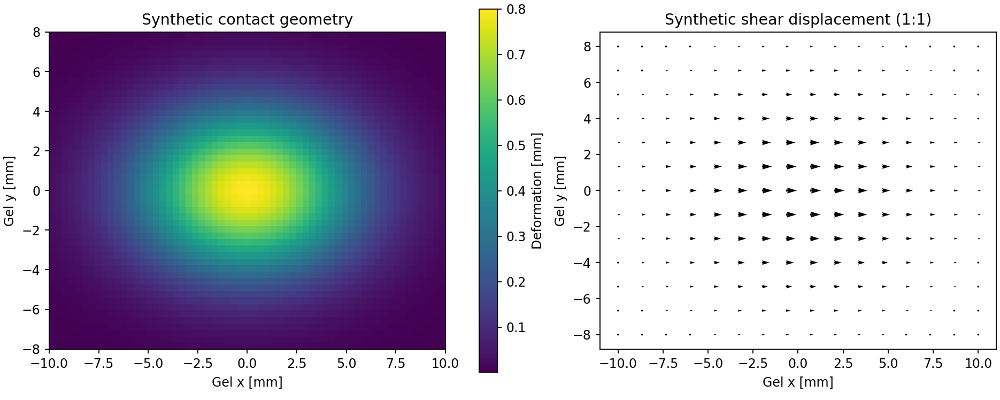
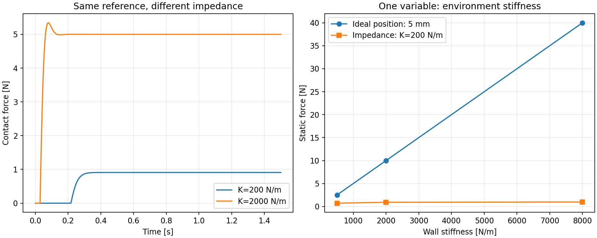
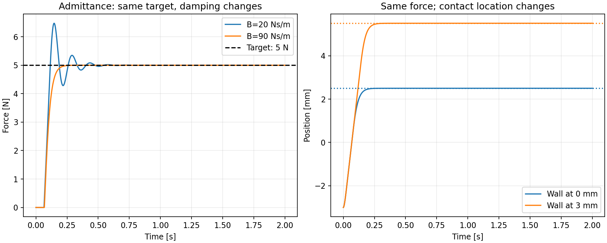

# D29 · 从看见目标到接触目标：视觉触觉闭环与四种控制

[学习入口](../_index.md) ｜ [本周日程](../P2-深度理解-日程.md) ｜ [上一课 D28](../day28/Daily-Learning-Pack.md) ｜ [下一课 D30](../day30/Daily-Learning-Pack.md) ｜ [CPU 实验](demo.py)

**看见插孔，解决“向哪里移动”；碰到孔壁，才暴露“允许多大力、怎样让步”。接触任务需要同时设计几何目标和机器人对外力的响应。**

本课为 **P2 / W5-D1 / 全局 Day29，原定 2026-10-03，2026-10-09 补写**。接续前一周的表示与重建，原顺序进入视觉伺服、触觉和操作控制。今天建立四类控制的区别，D30 进一步推导 PBVS / IBVS 并处理滑移。补写不代表已经学会；以下数值是教材脚本的验证结果。

<details>
<summary>个人学习记录（后续生成保留）</summary>

<!-- learner-notes:start -->

- 我能独立画出的控制回路：
- 我的预测、实际运行结果及差异解释：
- 我对力的正方向、控制接口仍有疑问的地方：
- 自测得分及补做证据：

<!-- learner-notes:end -->

</details>

<!-- daily-pack-generated:start -->

## 0. 本课要建立的地图

结束时，应能把“机器人靠近桌面并轻压一个零件”拆成观测、误差、控制输入与反馈，并完成三个判断：一个控制器到底控制什么；刚度/阻尼的单位是否正确；出现接触误差时应该改目标、改增益还是改变任务状态。

| 阅读顺序 | 核心问题 | 对应能力 |
| --- | --- | --- |
| 系统全景 | 视觉和触觉各自看到了什么 | 画出接近—接触—执行的闭环 |
| 接触物理 | 为什么毫米误差会变成很大的力 | 用刚度计算接触力 |
| 四种控制 | 控位置、控力、控交互动态有何区别 | 写清输入输出、符号和单位 |
| 触觉表示 | 相机图像怎样成为接触证据 | 区分形变、法向、力和滑移 |
| CPU 对照 | 哪个参数改变了哪个结果 | 预测、运行、解释单变量实验 |
| 总结验收 | 能否将误差追到相应模块 | 产出回路图和可复算笔记 |

## 1. 宏观：视觉不是终点，控制也不是一个 `move()`

### 1.1 三个回路各自关闭什么误差



视觉闭环根据**新图像**修正目标，接触闭环根据**新接触状态**改变交互，关节闭环根据编码器更新执行量。这些回路的采样率、延迟和权限可以不同。把感知结果保存到文件，再执行一段固定路径，只能算分阶段感知与执行；只有后续观测会影响后续动作，才关闭了相应反馈回路。

例子：RealSense 给出桌面高度 0.700 m，真实桌面为 0.703 m。规划几何正确到毫米级，仍可能在原计划之前接触。若内环坚持把末端压到 0.698 m，真实压入量就是 5 mm。此时“再跑一次分割网络”不是唯一答案：控制器必须知道进入接触后允许怎样偏离几何目标。

### 1.2 视觉与触觉的互补是观测范围的互补

| 观测 | 更直接得到的量 | 缺失或间接的量 |
| --- | --- | --- |
| 外部 RGB / RGB-D | 全局目标、障碍、表面、运动 | 指尖遮挡后的局部接触、细微滑移、真实接触力 |
| 光学触觉 | 接触区域内的表面形变、纹理、标记运动 | 未接触物体的远处结构、未经标定的绝对力 |
| 腕部六维力矩 | 传感器原点处的合力与合力矩 | 多个接触点分别在哪里、各点承担多少力 |
| 编码器 / 电流 | 关节状态、与驱动相关的信号 | 未补偿摩擦和重力时的准确外力 |

“多模态”不是将所有数据拼接后自动更好。先问每种数据在哪个物理状态下有效。例如没有接触时，GelSight 图像仍然有像素，但不能据此说物体在指尖上没有滑动——物体根本没有压到传感表面。

## 2. 接触前先统一符号、单位和坐标

### 2.1 用一维桌面模型说明全部正负号

定义末端坐标 $x$ 沿**压入环境**方向为正，墙面位置为 $x_w$，压入量与测量力的正标量为：

$$
\delta=\max(x-x_w,0),\qquad F_m=k_e\delta.
$$

$F_m\ge0$ 表示机器人向墙施加的压紧力大小；环境作用在机器人上的力是 **$-F_m$**。$k_e$ 单位 N/m；$x,\delta$ 单位 m。这里省略了材料非线性、速度相关阻尼和接触面积变化，适用于机制分析。

若 $k_e=2000\ \mathrm{N/m}$，则 1 mm 压入对应 2 N，5 mm 对应 10 N。改成 $8000\ \mathrm{N/m}$，同样 5 mm 变成 40 N。**“位置很准”与“力很合适”是两个目标。** 对未知刚度环境，固定压入深度无法保证固定接触力。

实际环境并不总是刚墙：软垫、夹爪软指腹、零件和机械臂结构可能共同变形。静态串联弹簧可用 $1/k_{eq}=1/k_1+1/k_2$ 近似，但真实机构可能有多方向耦合和迟滞。

### 2.2 六维 wrench 与 twist：别把单位混成一个数

本课约定：

$$
\mathcal V=[v_x,v_y,v_z,\omega_x,\omega_y,\omega_z]^T,
\quad
\mathcal F=[f_x,f_y,f_z,m_x,m_y,m_z]^T.
$$

前三个 twist 分量为 m/s，后三个为 rad/s；wrench 前三项 N、后三项 N·m。力矩依赖参考点，不能只旋转而忽略传感器与末端之间的力臂。若已知同一坐标方向下从末端原点指向力传感器原点的向量 $r$，把传感器 wrench 移到末端原点时有 $m_{tip}=m_{sensor}+r\times f$。

批处理示意：关节状态 `[B,nq]`，空间速度和 wrench `[B,6]`，几何 Jacobian `[B,6,nq]`。由功率一致性 $\tau^T\dot q=\mathcal F^T\mathcal V$ 与 $\mathcal V=J\dot q$，得到 $\tau=J^T\mathcal F$。**这要求两侧的速度/力定义、参考点和分量顺序一致。** 不能把图像 Jacobian、关节 Jacobian 或不同 wrench 排序混用。

## 3. 四种控制：按“拿什么作为输入、要求什么响应”分类

| 方法 | 目标与反馈 | 典型输出 | 关键风险 |
| --- | --- | --- | --- |
| 位置控制 | 目标位置与位置误差 | 力矩、速度或位置内环目标 | 环境未知时位置误差转成接触力 |
| 力控制 | 期望接触力与测量力误差 | 力矩或运动修正 | 无接触时不能实现期望接触力 |
| 阻抗控制 | 设定运动偏差与外力的动态关系 | 常见为力矩 / wrench | 名义参数不等于真实闭环动态 |
| 导纳控制 | 根据测得外力求运动响应 | 位置 / 速度参考 | 内环、时延和离散化会改变稳定性 |

位置控制和阻抗不必互斥：笛卡尔 PD 本身呈现弹簧—阻尼特性。区别是设计者是否把**与环境交互的动态**作为明确目标，以及是否有实现该动态所需的模型补偿与接口。

### 3.1 位置控制：环境没有出现在目标里

一维 PD 力指令写作：

$$
u=K_p(x_d-x)-K_d\dot x.
$$

配上简单惯性环境模型 $M\ddot x=u-F_m$，将出现由 $K_p,K_d,M,k_e$ 共同决定的接触响应。若把内环理想化为 $x=x_d$，那么力完全由环境的 $k_e\max(x_d-x_w,0)$ 决定。这两个模型不同：前者允许位置误差换取力平衡，后者假设无限位置跟踪能力。

工程上接近阶段通常需要位置/速度约束，使末端来到可接触区域。切换到接触阶段时不应突然给远处的目标位置，否则即便新模式名字叫“柔顺”，也可能因目标误差产生大瞬态。

### 3.2 力控制：力误差通过执行器改变接触状态

理想准静态力矩路线可以写作 $\tau=g(q)+J^T\mathcal F_d$；加上力传感反馈可补偿模型与负载误差。但重力补偿、外力符号和动力学假设必须和实际接口一致。[Modern Robotics 11.5](https://modernrobotics.northwestern.edu/nu-gm-book-resource/11-5-force-control/)

若机器人只接受位置参考，一个最小外环是：

$$
\dot x_d=k_f(F_d-F_m),\qquad [k_f]=\mathrm{m/(N\cdot s)}.
$$

在压入为正的定义下，力小于目标就继续压入，力过大则退让。注意这已经属于一种低阶**导纳式力调节**：用力误差生成运动，而不是直接输出电机力矩。

假设始终接触、$F=k_ex$、位置内环理想，Euler 更新给出：

$$
x_{k+1}=x_k+\Delta t k_f(F_d-k_ex_k),
\quad
e_{F,k+1}=(1-\Delta t k_fk_e)e_{F,k}.
$$

局部离散稳定要求 $|1-\Delta t k_fk_e|<1$，即 $0<\Delta t k_fk_e<2$。取 $\Delta t=0.01$ s、$k_e=2000$ N/m：$k_f=0.03$ 时乘子 0.4；改成 0.12 时乘子 −1.4，误差交替放大。**更快的力纠偏不总是更稳。** 这是无延迟线性模型的条件，真实内环和滤波延迟还会收紧可用范围。

无接触时 $F_m=0$，持续要求 $F_d>0$ 会不断推动参考位置。必须有接近速度、搜索距离和接触状态边界。给 PI 力控制器加限幅后还应管理积分器，避免目标不可达时积分持续增长。

### 3.3 阻抗：规定“受力时像怎样的机械系统”

固定参考 $x_r$ 的理想闭环示例为：

$$
M_d\ddot x+B_d\dot x+K_d(x-x_r)=F_{ext}=-F_m.
$$

各项单位均为 N：$M_d$ 为 kg，$B_d$ 为 N·s/m，$K_d$ 为 N/m。它不是“目标力等于某个常数”，而是规定偏离参考时出现怎样的惯性、阻尼和弹性关系。这是阻抗思想的核心。[Hogan 1985，Part I: Theory](https://newmanlab.mit.edu/wp-content/uploads/2017/09/1985-impedance-control-an-approach-to-manipulation-part-I-theory.pdf)

以 $x_w=0$、静态接触 $F_m=k_ex$ 为例：

$$
K_d(x_r-x)=k_ex,
\quad x=\frac{K_d}{K_d+k_e}x_r,
\quad F_m=\frac{k_eK_d}{k_e+K_d}x_r.
$$

设 $x_r=5$ mm、$k_e=2000$ N/m。$K_d=200$ N/m 时，$x=0.455$ mm，$F_m=0.909$ N；$K_d=2000$ N/m 时，$x=2.5$ mm，$F_m=5$ N。让步表现为实际位置偏离参考，不是感知定位出错。

阻尼控制能量耗散。自由空间线性系统常用 $B_{crit}=2\sqrt{M_dK_d}$ 理解临界阻尼；进入线性墙后总恢复刚度变为 $K_d+k_e$，不能继续忽略环境刚度。多维系统还涉及方向耦合和等效惯量，不能直接将一个标量经验推广至整个机械臂。

### 3.4 导纳：把力误差积分成运动参考

本课力调节导纳采用：

$$
M_a\ddot x_d+B_a\dot x_d=F_d-F_m.
$$

这里右侧按“不足就压入”定义为力误差，$x_d$ 交给位置内环。它没有回到某个固定位置的弹簧项，因而在理想稳态中 $F_m=F_d$，墙面位置变了，最终位置会随之改变。若加上 $K_a(x_d-x_0)$，稳态变成 $K_a(x_d-x_0)=F_d-F_m$，通常不再保证零力误差，除非额外设计补偿或积分。

脚本使用虚拟质量 1 kg、环境刚度 2000 N/m，接触后的近似临界阻尼为 $2\sqrt{1\times2000}\approx89.44$ N·s/m，所以比较 $B_a=20$ 与 90。它还显式限制参考速度到 ±0.05 m/s，防止自由空间持续加速。这个限幅会改变线性瞬态，因此不能直接用无约束解析曲线冒充脚本结果。

实际链路是：

```text
测量力 → 去零偏/重力补偿 → 滤波 → 力误差 → 虚拟动力学积分
      → 位移/速度/加速度约束 → 机器人位置内环 → 接触 → 新测量力
```

低通滤波能减小噪声，却会增加相位滞后。导纳不是“给刚性位置机器人外挂一个公式就天然稳定”。需要连同内环带宽、通信、采样和接触刚度评估闭环。

### 3.5 混合位置—力：在相容方向分配任务

擦桌面时沿桌面切向走轨迹、沿法向维持压力，比同时要求法向位置绝对不变又维持任意压力更相容。在一个已知接触坐标系中，可用选择矩阵 $S$ 挑选力控制方向，$I-S$ 挑选运动方向；它表达任务分解，不是把不同单位的“位置误差”和“力误差”直接相加。[Modern Robotics 11.6](https://modernrobotics.northwestern.edu/nu-gm-book-resource/11-6-hybrid-motion-force-control/)

若表面法向估计偏了，原本的法向力分量可能变成沿表面滑动的力。因此 D28 的几何表示质量仍进入本周控制问题。视觉估计表面方向，触觉/力反馈修正接触，二者不是替代关系。

## 4. 光学触觉：一张图里到底藏了什么

### 4.1 GelSight 的因果链

软胶接触物体后变形，涂层和多方向照明将局部表面朝向编码为颜色，内部相机记录这些变化。经标定可估表面法向、积分得到局部高度；标记位移可提供剪切变形线索。原论文同时讨论纹理相对运动与胶面标记分布来检测滑移。[Dong 等 2017，§III–V、Figure 3 / 7 / 8](https://arxiv.org/html/1708.00922v1)

这与 RealSense 的距离图不是同一类测量：前者关注接触胶面的局部形状，后者测相机前方场景几何。两者都能以 `[H,W]` 存储“深度”，但原点、长度尺度、可见区域和物理生成机制不同。

### 4.2 从法向到梯度，再到高度

把胶面局部表示为 $z=h(x,y)$，选择朝向传感器的法向约定：

$$
n=\frac{[-\partial_xh,-\partial_yh,1]^T}{\sqrt{1+(\partial_xh)^2+(\partial_yh)^2}}.
$$

若 $n_z\ne0$，可得 $\partial_xh=-n_x/n_z$、$\partial_yh=-n_y/n_z$。梯度是长度除以长度，无量纲；积分得到高度需要空间标尺和边界条件，法向本身无法确定绝对高度常数。

一个理想化光度模型是 $I_c\approx\rho\max(l_c^Tn,0)+b_c$。实际胶面光照不完全均匀、材料不完全理想，还可能有标记遮挡，所以需要针对传感器做颜色—法向标定或学习映射。不能看到三个 RGB 通道就直接认为是三个力分量。

| 中间量 | 教学 shape | 语义与单位 |
| --- | --- | --- |
| 触觉 RGB 时间窗 | `[B,T,3,H,W]` | 相机亮度，未直接成为力 |
| 接触 mask | `[B,T,1,H,W]` | 接触/有效像素证据 |
| 局部高度 | `[B,T,1,H,W]` | mm 或 m，必须明示 |
| 表面法向 | `[B,T,3,H,W]` | 单位向量，方向约定明确 |
| 标记位移 | `[B,T,Nm,2]` | px，标定后可转胶面 mm |
| 合力估计 | `[B,T,3]` | N，依赖力标定和材料模型 |
| 滑移判断 | `[B,T,1]` 或 `[B,1]` | 需声明当前检测或未来预测 |

这里的 batch/channel 布局是本课工程约定，不宣称某个官方模型强制如此。

### 4.3 位移不等于力，动了也不一定滑了

线性小形变近似可写 $F_t\approx k_t\Delta s$。如果 $k_t$ 未标定，看到 0.2 mm 剪切位移只能说“胶面变形了”，不能说“切向力是 2 N”。软胶有位置依赖、温漂、迟滞、法向载荷耦合，单一刚度也只是局部近似。

同样，物体和胶面一起移动可以是粘着形变；物体纹理相对胶面标记移动才更直接支持滑移。只追踪物体在相机图像里是否移动，会把弹性拉伸、机械臂运动和物体滑动混在一起。D30 将正式处理这组区别。



**读图方法：** 左图是人为构造的高度场，峰值 0.8 mm；右图是另一个人为构造的切向位移场，箭头以同一 mm 坐标标尺绘制。两者不是由真实图像反演出来的结果。图的用途是把“高度 `[49,61]`、法向 `[49,61,3]`、二维剪切位移”区分开：给出表面形状并不能唯一决定接触力。

## 5. 工程落点：插入与轻压任务怎么分状态

以“将小零件送到夹具，接触后轻压”为例：

1. **接近：** RGB-D 检测/分割给出候选表面与粗位姿；检查时间戳、坐标变换和可见性，沿约束路径移动。视觉伺服不断修正剩余偏差。
2. **搜索接触：** 降低接近速度，设最大搜索位移；接触力或触觉接触证据持续达到条件才切换，避免单帧噪声触发。
3. **接触建立：** 连续初始化新控制器的参考值与积分状态，渐变目标力；不要在切换时引入位置阶跃。
4. **操作：** 采用与任务相容的法向力/导纳、切向运动或阻抗关系；持续检查滑移、卡滞和目标是否仍可见。
5. **失效与退出：** 无接触却搜索到边界、压力无法建立、侧向力持续过大等情况应进入明确的退让/重观测状态。

一个实用日志结构可包含 `stamp, frame_id, mode, x_ref, x_meas, F_raw, F_compensated, F_target, saturated, contact_valid`。这样才能区分测量漂移、控制饱和、模型不准和真实接触变化。只记录“抓取失败”无法支持下一轮改进。

AI Coding 可帮助生成字段检查和绘图，但要人工核对符号：本课的压紧力大小为正，真实六维传感器在相应轴上可能输出负值。符号错了，负反馈就会变成“力越大压得越深”。

## 6. 实验：先预测，再看真实运行结果

### 6.1 三个预测写在运行之前

- 目标压入都为 5 mm，环境刚度从 500 增到 8000 N/m，理想位置控制与 $K_d=200$ 的阻抗静态力分别怎么变？
- 导纳目标同为 5 N，阻尼从 20 增到 90 N·s/m，峰值、稳态值各会怎样？
- 只把真实墙面从 0 移到 3 mm，导纳稳态位置和稳态力各改变多少？

运行方式（终端位于 vault 根目录，使用已有 Python 环境）：

```bash
python -B 3d_learning/day29/demo.py
```

依赖为 NumPy 和 Matplotlib。本教材已使用 Python 3.11.15 / NumPy 1.26.4 / Matplotlib 3.10.9 在 CPU 实跑。脚本不调用机器人、ROS、触觉硬件或模型权重。

### 6.2 实测对照与解释

| 只改变的量 | 配置 | 实测 / 解析核对 |
| --- | --- | --- |
| 环境刚度 | 500 / 2000 / 8000 N/m | 理想位置静态力 2.5 / 10 / 40 N |
| 同一环境刚度对照 | $K_d=200$、参考 5 mm | 阻抗静态力 0.7143 / 0.9091 / 0.9756 N |
| 机器人虚拟刚度 | 200 → 2000 N/m，环境固定 2000 | 最终力 0.9091 → 5.0000 N；峰值 0.9091 → 5.3423 N |
| 导纳阻尼 | 20 → 90 N·s/m，其余相同 | 力峰值 6.4753 → 5.0000 N；稳态均 5 N |
| 墙面位置 | 0 → 3 mm，导纳参数相同 | 最终位置 2.5 → 5.5 mm；力均 5 N |



左图是带惯性与阻尼的实际积分轨迹，右图是同一模型对应的静态公式。右图理想位置曲线不会自动让步，阻抗曲线则允许几何偏差。**小力来自设定的低刚度关系，不意味着已经达到某个任务需要的力。** 例如要稳固压住零件可能需要 5 N，0.9 N 反而不够。



左图把阻尼作为单变量，右图把墙面位置作为单变量。最终同为 5 N，并不意味着瞬态同样温和。右图展示力目标允许位置移动；若任务几何不允许这个位移，应重新设计相容任务，而不是强行让两个不相容目标同时成立。

### 6.3 一个故意失败的离散力回路

脚本还计算 $e_{k+1}=(1-\Delta t k_fk_e)e_k$ 对应的线性递推。稳定增益 0.03 在 20 步后得到约 5 N；只把增益改为 0.12 后，递推值变成约 −2505 N。

**负的巨大数不是“机器人真的吸住桌面产生负压力”。** 此分支明确使用双向、无饱和的线性弹簧模型，它离开有效接触区后不再代表单边真实接触。它证明的是离散误差的发散趋势，也提示模型的适用范围应和实验结论一起报告。

### 6.4 修改一个变量

在 `admittance()` 中只把 `wall_stiffness=2000.` 改为 8000，其他参数保持一致。先用 $2\sqrt{M_ak_e}$ 预测原来的 90 N·s/m 是否仍接近临界阻尼，再运行检查峰值。保存修改前后的结果，不要同时改步长、阻尼和限速来“把图调好看”。

起步核心是这四行，完整脚本在下面：

```python
force = wall_stiffness * max(x - wall, 0.0)
acceleration = (desired_force - force - damping * velocity) / virtual_mass
velocity = np.clip(velocity + dt * acceleration, -max_speed, max_speed)
x += dt * velocity  # 理想位置内环：实际 x 跟随所积分的参考
```

<details>
<summary>完整可复制代码（与 demo.py 一致）</summary>

<!-- demo-code:start -->
```python
"""Day29: 1D contact control and a synthetic tactile field, CPU only.

The ideal inner servo, linear wall and virtual mass are teaching assumptions.
No robot, measured tactile data, trained model or hardware safety validation.
"""
from pathlib import Path
import json
import platform
import numpy as np
import matplotlib
matplotlib.use("Agg")
import matplotlib.pyplot as plt


def impedance(stiffness, wall_stiffness=2000., damping=90., dt=.0005):
    t = np.arange(0., 1.5+dt/2, dt)
    x, v = -.003, 0.
    trace = []
    for time in t:
        force = wall_stiffness*max(x, 0.)
        trace.append([time, x, v, force])
        acceleration = (stiffness*(.005-x)-damping*v-force)/1.
        v += dt*acceleration
        x += dt*v
    return np.array(trace)


def admittance(damping=90., wall_stiffness=2000., wall=0., dt=.0005):
    t = np.arange(0., 2.+dt/2, dt)
    x, v = -.003, 0.
    trace = []
    for time in t:
        force = wall_stiffness*max(x-wall, 0.)
        trace.append([time, x, v, force])
        acceleration = (5.-force-damping*v)/1.
        v = np.clip(v+dt*acceleration, -.05, .05)
        x += dt*v
    return np.array(trace)


def force_iteration(gain, steps=20, dt=.01, wall_stiffness=2000.):
    # Signed bilateral spring, initialized and remaining in contact in stable case.
    x = .001
    force = []
    for _ in range(steps+1):
        force.append(wall_stiffness*x)
        x += dt*gain*(5.-wall_stiffness*x)
    return np.array(force)


def main():
    out = Path(__file__).resolve().parents[2]/"_assets/3d_learning/day29"
    out.mkdir(parents=True, exist_ok=True)
    imp = {k: impedance(k) for k in (200., 2000.)}
    adm = {b: admittance(b) for b in (20., 90.)}
    shifted = admittance(90., wall=.003)
    static = []
    for wall_k in (500., 2000., 8000.):
        static.append(dict(wall_stiffness_N_per_m=wall_k,
            ideal_position_force_N=wall_k*.005,
            impedance_K200_force_N=wall_k*200/(wall_k+200)*.005))
    summaries = {}
    for k, tr in imp.items():
        expected = k*2000/(k+2000)*.005
        assert abs(tr[-1, 3]-expected) < .001
        summaries[f"impedance_K{k:g}"] = dict(peak_N=float(tr[:, 3].max()),
            final_N=float(tr[-1, 3]), theory_N=expected)
    for b, tr in adm.items():
        assert abs(tr[-1, 3]-5) < .001
        summaries[f"admittance_B{b:g}"] = dict(peak_N=float(tr[:, 3].max()),
            final_N=float(tr[-1, 3]))
    assert abs(shifted[-1, 3]-5) < .001
    assert abs(shifted[-1, 1]-.0055) < 1e-6

    fig, axes = plt.subplots(1, 2, figsize=(11, 4.4), constrained_layout=True)
    for k, tr in imp.items():
        axes[0].plot(tr[:, 0], tr[:, 3], label=f"K={k:g} N/m")
    axes[0].set(xlabel="Time [s]", ylabel="Contact force [N]",
                title="Same reference, different impedance")
    axes[0].legend()
    wall_ks = [r["wall_stiffness_N_per_m"] for r in static]
    axes[1].plot(wall_ks, [r["ideal_position_force_N"] for r in static], "o-", label="Ideal position: 5 mm")
    axes[1].plot(wall_ks, [r["impedance_K200_force_N"] for r in static], "s-", label="Impedance: K=200 N/m")
    axes[1].set(xlabel="Wall stiffness [N/m]", ylabel="Static force [N]",
                title="One variable: environment stiffness")
    axes[1].legend()
    for ax in axes:
        ax.grid(alpha=.25)
    fig.savefig(out/"contact_stiffness.png", dpi=170)
    plt.close(fig)

    fig, axes = plt.subplots(1, 2, figsize=(11, 4.4), constrained_layout=True)
    for b, tr in adm.items():
        axes[0].plot(tr[:, 0], tr[:, 3], label=f"B={b:g} Ns/m")
    axes[0].axhline(5, color="black", ls="--", label="Target: 5 N")
    axes[0].set(xlabel="Time [s]", ylabel="Force [N]", title="Admittance: same target, damping changes")
    axes[0].legend()
    base = adm[90.]
    axes[1].plot(base[:, 0], base[:, 1]*1000, label="Wall at 0 mm")
    axes[1].plot(shifted[:, 0], shifted[:, 1]*1000, label="Wall at 3 mm")
    axes[1].axhline(2.5, color="C0", ls=":")
    axes[1].axhline(5.5, color="C1", ls=":")
    axes[1].set(xlabel="Time [s]", ylabel="Position [mm]", title="Same force; contact location changes")
    axes[1].legend()
    for ax in axes:
        ax.grid(alpha=.25)
    fig.savefig(out/"admittance_response.png", dpi=170)
    plt.close(fig)

    # Synthetic deformation, not a force reconstruction from real RGB.
    x = np.linspace(-10., 10., 61)
    y = np.linspace(-8., 8., 49)
    xx, yy = np.meshgrid(x, y)
    height = .8*np.exp(-((xx/4)**2+(yy/3)**2)/2)
    dhdy, dhdx = np.gradient(height, y, x)
    normals = np.stack([-dhdx, -dhdy, np.ones_like(height)], axis=-1)
    normals /= np.linalg.norm(normals, axis=-1, keepdims=True)
    marker_displacement = .6*np.exp(-((xx/6)**2+(yy/5)**2)/2)
    fig, axes = plt.subplots(1, 2, figsize=(11, 4.4), constrained_layout=True)
    im = axes[0].imshow(height, origin="lower", extent=[-10, 10, -8, 8], cmap="viridis")
    fig.colorbar(im, ax=axes[0], label="Deformation [mm]")
    axes[0].set(title="Synthetic contact geometry", xlabel="Gel x [mm]", ylabel="Gel y [mm]")
    sel = np.s_[::4, ::4]
    axes[1].quiver(xx[sel], yy[sel], marker_displacement[sel], np.zeros_like(xx[sel]),
                   angles="xy", scale_units="xy", scale=1, width=.005)
    axes[1].set(title="Synthetic shear displacement (1:1)", xlabel="Gel x [mm]", ylabel="Gel y [mm]", aspect="equal")
    fig.savefig(out/"tactile_fields.png", dpi=170)
    plt.close(fig)
    good, bad = force_iteration(.03), force_iteration(.12)
    assert abs(good[-1]-5) < 1e-5
    assert abs(bad[-1]-5) > 1000
    report = dict(scope="CPU teaching simulation; no robot or GelSight inference",
        environment=dict(python=platform.python_version(), numpy=np.__version__, matplotlib=matplotlib.__version__),
        static_force=static, responses=summaries,
        shifted_wall_final_position_mm=float(shifted[-1, 1]*1000),
        discrete_force=dict(stable_multiplier=.4, unstable_multiplier=-1.4,
            stable_final_N=float(good[-1]), unstable_final_signed_N=float(bad[-1]),
            caveat="Unstable signed linear spring loses unilateral-contact validity"),
        tactile_shapes=dict(height=list(height.shape), normals=list(normals.shape)))
    (out/"results.json").write_text(json.dumps(report, indent=2, ensure_ascii=False)+"\n")
    np.savetxt(out/"admittance_B90.csv", base, delimiter=",", header="time_s,x_m,v_m_per_s,force_N", comments="")
    print(json.dumps(report, indent=2, ensure_ascii=False))


if __name__ == "__main__":
    main()
```
<!-- demo-code:end -->

</details>

## 7. 今日重点、最容易混淆之处

**最值得掌握的四点：** 第一，视觉定位精度需要通过环境刚度才能转换成接触后果，这将感知与控制真正连接起来。第二，阻抗规定交互关系，导纳计算运动响应，决定了你能否使用现有机器人的接口。第三，单位和符号直接决定反馈方向，不能依赖变量名猜。第四，触觉图像是原始证据，需要几何/材料标定、时序和有效性判断才能成为控制输入。

三个容易踩坑的对比：

- **柔顺不等于低力保证。** 低刚度配上很大的目标偏差，仍然可能产生大力；低阻尼也可能有瞬态峰值。
- **力设定与运动设定不能随意并列。** 沿同一刚性法向同时规定不相容位置与力会冲突；先选择任务自由度与接触约束。
- **触觉深度不等于场景深度，形变不等于力。** 相同数组形状不代表相同物理量；标定、参考系和接触条件是接口的一部分。

## 8. 一手材料怎样读，以及今日留下什么

精读三处即可：

1. [Modern Robotics 11.5](https://modernrobotics.northwestern.edu/nu-gm-book-resource/11-5-force-control/)：对照其 wrench 到关节力矩的关系，写出自己的力正方向，说明准静态假设。
2. [Hogan 1985 Part I](https://newmanlab.mit.edu/wp-content/uploads/2017/09/1985-impedance-control-an-approach-to-manipulation-part-I-theory.pdf)：先读摘要与理论问题定义，解释为何只谈轨迹或力轨迹不足以描述机械交互。今天不要求复现完整机械臂阻抗实现。
3. [GelSight 2017 §IV 与 §V](https://arxiv.org/html/1708.00922v1)：看 Figure 3 的几何重建与 Figure 7 的相对运动，分别写出测量对象。不要把论文硬件效果写成本机实验结果。

今日产出：一张包含视觉、接触、执行三个反馈环的系统图；一页含符号、单位与两组手算的控制笔记；一次脚本运行与一个单变量改动。可直接查看 [数值结果](../../_assets/3d_learning/day29/results.json) 和 [导纳轨迹 CSV](../../_assets/3d_learning/day29/admittance_B90.csv)。本 vault 不要求 Git；用个人笔记记录修改与结论即可。

## 9. 自测：先答题，再展开文末答案

1. 视觉给出末端与桌面相差 1 mm，为什么还不能判断接触力是否合适？列出缺失量。
2. 本课 $x$ 沿压入方向为正。$F_m>F_d$ 时，导纳参考应该向哪个方向运动？环境作用在机器人上的力符号是什么？
3. $k_e=2000$ N/m、$K_d=200$ N/m、$x_r=5$ mm 时，手算静态压入量与力。
4. 为什么给力调节导纳加一个返回原点的弹簧项后，不再自然保证零稳态力误差？
5. $\Delta t=0.01$ s、$k_e=2000$ N/m、$k_f=0.08$ 时离散力误差乘子是多少？是单调还是交替收敛？
6. 一个接触表面高度图 `[49,61]` 能否唯一决定 `[3]` 的接触力？说明至少两个原因。
7. 腕部力传感器与 TCP 相隔 10 cm，为什么只旋转 force / torque 数组不够？
8. 擦桌面任务怎样安排运动方向和力方向？表面法向错误会导致什么？
9. 实验中低阻尼导纳最终也是 5 N。为什么不能只报告稳态误差为零就认为其表现与高阻尼相同？
10. 规划搜索接触时一直没有测到力，你应检查和约束哪些量？说明为什么不能无限增大力误差积分。

## 10. 未理解清单与下一课入口

若仍不能在一张纸上解释 $M\ddot x+B\dot x+K(x-x_r)=-F_m$ 的每一项，先回到一维符号和单位，不要急于加入六维矩阵。若仍把“胶面一起动”当成“物体滑了”，下一课从相对运动例子开始。

D30 将把视觉误差如何变成相机速度推导出来，比较 PBVS 与 IBVS，然后用触觉/视觉时序判断滑移并设计有限能力的纠偏。今天的控制边界将用于判断：纠偏命令合理，是否就一定抓得住？

> [!note]- 自测答案与 0 / 1 / 2 判分（最后查看）
> 每题 0 分：结论或符号错误；1 分：结论基本正确但缺少条件/计算/工程解释；2 分：结论正确且说明适用边界。满分 20；成绩由本人作答后记录，不预填掌握状态。
>
> 1. 还需实际接触与压入、环境/机构刚度、控制器响应；动态情况下还需速度、惯量和阻尼。距离误差不是力。
> 2. 应减小压入，即向负方向退让；环境力是 $-F_m$。已存在速度时瞬时运动还受惯性影响，不能将加速度纠偏误当即刻反向。
> 3. $x=200/(2200)\times5=0.4545$ mm；$F=2000\times0.0004545=0.9091$ N。
> 4. 稳态力误差需要平衡弹簧项，$F_d-F_m=K_a(x_d-x_0)$，一般不为零。
> 5. 乘子 $1-0.01\times0.08\times2000=-0.6$；在线性理想条件下交替衰减。
> 6. 缺材料/力标定、接触边界及剪切历史等；同形状可能对应不同刚度和受力，合力还涉及接触分布。
> 7. 力矩依赖原点，需加入相应 $r\times f$，并确认向量方向和坐标系。
> 8. 切向跟踪，法向调压力；错误法向会把预期压力投到切向，或引入意外几何运动。
> 9. 峰值 6.4753 N 与 5 N 不同，短时峰值可能破坏零件；还应看接触建立时间、振荡、饱和与有效范围。
> 10. 检查传感器零点/坐标、接触区域、搜索方向及目标可达性；设速度与搜索距离边界，管理积分。无接触时目标力不可由接触实现，继续积分会累积危险参考。

<!-- daily-pack-generated:end -->
