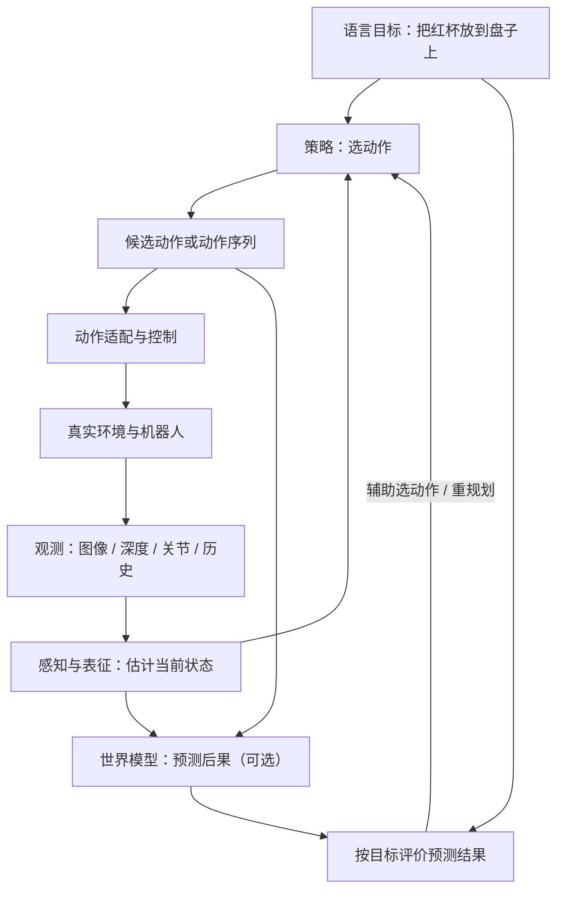
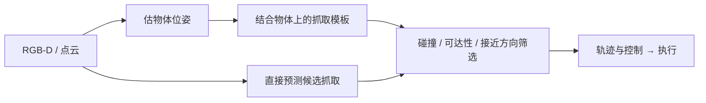
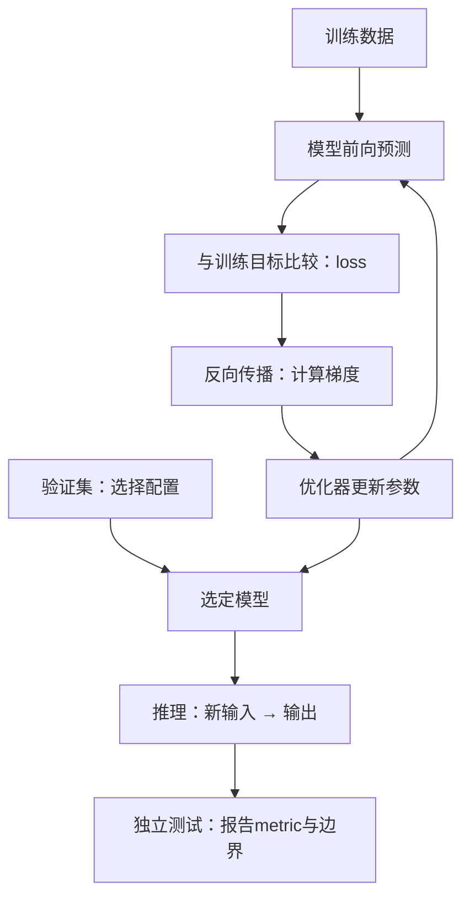
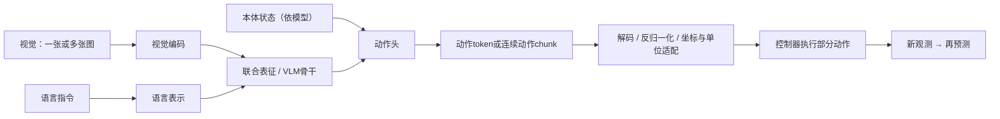
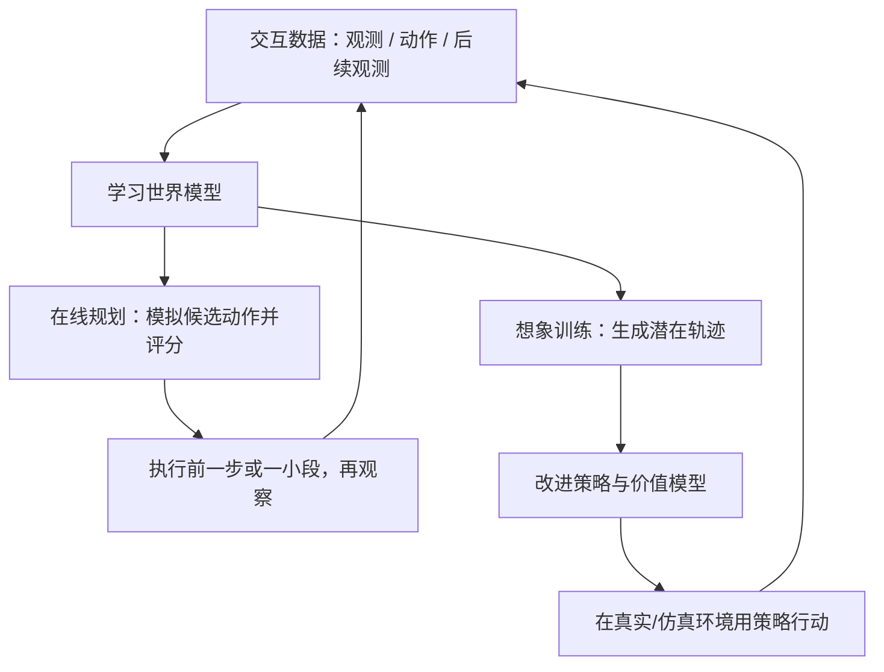

# D3 · 从“看见什么”到“怎么行动、会发生什么”

[返回 3D Learning](../_index.md) ｜ [本周日程](../P1-第一周-扫盲日程.md) ｜ [任务总表与练习页](3D任务-方法-指标总表.md) ｜ 交互实验 (not exported: missing source)

**今天要带走一个闭环：感知估计当前世界，策略选择动作，世界模型预测行动后果，控制执行动作，再用新观测纠正。Learning 则回答这些模块如何从数据中学出来。**

D1 学“数据用什么形式表示、在哪个坐标系”，D2 学“这些数怎么测、误差从哪来”。今天沿用近场机械臂抓杯子的例子，把表示、测量、任务、评价和学习连起来。**这是课程中的示意系统，不代表 nerve 项目的已确认实现。**

## 学习目标与路线（4h预算）

学完后应能：

- 对八类3D任务说清输入、输出、指标和一个失效边界；从输出判断任务。
- 手算IoU，解释AP不是IoU；说明ADD/ADD-S和单向/双向Chamfer的区别。
- 区别学习目标、模型结构、监督来源、训练与推理。
- 画出VLA与动作条件世界模型的数据流，说明它们如何分工与组合。
- 用小实验说明：一个好看的离线数字，不能替代闭环成功证据。

| 顺序 | 时间 | 阅读/操作 |
| --- | --- | --- |
| 宏观 | 20min | 第1节：闭环和概念分层，先画图再读 |
| 微观：3D任务 | 55min | 第2节：输出与坐标；对照任务总表 |
| 微观：评价 | 40min | 第3节：三组指标与手算 |
| 微观：Learning | 30min | 第4节：学什么、怎样学 |
| 微观：VLA / World Model | 35min | 第5—7节：动作、动态、组合 |
| 动手 | 40min | 第8节：交互与Python；原文图按需查看 |
| 总结 | 20min | 第9—11节：闭卷、自测、疑问与明日 |

这是带停顿的学习预算；遇到卡点可增加当天时间。**今日精度优先级：闭环与输入输出 > 指标的假设与算例 > 代表模型名字。**

## 1. 宏观：先画一条“抓杯子”的完整链

### 1.1 同一个目标，五个不同问题

指令：“把红色杯子放到盘子上。”

| 问题 | 模块角色 | 典型输出 |
| --- | --- | --- |
| 我看到了什么、它在哪里？ | 感知 | 目标mask、点云、物体位姿或特征 |
| 哪些信息对接下来有用？ | 状态/表征 | 物体位置、机器人关节、历史、潜在特征 |
| 现在该做什么？ | 策略（policy） | 关节命令或末端动作，可能是一段序列 |
| 如果这样做，接下来怎样？ | 动作条件世界模型 | 未来状态/特征/图像，可能还有奖励或终止预测 |
| 怎样把命令变成运动，并纠偏？ | 控制与反馈 | 轨迹跟踪、接触响应、新观测 |



读图要点：

1. **反馈形成闭环**：执行后再观察，实际结果与预期不同就调整。
2. 世界模型在这张图里是可选辅助模块；不用它也能有感知和策略。
3. 端到端VLA可能在内部完成感知与特征提取，不一定显式输出点云或物体位姿。
4. 预测未来本身没有指定什么未来是“好”的；还需要目标、奖励/代价或任务条件。

### 1.2 四层概念不要混在一起

| 层次      | 回答的问题    | 例子                                |
| ------- | -------- | --------------------------------- |
| 任务      | 要输出什么？   | 深度估计、分割、抓取、未来状态预测                 |
| 表示      | 信息怎么存？   | 深度图、点云、体素、mesh、潜向量                |
| 方法/结构   | 怎么计算？    | ICP、CNN、PointNet、Transformer、扩散模型 |
| 学习范式/目标 | 从什么信号改善？ | 监督、自监督、BC、RL                      |

同一个Transformer可以预测语义类别、动作或未来特征；同一个抓取任务可以用几何规则、模仿学习或RL。**VLA并不是与“监督学习、Transformer”并列的互斥类别。**

> [!question] 先猜
> “点云 → Transformer → 动作序列，用专家演示训练。”其中表示、结构、任务输出和学习方式分别是什么？

> [!note]- 参考
> 点云是观测表示；Transformer是计算结构；动作序列是策略输出；模仿专家演示属于IL，可用BC式目标训练。是否属于VLA还要看是否有视觉、语言与动作的联合建模，不能仅凭用了Transformer判断。

## 2. 微观：八类3D任务，先看输出

完整“输入—输出—方法—指标”导航保存在[任务总表](3D任务-方法-指标总表.md)。这里讲为什么这些任务不同，重点深挖与操作直接相关的部分。

### 2.1 深度估计：每个像素多一个距离量

输出深度图 $D\in\mathbb{R}^{H\times W}$，有效像素一般对应光轴方向深度 $z$；某些传感器输出的是沿光线的range，反投影前必须区分。

已去畸变且采用针孔模型时：

$$
\mathbf p^{cam}=zK^{-1}[u,v,1]^\top
$$

**回连D2**：深度误差会变成三维位置误差。今天进一步问：预测出来的是米、毫米，还是只能比较远近的相对量？相对深度做尺度/偏移对齐后分数很好，仍不能直接作为机器人距离命令。单目模型可以借助训练先验输出度量深度，但这不消除单视图几何的尺度歧义，也不保证新域精度。

常用指标：

$$
\mathrm{AbsRel}=\frac1N\sum_i\frac{|\hat z_i-z_i|}{z_i},
\qquad
\mathrm{RMSE}=\sqrt{\frac1N\sum_i(\hat z_i-z_i)^2}
$$

前者无量纲，后者沿用深度单位。只在合法深度mask内算，并报告有效覆盖率；否则删除难像素也可能“涨分”。

$\delta_1$ 统计 $\max(\hat z/z,z/\hat z)<1.25$ 的比例，等价于 $0.8<\hat z/z<1.25$，**并不是对称的±25%区间**。

### 2.2 分类、语义分割、实例分割：标签粒度不同

- 分类：一片物体点云 → 一个类别。
- 语义分割：每个点 → 一个类别；三个杯子都可叫“杯子”。
- 实例分割：再给不同杯子不同实例ID。

PointNet用逐点特征与对称聚合处理点集。分类输出应对点的排列**不变**；逐点分割则应随输入点的重排而相应重排，即**等变**。D1的“点云网络要置换不变”需按输出类型精确化。[PointNet原论文与架构图](https://stanford.edu/~rqi/pointnet/)

**为什么操作关心实例？** 指令针对的是红色那个杯子；把所有杯子点混在一起，后面的位姿和抓取也可能选错目标。分割mIoU高，还要检查小物体、把手和接触边界。

### 2.3 3D检测：物体的空间包围范围

常见地面场景框为：

$$
b=(x,y,z,l,w,h,\psi)
$$

前三个是中心位置，中间是尺寸，$\psi$是yaw。再附类别和置信度，有些任务还预测速度等量。

**7个数不等于7个刚体位姿自由度**：其中3个数描述尺寸。很多地面检测采用yaw-only，但3D检测也能定义完整旋转框；这是任务与数据集约定，不是“检测永远只能转一根轴”。

框适合粗定位、目标筛选和避障，但通常没有描述杯把朝向或插孔位置。

常见网络模型：

|场景／表示|代表网络|特点|
|---|---|---|
|室内 RGB-D、仓储点云|[VoteNet](https://openaccess.thecvf.com/content_ICCV_2019/html/Qi_Deep_Hough_Voting_for_3D_Object_Detection_in_Point_Clouds_ICCV_2019_paper.html)|PointNet++提特征，点向物体中心投票|
|室内点云、Transformer路线|[3DETR](https://openaccess.thecvf.com/content/ICCV2021/papers/Misra_An_End-to-End_Transformer_Model_for_3D_Object_Detection_ICCV_2021_paper.pdf)|端到端输出一组3D框|
|激光雷达、自动驾驶／移动机器人|[PointPillars](https://openaccess.thecvf.com/content_CVPR_2019/html/Lang_PointPillars_Fast_Encoders_for_Object_Detection_From_Point_Clouds_CVPR_2019_paper.html)|把点云组织成柱状BEV特征，速度快|
|激光雷达、自动驾驶／移动机器人|[CenterPoint](https://openaccess.thecvf.com/content/CVPR2021/html/Yin_Center-Based_3D_Object_Detection_and_Tracking_CVPR_2021_paper.html)|先检测物体中心，再回归尺寸、朝向等|
|抓取前的精细物体位姿|[DenseFusion](https://openaccess.thecvf.com/content_CVPR_2019/html/Wang_DenseFusion_6D_Object_Pose_Estimation_by_Iterative_Dense_Fusion_CVPR_2019_paper.html)、[PVN3D](https://openaccess.thecvf.com/content_CVPR_2020/html/He_PVN3D_A_Deep_Point-Wise_3D_Keypoints_Voting_Network_for_6DoF_CVPR_2020_paper.html)、[FoundationPose](https://research.nvidia.com/publication/2024-06_foundationpose-unified-6d-pose-estimation-and-tracking-novel-objects)|输出物体完整位置与旋转，比3D框更精细|

### 2.4 6D物体位姿：物体参考系怎么放到场景中

$$
T^{cam}_{obj}=
\begin{bmatrix}R&t\\0&1\end{bmatrix},
\quad R\in SO(3),\quad t\in\mathbb R^3
$$

6D指 **3个平移自由度+3个旋转自由度**，与D1用于神经网络回归**旋转**的“6D连续表示”不是同一个概念。后者仅表达旋转，平移还要另外预测。

位姿必须有参考：CAD物体坐标系、类别规范坐标系、参考图像建立的模型等。**不是所有方法必须有CAD**。例如FoundationPose支持给定CAD或参考图像的不同设置，跨新物体应用不必逐物体微调，但模型本身已经经过训练，仍有输入与初始化条件。[FoundationPose官方说明](https://github.com/NVlabs/FoundationPose)

CAD模型的获取方式：
- 人工建模
- 厂家提供CAD文件
- 三维扫描：激光、结构光、RGBD、多张图片重建，扫描 → 点云 → 去噪与配准 → 表面重建 → 网格模型（OBJ、PLY、STL 等） → 建立坐标系与尺度。

**与抓取连接的微型推导**

若预先在物体系定义抓取姿态 $T^{obj}_{grasp}$，相机在腕部：

$$
T^{base}_{grasp}
=
T^{base}_{ee}
T^{ee}_{cam}
T^{cam}_{obj}
T^{obj}_{grasp}
$$

约定始终是：$T^A_B$ 将B系的点变到A系。这里的 $T^{ee}_{cam}$ 是D1投影链中 $T^{cam}_{ee}$ 的逆。

**`ee`** 是 **End-Effector（末端执行器）**，比如机械臂末端法兰、机械爪。
- `base`：机器人本体/基座坐标系
- `ee`：末端执行器坐标系
- `cam`：相机坐标系
- `obj`：物体坐标系
- `grasp`：目标抓取坐标系

检查三个问题：相机/机器人时间戳是否对应？长度单位是否一致？夹爪参考系是法兰、TCP还是指尖中心？矩阵乘得对，参考定义错了仍会抓偏。

### 2.5 抓取检测：直接回答夹爪应放在哪里

输出可写为 $\{(T^{cam}_{grasp,k},w_k,q_k)\}$：候选夹爪位姿、开口宽度、质量分。



两条路线都可用。**机器人抓取不一定需要先估物体6D位姿**；已知零件装配、精确放置很需要物体参考系，直接抓取网络也可绕过这一中间结果。

质量分不自动等于真实成功概率；还要测遮挡、接触、摩擦、夹爪适配、可达性和碰撞。真实成功率分母应包含定义范围内的全部尝试，不能只统计“已经成功接近”的样本。

### 2.6 重建：几何和外观是两种目标

- 多视图几何：从多个观察恢复结构与相机关系。
- TSDF：融合多帧深度，获得一致表面。
- NeRF/3DGS：可用于新视角合成；图像逼真度与几何精度要分别验证。

PSNR/SSIM/LPIPS评价图像，Chamfer/F-score评价几何。杯子背面好看但位置不准，可能满足展示而不满足碰撞检查。DUSt3R等学习式方法预测pointmap，仍需检查尺度、对齐与置信度，不应理解为“从此无需几何约束”。[DUSt3R官方说明](https://github.com/naver/dust3r)

pointmap（点图）：直接给出三维位置，并保留像素对应关系。

### 2.7 配准：两份观测之间的变换

输入源点集 $P$ 与目标点集 $Q$，求对齐变换。例如ICP反复做“找对应 → 解变换 → 更新对应”。

低配准RMSE可能只是在少数重叠点上很好，应同时看重叠、内点覆盖、初值和独立位姿真值。对齐两个相机点云、估计物体位姿、手眼标定虽都涉及变换，**约束和未知量不同，不能把AX=XB直接等同于两片点云ICP**。

### 2.8 里程计/SLAM：时序中的自身定位与地图

里程计估连续运动；SLAM还要维护地图、处理累积误差和回环等问题。输出是传感器/机器人轨迹与地图，不是某个杯子的物体位姿。

ATE比较全局轨迹，RPE看局部相对运动。比较前要写对齐协议：刚体对齐、仅平移对齐，还是包含尺度的Sim(3)对齐。允许尺度对齐的单目轨迹分数，不能证明系统恢复了真实米制尺度。

## 3. 微观：指标既跟着输出，也跟着用途与协议

先问三件事：**比较什么？怎样匹配？什么算成功？** 一个指标至少要附单位、阈值、数据范围、对齐方法与聚合方式。

### 3.1 IoU → Precision/Recall → AP：不是同一个数

对两个3D框：

$$
IoU=\frac{V_{\cap}}{V_A+V_B-V_{\cap}}
$$

**手算**：两只边长 $L=100$mm 的轴对齐立方体，只沿x错开 $d=20$mm：

$$
V_\cap=(L-d)L^2,\quad IoU=\frac{L-d}{L+d}=\frac{80}{120}=\frac23
$$

同样错20mm，如果物体边长仅30mm，IoU变成 $10/50=0.2$。因此同一绝对位置误差对小物体更苛刻，IoU不是毫米精度的替代。

AP还多几步：


$Precision=TP/(TP+FP)$，$Recall=TP/(TP+FN)$。两个预测都框住同一个GT，不应算两个真阳性。AP既依赖定位和匹配，也依赖置信度排序与误检；单个框的IoU无法决定AP。

**协议差异必须记住**：KITTI 3D检测使用类别相关的IoU匹配条件；nuScenes检测mAP使用地平面中心距离匹配，NDS还综合平移、尺度、朝向、速度、属性等误差。不能一概写“mAP-3D都基于IoU”。[KITTI协议](https://www.cvlibs.net/datasets/kitti/eval_object.php?obj_benchmark=3d)、[nuScenes协议](https://www.nuscenes.org/object-detection)

KITTI和nuScenes都是自动驾驶公开数据集，KITTI数据源是LiDAR、GPS/IMU，数据量相对较小；nuScenes 数据源是LiDAR、Radar和GPS/IMU，并提供地图数据，更适合研究**360°检测、多传感器融合和时序感知**。

> [!question] 先算
> 边长100mm，错开60mm时IoU是多少？为什么“mAP很高”不能证明插孔位置误差小于1mm？

> [!note]- 参考
> IoU=40/160=0.25。mAP按特定匹配阈值与排序评价检测，并未直接约束插孔点、TCP或接触过程的毫米级误差。

### 3.2 ADD与ADD-S：衡量预测物体姿态与真实姿态相差多远

令模型点为 $x_i$，GT与预测为 $(R,t)$、$(\hat R,\hat t)$：

$$
ADD=\frac1N\sum_i\|Rx_i+t-(\hat R x_i+\hat t)\|_2
$$

ADD逐个比较**同一个模型点**变换后的位置。若只平移5mm而无旋转误差，每个点都偏5mm，所以ADD就是5mm。

ADD-S放松为最近点匹配（不必一一对应，而是真实模型与预测模型中对比位置相近的点）：

$$
ADD\text{-}S=\frac1N\sum_i\min_j
\|Rx_i+t-(\hat R x_j+\hat t)\|_2
$$

**对称算例**：把半径50mm的理想圆环绕中心转180°。每个有编号的点移动100mm，ADD=100mm；但几何点集重合，ADD-S≈0。加上一个独特把手后，该旋转未必再是可接受对称。

- “小于物体直径10%”是一些评测采用的阈值，不能当作所有操作任务的公差。
- 最近点匹配能容忍几何对称，也可能宽容某些错误对应；颜色标记、把手、插装方向应由任务定义是否等价。
- BOP还使用VSD、MSSD、MSPD等考虑可见性或对称的误差定义。今天识别其用途，正式评测时读协议，不自行用ADD-S替代全部指标。[BOP评测定义](https://bop.felk.cvut.cz/challenges/bop-challenge-2019/)

### 3.3 Chamfer：为什么“所有预测点都对”还不够

这里固定使用**欧氏距离、不平方、两个方向均值相加**：

$$
d(P\to Q)=\frac1{|P|}\sum_{p\in P}\min_{q\in Q}\|p-q\|_2
$$

$$
CD(P,Q)=d(P\to Q)+d(Q\to P)
$$

若坐标为mm，结果也为mm。其他实现可能用平方距离或除以2，数值与单位就不同，比较前先统一定义。[PyTorch3D文档中的方向与归约选项](https://pytorch3d.readthedocs.io/en/latest/modules/loss.html)

**一维点集嵌入3D的手算**，所有点的y=z=0：

- 真值 $Q=\{0,10,20\}$mm。
- 预测 $P=\{0,10\}$mm，漏掉最右点。
- $d(P\to Q)=0$：每个预测点都在真值上。
- $d(Q\to P)=(0+0+10)/3=3.33$mm：真值缺失部分被发现。
- 双向CD=3.33mm。

这与D1的2.5D遮挡有关：只恢复看见的表面，不能因为“恢复出的点都很准”就声称完整重建正确。

**边界**：双向Chamfer仍受采样密度、离群点、尺度与表面覆盖影响，不直接保证拓扑和碰撞几何正确。可补距离阈值下的precision/recall/F-score，并保持采样规则一致。

### 3.4 从离线指标走向闭环验收

| 层级 | 该记录什么 | 不能据此推断什么 |
| --- | --- | --- |
| 感知 | 几何/标签误差、覆盖率、延迟 | 自动推断抓取一定成功 |
| 策略离线 | 动作误差、似然或训练目标 | 自动推断真实状态访问与演示相同 |
| 世界模型 | 一步/多步误差、分布外动作结果 | 自动推断模型会正确排序候选动作 |
| 闭环 | 成功数/尝试数、耗时、碰撞/恢复、场景分组 | 用少量熟悉场景代表所有环境 |

**本课的工程推断**：先定位哪个模块误差改变了最终行为，再决定优化哪个指标。不能把所有感知、预测和控制误差不加条件地RSS合成；独立、零均值假设和系统性偏差要分开处理。

## 4. Learning扫盲：学什么、信号在哪、怎样改善

### 4.1 把训练看成调一组参数

以监督回归为例：

$$
\hat y=f_\theta(x),\quad
L(\theta)=\frac1N\sum_i\ell(f_\theta(x_i),y_i),\quad
\theta\leftarrow\theta-\eta\nabla_\theta L
$$

$x$是输入，$y$是训练目标，$\theta$是参数，$\ell$是每个样本的损失，$\eta$是学习率。

**30秒算例**：$f_w(x)=wx$，样本 $x=2,y=6$，$L=\frac12(2w-6)^2$。当 $w=1$：

$$
\frac{dL}{dw}=(2w-6)\cdot2=-8
$$

取 $\eta=0.1$，更新得 $w=1.8$；预测从2变成3.6，更接近6。反向传播是高效计算梯度的方法，优化器用梯度更新参数；它们不是新的监督来源。



- **训练**改变参数；普通推理使用选定参数计算输出。测试时适配是另一种设置，必须另外说明。
- **loss**用于优化；**metric**用于报告。二者可以相同，也可以不同，如动作MSE与抓取成功率。
- **batch**是一批样本；**epoch**通常是遍历训练集一遍；训练次数多不能代替泛化验证。

### 4.2 按“学习信号从哪来”识别

| 名称      | 主要信号         | 机器人例子            | 最容易误解的地方                         |
| ------- | ------------ | ---------------- | -------------------------------- |
| 监督学习    | 输入与外部给定目标    | RGB-D → GT位姿     | 标签也有误差，拟合好不等于泛化好                 |
| 无监督学习   | 数据结构与设定的目标   | 点云特征聚类           | 无人工类别标签，也仍需目标函数                  |
| 自监督学习   | 从数据本身构造目标    | 遮住区域预测特征；用前文预测后续 | 不是“没有监督信号”                       |
| 半监督学习   | 少量标注+大量未标注数据 | 少量点云标签配合伪标签      | 伪标签可能放大模型错误                      |
| 模仿学习 IL | 专家示范/纠正      | 观测与专家动作序列        | **Behavior Cloning**是常见实现，IL不只BC |
| 强化学习 RL | 交互轨迹中的奖励     | 根据任务回报改善策略       | 奖励不是逐步的标准动作标签                    |

这张表用于扫盲，分类有重叠：BC可作为监督学习问题；自监督可作表征预训练；VLA可能先模仿学习再RL后训练。Learning基础材料见[Stanford CS229公开讲义](https://cs229.stanford.edu/materials.html-withcomments)。

### 4.3 “模型长什么样”与“它怎么学”是两条轴

CNN/Transformer是结构；diffusion/flow matching是生成建模路线；预训练/微调是训练阶段；LoRA是一类参数高效适配方式；online/offline描述数据获得/更新设置。它们不能被写成一列互相替代的学习方法。

预训练学通用表征，微调用目标任务数据适配。冻结指某些参数不更新，LoRA通常只训练额外低秩参数。**能迁移的是某些知识和参数，不会自动迁移相机内参、动作单位与机器人关节定义。**

### 4.4 为什么“看着专家学”也会走偏

BC把专家动作作为监督：

$$
\min_\theta\ \mathbb E_{(o,a^*)\sim\mathcal D}
[\ell(\pi_\theta(o),a^*)]
$$

训练时输入来自专家走过的状态，部署时输入来自自己执行后的状态。一个小偏差可能让相机看见完全不同的画面，后续动作进一步偏离。这个问题常叫 **covariate shift（输入分布偏移）**；序列决策中误差还会改变未来输入。相关原始分析见[Ross与Bagnell，Efficient Reductions for Imitation Learning（2010）](https://proceedings.mlr.press/v9/ross10a.html)。

**双峰动作反例**：绕障碍可向左 $-1$ 或向右 $+1$。若相同观测中两种专家动作等概率出现，常数预测 $a$ 的MSE为：

$$
L(a)=\tfrac12(a+1)^2+\tfrac12(a-1)^2=a^2+1
$$

最优均值是0，却可能直撞障碍。多模态动作生成有动机，但不能因此声称“扩散一定比所有回归或RL方法好”。条件信息、数据、模型和评测都影响结果。

## 5. VLA：把“看懂与听懂”接到“动作输出”

### 5.1 一个由浅入深的定义

**直觉**：VLM看图听指令后可以回答“红杯在左边”；VLA要输出能被机器人动作接口消费的动作表示。

用一个较一般的记号：

$$
a_{t:t+H-1}\sim
\pi_\theta(\,\cdot\mid o_{\le t},\,l,\,q_t)
$$

$l$是语言目标，$o_{\le t}$是可用的视觉/观测历史，$q_t$是本体状态，$H$是预测动作段长度。**不同VLA并不都接收这些输入**；有的原版只用单图和语言，有的支持多图、历史或关节状态。



### 5.2 动作的“7个数”不是通用接口

教学示例：

$$
a_t=[\Delta x,\Delta y,\Delta z,\Delta r_x,\Delta r_y,\Delta r_z,g]
$$

前三项是平移增量，中间是某种旋转增量参数，$g$是夹爪命令。实际模型也可输出关节位置、速度或多臂序列。必须查：

- 增量还是绝对目标？平移用m还是mm？旋转是什么表示和单位？
- 以base、相机还是末端为坐标系？
- 夹爪是开口宽度、二值状态还是归一化值？
- 动作归一化使用哪个数据集统计量？预测频率与控制周期怎样对应？

**动作chunk**：一次预测未来H步，可能只执行前K步再观察，$K\le H$。预测20步不意味着要盲执行20步；较大的K减少重新推理次数，也延迟了对意外变化的反馈。

### 5.3 今天只用三类代表建立结构差异

| 代表 | 主要观察点 | 今天要问的问题 |
| --- | --- | --- |
| RT-2（2023） | 视觉语言知识与机器人动作token结合 | 语言/视觉预训练怎样接到动作输出？ |
| OpenVLA原版（2024） | 开放实现的VLA，离散动作预测路线 | 图像、指令、动作归一化怎样对应？ |
| π0（2024） | VLM骨干加连续动作专家，flow matching | 为何输出连续动作段，动作头如何生成序列？ |

这不是“最新排名”。原版OpenVLA与后续OFT等变体的动作头/推理方式不能混称。来源：[RT-2](https://robotics-transformer2.github.io/)、[OpenVLA](https://openvla.github.io/)、[π0原论文](https://arxiv.org/abs/2410.24164)。

生成直觉：扩散动作头学习逐步去噪；flow matching学习从简单分布向动作数据分布移动的速度场。今天只建立“生成一条合理动作，而非必须取均值”的直觉，W3/W5再看结构。参考[Diffusion Policy（RSS 2023）](https://diffusion-policy.cs.columbia.edu/)。

**边界**：语言理解、视觉泛化、动作精度、时延和失败恢复是不同能力；知道“杯子”是什么，不等于会控制任意夹爪抓住它。VLA也不以显式世界模型作为定义前提。

## 6. World Model：给定当前与行动，预测后果

### 6.1 先限定本课讨论的含义

“世界模型”在不同论文中范围很广，可指视频、潜特征或动态状态的预测。**本课程操作主线优先学习动作条件动态模型**：它能回答“做不同动作，后果有何不同”。

$$
\hat s_{t+1}=f_\phi(s_t,a_t)
$$

$s_t$可是真实可观测状态，也可能是从历史估计的潜状态。现实通常部分可观测；单张图未必告诉你速度、接触状态或遮挡物的位置：

$$
z_t=\mathrm{Encoder}(o_{\le t},a_{<t}),\qquad
\hat z_{t+1}\sim p_\phi(\,\cdot\mid z_t,a_t)
$$

这里的概率形式允许未来的不确定性；简单确定性预测器仍然能作为教学基线。

### 6.2 “地图”与“动态模型”多了哪一项

| 模型 | 典型查询 | 还缺什么才能支持行动预测 |
| --- | --- | --- |
| 静态几何/占据地图 | 某处是什么形状，是否被占用？ | 接触与运动如何变化 |
| 静态NeRF/3DGS场景 | 换个相机视角会看到什么？ | 机器人动作如何改变物体状态 |
| 无动作视频预测/表征模型 | 这段观察可能如何延续？ | 实际控制动作与后果的对应，需另行建立 |
| 动作条件动态模型 | 从此状态执行这组动作会怎样？ | 还需目标/代价、可信度与闭环验证 |

相机视角条件与操作动作条件不是同一件事。预测画面逼真，也不代表杯子位移、接触和力学关系准确。

### 6.3 一个能在纸上运行的世界模型

**自建教学系统，不是真实摩擦模型**：

$$
x_{t+1}=x_t+k a_t
$$

$x$为一维位置（mm），$a$为无量纲动作，$k$为每步动作增益（mm/单位动作）。真实 $k=10$，学到 $\hat k=8$，从 $x_0=0$ 连续执行 $a_t=1$：

| 步数 | 真实位置 | 预测位置 | 绝对误差 |
| --- | --- | --- | --- |
| 1 | 10mm | 8mm | 2mm |
| 5 | 50mm | 40mm | 10mm |
| 10 | 100mm | 80mm | 20mm |

这个例子误差线性累积；其他系统可能衰减、增长更快或因反馈被纠正，不能把线性当普遍规律。

**关键实验设计**：一步评测每次给真实 $x_t$，多步评测把自己预测的 $\hat x_t$喂回去。两者输入条件不同，只报告一步误差会漏掉rollout失真。

### 6.4 学模型，不等于已经选好了动作

两条常见使用路线：



- **在线规划 / MPC直觉**：预测多步、只执行一小段、获得新观测后重新规划。世界模型提供预测，目标函数负责评分。
- **想象中训练策略**：用模型生成训练信号，改善策略；部署策略时未必每步都搜索候选轨迹。DreamerV3是这一路线的代表。[DreamerV3项目与论文](https://danijar.com/project/dreamerv3/)
- **潜特征预测**：不必生成清晰图像。V-JEPA 2先做无动作视频表征学习，2-AC进一步建立动作条件预测用于机器人规划。不能把两阶段的数据条件混在一起。[V-JEPA 2原始说明](https://ai.meta.com/research/publications/v-jepa-2-self-supervised-video-models-enable-understanding-prediction-and-planning/)

更早的[World Models（2018）](https://worldmodels.github.io/)可用来建立编码、动态与控制分工的直觉；具体结构以对应论文为准。

**风险来自模型本身**：未见过的动作、接触变化和错误隐状态会让预测失真；规划器可能偏好模型误以为很好的动作。因此要测“候选动作排序是否正确”和“闭环成功率”，不能只看像素重建loss。

## 7. 回到宏观：VLA与世界模型如何组合

记住两个箭头：

$$
\text{策略：当前观测+目标}\ \longrightarrow\ \text{动作}
$$

$$
\text{动态模型：当前状态+动作}\ \longrightarrow\ \text{未来}
$$

**一种待验证的组合设计**：VLA给候选动作 → 世界模型预测后果 → 按目标/约束评分 → 控制执行 → 新观测纠正。也可只用预测模型做失败预警。并非每个VLA都这么工作，也不是把两个模型接起来就必然更强。

| 情形 | 先怀疑哪里 | 最小验证 |
| --- | --- | --- |
| 抓了蓝杯而不是红杯 | 语言指代/视觉目标选择 | 固定动作能力，测目标选择 |
| 目标选对，但末端偏20mm | 尺度、坐标、动作适配、位姿 | 检查坐标链与命令回放 |
| 一步预测准，连续推杯偏很大 | 模型多步滚动/动作域偏移 | 自由rollout与真实轨迹对照 |
| 预测成功、实际碰撞 | 接触/约束建模、模型被利用 | 看候选动作评分和真实后果 |
| 在演示附近会做，受扰后失败 | 策略访问了训练外状态 | 扰动后的恢复集与闭环测试 |

这就是“3D表示如何影响操作”的新版本：表示决定模型能看见哪些几何关系，策略决定怎样行动，动态模型决定预测保留了哪些因果相关量。**具体是否获益要由受控实验回答。**

## 8. 动手：先预测，再改变一个变量（40min）

材料：交互页 (not exported: missing source) ｜ [实验脚本](P1-D3-动手-评价指标.py) ｜ [记录页](3D任务-方法-指标总表.md)。

### 8.1 浏览器交互（约10min）

用浏览器打开交互页；不需网络或GPU。

1. 改立方体错位：20 → 60mm，先算IoU再对照；换边长看小物体效应。
2. 看漏点示意：比较单向误差和双向误差。
3. 改动态模型增益8 → 10、预测步数1 → 10：看真实/预测轨迹和累积误差。

### 8.2 Python五段实验（约25min）

环境：Python 3.9+，仅标准库，CPU，无额外安装。从vault根目录运行：

```bash
python3 3d_learning/day3/P1-D3-动手-评价指标.py
python3 3d_learning/day3/P1-D3-动手-评价指标.py --stage iou --offset-mm 60
python3 3d_learning/day3/P1-D3-动手-评价指标.py --stage world --model-gain 10 --steps 10
```

| 实验          | 先预测                  | 要观察的现象                      |
| ----------- | -------------------- | --------------------------- |
| A IoU       | 100mm立方体错20/60mm     | IoU约0.667/0.250；同样偏差对小物体更苛刻 |
| B Chamfer   | 预测只保留0、10mm，真值还有20mm | 单向0、反向3.333、双向3.333mm       |
| C ADD/ADD-S | 50mm圆环转180°          | ADD=100mm，ADD-S≈0；对称判定的重要性  |
| D BC均值      | 专家动作-1/+1等概率         | MSE最优是0，不一定是合理动作            |
| E 世界模型      | 增益真值10、估计8、执行10步     | 终点误差20mm；改为10后为0            |

验证状态、解释记录和未理解问题填写在[输出页](3D任务-方法-指标总表.md)。脚本的合成例只验证数学直觉，不代表真实机器人模型性能。

### 8.3 收尾（约5min）

从五段里选一个，写“我原来以为……；改变……后看到……；原因与适用条件是……”。不只抄终端数字。

## 9. 今日总结：合上资料讲三句话

1. **任务由所需输出区分**：深度、标签、框、位姿、几何、轨迹、配准变换与抓取候选各有用途。
2. **评价由输出、用途和协议共同决定**：IoU不是AP，几何相似不是操作成功；指标必须附单位、匹配、对齐与阈值。
3. **Learning负责从数据改善模块；VLA选择动作，动作条件世界模型预测后果**。二者可组合，但要靠新观测和闭环实验检查是否真的有用。

今天必须记住的五个边界：

- 物体6D位姿 ≠ 旋转的6D连续表示 ≠ 常见检测框的7个参数。
- 分类需要排列不变；逐点分割需要排列等变。
- 相对尺度评测优秀，不代表真实毫米精度正确。
- 生成合理动作、预测未来和获得高回报，是相关但不同的目标。
- 一步预测准、动作MSE低、图像逼真，都不能单独证明闭环可靠。

## 10. 自测：从复述走到迁移

先在[输出页](3D任务-方法-指标总表.md)作答，再看下面的核对要点。每题0—2分：0=不知道/混淆；1=能复述；2=能举例或反例。**建议≥12/16，且第5、6题不能为0**；这是学习验收建议，不是考试成绩。

1. 检测框、物体位姿、抓取位姿的输出各是什么？什么时候能不先估物体位姿？
2. 边长100mm的框错20mm，IoU是多少？为什么这还不能给出AP？
3. 对称圆环转180°，ADD与ADD-S为何不同？有把手时还能这样判吗？
4. 预测点集是真值的严格子集，哪个方向的Chamfer可能等于0？
5. VLA与动作条件世界模型分别把什么映射成什么？二者都必须显式输出3D点云吗？
6. 自监督“监督”从哪来？BC为何可用监督目标，却仍有闭环分布偏移？
7. 学到的位移增益8，真实10，执行十次单位动作后误差多少？何时不按此规律增长？
8. 设计一个实验，排除“VLA成功率更高只是看到了更多相机/演示”的解释。

> [!note]- 核对要点
> 1：框描述包围范围，物体位姿定位物体系，抓取位姿定位夹爪；直接抓取预测可绕过物体位姿。2：2/3；AP还要置信度排序、GT匹配和全数据集统计。3：固定点对应与最近点匹配不同；把手可能破坏对称。4：预测→真值。5：观测/语言→动作，状态/动作→未来；均不要求显式点云。6：从数据构造目标；自己行动改变后续输入。7：20mm；反馈、非线性、噪声和增益变化会改变增长。8：固定观测、数据量、动作接口、测试场景与预算，逐项消融并报告成功数/总数。

## 11. 未理解问题与次日衔接

把“不懂”改写成能回答的问题，例如：

| 问题种子 | 后续位置 | 今天先掌握到哪 |
| --- | --- | --- |
| AP的插值/采样与阈值怎样影响数值？ | P2-W3检测 | 知道排序、匹配、PR的顺序 |
| 旋转误差如何映射到接触点误差？ | P2-W2 / W5 | 会看变换链与杠杆臂量级 |
| 多模态动作如何通过扩散或flow matching生成？ | P2-W3 / W5 | 理解均值不一定合理 |
| 隐状态怎样保留速度与遮挡信息？ | P2-W4 | 知道单帧观测不等于完整状态 |
| RL怎样利用世界模型训练策略？ | D4 / P2-W4 | 区分在线规划与想象训练 |
| 新相机、新夹爪怎样接入VLA？ | D5 / P3-W12—W14 | 会列动作与观测接口约束 |

下一天进入[ D4：IL、RL与仿真](../P1-第一周-扫盲日程.md)：把今天的“策略、状态、动作、奖励、转移”变成学习流程，进一步讨论为什么BC会偏离、DAgger怎样纠正、RL如何利用回报。**明日第一件事：不查资料画今天的闭环，并标出训练数据从哪来。**
