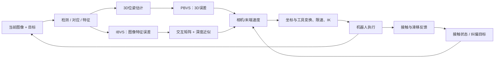
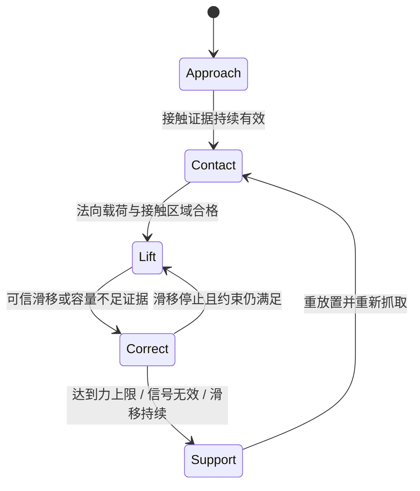
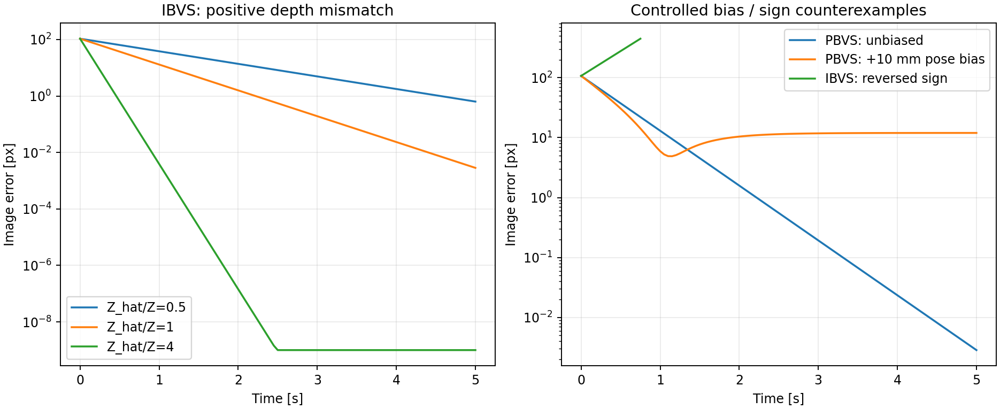
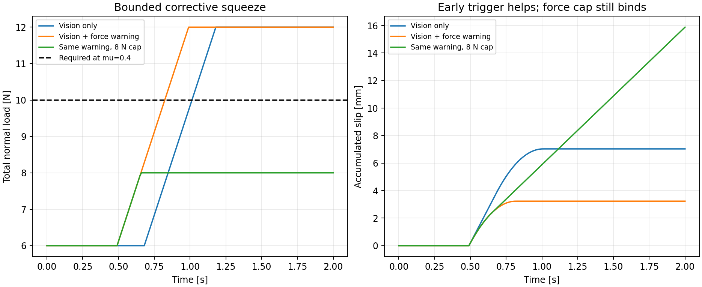

# D30 · 图像误差怎样变成动作：PBVS、IBVS 与滑移纠偏

[学习入口](../_index.md) ｜ [本周日程](../P2-深度理解-日程.md) ｜ [上一课 D29](../day29/Daily-Learning-Pack.md) ｜ [下一课 D31](../day31/Daily-Learning-Pack.md) ｜ [CPU 实验](demo.py)

**接近物体时，要把“看起来偏了”变成正确方向的运动；接触物体后，要分清“胶面在变形”与“物体正滑走”。这两个问题都要求观测、坐标、时间和执行能力对应起来。**

本课为 **P2 / W5-D2 / 全局 Day30，原定 2026-10-04，2026-10-09 补写**。D29 已建立位置、力、阻抗与导纳；今天保留原视觉触觉主线，深入视觉伺服与多模态接触。D31 收束触觉，再学习 VLM、RT-2 与原版 OpenVLA 的动作接口。

<details>
<summary>个人学习记录（后续生成保留）</summary>

<!-- learner-notes:start -->

- 我独立推导的图像运动方向：
- PBVS / IBVS 实验预测与实际误差：
- 我识别滑移、弹性变形、接触失效的方法：
- 我修改的一个变量、自测得分及未理解项：

<!-- learner-notes:end -->

</details>

<!-- daily-pack-generated:start -->

## 0. 学习路线与能力目标

| 顺序 | 关键问题 | 今天能做到的事 |
| --- | --- | --- |
| 宏观 | 误差定义在哪里 | 区分位姿误差与图像误差 |
| 微观 | 相机运动如何改变像素 | 从投影求点特征交互矩阵 |
| 工程 | 何时收敛、何时失效 | 检查秩、深度、符号、延迟、视野 |
| 接触 | 看到运动是否就是滑移 | 区分物体—胶面相对运动和共同变形 |
| 纠偏 | 发现滑移后能否救回 | 用摩擦容量和执行限幅判断可行性 |
| 验收 | 改哪个模块有证据 | 留下可运行对照、曲线和接口图 |

本课结束应能手算一个点对相机平移的图像响应，写出 `[2N,6]` 的含义，解释某种 PBVS 偏差与某种 IBVS 深度误差的不同后果，并判断“再用力夹一点”何时已不是可行纠偏。

## 1. 宏观：同一个机器人，可以在不同空间关闭误差

### 1.1 PBVS 与 IBVS 不是网络名称

**PBVS（Position-Based Visual Servoing）**：从视觉估计三维位置/姿态，用三维误差设计运动。**IBVS（Image-Based Visual Servoing）**：直接用图像特征误差设计运动。两者都依赖后续图像更新，都可以使用传统特征或学习感知模块；“网络输出位姿”不自动意味着实现了闭环。



第一条路线需要可信位姿；第二条路线也并非完全不需要几何，而是将几何放在图像特征与速度之间的映射中。两种路线都需要相机内参、手眼关系与执行接口的适当信息，区别在误差定义及误差如何传播。[Chaumette & Hutchinson 2006，Basic Approaches](https://web.mit.edu/amcp/OldFiles/drg/Chaumette_Part_I.pdf)

### 1.2 先约定 eye-in-hand 与静止目标

下文交互矩阵假设相机固定在末端、目标点在世界中静止，相机 twist 用当前相机坐标表达，顺序为 $[v_x,v_y,v_z,\omega_x,\omega_y,\omega_z]$。如果目标自己运动，图像速度还会有目标运动项；如果相机固定在外部，执行变量是末端而不是相机，映射也必须随之改变。

不要把 eye-to-hand 画面中“末端向右”与 eye-in-hand 中“相机向右”视为同一个符号。在后一种情况下，静止目标通常向图像左侧移动。

## 2. PBVS：位姿估计与控制误差之间的桥

### 2.1 一个明确、可实现的几何约定

设在机器人基座坐标下，当前末端位姿估计为 $(\hat R,\hat p)$，期望为 $(R_d,p_d)$。一个局部几何速度控制设计为：

$$
v_b=\lambda_p(p_d-\hat p),\qquad
\omega_b=\lambda_R\operatorname{Log}(R_d\hat R^T)^\vee.
$$

这里 $\operatorname{Log}(R_d\hat R^T)^\vee$ 是在基座方向表达的旋转向量；姿态更新采用左乘 $R_{k+1}=\operatorname{Exp}([\omega_b\Delta t]_\times)R_k$。这组写法只有连同约定才完整：若旋转误差改成 $\hat R^TR_d$，它是另一种表达，不能沿用同一基座角速度解释。

$\lambda_p,\lambda_R$ 的单位为 $s^{-1}$；$v_b$ 为 m/s，$\omega_b$ 为 rad/s。在真实机器人中还要把期望 twist 经工具关系与 Jacobian 转成可执行命令，检查关节限位、奇异与碰撞。这是本课的几何接口设计示例，并非声称所有 PBVS 文献使用相同姿态参数化。

### 2.2 位姿存在系统偏差时，控制器可能“认真地停错位置”

只看一维平移，若视觉估计为 $\hat p=p+b$，控制为 $\dot p=\lambda(p_d-\hat p)$，稳态满足：

$$
p=p_d-b.
$$

视觉误差变成了真实末端偏差。更多控制迭代未必消除标定偏差，可能只是更稳定地收敛到错误目标。误差来源可包括深度尺度、对象模型原点、手眼标定、运动中使用了旧时间戳等。D19–D21 的坐标约定会在这里直接体现为末端运动后果。

本课实验将偏差注入“目标相对相机的平移估计”，因此公式的偏差符号与上述“末端绝对位置偏差”相反，但**稳态误差大小同为偏差大小**。脚本的 `pose_bias` 明确加在相对位置量上，不在两个模型之间偷换符号。

### 2.3 三维路径合理，不代表图像特征始终可见

PBVS 可以很自然地表达基座系中的距离和方向，却不能仅靠三维误差趋零就保证特征一直留在视野中。控制设计需加入视野、遮挡和重新获取条件。反过来，IBVS 尽量减小图像误差，也不自动保证全臂路径无碰撞。

## 3. IBVS：从针孔投影一步步推到速度

### 3.1 像素先变成归一化图像坐标

对相机系静止场景点 $P=[X,Y,Z]^T$，针孔投影为：

$$
x=X/Z=(u-c_x)/f_x,\qquad y=Y/Z=(v-c_y)/f_y.
$$

$u,v$ 为像素；$x,y$ 无量纲；$Z$ 是相机光轴深度 m。用归一化坐标构造的矩阵不能直接乘“像素误差”，否则增益里会莫名多一个焦距尺度。若使用像素形式，相应矩阵的行应乘 $f_x,f_y$。

### 3.2 静止点为何相对相机向反方向运动

相机平移并转动，而世界点不动，因此在当前相机系中：

$$
\dot P=-v_c-\omega_c\times P.
$$

对 $x=X/Z$ 求导：$\dot x=(\dot X-x\dot Z)/Z$；对 $y$ 同理。代入上式，得到：

$$
\begin{bmatrix}\dot x\\\dot y\end{bmatrix}
=L(x,y,Z)\mathcal V_c,
$$

$$
L=
\begin{bmatrix}
-1/Z&0&x/Z&xy&-(1+x^2)&y\\
0&-1/Z&y/Z&1+y^2&-xy&-x
\end{bmatrix}.
$$

这正是点特征的交互矩阵。前三列单位 $1/m$，乘 m/s 后变为 $1/s$；后三列乘角速度也得到图像坐标变化率。完整推导可对照原教程的式 (6)–(11)。[原论文 pp.83–84](https://web.mit.edu/amcp/OldFiles/drg/Chaumette_Part_I.pdf)

**手算方向：** 在图像中心 $x=y=0$、$Z=0.5$ m，相机以 $v_x=0.01$ m/s 向右平移，$\dot x=-0.02\ s^{-1}$。若 $f_x=600$ px，则 $\dot u=-12$ px/s。这个小算例比“看起来控制方向没错”更可靠。

### 3.3 堆叠特征，求一个能减小误差的 twist

有 $N$ 个点时：

$$
s=[x_1,y_1,\ldots,x_N,y_N]^T,\quad
e=s-s^*,\quad
L_s=\begin{bmatrix}L_1\\\vdots\\L_N\end{bmatrix}\in\mathbb R^{2N\times6}.
$$

选择 $\mathcal V_c=-\lambda\hat L_s^+e$。在矩阵准确且局部可控的理想条件下，它试图使可达方向上的误差满足指数下降。伪逆是最小二乘意义的速度，不是“每个像素都能独立变到任意位置”。冗余特征之间受同一刚体运动约束。

| 量 | 无 batch | 有 batch | 含义 |
| --- | --- | --- | --- |
| 特征 / 目标 | `[2N]` | `[B,2N]` | 已归一化的图像坐标 |
| 深度 | `[N]` | `[B,N]` | 每点正光轴深度 |
| 交互矩阵 | `[2N,6]` | `[B,2N,6]` | 相机运动到特征速度 |
| 伪逆 | `[6,2N]` | `[B,6,2N]` | 特征误差到相机 twist |
| twist | `[6]` | `[B,6]` | m/s 与 rad/s，已声明参考系 |

单点只有两行，无法观测六个自由度。三个点有六行也不能保证每种构型都可逆；共线、投影退化、对应错误或极小目标区域都会影响可观测性。增加到四点得到 `[8,6]`，仍需检查数值秩和条件，而不是只数元素个数。

接近奇异时，可使用带阻尼的最小二乘求解并限制速度。平移列与转动列的量纲不同，实际调节阻尼或比较条件数时需要明确长度尺度/权重；不能把未经尺度约定的奇异值阈值当作跨机器人通用参数。

### 3.4 IBVS 也需要深度，误差形式决定敏感性

矩阵的平移列含 $1/Z$，因此“图像控制不用深度”不准确。可使用 RGB-D 当前深度、目标深度近似或其他估计，但对应误差会进入闭环。

为了能完整手算，本课仿真只允许相机沿 $x,y$ 平移，固定方向和 $Z$，目标位于光轴中心：

$$
s=(P_{xy}-C_{xy})/Z,\qquad
L=-I/Z,\qquad v_c=\lambda\hat Zs.
$$

Euler 更新后：

$$
s_{k+1}=(1-\lambda\Delta t\hat Z/Z)s_k.
$$

正深度误差在这个受限模型中相当于改变闭环增益；只要 $0<\lambda\Delta t\hat Z/Z<2$ 就收敛。过大估计、符号反转或加入延迟则可能破坏稳定性。**这是二维平移模型的精确结论，不是一般六自由度 IBVS 的全局保证。**

## 4. 工程故障地图：先定位误差源，再改增益

| 现象 | 可能原因 | 优先证据 |
| --- | --- | --- |
| 每次稳定停在同一偏差 | 位姿/外参/目标坐标偏置 | 在独立测量系核对最终位置 |
| 误差持续变大 | 坐标或反馈符号反了 | 用一个小平移核对像素方向 |
| 小误差阶段高速抖动 | 特征噪声、深度跳变、病态矩阵 | 记录特征置信、奇异值与速度 |
| 静止可以，运动时偏差大 | 图像、TF、执行时间错位 | 对齐采集时刻与变换时刻 |
| 接近过程中丢失特征 | 视野约束、遮挡、错误对应 | 保存轨迹上的图像与ROI |
| 图像误差下降但机械臂碰撞 | 只约束相机局部目标 | 检查全臂轨迹与环境模型 |

常见 ROS 错误是拿“当前 TF”变换一张早已采集的图像。若末端速度为 0.1 m/s，观测落后 100 ms，则仅平移就可能差 10 mm。应明确 `image_stamp → transform_at_stamp → command_stamp`，并设置过期观测处理。这里不指定某个 ROS 版本 API，避免把概念性接口误写成已验证的节点代码。

## 5. 接触之后：滑移是相对运动，不是所有运动

### 5.1 三种状态要分开

1. **粘着并弹性变形：** 物体和接触胶面一起移动，纹理相对标记基本稳定；胶面拉伸不等于物体从指尖滑过。
2. **初始局部滑移：** 接触区域一部分开始失去粘着，中心与边缘形变模式不同。局部滑移可在整体明显位移前出现，但不是每个材料/接触几何都给相同图案。
3. **整体滑移或脱离：** 物体相对胶面移动，或接触区域快速减小；可能已经需要停止搬运而非继续挤压。

光滑、形状沿滑动方向近似不变的物体，触觉图像可能一直看起来相似；外部视觉可补充物体与夹爪的整体相对运动。反过来，外部图像中的物体小幅位移也可能只是胶面拉伸，触觉相对纹理可以帮助解释。[Li 等 2018，§IV-C、Figures 6–7](https://arxiv.org/html/1802.10153v1)

### 5.2 一个真实论文架构，读清楚输入与输出

上述工作把同步视觉/触觉时间窗分别编码，逐时刻拼接特征，再用时序网络判断滑移。其 §III 给出八个时刻的图像对、CNN、64维压缩、两层64单元 LSTM 和两类输出；输出是稳定/滑移判断，不是末端动作，也不是物理摩擦系数。[原论文 §III 与 Figure 2](https://arxiv.org/html/1802.10153v1)

用 PyTorch 常见布局重新表达这一思想，可写：

```text
视觉 [B,8,3,H,W] → 编码器 → [B,8,Dv]
触觉 [B,8,3,H,W] → 编码器 → [B,8,Dt]
                 拼接 → [B,8,Dv+Dt]
                 线性 → [B,8,64]
                 LSTM → [B,8,64]
                 分类 → [B,2]
```

这张 shape 图说明数据组织，并未声称本机运行了作者网络。原论文实现与本课示意布局不同并不矛盾，核心是每个时刻如何对齐、哪些参数是训练的、监督标签是什么。

如果训练滑移分类器，交叉熵学习的是标签条件概率；物体表面、光照、传感器老化或不同夹持力会导致分布变化。切分训练集时必须防止同一次抓取滑窗跨训练/测试；更有意义的评估还应按未见物体、材质、传感器状态分组。模型分类准确率不直接等于闭环抓取成功率。

### 5.3 简化摩擦模型先判断纠偏有没有能力

本课用对称双指、只考虑平移下滑的简化模型，定义 $N$ 为**两侧法向载荷的总和**。若两侧摩擦系数同为 $\mu$，可用：

$$
|F_t|\le\mu N.
$$

如果每指法向为 $n$，则 $N=2n$；不要既用了总载荷又再乘一次2。这里忽略扭转、接触位置、物体转矩、加速度、接触面积和软材料特性，所以它不是完整 force closure 判据。

手算：$F_t=4$ N、$\mu=0.4$，需要 $N\ge10$ N。若易碎物体允许总法向上限只有 8 N，最大摩擦容量为3.2 N，继续增加到上限仍无法满足。应减小搬运加速度/负载需求、放回支撑、换接触位置或重新抓取。**检测再准确，也不能创造缺失的执行能力。**

### 5.4 融合不等于拼接，至少还需有效性与时效

一个接触状态记录可以是：

```text
ContactState = {
  stamp, contact_valid, contact_frame,
  normal_load_N, slip_probability, relative_slip_velocity_m_per_s,
  sensor_age_s, calibration_id, uncertainty, saturation
}
```

视觉估计整体相对运动，触觉估计胶面局部运动，二者未必是同一个物理量。要做数值平均，先变到同一参考系、同一时刻、同一量纲并处理胶面弹性；只做决策级融合时，也要明确哪个信号代表接触、哪个代表滑移、哪个信号只是不可用。

## 6. 纠偏策略：动作之前先确定状态与约束

一个简化状态机可设计为：



`Correct` 可以增大夹紧、减少搬运加速度、改变姿态或退到支撑；不能默认永远只增大夹紧。使用阈值时需避免一次噪声事件锁定持续闭合，真实实现可采用持续帧、滞回、反馈目标和恢复条件。本课实验故意使用简单锁存纠偏，便于隔离“预警时刻”这个变量；它不是完整状态机实现。

## 7. CPU 实验：可手算的视觉控制与可失败的滑移纠偏

### 7.1 先写四个预测

- IBVS 中仅将 $\hat Z/Z$ 从 0.5 改成 4，误差下降会更快还是更慢？是否所有正值都稳定？
- 给 PBVS 相对平移估计固定加 10 mm 偏差，真实图像误差最后能归零吗？
- 触觉预警比视觉提前，是否意味着累计滑移一定为零？
- 把允许总法向上限从12 N改成8 N，4 N切向负载还能停住吗？

```bash
python -B 3d_learning/day30/demo.py
```

本教材已在 CPU 使用 Python 3.11.15 / NumPy 1.26.4 / Matplotlib 3.10.9 运行；没有调用视觉模型、GelSight 网络、ROS 或机械臂。

### 7.2 视觉实验的设定和真实结果

目标 $P_{xy}=(0.08,-0.04)$ m，初始相机 $C_{xy}=0$，恒定 $Z=0.5$ m，$f=600$ px，控制步长0.05 s，$\lambda=2\ s^{-1}$。只控制平移，不转动；因此**不是完整六维视觉伺服复现**。

| 受控条件 | 100步 / 5 s 后像素误差范数 |
| --- | ---: |
| IBVS，$\hat Z/Z=0.5$ | 0.635458 px |
| IBVS，$\hat Z/Z=1$ | 0.002851 px |
| IBVS，$\hat Z/Z=4$ | 约 $1.86\times10^{-14}$ px（数值精度） |
| PBVS，相对平移估计偏置 +10 mm | 11.997131 px |

PBVS 理论残差是 $600\times0.01/0.5=12$ px。偏差为零的 PBVS 在这个特殊平移模型里与准确深度 IBVS 给出相同控制律；对照不是在证明某一类方法普遍优于另一类，而是在展示特定误差怎样传播。

符号反转的 IBVS 只运行15步，误差由约107.33 px增至448.35 px。真实有限视野系统可能早已丢失目标，脚本使用无限针孔平面继续算误差，不能把它当成实际追踪器还能保持对应。



左图纵轴是对数尺度，直线斜率对应指数衰减速率；为了可读性，绘图把低于 $10^{-9}$ px 的数值显示在该下限，表格保留实际计算值。右图把偏置与符号错误分开：有偏置可能停错位置，符号错误则向错误方向持续运动。每条对照只改变对应参数，没有重新调节其他增益来掩盖错误。

脚本另将四个点的完整矩阵堆叠为 `[8,6]`，数值秩为6，并用有限差分验证了受限平移方向的解析导数，最大误差约 $1.05\times10^{-11}$。**构造六列矩阵并验证局部导数，不等于跑过六自由度闭环或证明全局稳定。**

### 7.3 滑移实验：明确哪部分是人工理想化

合成切向负载在0.5 s从1.5 N跳到4 N，初始总法向6 N，摩擦系数0.4。脚本使用一个可检查的过阻尼滑移近似：

$$
v_{slip}=\frac{\max(F_t-\mu N,0)}{b_s},\quad b_s=80\ \mathrm{N\cdot s/m}.
$$

它只模拟一个方向的相对滑动，未包含物体惯性、动静摩擦切换和转动。视觉触发条件为累计滑移超过2 mm，再加100 ms观察延迟；触觉分支使用**已知力与摩擦系数**给出的理想容量预警 $F_t>0.9\mu N$。真实触觉如何估计这些量不在脚本内，因此不能称它为已实现的滑移识别网络。

触发后以12 N/s增加法向载荷，锁存到给定力上限。只切换 `use_tactile`，比较信息提前量；另只改 `max_force`，比较纠偏能力。

| 设定 | 首次触发 | 2 s累计滑移 | 最终滑移速度 |
| --- | ---: | ---: | ---: |
| 仅视觉触发，上限12 N | 0.69 s | 7.034 mm | 0 mm/s |
| 加理想触觉预警，上限12 N | 0.50 s | 3.234 mm | 0 mm/s |
| 同一预警，仅将上限改8 N | 0.50 s | 15.884 mm | 10 mm/s |



左图说明法向载荷增长需要时间，预警并不能瞬间给出所需10 N，因此融合分支仍有3.234 mm滑移。右图8 N上限分支持续上升：这是容量不足，不能靠更激进的分类阈值解决。锁存纠偏会继续增到12 N，是本实验的简化规则；实际系统应停止不必要的增力，并加入易碎性和恢复状态约束。

### 7.4 自己修改一个变量

先只把视觉延迟索引 `k-10` 改为 `k-20`，保持步长0.01 s和其他条件不变，预测仅视觉分支累计滑移怎样变化。再恢复原文件，单独将初始法向载荷从6 N改为9 N，重新预测滑移与触发时刻。两次实验分别保留结果，避免同时修改后无法归因。

起步核心代码：

```python
feature = (point_xy - camera_xy) / depth
camera_velocity = gain * estimated_depth * feature
camera_xy += dt * camera_velocity
# 仅用于固定 Z、固定姿态的二维平移模型
```

<details>
<summary>完整可复制代码（与 demo.py 一致）</summary>

<!-- demo-code:start -->
```python
"""Day30: planar visual servo and force-budget slip correction, CPU only.

Two translational camera DOFs; synthetic force-informed tactile trigger.
Not a complete six-DOF servo, GelSight network, friction model or robot test.
"""
from pathlib import Path
import json
import platform
import numpy as np
import matplotlib
matplotlib.use("Agg")
import matplotlib.pyplot as plt


def servo(depth_ratio=1., mode="ibvs", pose_bias=0., steps=100):
    dt, gain, depth, focal = .05, 2., .5, 600.
    point = np.array([.08, -.04])
    camera = np.zeros(2)
    trace = []
    for k in range(steps+1):
        feature = (point-camera)/depth
        trace.append([k*dt, *camera, np.linalg.norm(feature)*focal])
        if k == steps:
            break
        if mode == "ibvs":
            velocity = gain*depth*depth_ratio*feature
        else:
            velocity = gain*(point-camera+np.array([pose_bias, 0.]))
        camera += dt*velocity
    return np.array(trace)


def slip(use_tactile, max_force=12.):
    dt, mu, drag = .01, .4, 80.
    t = np.arange(0., 2.+dt/2, dt)
    normal, displacement, active = 6., 0., False
    delayed_displacement = []
    trace = []
    trigger_time = None
    for k, time in enumerate(t):
        load = 1.5 if time < .5 else 4.
        # Common camera trigger: >2 mm accumulated slip, 100 ms sensor delay.
        camera_d = delayed_displacement[max(0, k-10)] if k else 0.
        visual_trigger = camera_d > .002
        # Idealized calibrated force warning, not raw tactile image inference.
        tactile_trigger = use_tactile and load > .9*mu*normal
        if (visual_trigger or tactile_trigger) and not active:
            active, trigger_time = True, float(time)
        if active:
            normal = min(max_force, normal+12.*dt)
        velocity = max(load-mu*normal, 0.)/drag
        displacement += dt*velocity
        delayed_displacement.append(displacement)
        trace.append([time, normal, load, velocity, displacement])
    return np.array(trace), trigger_time


def point_interaction(x, y, z):
    return np.array([[-1/z, 0, x/z, x*y, -(1+x*x), y],
                     [0, -1/z, y/z, 1+y*y, -x*y, -x]])


def main():
    out = Path(__file__).resolve().parents[2]/"_assets/3d_learning/day30"
    out.mkdir(parents=True, exist_ok=True)
    runs = {r: servo(r) for r in (.5, 1., 4.)}
    biased = servo(mode="pbvs", pose_bias=.01)
    unbiased = servo(mode="pbvs")
    reverse = servo(-1., steps=15)
    assert runs[1.][-1, 3] < .01
    assert abs(biased[-1, 3]-12) < .01
    assert reverse[-1, 3] > reverse[0, 3]
    fig, axes = plt.subplots(1, 2, figsize=(11, 4.5), constrained_layout=True)
    for ratio, tr in runs.items():
        axes[0].semilogy(tr[:, 0], np.maximum(tr[:, 3], 1e-9), label=f"Z_hat/Z={ratio:g}")
    axes[0].set(xlabel="Time [s]", ylabel="Image error [px]", title="IBVS: positive depth mismatch")
    axes[0].legend()
    for label, tr in [("PBVS: unbiased", unbiased), ("PBVS: +10 mm pose bias", biased), ("IBVS: reversed sign", reverse)]:
        axes[1].semilogy(tr[:, 0], np.maximum(tr[:, 3], 1e-9), label=label)
    axes[1].set(xlabel="Time [s]", ylabel="Image error [px]", title="Controlled bias / sign counterexamples")
    axes[1].legend()
    for ax in axes:
        ax.grid(alpha=.25)
    fig.savefig(out/"visual_servo.png", dpi=170)
    plt.close(fig)

    tactile, tt = slip(True)
    vision, tv = slip(False)
    limited, tl = slip(True, max_force=8.)
    assert tactile[-1, 4] < vision[-1, 4]
    assert limited[-1, 3] > 0
    fig, axes = plt.subplots(1, 2, figsize=(11, 4.5), constrained_layout=True)
    for label, tr in [("Vision only", vision), ("Vision + force warning", tactile), ("Same warning, 8 N cap", limited)]:
        axes[0].plot(tr[:, 0], tr[:, 1], label=label)
        axes[1].plot(tr[:, 0], tr[:, 4]*1000, label=label)
    axes[0].axhline(10, ls="--", color="black", label="Required at mu=0.4")
    axes[0].set(xlabel="Time [s]", ylabel="Total normal load [N]", title="Bounded corrective squeeze")
    axes[1].set(xlabel="Time [s]", ylabel="Accumulated slip [mm]", title="Early trigger helps; force cap still binds")
    for ax in axes:
        ax.legend(fontsize=8)
        ax.grid(alpha=.25)
    fig.savefig(out/"slip_feedback.png", dpi=170)
    plt.close(fig)

    # Four normalized image points provide 8 rows for 6 camera-twist columns.
    points = np.array([[-.1, -.1, .5], [.1, -.1, .5], [.1, .1, .5], [-.1, .1, .5]])
    interaction = np.vstack([point_interaction(*p) for p in points])
    singular = np.linalg.svd(interaction, compute_uv=False)
    assert interaction.shape == (8, 6)
    assert np.linalg.matrix_rank(interaction) == 6
    # Velocity check in the restricted x/y translation setting.
    p = np.array([.08, -.04, .5])
    v = np.array([.01, -.02, 0., 0., 0., 0.])
    epsilon = 1e-6
    old = p[:2]/p[2]
    moved = p-epsilon*v[:3]
    finite_difference = (moved[:2]/moved[2]-old)/epsilon
    analytic = point_interaction(*old, p[2])@v
    assert np.max(np.abs(finite_difference-analytic)) < 1e-8
    report = dict(scope="Planar camera + toy contact feedback; no learned slip detector",
        environment=dict(python=platform.python_version(), numpy=np.__version__, matplotlib=matplotlib.__version__),
        servo_final_px={f"depth_ratio_{r:g}":float(tr[-1, 3]) for r, tr in runs.items()},
        pbvs_bias_final_px=float(biased[-1, 3]),
        reversed_sign_15_steps_px=float(reverse[-1, 3]),
        interaction_shape=list(interaction.shape), interaction_rank=int(np.linalg.matrix_rank(interaction)),
        interaction_singular_values=singular.tolist(), derivative_max_error=float(np.max(np.abs(finite_difference-analytic))),
        slip={name:dict(trigger_s=when, total_slip_mm=float(tr[-1, 4]*1000),
                       final_slip_mm_per_s=float(tr[-1, 3]*1000), final_normal_N=float(tr[-1, 1]))
              for name, tr, when in [("vision_only", vision, tv), ("fusion", tactile, tt), ("force_cap_8N", limited, tl)]})
    (out/"results.json").write_text(json.dumps(report, indent=2, ensure_ascii=False)+"\n")
    np.savetxt(out/"slip_fusion.csv", tactile, delimiter=",",
               header="time_s,normal_N,tangential_N,slip_velocity_m_per_s,slip_m", comments="")
    print(json.dumps(report, indent=2, ensure_ascii=False))


if __name__ == "__main__":
    main()
```
<!-- demo-code:end -->

</details>

## 8. 今日重点与难点复盘

最重要的四件事：

- **定义误差的空间。** 位姿误差带来直接几何意义，图像误差减少中间位姿估计依赖；二者各有不同误差传播路径。
- **推导一次运动符号。** $\dot P=-v-\omega\times P$ 是眼在手上、静止目标的起点，能及时发现会导致发散的坐标错误。
- **先判断可观测与可执行。** 特征数够不等于矩阵稳定，理想 twist 也不等于机械臂可执行路径。
- **把检测能力与纠偏能力分开。** 提前知道可能滑，只有在法向、速度和支撑约束允许时才可能救回。

最容易混淆的三处：IBVS“在图像里控制”不等于没有深度；物体在图像里移动不等于相对接触滑移；模型输出高滑移概率不等于允许无上限增大夹持力。分别用投影导数、纹理—标记关系和摩擦容量检查。

## 9. 精读与今日产出

精读 [视觉伺服原教程](https://web.mit.edu/amcp/OldFiles/drg/Chaumette_Part_I.pdf) 的式 (6)–(11) 与 PBVS 小节，自己从一个投影点重推两行矩阵；再看其大运动示例，找出局部误差下降与全局路径表现并非同一件事。

精读 [多模态滑移论文](https://arxiv.org/html/1802.10153v1) Figure 2 和 Figures 6–7：分别说明时序信息怎样进入判断，以及外部视觉与触觉在哪种情况下互补。今天不需要复现论文网络，只需画明白它的输入、输出、训练标签和实验边界。

今日留下：一页 PBVS / IBVS 对照笔记、一张包含接触状态与限力退路的系统图、视觉误差曲线和一次延迟/载荷单变量对照。脚本原始输出见 [结果 JSON](../../_assets/3d_learning/day30/results.json) 与 [滑移轨迹 CSV](../../_assets/3d_learning/day30/slip_fusion.csv)。个人掌握程度由自测和产出确认。

## 10. 自测

1. 区分“运行位姿估计网络”“执行一条轨迹”和“PBVS 闭环”的必要条件。
2. 在 $Z=0.5$ m、$f_x=600$ px、图像中心，相机向右以0.01 m/s移动，静止点的像素速度是多少？
3. 四个点的图像交互矩阵为何是 `[8,6]`？它满列秩是否足以证明全局收敛？
4. 本课 $\lambda=2$、$\Delta t=0.05$，深度比 $\hat Z/Z=4$ 时误差乘子多少？若改成25会怎样？
5. 本课 PBVS 相对位置估计偏置10 mm为何留下约12 px残差？增加控制迭代能否自动消除？
6. 触觉图中物体纹理与胶面标记一起移动，是否足以判定滑移？为什么？
7. 两指各4 N法向、$\mu=0.4$，本课简化模型下总摩擦容量是多少？能否抵抗4 N切向负载？
8. 为什么融合实验比视觉分支更早触发，却仍然留下3.234 mm滑移？
9. 滑移分类器在相同抓取的视频滑窗上随机切分得到高分，有什么评估问题？还需测什么闭环指标？
10. 图像中误差在减小，但末端动作忽快忽慢、偶尔丢目标。请列出三个应记录的中间量，并解释用途。

## 11. 未理解项与 D31 的连接

仍弄不清相机运动符号时，固定所有旋转，只保留本课中心点手算；仍混淆 PBVS 与 IBVS 时，分别写出误差向量的单位。不要直接记忆两种方法的优缺点列表。

D31 会把接触状态、有效性门控和局部反馈保留下来，再看高层视觉语言动作模型。届时要问：大模型发来的动作在哪个坐标系、经什么统计反归一化、遇到接触约束时由谁修正？本课的系统接口会成为判断 VLA 是否可用的依据。

> [!note]- 自测答案与 0 / 1 / 2 判分（最后查看）
> 每题0分为关键概念/符号错误；1分为结论正确但缺条件或推导；2分为解释完整且能指出工程边界。满分20，留给本人记录。
>
> 1. 位姿网络只输出估计，轨迹执行可能没有新视觉反馈；PBVS要求后续视觉更新三维误差并影响后续控制。
> 2. $\dot x=-0.01/0.5=-0.02\ s^{-1}$，$\dot u=-12$ px/s；目标向左。
> 3. 每点两行，六列对应相机 twist；满列秩是局部信息条件，不保证全局、视野、对应正确或无碰撞。
> 4. $1-2\times0.05\times4=0.6$；比值25时乘子−1.5，在该离散模型中交替发散。
> 5. $600\times0.01/0.5=12$ px。系统会消除估计误差，却留下真实偏差；需校正误差源。
> 6. 不足。这可能是粘着下胶面的弹性变形；需纹理相对胶面运动、局部形变模式或其他有效证据。
> 7. 总法向8 N，容量 $0.4\times8=3.2$ N，不够4 N；不能再额外乘一次2。
> 8. 力增长率有限，初始6 N要升到至少10 N，建立能力的这段时间还会滑。预警没有改变执行器增力速度。
> 9. 同抓取片段高度相关，可能泄漏；应按抓取/物体等隔离。闭环还需累计滑移、最大力、恢复时间、失败率和未见条件评估。
> 10. 如特征置信/对应与ROI用于判断丢失；深度与奇异值用于判断病态映射；图像/TF/命令时间戳用于判断延迟；原始/限幅速度用于判断饱和。任举三项并解释。

<!-- daily-pack-generated:end -->
