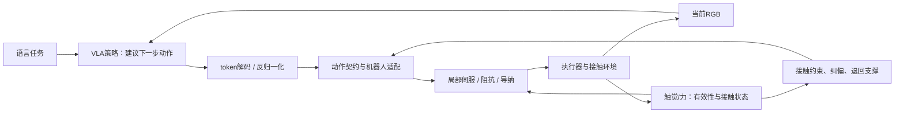
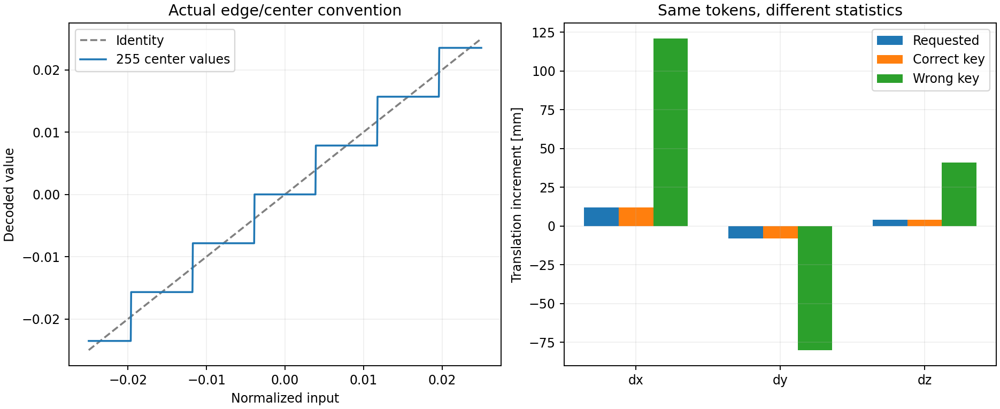
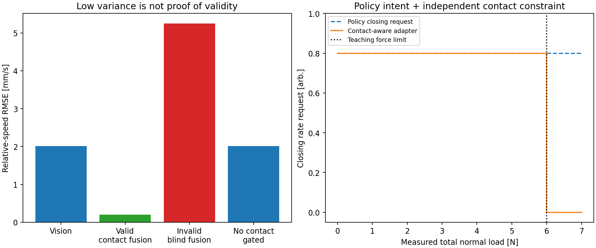

# D31 · 触觉闭环与视觉语言动作模型：从语义到有单位的动作

[学习入口](../_index.md) ｜ [本周日程](../P2-深度理解-日程.md) ｜ [上一课 D30](../day30/Daily-Learning-Pack.md) ｜ [下一课 D32](../day32/Daily-Learning-Pack.md) ｜ [CPU 实验](demo.py)

**模型知道“拿起杯子”，不代表它知道此刻指尖已压到几牛顿。今天把触觉、局部反馈和动作接口接在一起，再理解 RT-2 与原版 OpenVLA 如何把图像和语言变成动作 token。**

本课为 **P2 / W5-D3 / 全局 Day31，原定 2026-10-05，2026-10-09 补写**。D29–D30 的视觉伺服与触觉反馈继续保留；新增 VLA 用于理解策略层，并不替代接触观测和控制。今天聚焦原始 RT-2 与2024原版 OpenVLA，后续 OFT、FAST 等单独看待。D32 按原课序继续本周内容。

<details>
<summary>个人学习记录（后续生成保留）</summary>

<!-- learner-notes:start -->

- 我独立整理的视觉/触觉有效性条件：
- 我写出的动作契约（单位、坐标、周期、夹爪语义、统计key）：
- 量化与错统计对照的预测、运行和解释：
- 自测得分、尚不能独立解释的接口：

<!-- learner-notes:end -->

</details>

<!-- daily-pack-generated:start -->

## 0. 今日知识路线

| 层次 | 要解答的问题 | 目标能力 |
| --- | --- | --- |
| 触觉收束 | 什么时候触觉是有效测量 | 写出接触状态、置信与失效处理 |
| 系统架构 | 策略、伺服、接触约束怎样协作 | 分开任务意图与快速反馈 |
| VLM → VLA | 预测文字如何变成预测动作 | 理解动作监督与自回归表示 |
| 原模型 | RT-2 和原版 OpenVLA 做了什么 | 不把后续扩展混入原架构 |
| 接口细节 | token 如何回到 m、rad、夹爪目标 | 手算量化、反归一化与错key误差 |
| 实验验收 | 哪些错误能在不跑大模型时暴露 | 运行量化、尺度、坐标和融合反例 |

今天结束后，应能看到一份 VLA 示例里的 `action.shape == (7,)` 就继续追问其语义，而不是直接发给机器人；同时能解释为什么一个看似很稳定的触觉数值仍可能不应参与融合。

## 1. 触觉收尾：把“有图像”变成“有可用接触证据”

### 1.1 三层输出对应三种承诺

| 层 | 输出举例 | 可以承诺什么 | 尚不能承诺什么 |
| --- | --- | --- | --- |
| 测量 / 表征 | 胶面RGB、接触mask、标记位移 | 记录了某种局部变化 | 力已经校准、一定发生滑移 |
| 状态估计 | 法向载荷、相对滑移、接触是否有效 | 在假设下估计当前接触状态 | 该估计跨物体和材料始终准确 |
| 决策 / 控制 | 增力、减速、退回支撑 | 选择符合任务约束的纠偏 | 执行后一定成功 |

D29 的形变到力需要材料与传感标定；D30 的滑移要区分胶面共同变形与物体相对运动。今天再加一个条件：**测量对象不存在时，低噪声不是高可信。** 没有接触时胶面几乎不动，只能说明胶面没有观测到物体，不代表物体相对夹爪速度为零。

### 1.2 只有同一个物理量才能直接融合

假设视觉与触觉已经测到同一局部切向方向上、同一时刻的物体相对指尖速度 $v$，两者无偏且噪声相互独立：

$$
z_v=v+\epsilon_v,\quad z_t=v+\epsilon_t,
\quad\epsilon_v\sim\mathcal N(0,\sigma_v^2),
\quad\epsilon_t\sim\mathcal N(0,\sigma_t^2).
$$

最小方差线性融合为：

$$
\hat v=\frac{z_v/\sigma_v^2+z_t/\sigma_t^2}{1/\sigma_v^2+1/\sigma_t^2},
\qquad
\sigma_{fused}^2=\left(\sigma_v^{-2}+\sigma_t^{-2}\right)^{-1}.
$$

取 $\sigma_v=2$ mm/s、$\sigma_t=0.2$ mm/s，触觉权重约99.01%，理论融合标准差约0.199 mm/s。这个结果看似漂亮，但全部建立在“触觉确实测到同一速度”的前提上。

若物体没有接触，触觉读数只是均值约0、标准差0.2的胶面噪声，继续用上述权重会把真实运动强行拉向零。应该先做接触有效性门控，触觉无效时使用视觉或其他观测，而不是将“无效”编码成高置信零。

若两种估计有共同标定偏差或共享同一输入网络，独立噪声假设也不成立。更复杂的协方差融合需显式处理相关性；稳定偏差不会通过更多取平均自动消失。

### 1.3 接触状态应随动作一起记录

一个最小多模态状态可以包含：

```text
RGB/RGB-D + 采集时间与相机参数
触觉时间窗 + 空载参考 + contact_valid
关节状态 + TCP/工具坐标
法向载荷、相对切向速度、滑移置信、测量是否饱和
目标对象、任务阶段、允许的夹持/运动范围
```

“看到一个杯子”与“正夹着杯子”不是同一状态。原版视觉语言动作模型若未输入触觉，它只能通过可见线索和训练先验估计接触，不能被描述为直接测到了本机指尖的力。

## 2. 把策略层放回完整机器人系统



这是本课提出的**模块化集成设计**，不是 RT-2 或 OpenVLA 官方已经默认包含的触觉架构。策略建议动作，适配器赋予其正确语义，局部控制器处理动态；接触约束有权让动作减速、改变或退出。

不必假设所有层使用同一更新率。语义任务通常不需要每个低层周期重推，但快速接触变化不能等待大模型重新生成。低层使用最近的有效目标并管理过期、超时和状态切换；高层动作也需要时间戳与最长有效期。

一个数值例子：大模型基于150 ms前的图像建议继续闭合；此时力传感器已经超过允许载荷。正确接口应处理当前接触状态，不应因高层动作仍在有效队列里就坚持执行。D20 的动作 chunk 也有同类问题：未执行完的未来动作需要根据新状态管理，而不是不可打断的脚本。

## 3. VLM 与 VLA：输出符号的物理含义发生了变化

### 3.1 VLM 的基本结构

视觉语言模型（VLM）通常将图像编码成视觉 token，映射到语言模型的嵌入空间，与文本 token 一起输入序列模型，再预测输出 token。视觉 token 是特征向量，不一定对应可读单词；投影器对齐的是维度与训练得到的表示关系，不是在做相机三维投影。

若图像编码输出 `[B,P,Cv]`，语言模型嵌入宽度为 $D$，投影器输出 `[B,P,D]`；文本嵌入 `[B,L,D]`，组合序列长度大致为 $P+L$，另加实际模板中的特殊 token。**空间 patch 数 $P$、通道数 $Cv$、文本长度 $L$ 是不同维度。**

### 3.2 VLA 增加了动作监督与动作解码约定

VLA 不只是让 VLM 写一句“向左移动”。将一个真实机器人动作编码成离散符号，再用示范数据训练：图像与指令作为条件，动作 token 作为监督输出。推理出的符号经反变换成为控制数值。

可以用条件分布表达：

$$
\pi_\theta(a\mid I,\ell),\qquad
p_\theta(z_1,\ldots,z_D\mid I,\ell)
=\prod_{j=1}^D p_\theta(z_j\mid I,\ell,z_{<j}).
$$

$D$ 在此表示动作维度，和前面语言嵌入宽度的符号容易混淆；以下将动作维度写为 $d_a$、语言宽度写为 $d_{model}$。这也是阅读论文时需要主动维护符号表的原因。

这些概率描述的是动作选择，并不自动预测下一张图像、接触力或未来状态。**策略与 world model 的目标不同：** 前者学习“下一步做什么”，后者显式建模“给定状态与动作之后发生什么”。大模型有丰富先验，不等于它已经具有可查询的机器人动力学模型。

## 4. RT-2：把动作写进视觉语言输出空间

RT-2 将机器人示范与视觉语言任务一起用于训练，把动作各维离散化并映射为模型可输出的符号。其动作描述包括末端三维位置增量、三维旋转增量、夹爪开合和一个离散终止指令；因此序列结构包含**8项**，其中连续维度用256档离散表示。[RT-2 原论文 §3.2](https://arxiv.org/html/2307.15818v1)

```text
图像 + 指令
   → 预训练视觉语言模型及机器人动作监督
   → [terminate, dx, dy, dz, drx, dry, drz, gripper]
   → 动作解码、机器人执行、重新获取图像
```

它的重要思想是复用视觉语言表征和序列预测框架。语义知识有机会帮助选对目标或理解任务，但坐标、执行频率和接触响应仍需靠机器人数据及具体系统实现。不要把“模型能理解哪个物体是可回收物”推导成“它一定知道该物体能承受多大夹持力”。

这里的8项不应直接套到 OpenVLA 的7维输出，也不能假设任何 VLA 都采用同一终止编码。终止预测与任务确实完成还应分开：若物体掉落，模型给出结束符并不等于成功验收。

## 5. 原版 OpenVLA：架构、训练与版本边界

### 5.1 本课“原版”指什么

本课基准为2024年 OpenVLA 原论文 v1 的模型路线：RGB图像与语言指令输入，DINOv2 与 SigLIP 特征融合，投影到 Llama 2 语言嵌入空间，以动作 token 自回归方式给出单次7维控制动作。原模型选择224×224图像，并使用单臂末端控制的机器人数据。[原论文 Figure 2、§3.1–3.4](https://arxiv.org/html/2406.09246v1)

| 要区分的对象 | 本课如何处理 |
| --- | --- |
| 原版 OpenVLA / `openvla-7b` | 讲架构、动作token与统计反归一化 |
| OpenVLA-OFT | 后续优化路线，不能把其并行/连续动作、更多输入能力写成原版默认功能 |
| FAST 等动作编码扩展 | 另一种动作表示路线，不能与本课逐维离散编码混为一谈 |
| 本课NumPy脚本 | 仅验证编码/接口与传感有效性，没有运行上述模型 |

官方仓库将 OFT 和 FAST 列为后续更新，原始推理例程仍展示 `predict_action(..., unnorm_key=...)`。[官方 README 的 Latest Updates / Getting Started](https://github.com/openvla/openvla)

### 5.2 双视觉编码器拼的是通道，不是两个时刻

令同一图像的 patch 数为 $P$：

```text
同一RGB图像的各自预处理
   ├→ DINOv2 → [B,P,Cd]
   └→ SigLIP → [B,P,Cs]
通道拼接       [B,P,Cd+Cs]
投影器         [B,P,d_model]
文本嵌入       [B,L,d_model]
序列模型       条件化预测动作token
```

拼接后 patch 数仍为 $P$，不是 $2P$。具体数值维度应查对应模型配置；本课使用符号 shape，避免把某个版本的视觉 backbone 尺寸误认为所有 OpenVLA 都相同。

官方 HF 实现中可能将同一图像的两种预处理结果沿输入 channel 存成6通道，再拆成两份3通道给两个编码器。这不是“两台物理相机”或“两帧历史图像”的证据。[官方 `modeling_prismatic.py` 的视觉 backbone](https://github.com/openvla/openvla/blob/main/prismatic/extern/hf/modeling_prismatic.py)

### 5.3 训练：动作 token 交叉熵，不是直接优化牛顿数

设训练目标动作编码为 $z^*_{1:d_a}$：

$$
\mathcal L=-\sum_{j=1}^{d_a}\log p_\theta(z_j^*\mid I,\ell,z_{<j}^*).
$$

训练用真实前缀，即 teacher forcing；推理用已生成的前缀，前面维度的错误可能影响后续维度。原版训练在动作 token 位置计算交叉熵，文本提示、视觉嵌入等不是同样的动作标签位置。[原论文 §3.2](https://arxiv.org/html/2406.09246v1)

若完整 logits 为 `[B,S,V]`，$S$ 是完整序列长度、$V$ 是词表大小，则 loss mask 只选动作监督位置；单步动作标签概念 shape 为 `[B,7]`。实现通常通过标签忽略值处理非监督位置，不能把 padding、文本和动作全部当成同一种训练目标。

相邻量化档的物理距离与相隔很远的档不同，但普通分类交叉熵首先区分的是离散标签。因此还应检查解码后的物理误差、动作时序与任务成功，不能只用 token accuracy 推断插入精度。一个 token 错一档可能只有0.1 mm，也可能因错误统计变成更大误差。

## 6. 从动作到 token：手算一次完整编码链

### 6.1 先定义本课动作契约

下面全是**教学用统计与机器人约定**，不冒充 BridgeData 或任何官方机器人数据：

| 维度 | 本课语义 | 单位 / 范围 | 执行约定 |
| --- | --- | --- | --- |
| 0–2 | 基座坐标下末端平移增量 | m，教学 $q_{01}=-0.02,q_{99}=0.02$ | 每个动作周期0.1 s的增量 |
| 3–5 | 基座坐标下小旋转向量增量 | rad，教学 $q_{01}=-0.1,q_{99}=0.1$ | 左乘 $\operatorname{Exp}([\Delta r]_\times)R$ |
| 6 | 夹爪闭合目标比例 | 0开、1闭 | 目标比例，不是N、不是闭合速度 |

统计 key 为 `teaching_base_delta`，不是实际模型内已存在的 key。位移增量0.01 m每0.1 s，相当于该方向平均0.1 m/s；如果接口误当每秒速度，实际效果就不同。旋转向量也不能未经说明当成三个独立欧拉角相加。

原版模型返回多少维，官方接口会查看所选统计中 `q01` 的长度；常见原版是7维，但这不能替代数据集动作语义检查。[官方 `get_action_dim` / `get_action_stats`](https://github.com/openvla/openvla/blob/main/prismatic/extern/hf/modeling_prismatic.py)

### 6.2 分位数归一化与 mask

对需要归一化的第 $i$ 维：

$$
\tilde a_i=2\frac{a_i-q_{01,i}}{q_{99,i}-q_{01,i}}-1.
$$

本课0.012 m对应 $2(0.012+0.02)/0.04-1=0.6$；−0.008 m对应−0.4。分位范围的目的之一是避免少量极端样本把有效动作范围拉得过宽，但超范围动作在裁剪后无法恢复原幅度。

`mask[i]=False` 的维度不应用这条尺度变换。本课将夹爪维设置为False，保持其0–1目标语义。**不要从某个例子推断所有数据集最后一维的mask都相同**；以模型对应的统计与预处理约定为准。

### 6.3 论文说“256档”，源码边界有一个值得检查的细节

本次核对官方 `ActionTokenizer`，它用 `np.linspace(-1,1,256)` 建立256个边界，再取相邻边界的中点，因此得到**255个不同中心值**；`digitize` 产生1至256的索引，最后索引在解码时被裁到最后一个中心。不要把“256个边界”和“256个区间中心”混为一谈。[官方 `action_tokenizer.py`](https://github.com/openvla/openvla/blob/main/prismatic/vla/action_tokenizer.py)

本课直接实现该数值边界约定，但不实现语言 tokenizer 的字符串过程：

```python
edges = np.linspace(-1.0, 1.0, 256)
centers = (edges[:-1] + edges[1:]) / 2
index = np.digitize(np.clip(normalized_action, -1, 1), edges)
token_id = teaching_vocab_size - index
decoded = centers[np.clip(teaching_vocab_size - token_id - 1, 0, 254)]
```

`teaching_vocab_size=32000` 仅是脚本常量；真正词表基址要来自配套 tokenizer / 模型配置，不能把这个数复制到任意 checkpoint。正式接口还需确认动作 token 范围。官方中心索引裁剪本身不是对异常文本 token 的完整安全校验，本课额外拒绝范围外和非整数 token。

在区间内、无其他误差时，相邻中心间距为 $2/255$，最大单维归一化量化误差为 $1/255\approx0.00392157$。映回本课40 mm跨度，最大单轴误差为：

$$
\epsilon_{max}=\frac{40\ \mathrm{mm}}{2\times255}\approx0.07843\ \mathrm{mm}.
$$

这只是量化误差上界，不含策略预测、标定、动力学或接触误差。若归一化输入为2而被裁到1，解码约0.9961，误差约1.0039，已不适用区间内小误差界。

### 6.4 反归一化：相同 token 可以变成完全不同的运动

对需要恢复尺度的维度：

$$
a_i=\frac{\hat a_i+1}{2}(q_{99,i}-q_{01,i})+q_{01,i};
$$

mask为False时直接保留 $\hat a_i$。官方 `predict_action()` 从指定 `unnorm_key` 取出各维分位数与mask进行这一操作；若模型含多个统计集合且没有指定key，接口要求明确选择。[官方解码与反归一化实现](https://raw.githubusercontent.com/openvla/openvla/main/prismatic/extern/hf/modeling_prismatic.py)

因此 `unnorm_key` 不只是数据目录名称，它决定输出的物理尺度。脚本将同一组token分别用正常统计与10倍尺度统计解码：第一维由约12.078 mm变成120.784 mm。模型本身完全没变，适配错误已足以让动作危险地偏离。

## 7. 七个数之外：必须明确的机器人接口

| 接口问题 | 错误示例 | 应明确的内容 |
| --- | --- | --- |
| 位置是增量还是绝对值 | 把0.02 m当成世界目标x坐标 | `delta / target / velocity` |
| 坐标方向 | 工具向前与基座向前混用 | 参考系、工具变换、左/右乘 |
| 旋转参数化 | 旋转向量当欧拉角顺序叠加 | rad/deg、轴顺序、组合方式 |
| 夹爪语义 | 0在模型里是开，在驱动里是闭 | 目标/速度/力、方向与范围 |
| 时间 | 一次增量重复执行10次 | 周期、时间戳、有效期、重规划 |
| 统计来源 | 多数据集随便选一个key | 配套训练统计、mask与数据适配 |
| 接触状态 | 触觉失效仍当作零力 | 有效性、补偿、饱和、退出条件 |

坐标反例：工具相对基座绕z轴转90°，工具系平移 $[0.01,0,0]^T$ m在基座中应为 $[0,0.01,0]^T$。若直接复制为基座 $[0.01,0,0]^T$，两目标相差 $\sqrt{2}\times10=14.142$ mm。**shape 完全正确，物理意义仍完全错误。**

接触反例：策略的夹爪值是闭合目标比例 $g$，底层控制器另有闭合速度指令 $\dot g$。若法向载荷已达7 N而教学限制为6 N，可以停止进一步闭合，即令该低层闭合速度请求为0；不能直接把目标比例 $g$ 改成0然后说“保持”，因为本课 $g=0$ 表示张开。

脚本图中的 `closing rate request` 是单独的任意单位低层变量，与七维动作最后一项的目标比例不是同一变量。停止闭合只能停止继续增加的趋势，不会自动卸掉已有7 N；若需要降力，应由经过验证的力/导纳回路或退让状态处理。这里没有实现完整物理夹爪控制。

## 8. Learning 扫盲：训练目标与系统能力之间隔着什么

**监督学习 / 行为克隆：** 示范提供在某种观测下采取的动作。它学习条件分布，训练数据覆盖不足时会遇到分布偏移；机器人一旦偏离示范轨迹，未来观测也会改变。

**预训练与微调：** 视觉语言预训练提供可复用表征和语义先验，动作微调把输出对齐到机器人动作。仅修改提示词不等于完成新机械臂坐标、工具和动力学适配。

**动作量化与模型权重量化：** 前者把连续控制值转为离散输出符号；后者降低模型参数的数值表示精度以节省资源。两者发生在不同位置，不能把“8-bit模型”理解为“动作只有8档”。

**动作chunk与逐维token：** 本课7个动作token通常描述一个时刻的7个维度，不是未来7个时刻。D20 ACT / Diffusion Policy 的chunk则显式包含时间维 `[B,H,da]`。后续 VLA 扩展可以采用chunk，但不能据此倒推原版一定如此。

**能力评估：** 至少分开语义目标选择、物理动作误差、控制时延、接触峰值、累计滑移和闭环成功率。语言看懂了不等于夹爪接触成功，token预测准确也不等于所有输出已满足物理约束。

## 9. CPU 实验：不用下载模型，也能验证关键接口

### 9.1 先猜再运行

先写下：量化误差应是微米/毫米还是厘米量级；相同token错key是否会改变维度；触觉无接触但读数很稳定时盲目融合是否更准确；工具系10 mm动作直接当基座系会差多远。

```bash
python -B 3d_learning/day31/demo.py
```

脚本已在 CPU、Python 3.11.15 / NumPy 1.26.4 / Matplotlib 3.10.9 实跑。它模拟编码与传感器估计，**没有加载 RT-2、OpenVLA、OFT 或触觉模型，也没有运行机器人**。教学动作统计和词表常量在代码头部可见。

### 9.2 量化与统计结果

本课输入：`[0.012, -0.008, 0.004, 0.04, -0.02, 0.01, 1.0]`，单位按第6节契约。实际得到的 token 为 `[31795,31923,31846,31821,31898,31859,31744]`；边界处浮点舍入可能决定相邻量化索引，应以定义与误差界核验，不能仅凭一串token比较是否正确。

| 对照 | 实跑结果 |
| --- | --- |
| 区间内最大归一化量化误差 | 0.0039215686，符合 $1/255$ |
| 单轴40 mm跨度量化界 | 0.078431 mm |
| 正确key的三维平移误差范数 | 0.110919 mm |
| 同一token、仅改为10倍统计范围 | 三维平移误差范数135.540078 mm |
| 工具/基座系误用算例 | 目标差14.142136 mm |
| 归一化输入2被裁剪 | 误差1.003922，超出区间内小误差界 |
| 非动作token 1234 | 明确抛出异常并被实验捕获 |

三维范数可以大于单轴误差界，因为它综合多个轴；不要用0.078431 mm直接要求三维欧氏误差也小于这个数。



左图只放大零附近的阶梯，说明区间中心量化造成的小误差；右图保持token不变、只换统计，尺度变大一个数量级。两个问题的纠正方式不同：更细的量化不能修正错误key。

### 9.3 融合有效性反例

生成20000个物体相对指尖的真实切向速度，范围2–8 mm/s。接触有效时该量就是局部滑移速度；未接触时仍可定义相对运动，但胶面无法观测它。视觉标准差2 mm/s，有效触觉标准差0.2 mm/s。无接触时只把触觉测量生成方式改为零均值胶面噪声，其余真值和视觉数据保持相同。

| 对照 | 相对速度 RMSE |
| --- | ---: |
| 仅视觉 | 2.008406 mm/s |
| 接触有效，按方差融合 | 0.198502 mm/s |
| 无接触仍盲目融合 | 5.252035 mm/s |
| 无接触时禁用触觉，保留视觉 | 2.008406 mm/s |



左图是固定随机种子的真实计算，说明更低噪声传感器在观测失效时可能带来更大偏差。右图是**教学适配规则**：达到6 N阈值后抑制额外闭合速度请求；它没有物理力响应仿真，也不证明现实系统能把已有力稳定降回阈值。

### 9.4 改一个变量，并解释而非只截图

第一轮只改 `STATS` 中错误统计的平移范围，让它从10倍变成2倍；先预测误差量级，再运行。第二轮恢复统计，只把触觉标准差从0.2变成1.0，并同步更新用于融合的方差，比较有效接触与无效接触两种情况。若只改真实噪声却不改权重，那是在研究“方差估计错误”，应单独命名，不能混作同一实验。

起步公式的代码可直接复制：

```python
normalized = decode(tokens)
action = np.where(mask,
    0.5 * (normalized + 1) * (q99 - q01) + q01,
    normalized)
# 之后仍需验证单位、参考系、周期与接触状态；此处尚未执行机器人。
```

<details>
<summary>完整可复制代码（与 demo.py 一致）</summary>

<!-- demo-code:start -->
```python
"""Day31: OpenVLA-style token boundaries, unit contracts and contact gating.

Pure NumPy teaching adapter; no OpenVLA/RT-2 weights or model inference.
Vocabulary size and all action statistics below are deliberately synthetic.
"""
from pathlib import Path
import json
import platform
import numpy as np
import matplotlib
matplotlib.use("Agg")
import matplotlib.pyplot as plt


VOCAB_SIZE = 32000  # Teaching constant, not read from a real checkpoint.
EDGES = np.linspace(-1., 1., 256)
CENTERS = (EDGES[:-1]+EDGES[1:])/2
MASK = np.array([True]*6+[False])
STATS = {
    "teaching_base_delta": (np.array([-.02]*3+[-.1]*3+[0.]), np.array([.02]*3+[.1]*3+[1.])),
    "teaching_ten_times": (np.array([-.2]*3+[-1.]*3+[0.]), np.array([.2]*3+[1.]*3+[1.])),
}


def encode(normalized):
    return VOCAB_SIZE-np.digitize(np.clip(normalized, -1., 1.), EDGES)


def decode(tokens):
    tokens = np.asarray(tokens)
    if not np.issubdtype(tokens.dtype, np.integer):
        raise ValueError("Action token IDs must be integers")
    if np.any((tokens < VOCAB_SIZE-256) | (tokens >= VOCAB_SIZE)):
        raise ValueError("Non-action token; reject before continuous decoding")
    return CENTERS[np.clip(VOCAB_SIZE-tokens-1, 0, len(CENTERS)-1)]


def normalize(action, key):
    low, high = STATS[key]
    return np.where(MASK, 2*(action-low)/(high-low)-1, action)


def unnormalize(normalized, key):
    low, high = STATS[key]
    return np.where(MASK, .5*(normalized+1)*(high-low)+low, normalized)


def rmse(predicted, truth):
    return float(np.sqrt(np.mean((predicted-truth)**2)))


def main():
    out = Path(__file__).resolve().parents[2]/"_assets/3d_learning/day31"
    out.mkdir(parents=True, exist_ok=True)
    rng = np.random.default_rng(31)
    action = np.array([.012, -.008, .004, .04, -.02, .01, 1.])
    key = "teaching_base_delta"
    normalized = normalize(action, key)
    tokens = encode(normalized)
    restored_norm = decode(tokens)
    restored = unnormalize(restored_norm, key)
    wrong = unnormalize(restored_norm, "teaching_ten_times")
    probes = np.r_[np.linspace(-1., 1., 10001), [-2., 2.]]
    reconstructed = decode(encode(probes))
    within = (probes >= -1) & (probes <= 1)
    quantization_max = float(np.max(np.abs(probes[within]-reconstructed[within])))
    assert quantization_max <= 1/255+1e-12
    assert np.max(np.abs(action[:3]-restored[:3])) <= .04/(2*255)+1e-12
    assert np.allclose(wrong[:6], 10*restored[:6])
    rejected = False
    try:
        decode(np.array([1234]))
    except ValueError:
        rejected = True
    assert rejected
    fig, axes = plt.subplots(1, 2, figsize=(11, 4.5), constrained_layout=True)
    fine = np.linspace(-.025, .025, 1000)
    axes[0].plot(fine, fine, color="gray", ls="--", label="Identity")
    axes[0].plot(fine, decode(encode(fine)), label="255 center values")
    axes[0].set(xlabel="Normalized input", ylabel="Decoded value", title="Actual edge/center convention")
    axes[0].legend()
    index = np.arange(3)
    for offset, label, values in [(-.24, "Requested", action), (0., "Correct key", restored), (.24, "Wrong key", wrong)]:
        axes[1].bar(index+offset, values[:3]*1000, width=.24, label=label)
    axes[1].set(xticks=index, xticklabels=["dx", "dy", "dz"], ylabel="Translation increment [mm]", title="Same tokens, different statistics")
    axes[1].legend()
    for ax in axes:
        ax.grid(alpha=.2)
    fig.savefig(out/"action_codec.png", dpi=170)
    plt.close(fig)

    # Object-versus-finger tangential speed in mm/s in the same local frame.
    # During contact this is slip speed; without contact the gel cannot observe it.
    count = 20000
    truth = rng.uniform(2., 8., count)
    vision = truth+rng.normal(0., 2., count)
    tactile_valid = truth+rng.normal(0., .2, count)
    tactile_invalid = rng.normal(0., .2, count)  # No contact: estimates gel noise only.
    weight_v, weight_t = 1/2.**2, 1/.2**2
    fuse = lambda a, b: (weight_v*a+weight_t*b)/(weight_v+weight_t)
    fused_contact = fuse(vision, tactile_valid)
    fused_no_contact = fuse(vision, tactile_invalid)
    gated_no_contact = vision.copy()
    values = [rmse(vision, truth), rmse(fused_contact, truth), rmse(fused_no_contact, truth), rmse(gated_no_contact, truth)]
    assert values[1] < values[0]
    assert values[2] > values[0]
    assert values[3] == values[0]
    fig, axes = plt.subplots(1, 2, figsize=(11, 4.6), constrained_layout=True)
    axes[0].bar(["Vision", "Valid\ncontact fusion", "Invalid\nblind fusion", "No contact\ngated"], values,
                color=["C0", "C2", "C3", "C0"])
    axes[0].set(ylabel="Relative-speed RMSE [mm/s]", title="Low variance is not proof of validity")
    levels = np.linspace(0., 7., 141)
    raw_close = np.full_like(levels, .8)
    adapted_close = np.where(levels >= 6., 0., raw_close)
    axes[1].plot(levels, raw_close, "--", label="Policy closing request")
    axes[1].step(levels, adapted_close, where="post", label="Contact-aware adapter")
    axes[1].axvline(6., color="black", ls=":", label="Teaching force limit")
    axes[1].set(xlabel="Measured total normal load [N]", ylabel="Closing rate request [arb.]",
                title="Policy intent + independent contact constraint", ylim=(-.05, 1.))
    axes[1].legend(fontsize=8)
    fig.savefig(out/"contact_validity.png", dpi=170)
    plt.close(fig)
    rotation = np.array([[0., -1., 0.], [1., 0., 0.], [0., 0., 1.]])
    tool_delta = np.array([.01, 0., 0.])
    base_delta = rotation@tool_delta
    frame_error = float(np.linalg.norm(tool_delta-base_delta)*1000)
    report = dict(scope="Synthetic actions and sensor estimates; no VLA inference",
        environment=dict(python=platform.python_version(), numpy=np.__version__, matplotlib=matplotlib.__version__),
        contract=dict(key=key, translation="base-frame delta m per action", rotation="base-frame small rotation-vector delta rad per action",
            gripper="0=open, 1=closed target, not force", control_period_s=.1, mask=MASK.tolist(), vocab_size=VOCAB_SIZE),
        action=action.tolist(), normalized=normalized.tolist(), tokens=tokens.tolist(), decoded_normalized=restored_norm.tolist(),
        correct_key_action=restored.tolist(), wrong_key_action=wrong.tolist(),
        quantization=dict(edges=len(EDGES), centers=len(CENTERS), normalized_max_error=quantization_max,
            normalized_bound=1/255, translation_bound_mm=.04/(2*255)*1000,
            out_of_range_input_2_error=float(abs(2-reconstructed[-1])), invalid_token_rejected=rejected),
        translation_error_mm=dict(correct=float(np.linalg.norm(restored[:3]-action[:3])*1000),
            wrong=float(np.linalg.norm(wrong[:3]-action[:3])*1000)),
        frame_counterexample_error_mm=frame_error,
        fusion_rmse_mm_per_s=dict(zip(["vision", "valid_contact", "invalid_blind", "invalid_gated"], values)),
        contact_adapter=dict(limit_N=6., measured_N=7., request_before=.8, request_after=0.,
            caveat="Stops extra closing in toy interface; does not actively remove existing force"))
    (out/"results.json").write_text(json.dumps(report, indent=2, ensure_ascii=False)+"\n")
    print(json.dumps(report, indent=2, ensure_ascii=False))


if __name__ == "__main__":
    main()
```
<!-- demo-code:end -->

</details>

## 10. 总结：今天最值得带走的五件事

1. **触觉有效性先于置信加权。** 无接触不是一个高精度零测量；状态门控能避免融合制造错误。
2. **VLA动作仍需物理解释。** 维度数、统计key、单位、坐标、周期和夹爪语义共同构成接口，缺一个就可能误执行。
3. **原版与后续扩展分开。** 原OpenVLA逐维动作token，与OFT等后续路线的输入/输出机制不能混写。
4. **量化误差和接口错误差几个数量级。** 今天的正确量化平移误差约0.111 mm，错误key约135.54 mm，排错应先检查契约。
5. **高层策略和接触反馈解决不同问题。** 理解语言与预测动作不会自动实现力控制；D29–D30的局部闭环仍是完整系统中的必要知识。

三处难点再检查一次：7个维度不是7个未来时刻；动作离散化不是权重量化；夹爪目标值为0与闭合速度为0不是同一控制命令。

## 11. 精读与今日产出

按问题读四段一手资料：

- [RT-2 §3.2](https://arxiv.org/html/2307.15818v1)：写出8项的含义，标出终止项与连续动作项。
- [OpenVLA v1 Figure 2、§3.1–3.2](https://arxiv.org/html/2406.09246v1)：画通道拼接、投影器、文本输入与动作监督，别只记模型名字。
- [ActionTokenizer 源码](https://github.com/openvla/openvla/blob/main/prismatic/vla/action_tokenizer.py)：跟踪 `bins → centers → digitize → token_id`，亲手检查±1端点。
- [HF模型源码中的 `predict_action` 与 `get_action_stats`](https://github.com/openvla/openvla/blob/main/prismatic/extern/hf/modeling_prismatic.py)：找出key、q01、q99、mask和动作维数的关系。

今日留下：一页完整动作契约、一张“VLA—适配—接触—控制”系统图、一份有效性与错key对照笔记。实验原始结果见 [results.json](../../_assets/3d_learning/day31/results.json)。前三天原视觉触觉产出应保留：控制四类对照、PBVS/IBVS推导、滑移与纠偏边界，不能只留下VLA论文摘要。

## 12. 自测

1. 为什么无接触时一张稳定的触觉图不能作为“物体相对指尖速度为零”的高置信证据？
2. $\sigma_v=2$、$\sigma_t=0.2$ mm/s时，触觉的融合权重约多少？写出公式依赖的两个条件。
3. RT-2的8项动作序列与原OpenVLA常见7维输出有什么区别？能否直接共用解码器？
4. 原OpenVLA两种视觉特征 `[B,P,Cd]` 与 `[B,P,Cs]` 怎样拼接？为什么不一定代表两台相机？
5. 归一化范围为−0.02到0.02 m，0.012 m对应什么归一化值？解码值0.6应恢复多少米？
6. 本次官方tokenizer为何出现256个边界、255个中心？40 mm物理跨度的单轴量化界是多少？
7. `mask=False` 与选错 `unnorm_key` 分别影响哪一步？为什么更高token准确率不能修正错key？
8. 原版7个动作token与 `[B,H,7]` 动作chunk有什么差别？与world model又有什么不同？
9. 模型输出夹爪目标1，接触载荷已超限。把这个值直接改0是否等于“停止继续闭合”？说明本课接口的正确区别。
10. 无需运行大模型，今天已经能验证哪些接口问题？哪些能力仍不能据此声称已验证？

## 13. 未理解清单与下一课

若还不能把七维数组写成“变量名、单位、坐标、时间含义”的表，就先回到第6–7节；若还认为融合必然改善，重看无接触反例；若把原版OpenVLA和后续chunk扩展混在一起，先逐一写出输入与输出shape。

继续 [D32](../day32/Daily-Learning-Pack.md) 前，应能独立解释完整链路：传感器提供有效证据，策略产生建议动作，统计与坐标赋予物理含义，局部控制响应接触，任务验收检查真实结果。今天只验证教学机制，个人学习状态仍待本人作答与产出确认。

> [!note]- 自测答案与 0 / 1 / 2 判分（最后查看）
> 每题0分：关键概念/计算错误；1分：主要结论正确但条件或接口解释不全；2分：结论正确且说明边界。满分20，不自动记为本人通过。
>
> 1. 触觉只观测胶面；未接触时没有测到物体，该零附近读数不满足同一观测方程，应禁用或标记无效。
> 2. 权重 $(1/0.2^2)/(1/2^2+1/0.2^2)=100/101\approx99.01\%$；要求同一物理量/坐标/时刻、无偏与噪声独立等。
> 3. RT-2包含终止项及7个连续控制项；原OpenVLA常见为7维动作。token映射、统计、坐标和终止语义不同，不能直接共用。
> 4. 沿通道得 `[B,P,Cd+Cs]`；同一图像可分别预处理与编码，不意味着多摄像头。
> 5. 0.6；$0.5(0.6+1)\times0.04-0.02=0.012$ m。
> 6. `linspace`给边界，中点只有相邻对数量255；最末索引裁到末中心。单轴界 $40/(2\times255)=0.078431$ mm。
> 7. mask控制哪些维度应用尺度恢复；key决定所取统计集合。错key是token之后的物理映射错误，准确token也会被错误放大。
> 8. 前者描述一个时刻的各维；后者包含H个未来时刻。策略预测动作，world model显式预测给定动作后的状态/观测等，不应混同。
> 9. 不等于。本课目标0是张开，闭合速度0是停止增加；它也不会自动卸掉已存在的力，需明确力反馈或退让处理。
> 10. 已验证边界量化、统计尺度、mask、异常token、坐标反例和有效性融合；未验证模型语义理解、真实推理性能、硬件控制稳定、真实触觉识别或任务成功。

<!-- daily-pack-generated:end -->
