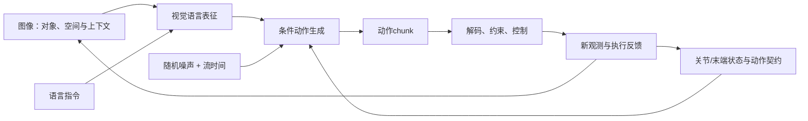
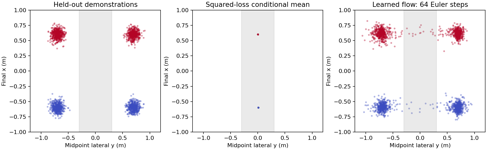
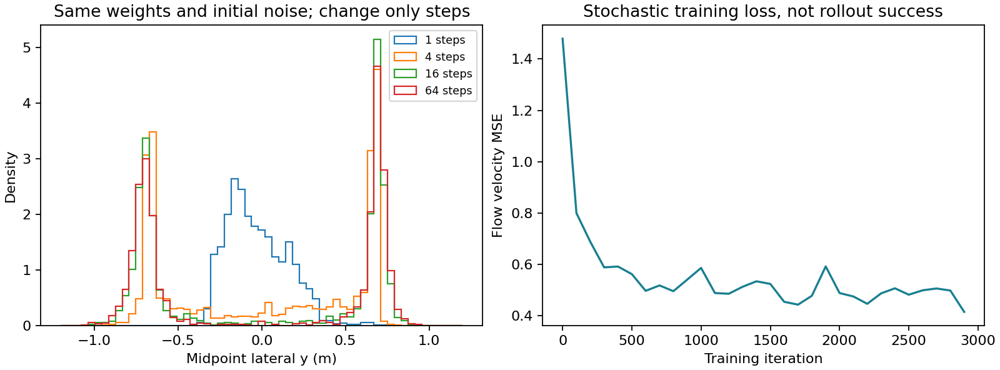

# D32 · 从视觉语言理解到连续动作分布

[返回学习入口](../_index.md) ｜ [本周日程](../P2-深度理解-日程.md) ｜ [上一课 D31](../day31/Daily-Learning-Pack.md) ｜ [下一课 D33](../day33/Daily-Learning-Pack.md) ｜ [CPU实验](demo.py)

**理解“红杯子在哪里”与生成“接下来怎样移动”之间，还隔着动作表示、训练分布、闭环反馈和真实机器人接口。今天用 π₀ 的结构与一个实际训练的条件流模型，把这段距离讲清。**

本课为 P2 / W5-D4，按原定2026-10-06补写。D31的视觉语言表征继续接入机器人动作；本课保留VLM与Embodied AI主线，加入π₀(2024)、flow matching、BC/DAgger，以及ACT和Diffusion Policy比较。D33转向接触预测与RL/IL概念，D34再整合观测、语言与动作字段。

<details>
<summary>个人学习记录（后续生成保留）</summary>

<!-- learner-notes:start -->
- 我的视觉—语言—动作接口图：
- 我能手算的流时间与机器人时间关系：
- 改变量前预测、实测、解释：
- 自测作答、未理解问题与个人验收：
<!-- learner-notes:end -->

</details>

<!-- daily-pack-generated:start -->

## 0. 学习目标与全景

学完后，应能区分VLM表征、语言规划、连续动作生成与控制执行；说明BC为何有状态分布偏移，DAgger具体补充什么标签；从插值路径求出flow matching目标与Euler更新；读懂动作chunk的shape；用保留样本检查动作分布，而不把低MSE或漂亮轨迹等同于机器人成功。

| 顺序 | 知识主线 | 需回答的问题 |
| --- | --- | --- |
| 1 | VLM、Embodied AI 与原始 π0 | 语义、动作与控制各自输出什么？ |
| 2 | 多模态动作与 flow matching | 平均为什么可能失败，速度场怎样生成分布？ |
| 3 | BC、DAgger、ACT 与 Diffusion Policy | 数据分布与动作生成方式分别改变什么？ |
| 4 | CPU 训练与积分步数对照 | 同一模型改变采样步数，哪些指标实际变化？ |



读图时分清两种预测：策略输出的是动作；世界模型输出的是行动后的状态或观测。给一个动作生成器加语言输入，不会自动使它成为未来预测器。

## 1. VLM怎样进入Embodied AI

### 1.1 表征、规划与动作的输出不一样

VLM可以把图像中的对象与语言概念联系起来，输出特征、相似度、文本或结构化描述。机器人还需要把描述绑定到可观测对象和执行接口。例如“抓靠左的红杯子”至少包含指代消歧、目标定位、可抓区域、动作空间和反馈判断。

| 模块 | 典型输入→输出 | 单独缺少什么 |
| --- | --- | --- |
| 视觉语言匹配 | 候选区域+文本→匹配分数 | 米制位置与动作后果 |
| 高层语言策略 | 场景+目标→子任务 | 毫米级动作与控制频率 |
| VLA | 图像+语言+机器人状态→动作 | 输出仍需对应指定机器人的动作契约 |
| 世界模型 | 当前状态+动作→下一状态 | 任务目标与动作选择规则 |
| 控制器 | 目标/增量/速度→执行反馈 | 语义任务理解通常不在其职责内 |

有些系统把这些模块显式分开，有些端到端融合。判断能力看输入、输出、监督和验收，不看名字里是否有“foundation”。端到端也仍需要同步时间戳、关节顺序、单位、标定和限幅；这些约定只是移动到了模型周围的数据适配器中。

### 1.2 预训练提供先验，机器人数据建立动作联系

互联网图文能帮助识别杯子、布料、抽屉及其语义关系，但通常不包含特定机械臂在某一控制周期里应发送哪组关节命令。机器人演示把观测与动作绑定，提供平台、任务与运动习惯的信息。

因此“使用预训练VLM”与“已经能控制我的机器人”之间不能划等号。目标机器人的相机位置、夹爪、关节范围与动作标签不同，都会改变这个映射。后续微调也不只是把文本换成中文，而是可能需要重新对齐机器人状态和动作统计。

## 2. π₀(2024)：把离散语义上下文接到连续动作

### 2.1 只讨论原始版本，不把后续版本倒灌回来

本课的π₀指2024-10-31首次发布的 *π₀: A Vision-Language-Action Flow Model for General Robot Control*。它使用预训练PaliGemma视觉语言骨干，并增加机器人状态、动作输入输出与动作专家。图像/文字与机器人token有不同参数路径，通过注意力交互。动作不是逐字符写出的文本，而是条件连续分布的样本。[原论文v1，§IV与附录A-B](https://arxiv.org/html/2410.24164v1) · [原发布页](https://www.physicalintelligence.company/blog/pi0)

π₀-FAST和π₀.₅是后续模型；当前openpi仓库包含多个版本，不能因为同一仓库有某个功能，就把它写成2024原模型的设定。特别是FAST的自回归动作token路线与本课的连续flow路线要分开。[官方仓库模型列表](https://github.com/Physical-Intelligence/openpi)

### 2.2 条件是什么，生成什么

$$
o_t=(I_t^1,\ldots,I_t^M,\ell_t,q_t),\qquad
A_t=[a_t,\ldots,a_{t+H-1}].
$$

这里t是机器人离散时间；$q_t$是本体状态，$\ell_t$是指令，$A_t$是一段未来动作。条件分布为：

$$
p_\theta(A_t\mid o_t).
$$

原论文任务使用H=50，生成后可以只执行前缀再重新感知。**动作chunk长度不等于每次必须开环执行的长度，也不等于模型采样迭代次数。** 图像与指令在同一次采样里保持不变，因此可以缓存其上下文计算；这不同于把后续真实观测提前送给模型。

### 2.3 从shape看清token的意思

以教学接口B=8、M=2、每图256个patch、文本32token、H=16、动作维数7为例：

| 量 | 示例shape | 语义 |
| --- | --- | --- |
| 图像patch特征 | `[8,512,D_v]` | 两个相机的视觉内容 |
| 文本特征 | `[8,32,D_v]` | 指令token |
| 机器人状态 | `[8,d_q]` | 关节或明确约定的状态 |
| 带噪动作 | `[8,16,7]` | 16个未来时刻，每时刻7个动作数 |
| 流时间 | `[8,1,1]` | 对chunk广播的生成进度 |
| 预测向量场 | `[8,16,7]` | 对带噪动作的更新方向 |

这些数字是教学示例，不是对原论文所有机器人的配置复述。7维也不自动代表xyz+四元数；它可能是6维末端增量+夹爪，或7个关节目标。必须从数据适配器确认。

动作token中的“token”只是序列位置，不一定是离散词表ID。对连续动作每时刻做线性投影，同样可以得到供Transformer处理的token。

## 3. 为什么直接取平均动作会出问题

### 3.1 MSE的最优解是条件均值

对固定观测o，最小化平方误差：

$$
\hat a(o)=\arg\min_b\mathbb E[\|A-b\|^2\mid o]
=\mathbb E[A\mid o].
$$

证明只需对b求导：$2b-2\mathbb E[A\mid o]=0$。若演示者有一半从左绕、一半从右绕，均值可能从中间穿过障碍。错误不一定来自模型容量不足，而可能来自把多峰分布压成一个均值。

设中间路径横向坐标有两个模式：$y=-0.7$ m与$+0.7$ m，各占一半。均值y=0；若$|y|<0.3$是禁止的中间通道，那么两类演示都可用，均值却落在禁止区域。

这不是说BC一定只能输出均值。BC描述“从专家动作学习策略”的训练目标；它可以使用高斯混合、自回归、扩散或flow等分布模型。应区分**学习范式**与**动作分布参数化**。

### 3.2 多模态生成仍需要选择和检验

采样器能同时覆盖左右两种模式，不代表每次采样都避障。模式之间的低密度区域、数据覆盖不足、积分误差或新观测仍可能造成坏动作。因此必须检验生成分布的模式覆盖、任务相关的禁区率和约束违规，而不是只统计“看起来像演示”的平均距离。

## 4. Flow matching：学习一条分布运输的速度场

### 4.1 固定端点，再求路径导数

本课用无量纲归一化动作，约定流时间$\tau=0$是噪声、$\tau=1$是数据动作。取：

$$
\epsilon\sim\mathcal N(0,I),\quad A\sim p_{data}(A\mid o),\quad
X_\tau=(1-\tau)\epsilon+\tau A.
$$

对这条直线路径求导：

$$
\frac{dX_\tau}{d\tau}=A-\epsilon.
$$

训练一个向量场$v_\theta(X_\tau,\tau,o)$，拟合该导数：

$$
\mathcal L_{FM}=\mathbb E\left[\|v_\theta(X_\tau,\tau,o)-(A-\epsilon)\|^2\right].
$$

网络只能看到当前带噪动作、时间和条件，不知道这一批里隐藏的具体A与ε。对相同条件与位置，平方损失学到的是目标速度的条件期望。它不是机械臂TCP在真实时间中的物理速度，而是动作空间相对于生成进度的变化率。[Flow Matching原论文，条件路径与回归目标](https://arxiv.org/html/2210.02747v2)

给定A时，上式采样分布的均值为$\tau A$，协方差为$(1-\tau)^2I$。标准差与方差不要混写。越接近1，噪声标准差越小。

### 4.2 手算一维路径

A=.8、ε=−.4，取τ=.25：

$$
X_{.25}=.75(-.4)+.25(.8)=-.1,\qquad u=.8-(-.4)=1.2.
$$

若这个样本对应的理想速度保持不变，步长h=.25，则下一步$X_{.5}=-.1+.25\times1.2=.2$。四步从−.4走到.8。真实训练中的共享网络并不知道固定端点，生成场也未必沿单条直线；这个算例用于检查符号和单位。

### 4.3 推理是ODE积分，不需要演示标签

$$
X_0\sim\mathcal N(0,I),\qquad
X_{k+1}=X_k+h\,v_\theta(X_k,\tau_k,o),\quad h=1/K.
$$

完成K步后将$X_K$解归一化为动作chunk。训练时从数据构造带噪样本，推理时只从噪声和观测出发；不能在推理循环中偷用真实演示动作。

```python
# A 与 epsilon 的shape同为[B,H,d_a]；tau为[B,1,1]
x_tau = (1 - tau) * epsilon + tau * A
target = A - epsilon
loss = ((velocity(x_tau, tau, observation) - target) ** 2).mean()
# 推理：固定观测，随机起点，不再访问A
x = noise
for k in range(K):
    x = x + velocity(x, k / K, observation) / K
```

减小积分步长可以减少数值误差，但不会保证修复训练分布外的向量场。更多步数也有延迟成本，所以K必须和闭环更新预算一起评价。

### 4.4 原论文与当前代码的时间方向检查

当前官方openpi实现使用反向时间约定：$t=1$是噪声，$t=0$是动作，$X_t=t\epsilon+(1-t)A$、目标为$\epsilon-A$，积分步长为$-1/K$。它与本课用$t=1-\tau$转换后等价。[官方pi0.py：compute_loss与sample_actions](https://github.com/Physical-Intelligence/openpi/blob/main/src/openpi/models/pi0.py)

原论文v1正文的噪声→动作路径、目标速度符号与积分方向在相邻公式中存在不一致，不能把某一行直接抄入另一约定。这里采用“写端点→对路径求导→核对积分方向”的自洽定义。读任何实现都检查三项：哪个端点是噪声、target的符号、dt的正负。单看变量名`time`或`velocity`无法判断。

### 4.5 三种时间不可混在一起

| 时间/长度 | 含义 | 例子 |
| --- | --- | --- |
| 机器人周期$\Delta t$ | 每条动作保持多久 | .02 s对应50 Hz |
| chunk长度H | 一次输出多少未来动作 | H=50覆盖1 s的动作字段 |
| 生成步数K | 从噪声积分多少次 | K=10只描述采样计算 |

H=50、K=10并不意味着机器人每次跳5个动作；重新感知周期还由执行前缀长度、推理延迟和系统策略决定。生成中的“流时间1”也不是现实世界过去了1秒。

## 5. BC与DAgger：改变的是训练时见到的状态

### 5.1 BC的分布偏移来自闭环

行为克隆用专家数据$D_E=\{(o_t,a_t^E)\}$拟合策略。训练观测来自专家轨迹；执行时观测由学习策略自己造成：

$$
\mathcal L_{BC}=\mathbb E_{o\sim d_{\pi_E}}[\ell(\pi_\theta(o),a^E)],
\qquad部署访问的是d_{\pi_\theta}.
$$

一次小误差会把物体推到偏一点的位置，下一帧就不再完全像演示；连续偏移又可能扩大误差。因此“测试集里每个专家动作预测准”与“自己的闭环状态上能恢复”不是同一评价。

不要把误差积累机械写成必然指数爆炸。实际增长取决于动力学稳定性、恢复能力、反馈、数据覆盖与评价时域；分布偏移是一种风险机制，不是每个系统都遵守同一增长曲线。

### 5.2 DAgger为什么要访问学习者状态再问专家

DAgger的关键是**在学习策略实际访问的状态上查询专家动作，加入已有数据继续训练**。专家告诉的是“现在这个状态该怎样恢复”，不只是重放一条完美轨迹。[Ross等，2011，算法与分析](https://proceedings.mlr.press/v15/ross11a.html)

```text
D = 初始专家数据
for iteration:
    拟合 policy(D)
    在允许的环境中用当前策略/专家混合策略收集访问状态
    对这些状态查询专家动作
    D = D ∪ 新状态及专家标签
    重新训练，并用独立闭环任务验收
```

它仍是模仿学习：优化信号来自专家动作，而不是仅靠奖励自行试错。它需要新交互与专家查询；把固定离线数据多训练几遍不是DAgger。专家可能是人、规则控制器或规划器，但都应说明标签可信范围与查询成本。

今天没有运行DAgger机器人或仿真闭环，理论比较不记作已完成实操。CPU实验专注于动作分布学习；改变状态分布的效果还需另有交互实验。

## 6. ACT、Diffusion Policy与π₀：按轴比较，不排“先进程度”

| 比较轴 | ACT | Diffusion Policy | 原始π₀ |
| --- | --- | --- | --- |
| 主要输出 | 连续动作chunk | 条件动作序列分布 | 语言/视觉/本体条件的连续动作chunk |
| 代表生成机制 | CVAE/Transformer动作重建 | 迭代去噪 | 条件flow向量场积分 |
| 主要学习信号 | 演示动作重建与潜变量正则 | 演示动作上的去噪目标 | 机器人动作上的flow目标与预训练表征 |
| 多模态能力从哪来 | 潜变量与条件建模，推理配置很重要 | 噪声采样与条件生成 | 噪声采样、语义条件和动作专家 |
| 反馈怎样进入 | 执行chunk前缀后新观测；可有时间融合 | 重规划前缀与滚动执行 | 原论文有自己的chunk执行协议 |
| 不能据名字推出 | 所有ACT推理都保留丰富多模态 | 使用扩散就一定有语言理解 | 在任意机器人上零样本可用 |

ACT训练的代表损失可写成$\mathcal L_{rec}+\beta D_{KL}(q_\phi(z\mid o,A)\|p(z))$；Diffusion Policy常在带噪动作上回归噪声；flow回归路径速度。这三者都能使用专家演示，不应把flow当作与IL并列的新监督来源。[ACT项目与论文](https://tonyzhaozh.github.io/aloha/) · [Diffusion Policy项目](https://diffusion-policy.cs.columbia.edu/) · [Diffusion Policy论文](https://arxiv.org/abs/2303.04137)

对于当前RGB-D抓取系统，先确定输入图像与状态、动作绝对/增量语义、周期、观察延迟和chunk前缀，再比较模型。在不同数据量、相机和动作空间上直接对比论文成功率，通常无法隔离模型结构的贡献。

## 7. CPU实操：真实训练一个条件动作流

### 7.1 先写预测，再运行

在执行前写下三条预测：对称左右演示的均值在哪里；仅一步Euler会不会充分形成双峰；增加K后，禁区率和两个模式的覆盖是否可能同时改善。

```bash
python -B 3d_learning/day32/demo.py
```

依赖NumPy、PyTorch、Matplotlib。已在Python3.11.15、NumPy1.26.4、PyTorch2.13.0.dev20260423的CPU环境实际运行；2线程，不下载数据或模型，不连接机器人。代码保存到[demo.py](demo.py)，数值在[results.json](../../_assets/3d_learning/day32/results.json)，原始采样在results.npz (not exported: excluded by publication policy)。

本课的动作摘要为$A=(y_{mid},x_{final})$，物理单位m，以1 m为归一化尺度。目标g=±1决定$x_{final}\approx.6g$；左右模式决定$y_{mid}\approx\pm.7$，每维加入标准差.06 m的噪声。这两个数是一个教学路径摘要，不是假装完整机械臂7维控制命令。

训练4096个演示对、独立测试2048对；MLP输入为`[X_tau(2),tau(1),goal(1)]`，shape`[256,4]`，两层64维隐藏层，输出`[256,2]`。固定训练3000步，共4610个参数。条件均值基线用最小二乘拟合相同训练数据。

### 7.2 结果：均值正确拟合了均值，却没有保留动作模式



灰色区域是$|y_{mid}|<.3$的教学禁区。左右是动作模式，红蓝是两种目标条件。条件均值对最终目标坐标很准，但所有输出都落到中间；流模型保留了左右模式，同时仍有少量中间样本。这里的禁区检查只作用于一个路径摘要，不是完整连杆碰撞检测。

| 输出 | 中间禁区率 | 到最近模式中心的RMSE |
| --- | --- | --- |
| 独立演示样本 | 0% | .08481 m |
| 平方损失条件均值 | 100% | .69298 m |
| flow，K=1 | 94.09% | .56182 m |
| flow，K=4 | 13.87% | .24045 m |
| flow，K=16 | 2.73% | .13530 m |
| flow，K=64 | 1.22% | .12022 m |

K=64输出中正侧模式占51.66%，独立演示中为48.44%；没有全部塌缩到同一侧。最近模式距离只衡量离两簇有多远，不能独立证明分布已匹配，还要看模式比例与散布。若模型只输出两个中心，这个RMSE可能更小，却漏掉演示的真实变化。

### 7.3 单变量对照与训练损失的解读



对照复用同一模型、同一2048个噪声起点和目标，只改变K，因此不会把随机起点变化错当成积分精度效果。左图可以直接观察双峰形成；右图是随机批次速度回归损失，不是机器人失败率。

损失不降到0也不等于训练坏了：相同带噪位置可能由不同端点配对产生，共享网络只能拟合条件平均速度，存在目标条件方差。另一方面，训练损失低也不能替代采样后的分布检验。

你的改变量任务：在现有K表中加入8，先预测禁区率，再用同一权重/噪声采样；或固定K，仅改变训练步数。不要同时改变噪声幅度、模型宽度与训练数据量。生成动作未经完整碰撞、IK、时延和控制验证，不能发给机器人。

### 7.4 完整主脚本

<details>
<summary>展开demo.py，与附件逐字一致</summary>

```python
"""Conditional flow matching on a two-mode action sketch; CPU, synthetic data."""
import json
import os
from pathlib import Path
os.environ.setdefault('MPLCONFIGDIR', '/tmp/day32-mpl')
os.environ.setdefault('XDG_CACHE_HOME', '/tmp/day32-cache')
import numpy as np
import torch
from torch import nn
import matplotlib
matplotlib.use('Agg')
import matplotlib.pyplot as plt

OUT = Path(__file__).resolve().parents[2] / '_assets/3d_learning/day32'


def data(n, generator):
    goal = (2 * torch.randint(0, 2, (n, 1), generator=generator) - 1).float()
    mode = (2 * torch.randint(0, 2, (n, 1), generator=generator) - 1).float()
    # Two physical coordinates, expressed as dimensionless values using 1 m.
    action = torch.cat([.70 * mode, .60 * goal], 1)
    action += .06 * torch.randn(n, 2, generator=generator)
    return goal, action


def sample(model, noise, goal, steps):
    x = noise.clone()
    with torch.no_grad():
        for k in range(steps):
            tau = torch.full((len(x), 1), k / steps)
            x += model(torch.cat([x, tau, goal], 1)) / steps
    return x.numpy()


def metrics(x, goal):
    modes = np.stack([np.c_[np.full(len(x), -.7), .6 * goal[:, 0]],
                      np.c_[np.full(len(x), .7), .6 * goal[:, 0]]], 1)
    return {'center_corridor_rate': float((np.abs(x[:, 0]) < .30).mean()),
            'positive_mode_fraction': float((x[:, 0] > 0).mean()),
            'nearest_mode_rmse': float(np.sqrt(((x[:, None] - modes)**2).sum(-1).min(1).mean())),
            'goal_coordinate_rmse': float(np.sqrt(((x[:, 1] - .6 * goal[:, 0])**2).mean()))}


def main():
    OUT.mkdir(parents=True, exist_ok=True)
    torch.set_num_threads(2)
    torch.manual_seed(32)
    train_g, train_a = data(4096, torch.Generator().manual_seed(320))
    test_g, test_a = data(2048, torch.Generator().manual_seed(321))
    model = nn.Sequential(nn.Linear(4, 64), nn.SiLU(), nn.Linear(64, 64), nn.SiLU(), nn.Linear(64, 2))
    opt = torch.optim.Adam(model.parameters(), lr=.002)
    history = []
    for step in range(3000):
        ids = torch.randint(len(train_a), (256,))
        a, g = train_a[ids], train_g[ids]
        noise, tau = torch.randn_like(a), torch.rand(256, 1)
        x = (1 - tau) * noise + tau * a
        target_velocity = a - noise
        loss = (model(torch.cat([x, tau, g], 1)) - target_velocity).square().mean()
        opt.zero_grad(); loss.backward(); opt.step()
        if step % 100 == 0:
            history.append([step, float(loss.detach())])
    design = np.c_[train_g.numpy(), np.ones(len(train_g))]
    coef = np.linalg.lstsq(design, train_a.numpy(), rcond=None)[0]
    mean_action = np.c_[test_g.numpy(), np.ones(len(test_g))] @ coef
    noise = torch.randn(2048, 2, generator=torch.Generator().manual_seed(322))
    report = {'verified_date': '2026-10-09', 'torch': torch.__version__, 'numpy': np.__version__,
              'train_pairs': 4096, 'test_pairs': 2048, 'steps': 3000,
              'parameters': sum(p.numel() for p in model.parameters()),
              'conditional_mean': metrics(mean_action, test_g.numpy()),
              'reference': metrics(test_a.numpy(), test_g.numpy()), 'integration': {}}
    saved = {'goal': test_g.numpy(), 'reference': test_a.numpy(), 'mean_action': mean_action,
             'history': np.array(history), 'initial_noise': noise.numpy()}
    for steps in [1, 4, 16, 64]:
        samples = sample(model, noise, test_g, steps)
        report['integration'][str(steps)] = metrics(samples, test_g.numpy())
        saved[f'flow_{steps}'] = samples
    np.savez_compressed(OUT / 'results.npz', **saved)
    (OUT / 'results.json').write_text(json.dumps(report, indent=2))
    torch.save(model.state_dict(), OUT / 'flow_model.pt')
    fig, ax = plt.subplots(1, 3, figsize=(12, 3.7), constrained_layout=True)
    for a, values, title in zip(ax, [test_a.numpy(), mean_action, saved['flow_64']],
                                ['Held-out demonstrations', 'Squared-loss conditional mean', 'Learned flow: 64 Euler steps']):
        a.scatter(values[:, 0], values[:, 1], c=test_g[:, 0], cmap='coolwarm', s=5, alpha=.3)
        a.axvspan(-.3, .3, color='gray', alpha=.16)
        a.set(xlim=(-1.2, 1.2), ylim=(-1, 1), xlabel='Midpoint lateral y (m)', ylabel='Final x (m)', title=title)
    fig.savefig(OUT / 'action_modes.png', dpi=160); plt.close(fig)
    fig, ax = plt.subplots(1, 2, figsize=(10, 3.7), constrained_layout=True)
    for steps in [1, 4, 16, 64]:
        ax[0].hist(saved[f'flow_{steps}'][:, 0], bins=np.linspace(-1.2, 1.2, 60),
                   histtype='step', density=True, label=str(steps) + ' steps')
    ax[0].set(xlabel='Midpoint lateral y (m)', ylabel='Density', title='Same weights and initial noise; change only steps')
    ax[0].legend(fontsize=8)
    ax[1].plot(*np.array(history).T, color='#187f90')
    ax[1].set(xlabel='Training iteration', ylabel='Flow velocity MSE', title='Stochastic training loss, not rollout success')
    fig.savefig(OUT / 'flow_steps.png', dpi=160); plt.close(fig)
    print(json.dumps(report, indent=2))


if __name__ == '__main__':
    main()
```

</details>

## 8. 今日重点与产出

最值得掌握的是：VLM给语义先验但动作需要机器人数据；BC可以是分布生成而不局限于均值；flow时间与真实时间完全不同；DAgger补学习者状态上的专家标签；chunk必须保留反馈与接口约定。这些结论分别对应语义接地、多模态动作、数值实现、分布偏移和闭环执行，能直接帮助你判断一个新VLA究竟改了哪一层。

最易混淆的三点是：把流速度当TCP速度；把K当H；把迭代重训固定数据叫DAgger。用端点手算、shape表和DAgger查询流程各回查一次。

今日产出：一张模型—数据—接口图；flow路径与更新的手算；ACT/扩散/flow比较卡；默认结果与一次单变量记录；VLA五格卡（输入输出、结构、监督、损失、验收边界）。

## 9. 自测：先独立作答

1. 图文模型识别“红杯子”后，还缺哪些信息才能形成可执行抓取？
2. 对半概率的±.7 m动作，平方损失最优点在哪里？这是否说明所有BC都不能多模态？
3. A=.8、ε=−.4、τ=.25时，$X_\tau$与目标速度各是多少？正向h=.25下一点是多少？
4. 若实现用t=1噪声、t=0动作，路径、训练target与dt应怎样一起改？
5. `[8,16,7]`动作chunk中的三个轴是什么？流时间为何常用`[8,1,1]`？
6. H=50、机器人50 Hz、K=10各代表什么？执行H步与执行前25步的开环时长各是多少？
7. 为什么低BC验证误差不能证明自己造成的偏离状态上也能恢复？DAgger补什么数据？
8. 本课K对照固定了什么？为何“最近模式RMSE更低”不能单独证明生成分布更好？
9. ACT、Diffusion Policy与π₀的结构差异，是否改变了它们可以从专家演示学习这一事实？
10. 本课流模型跑通后，哪些官方模型、几何和真实执行能力仍未验证？

## 10. 疑问与下一课

记录你仍需回查的具体问题：动作归一化统计来自哪一分区？左右模式是否都适用于当前障碍？轨迹偏离后有无恢复演示？采样延迟相对于控制周期有多大？新机器人需要重配哪些动作字段？

下一课D33引入接触事件预测。先问“是否接触”“多大接触力”“会不会滑动”“任务是否成功”分别需要哪些观测与标签，再把RL/IL、on/off-policy、online/offline放到相互独立的概念轴上。

## 11. 参考答案与判分

> [!note]- 作答后展开：每题0/1/2分，共20分
> 0分：关键关系错误；1分：结论正确但缺单位/边界；2分：结论与原因完整。建议至少16分，时间方向与动作语义题不应为0。个人验收尚未完成。
>
> 1. 对象绑定、尺度与深度、位姿/可抓区域、机器人坐标、动作语义/周期、IK/碰撞与反馈等。
> 2. 0 m；只说明确定性平方回归给条件均值。BC可训练混合或生成式策略。
> 3. −.1，1.2，下一点.2。生成速度单位相对于流进度，不是m/s机械速度。
> 4. $X_t=t\epsilon+(1-t)A$，target=$\epsilon-A$，dt负，才能从1积分到0。
> 5. batch、未来时刻、每时刻动作维数；流时间对H和动作维数广播。
> 6. H为未来动作数、50 Hz为每步.02s、K为采样积分次数；分别1s与.5s。
> 7. 验证常访问专家分布，部署状态由学习者造成；DAgger在学习者访问状态上查询专家标签并聚合数据。
> 8. 权重、初始噪声、目标条件和评价定义固定。集中在少数模式中心也能降低距离，却可能损失模式覆盖和分布方差。
> 9. 不改变；结构/生成机制与监督来源是不同轴，三者可用演示进行模仿学习。
> 10. 未运行完整π₀/ACT/Diffusion Policy官方模型或DAgger闭环；未检验完整路径碰撞、机械臂动力学、真实任务成功与平台迁移。

<!-- daily-pack-generated:end -->
