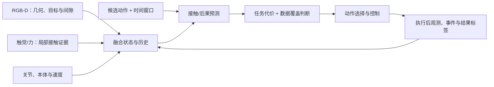
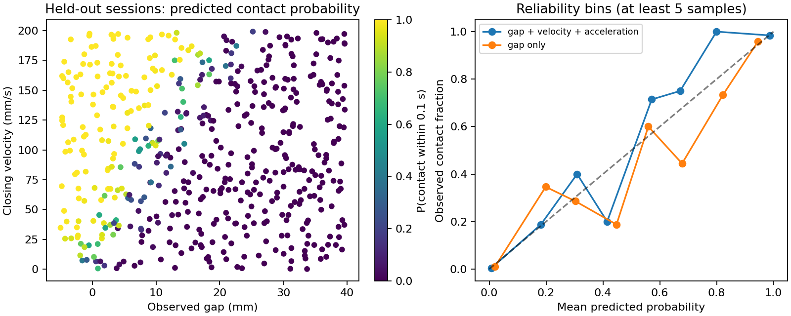
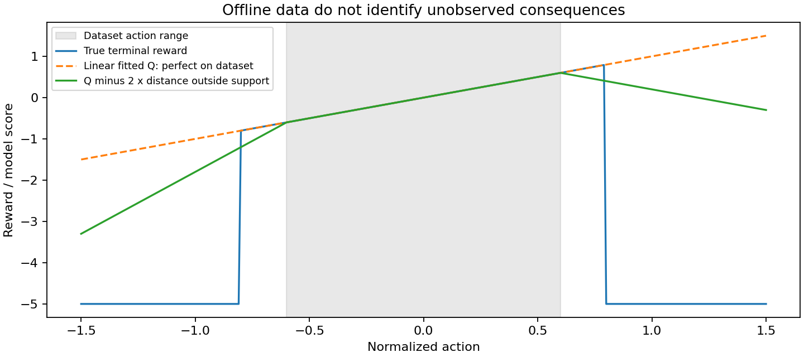

# D33 · 接触预测、数据覆盖与学习范式

[返回学习入口](../_index.md) ｜ [本周日程](../P2-深度理解-日程.md) ｜ [上一课 D32](../day32/Daily-Learning-Pack.md) ｜ [下一课 D34](../day34/Daily-Learning-Pack.md) ｜ [CPU实验](demo.py)

**接触不是一张图里的类别，而是几何、运动、动作和材料共同决定的事件。模型是否学会预测它，要看标签定义、时间范围与独立数据；策略是否会利用这个预测，还取决于学习目标及数据覆盖。**

本课为P2 / W5-D5，保留原定2026-10-07，2026-10-09补写。D32讲动作分布及模仿学习；今天回到操作感知与接触预测，再把RL/IL、on-policy/off-policy、online/offline拆成不同问题。D34将这些边界接入完整的语言目标到动作字段实验。

<details>
<summary>个人学习记录（后续生成保留）</summary>

<!-- learner-notes:start -->
- 我的接触、力、滑动和任务成功标签定义：
- 我的时间窗口、单位和传感器同步记录：
- 单变量实验预测与结果：
- 学习范式五格卡、自测与待解问题：
<!-- learner-notes:end -->

</details>

<!-- daily-pack-generated:start -->

## 0. 宏观目标：把感知任务与策略训练分开

学完后，应能定义一个可标注的接触预测任务，说明距离、速度和动作为什么缺一不可；推导固定加速度下的接近与首次接触；读懂概率、阈值和漏报代价；区分模仿目标、奖励目标与数据获取协议；用一个训练误差近零却决策失败的反例解释离线支持集问题。

| 顺序 | 知识主线 | 需回答的问题 |
| --- | --- | --- |
| 1 | 操作感知、接触与摩擦 | 接触、抓稳和完成任务为何是不同标签？ |
| 2 | 接触预测与概率评价 | 什么时刻算接触，阈值怎样影响漏报？ |
| 3 | IL/RL、on/off-policy、online/offline | 监督目标、数据策略与采集协议如何分别描述？ |
| 4 | CPU 接触模型与离线支持集反例 | 低训练误差为什么不能保证动作选择正确？ |



这条链允许不同学习方式：用专家动作训练策略是IL；用回报优化策略是RL；只训练接触预测器是监督预测，本身既没有产生专家策略，也没有完成强化学习。

## 1. 操作感知：四个看似相近、实际不同的问题

### 1.1 “碰到了”不等于“抓稳了”

| 问题 | 标签例子 | 所需证据 | 容易误判的情况 |
| --- | --- | --- | --- |
| 是否接触 | 二值事件、首次接触时刻 | 几何/力/触觉阈值与同步 | 接近但未触碰，背景碰撞 |
| 接触力多大 | 法向/切向力或wrench | 标定后的力/触觉读数 | 视觉重叠无法确定力 |
| 是否滑动 | 局部相对运动、滑移事件 | 触觉时序、剪切变化、视觉运动 | 有接触且力很大仍可能滑 |
| 是否完成任务 | 物体稳定抬起、成功放置 | 后续状态与任务判据 | 瞬时接触不代表抓取成功 |

视觉通常擅长接触前的几何布局；触觉与力反馈提供接触后更直接的局部证据。两者不能互相简单替代。遮挡可以让视觉看不到手指与物体的局部接触；触觉则未必知道当前碰到的究竟是不是语言指定对象。

### 1.2 最简接触力学直觉

理想刚体单边接触可用间隙$\phi$和法向力$f_n$描述：

$$
\phi\ge0,\qquad f_n\ge0,\qquad \phi f_n=0.
$$

含义是不能穿透、接触不能凭空拉住物体、分离时不产生接触法向力。它只是接触约束的一部分，还需要运动方程与摩擦模型；真实软物体、传感器压缩和数值求解会使用不同近似。

静摩擦锥的简化条件为：

$$
\|f_t\|\le\mu f_n.
$$

例如法向力4 N、摩擦系数.3，单个接触可提供的静态切向力上限约1.2 N。在这一简化模型下，若必须承担1.5 N且没有其他支撑，就不能仅因“接触存在”判断稳定。多接触的力矩、物体重心和夹持几何也会影响结果。[Modern Robotics §12.2.1：摩擦与摩擦锥](https://modernrobotics.northwestern.edu/nu-gm-book-resource/12-2-1-friction/)

本课实验不模拟接触力或摩擦求解，只预测一个几何接触事件。把事件预测器用于抓取评分时，不能把概率当作抓稳概率直接替换。

## 2. 从距离到时间：定义一个可以手算的预测问题

### 2.1 间隙、接近速度和动作的约定

用g表示沿接触法向的当前间隙，单位m；g>0表示分开。v为接近速度，单位m/s，v>0表示间隙正在减小。a为该方向的命令加速度，单位m/s²，a>0加快接近。在接触前短窗口H内假设加速度常值：

$$
g(t)=g_0-v_0t-\tfrac12at^2,\qquad 0\le t\le H.
$$

这是自由运动的几何预测，碰到之后不能继续把它当作真实穿透轨迹。它适合定义“是否会到达接触边界”，不适合直接输出接触后的力。

### 2.2 接触时刻不是随便拿两帧做差

a=0且v>0时，首次接触时间为$T_c=g_0/v$。例：g=12 mm、v=.08 m/s，得到$T_c=.15$ s，所以在未来.1 s内尚未触及；同一间隙若v=.16 m/s，$T_c=.075$ s，事件定义就改变了。

若v=0，除法无定义；若v<0且无加速度，物体正在远离，不能输出负的“未来接触时刻”。有加速度时应求满足$g(t)=0$的最早非负根，并验证其是否落入窗口。

### 2.3 “窗口末端接触”与“窗口中曾经接触”不同

本课事件定义为：

$$
y_H=\mathbf1\left\{\min_{0\le t\le H}g(t)\le0\right\}.
$$

等价地定义最大接近距离：

$$
D_{max}=\max_{0\le t\le H}(v_0t+\tfrac12at^2),\qquad y_H=\mathbf1\{g_0\le D_{max}\}.
$$

只需检查端点0、H和落在区间内的驻点$t_*=-v_0/a$。a<0时，先接近再减速远离，最大接近可能发生在中间。

手算：g=.8 mm、v=.04 m/s、a=−.8 m/s²、H=.1 s。驻点在.05 s，最大接近距离为1 mm，因此中间会碰到；末端净接近距离却为0，若只看$g(H)$会漏掉事件。这也是为什么仅看终点无碰撞不等于整段路径无碰撞。

本课标签包括t=0已经为非正间隙的样本。如果目标改成“从当前明确未接触状态预测首次接触”，应先筛选当前未接触样本，并重新定义标签与评价。标签名称相近，数据任务可能不同。

## 3. 学习接触概率：输出与误差怎样解释

### 3.1 为什么相同观测下可能有不同结果

视觉测得的间隙有表面定位误差，材料与时延也可能不可见。实验给每个采集session设置一个固定未知表面偏置$b\sim\mathcal N(0,.002^2)$ m，同一session内20个探测共享它。真实几何间隙为$g_{obs}+b$。

模型输入$(g_{obs},v,a)$，输出：

$$
p_\theta=P(y_H=1\mid g_{obs},v,a),\qquad H=.1\ \mathrm{s}.
$$

H在本实验中固定；如果混入不同H的数据却不告诉模型，同一输入就会对应不同标签规则。未知偏置使接触边界附近无法完全确定，不是增加训练迭代就一定能消除的噪声。

### 3.2 最小逻辑回归已经能检验输入是否有用

对训练集拟合每一维均值与标准差，得到标准化特征$\tilde x$；逻辑回归为：

$$
z=w^\top\tilde x+b_0,\quad p=\operatorname{sigmoid}(z),
$$

$$
\mathcal L=-\frac1N\sum_i[y_i\log p_i+(1-y_i)\log(1-p_i)].
$$

计算使用`binary_cross_entropy_with_logits`，直接输入z以获得更稳定的数值计算。不要先sigmoid又把p当作logit喂进去。

| 量 | 本课shape |
| --- | --- |
| 全部探测特征 | `[3000,3]`，g/v/a |
| 标准化均值/标准差 | `[3]`，仅2000个训练探测拟合 |
| 权重与偏置 | `[1,3]`与`[1]` |
| 标签与logits | `[N,1]` |
| 概率 | `[N]`用于统计与可视化 |

真实事件边界含最大接近距离与未知偏置，逻辑回归不一定精确表达全部非线性。这里有意先用简单模型，避免把所有改善都归因于复杂网络。

### 3.3 概率质量与二值阈值要分开评估

Brier分数：

$$
BS=\frac1N\sum_i(p_i-y_i)^2.
$$

它评价概率预测；可靠性图将预测概率分箱，对比平均预测概率与实际接触频率。有限样本箱会抖动，本课只画样本数至少5的箱，不能据几处偏离就断言完全校准或完全失效。

给定阈值η，预测接触为$p\ge\eta$。阈值下降一般会减少漏报但增加误报，具体代价由任务决定。不要把准确率变化误认为概率模型本身发生了变化。

若漏报代价$C_{FN}$、误报代价$C_{FP}$，正确判断代价为0，比较“报告接触”和“不报告”的条件期望代价可得：

$$
C_{FP}(1-p)\le C_{FN}p
\Rightarrow p\ge\frac{C_{FP}}{C_{FP}+C_{FN}}.
$$

漏报代价4、误报代价1时理论阈值为.2。这个推导需要概率和代价都适用当前部署分布；本课只用它解释阈值作用，不把合成阈值直接指定给真实控制器。

### 3.4 数据划分为什么以session为单位

同session共享表面偏置，若随机把探测分到训练和测试，两侧就共享了隐含环境条件。即使没有逐行复制，仍可能高估新环境能力。

本课150个独立session中，100训练、25验证、25测试，每个20次独立探测。它们不是连续机械臂轨迹，而是共享标定条件的探测组。训练/验证/测试分别2000/500/500条，划分键是session ID。验证集未用于选阈值或调参；.5和.2阈值预先固定做教学比较。

## 4. IL与RL：优化信号来自哪里

### 4.1 模仿学习对齐专家动作

$$
\min_\theta\mathbb E_{(o,a^E)\sim D_E}[\ell(\pi_\theta(o),a^E)].
$$

这包括D32的BC及生成式动作模型。若专家通过恢复演示或DAgger提供新标签，仍是IL。学出的动作可能表现很好，但监督告诉模型的是专家做了什么，不必显式包含奖励函数。

### 4.2 强化学习优化累计回报

$$
J(\pi)=\mathbb E_{\tau\sim\pi}\left[\sum_{t=0}^{T-1}\gamma^tr_t\right],
\qquad \max_\pi J(\pi).
$$

奖励可编码完成目标、时间代价、能耗或碰撞惩罚，但定义是否正确本身就是工程问题。一个模型把某种分数提高，不等于用户想要的抓取成功已提高。

策略$\pi$选择动作；$Q^\pi(s,a)$估计先执行a、随后按π行动的折扣回报；转移模型预测下一状态；接触预测器预测事件。这四者输出不同。把接触概率作为奖励项输入RL，不会使该概率网络本身变成策略。

### 4.3 两类学习可以组合

可以先用演示初始化，再用奖励优化；可以用规划器产生专家标签；可以用接触预测作为模型或辅助任务。但报告时应写清每一阶段的数据与目标，不能因最终用了RL，就把前面的演示训练称作“没有监督”。

学习五格卡在今天应填成：接触预测输入g/v/a，输出事件概率；结构是逻辑回归；监督来自定义明确的未来事件；损失是BCE；验收是独立session的概率/分类指标。它并未选择动作或优化长期回报。

## 5. On/off-policy与online/offline：两根不同的坐标轴

### 5.1 Online/offline问的是能否继续收集交互

- **Online学习设置：** 学习过程中可以与环境交互，用新反馈更新数据和模型。
- **Offline学习设置：** 本阶段只使用固定数据集，不能为当前策略的新动作向真实环境补采后果。

“模型正在服务器在线运行”是服务部署用语，不代表online RL；“数据保存在硬盘”也不意味着算法属于offline RL，online算法同样会把经验写进replay buffer。

### 5.2 On/off-policy问的是数据策略与目标策略的关系

行为策略μ产生训练数据，目标策略π是正在评价或改进的策略。On-policy方法依赖与当前目标策略相匹配或受控的近策略数据；off-policy方法允许利用来自不同μ的数据学习目标π。具体算法可能还需要重要性校正、覆盖条件或其他约束。[Spinning Up：策略优化与Q学习分类](https://spinningup.openai.com/en/latest/spinningup/rl_intro2.html)

PPO通常归为on-policy，但会对近期采集的数据做有限多次优化；不能机械定义成“每次梯度更新后只要π变化一点就不再是on-policy”。SAC常作为off-policy算法，一边收集新经验、一边重用旧经验，因此可同时是**online + off-policy**。

| 场景 | 是否继续交互 | 数据关系/目标 |
| --- | --- | --- |
| 当前策略采集一批轨迹后做PPO式更新 | online | 典型on-policy/近策略更新 |
| 边与环境交互边重放历史经验的SAC | online | off-policy |
| 只用固定机器人日志训练保守价值/策略 | offline | 通常需处理off-policy分布问题 |
| 固定专家日志训练BC | offline IL | 不应强行套成某种Q学习算法 |
| DAgger补学习者访问状态的专家标签 | 交互式IL | 关键是状态分布与专家查询，不是奖励学习 |

这些轴在概念上不同，不表示任意算法可以无需条件地放进所有组合。固定数据评价生成它的同一行为策略可以有on-policy含义，但策略反复改变后，原固定数据一般不再自动匹配。

### 5.3 一个重要性比率就能看见“覆盖”问题

在简化条件下，用μ的数据评价π可能出现：

$$
\rho(s,a)=\frac{\pi(a\mid s)}{\mu(a\mid s)}.
$$

若目标策略想执行某动作，但行为策略对此动作概率为0，分母没有支持。这不是多跑几步优化就能恢复的后果信息。实际长程估计还涉及状态分布、轨迹比率和方差；单个比率不是通用修复工具。

## 6. 离线Q值为何会“自信地选错”

### 6.1 Bellman目标与未观测动作

Q学习的简化目标为：

$$
y=r+\gamma(1-d)\max_{a'}Q_{target}(s',a'),
\qquad\mathcal L_Q=(Q(s,a)-y)^2.
$$

d为真正终止标记。若只是采集时限截断，是否bootstrap要按环境定义处理，不能把所有截断都当终止。最大化可能选择数据未覆盖的a'，高估随目标继续传播；这是函数逼近、bootstrapping与分布偏移共同作用的一种风险。

离线算法常约束策略靠近数据支持、惩罚不可靠价值或进行保守估计。CQL是保守价值学习的代表之一，但其目标和条件远比一个手写距离惩罚复杂。[CQL原论文](https://arxiv.org/abs/2006.04779)

### 6.2 一个不需要复杂网络的反例

先把时域缩成单步终止，Q就是期望即时奖励。数据只含$a\in[-.6,.6]$，观察到$r=a$。线性回归可以在这些数据上完全拟合$\hat Q(a)=a$。

真实系统却是：

$$
r(a)=\begin{cases}a,&|a|\le.8,\\-5,&|a|>.8.\end{cases}
$$

如果优化器可搜索$[-1.5,1.5]$，它会选a=1.5，预测1.5，实际−5。数据范围内的另一个世界$r(a)=a$与这个世界完全无法区分；离线数据并未提供外部断崖的信息。

加入教学性的支持距离惩罚：

$$
\tilde Q(a)=\hat Q(a)-\lambda\max(0,|a|-.6).
$$

当λ=2时，最大值落回.6，真实回报.6。它没有发现真正安全边界.8，也没有证明对所有环境保守；它只展示“对未见动作的模型外推保持怀疑”怎样改变这一个决策。这里没有实现完整CQL或长程RL。

## 7. CPU实操与真实结果

### 7.1 先预测

先写下：同间隙下速度增加会怎样改变接触概率；阈值.5降到.2时漏报/误报如何变化；支持区间不变而搜索区间扩大会不会保证更优动作。然后运行：

```bash
python -B 3d_learning/day33/demo.py
```

已在CPU执行；环境Python3.11.15、NumPy1.26.4、PyTorch2.13.0.dev20260423，依赖另含Matplotlib。无外部数据、模型或硬件访问。脚本见[demo.py](demo.py)，完整结果见[results.json](../../_assets/3d_learning/day33/results.json)，原始数组见results.npz (not exported: excluded by publication policy)。

### 7.2 接触预测：不是只看准确率

测试500个探测中，接触事件占31%。结果：

| 模型/阈值 | Brier↓ | 漏报率FNR↓ | 误报率FPR↓ | 准确率 |
| --- | --- | --- | --- | --- |
| g/v/a，.5 | .02466 | 5.81% | 1.74% | 97.0% |
| g/v/a，.2 | .02466 | 1.29% | 5.80% | 95.6% |
| 仅g，.5 | .07509 | 13.55% | 8.70% | 89.8% |

FNR的分母是真实接触样本，FPR的分母是真实非接触样本，二者不是全样本占比。阈值改变没有改变p，所以Brier保持不变。完整输入提高了事件预测质量，但不能据合成97%认定真实触觉、时延和材料变化都已解决。



左图将测试探测按观测间隙与速度摆放，颜色为模型概率。相似间隙下，快速接近通常对应更高事件概率；加速度与未知偏置也是因素，所以颜色不是只由这两个坐标决定。右图显示分箱可靠性，稀疏中间箱抖动明显，不应把连线当作平滑的真实校准函数。

### 7.3 单变量实验：固定概率，只移动阈值

`.5 → .2`对照固定同一模型、同一测试集、同一预测p，只改变决策阈值。这使“漏报下降、误报上升”可归因于阈值。你的练习是在不重训情况下增加.35阈值，并分别统计TP/FP/FN/TN，验证FNR/FPR分母。

去掉速度与动作的对照改变的是输入集合，用来检验额外信息是否有用；不要将它与阈值对照混成同一个实验。

### 7.4 支持集反例：拟合误差接近零仍选错



训练MSE约$2.49\times10^{-39}$，已是浮点精度尺度。无惩罚选择a=1.5，预测1.5而真实−5；固定同一拟合模型，只把λ从0改成2，选择a=.6，真实.6。

灰区是数据覆盖范围；真实回报在±.8外下降，这个断崖只用于合成评价，没有提供给拟合器。绿色惩罚线不是学出的真实奖励，也不是有证明的Q下界。它只改变动作选择的偏好。

### 7.5 完整主脚本

<details>
<summary>展开demo.py，与附件逐字一致</summary>

```python
"""Contact-event learning plus a one-step offline support counterexample."""
import json
import os
from pathlib import Path
os.environ.setdefault('MPLCONFIGDIR', '/tmp/day33-mpl')
os.environ.setdefault('XDG_CACHE_HOME', '/tmp/day33-cache')
import numpy as np
import torch
from torch import nn
import matplotlib
matplotlib.use('Agg')
import matplotlib.pyplot as plt

OUT = Path(__file__).resolve().parents[2] / '_assets/3d_learning/day33'


def scores(p, y, threshold):
    positive = p >= threshold
    return {'brier': float(np.mean((p - y)**2)),
            'false_negative_rate': float(np.mean(~positive[y == 1])),
            'false_positive_rate': float(np.mean(positive[y == 0])),
            'accuracy': float(np.mean(positive == y))}


def fit(features, y, train):
    mu, std = features[train].mean(0), features[train].std(0)
    x = torch.tensor((features - mu) / std, dtype=torch.float32)
    target = torch.tensor(y, dtype=torch.float32)[:, None]
    model = nn.Linear(x.shape[1], 1)
    opt = torch.optim.Adam(model.parameters(), lr=.04)
    for _ in range(1600):
        logits = model(x[train])
        loss = nn.functional.binary_cross_entropy_with_logits(logits, target[train])
        opt.zero_grad(); loss.backward(); opt.step()
    with torch.no_grad():
        prob = torch.sigmoid(model(x)).numpy()[:, 0]
    return prob, mu, std, model.weight.detach().numpy(), model.bias.detach().numpy()


def main():
    OUT.mkdir(parents=True, exist_ok=True)
    torch.manual_seed(33); torch.set_num_threads(2)
    rng = np.random.default_rng(33)
    # Each independent acquisition session has a fixed unknown surface offset.
    sessions = np.repeat(np.arange(150), 20)
    split = np.where(sessions < 100, 0, np.where(sessions < 125, 1, 2))
    offset = rng.normal(0, .002, 150)
    gap = rng.uniform(-.005, .04, 3000)
    velocity = rng.uniform(0., .20, 3000)
    acceleration = rng.uniform(-.8, .8, 3000)
    horizon = .1
    # First-crossing under constant acceleration: include interior extremum.
    t_vertex = np.clip(-velocity / np.where(np.abs(acceleration) > 1e-12, acceleration, 1e-12), 0, horizon)
    advance_end = velocity * horizon + .5 * acceleration * horizon**2
    advance_vertex = velocity * t_vertex + .5 * acceleration * t_vertex**2
    advance_max = np.maximum.reduce([np.zeros(3000), advance_end, advance_vertex])
    margin = gap + offset[sessions] - advance_max
    labels = (margin <= 0).astype(float)
    features = np.c_[gap, velocity, acceleration]
    full, mu, std, weight, bias = fit(features, labels, split == 0)
    gap_only, *_ = fit(features[:, :1], labels, split == 0)
    test = split == 2
    report = {'verified_date': '2026-10-09', 'numpy': np.__version__, 'torch': torch.__version__,
              'horizon_s': horizon, 'sessions': [100, 25, 25], 'probes_per_session': 20,
              'surface_offset_std_m': .002, 'test_prevalence': float(labels[test].mean()),
              'full_threshold_05': scores(full[test], labels[test], .5),
              'full_threshold_02': scores(full[test], labels[test], .2),
              'gap_only_threshold_05': scores(gap_only[test], labels[test], .5)}
    action_data = np.linspace(-.6, .6, 61)
    reward_data = action_data.copy()  # all observed trials terminate in one step
    coef = np.polyfit(action_data, reward_data, 1)
    grid = np.linspace(-1.5, 1.5, 301)
    q = np.polyval(coef, grid)
    true_reward = np.where(np.abs(grid) <= .8, grid, -5.)
    distance = np.maximum(np.abs(grid) - .6, 0.)
    pessimistic = q - 2. * distance
    report['offline_support'] = {}
    for name, value in [('unrestricted', q), ('distance_penalty', pessimistic)]:
        k = int(np.argmax(value))
        report['offline_support'][name] = {'action': float(grid[k]), 'model_score': float(value[k]),
                                           'true_reward': float(true_reward[k])}
    report['offline_support']['train_mse'] = float(np.mean((np.polyval(coef, action_data)-reward_data)**2))
    np.savez_compressed(OUT / 'results.npz', features=features, labels=labels, split=split,
                        session_ids=sessions, full_probability=full, gap_probability=gap_only,
                        train_mean=mu, train_std=std, weight=weight, bias=bias,
                        grid=grid, q=q, true_reward=true_reward, penalized=pessimistic)
    (OUT / 'results.json').write_text(json.dumps(report, indent=2))
    fig, ax = plt.subplots(1, 2, figsize=(10, 4), constrained_layout=True)
    points = ax[0].scatter(gap[test]*1000, velocity[test]*1000, c=full[test], cmap='viridis', s=18)
    ax[0].set(xlabel='Observed gap (mm)', ylabel='Closing velocity (mm/s)', title='Held-out sessions: predicted contact probability')
    fig.colorbar(points, ax=ax[0], label='P(contact within 0.1 s)')
    bins = np.linspace(0, 1, 9)
    for pred, name in [(full, 'gap + velocity + acceleration'), (gap_only, 'gap only')]:
        bx, by = [], []
        for lo, hi in zip(bins[:-1], bins[1:]):
            keep = test & (pred >= lo) & (pred < hi + (1e-9 if hi == 1 else 0))
            if keep.sum() >= 5:
                bx.append(pred[keep].mean()); by.append(labels[keep].mean())
        ax[1].plot(bx, by, 'o-', label=name)
    ax[1].plot([0, 1], [0, 1], 'k--', alpha=.5)
    ax[1].set(xlabel='Mean predicted probability', ylabel='Observed contact fraction', title='Reliability bins (at least 5 samples)')
    ax[1].legend(fontsize=8)
    fig.savefig(OUT / 'contact_probability.png', dpi=160); plt.close(fig)
    fig, ax = plt.subplots(figsize=(9, 4), constrained_layout=True)
    ax.axvspan(-.6, .6, color='gray', alpha=.18, label='Dataset action range')
    ax.plot(grid, true_reward, label='True terminal reward')
    ax.plot(grid, q, '--', label='Linear fitted Q: perfect on dataset')
    ax.plot(grid, pessimistic, label='Q minus 2 x distance outside support')
    ax.set(xlabel='Normalized action', ylabel='Reward / model score', title='Offline data do not identify unobserved consequences')
    ax.legend(fontsize=8)
    fig.savefig(OUT / 'offline_support.png', dpi=160); plt.close(fig)
    print(json.dumps(report, indent=2))


if __name__ == '__main__':
    main()
```

</details>

## 8. 今日重点、难点与产出

五个重点：接触/力/滑动/成功分别定义，避免拿错标签；窗口内事件检查整段运动，避免只看末端；概率评价与阈值决策分开，才能解释代价取舍；学习目标和数据协议分轴描述，才能准确理解IL/RL及online/offline；支持集决定哪些决策有数据证据，防止把低拟合误差当成外推保证。

最容易混淆的是：把接触概率当成功概率；把服务器在线服务当online RL；把off-policy误当作offline。分别回到第1节标签表、第5节两根轴和第6节反例检查。

今日产出：接触任务规格（输入、单位、窗口、标签、分区、指标）；首次接触手算；阈值混淆矩阵；RL/IL两轴卡；支持集反例与自己的解释。代码和图已验证，个人学习完成状态仍由你作答确认。

## 9. 自测：先独立作答

1. 为什么接触存在、接触力大、没有滑动与抓取成功是不同标签？
2. g=12 mm、v=.08 m/s、a=0时，接触时间是多少？未来.1 s内是否接触？
3. g=.8 mm、v=.04 m/s、a=−.8 m/s²、H=.1 s，为什么终点检查会漏掉中间接触？
4. 为什么本课模型输入必须包含预测窗口，或像本课一样把窗口固定？
5. 若模型概率p不变，仅阈值.5降到.2，Brier为何不变，FNR/FPR为何变化？
6. 漏报代价4、误报代价1时，理想校准概率下的最小期望代价阈值是多少？
7. 为什么按session划分比随机拆探测更符合本课独立评价目标？
8. 边交互边重放旧经验的SAC可同时属于online与off-policy吗？固定日志BC是否自动属于offline RL？
9. 单步支持集实验训练误差近零，为什么a=1.5仍然失败？λ=2的惩罚证明了什么、没有证明什么？
10. 把接触概率当奖励项后，该预测器是否已经是策略？真实部署还要验证哪些条件？

## 10. 疑问与下一课

记录未清楚的具体项：首次接触与当前接触如何区分？触觉标签是否有延迟？表面偏置是否随session共享？速度是测量还是差分估计？测试是否包含不同材质、物体与操作者？策略想选的动作是否落在采集覆盖之外？

D34把语义目标选择、RGB-D反投影、坐标链、动作字段与输入校验连接起来，并实际验证冻结参数和LoRA。先带着今天的区别进入下一课：候选目标分数不是接触概率，接触概率也不是执行授权或任务成功。

## 11. 参考答案与判分

> [!note]- 作答后展开：每题0/1/2分，共20分
> 0分：概念或单位错误；1分：结论正确但解释/边界不足；2分：结论、推导和适用条件完整。建议至少16分；标签、时间和学习范式题不应为0。
>
> 1. 分别描述几何事件、受力、相对运动和任务结果，时间与观测不同。接触仍可能滑动、对象错误或放置失败。
> 2. .012/.08=.15 s，因此.1 s内未接触。
> 3. 最大接近在.05 s，距离1 mm超过.8 mm；末端净接近0，已发生的中间事件会被漏掉。
> 4. 同一状态/动作在不同时间窗口可能有不同标签；若H可变却不可见，学习目标不一致。
> 5. Brier只依赖p/y；阈值改变二值判定，可能减少FN并增加FP。
> 6. $1/(1+4)=.2$，需概率与代价适用当前分布。
> 7. 同session共享未知表面偏置，随机拆分会共享隐含条件；独立session更接近新采集条件。
> 8. 可以，交互获取与数据策略关系是不同轴；BC优化专家动作而非回报，不自动是RL。
> 9. 数据仅覆盖±.6，未观测±.8外断崖；距离惩罚让这次选择回到覆盖区，不证明真实边界或通用Q下界。
> 10. 不是，策略还要选择动作并优化目标；还要验证同步、动作语义、传感器偏差、材料变化、真实接触和闭环任务结果。

<!-- daily-pack-generated:end -->
