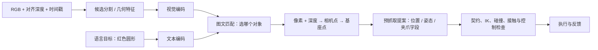
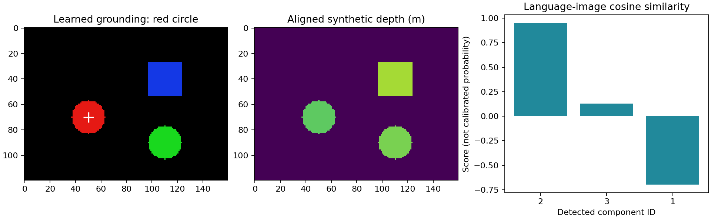
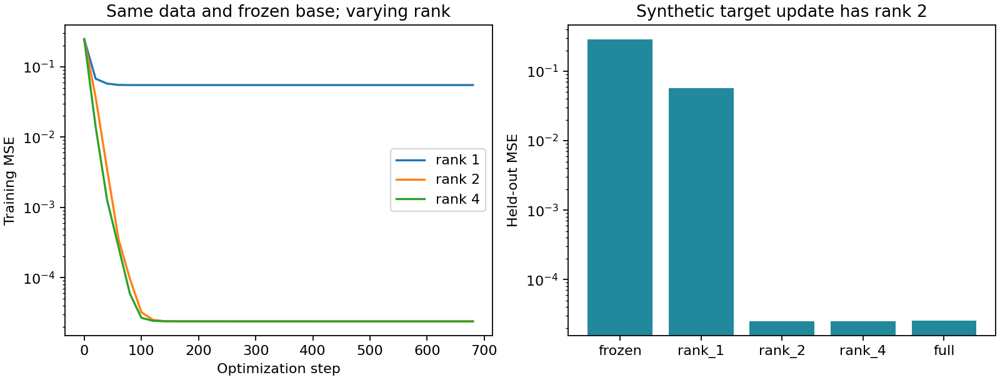

# D34 · 从语言目标到操作提案与 LoRA 适配

[返回学习入口](../_index.md) ｜ [本周日程](../P2-深度理解-日程.md) ｜ [上一课 D33](../day33/Daily-Learning-Pack.md) ｜ [下一课 D35](../day35/Daily-Learning-Pack.md) ｜ [完整 CPU 实验](demo.py)

**“找到了红色圆形”只解决目标关联；“生成了动作向量”只解决输出格式。机器人真正需要的是语义、几何、单位、坐标系、时间和控制契约共同成立。微调模型也一样：能训练少量参数，不等于已经证明适配成功。**

本课为 P2 / W5-D6，保留原定 2026-10-08，2026-10-09 补写。D32 理解了动作分布与模仿学习，D33 拆开接触预测和学习范式；今天完成原定的 VLM 与操作综合实验，再通过真实梯度与参数对照理解 LoRA。D35 将对 P2 的几何、感知、学习和操作接口做综合验收。

<details>
<summary>个人学习记录（后续生成保留）</summary>

<!-- learner-notes:start -->
- 我的图文关联与几何链路草图：
- 观测、动作单位和坐标系检查：
- 单变量预测与实测结果：
- LoRA 梯度、参数量、自测和未解问题：
<!-- learner-notes:end -->

</details>

<!-- daily-pack-generated:start -->

## 0. 宏观目标：让语言、几何和参数更新各自有可验收的职责

今天结束后，你应能把一句目标描述连接到图像候选、RGB-D 反投影和基座系操作提案；解释语义分数为什么不是抓取成功率；列出复现一个官方 VLA 推理示例之前必须对齐的模型、输入、动作和资源条件；手算 LoRA 的参数量和第一步梯度，并用运行结果证明哪些参数变了、哪些没有变。

| 顺序 | 知识主线 | 需回答的问题 |
| --- | --- | --- |
| 1 | 语言目标、视觉候选与共享表征 | 模型在匹配什么，分数能解释到哪里？ |
| 2 | RGB-D 坐标链与操作提案 | 像素如何变成带单位、坐标系的目标？ |
| 3 | 官方 VLA 资源与接口条件 | 什么才算运行了指定模型和指定后端？ |
| 4 | 冻结参数与 LoRA | 更新的秩、梯度和参数量如何验证？ |
| 5 | 集成实验、单变量门控与独立测试 | 哪些能力已运行，哪些仍待真实系统验证？ |



今天的 CPU 实验真正实现了前面的学习式图文匹配、合成 RGB-D 几何和几个数值契约检查；不会执行最后的机器人控制。图中最后一段是系统必须具备的位置，不能因为流程图画到了控制，就把它记为已经验证的能力。

本课还有一个独立的 LoRA 实验。它用小矩阵回归隔离参数适配机制，与图文匹配共享“学什么、冻结什么、怎么验收”的思路，但没有把 LoRA 接到官方 π0，也没有声称训练了一个通用 VLA。

## 1. VLM 在操作系统里做什么：从“说得通”变成“指得对”

### 1.1 语言目标需要落到可测量的对象

“抓红色圆形”包含属性和动作意图。视觉部分至少要回答：图像中哪个候选满足红色与圆形？候选被遮挡了吗？它的像素位置和深度是否可靠？如果有两个红色圆形，当前描述是否足够消除歧义？

VLM 的语义匹配擅长连接语言与视觉概念；几何模块负责把被选对象放到物理空间。二者输入输出不同：前者可输出候选分数、标签或语言解释，后者输出带单位和坐标系的点、姿态与不确定性。一个回答“左边那个”的模型，如果没有稳定的实例 ID、相机时间戳和区域关联，就还不能直接接到机械臂目标位置。

| 模块 | 本课输入 | 本课输出 | 不能据此推断的能力 |
| --- | --- | --- | --- |
| 候选提取 | 合成 RGB | 连通区域 mask | 真实杂乱场景实例分割 |
| 学习式图文匹配 | 区域特征、颜色与形状描述 | 余弦相似度、候选排序 | 开放词汇理解、概率校准 |
| RGB-D 几何 | 像素、Z 深度、K、外参 | 基座系三维点 | 物体完整 6D 姿态 |
| 操作提案 | 目标点、接近方向假设 | 预抓取位置与字段 | IK 可达、无碰撞、稳定接触 |
| 数值契约门控 | 深度、观测年龄、语义间隔 | 通过/拒绝 | 对所有异常的安全保证 |

这也解释了为什么 VLA 输出端到端动作之后，仍然需要动作空间定义和系统验收：把中间模块隐藏进网络，不能让米、弧度、基座系、工具系以及控制周期自动变成同一个概念。

### 1.2 小型学习式图文对齐：确实学习，但明确问题规模

实验生成三种颜色 × 两种形状，共六种描述。视觉数据有独立的颜色扰动与尺寸变化。每个物体使用六维特征：

$$
x_v=[\overline R,\overline G,\overline B,\text{fill},\text{aspect},\text{area}/1024]\in\mathbb R^6.
$$

fill 是 mask 面积除以外接框面积，aspect 是宽高比。圆形的 fill 通常约为 $\pi/4$，方形接近 1，但像素栅格和尺寸会影响实际值。我们没有让神经网络直接从所有像素学习边缘；这些特征是人为提供的视觉归纳偏置。这使 CPU 实验易于训练，也限制了能够声称的泛化范围。

文本描述被编码为颜色 one-hot 三维与形状 one-hot 二维的拼接：

$$
x_l\in\mathbb R^5,\qquad
\text{red circle}=[1,0,0,1,0].
$$

这是受限语言接口，不是自然语言 tokenizer，更不能处理任意同义词、否定句或空间关系。

两个编码器将特征送到同一个 12 维空间：

$$
z_v=\frac{f_\theta(x_v)}{\|f_\theta(x_v)\|_2},\qquad
z_l=\frac{g_\phi(x_l)}{\|g_\phi(x_l)\|_2}.
$$

视觉网络是 $6\to16\to12$，文本网络是 $5\to12$。归一化后，$s_{ij}=z_{v,i}^Tz_{l,j}$ 是余弦相似度，范围在 $[-1,1]$。训练使用六个描述原型作为类别：

$$
\mathcal L=-\frac1B\sum_{i=1}^{B}
\log\frac{\exp(s_{i,y_i}/\tau)}{\sum_{j=1}^6\exp(s_{ij}/\tau)},\qquad\tau=0.1.
$$

低温度把相似度差异放大后再送给 softmax。例如相似度差 .2，在 $\tau=.1$ 下对应 logit 差 2，相对指数权重约 $e^2=7.39$。这改变训练区分力度，不会自动得到经过真实任务校准的置信度。

| 张量 | shape | 含义 |
| --- | --- | --- |
| 一个训练 batch 的视觉特征 | `[64, 6]` | 64 个独立合成物体 |
| 所有文本原型 | `[6, 5]` | 六种颜色/形状描述 |
| 视觉 embedding | `[64, 12]` | 已归一化 |
| 文本 embedding | `[6, 12]` | 已归一化 |
| 相似度/logits | `[64, 6]` | 每个物体对六种描述打分 |
| 监督标签 | `[64]`，整数 | 正确描述索引 0–5 |

这里有一个容易忽略的数据问题：同一个 batch 可以有很多红色圆形。如果简单照搬“每对图文只在对角线上匹配，其他所有位置都是负例”的目标，就会把同义描述错误地当成负例。本实验直接与六个类别原型比较，避免这类假负例。它借鉴图文共享空间的思想，不是完整 CLIP 训练复现。[CLIP 原论文，方法部分与图文对比训练](https://proceedings.mlr.press/v139/radford21a.html)

### 1.3 分数差、概率和成功率的三个边界

推理时，语言固定为红色圆形，对每个区域计算余弦分数。最高分与次高分的差：

$$
m=s_{(1)}-s_{(2)}
$$

可作为一个简单的歧义诊断量，但阈值 .1 是教学设定，需要用独立任务数据验证。若所有候选都不符合目标，仍然会有一个最高分。若候选提取漏掉正确对象，排序模块也不能从不存在的候选中把它找回来。

所以，以下三句话不能相互替换：

1. 区域 A 的相似度比 B 高，表示在当前特征和描述集合下更匹配。
2. 目标识别正确概率为某个数，需要额外定义概率模型与校准评价。
3. 抓取成功概率为某个数，还要考虑几何、接近路径、摩擦、夹爪和执行状态。

D33 的接触概率是针对明确标签和时间窗口训练的二分类输出；本课的相似度不是那个概率。即便把相似度送入 softmax，概率解释也只覆盖当前候选集合与训练目标，不能跳到机器人任务成功。

## 2. 从像素到操作位置：把坐标与单位逐项写清

### 2.1 Z 深度反投影与变换方向

沿用列向量与 $T^A_B$ 约定：$T^A_B$ 把 B 系坐标变为 A 系坐标。相机点先由像素与光轴深度 Z 计算：

$$
p_C=ZK^{-1}\begin{bmatrix}u\\v\\1\end{bmatrix}
=\begin{bmatrix}(u-c_x)Z/f_x\\(v-c_y)Z/f_y\\Z\end{bmatrix},
\qquad
p_B=R^B_Cp_C+t^B_C.
$$

这要求像素和深度来自同一个已对齐的图像坐标域，K 也属于该图像。若深度还是原深度相机的像素坐标，却用了 RGB 的 K 和目标像素，数值可正常运行，几何却不成立。镜头畸变也须先按标定模型处理；本实验使用理想无畸变合成相机。

注意 Z 是相机光轴方向深度，不是射线到点的欧氏距离。若传感器提供距离 $r$，必须先根据射线单位方向转换。真实 RealSense 数据还要读取设备深度比例，而不是凭数组 dtype 猜单位。

### 2.2 手算实验里的一个目标

实验中红色圆形中心为 $(u,v)=(50,70)$，$f_x=f_y=120$ px，$(c_x,c_y)=(80,60)$，$Z=.45$ m：

$$
p_C=
\begin{bmatrix}
(50-80)\times.45/120\\
(70-60)\times.45/120\\
.45
\end{bmatrix}
=\begin{bmatrix}-.1125\\.0375\\.45\end{bmatrix}\text{ m}.
$$

设相机到基座旋转是绕基座 Z 轴的 $90^\circ$，平移为 $[.30,.10,.20]^T$ m：

$$
R^B_C=\begin{bmatrix}0&-1&0\\1&0&0\\0&0&1\end{bmatrix},
\qquad
p_B=\begin{bmatrix}.2625\\-.0125\\.65\end{bmatrix}\text{ m}.
$$

在本课给定的接近假设下，预抓取点设为基座 Z 方向高 .06 m：

$$
p_{\rm pre}^B=p_B+[0,0,.06]^T=[.2625,-.0125,.71]^T\text{ m}.
$$

这里 .06 m 明确是**基座系方向的位移**。它不是工具坐标系的增量，也没有定义沿表面法向接近。真实系统中，应根据场景、抓取方向与工具安装关系选择接近轴。

### 2.3 一个三维点还不是抓取姿态

输出 JSON 中的 `quaternion_xyzw=[0,0,0,1]` 是单位姿态占位值，未从图像或点云估计，也未验证夹爪朝向。仅有一个目标中心，无法确定完整物体 6D 位姿或有效抓取坐标系。

夹爪开口采用一条可手算的尺寸估计。目标宽 27 px、近似正对相机、各点深度近似一致，则投影宽度约为：

$$
w_{\rm object}\approx\frac{27\times.45}{120}=.10125\text{ m}.
$$

增加总共 .01 m 的开口裕量，提案宽度为 .11125 m。总裕量 .01 m 不是左右各 .01 m。这个估计没有处理物体倾斜、遮挡和透视厚度，也没有检查实体夹爪最大开口。若真实夹爪最大只能 .085 m，即便目标位置完全正确，也无法按这个提案包围物体。

因此本实验字段被称为**操作提案**，`execution_authorized` 固定为 `false`。这一字段不是模型得出的安全结论，只是演示程序没有硬件执行授权与执行实现。

### 2.4 时间戳是几何的一部分

若目标以 .2 m/s 移动，观测已过期 .25 s，仅匀速位移就可达 .05 m。即使过去那一帧的深度和外参完美，当前控制也可能抓空。

代码检查深度处于 [.1,2] m、观测年龄不超过 .10 s、语义分差至少 .10。这是三个示例契约，不是穷尽异常的生产验证器；没有覆盖负年龄、无穷值、所有传感器时钟域、机器人状态与完整工作空间。真实 ROS 管线还应明确图像 stamp、相机到基座变换的查询时刻，以及动作生成与实际执行的延迟。

## 3. 官方 VLA demo：把“能运行什么”写成一份资源与接口合同

### 3.1 原始 π0 与后续模型分别对待

D32 介绍的是 2024 年原始 π0 的流匹配动作生成思想。当前 openpi 仓库同时收录 π0、自回归形式的 π0-FAST，以及后续 π0.5；它们不是一个模型换三个名字。检查复现资料时，至少要记录模型名、配置名、checkpoint、代码版本和输入转换，不能拿后续分支的默认示例替代原始论文的实验设置。[原始 π0 项目](https://www.physicalintelligence.company/blog/pi0)、[openpi 官方代码与模型列表](https://github.com/Physical-Intelligence/openpi)

本课在 2026-10-09 核验到的官方 README 给出以下资源条件。这些是仓库当时的参考要求，未来复现应重新核对具体配置，不应把它们当成所有 batch、模型和机器人任务的固定显存保证。

| 工作方式 | 官方 README 所列 NVIDIA GPU 内存条件 | 本次状态 |
| --- | --- | --- |
| 推理 | 大于 8 GB | 未下载 checkpoint、未运行 |
| LoRA 微调 | 大于 22.5 GB | 未运行官方训练 |
| 全参数微调 | 大于 70 GB | 未运行 |
| 平台 | 在 Ubuntu 22.04 测试，其他平台当时不属于当前支持范围 | 本地 Mac CPU 仅跑本文教学实验 |

官方提供 robotless simple client，可以在没有机器人的情况下测试 client/server 推理调用，但仍需符合模型服务端的依赖、checkpoint 和计算资源条件。它验证数据流与推理接口，不验证机器人动作是否正确。[openpi 官方 simple client 说明](https://github.com/Physical-Intelligence/openpi/tree/main/examples/simple_client)

另一个容易混淆的边界：当前 README 的 **PyTorch Support** 部分列出 PyTorch 实现暂不支持 LoRA 微调等若干功能；整体仓库提供的 LoRA 路径不等于每个后端都支持。本文使用 PyTorch 手写的小矩阵 LoRA 是数学机制实验，不能作为“已跑通官方 PyTorch π0 LoRA”的证据。[官方 README 的需求与 PyTorch 支持状态](https://github.com/Physical-Intelligence/openpi#pytorch-support)

### 3.2 模型服务能接收数据之前，要先对齐什么

| 合同项 | 必须记录的内容 | 常见隐蔽错误 |
| --- | --- | --- |
| 图像 | 相机顺序、RGB/BGR、尺寸、layout、数值范围 | `[H,W,3]` 与 `[3,H,W]` 混淆，0–255 与 0–1 混用 |
| 本体状态 | 关节顺序、位置/速度、单位、夹爪约定 | 度与弧度混用，关节重排后没同步 |
| 语言 | prompt 格式、长度、训练时任务表达 | 可输入文本不代表理解所有命令 |
| 动作 | 关节/末端、绝对/增量、参考系、控制周期 | 把归一化动作直接发送到控制器 |
| 归一化 | 与训练数据匹配的统计量及反变换 | 用另一机器人数据集的均值方差 |
| 模型 | 配置、checkpoint、输入输出 adapter 配套 | 权重可加载但动作维度/语义不对 |

例如模型输出 `[H,d_a]` 动作块，H 是未来多少个控制步，$d_a$ 是每步动作字段数；它们还没有告诉你一个步长是多少秒，更没有说明三个平移维度是 m、归一化值还是速度。模型输入历史长度、预测动作长度与实际执行前缀长度也是三件不同的事。

把动作反归一化为物理量只是第一步。末端位姿仍需与 IK、关节限制、碰撞检测和控制器匹配；在接触任务中还需要接触状态与力/顺应控制约束。D33 的接触预测可以提供一个有明确时间窗口的判断，但不能自动替代这些组件。

### 3.3 今日资源验收产出

应留下一个简短的官方复现卡片：目标模型与代码版本、指定 checkpoint/配置、计算资源、输入字段、动作语义、归一化来源、已有验证和未验证部分。本课已经核验官方说明，但不满足官方 GPU 推理运行条件，所以实际可执行内容在第 6 节的独立 CPU 脚本中完成。原计划中的“真实官方 VLA 推理、真实操作与目标域适配效果”仍需合适环境和数据后单独验收。

## 4. 学习扫盲：冻结参数、冻结功能和评估模式不是一回事

### 4.1 四个 PyTorch 动作分别控制什么

| 操作 | 控制的对象 | 不会自动发生的事 |
| --- | --- | --- |
| `param.requires_grad_(False)` | 是否为这个参数累积梯度 | 不会固定整个模型输出 |
| 只把部分参数交给 optimizer | optimizer 更新哪些张量 | 不会自动阻止其他张量计算梯度 |
| `model.eval()` | dropout、BatchNorm 等层的行为 | 不会关闭自动求导 |
| `torch.no_grad()` / `detach()` | 指定计算是否进入梯度图 | 不等于只冻结参数，可能切断上游梯度 |

设输入先经过可训练 adapter，再经过冻结网络层。如果把整个冻结网络前向都放进 `no_grad()`，可能导致 loss 无法传回前面的 adapter。你想冻结的是该层权重，未必想切断它对输入的导数。

相反，如果图像特征只是预先缓存的固定输入，且前面没有需要学习的部分，使用 `no_grad()` 提取特征可以节省计算图开销。选择依据是梯度路径，而不是“这层是不是大模型”。

冻结基座 W0 只保证它的数值不因训练更新；加入 adapter 后 $f(x)$ 会改变。因此“基座没变”不能推出“旧任务不会遗忘”或“危险输出不会增加”。这些是函数行为与数据分布上的问题，需要保留任务集做评估。

### 4.2 本课的 Learning 五格卡

| 格子 | 图文匹配实验 | LoRA 实验 |
| --- | --- | --- |
| 数据 | 合成物体区域与六种描述标签 | 16 维输入、8 维目标向量 |
| 输入/输出 | 视觉/文本特征 → 共享 embedding 与匹配分数 | x → 目标线性映射 y |
| 可学习参数 | 两个小编码器全部参数 | 仅 A、B；对照为全部 W |
| 目标 | 六类别图文原型交叉熵 | 均方误差 |
| 验收 | 独立渲染样本分类、综合场景关联、接口反例 | 独立测试 MSE、梯度、基座变化、合并误差 |

两者都是监督学习。本课没有奖励驱动的策略优化，没有机器人在线采样，也没有完整 imitation policy。训练用了梯度下降，只能说明参数被优化了，不能据此把学习范式改叫 RL。

## 5. LoRA：让更新低秩，而不是让整个模型低秩

### 5.1 从矩阵形状推导参数量

设线性层按列向量写为 $y=Wx$，$W_0\in\mathbb R^{m\times n}$。全参数微调学习 m×n 个元素；LoRA 保持 $W_0$ 冻结，用两个小矩阵表示更新：

$$
W=W_0+sBA,\quad
A\in\mathbb R^{r\times n},\quad
B\in\mathbb R^{m\times r},\quad
s=\alpha/r.
$$

由于 $\operatorname{rank}(BA)\le r$，受限的是更新 $\Delta W$，不是完整 W。即便 r=2，W0 也可以是满秩。[LoRA 原论文 §4.1：低秩参数化与初始化](https://arxiv.org/abs/2106.09685)

本实验 n=16、m=8，基座有 128 个元素：

| r | A 的 shape | B 的 shape | 可训练参数 $r(n+m)$ |
| --- | --- | --- | --- |
| 1 | `[1,16]` | `[8,1]` | 24 |
| 2 | `[2,16]` | `[8,2]` | 48 |
| 4 | `[4,16]` | `[8,4]` | 96 |

rank2 的可训练参数是全参数方案的 $48/128=37.5\%$。但模型仍须保存或读取 128 个基座参数，再加上 adapter；不是把整个模型压成了 48 个数字。训练显存还包含激活、梯度与 optimizer 状态，不能只把参数比率照搬成显存节省比率。

代码采用 PyTorch batch 的行向量形式：

$$
Y=XW_0^T+s(XA^T)B^T,
\quad X:[N,16],\quad XA^T:[N,r],\quad Y:[N,8].
$$

本实验选择 $\alpha=r$，所以 s=1；不同 rank 不额外改变缩放系数。模型没有 bias、dropout、量化或多层非线性，让我们可以直接审计更新矩阵。

### 5.2 为什么 A 随机、B 为零，而不是两个都为零

初始化 A 为小随机值、B=0 时，$\Delta W=0$，初始模型与基座完全一致。设 $G=\partial\mathcal L/\partial W$，由矩阵微分可得：

$$
\frac{\partial\mathcal L}{\partial B}=sGA^T,
\qquad
\frac{\partial\mathcal L}{\partial A}=sB^TG.
$$

因此第一步 B=0 使 A 的梯度为 0；但 A 随机且通常非零，B 可以得到非零梯度。B 更新后，后续步骤中 A 也能够学习。第一步 A 的梯度为零不是训练失败。

反例：如果 A=B=0，上面两项梯度都为零。对这个纯线性 adapter，普通梯度下降无法从全零状态自行打破对称性；再训练很多 epoch 也不能替代正确初始化。额外的参数噪声或不同优化机制会改变条件，本课脚本不采用这些机制。

### 5.3 合并为什么成立，数值上应检查什么

在本课的线性、无 dropout、无量化设置中，推理可以预先合并：

$$
W_{\rm merged}=W_0+sBA.
$$

此时一次矩阵乘法与基座分支加 adapter 分支在实数代数下相同。浮点运算的结合顺序不同，输出可以有约 $10^{-7}$–$10^{-6}$ 的舍入差；应使用合理容差，而不是要求逐 bit 相等。

若训练时 adapter 有 dropout、部署时含量化或不同 dtype，则要根据具体实现重新做合并测试。不能把本课无量化的等价性直接套到所有压缩部署流程。

### 5.4 低秩适配能够学会什么，要由任务更新结构决定

实验特意构造一个 rank2 的真实更新：

$$
W_*=W_0+0.12UV,\quad U:[8,2],\quad V:[2,16],\quad
y=xW_*^T+\epsilon,\quad\epsilon\sim\mathcal N(0,.005^2I).
$$

rank1 没有足够表达能力覆盖一般 rank2 更新，rank2 恰好能表示，rank4 则有额外自由度。这是一个有控制的机制实验。真实 VLA 的目标域偏移可能涉及相机、动作语义、机器人结构和数据覆盖，不能从本实验推导出“所有适配用 rank2 就够”。

这里输入 x 是合成的无量纲特征，输出 y 也是无量纲向量；不能把其 MSE 解释为末端位置的平方米误差。相比第 2 节带米单位的几何，本节刻意隔离参数机制，避免把归一化特征与物理动作混为一谈。

## 6. 实操：真实运行图文关联、几何提案与 LoRA 对照

### 6.1 先预测，再检查

运行前写下四条预测：

1. 目标描述固定为红色圆形，场景中三个候选的排序应是什么？如果正确候选没被分割出来，排序还能补救吗？
2. 只把深度 .45 改为 450，反投影会怎样？单位门控是否会拒绝？
3. 只把观测年龄 .03 s 改为 .25 s，几何坐标本身不变，提案还能通过示例门控吗？
4. B=0、A 随机时第一步谁有梯度？rank1、rank2 与全参数训练的误差应呈现什么关系？

这些预测分别检查语义、单位、时间与参数机制，不能把所有改动同时做完后仅凭 loss 变化解释原因。

从 vault 根目录运行：

```bash
python -B 3d_learning/day34/demo.py
```

脚本使用已有 NumPy、PyTorch、OpenCV 与 Matplotlib，仅 CPU。它生成全部数据，无需下载模型、数据或连接机器人。固定 seed=34；图文训练/测试分别使用独立随机种子 340/341；LoRA 数据种子 342。不同库版本与硬件上的最后几位数值可能有所差别。

### 6.2 图文关联和几何：输出已经过实际运行

图文训练样本 768、测试样本 384，训练 600 个优化步。测试数据是相同六个概念组合的独立尺寸/颜色扰动，准确率为 **1.0**。这仅说明合成闭集问题学会了，不是跨背景、遮挡、新概念或真实 RGB-D 的泛化结果。

| 合成场景候选 | 区域 ID | 对“红色圆形”的余弦分数 |
| --- | --- | --- |
| 红色圆形 | 2 | .951960 |
| 绿色圆形 | 3 | .127500 |
| 蓝色方形 | 1 | −.698124 |

最高与次高分之差 .824460。ID 来自连通区域遍历顺序，与语义标签不是一回事。红色圆形的 camera point、base point 和 pregrasp 分别为 `[-.1125,.0375,.45]`、`[.2625,-.0125,.65]`、`[.2625,-.0125,.71]` m，与第 2 节手算一致。



左图的白色十字是被语言选中的区域中心；中图是已经对齐的合成深度；右图展示匹配分数。中图的背景零值不表示真实机器人可以把背景当作 0 m 表面。本实验只在物体 mask 内取深度中位数；真实传感器还需要有效深度 mask 与空洞处理。

| 测试 | 仅改变的字段 | 数值契约结果 |
| --- | --- | --- |
| nominal | 基准场景 | true |
| depth_in_mm | 深度 ×1000 | false |
| stale_observation | 观测年龄 .03→.25 s | false |
| ambiguous_goal | 语义分差改为 .01 | false |

这三个反例是已执行的单变量对照。nominal=true 只表示这三项示例数值条件成立，绝不表示 IK、碰撞、夹爪范围、姿态或接触成功通过。完整提案记录仍为 `execution_authorized=false`。

### 6.3 LoRA：用参数、梯度与独立误差一起证明机制

LoRA 数据共 768 个独立样本，前 512 个训练、后 256 个测试。所有方案共享同一基座和数据，每个训练方案 700 个优化步。rank 对照使用各自固定初始化 seed，不能把不同 rank 的每一条细微曲线差异都归因于 rank；其主要作用是比较已知 rank2 目标下的表达能力。

| 方案 | 可训练参数 | 独立测试 MSE |
| --- | ---: | ---: |
| 完全冻结基座 | 0 | .29043305 |
| LoRA rank1 | 24 | .05674928 |
| LoRA rank2 | 48 | .0000248944 |
| LoRA rank4 | 96 | .0000250843 |
| 全参数更新 | 128 | .0000255591 |

噪声方差为 $.005^2=.000025$，后三个结果处于接近这一尺度的位置。这不表示每次运行都必须按 rank2、rank4、full 这个细小次序排列，更不意味着 rank2 在所有任务上泛化最好。rank1 的主要差距则明显超过采样噪声尺度，符合其不足以表示本题目标更新的预期。



左图的训练 loss 已实际下降；右图使用对数坐标，展示不同方案的测试误差。只有 loss 曲线还不够，我们同时记录了三个结构性检查：

- rank1/2/4 的 `base_max_change` 均为 **0**，且冻结参数 `.grad is None`。
- 所有 rank 的第一步 A 梯度范数为 **0**；B 梯度非零，rank2 为 **.0399309**，与推导一致。
- rank2 合并前后最大输出差约 **9.54×10⁻⁷**，在浮点舍入范围内。

这组证据支持“仅低秩 adapter 更新，并且线性合并正确”的结论。它不支持官方大模型显存、真实机械臂成功率或目标域泛化的结论。

### 6.4 你应留下的产出物

保留一张语言→候选→坐标→提案的接口图，并逐项标注输入 shape、单位与坐标系；在实验记录中写下三个单变量门控的预测与实际结果；为 LoRA 写出 rank2 参数量、初始梯度和合并误差。官方 VLA 复现卡里要把“文档条件已核验”和“推理尚未运行”分开记录。

已生成的结果：

- [完整结果 JSON](../../_assets/3d_learning/day34/results.json)：候选分数、位置、提案、门控和 LoRA 指标。
- LoRA 数据 NPZ (not exported: excluded by publication policy)：inputs、targets、base、true_update，可独立检查目标更新的秩。
- [完整主脚本](demo.py)：与下面折叠代码逐字一致。

<details>
<summary>展开完整可运行代码：demo.py</summary>

```python
"""Small learned vision-language grounding, geometry contracts, and LoRA.
All data are synthetic. This script is not an openpi inference demo.
"""
import json
import os
from pathlib import Path
os.environ.setdefault('MPLCONFIGDIR', '/tmp/day34-mpl')
os.environ.setdefault('XDG_CACHE_HOME', '/tmp/day34-cache')
import numpy as np
import torch
from torch import nn
import cv2
import matplotlib
matplotlib.use('Agg')
import matplotlib.pyplot as plt

OUT = Path(__file__).resolve().parents[2] / '_assets/3d_learning/day34'
COLORS = np.array([[.9, .10, .08], [.08, .22, .9], [.10, .85, .12]])


def features(crop, mask):
    rgb = crop[mask].mean(0)
    y, x = np.where(mask)
    h, w = y.max()-y.min()+1, x.max()-x.min()+1
    return np.r_[rgb, mask.sum()/(h*w), w/h, mask.sum()/1024.].astype('float32')


def shape_patch(color, shape, radius=13):
    mask = np.zeros((36, 36), np.uint8)
    if shape == 0:
        cv2.circle(mask, (18, 18), radius, 1, -1)
    else:
        cv2.rectangle(mask, (18-radius, 18-radius), (18+radius, 18+radius), 1, -1)
    return mask[..., None] * color, mask.astype(bool)


def dataset(n, seed):
    rng = np.random.default_rng(seed)
    xs, ys = [], []
    for _ in range(n):
        c, shape = rng.integers(3), rng.integers(2)
        color = np.clip(COLORS[c] + rng.normal(0, .035, 3), 0, 1)
        crop, mask = shape_patch(color, shape, int(rng.integers(9, 16)))
        xs.append(features(crop, mask)); ys.append(int(c*2+shape))
    return torch.tensor(np.array(xs)), torch.tensor(ys)


def language_features():
    return torch.tensor(np.array([np.r_[np.eye(3)[c], np.eye(2)[s]]
                                  for c in range(3) for s in range(2)]), dtype=torch.float32)


def grounding():
    train_x, train_y = dataset(768, 340)
    test_x, test_y = dataset(384, 341)
    image_encoder = nn.Sequential(nn.Linear(6, 16), nn.Tanh(), nn.Linear(16, 12))
    text_encoder = nn.Linear(5, 12, bias=False)
    opt = torch.optim.Adam(list(image_encoder.parameters()) + list(text_encoder.parameters()), lr=.01)
    text = language_features()
    def logits(x):
        im = nn.functional.normalize(image_encoder(x), dim=-1)
        tx = nn.functional.normalize(text_encoder(text), dim=-1)
        return im @ tx.T / .1
    for _ in range(600):
        ids = torch.randint(len(train_x), (64,))
        loss = nn.functional.cross_entropy(logits(train_x[ids]), train_y[ids])
        opt.zero_grad(); loss.backward(); opt.step()
    with torch.no_grad():
        accuracy = float((logits(test_x).argmax(1) == test_y).float().mean())
    scene = np.zeros((120, 160, 3), dtype=float)
    depth = np.zeros((120, 160), dtype=float)
    specifications = [(0, 0, 50, 70, .45), (1, 1, 110, 40, .52), (2, 0, 110, 90, .48)]
    for color, shape, u, v, z in specifications:
        crop, mask = shape_patch(COLORS[color], shape)
        scene[v-18:v+18, u-18:u+18] = crop
        depth[v-18:v+18, u-18:u+18][mask] = z
    binary = (scene.max(-1) > .3).astype('uint8')
    count, labels = cv2.connectedComponents(binary)
    candidates = []
    goal = text[0]  # closed-vocabulary command: red circle
    for instance in range(1, count):
        mask = labels == instance
        y, x = np.where(mask)
        feat = features(scene, mask)
        with torch.no_grad():
            im = nn.functional.normalize(image_encoder(torch.from_numpy(feat)[None]), dim=-1)
            tx = nn.functional.normalize(text_encoder(goal[None]), dim=-1)
            score = float((im * tx).sum())
        candidates.append({'id': instance, 'score': score, 'u': float(x.mean()), 'v': float(y.mean()),
                           'pixel_width': int(x.max()-x.min()+1), 'z': float(np.median(depth[mask]))})
    candidates.sort(key=lambda item: item['score'], reverse=True)
    best = candidates[0]
    semantic_margin = best['score'] - candidates[1]['score']
    point_cam = np.array([(best['u'] - 80)*best['z']/120,
                          (best['v'] - 60)*best['z']/120, best['z']])
    R = np.array([[0., -1., 0.], [1., 0., 0.], [0., 0., 1.]])
    point_base = R @ point_cam + np.array([.30, .10, .20])
    pregrasp = point_base + np.array([0., 0., .06])
    width = best['pixel_width'] * best['z'] / 120 + .01
    def contract(z, age, margin):
        return bool(.1 <= z <= 2. and age <= .10 and margin >= .10)
    gate_cases = {'nominal': contract(best['z'], .03, semantic_margin),
                  'depth_in_mm': contract(best['z']*1000, .03, semantic_margin),
                  'stale_observation': contract(best['z'], .25, semantic_margin),
                  'ambiguous_goal': contract(best['z'], .03, .01)}
    report = {'test_feature_accuracy': accuracy, 'candidates': candidates,
              'semantic_margin': semantic_margin, 'point_camera_m': point_cam.tolist(),
              'point_base_m': point_base.tolist(), 'pregrasp_base_m': pregrasp.tolist(),
              'contract_cases': gate_cases,
              'proposal': {'frame': 'base', 'mode': 'absolute_pose', 'position_m': pregrasp.tolist(),
                           'quaternion_xyzw': [0., 0., 0., 1.], 'gripper_width_m': width,
                           'observation_age_s': .03, 'execution_authorized': False}}
    fig, ax = plt.subplots(1, 3, figsize=(12, 3.7), constrained_layout=True)
    ax[0].imshow(scene); ax[0].scatter([best['u']], [best['v']], marker='+', c='white', s=150)
    ax[0].set_title('Learned grounding: red circle')
    ax[1].imshow(depth, vmin=0, vmax=.6, cmap='viridis'); ax[1].set_title('Aligned synthetic depth (m)')
    ax[2].bar([str(c['id']) for c in candidates], [c['score'] for c in candidates], color='#21899b')
    ax[2].set(title='Language-image cosine similarity', xlabel='Detected component ID', ylabel='Score (not calibrated probability)')
    fig.savefig(OUT / 'grounded_pipeline.png', dpi=160); plt.close(fig)
    return report


def lora_experiment():
    gen = torch.Generator().manual_seed(342)
    x = torch.randn(768, 16, generator=gen)
    base = torch.randn(8, 16, generator=gen) * .15
    delta = .12 * torch.randn(8, 2, generator=gen) @ torch.randn(2, 16, generator=gen)
    y = x @ (base + delta).T + .005 * torch.randn(768, 8, generator=gen)
    results, histories = {}, {}
    results['frozen'] = {'trainable': 0, 'test_mse': float(((x[512:] @ base.T - y[512:])**2).mean())}
    for rank in [1, 2, 4]:
        torch.manual_seed(3400 + rank)
        frozen = nn.Parameter(base.clone(), requires_grad=False)
        A = nn.Parameter(.05 * torch.randn(rank, 16))
        B = nn.Parameter(torch.zeros(8, rank))
        optimizer = torch.optim.Adam([A, B], lr=.03)
        history, first_gradient = [], None
        for step in range(700):
            prediction = x[:512] @ (frozen + B @ A).T  # alpha/r=1
            loss = (prediction - y[:512]).square().mean()
            optimizer.zero_grad(); loss.backward()
            if step == 0:
                first_gradient = {'A_norm': float(A.grad.norm()), 'B_norm': float(B.grad.norm()),
                                  'frozen_grad_is_none': frozen.grad is None}
            optimizer.step()
            if step % 20 == 0:
                history.append([step, float(loss.detach())])
        with torch.no_grad():
            merged = frozen + B @ A
            mse = float(((x[512:] @ merged.T - y[512:])**2).mean())
            merge_error = float((x[512:] @ merged.T - (x[512:] @ frozen.T + (x[512:] @ A.T) @ B.T)).abs().max())
        results[f'rank_{rank}'] = {'trainable': A.numel()+B.numel(), 'test_mse': mse,
                                  'base_max_change': float((frozen-base).abs().max()),
                                  'merge_max_error': merge_error, 'first_gradient': first_gradient}
        histories[str(rank)] = np.array(history)
    full = nn.Parameter(base.clone())
    optimizer = torch.optim.Adam([full], lr=.03)
    for _ in range(700):
        loss = (x[:512] @ full.T-y[:512]).square().mean()
        optimizer.zero_grad(); loss.backward(); optimizer.step()
    results['full'] = {'trainable': full.numel(), 'test_mse': float(((x[512:] @ full.T-y[512:])**2).mean().detach())}
    fig, ax = plt.subplots(1, 2, figsize=(10, 3.8), constrained_layout=True)
    for rank, history in histories.items():
        ax[0].semilogy(history[:, 0], history[:, 1], label='rank '+rank)
    ax[0].set(xlabel='Optimization step', ylabel='Training MSE', title='Same data and frozen base; varying rank')
    ax[0].legend()
    names = ['frozen', 'rank_1', 'rank_2', 'rank_4', 'full']
    ax[1].bar(names, [results[k]['test_mse'] for k in names], color='#21899b')
    ax[1].set(yscale='log', ylabel='Held-out MSE', title='Synthetic target update has rank 2')
    fig.savefig(OUT / 'lora_learning.png', dpi=160); plt.close(fig)
    np.savez_compressed(OUT / 'lora_data.npz', inputs=x.numpy(), targets=y.numpy(), base=base.numpy(), true_update=delta.numpy())
    return results


def main():
    OUT.mkdir(parents=True, exist_ok=True)
    torch.set_num_threads(2); torch.manual_seed(34)
    report = {'verified_date': '2026-10-09', 'torch': torch.__version__, 'numpy': np.__version__,
              'grounding': grounding(), 'lora': lora_experiment()}
    (OUT / 'results.json').write_text(json.dumps(report, indent=2))
    print(json.dumps(report, indent=2))


if __name__ == '__main__':
    main()
```

</details>

## 7. 总结：今天最值得掌握的五件事

1. **语义落地必须形成可追踪的对象关联。** 语言匹配分数解决“选哪个”，深度与变换解决“在哪里”；把它们混成一个信心分数会掩盖失败来源。
2. **操作提案需要明确坐标、单位、时间与姿态来源。** 一个正确的三维中心并不提供完整抓取姿态，正常数值也不证明可执行。
3. **官方模型、后端与资源条件要逐项匹配。** π0、π0-FAST、π0.5，整体仓库能力与 PyTorch 后端能力，都不能互相替换。
4. **冻结参数和切断梯度是不同操作。** 验收时既检查参数有没有变化，也检查你希望学习的上游模块是否仍有梯度。
5. **LoRA 的低秩约束作用在更新上。** 参数量、初始化梯度、独立测试与合并一致性共同构成可复核证据；低 loss 本身没有说明真实操作能力。

最容易踩的三个坑分别是：把余弦分数当抓取成功率；把单位姿态占位值当做视觉估计的抓取方向；把第一步 A 的零梯度误判为 LoRA 失效。遇到这些情况，分别回到标签定义、几何来源和矩阵导数检查，不要靠调学习率掩盖问题。

## 8. 自测：先作答，再打开末尾标准

1. 为什么本课测试准确率 1.0，仍然不能声称学会了开放词汇 VLM？至少指出三个实验约束。
2. 视觉 embedding 为 `[64,12]`，六个文本 embedding 为 `[6,12]`，如何得到 `[64,6]` logits？温度 .1 起什么作用？
3. 余弦分数 .95、语义分差 .82、接触概率 .95、抓取成功率 .95 分别在解释什么？哪些不能互相替换？
4. 使用本课 K、像素和 Z，手算 camera point 与 base point。若把 .45 m 误写成 450，错误发生在哪里？
5. 为什么 `quaternion_xyzw=[0,0,0,1]` 与 nominal 门控通过不能证明一个完整抓取动作已验证？至少给出三项尚缺信息。
6. 本课 27 px 宽的物体、Z=.45 m、fx=120 px，估计夹爪开口是多少？这个估计依赖哪些几何假设？
7. $W_0:[8,16]$，LoRA rank2 的 A、B shape、可训练参数数分别是多少？冻结基座之后模型总存储是否只剩 48 个参数？
8. 用梯度式说明 A 随机、B=0 时第一步谁更新；如果 A=B=0 会怎样？
9. `eval()`、`requires_grad=False`、`no_grad()` 有什么区别？一个可训练 adapter 在冻结网络之前时，什么错误写法可能阻止 adapter 学习？
10. 准备运行官方 VLA 时，列出至少六项接口/资源条件。本课哪些环节已经实际运行，哪些还需要原计划后续补做？

## 9. 未理解与下一课

个人区记录一个你仍不能自己推导的点，优先选择：共享 embedding 的训练目标、RGB-D 坐标链、动作字段语义、LoRA 初始梯度或后端资源边界。不要把“看完了”当作已经通过这些能力的验收。

[D35](../day35/Daily-Learning-Pack.md) 将回到 P2 总验收：把深度、3D 表示、重建、位姿、视觉语言和操作接口串成一个可审查的机器人系统。今天生成的语言落地链路、坐标手算、门控反例和 LoRA 五格卡，都可以作为验收材料；合成实验通过不会自动把学习状态改为已掌握。

## 10. 自测答案与判分标准

每题 0/1/2 分：0 分为概念错误或无法解释；1 分为主旨正确但缺必要条件、单位或证据；2 分为答案与边界完整。总分用于定位补学点，不替代真实实验与个人复述。

> [!answer]- 展开简洁答案（先完成上面的十题）
> 1. 六种描述闭集；颜色/形状由 one-hot 输入，没有真实语言 tokenizer；视觉是人工六维特征；测试只变化尺寸与颜色扰动，没有新概念、遮挡或真实背景。说出三项并解释范围得 2 分。
> 2. `image @ text.T / .1`。温度缩放 logits 与相对指数权重，不自动校准为任务成功概率。shape 和解释各占一半。
> 3. 前两者描述当前 embedding/候选的关联与间隔；接触概率对应特定事件和时间窗口；抓取成功率对应完整任务判据。都不能直接互换，尤其不能把余弦相似度当作物理成功概率。
> 4. camera `[-.1125,.0375,.45]` m；base `[.2625,-.0125,.65]` m。450 被当作米会使反投影相机坐标放大 1000 倍，平移部分仍保持原单位，整体结果错误；示例深度门控会拒绝。
> 5. 姿态是占位值；尚缺有效抓取朝向、工具/安装变换、IK、碰撞、夹爪行程、摩擦/接触与控制器检查等。nominal 只检查三个数值条件。
> 6. 物体宽 .10125 m，加总裕量 .01 m，开口 .11125 m。依赖近似正对相机、同一深度、有效完整 mask 与正确 K；还没有检查实体夹爪行程。
> 7. A `[2,16]`、B `[8,2]`，32+16=48 个可训练参数。基座 128 个参数仍然存在，总存储还包括 adapter；优化器与激活另计。
> 8. `dB=sGA.T`、`dA=sB.TG`。第一步 A 梯度为零而 B 通常非零，随后 A 可学习；两者全零会使两项梯度都为零，在本课优化机制下无法起步。
> 9. eval 控制层行为；requires_grad 控制参数求导；no_grad 切断所包围运算的梯度图。冻结层仍需把梯度传到前面的可训练 adapter，不能一概用 no_grad 包住其前向。
> 10. 模型/配置/checkpoint/后端、GPU/平台、图像顺序与范围、状态关节顺序单位、动作绝对/增量与坐标系/周期、归一化统计等。已运行小型图文匹配、合成 RGB-D 几何与契约、矩阵 LoRA；未运行官方大 VLA、真实 RGB-D 泛化、IK/碰撞/接触闭环或真实机器人操作。

<!-- daily-pack-generated:end -->
