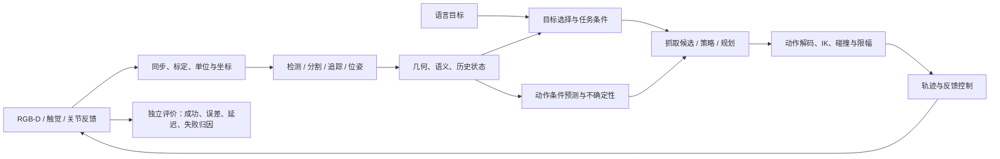
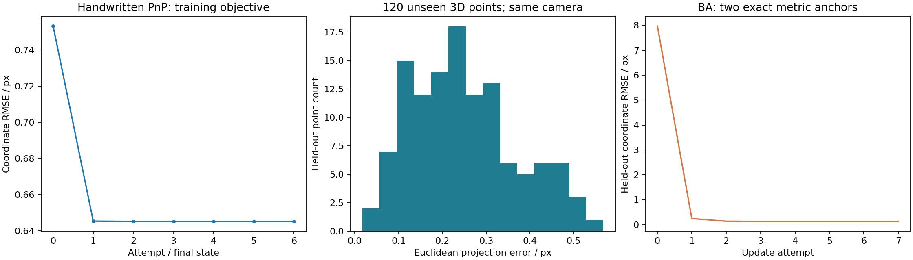
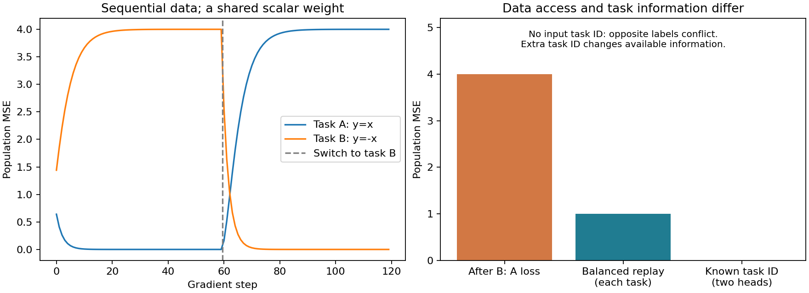

# D35 · 从分立算法到可验证的机器人感知链

[返回学习入口](../_index.md) ｜ [本周日程](../P2-深度理解-日程.md) ｜ [上一课 D34](../day34/Daily-Learning-Pack.md) ｜ [CPU 实验](demo.py) ｜ [绘图脚本](plot_demo.py)

**理解一个算法，是能写出它在什么条件下把什么输入变成什么输出；理解一套机器人系统，还要能指出错误在哪里进入、怎样传播、用什么独立证据发现。今天用四组推导、三个核心模块和一套统一验收，把 P2 的知识接起来。**

本课是 P2 / W5-D7 / 全局 Day35。D29–34 已将视觉触觉、反馈控制、VLM/VLA、动作接口和学习方式放进同一个机器人案例；今天保留原定的立体、SfM、NeRF、6D位姿四组推导，几何PnP、PointNet、BA三个手写模块，以及20篇精读的个人证据要求。新增多任务、元学习、持续学习只讲到能辨别问题与目标，不另开大规模训练项目。

贯穿案例：RGB-D机械臂需要根据“拿起左边的杯子”定位目标、恢复位姿、生成抓取、通过碰撞检查并在接触后调整。检测框正确、重投影残差很低、VLA输出了七个数，都只是局部事实；最终要解释它们怎样支持或不支持抓取成功。

<details>
<summary>个人学习记录（由你填写，后续生成保留）</summary>

<!-- learner-notes:start -->

- 四组推导中我可以闭卷完成的部分：
- 三个模块我实际修改、运行、解释的证据：
- 我的20篇精读卡片与尚未读完的篇目：
- 自测分数与P2验收未通过项：
- 进入P3前优先修复的一个接口问题：

<!-- learner-notes:end -->

</details>

<!-- daily-pack-generated:start -->

## 0. 学习目标与知识路线

学完后应能：

1. 独立推导双目深度误差、BA局部更新、体渲染权重、刚体位姿配准的主要关系，并给出各自的退化或歧义。
2. 从DLT初始化到阻尼Gauss–Newton写出一个非共面PnP小求解器，解释为什么它不能覆盖所有PnP情况。
3. 用置换、保留观测、数值导数和尺度反例检查PointNet与BA，而非仅确认函数没有报错。
4. 把视觉、语言、几何、接触、策略和控制之间的接口写成带单位、坐标系、时间的记录。
5. 区分多任务、元学习和持续学习，以及它们与监督来源、模型结构、on/off-policy的关系。
6. 将教材提供的实验与自己的推导、精读、修改记录分开，形成可核验的P2产出。

| 顺序 | 知识主线 | 要回答的问题 |
| --- | --- | --- |
| 宏观 | 闭环与证据 | 某个局部指标通过，能支持多大的结论？ |
| 几何 | 立体、SfM、6D位姿 | 像素怎样约束空间，缺什么信息？ |
| 表示 | NeRF与PointNet | 学到外观、集合特征或状态，分别意味着什么？ |
| 实现 | PnP与BA的线性化 | 公式怎样变成可检查的计算？ |
| 学习 | 多任务、元学习、持续学习 | 任务、数据访问和适应过程如何变化？ |
| 收束 | 实验、精读与验收 | 哪些证据已经存在，哪些必须由自己完成？ |

## 1. 宏观：把“看对了”拆成一组可以检验的命题



图中箭头不是“传一个tensor就完成”。例如位姿到抓取要知道物体坐标原点；策略到控制要知道动作是绝对位姿还是增量、在哪个系中定义；触觉到接触状态要知道无接触基线、同步时刻和标定范围。

### 1.1 四种容易混为一谈的成功

| 层级 | 可以确认的事实 | 还不能直接推出 |
| --- | --- | --- |
| 文件完整 | 讲义、图、脚本可以打开 | 学习者掌握了知识 |
| 代码验证 | 该版本、该数据、该参数下检查通过 | 换场景或真机仍可靠 |
| 局部任务 | 位姿或预测指标符合已定义协议 | 机器人整个任务成功 |
| 闭环任务 | 明确初态分布下成功数/尝试数达标 | 任意物体、环境与动作均成功 |

**本课已经完成的是前两层的材料准备和合成验证；个人学习、20篇精读和实际项目验收仍由你的产出决定。** 这一划分让后续项目报告中的每句话都有对应证据，而不是把所有状态塞进一个“完成”勾选框。

### 1.2 一条接口记录至少回答四件事

1. **是什么量？** RGB、轴向深度、物体位姿、夹爪宽度、速度或力。
2. **属于哪里？** camera/base/object/tool哪个坐标系，轴方向、旋转约定和单位。
3. **属于何时？** 采样时刻、生效区间、观测延迟，不能只存文件保存时间。
4. **在什么条件下可信？** 有效mask、可见性、置信度、分布范围和未知区域。

同样的`[0,0,0.01]`，可以是base系中向上1cm的位移、tool系向前1cm、0.01m/s速度，也可能是归一化空间中的动作。shape相同不能证明语义相同。

## 2. 第一组推导：双目深度为什么对视差误差敏感

### 2.1 从两个相似三角形开始

考虑理想、已校正的双目：两相机平行，左相机为原点，右相机中心沿x移动基线B。焦距f以像素为单位，主点已扣除。三维点为$(X,Y,Z)$：

$$
u_L=fX/Z,\qquad u_R=f(X-B)/Z.
$$

两式相减，视差$d=u_L-u_R$：

$$
\boxed{d=fB/Z,\qquad Z=fB/d.}
$$

其中B、Z使用相同长度单位，d、f使用像素单位。这一简式依赖已校正双目和正确对应；一般相机布局应使用投影矩阵三角化，不能把未经校正的横坐标差直接代入。

### 2.2 一阶误差传播解释了远处为什么更难

把f、B暂时视为精确常数：

$$
\frac{\partial Z}{\partial d}=-\frac{fB}{d^2}=-\frac{Z^2}{fB},
\quad \sigma_Z\approx\frac{Z^2}{fB}\sigma_d.
$$

取$f=600$px、$B=0.1$m、$\sigma_d=0.2$px：Z=1m时$d=60$px、$\sigma_Z\approx3.33$mm；Z=3m时$d=20$px、$\sigma_Z\approx30$mm。同一个视差算法，距离变成3倍，近似深度误差变成9倍。

若f、B也不准确，微分为：

$$
\frac{\delta Z}{Z}\approx\frac{\delta f}{f}+\frac{\delta B}{B}-\frac{\delta d}{d}.
$$

独立随机误差可对各项方差相加；系统偏置不能靠增加同分布帧数保证消失。接近零视差时，一阶高斯近似也可能失效，必须检查分布与无效值。

### 2.3 学习式匹配改变哪个部分

GCNet类方法用代价体组织候选视差，随后回归视差。一种soft argmin为：

$$
p(d)=\frac{e^{-C(d)}}{\sum_k e^{-C(k)}},\qquad \hat d=\sum_d d\,p(d).
$$

若候选d=10、20各占一半，均值是15，但15未必对应任何真实表面。多峰分布和遮挡会让“平滑、可微”的结果仍然错误。学习的是对应和正则化，深度单位与相机几何仍由投影关系决定。[GCNet原论文](https://arxiv.org/abs/1703.04309)

> [!question] 先算再解释
> 同样0.2px的误差，要把3m处的30mm误差降到15mm，只改基线需要怎样改变B？如果扩大基线导致更多遮挡，原先“视差误差不变”的假设还成立吗？

## 3. 第二组推导：SfM不是点越多越好，BA不是残差越小越真

### 3.1 从已匹配观测到联合变量

令$T^{cam_i}_{world}=(R_i,t_i)$，世界点为$X_j$，观测像素为$u_{ij}$：

$$
r_{ij}=\pi(R_iX_j+t_i)-u_{ij},\qquad
\min_{R,t,X}\frac12\sum_{(i,j)\in\mathcal O}\|r_{ij}\|^2.
$$

SfM前端决定谁与谁对应、哪些相机形成连通关系、哪些点可三角化；BA后端在这些身份和模型假设下优化连续变量。把动态物体强当静态点，BA可能把错误解释得更加一致；它不会凭空改写数据关联。

### 3.2 用同一局部更新推导两个Jacobian

采用$R'=\exp([\delta\omega]_\times)R$、$t'=\exp([\delta\omega]_\times)t+\delta v$。对$q=RX+t$：

$$
\delta q=-[q]_\times\delta\omega+\delta v+R\delta X.
$$

投影导数与两个块为：

$$
J_\pi=\begin{bmatrix}f_x/z&0&-f_xx/z^2\\0&f_y/z&-f_yy/z^2\end{bmatrix},
\quad A=J_\pi[-[q]_\times\ I],\quad B=J_\pi R.
$$

A为`[2,6]`，B为`[2,3]`；平移和点增量单位为米，旋转为弧度，残差为像素。参数更新约定一变，导数也必须重推；不能把另一篇文章的右扰动Jacobian直接接到这里的左扰动更新上。

堆叠后$r(\theta\boxplus\delta)\approx r+J\delta$，令局部二次目标的导数为0得到：

$$
J^TJ\delta=-J^Tr.
$$

阻尼改变局部步的大小与稳定性，但不会增加真实观测。平方损失与鲁棒损失还要使用一致的权重和候选步评价。

### 3.3 Schur消元保留了点的约束

将相机和点分块：

$$
\begin{bmatrix}U&W\\W^T&V\end{bmatrix}
\begin{bmatrix}\delta c\\\delta p\end{bmatrix}
=-\begin{bmatrix}g_c\\g_p\end{bmatrix}.
$$

因为普通像素残差只涉及一个点，V按点块对角。由点方程解出并代回：

$$
\boxed{(U-WV^{-1}W^T)\delta c=-g_c+WV^{-1}g_p},
\quad \delta p=-V^{-1}(g_p+W^T\delta c).
$$

这里的逆是数学记号，工程中优先分解/求解小块。相机系统先吸收点的响应，再回代点；不能省略回代后还称完整BA。

### 3.4 用尺度反例区分几何一致与米制正确

单目系统整体乘正尺度s：$X'=sX,t'=st$，则$q'=s(RX+t)$，投影完全不变。整体旋转和平移也可通过更换世界坐标系消去。一般非退化标定单目SfM有7维相似规范自由度。

**固定世界原点、方向和内部尺度，是选择表达；已知双目基线或物体真实尺寸，才为“米”提供来源。** 本课BA实验固定两台相机完整真值位姿，属于强米制先验，不能宣传成无先验单目恢复。

更完整推导和鲁棒对照见[Day23](../day23/Daily-Learning-Pack.md)。本课使用新的点和保留观测重新检查模块，未重复覆盖其旧实验文件。

## 4. 第三组推导：NeRF怎样生成颜色，为什么仍需要几何验收

### 4.1 连续形式的量纲

射线$r(t)=o+td$使用单位方向d，t为米。场输出非负密度$\sigma(x)$，单位每米，以及颜色$c(x,d)\in[0,1]^3$。透射率为：

$$
T(t)=\exp\left(-\int_{t_n}^t\sigma(r(s))ds\right).
$$

像素颜色在有限区间内累积：

$$
C=\int_{t_n}^{t_f}T(t)\sigma(r(t))c(r(t),d)dt+T(t_f)c_{bg}.
$$

若方向未归一化，参数间隔必须乘方向范数才得到实际段长。若场景整体改了尺度，密度数值也要对应改变，不能把单位盒中的密度直接当每米的物理量。

### 4.2 离散权重与一个守恒检查

每段近似常值时：

$$
\alpha_i=1-e^{-\sigma_i\delta_i},\quad
T_i=\prod_{j<i}(1-\alpha_j),\quad
w_i=T_i\alpha_i.
$$

由于$w_i=T_i-T_{i+1}$：

$$
\sum_iw_i+T_{N+1}=1.
$$

两段密度2、3每米，各长0.2m，得到$w_1=0.329680,w_2=0.302441,T_3=0.367879$。三者和为1。把前景权重强制归一化再合成，会删掉背景透射，改变成像模型。原论文与实现可由[NeRF作者项目页](https://www.matthewtancik.com/nerf)进入。

### 4.3 像素指标只能回答它定义的问题

RGB MSE关注渲染颜色，PSNR是它的对数变换；几何精度关注表面在哪里；完整度关注有没有重建出来；碰撞检查还关注未观测空间、物体厚度和机器人形状。

两个不同深度的同色薄层，在背景和光学厚度合适时可以生成同一个像素。多视角约束有帮助，但遮挡、透明、纹理重复和标定误差会保留歧义。不能从新视角PSNR高直接推出“夹爪离桌面还有5mm”。

同理，静态场的相机查询是“从哪里看”；动作条件模型的动作输入是“改变什么”。V-JEPA类表征、NeRF外观场、显式碰撞几何和动作转移可以组合，但各自需要独立训练目标与验收。

## 5. 第四组推导：从对应点到6D位姿，再到真正可用的抓取

### 5.1 刚体最小二乘的闭式骨架

设物体系点$x_i$和相机系对应点$y_i$，要求$R\in SO(3)$、$t\in\mathbb R^3$：

$$
\min_{R,t}\sum_i\|Rx_i+t-y_i\|^2.
$$

对t求导，得到$t=\bar y-R\bar x$。将点去中心，构造：

$$
H=\sum_i(x_i-\bar x)(y_i-\bar y)^T=U\Sigma V^T.
$$

于是：

$$
R=V\operatorname{diag}(1,1,\det(VU^T))U^T,\qquad t=\bar y-R\bar x.
$$

行列式修正确保旋转不变成镜像。这个问题假定已有正确3D对应；PnP接受3D–2D对应，ICP还要迭代近邻关联，NOCS会涉及类别规范坐标与尺寸。这些任务不能因为最后都输出位姿就混成同一个求解问题。

### 5.2 一个旋转误差怎样变成末端位置误差

物体原点估计无偏，但抓取点离原点r=0.1m，姿态差$\theta=5^\circ$。若抓取点方向垂直于该旋转轴，位置变化为：

$$
\|\delta p\|=2r\sin(\theta/2)\approx8.72\text{ mm}.
$$

同一个5°对物体中心的位置误差可能为0，对长物体远端却很大。只看平移误差会漏掉这种效应；旋转容差需要与抓取几何和任务尺寸一起设定。

### 5.3 对称与坐标变换不要只背术语

ADD使用对应模型点的平均距离；ADD-S式最近点匹配可减轻对称对应歧义，但“评测认为等价”不必然等于“操作认为等价”。无把手圆柱的绕轴角可能不影响几何；杯把、标签、插口或语言任务会破坏这种等价。

从物体位姿到base系抓取位姿应是：

$$
T^{base}_{grasp}=T^{base}_{cam}T^{cam}_{object}T^{object}_{grasp}.
$$

若实际控制的是TCP，而几何中定义的是夹爪抓取框架，还要补上对应的固定变换。最后再检查夹爪宽度、接近方向、IK分支、碰撞、时间参数化和接触反馈。位姿估计的置信度应影响保守裕量，而不是在变换链中被丢掉。

## 6. 补齐手写几何模块：从DLT到一个能检查的PnP求解器

### 6.1 为什么今天要把求解器打开

[Day10脚本](../day10/demo.py)用`cv2.solvePnP`检验噪声影响，这能说明工程使用，但不等于自己实现了PnP求解过程。本课直接写出DLT初始化、旋转投影、解析Jacobian、阻尼更新与接受/拒绝逻辑，不调用OpenCV的PnP函数，从而落实原定“手写一个几何核心模块”的要求。

范围明确：已知K、已去畸变、至少6个非共面且分布合理的3D–2D正确对应；本实现不带RANSAC，不处理所有平面或最小点数场景，不代替成熟PnP库。

### 6.2 归一化与线性方程

先把像素转成归一化相机坐标$(x,y)$：$[x,y,1]^T\propto K^{-1}[u,v,1]^T$。对齐次世界点$X_h$和投影矩阵P的三行$p_1,p_2,p_3$：

$$
p_1^TX_h-xp_3^TX_h=0,\qquad
p_2^TX_h-yp_3^TX_h=0.
$$

每对对应给两行，堆为$A\in\mathbb R^{2N\times12}$，求单位向量p使$\|Ap\|$最小，取SVD最后右奇异向量。为了改善数值范围，本课把3D点平移至均值、平均距离缩放到$\sqrt3$，求解后撤销这项世界点归一化。

P只在尺度上确定。对左侧3×3块做SVD，投影到最近的合法旋转，平均奇异值估计共同尺度，再除出平移。符号要保证旋转的行列式为正，并检查所有点在相机前方。

这一步最小化代数误差，未直接最小化像素误差；有噪声时，还需要下面的几何优化。

### 6.3 由BA特例得到位姿精化

固定X，只优化R、t，BA的相机Jacobian直接可用：

$$
J_i=J_{\pi,i}[-[RX_i+t]_\times\ I].
$$

求$(J^TJ+\lambda D)\delta=-J^Tr$，其中$D_{kk}=\max((J^TJ)_{kk},1)$。若候选姿态让像素目标下降且保持正深度则接受，减小阻尼；否则拒绝并增大阻尼。

代码没有复杂的信赖域收敛证书；它演示可读、可定位错误的局部求解。雅可比用中心差分独立检查，不能让错误的更新函数与错误的导数彼此“自洽”后就停止几何检查，还应回到投影真值与手算例。

### 6.4 Shape与退化检查

| 计算对象 | 默认shape | 含义 |
| --- | --- | --- |
| 3D点 / 像素 | `[48,3]` / `[48,2]` | 米制模型点与像素观测 |
| DLT方程 | `[96,12]` | 两行/对应，投影矩阵12元素 |
| 局部残差 / Jacobian | `[96]` / `[96,6]` | 仅优化6个位姿参数 |
| 正规方程 | `[6,6]` | 小型阻尼线性系统 |
| 保留3D点 | `[120,3]` | 不参与求解的点，同一真值相机 |

本实现显式拒绝共面点。**这不意味着“平面PnP无法求解”**，而是通用3×4 DLT在平面数据下无法确定所有自由项；平面专用算法可以利用单应性等结构求解。本课把不支持的条件变成可见错误，避免输出看似合理的错误数字。

### 6.5 低重投影误差仍然抓不准的单位反例

将所有模型点从米数值改成毫米数值，同时求得平移也放大1000倍，像素投影几乎完全不变。本次$t_z$分别为1.1000247和1100.0247，投影最大差约$2.22\times10^{-11}$px。

这是同一个几何关系的两种单位表达，本身并不错误。错误发生在把毫米平移当作米，或者把毫米点与米制机器人变换混用。评价协议必须记录模型点单位；仅凭像素残差无法替你判定单位。

## 7. PointNet与BA：结构性质和几何证据分别检查

### 7.1 PointNet：排序改变，哪一个输出要跟着变

分类可以表示为$g(\max_i h(x_i))$。共享h对每点使用相同参数，max对点的排列对称，因此重排点后分类输出不变。

分割则对每个点输出类别，写成$y_i=q(h_{local}(x_i),g_{global})$。点重排后，输出也应按同一排列变化。这叫等变，而不是所有位置输出都不变。

本课导入[Day15手写模块](../day15/demo.py)，新生成`[3,96,3]`点集、重新固定随机种子、改变点顺序：分类误差0，正确对齐分割误差0，不对齐直接比较的误差0.195896。这是结构性质的检查；没有训练，不代表分类或分割准确率。

平移、旋转、缩放和离群点则不是由“max对称”保证的不变量。点顺序鲁棒不能自动推出几何扰动鲁棒。

### 7.2 BA：用没参与优化的像素检查结果

本课重新构造3台相机、16点、44条优化观测，保留4条第三相机的干净投影。前两台完整米制真值位姿固定，第三台位姿和点同时优化。初始化在真值附近；像素噪声0.2px，未额外注入离群点。

优化前后保留坐标RMSE为7.97099→0.128959px，三维点中位误差仍为5.142mm。Schur与直接求解同一阻尼方程的差为$3.14\times10^{-15}$。

这组检查支持“实现与当前已知条件一致”。保留观测数量很小、属于同场景点，并且有两台精确相机锚；它既不是大型BA性能评测，也不是新场景泛化或精密装配能力证明。

### 7.3 三个模块如何组成调试次序

```text
坐标/单位/数据关联检查
    → PnP：已知3D点，求单相机或单物体位姿
    → BA：多视图相机和点联合精化
    → 点集特征：在明确几何空间上学习任务表示
    → 任务头、策略或规划
```

真实系统不一定严格按该顺序执行，例如PointNet也可直接从传感器点云提取特征；这里展示的是依赖排查顺序。先证明空间输入有意义，再讨论模型是否足够强，通常更容易定位单位错、坐标错和数据泄漏。

## 8. VLA、世界模型与操作算法的能力不能互相代签

### 8.1 三类函数解决三种不同问题

$$
a\sim\pi(a\mid o,h,\ell),\qquad
\hat s'\sim f(s'\mid s,a),\qquad
u=\operatorname{Control}(q,\dot q,a,\text{反馈}).
$$

策略根据观测、历史与语言选择动作；世界模型预测动作后果；控制将目标转为执行输入并利用反馈。它们可以共享表征或端到端训练，但接口责任不会因此消失。

例如VLA在归一化空间输出动作chunk，部署仍要指定反归一化统计、控制频率、截断规则、每次执行多少步、是否重规划。世界模型的训练损失可能关注图像或潜变量，若要给MPC评分，还需明确目标代价、碰撞约束、未知区和模型不确定性。

### 8.2 为进入P3准备最小数据记录

下面是接口示意，不是某个官方模型的固定schema：

```text
observation:
  rgb, depth_m, valid_depth, K, distortion, T_base_camera
  timestamp_sensor, robot_q, robot_qdot, gripper_width_m
  tactile, tactile_calibration_id, sync_offset_s
task:
  language, selected_object_id
action:
  representation, reference_frame, units, control_dt_s
  command_timestamp, effective_interval, executed_command
outcome:
  next_observation_timestamp, contact_event, success_definition
provenance:
  episode_id, scene_id, object_id, split, calibration_id
```

depth无效值不能与0m表面混淆；缺触觉用mask和缺失原因表达；动作标签是命令还是实际执行值要区分。按episode/scene/对象身份进行划分的理由，是要对应项目承诺的泛化，不是为了机械地把所有数据切成某个百分比。

## 9. Learning扫盲收束：多任务、元学习、持续学习

### 9.1 多任务学习：同时优化哪些目标

多个任务共享一部分参数，可能有不同任务头：

$$
\min_{\theta,\phi_1,\ldots,\phi_K}\sum_{k=1}^{K}\lambda_k
\mathbb E_{(x,y)\sim D_k}\mathcal L_k(g_{\phi_k}(f_\theta(x)),y).
$$

例如同一RGB-D编码器输出物体类别、位姿和接触概率。任务共享有时改善表示，有时出现梯度冲突、标签质量差或任务损失量纲不同造成的负迁移。多输出头不是成绩更好的保证，必须分别报告每个任务及共同部署目标。

五格：数据来自多个任务；学共享表示与任务映射；目标为加权损失；训练联合更新，推理选相应输出；泛化按各任务、场景和模态缺失条件分别测。

### 9.2 元学习：优化的是适应后的能力

以梯度型方法为例，对每个任务有support集和query集：

$$
\theta'_k=\theta-\alpha\nabla_\theta\mathcal L_{support,k}(\theta),
\qquad
\min_\theta\sum_k\mathcal L_{query,k}(\theta'_k).
$$

外层目标希望经过少量任务数据适应后，仍能处理该任务的其他样本。support/query不是两个随便改名的batch：query不能先进入同一次内层适应，再被称作独立检查。元测试还应使用未见任务，而不只是元训练任务的新帧。[MAML论文](https://proceedings.mlr.press/v70/finn17a.html)

手算：模型$\hat y=\theta x$，support为$(1,2)$，损失$\frac12(\theta-2)^2$，$\theta=0,\alpha=0.5$。内层后$\theta'=1$。query为$(2,4)$，损失$\frac12(2\theta'-4)^2=2$。完整外层梯度还要乘$\partial\theta'/\partial\theta=0.5$，得到$-2$。这说明“先适应、再评价、再改初始化”的优化对象；本课不实现或声称训练了MAML。

五格：数据是任务分布；学快速适应机制或初始化；目标是适应后的query表现；训练包含内外层，推理可能带适应；泛化测新任务及固定适应样本预算。简单微调不是自动等于元学习。

### 9.3 持续学习：数据按阶段到达，旧能力是否保留

持续学习关注顺序到达的数据或任务下，学习新内容时旧能力如何变化。方法可用回放、参数约束或模块结构等；旧数据能否保存、任务身份是否给定、测试时是否知道任务，都属于问题定义。

一种历史代表方法用参数重要性约束更新；它需要自己的估计假设，不是对所有任务的通用解决器。[EWC原论文：Overcoming catastrophic forgetting in neural networks](https://arxiv.org/abs/1612.00796)

本课构造极简反例：同一个输入x、同一个标量模型$wx$，任务A要求$y=x$，任务B要求$y=-x$，且$E[x^2]=1$。A、B的MSE为：

$$
L_A=(w-1)^2,\qquad L_B=(w+1)^2.
$$

先学A使w接近1，再只学B使w接近−1，A的损失从接近0变成4。若均匀回放两任务，平均目标为$w^2+1$，最优w=0，每个任务损失仍为1。

这不仅是“参数记不住”，也是**没有任务条件时同一输入有相反标签**。已知任务ID并使用两个头可以同时达到0，但它比无任务ID模型多了信息和参数，不能把两者的差距全归功于某种训练算法。

### 9.4 这些词与IL/RL、online/offline是什么关系

| 分类轴 | 要区分的问题 | 可以并存的例子 |
| --- | --- | --- |
| 监督/目标来源 | 标签、结构、示范或回报从哪里来 | 多任务BC、持续自监督学习 |
| 任务组织 | 同时多任务、跨任务适应、顺序到达 | 元学习初始化后持续适配 |
| 数据采集 | 训练期间是否继续交互采新数据 | offline多任务IL、online RL |
| 策略分布关系 | RL更新是否利用与当前策略不同的行为数据 | off-policy算法既可在线采集，也可处理离线数据 |
| 参数适配 | 冻结、全量、LoRA等改变哪些参数 | LoRA微调VLA不自动变成元学习或RL |

不要把不同轴的词做成互斥分类树。真正有用的描述是：“离线多任务示范数据，监督动作chunk，只训练低秩适配器，按新场景评测”；每部分都能落到数据、代码或协议。

## 10. 二十篇精读：把阅读变成能解释方法的证据

下面提供一套覆盖P2主线的20篇核对清单，不把“有链接”“已生成讲义”计为你已精读。已有符合原主题的个人精读卡可以对应复用，不要求因为本表换编号就重新阅读；原已定论文任务及纠错仍保留。每篇至少留下：问题和假设、核心图/式的自己的推导或解释、一个与你系统相关的失败条件、一处实际读到的实验设置。阅读入口在2026-10-09核验；个别全文访问受限时已区分书目信息与全文验证。

| # | 一手阅读入口 | 定位到的阅读内容 | 必须用自己的话回答 |
| --- | --- | --- | --- |
| 1 | [Zhang：A Flexible New Technique for Camera Calibration](https://www.microsoft.com/en-us/research/publication/a-flexible-new-technique-for-camera-calibration/) | 平面标定的线性初始化、畸变与非线性精化 | K、畸变、外参分别在哪里？平面要如何改变朝向？ |
| 2 | [Schönberger与Frahm：Structure-from-Motion Revisited](https://colmap.github.io/) | 从官方Citation定位2016原论文；增量注册、三角化、BA | 什么信息让下一台相机能够被注册？官方主页已核对，本文不宣称本次逐页读取该PDF |
| 3 | [Žbontar与LeCun：Stereo Matching…](https://www.jmlr.org/papers/v17/15-535.html) | 两种patch网络、匹配代价与后处理 | 学习模块替换了立体管线的哪一段？ |
| 4 | [Kendall等：GCNet](https://arxiv.org/abs/1703.04309) | 代价体、3D正则化、soft argmin | 体的轴分别是什么，均值视差何时误导？ |
| 5 | [Qi等：PointNet](https://stanford.edu/~rqi/pointnet/) | 对称聚合、分类/分割架构、关键点性质 | 不变与等变分别在哪里，哪些扰动没有保证？ |
| 6 | [Qi等：PointNet++](https://arxiv.org/abs/1706.02413) | 采样、分组、局部PointNet与层次结构 | 如何补足局部结构，密度变化有什么影响？ |
| 7 | [Qi等：Frustum PointNets](https://arxiv.org/abs/1711.08488) | 2D框到视锥、分割、中心与3D框回归 | 2D框/深度误差怎样传播？ |
| 8 | [Zhou等：Objects as Points](https://arxiv.org/abs/1904.07850) | 中心热图、偏移、尺寸及属性回归 | 检测中心怎样还原为输出框，不能漏掉哪个缩放？ |
| 9 | [Wang等：NOCS](https://arxiv.org/abs/1901.02970) | 类别规范坐标、尺寸与位姿恢复 | 为什么类别级坐标预测不等于已知CAD点对应？ |
| 10 | [Chen等：EPro-PnP](https://arxiv.org/abs/2203.13254) | 概率位姿目标、对应点权重和训练 | 为什么一个点估计不等于完整位姿分布？ |
| 11 | [Agarwal等：Building Rome in a Day](https://grail.cs.washington.edu/projects/rome/) | 匹配提议/验证、skeletal set、BA | 减少冗余图像与Schur消元分别缩减什么？ |
| 12 | [Mildenhall等：NeRF](https://www.matthewtancik.com/nerf) | 体渲染、位置编码、分层采样 | 哪些量决定颜色，哪些证据能支持几何？ |
| 13 | [Müller等：Instant-NGP](https://arxiv.org/abs/2201.05989) | 多分辨率哈希编码及实现分工 | 表示压缩、空域跳过与硬件速度为何要分开解释？ |
| 14 | [Kerbl等：3D Gaussian Splatting](https://repo-sam.inria.fr/fungraph/3d-gaussian-splatting/) | 协方差、投影、alpha合成与优化 | 三维基元如何变成二维覆盖，顺序为什么重要？ |
| 15 | [Chaumette与Hutchinson：Visual Servo Control Part I](https://web.mit.edu/amcp/OldFiles/drg/Chaumette_Part_I.pdf) | Basic Components、Interaction Matrix、PBVS/IBVS与稳定性 | 交互矩阵的深度、单位与局部条件分别是什么？ |
| 16 | [Yuan等：GelSight，高分辨率几何与力感知](https://pubmed.ncbi.nlm.nih.gov/29186053/) | 几何恢复、标记运动、力标定及滑移部分 | 触觉图像怎样成为测量？本次全文入口受限，具体页码由实际打开的版本记录 |
| 17 | [Radford等：CLIP](https://proceedings.mlr.press/v139/radford21a.html) | 图文对比目标、零样本分类与评价 | 对齐语义为什么不自动提供米制位置或动作？ |
| 18 | [Brohan等：RT-2](https://robotics-transformer2.github.io/) | 动作文本token与联合微调 | 网页图文数据和机器人数据各提供什么监督？ |
| 19 | [Kim等：OpenVLA原版](https://openvla.github.io/) | 视觉语言骨干、动作离散化、反归一化与适配 | 统计key、动作约定和部署机器人怎样对应？ |
| 20 | [π0原论文（2024）](https://arxiv.org/abs/2410.24164) | 条件flow matching、动作专家、chunk采样 | 时间变量端点和速度符号怎样保持一致？ |

原立体匹配误链1505.07427实际属于PoseNet，不能记在第3篇名下；GCNet和Objects as Points是原定内容，不由其他方法替代。原“平面物体6D位姿”题名与1902.04070不匹配，正确原出处仍待确认；保留该几何任务，但不虚构这篇已精读。原NeRF-Factory/MonoGRF误链也不能用来凑20篇。

ACT、Diffusion Policy、DAgger、Dreamer、V-JEPA2及本课MAML/EWC可作为已学新增主题的补充卡，不因出现了更多名称就降低20篇深读的要求。最有价值的卡片往往有一句“在我的数据条件下不能直接使用，因为……”，并给出证据。

## 11. 动手：把三个模块放进同一份审计报告

### 11.1 先写预测

运行前写下四个预测：

1. PnP把全部点从米改成毫米，像素误差会明显变大吗？平移数值会怎样变化？
2. PointNet分割输出在重排后直接逐索引比较，会得到0差异吗？
3. BA投影很准时，三维点是否必然达到毫米以下精度？
4. 同输入相反标签的任务，均衡回放是否能让一个无任务条件的标量模型同时零误差？

然后在vault根目录运行，已有环境需要NumPy、PyTorch、Matplotlib：

```bash
python -B 3d_learning/day35/demo.py
python -B 3d_learning/day35/plot_demo.py
```

完整主脚本通过相对文件位置导入Day15、Day23已归档的教学模块，不执行其main、不改旧结果。因此复制到其他机器时应保留课程目录中的这两个文件；不是只拿走Day35单个脚本就能忽略依赖。几何PnP实现完整包含在本课脚本中。

本次环境：Python3.11.15、NumPy1.26.4、PyTorch2.13.0.dev20260423、Matplotlib3.10.9，CPU单线程torch，随机种子35。没有下载模型、采集新硬件数据或向控制器发送命令。主程序记录的9.48秒包含本机模块加载/缓存准备，不作为算法速度基准。

### 11.2 已实际执行的结果与解释

| 检查 | 2026-10-09实测 | 能支持的结论 |
| --- | --- | --- |
| 手写PnP训练坐标RMSE | 0.75320→0.64514px | 本设置下精化改善像素目标 |
| PnP保留120点的欧氏RMS | 0.27787px | 同相机未参与拟合点的投影一致 |
| PnP平移/旋转误差 | 0.22676mm / 0.20664° | 合成已知真值下的实际误差 |
| PnP解析/数值Jacobian差 | $2.64\times10^{-8}$ | 当前两点六参数局部导数一致 |
| 米/毫米同比缩放投影差 | $2.22\times10^{-11}$px | 重投影无法独立识别单位 |
| PointNet分类/对齐分割差 | 0 / 0 | 当前模型与输入的置换性质 |
| BA保留坐标RMSE | 7.97099→0.12896px | 强锚、良好初值下几何一致性改善 |
| BA三维点中位误差 | 5.142mm | 像素很准仍需检查空间误差 |
| BA Schur/直接解差 | $3.14\times10^{-15}$ | 同一阻尼线性系统的两种解一致 |
| 体渲染权重+背景守恒差 | 0（浮点结果） | 这个两段算例满足质量守恒 |

PnP训练RMSE按坐标分量计算，保留RMS按二维欧氏误差计算；两者相差的定义因素不能忽略，也不能把其数值直接当过拟合差值。保留点属于同一相机、同一物体范围，真值像素未叠加额外噪声；这解释了为什么保留误差小于有噪训练残差，不代表新场景优于训练场景。



左图显示PnP训练残差；中图显示保留点的像素误差分布；右图是两台精确米制锚下BA保留误差。这里没有把三种量混成一个“总准确率”。



先A后B的标量模型对A的损失接近4；平衡回放理论最优每任务损失为1；显式给定任务ID并使用独立头可为0。右图不同柱子的可用信息和模型不同，目的在于解释问题设置，而非排行榜比较。

### 11.3 只改一个变量

只将像素噪声标准差由0.7改成2，保持种子、对应点、相机和其他模块不变。使用独立输出目录保留基线：

```bash
python -B 3d_learning/day35/demo.py --noise-px 2 --out-dir /tmp/day35-noise2
```

先预测旋转、平移、训练残差和保留误差分别如何变化，再读取该目录的results.json对照。该命令是你的改变量任务，本文没有提前将它标记为已运行。单个种子下某一误差可能偶然下降；要对普遍趋势下结论需固定协议并汇总多个独立噪声样本。

进阶定位任务：把`pose_jacobian`旋转块负号故意去掉，先预测哪一项检查最先失败，然后恢复；或把PointNet分割对齐索引去掉，解释为何错误发生在比较方法而非网络。这些是定位因果的修改，不是随机调参。

产物：[实测JSON](../../_assets/3d_learning/day35/results.json)、实验数组 (not exported: excluded by publication policy)与两张图。你应另留下预测—修改—结果—解释四列记录，以及未通过的假设清单。

### 11.4 完整主脚本

<details>
<summary>完整 demo.py（需要已归档的 Day15 和 Day23 模块）</summary>

```python
"""D35: handwritten PnP, independent PointNet/BA audits, task interference.
Run from vault root: python -B 3d_learning/day35/demo.py
CPU only. Reuses teaching modules in day15/demo.py and day23/demo.py.
Does not execute their main functions or modify their saved results.
"""
from pathlib import Path
import argparse
import importlib.util
import json
import platform
import time
import numpy as np
import torch

ROOT = Path(__file__).resolve().parents[2]


def load_module(day):
    path = ROOT / f"3d_learning/day{day}/demo.py"
    spec = importlib.util.spec_from_file_location(f"course_day{day}", path)
    module = importlib.util.module_from_spec(spec)
    spec.loader.exec_module(module)
    return module


def skew(v):
    x, y, z = v
    return np.array([[0., -z, y], [z, 0., -x], [-y, x, 0.]])


def exp_so3(w):
    angle = np.linalg.norm(w)
    W = skew(w)
    if angle < 1e-8:
        return np.eye(3) + W + .5 * W @ W
    return np.eye(3) + np.sin(angle) / angle * W + (1 - np.cos(angle)) / angle**2 * W @ W


def project(X, R, t, K):
    q = X @ R.T + t
    if np.any(q[:, 2] <= 0):
        raise ValueError("Projection contains non-positive camera depth")
    uvw = q @ K.T
    return uvw[:, :2] / uvw[:, 2:3]


def dlt_pose(X, uv, K):
    """Calibrated, non-planar DLT initialization; no OpenCV PnP call."""
    if len(X) < 6 or np.linalg.matrix_rank(X - X.mean(0), tol=1e-8) < 3:
        raise ValueError("This teaching DLT requires >=6 non-coplanar points")
    center = X.mean(0)
    scale = np.sqrt(3) / np.mean(np.linalg.norm(X - center, axis=1))
    T = np.eye(4)
    T[:3, :3] *= scale
    T[:3, 3] = -scale * center
    Xh = np.c_[X, np.ones(len(X))] @ T.T
    rays = np.c_[uv, np.ones(len(uv))] @ np.linalg.inv(K).T
    xy = rays[:, :2] / rays[:, 2:3]
    A = []
    for Xj, (x, y) in zip(Xh, xy):
        A.append(np.r_[Xj, np.zeros(4), -x * Xj])
        A.append(np.r_[np.zeros(4), Xj, -y * Xj])
    _, singular, vt = np.linalg.svd(np.array(A), full_matrices=False)
    P = vt[-1].reshape(3, 4) @ T
    if np.linalg.det(P[:, :3]) < 0:
        P *= -1
    U, values, Vt = np.linalg.svd(P[:, :3])
    R = U @ np.diag([1., 1., np.linalg.det(U @ Vt)]) @ Vt
    t = P[:, 3] / values.mean()
    return R, t, singular


def pose_jacobian(X, R, t, K):
    rows = []
    for q in X @ R.T + t:
        x, y, z = q
        Jp = np.array([[K[0, 0] / z, 0, -K[0, 0] * x / z**2],
                       [0, K[1, 1] / z, -K[1, 1] * y / z**2]])
        rows.append(Jp @ np.c_[-skew(q), np.eye(3)])
    return np.vstack(rows)


def refine_pose(X, uv, K, R, t):
    """Damped Gauss-Newton with local left rotation and local translation."""
    damping, history = 1e-3, []
    for _ in range(35):
        r = (project(X, R, t, K) - uv).ravel()
        history.append(float(np.sqrt(np.mean(r**2))))
        J = pose_jacobian(X, R, t, K)
        H, g = J.T @ J, J.T @ r
        step = np.linalg.solve(H + damping * np.diag(np.maximum(np.diag(H), 1)), -g)
        Q = exp_so3(step[:3])
        nr, nt = Q @ R, Q @ t + step[3:]
        if np.all((X @ nr.T + nt)[:, 2] > .1):
            cost = np.sum((project(X, nr, nt, K) - uv)**2)
        else:
            cost = np.inf
        if cost < r @ r:
            R, t = nr, nt
            damping = max(1e-9, damping / 3)
            if np.linalg.norm(step) < 1e-10:
                break
        else:
            damping = min(1e9, damping * 10)
    history.append(float(np.sqrt(np.mean((project(X, R, t, K) - uv)**2))))
    return R, t, np.array(history)


def main():
    parser = argparse.ArgumentParser()
    parser.add_argument('--noise-px', type=float, default=.7)
    parser.add_argument('--out-dir', type=Path, default=ROOT / '_assets/3d_learning/day35')
    args = parser.parse_args()
    if args.noise_px < 0:
        raise ValueError('noise-px must be non-negative')
    args.out_dir.mkdir(parents=True, exist_ok=True)
    start = time.perf_counter()
    torch.set_num_threads(1)
    torch.manual_seed(35)
    rng = np.random.default_rng(35)
    K = np.array([[620., 0, 320.], [0, 610., 240.], [0, 0, 1.]])
    X = rng.uniform([-.3, -.2, -.15], [.3, .2, .15], (48, 3))
    Xt = rng.uniform([-.3, -.2, -.15], [.3, .2, .15], (120, 3))
    Rtrue, ttrue = exp_so3(np.array([.18, -.12, .07])), np.array([.03, -.02, 1.1])
    uv = project(X, Rtrue, ttrue, K) + args.noise_px * rng.normal(size=(48, 2))
    Rt, tt, singular = dlt_pose(X, uv, K)
    R, t, history = refine_pose(X, uv, K, Rt, tt)
    test_error = np.linalg.norm(project(Xt, R, t, K) - project(Xt, Rtrue, ttrue, K), axis=1)
    angle = np.degrees(np.arccos(np.clip((np.trace(R @ Rtrue.T) - 1) / 2, -1, 1)))
    J = pose_jacobian(X[:2], R, t, K)
    eps, numerical = 1e-6, []
    for k in range(6):
        step = np.zeros(6); step[k] = eps
        values = []
        for sign in [1, -1]:
            Q = exp_so3(sign * step[:3])
            values.append(project(X[:2], Q @ R, Q @ t + sign * step[3:], K).ravel())
        numerical.append((values[0] - values[1]) / (2 * eps))
    jac_error = float(np.max(np.abs(J - np.array(numerical).T)))
    planar = X.copy(); planar[:, 2] = 0
    try:
        dlt_pose(planar, uv, K)
        raise AssertionError('Planar data should be rejected by this implementation')
    except ValueError:
        planar_rejected = True
    # A metre/mm mistake leaves training projection invariant if ALL model points
    # and translation scale together; a mixed-unit downstream target reveals it.
    Rmm, tmm, _ = dlt_pose(X * 1000, uv, K)
    Rmm, tmm, _ = refine_pose(X * 1000, uv, K, Rmm, tmm)
    scale_projection_error = float(np.max(np.abs(project(X * 1000, Rmm, tmm, K) - project(X, R, t, K))))
    pnp = dict(train_points=48, heldout_points=120, noise_px=args.noise_px,
               initial_train_coordinate_rmse_px=float(history[0]), final_train_coordinate_rmse_px=float(history[-1]),
               heldout_euclidean_rms_px=float(np.sqrt(np.mean(test_error**2))),
               translation_error_mm=float(np.linalg.norm(t - ttrue) * 1000), rotation_error_deg=float(angle),
               analytic_jacobian_max_difference=jac_error, planar_input_rejected=planar_rejected,
               model_mm_translation_z=float(tmm[2]), model_m_translation_z=float(t[2]),
               simultaneous_scale_projection_max_difference_px=scale_projection_error)
    pn = load_module(15)
    points = torch.from_numpy(rng.normal(size=(3, 96, 3)).astype(np.float32))
    model = pn.TinyPointNet().eval()
    perm = torch.randperm(96)
    with torch.no_grad():
        logits, seg, _, _ = model(points)
        pl, ps, _, _ = model(points[:, perm])
    pointnet = dict(classification_permutation_max_difference=float((pl - logits).abs().max()),
                    segmentation_aligned_max_difference=float((ps - seg[:, perm]).abs().max()),
                    segmentation_unaligned_max_difference=float((ps - seg).abs().max()),
                    training_steps=0, input_shape=list(points.shape), source='day15/demo.py')
    ba = load_module(23)
    XX = rng.uniform([-.5, -.4, 3.2], [.5, .4, 4.8], (16, 3))
    RR = np.array([np.eye(3), np.eye(3), exp_so3(np.array([.025, -.03, .01]))])
    centers = np.array([[0., 0, 0], [.6, 0, 0], [.2, .35, .02]])
    tt0 = -np.einsum('nij,nj->ni', RR, centers)
    obs, hold = [], []
    for i in range(3):
        for j in range(16):
            pixel = ba.project(RR[i] @ XX[j] + tt0[i])
            if i == 2 and j % 4 == 0:
                hold.append((i, j, pixel))
            else:
                obs.append((i, j, pixel + rng.normal(0, .2, 2)))
    Xi = XX + rng.normal(0, .025, XX.shape)
    Ri, ti = RR.copy(), tt0.copy()
    Q = exp_so3(np.array([.012, -.009, .007]))
    Ri[2], ti[2] = Q @ Ri[2], Q @ ti[2] + np.array([.018, -.015, .02])
    _, JJ, rr = ba.linearize(Ri, ti, Xi, obs, False)
    schur, H, g = ba.schur_step(JJ, rr, 6, 1e-3)
    schur_diff = float(np.max(np.abs(schur - np.linalg.solve(H, -g))))
    rb, tb, xb, bh = ba.optimize(Ri, ti, Xi, obs, hold, False)
    ba_report = dict(source='day23/demo.py', fixed_metric_camera_poses=2, optimized_camera_poses=1,
                     points=16, train_observations=len(obs), heldout_observations=len(hold),
                     initial_heldout_coordinate_rmse_px=float(bh[0, 2]),
                     final_heldout_coordinate_rmse_px=float(bh[-1, 2]),
                     schur_direct_max_difference=schur_diff,
                     median_point_error_mm=float(np.median(np.linalg.norm(xb - XX, axis=1)) * 1000))
    # Deliberately conflicting tasks WITHOUT a task indicator: y=x vs y=-x.
    # Exact population E[x^2]=1; loss = E[(wx-y)^2]. This is not an EWC/MAML run.
    w, losses = 0., []
    for target in [1.] * 60 + [-1.] * 60:
        w -= .1 * 2 * (w - target)
        losses.append([(w - 1)**2, (w + 1)**2, w])
    losses = np.array(losses)
    continual = dict(task_A_loss_after_A=float(losses[59, 0]), task_A_loss_after_B=float(losses[-1, 0]),
                     task_B_loss_after_B=float(losses[-1, 1]), balanced_replay_optimal_w=0.,
                     balanced_replay_each_task_mse=1., task_conditioned_two_head_each_mse=0.,
                     warning='Opposite labels for the same input require task context or a distribution; replay is not magic.')
    alpha = 1 - np.exp(-np.array([2., 3.]) * .2)
    T = np.exp(-np.r_[0., np.cumsum(np.array([2., 3.]) * .2)])
    weights = T[:-1] * alpha
    conservation = float(abs(weights.sum() + T[-1] - 1))
    assert jac_error < 1e-6 and schur_diff < 1e-8 and conservation < 1e-12
    assert pointnet['classification_permutation_max_difference'] < 1e-6
    assert pointnet['segmentation_aligned_max_difference'] < 1e-6
    assert bh[-1, 2] < bh[0, 2] and history[-1] <= history[0] + 1e-8
    report = dict(date='2026-10-09', seed=35, device='cpu', python=platform.python_version(),
                  numpy=np.__version__, torch=torch.__version__, pnp=pnp, pointnet=pointnet,
                  ba=ba_report, continual=continual, rendering_mass_error=conservation,
                  seconds_main=float(time.perf_counter() - start),
                  scope='Synthetic module audits; no user assessment, trained PointNet accuracy, official VLA inference or robot execution.')
    (args.out_dir / 'results.json').write_text(json.dumps(report, indent=2) + '\n')
    np.savez(args.out_dir / 'arrays.npz', pnp_history=history, pnp_test_error=test_error,
             ba_history=bh, continual_losses=losses, pnp_uv=uv, pnp_pred=project(X, R, t, K))
    print(json.dumps(report, indent=2))


if __name__ == '__main__':
    main()
```

</details>

## 12. 回到宏观：P2到底验收什么

三句话收束：像素到空间依赖几何与条件，学习模型不能免除坐标和单位约定。空间表示、语义表示和动态预测的目标不同，不能用一个指标代替全部能力。操作成功来自可观测信息、可靠接口、约束和反馈，需要用独立证据逐层确认。

最值得保留的五条判断及理由：

1. **先写假设，再写公式。** 双目校正、非共面点、静态场景、强锚都会决定结果能否迁移。
2. **度量必须对应承诺。** PSNR不测碰撞表面，重投影不测单位，置换检验不测识别准确率。
3. **模块间误差要带到下游。** 一个5°姿态误差能在远端抓取点变成毫米级偏移，不能只检查原点。
4. **训练设置要描述可用信息。** 任务ID、历史、动作、触觉和数据回放改变了问题，不能只比较模型名字。
5. **未验证边界要留作下一步实验。** 它具体告诉你P3应该采什么数据、测什么误差，而不是降低学习完成感。

| P2要求 | 今天提供的入口 | 你的通过证据 | 当前个人状态 |
| --- | --- | --- | --- |
| 四组核心推导 | 本文第2–5节，前课完整版本 | 闭卷推导+单位+一个反例 | 未评估 |
| 三个手写模块 | 本课PnP、Day15 PointNet、Day23 BA | 能改核心步骤并解释失败/恢复 | 未评估 |
| 20篇精读 | 第10节逐篇问题 | 实际阅读位置、自己的图/式解释及局限 | 未评估 |
| 比较表与理论图 | 本文闭环图、各课对比 | 将自己的系统映射到输入输出与误差 | 未评估 |
| VLA/世界模型/操作新增链 | Day20及Day26–34的机制与实验 | 说明动作契约、预测误差与规划控制边界 | 未评估 |
| 可运行路径的边界 | 教学CPU例已验证 | 官方VLA/完整框架/真实系统另按原路线验证 | 待实际执行 |

本课的建议标准：自测至少16/20，且坐标单位、评价边界、数据泄漏问题不能靠模糊表述过关；四组推导、三模块与精读产出仍要各自存在。若还有缺项，记录具体项并补足；日历课程仍按原计划进入P3，不自动替你勾选阶段通过，也不擅自顺延。

## 13. 自测：从手算到系统判断

1. f=600px、B=0.1m、视差20px，深度是多少？若视差标准差0.2px，一阶深度标准差是多少？列出该公式的两个条件。
2. BA中$r=\pi(RX+t)-u$，按本文局部更新写出相机/点Jacobian。为什么点块对角，消元后相机却可能耦合？
3. 将所有世界点与相机平移放大1000倍，像素怎样变化？什么额外信息才能判定结果的米制尺度？
4. 两段各长0.2m，密度分别2和3每米，求两个终止权重和背景权重。为何不能强行把前景权重归一化后直接渲染？
5. 刚体对应点配准为何需要修正旋转行列式？离旋转轴0.1m的抓取点发生5°角误差，位移约多少？
6. 本课DLT为何拒绝共面点？这能否证明平面PnP不可解？为什么还要几何精化和保留点检查？
7. PointNet分类重排后不变，分割却必须按相同置换对齐。若不对齐误差0.196，能否判定网络失效？是否说明有准确识别能力？
8. 用一句完整任务描述区分多任务、元学习、持续学习。MAML式外层目标为什么用适应后的query误差？
9. 同输入x，任务A是x、任务B是−x，无任务ID标量模型均衡回放的最优w和两任务误差是什么？提供任务ID后是否仍是同样公平的算法对照？
10. RGB-D抓杯系统的像素误差很低、VLA能输出动作、仿真成功率也高。进入真实项目还应检查至少五个具体接口或评价条件，并说明其中一个失败怎样传播。

## 14. 未理解问题与下一课第一步

若仍有疑问，优先记录成可检验问题：我分不清的规范自由度是哪一维？我的深度单位在哪里转换？模型收到的是命令动作还是执行动作？我当前保留集究竟代表新帧、新场景还是新物体？是否把没有跑通的官方模型算成了自己的系统成果？

下一课Day36 / W6-D1进入Π-1基础3D检测与位姿项目，先定义数据集、任务和评价协议。YCB-Video/LineMOD通常涉及已知对象模型的物体级条件，NOCS讨论类别级规范空间与尺寸；应先核对候选方法与数据是否匹配，再决定训练和基线。第一件事是写清“输入模态、对象先验、输出、坐标尺度、数据划分、指标与失败条件”，不急于把一个网络下载下来就叫做基线。

## 15. 折叠答案与判分

> [!note]- 作答后展开：每题0 / 1 / 2分，共20分
> 0分＝核心关系错误或未答；1分＝结论正确但缺条件、推导或具体例子；2分＝达到下面的要点。建议线不是个人成绩，当前仍未评估。
>
> 1. Z=3m，σZ≈0.03m。需已校正双目/正确对应，f/B准确或另计其误差，小扰动近似有效；深度与基线单位一致。
> 2. A=Jπ[−[q]× I]、B=JπR。一条观测只涉及一个点，因此点块对角；共视点经Schur消元把相机联系起来。
> 3. 像素不变。内部尺度规范不等于米；已测基线、已知物体尺寸或其他可靠尺度传感信息才能提供物理尺度，并保持全链单位一致。
> 4. w₁=.329680、w₂=.302441、背景=.367879。前景没有吸收全部能量，归一化会抹掉透射背景、改变原成像模型。
> 5. 正交矩阵也可能det=−1，属于反射；SO(3)需det=+1。位移2×.1×sin2.5°≈8.72mm，前提点方向垂直旋转轴。
> 6. 本通用3×4 DLT在共面点下存在额外不定项；平面专门方法可利用单应性等求解。DLT优化代数误差，几何精化优化像素误差；保留点和真值用于独立检查局部拟合。
> 7. 不能。分割等变要求先按同样的点排列对齐输出；错误索引比较会制造差异。随机模型通过结构检验不代表识别准确率。
> 8. 多任务同时优化多个任务；元学习优化跨任务适应后的表现；持续学习在顺序数据下学习并评价旧能力。query检查适应的迁移，不能先被当support用掉。
> 9. w=0，每任务MSE=1。没有任务条件，同一个x要对应相反目标。加任务ID/双头改变信息和容量，不能只归因于训练算法。
> 10. 至少包括K/畸变/手眼、深度尺度、动作参考系和绝对/增量、控制周期与延迟、反归一化统计、夹爪与TCP变换、未知区和碰撞、任务成功定义与初态分布、真机域差异。例：把tool系增量当base系会沿错误方向执行，局部视觉指标仍可完全正常。

<!-- daily-pack-generated:end -->
