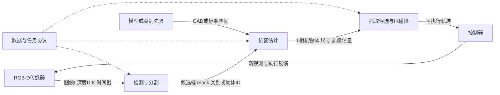
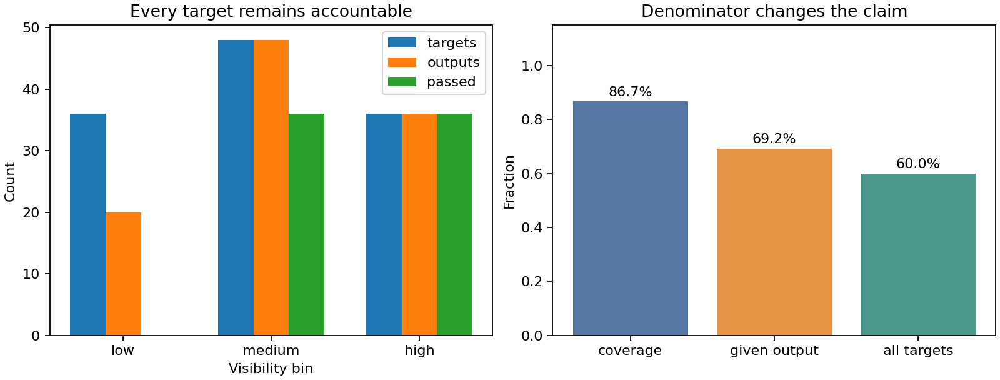

# D36 · 从一个数据集名称到可复现的位姿任务

[学习入口](../_index.md) · [本周日程](../P3-项目实战-日程.md) · [上一课：P2知识收束](../day35/Daily-Learning-Pack.md) · [CPU实验](demo.py)

**项目Π-1的第一份基线应当是一份明确的数据与任务协议：模型到底可以看见什么、必须输出什么、对哪些样本负责、按什么规则被判定为成功。协议不明确，后面得到更高分数也无法说明系统更好。**

Day35把投影、位姿求解、PointNet和BA的局部机制串起来。今天进入P3，我们开始把机制放进完整实验：给机械臂一幅RGB-D图像，要找到杯子并估计它在相机坐标系中的位姿。这里至少隐含三个不同问题：识别的是训练见过的那个杯子，还是任意同类别新杯子？推理时有精确CAD模型吗？输入已经提供目标框，还是系统必须自己找出目标？

这些决定应当先于选模型和下载数据。今天保留原计划中的YCB-Video、LineMOD以及NOCS、EPro-PnP候选，但把它们放到各自适用的问题上。

<details>
<summary>个人作答与实验记录（后续更新保留）</summary>

<!-- learner-notes:start -->
个人作答、阅读证据和未理解问题写在此处。材料生成不表示个人验收通过。
<!-- learner-notes:end -->

</details>

<!-- daily-pack-generated:start -->

## 1 学习目标与路线

学完后应能写出一个可检查的位姿任务合同；区分物体实例级、类别级和测试时新物体条件；从模型输出还原真正的评测分母；实现一个数据清单与基础字段检查器；解释为什么有RGB-D与位姿标注的数据不自动成为VLA动作数据。

| 顺序 | 知识主线 | 必须回答的问题 |
| --- | --- | --- |
| 1 | 系统边界 | 感知模块向抓取规划交付哪些量？ |
| 2 | 数据集与任务 | YCB-V、LM、NOCS的哪些条件能够比较？ |
| 3 | 最小记录 | 图像、K、位姿、单位、可见性怎样关联？ |
| 4 | 评价分母 | 没有输出的目标在哪里被计数？ |
| 5 | 固化与实验 | 改变筛选条件为什么会改变实验问题？ |

## 2 宏观：从观测到抓取的接口先固定



图中实线传递可数值化的量，虚线规定这些量的含义。位姿矩阵 $T_{co}$ 把物体坐标变为相机坐标；它不是夹爪目标，也不是相机在世界中的位姿。若规划使用基座坐标，还需要手眼或外参 $T_{bc}$，以及物体到抓取的相对变换 $T_{og}$：

$$
T_{bg}=T_{bc}T_{co}T_{og}.
$$

因此，数据协议中写“提供pose”不够：至少要写明变换方向、旋转约定、长度单位和对应时刻。今天只定义离线感知实验的入口，尚未让任何动作在真机执行。

### 2.1 一个最小任务合同

下面是本项目可以采用的**教学基线合同**，并非宣称用户已经批准了真实系统的最终配置。

```yaml
task: instance_pose_localization
input_modalities: [rgb, depth]
target_identity: supplied_object_id
target_count: supplied_per_image
model_access: known_metric_cad
output_pose: object_to_camera
length_unit: m
camera_axes: x_right_y_down_z_forward
split_unit: scene_or_video
failure_policy: keep_missing_predictions_in_denominator
evaluation: fixed_targets_and_symmetry_convention
```

`localization`（给定目标条件的定位）和`detection`（还需决定有哪些实例）可以共享位姿网络，却不是同一个端到端任务。提供GT框、GT mask或真实实例数会减少前端不确定性。应把这种实验叫“给定目标区域的位姿基线”，不要把它的分数当作整图检测加位姿的结果。

## 3 微观：数据集名称不等于实验条件

### 3.1 三种泛化轴

物体实例级任务关心有身份的物体，例如`obj_05`的准确形状与尺度。类别级任务关心共享结构，例如训练过几个杯子，在另一个杯子上恢复标准方向、平移和尺寸。新场景、未见物体实例、未见类别又是三条不同的划分轴。

| 候选材料 | 基本对象与信息 | 本项目适用问题 | 必须另外核对 |
| --- | --- | --- | --- |
| YCB-Video / BOP YCB-V | 已标识物体、RGB-D、位姿与模型 | 已知实例在新场景中的位姿和遮挡误差 | 原始数据还是BOP版本、目标列表、可见性和对称规则 |
| LineMOD / BOP LM | 有模型的物体级RGB-D位姿资料 | 原EPro-PnP-6DoF候选的数据适配路径 | LM与遮挡LM-O不同、训练划分及合成数据来源 |
| NOCS CAMERA / REAL | 类别标准空间、RGB-D、实例与尺寸监督 | 同类别新实例的位姿及尺寸 | 类别与实例划分、NOCS坐标约定、有效深度及对称处理 |

YCB-Video来源论文报告21种物体、92段视频。这里的数量用于识别数据来源，不应据此自行重建官方训练测试划分。[PoseCNN与YCB-Video原论文](https://arxiv.org/abs/1711.00199)

NOCS的核心候选路径是先从图像预测类别标准坐标，再与深度反投影点对齐恢复度量位姿和尺寸；它不要求对测试新实例提供精确CAD。精读原论文§4数据、§5.1坐标预测、§5.2对齐、§6.1类别级评测，画出“RGB预测什么，Depth补充什么”。[NOCS原论文](https://arxiv.org/html/1901.02970v1)

> [!warning] 同样写6D，不表示可以直接排一个名次
> 给定精确CAD的物体级估计，与没有测试实例CAD的类别级位姿尺寸估计，信息条件不同。把两者放在同一个表里讨论适用性可以；混合指标后比较“准确率高低”不成立。

### 3.2 原候选算法如何保留

NOCS继续作为类别级候选；EPro-PnP继续作为可学习对应与概率PnP的候选。官方EPro-PnP-6DoF使用CDPN风格稠密对应分支，现有README的数据路径针对LineMOD；YCB适配需要重新核对模型、对象ID、标注、训练配置和评价，不是改一个数据目录即可。后续Day39具体拆开求解器和学习前端。[EPro-PnP-6DoF官方说明](https://github.com/tjiiv-cprg/EPro-PnP/tree/main/EPro-PnP-6DoF)

**先固定一个主要实验问题，再给另一个候选单独定义适用任务。** 这样保留了原候选，同时避免人为构造不公平对照。

## 4 微观：一条样本必须能追到哪一个目标

### 4.1 帧、实例和预测是三个粒度

一帧图像可以有多个同类别或同ID物体；一个检测器又可以输出多个重复候选。最小标识不能仅是文件名，也不能仅是物体ID。教学清单使用：

$$
\text{target key}=(\text{scene id},\text{frame id},\text{instance id}).
$$

实例ID可采用该帧GT列表索引；本实验每帧恰好一个目标，所以用对象ID参与唯一键也足够。真实多实例数据不要照搬这一简化。

| 字段 | shape / 类型 | 含义与检查 |
| --- | --- | --- |
| RGB | $H\times W\times3$，uint8或规范化float | RGB/BGR顺序必须写明 |
| depth | $H\times W$ | raw整数要附scale；0一般是无效量而非0米表面 |
| K | $3\times3$ | 像素单位内参，畸变参数另存 |
| R、t | $3\times3$、$3$ | $X_c=RX_o+t$；$t$与模型点统一米 |
| mask / mask_visib | $H\times W$，bool | 完整轮廓和实际可见像素不能混用 |
| obj_id / category_id | 整数或字符串 | 身份与类别是不同标签轴 |
| timestamp | 秒及clock_id | 单帧位姿不必有动作，但融合时需要时间对齐 |
| split / provenance | 枚举与版本 | 训练/验证/测试、原始/合成、变换记录 |

在BOP格式中逐帧内参来自`scene_camera.json`；深度整数乘`depth_scale`得到毫米，进入米制管线还要乘$10^{-3}$。GT模型到相机变换在`scene_gt.json`中，mask文件含帧ID和GT索引。这里只摘要关键字段，实际适配以固定版本的格式文件为准。[BOP数据格式](https://github.com/thodan/bop_toolkit/blob/master/docs/bop_datasets_format.md)

### 4.2 合同检查器能拦住什么，拦不住什么

合法旋转要求：

$$
R^TR=I,\qquad\det R=+1.
$$

矩阵$\mathrm{diag}(-1,1,1)$虽然保持长度，却是反射，行列式为$-1$，不能作为刚体旋转。浮点实现使用容差而非逐元素严格相等。平移还需有限值、维度与合理范围检查。

今天代码故意注入五个错误：`mm`标签、逆变换方向、反射矩阵、可见率1.2、负深度。检查器全部能发现。它仍然是最小教学模块：`length_unit='m'`并不能证明数值真的以米表示；一个合法旋转也可能标错方向。Day38会用投影和度量深度交叉检查这种语义错误。

## 5 微观：分母也是算法结果的一部分

设固定目标集为$\mathcal T$，大小为$N$；模型为其中$N_o$个目标输出位姿，$N_s$个达到预先定义的误差阈值。三个量分别是：

$$
\text{coverage}=\frac{N_o}{N},\qquad
\text{success}_{\mathrm{output}}=\frac{N_s}{N_o},\qquad
\text{success}_{\mathrm{all}}=\frac{N_s}{N}.
$$

在每个目标至多一个输出的教学设置里，第三项等于前两项相乘。实际多检测候选还需明确匹配与重复检测规则，不能直接拿所有预测数当$N_o$。

今天使用已知对应点平均距离ADD的阈值事件：

$$
e_{\mathrm{ADD}}=\frac1M\sum_i\|\hat R X_i+\hat t-(RX_i+t)\|_2,
\quad e_{\mathrm{ADD}}<0.1d.
$$

$X_i,t,d$统一米，$d$是模型直径。实验把$d=0.20$米，阈值为0.02米。这个事件只是教学协议；对称物体应采用约定的等价姿态/表面比较，正式BOP还会用自己的误差函数、阈值集合及目标规则，不能把今天的单阈值分数称为BOP AR。

> [!question] 先算：模型只有104个输出，72个达标，数据里有120个目标
> “准确率69.2%”在什么条件下成立？若机器人必须处理全部120个目标，应先报告哪个分数？

完整答案是：输出条件成功率$72/104=69.23\%$，覆盖率$104/120=86.67\%$，全目标成功率$72/120=60\%$。16个无输出目标并没有消失。



左图每组蓝柱为目标数量，橙柱为输出数量，绿柱为达标数量；低可见率组漏检更多。右图三根柱描述同一组结果，不能互相替代。图回答的是“高分是否来自只处理容易目标”，而不是哪种神经网络更好。

### 5.1 过滤数据会改变问题

令可见率筛选为$\mathcal T_\alpha=\{i:v_i\geq\alpha\}$。如果从$\alpha=0$改为0.5，分母和困难分布同时改变。它可以成为合理的预先规定子集评测，但不得事后去掉失败样本后仍沿用原实验标题。发布结果时同时保存目标列表、筛选条件、分母以及失败计数。

## 6 回到宏观：把协议固化成可重跑的证据

建议保存四层信息：原始资料的版本与许可、样本清单、划分与变换配置、预测及评测配置。清单排序后计算SHA-256，可检测文件内容变化；哈希不是数据正确性的证明，只是同一内容的指纹。相同seed也不能代替清单，文件枚举顺序和库版本变化仍可能改变结果。

在Robot Perception链路中，首先锁定`RGB-D→目标→pose`的评测。操作模块以后可以在同一批目标上统计IK可达率、碰撞筛除率、抓取成功数，避免只把位姿好看的例子送进规划。VLA可以接收目标或RGB，但动作协议是独立的一层；世界模型需要时间连续且有动作条件的转移。

| 五格卡 | 本课的数据协议 |
| --- | --- |
| 数据从哪来 | 指定版本的图像、模型、GT；今天是120条合成目标记录 |
| 学什么 | 本课不训练模型，学习如何定义可比较实验 |
| 改善信号 | 记录完整率、合同失败项、固定目标上的误差 |
| 训练与推理 | 标签可供训练和评估，测试标签不能作为推理输入 |
| 泛化怎样测 | 指定新场景或新实例，不能让划分含义在实验后变化 |

**位姿帧没有动作标签时，可以训练感知模型；不能凭相邻两帧虚构机器人动作，再声称得到动作条件世界模型或VLA演示。** 感知资料可支持后续模块，但数据许可、动作字段与时间契约仍要另做。

## 7 动手：先预测，再改一个协议变量

依赖Python 3.11、NumPy、Matplotlib。脚本内置合成输入，不读真实相机或下载数据。从笔记库根目录运行：

```bash
python -B 3d_learning/day36/demo.py
python -B 3d_learning/day36/demo.py --min-visibility 0.5 --out-dir /tmp/day36-visible
```

第一步，运行前写下三个分母以及你预测的大小关系。第二步，检查`results.json`里的120/104/72和五条负例。第三步只把`min-visibility`改为0.5，保持seed、生成规则与阈值不动。第四步说明分数变化来自条件分布还是模型改进；模型没有训练，不能把它解释成学习变好了。

**已确认（2026-10-24）：** 默认实验CPU执行成功，Python 3.11.15 / NumPy 1.26.4 / Matplotlib 3.10.9，seed36。120个目标、104个输出、72个阈值成功；五类注入合同错误全部被捕获；硬件交互0、训练更新0。日志中的`elapsed_s`只计数据与统计部分，不含绘图/启动，不作为模型延迟。同日也执行了可见率0.5的单变量实验：60个目标全部输出且达标，得到60/60。这验证了筛选可把60%的全集结果变成100%的子集结果，模型没有改变。记录见[变变量结果](../../_assets/3d_learning/day36/variation-results.json)。新的产物写入独立目录以保留默认证据。

产物：[样本清单](../../_assets/3d_learning/day36/manifest.json) · [实验结果](../../_assets/3d_learning/day36/results.json)。真实数据适配时让清单生成器读取官方目标与逐帧相机文件，保留原ID和注释，不改变官方test集合。

> [!note]- 完整可复制代码（与同目录demo.py一致）
> ```python
> """D36: synthetic protocol manifest and denominator audit; no dataset download."""
> from pathlib import Path
> import argparse, hashlib, json, platform, time
> import numpy as np
> import matplotlib
> matplotlib.use('Agg')
> import matplotlib.pyplot as plt
> 
> 
> def validate(record):
>     errors = []
>     if record['length_unit'] != 'm':
>         errors.append('length_unit')
>     if record['pose_direction'] != 'object_to_camera':
>         errors.append('pose_direction')
>     r = np.asarray(record['R'], float)
>     if r.shape != (3, 3) or not np.allclose(r.T @ r, np.eye(3), atol=1e-6) or not np.isclose(np.linalg.det(r), 1):
>         errors.append('SO3')
>     if not (0 <= record['visibility'] <= 1):
>         errors.append('visibility')
>     if len(record['t']) != 3 or record['t'][2] <= 0:
>         errors.append('positive_depth')
>     return errors
> 
> 
> def main():
>     parser = argparse.ArgumentParser()
>     parser.add_argument('--min-visibility', type=float, default=0.0)
>     parser.add_argument('--out-dir', type=Path, default=Path(__file__).resolve().parents[2] / '_assets/3d_learning/day36')
>     args = parser.parse_args()
>     if not 0 <= args.min_visibility <= 1:
>         raise ValueError('min visibility must be in [0,1]')
>     started = time.perf_counter()
>     out = args.out_dir
>     out.mkdir(parents=True, exist_ok=True)
>     rng = np.random.default_rng(36)
>     rows = []
>     for i in range(120):
>         v = (i % 10 + 0.5) / 10
>         # Deliberately create harder low-visibility targets, not a learned model.
>         emitted = (i % 10 >= 2) or (i % 3 == 0)
>         error_m = (0.004 + 0.040 * (1 - v) ** 2 + rng.uniform(0, .004)) if emitted else None
>         rows.append(dict(scene_id=i // 10, frame_id=i % 10, obj_id=i % 3,
>                          target_id=f'{i//10:03d}/{i%10:03d}/{i%3}',
>                          length_unit='m', pose_direction='object_to_camera',
>                          R=np.eye(3).tolist(), t=[.02, -.01, .8],
>                          visibility=v, diameter_m=.20, emitted=emitted,
>                          add_m=error_m))
>     assert not any(validate(r) for r in rows)
>     assert len({r['target_id'] for r in rows}) == len(rows)
>     threshold_m = .02
>     selected = [r for r in rows if r['visibility'] >= args.min_visibility]
>     if not selected:
>         raise ValueError('no targets after visibility selection')
>     n = len(selected)
>     emitted = sum(r['emitted'] for r in selected)
>     passed = sum(r['emitted'] and r['add_m'] < threshold_m for r in selected)
>     corruptions = []
>     import copy
>     for label in ['length_unit', 'pose_direction', 'SO3', 'visibility', 'positive_depth']:
>         r = copy.deepcopy(rows[0])
>         if label == 'length_unit': r['length_unit'] = 'mm'
>         if label == 'pose_direction': r['pose_direction'] = 'camera_to_object'
>         if label == 'SO3': r['R'][0][0] = -1
>         if label == 'visibility': r['visibility'] = 1.2
>         if label == 'positive_depth': r['t'][2] = -.8
>         corruptions.append({'fault': label, 'detected': validate(r)})
>         assert label in validate(r)
>     serialized = json.dumps(rows, sort_keys=True).encode()
>     result = dict(day=36, verified_on='2026-10-24', seed=36, device='CPU',
>                   python=platform.python_version(), numpy=np.__version__, matplotlib=matplotlib.__version__,
>                   data='120 synthetic single-object targets; no real images', training_steps=0,
>                   target_count=n, emitted_count=emitted, success_count=passed,
>                   add_threshold_m=threshold_m, coverage=emitted/n,
>                   conditional_success=passed/emitted if emitted else None,
>                   all_target_success=passed/n, min_visibility=args.min_visibility,
>                   manifest_sha256=hashlib.sha256(serialized).hexdigest(),
>                   schema_negative_cases=corruptions, hardware_interactions=0,
>                   elapsed_s=time.perf_counter()-started)
>     (out/'manifest.json').write_text(json.dumps(rows, indent=2))
>     (out/'results.json').write_text(json.dumps(result, indent=2))
>     fig, ax = plt.subplots(1, 2, figsize=(10, 3.8), constrained_layout=True)
>     bins = [(0, .3), (.3, .7), (.7, 1.01)]
>     counts = []
>     for lo, hi in bins:
>         group = [r for r in selected if lo <= r['visibility'] < hi]
>         counts.append([len(group), sum(r['emitted'] for r in group),
>                        sum(r['emitted'] and r['add_m'] < threshold_m for r in group)])
>     a = np.asarray(counts)
>     x = np.arange(3)
>     for j, name in enumerate(['targets','outputs','passed']):
>         ax[0].bar(x+(j-1)*.24, a[:,j], .24, label=name)
>     ax[0].set_xticks(x, ['low','medium','high']); ax[0].set_xlabel('Visibility bin')
>     ax[0].set_ylabel('Count'); ax[0].legend(); ax[0].set_title('Every target remains accountable')
>     rates = [result['coverage'], result['conditional_success'] or 0, result['all_target_success']]
>     ax[1].bar(['coverage','given output','all targets'], rates, color=['#5778a4','#e49444','#4c998b'])
>     for i,v in enumerate(rates): ax[1].text(i,v+.02,f'{v:.1%}',ha='center')
>     ax[1].set_ylim(0,1.15); ax[1].set_ylabel('Fraction'); ax[1].set_title('Denominator changes the claim')
>     fig.savefig(out/'protocol.png', dpi=160); plt.close(fig)
>     print(json.dumps(result, ensure_ascii=False, indent=2))
> 
> 
> if __name__ == '__main__':
>     main()
> ```

## 8 今日总结与可验收产出

数据集名称只说明来源，任务合同决定你能做什么结论。实例身份、可见性、单位与变换方向都必须变成字段和检查。把没有输出的目标留在分母里，才看得到完整感知系统的边界。

今天最值得留下的四点是：**任务边界**决定是否公平；**实例唯一键**防止错配和漏数；**固定评测分母**防止选择性报喜；**米制与坐标合同**使感知能连接抓取。最容易混淆的是类别级与实例级任务、条件成功率与全目标成功率、schema合法与几何正确。

验收产出为一页任务合同、带哈希的清单、两个筛选条件的统计对照，以及一句说明“本项目主要泛化到新场景还是新物体”。这不是个人已完成记录，待你运行与解释后填写个人区。

## 9 自测

1. 给定GT mask与整图检测加位姿，为什么不是相同任务？
2. 已知杯子CAD的测试与NOCS新杯子测试，分别改变了哪个信息条件？
3. 120个目标、104个输出、72个达标，计算三个比例。
4. 为什么$R^TR=I$仍不足以判定合法旋转？给一个反例。
5. BOP raw depth=1400，depth_scale=0.5，转换为米是多少？
6. 把可见率小于0.5的失败样本排除后，能否宣称模型提升？应如何报告？
7. 一帧里有两个同类别杯子，为什么类别ID不能作为目标唯一键？
8. 只有RGB-D和物体位姿的连续帧，缺什么才不能直接训练动作条件世界模型？

## 10 未理解问题与次日衔接

若“模型训练见过”与“推理时提供CAD”还混淆，先分别列出训练集、推理输入和评测对象三张清单；Day39会对照两条候选管线。若分母仍容易混淆，Day40标准评价会进一步拆开漏检、姿态失败与对称等价。下一课Day37从这个清单实现加载器和场景划分，第一步是让一段视频只属于一个划分。

> [!note]- 自测参考与判分（每题0/1/2分，建议至少12/16且无单位错误）
> 1. GT mask额外提供目标存在与像素区域；只答“更简单”1分，说明推理信息与前端漏检被排除2分。
> 2. 前者可用精确实例形状尺度，后者依赖类别先验并估计新实例尺寸；指出训练/测试实例关系再得第2分。
> 3. 覆盖86.67%，输出条件69.23%，全目标60%；三个分母都正确2分，部分正确1分。
> 4. 还要det=+1；diag(-1,1,1)是反射。条件与反例都给出2分。
> 5. 1400×0.5=700mm=0.7m；只给数字无单位1分。
> 6. 不能；改变了目标分布，须报告筛选规则、总数和原全集结果。说明因果边界2分。
> 7. 类别会重复，甚至物体ID也可多实例；使用scene/frame/instance级键，能举例2分。
> 8. 至少缺同步动作、动作单位/参考系/周期及执行对应关系；有帧序列不等于有因果动作监督，完整说明2分。
<!-- daily-pack-generated:end -->
