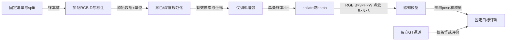
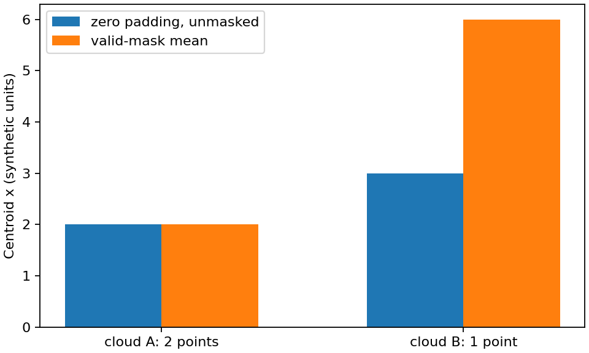
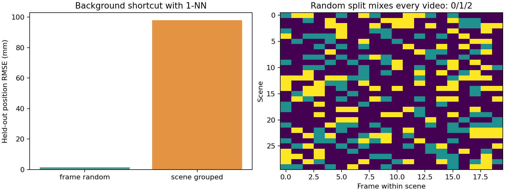

# D37 · 从能读图像到可信的数据加载与划分

[学习入口](../_index.md) · [本周日程](../P3-项目实战-日程.md) · [上一课：数据与任务协议](../day36/Daily-Learning-Pack.md) · [CPU实验](demo.py)

**加载器决定模型实际上看见了什么；划分方式决定测试分数回答了哪个问题。训练程序可以完全正常运行，却因为同场景帧泄漏、单位转换或padding，让结果从一开始就失去工程意义。**

昨天为Π-1固定了对象、传感器与评价分母。今天把清单变成模型输入。抓杯子时，相邻RGB-D帧常常只有很小变化；若一部分放训练、另一部分放测试，模型可能记住桌面背景对应的位置，根本没有学到可迁移的杯子几何。我们会让一个只有最近邻记忆的模型亲自暴露这个问题。

<details>
<summary>个人作答与实验记录（后续更新保留）</summary>

<!-- learner-notes:start -->
个人作答、运行记录和未理解问题写在这里；不自动标记已掌握。
<!-- learner-notes:end -->

</details>

<!-- daily-pack-generated:start -->

## 1 学习目标与路线

本课结束后应能按场景生成可复现划分；写出惰性读取RGB-D的最小加载器；准确说明batch中图像、深度、点云和mask的shape；对变长点云使用有效位mask；判断归一化与数据增强是否越过训练/测试边界。

| 顺序 | 知识主线 | 需要回答的问题 |
| --- | --- | --- |
| 1 | 独立样本单位 | 一帧独立是否等于一段视频独立？ |
| 2 | Dataset与batch | 磁盘字段如何变成网络实际输入？ |
| 3 | mask与变长 | 补零为什么能改变点云均值？ |
| 4 | 学习边界 | 标准化统计量从哪里来？ |
| 5 | 实验证据 | 怎样区分记住背景与泛化？ |

## 2 宏观：把数据变换看成系统的一部分



图中每条边都是可检查的接口。标签可以和图像一同存储，但“同时返回在字典里”不表示允许传给网络。最稳妥的调用方式明确区分`inputs`与`targets`：模型只读取前者，loss或评估器读取后者。调试时打印一次实际输入键，能发现许多意外的GT泄漏。

### 2.1 加载器的三个职责

Dataset负责“给定索引，返回一条样本”；Sampler决定“本轮取哪些索引，以什么顺序”；collate把不同样本组为batch。这三项不应混在一个读取函数里：改变训练采样策略不该悄悄改变测试集合。

在PyTorch中，映射式Dataset通常实现`__len__`和`__getitem__`，DataLoader组织采样、batch与工作进程。今天使用NumPy写同样的最小接口，避免把数据正确性绑到训练框架。[PyTorch数据加载官方文档](https://docs.pytorch.org/docs/stable/data.html)

## 3 微观：先定义什么叫“独立测试”

### 3.1 帧相关性如何制造捷径

设场景$s$有一个固定背景向量$b_s$和目标位置$y_s$，第$t$帧观测是：

$$
x_{s,t}=b_s+\epsilon_{s,t},\qquad
y_{s,t}=y_s+\eta_{s,t}.
$$

这里$x$是8维合成背景特征，$y$是米制横向位置；$\epsilon$是小的帧间变化。我们故意令$b_s$与$y_s$在不同场景间独立，背景对新场景没有真实预测价值。

最近邻预测只做：

$$
j^*=\arg\min_{j\in\mathcal D_{train}}\|x_i-x_j\|_2^2,
\quad\hat y_i=y_{j^*}.
$$

若训练已有同场景帧，它几乎必然找到同背景并读出相近位置；若整个场景未见，背景最近不表示杯子位置相近。模型没有任何几何能力，仍然能在随机帧测试里获得很小误差。

> [!question] 先猜
> 30个场景各20帧，随机抽60%帧训练。对任意一个测试帧，它所在场景完全没有训练帧的概率会很大吗？

在独立近似下，其余19帧都不进训练的概率约为$0.4^{19}\approx2.75\times10^{-8}$。固定数量抽样并非严格独立，精确概率应用超几何分布，但数量级已经说明：随机帧划分几乎总能让每个测试背景出现在训练中。

### 3.2 分组划分保留的是什么边界

定义场景集合$S_{train},S_{val},S_{test}$，要求两两交集为空，然后把每个场景的所有帧分配到相同集合。今天的30场景按18/6/6划分，恰好得到360/120/120帧；因为每场景帧数相同，组比例等于帧比例。真实数据场景长度不等，两者通常不同。

| 要验证的泛化 | 推荐隔离单位 | 允许共享什么 | 不足以证明什么 |
| --- | --- | --- | --- |
| 已知物体的新场景 | 场景/视频/采集会话 | 物体ID与CAD | 未见实例或未见类别 |
| 同类别新实例 | 物理实例ID，并检查场景交叉 | 类别定义 | 新类别 |
| 新设备或新域 | 设备/地点/采集批次 | 视任务保留对象 | 任意域迁移 |
| 单段序列未来预测 | 时间块并留出间隔 | 序列身份 | 新序列泛化 |

选择分组单位来自Day36任务定义，不是“分得越严格越好”。若目标是已知物体新场景，把所有对象身份都隔离可能改变任务；若目标是新杯子，只隔离场景还会让同一杯子泄漏。既有官方测试划分应保留，自定义验证集优先从官方训练集内部划分。

实现上，先取唯一group，再分组，再映射回帧；不能先分帧再修补冲突。官方`GroupShuffleSplit`的比例针对组数量，重复多次拆分的测试组并不保证互不重叠；这里仅使用一份固定的三路划分。[scikit-learn分组划分说明](https://scikit-learn.org/stable/modules/generated/sklearn.model_selection.GroupShuffleSplit.html)

## 4 微观：从磁盘数组到模型张量

### 4.1 读文件时同时建立物理含义

今天生成600帧$12\times16$的微型RGB-D文件，分别保存为NumPy数组；它们只演示读取和类型转换，不用于上节的背景捷径模型。用`mmap_mode='r'`打开后，单次索引读取所需切片，避免把大库复制进每个worker。

```python
rgb = rgb_uint8.astype(np.float32).transpose(2, 0, 1) / 255
depth_m = depth_uint16.astype(np.float32) * 0.001
valid_depth = depth_m > 0
```

乘0.001是本合成数据的明确约定，不是所有深度相机的通用常数。BOP需要结合逐帧`depth_scale`；RealSense需要设备给出的depth unit。OpenCV读图常得到BGR，网络可能要求RGB，读入后必须显式转换。

| 层次 | RGB | Depth | 有效深度mask |
| --- | --- | --- | --- |
| 磁盘一帧 | $(12,16,3)$ uint8 | $(12,16)$ uint16 | 无；需从深度编码解析 |
| 单条样本 | $(3,12,16)$ float32 | $(12,16)$ float32米 | $(12,16)$ bool |
| 两帧batch | $(2,3,12,16)$ | $(2,12,16)$ | $(2,12,16)$ |

矩阵维度对了不代表语义对了。RGB除255后是$[0,1]$；深度除255通常没有物理意义。无效深度0若参与反投影，会在相机原点制造大量伪点；后续PointNet可能把这些点当成真实结构。

### 4.2 变长点云必须携带mask

每幅mask内有效点数$N_i$不同。可以固定采样$N$点，也可以pad到$N_{max}$再传有效位$V\in\{0,1\}^{B\times N_{max}}$。两者都有前提：采样需记录策略，padding需让每个后续操作使用mask。

对均值池化：

$$
\bar p_b=\frac{\sum_iV_{bi}p_{bi}}{\sum_iV_{bi}}.
$$

如果某个样本无有效点，分母为0，应该返回失败/跳过并计数，而非静默制造原点。这份教学函数假设每个列表至少有一点，实际接口应主动检查空样本。

手算：A有$x=1,3$两点，均值2；B只有$x=6$一点，pad为`[6,0]`后直接平均得到3，而mask平均仍是6。最大池化也不是“补0总没关系”：若有效特征全负，0会抢走最大值；应将无效特征设为$-\infty$并处理全无效样本。



该图不比较神经网络，它显示了**同一个输入集合因为batch实现而被改变**。PointNet分类不变性只对有效集合顺序成立，不保证忽略伪造的padding点。

## 5 微观：标准化、增强和缓存的学习边界

### 5.1 为什么标准化也可能泄漏

若特征用$z=(x-\mu)/\sigma$标准化，$\mu,\sigma$必须从训练数据估计并保存，验证与测试只应用该变换。用全数据拟合统计量已经让测试分布影响了训练流程，尤其在小数据和域偏移条件下会改变结论。

$$
\mu_{train}=\frac1{N_{train}}\sum_{i\in train}x_i,
\quad
\sigma^2_{train}=\frac1{N_{train}}\sum_{i\in train}(x_i-\mu_{train})^2.
$$

例如训练特征为1、3，均值2；测试值101若也进入统计量，全数据均值35，让训练值的表达随测试样本改变。本课采用总体标准差定义，近零维度用$\max(\sigma,10^{-6})$防除零，但这种截断不是处理坏特征的万能方式。[scikit-learn关于预处理与数据泄漏](https://scikit-learn.org/stable/common_pitfalls.html)

### 5.2 几何增强必须同步改标签

颜色扰动通常不改变pose；随机裁剪、缩放或水平翻转会改变像素坐标以及内参表达。若RGB裁剪而depth、mask或K未同步，就把正确对应关系变成错误训练标签。明天专门推导$K'=AK$。

世界坐标旋转增强与图像翻转也不同：前者可对3D点和pose一致变换；后者涉及成像与手性，不能把所有pose矩阵某一列取负就宣称完成增强。先实现最小可验证变换，再增加组合。

缓存有同样风险：若把带随机增强的结果按原图路径缓存，多轮“随机”可能固定；若缓存里混入目标字段作为特征，则形成隐蔽泄漏。建议缓存确定性解码，随机增强由训练访问时执行，并保存增强参数用于复现具体样本。

## 6 工程：加载器应当怎样报错

每个batch返回可追踪的`scene_id/frame_id`；遇到图像缺失、空mask、非有限深度或shape不符时，异常中写样本键。训练时允许跳过坏样本也要计数；测试时不能跳过后缩小分母。

在ROS或RealSense适配中，离线loader对应的是日志读取入口。相同代码应接收明确的时戳、帧名与深度scale，保证在线offline预处理一致。它不负责连接机器人。VLA动作chunk数据还需要按episode划分，并让观测窗口、动作窗口和目标窗口一起留在同一个集合；不能把同episode不同窗口打散后宣称独立测试。

| Learning五格 | 本课例子 |
| --- | --- |
| 数据来源 | 30个合成场景，每个20帧 |
| 学什么 | 最近邻记住背景与标签对应，无梯度训练 |
| 信号 | 训练标签为位置，测试计算RMSE |
| 训练/推理 | 训练集存储；推理只能查询训练样本的标签 |
| 泛化 | 比较同场景新帧与全新场景，两者问题不同 |

## 7 动手：亲自制造并识别背景捷径

依赖Python、NumPy、Matplotlib，默认CPU，无硬件与下载。运行：

```bash
python -B 3d_learning/day37/demo.py
python -B 3d_learning/day37/demo.py --jitter 1.0 --out-dir /tmp/day37-jitter1
```

先预测哪个划分的最近邻误差更小；运行后查看`shared_train_test_scenes`，不要只看RMSE。再把帧噪声从0.03改到1.0，保持场景、标签和划分随机种子不变，解释背景记忆为何变得不可靠。最后检查batch shape与padding均值，不需要训练大模型就能定位数据模块错误。



左图给出位置RMSE；右图每行一段场景视频，颜色0/1/2分别是训练/验证/测试。每行混色意味着同一场景进入多个集合。正确的场景划分应每行单色；它可以提高误差，却更忠实地测出未见场景能力。

**已确认（2026-10-24）：** Python 3.11.15、NumPy 1.26.4、Matplotlib 3.10.9，CPU；数据seed37，帧划分370、场景划分371。两种划分均360/120/120帧。默认随机帧测试RMSE **1.404mm**，场景隔离 **98.055mm**；训练测试共享场景分别30和0。把jitter提高到1.0，误差变为105.830mm和130.680mm。该实验故意让背景在新场景无预测力，因此不是任何真实数据集的性能估计。

加载器实际返回RGB `(2,3,12,16)`、depth `(2,12,16)`；每帧16个无效深度像素。点云B未mask时质心3，mask后6。训练更新0、硬件交互0；`elapsed_s`计生成、加载和统计，不含绘图，也不是实际系统端到端延迟。

产物：[默认结果](../../_assets/3d_learning/day37/results.json) · [单变量结果](../../_assets/3d_learning/day37/variation-results.json) · [固定split](../../_assets/3d_learning/day37/split.json)。保存的微型RGB-D数组可重复加载；真实工程应换成官方数据适配器，维持同一字段约定。

> [!note]- 完整可复制代码（与同目录demo.py一致）
> ```python
> """D37: grouped splitting, lazy loading and masked variable-length collation."""
> from pathlib import Path
> import argparse, json, platform, time
> import numpy as np
> import matplotlib
> matplotlib.use('Agg')
> import matplotlib.pyplot as plt
> 
> 
> def split_frames(n, rng):
>     p = rng.permutation(n)
>     return [p[:int(.6*n)], p[int(.6*n):int(.8*n)], p[int(.8*n):]]
> 
> 
> def nn_predict(x, y, train, test):
>     distance = ((x[test,None,:] - x[None,train,:]) ** 2).sum(-1)
>     return y[train[distance.argmin(1)]]
> 
> 
> class TinyRGBD:
>     """Each __getitem__ reads one mmap slice; no labels enter network inputs."""
>     def __init__(self, root, ids):
>         self.rgb = np.load(root/'rgb.npy', mmap_mode='r')
>         self.depth = np.load(root/'depth.npy', mmap_mode='r')
>         self.ids = np.asarray(ids)
>     def __len__(self):
>         return len(self.ids)
>     def __getitem__(self, index):
>         i = int(self.ids[index])
>         rgb = self.rgb[i].astype(np.float32).transpose(2,0,1)/255
>         depth = self.depth[i].astype(np.float32)*.001
>         valid = depth > 0
>         return dict(frame_id=i, rgb=rgb, depth=depth, valid=valid)
> 
> 
> def pad_points(point_lists):
>     b, n = len(point_lists), max(map(len, point_lists))
>     points, valid = np.zeros((b,n,3),np.float32), np.zeros((b,n),bool)
>     for i, p in enumerate(point_lists):
>         points[i,:len(p)] = p
>         valid[i,:len(p)] = True
>     means = (points*valid[...,None]).sum(1)/valid.sum(1,keepdims=True)
>     return points, valid, means
> 
> 
> def main():
>     ap = argparse.ArgumentParser()
>     ap.add_argument('--jitter', type=float, default=.03)
>     ap.add_argument('--out-dir', type=Path, default=Path(__file__).resolve().parents[2]/'_assets/3d_learning/day37')
>     a = ap.parse_args(); start = time.perf_counter(); out=a.out_dir; out.mkdir(parents=True,exist_ok=True)
>     rng=np.random.default_rng(37)
>     scene=np.repeat(np.arange(30),20); n=len(scene)
>     background=rng.normal(size=(30,8))
>     position=rng.uniform(-.15,.15,size=30)
>     x=background[scene]+a.jitter*rng.normal(size=(n,8))
>     y=position[scene]+rng.normal(0,.001,n)
>     frame_split=split_frames(n,np.random.default_rng(370))
>     groups=np.random.default_rng(371).permutation(30)
>     group_split=[np.flatnonzero(np.isin(scene,g)) for g in [groups[:18],groups[18:24],groups[24:]]]
>     results=[]
>     for label, ids in [('frame_random',frame_split),('scene_grouped',group_split)]:
>         train,val,test=ids
>         pred=nn_predict(x,y,train,test)
>         overlap=set(scene[train]) & set(scene[test])
>         results.append(dict(split=label,train=len(train),val=len(val),test=len(test),
>                             shared_train_test_scenes=len(overlap),
>                             test_rmse_m=float(np.sqrt(np.mean((pred-y[test])**2)))))
>     assert results[0]['shared_train_test_scenes'] > 0
>     assert results[1]['shared_train_test_scenes'] == 0
>     # Use a tiny disk fixture: 600 x 12 x 16 RGB-D, not a real dataset.
>     rgb=np.zeros((n,12,16,3),np.uint8)
>     rgb[:]=rng.integers(0,256,(n,1,1,3),dtype=np.uint8)
>     depth=np.full((n,12,16),800,np.uint16); depth[:,0,:]=0
>     np.save(out/'rgb.npy',rgb); np.save(out/'depth.npy',depth)
>     train_ds=TinyRGBD(out,group_split[0]); samples=[train_ds[0],train_ds[1]]
>     batch_rgb=np.stack([s['rgb'] for s in samples])
>     batch_depth=np.stack([s['depth'] for s in samples])
>     points,valid,mean=pad_points([np.array([[1,0,0],[3,0,0]]),np.array([[6,0,0]])])
>     naive=points.mean(1)
>     mu=x[group_split[0]].mean(0); std=x[group_split[0]].std(0)
>     normalized=(x[group_split[2]]-mu)/np.maximum(std,1e-6)
>     manifest={'train':group_split[0].tolist(),'val':group_split[1].tolist(),'test':group_split[2].tolist()}
>     (out/'split.json').write_text(json.dumps(manifest,indent=2))
>     result=dict(day=37,verified_on='2026-10-24',seed=37,split_seeds=[370,371],device='CPU',
>                 python=platform.python_version(),numpy=np.__version__,matplotlib=matplotlib.__version__,
>                 data='30 synthetic scenes x 20 frames, random scene background and target',
>                 jitter=a.jitter,comparison=results,training='1-NN memorization, no parameter updates',
>                 batch_rgb_shape=list(batch_rgb.shape),batch_depth_shape=list(batch_depth.shape),
>                 invalid_depth_per_frame=int((~samples[0]['valid']).sum()),
>                 masked_centroid_x=mean[:,0].tolist(),naive_centroid_x=naive[:,0].tolist(),
>                 heldout_normalized_feature_mean=normalized.mean(0).tolist(),
>                 hardware_interactions=0,elapsed_s=time.perf_counter()-start)
>     (out/'results.json').write_text(json.dumps(result,indent=2))
>     fig,ax=plt.subplots(1,2,figsize=(10,3.8),constrained_layout=True)
>     ax[0].bar(['frame random','scene grouped'],[r['test_rmse_m']*1000 for r in results],color=['#4c998b','#e49444'])
>     ax[0].set_ylabel('Held-out position RMSE (mm)'); ax[0].set_title('Background shortcut with 1-NN')
>     grid=np.zeros((30,20),int)
>     for k,ids in enumerate(frame_split): grid.reshape(-1)[ids]=k
>     ax[1].imshow(grid,aspect='auto',cmap='viridis',vmin=0,vmax=2)
>     ax[1].set_xlabel('Frame within scene'); ax[1].set_ylabel('Scene'); ax[1].set_title('Random split mixes every video: 0/1/2')
>     fig.savefig(out/'split_audit.png',dpi=160); plt.close(fig)
>     fig,ax=plt.subplots(figsize=(6,3.6),constrained_layout=True)
>     q=np.arange(2); ax.bar(q-.16,naive[:,0],.32,label='zero padding, unmasked')
>     ax.bar(q+.16,mean[:,0],.32,label='valid-mask mean'); ax.set_xticks(q,['cloud A: 2 points','cloud B: 1 point'])
>     ax.set_ylabel('Centroid x (synthetic units)'); ax.legend(); fig.savefig(out/'padding.png',dpi=160); plt.close(fig)
>     print(json.dumps(result,indent=2))
> 
> 
> if __name__ == '__main__': main()
> ```

## 8 今日总结与产出

独立测试的单位要对应真实泛化问题。加载器把物理观测变成张量，单位、mask和标签边界与模型结构同样重要。分数低一点但协议清楚，才有可改进的基础。

最值得掌握的四点：场景隔离检验新场景能力；有效位mask防止batch改变集合；训练统计量固定推理预处理；样本键让错误可以追踪。容易混淆的边界是“分组更严”与“任务更合适”、“可见深度0”与“0米表面”、以及“测试标签可以读来评价”与“可以传给模型”。

留下一个固定split文件、一次加载器shape记录、背景捷径对照表和一条padding失败解释。真实数据首次接入时，应先抽查少量样本的RGB、depth、mask叠加，再考虑吞吐量优化。

## 9 自测

1. 为什么相邻帧随机分割不能证明新场景泛化？
2. 30场景各20帧，18/6/6场景划分得到多少帧？若场景长度不等会怎样？
3. Dataset、Sampler、collate分别改变哪件事？
4. 原始RGB shape为$(H,W,3)$，两帧batch用于常见CNN的shape是什么？深度是否也除255？
5. 点集A为1、3，B为6，pad到2点后两种均值分别是多少？
6. 为什么“最大池化对补零天然安全”是错的？
7. 归一化均值使用train+test估计，为什么属于信息泄漏？
8. VLA训练把同episode的动作窗口打散，可能造成什么问题？怎样修复？

本课精读衔接：[NOCS原论文](https://arxiv.org/html/1901.02970v1) §4.2 Real-World Data与§6.1 Category-Level 6D Pose and Size Estimation。把文中的训练/测试实例边界抄成自己的字段关系图，并与今天只隔离场景的例子比较；这是阅读任务，不是已完成阅读记录。

## 10 未理解问题与下一课

若你仍无法选择分组单位，把希望部署到的新条件写成一句话，再决定隔离scene、instance、device还是episode；W8闭环评价会用到这个决定。若RGB与depth尺寸相同却仍无法对齐，先问是否同一成像坐标系，Day38从投影、裁剪和单位开始验证。下一步：拿一组已知3D点、GT pose和K投影到图像，把数据链中的单位错误变成可见证据。

> [!note]- 参考答案与判分（每题0/1/2分，建议至少12/16）
> 1. 同一背景、姿态或实例出现在训练里，可靠记忆获得低误差；举最近邻背景捷径2分，只说“泄漏”1分。
> 2. 360/120/120；长度不等时组比例不等于帧比例，完整说明2分。
> 3. Dataset取单条内容，Sampler选索引与顺序，collate组合batch；三者全对2分。
> 4. $(2,3,H,W)$；深度按设备或文件scale换米，除255没有一般依据。shape和单位都对2分。
> 5. A均为2；B未mask为3，正确为6。解释0是padding而非真实点2分。
> 6. 有效特征全负时0抢最大；无效位需屏蔽，且处理全无效样本，完整2分。
> 7. 测试分布改变训练特征表达；训练fit，验证测试只transform，给出修复2分。
> 8. 重叠观测/动作和场景信息横跨集合；按episode分配完整窗口并检查重叠，2分。
<!-- daily-pack-generated:end -->
