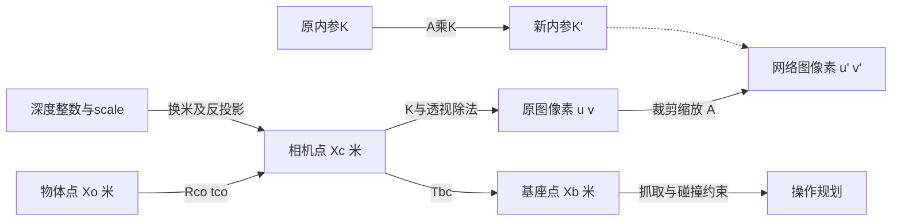
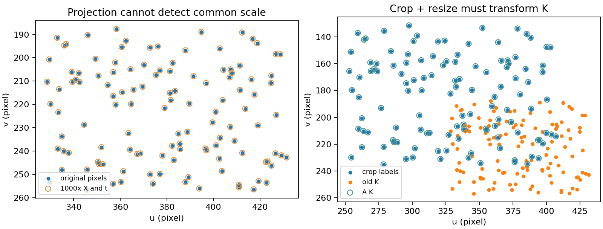
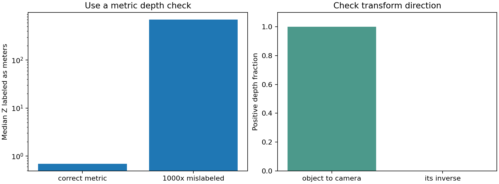

# D38 · 从GT叠加图到坐标、单位与内参的联合检查

[学习入口](../_index.md) · [本周日程](../P3-项目实战-日程.md) · [上一课：加载器与划分](../day37/Daily-Learning-Pack.md) · [CPU实验](demo.py)

**投影看起来对齐，只能证明一部分几何关系；米与毫米同时错1000倍时，像素甚至可以完全不变。可靠的数据验收必须把像素重投影、正深度、度量尺度和坐标链一起核对。**

Day37确保样本被正确取出，今天检查这些数是否真的表示同一个物理世界。以RGB-D机械臂抓杯子为例：杯子轮廓在图像上画得很好看，但深度单位错了，规划会把目标放到几百米外；裁剪后K没更新，PnP会把图像预处理的错误解释成物体姿态变化。模型还没开始训练，错误已经进入了监督。

<details>
<summary>个人作答与实验记录（后续更新保留）</summary>

<!-- learner-notes:start -->
在这里保留个人计算、运行结果和未理解问题。
<!-- learner-notes:end -->

</details>

<!-- daily-pack-generated:start -->

## 1 学习目标与路线

你应能从物体点和GT位姿计算像素；推导裁剪缩放后的内参；手算深度整数到米及反投影；构造投影无法发现的尺度反例；通过多种残差区分外参方向、内参和单位错误。

| 顺序 | 知识主线 | 需要回答的问题 |
| --- | --- | --- |
| 1 | 投影约定 | $T_{co}$究竟把谁变到谁？ |
| 2 | 度量反例 | 为什么一致缩放不会改变像素？ |
| 3 | 图像坐标变换 | crop/resize之后为什么是$K'=AK$？ |
| 4 | 深度与可见性 | 深度是Z还是射线长度，遮挡怎么处理？ |
| 5 | 工程审计 | 哪些证据支持“GT正确”，哪些仍不足？ |

## 2 宏观：把同一物理点追踪到每个模块



图回答“一个点经过哪些表示变化”，不代表这些模块已经在用户机器上部署。实线上的每个转换都要有方向和单位，特别是相机到机器人基座的外参，不参与普通的图像内投影，却直接决定机械臂去哪儿。

## 3 微观：投影函数的合同

### 3.1 从列向量公式到批量行数组

约定相机x向右、y向下、z向前，物体点$X_o\in\mathbb R^3$，模型到相机变换为：

$$
X_c=R_{co}X_o+t_{co},\qquad
\tilde u\sim KX_c,
\quad K=\begin{bmatrix}f_x&0&c_x\\0&f_y&c_y\\0&0&1\end{bmatrix}.
$$

若$X_c=(X,Y,Z)^T$且$Z>0$，则$u=f_xX/Z+c_x$，$v=f_yY/Z+c_y$。$f,c$用像素，$X,Y,Z,t$用米，旋转无量纲。畸变若存在要加入相应模型或先去畸变；K本身不包含畸变系数。

代码以`(N,3)`行数组存点，因此是`camera = points @ R.T + t`；它与列向量$RX$是同一个变换。很多“转置错误”来自把数学列向量直接抄成批量代码的右乘。

手算：$X_c=(0.1,-0.05,1.0)$米，$f_x=f_y=600$像素，主点$(320,240)$，则像素为$(380,210)$。图像中v减少表示向上，而机器人基座z向上是另外一个坐标约定，不应混用。

OpenCV的`solvePnP`返回从物体/世界点到相机点的变换；使用前仍须核对自己传入点的参考系。文档同时说明不同求解器的点数与平面条件，不要把所有PnP接口视为等价。[OpenCV投影与PnP说明](https://docs.opencv.org/4.x/d5/d1f/calib3d_solvePnP.html)

### 3.2 逆变换不是只把平移取负

由$X_c=RX_o+t$解出：

$$
X_o=R^TX_c-R^Tt,
\qquad T_{oc}=\begin{bmatrix}R^T&-R^Tt\\0&1\end{bmatrix}.
$$

因此逆平移为$-R^Tt$，不是一般情况下的$-t$。如果把$T_{oc}$当作$T_{co}$投影，对多数朝前目标会出现负深度或异常位置，但**正深度也不是变换方向正确的充分条件**：某些构型两种错误解释仍都在前方，必须结合重投影与已知位置检验。

## 4 微观：看起来完全正确的1000倍错误

对任意正比例$s$：

$$
\pi(K(sRX+st))=\pi(sK(RX+t))=\pi(K(RX+t)).
$$

透视除法会消掉共同尺度。这意味着模型点和位姿平移若都从米改成毫米，数值放大1000倍，像素不变。转换本身合法；错误发生在后续把这些数**仍标成米**时。

如果只把$X$放大而$t$不变，则不是共同尺度：模型相对相机位置与大小关系改变，投影通常严重错乱。因此“单位错就必然投影很离谱”不准确，取决于哪些量一起错。



左图蓝点与橙色空心圈完全重合，一个以米表示，另一个把模型和t都放大1000倍；像素误差接近浮点零。右图显示crop/resize后的GT像素、新K投影与错误旧K投影。两种错误在视觉上呈现不同症状。

> [!question] 先判断
> 一张重投影误差0.2像素的图，能证明机械臂距离目标0.7米吗？如果不能，至少还应取得哪种独立度量信息？

可以比较深度传感器的已知scale、模型真实直径、标定板已知格长或外部量测。注意不能用同一套被错误放大的数相互验证，否则只是内部自洽。

## 5 微观：裁剪缩放后的K怎样推导

原图坐标$u,v$，从左上$(l,t)$裁剪，再横纵分别缩放$s_x,s_y$。采用连续像素坐标关系：

$$
u'=s_x(u-l),\qquad v'=s_y(v-t),
\quad
A=\begin{bmatrix}s_x&0&-s_xl\\0&s_y&-s_yt\\0&0&1\end{bmatrix}.
$$

因为$\tilde u'\sim A\tilde u\sim AKX_c$，所以$K'=AK$。展开为：

$$
f_x'=s_xf_x,\ f_y'=s_yf_y,
\ c_x'=s_x(c_x-l),\ c_y'=s_y(c_y-t).
$$

公式中的$t$在本段是裁剪上边距，和前文位姿平移向量不同；实现用`crop_top`避免命名歧义。

手算本实验：原$K$中$f_x=600,f_y=610,c_x=320,c_y=240$，裁剪左160、上100，再统一放大1.5，得到$f_x'=900,f_y'=915,c_x'=240,c_y'=210$。GT像素、RGB、depth、mask、预测关键点都应遵守同一像素变换。

### 5.1 像素中心约定不能遗漏

上面是本教学例明确采用的连续坐标变换，demo不调用图像重采样。实际图像库可能使用半像素中心关系，例如$u'=s(u+0.5)-0.5$；此时A的平移项多出$(s-1)/2$。`align_corners`、整数坐标原点与插值方式都应与模型训练代码一致。

非等比例缩放还会改变像素中的形状比例，但只要K和标签同步，几何关系仍可表达。深度的**数值**不因图像resize变成另一种单位；重采样时边界混合会产生假深度，特别要处理前景与背景交界及无效0。

## 6 微观：深度反投影与可见性不是同一检查

### 6.1 Z深度与射线距离

若$D(u,v)$表示光轴方向Z，则：

$$
X_c=D(u,v)K^{-1}[u,v,1]^T.
$$

若传感器提供沿射线的距离$r$，则应先归一化射线：$X_c=r\,d/\|d\|$，其中$d=K^{-1}[u,v,1]^T$。这两个公式只有主点附近近似一样，离轴时差别明显。

例：归一化射线$d=(0.6,0,1)$，若Z=1米，点为$(0.6,0,1)$，欧氏距离约1.166米；若r=1米，点约$(0.5145,0,0.8575)$。把1米range当Z，会把点推远。

BOP raw depth=1400、`depth_scale=0.5`时，得到700毫米，再换成0.7米。该scale是数据格式定义中的毫米/整数计数，不等于某相机SDK默认米/计数。[BOP逐帧相机与深度格式](https://github.com/thodan/bop_toolkit/blob/master/docs/bop_datasets_format.md)

### 6.2 为什么投影落在mask外不一定是GT错

物体CAD包含背面和被遮挡表面，全部点投影会落到遮挡物像素后方。可见mask只保留真正可见部分，完整amodal轮廓与可见modal轮廓不同。正确比较步骤是先用z-buffer或渲染得到最近表面，再与有效深度做可见性门控：

$$
\text{visible candidate}\iff Z_{render}>0\land D>0
\land |Z_{render}-D|<\tau_z.
$$

$\tau_z$应依深度噪声和任务尺度设置，单位米；缺深度不代表确定遮挡。透明杯壁可能没有可靠深度，模型几何也可能只近似真实物体，不能把所有不一致归咎于pose。

本CPU例只用无遮挡合成点，没有实现渲染、mask匹配或真实深度传感器模型。它验证坐标算术，真实GT验收仍需可见性处理。

## 7 回到宏观：用残差模式定位责任模块

| 观测症状 | 首先核对 | 为什么 |
| --- | --- | --- |
| 全部投影系统性平移 | crop原点、主点、图像坐标 | 像素原点变化容易产生共同偏移 |
| 像素很准但距离大1000倍 | 模型/t/depth单位 | 共同尺度在投影中不可观测 |
| 大量负Z | 变换方向、相机轴向、对象位置 | cheirality（正深度条件）被破坏 |
| 图像边缘误差更大 | 畸变、错误resize、相机模型 | pinhole近似或内参变化不正确 |
| 运动时好坏不稳定 | RGB-D/pose时间同步 | 同一帧的GT其实来自另一个时刻 |
| 只在遮挡区域不一致 | modal mask、z-buffer、深度空洞 | 不能把背面当可见表面比较 |

这些是排查顺序，不是单凭症状就能断定原因。对于ROS，坐标帧要包含实际`frame_id`和变换时刻；对于世界模型，单位错误会同时污染状态转移；对于VLA，视觉预处理与动作反归一化要分别校验。模型输出“合理动作”不能修复未知坐标链。

把GT检查结果保存在数据样本旁：原始样本键、处理后的K、单位scale、采用的变换方向、投影/深度残差、拒绝原因。只保存叠加PNG没有数值范围，别人很难定位问题。

## 8 动手：一个像素检查加一个度量检查

依赖NumPy、Matplotlib，CPU合成120个3D点。默认姿态、K和种子固定，全部点在相机前方。运行：

```bash
python -B 3d_learning/day38/demo.py
python -B 3d_learning/day38/demo.py --crop-left 200 --out-dir /tmp/day38-crop200
```

先猜四个结果：共同缩放1000倍后的像素残差、只放大模型点的残差、使用旧K的裁剪残差、逆变换的正深度比例。然后运行验证。第二次只改变裁剪左边界160→200，先手算新$c_x'=1.5(320-200)=180$，再检查结果；正确K仍应得到数值零残差。



左图使用对数纵轴：共同尺度错误把深度中位数0.695米变成695米，虽然上图像素重合。右图在本构型中逆变换使全部点落到相机后方。图表达的是互补证据，不是所有错误姿态都必然负Z。

**已确认（2026-10-24）：** Python 3.11.15、NumPy 1.26.4、Matplotlib 3.10.9，seed38，CPU。正确crop重投影RMS $6.08\times10^{-14}$像素；旧K为65.599像素；共同尺度误差最大$8.04\times10^{-14}$像素；只放大模型而不改t为26277.347像素。反投影最大坐标差$1.25\times10^{-16}$米；逆变换正深度比例0。crop-left改200后旧K误差117.976像素，正确K仍约零。

训练0步、真实交互0；`elapsed_s`仅数值计算，不包含图像渲染或实际相机I/O。图已经查看，数值不是实际相机标定精度。产物：[默认结果](../../_assets/3d_learning/day38/results.json)、[单变量结果](../../_assets/3d_learning/day38/variation-results.json)、数值数组 (not exported: excluded by publication policy)。

> [!note]- 完整可复制代码（与同目录demo.py一致）
> ```python
> """D38: metric scale, projection, crop intrinsics and transform direction."""
> from pathlib import Path
> import argparse, json, platform, time
> import numpy as np
> import matplotlib
> matplotlib.use('Agg')
> import matplotlib.pyplot as plt
> 
> 
> def project(x, r, t, k):
>     camera=x@r.T+t
>     homogeneous=camera@k.T
>     return homogeneous[:,:2]/homogeneous[:,2:],camera
> 
> 
> def main():
>     p=argparse.ArgumentParser()
>     p.add_argument('--crop-left',type=float,default=160.)
>     p.add_argument('--out-dir',type=Path,default=Path(__file__).resolve().parents[2]/'_assets/3d_learning/day38')
>     a=p.parse_args(); start=time.perf_counter(); out=a.out_dir; out.mkdir(parents=True,exist_ok=True)
>     rng=np.random.default_rng(38)
>     x=rng.uniform([-0.06,-0.04,-0.03],[.06,.04,.03],(120,3))
>     angle=.35; c,s=np.cos(angle),np.sin(angle)
>     r=np.array([[c,0,s],[0,1,0],[-s,0,c]])
>     t=np.array([.07,-.02,.70]); k=np.array([[600.,0,320],[0,610.,240],[0,0,1]])
>     uv,camera=project(x,r,t,k)
>     # Resize after crop: raw origin (left, top); scale is 1.5.
>     top=100.; resize=1.5
>     pixel_transform=np.array([[resize,0,-resize*a.crop_left],[0,resize,-resize*top],[0,0,1]])
>     new_k=pixel_transform@k
>     target=(uv-np.array([a.crop_left,top]))*resize
>     corrected,_=project(x,r,t,new_k)
>     wrong_k,_=project(x,r,t,k)
>     uniform_scaled,scaled_camera=project(x*1000,r,t*1000,k)
>     bad_mixed,_=project(x*1000,r,t,k)
>     inverse_uv,inverse_camera=project(x,r.T,-r.T@t,k)
>     back=np.column_stack([uv,np.ones(len(uv))])@np.linalg.inv(k).T*camera[:,2:]
>     raw_depth=1400.; depth_scale=.5
>     depth_m=raw_depth*depth_scale/1000
>     errors=dict(correct_crop=float(np.sqrt(np.mean(np.sum((corrected-target)**2,axis=1)))),
>                 wrong_K_after_crop=float(np.sqrt(np.mean(np.sum((wrong_k-target)**2,axis=1)))),
>                 uniform_scale_pixel=float(np.max(np.linalg.norm(uniform_scaled-uv,axis=1))),
>                 mixed_units_pixel=float(np.sqrt(np.mean(np.sum((bad_mixed-uv)**2,axis=1)))))
>     assert errors['correct_crop']<1e-9 and errors['uniform_scale_pixel']<1e-9
>     assert np.max(np.abs(back-camera))<1e-9
>     result=dict(day=38,verified_on='2026-10-24',seed=38,device='CPU',python=platform.python_version(),
>                 numpy=np.__version__,matplotlib=matplotlib.__version__,training_steps=0,
>                 data='120 synthetic object points, calibrated ideal pinhole, no distortion',
>                 crop_left=a.crop_left,crop_top=top,resize=resize,K_after_crop=new_k.tolist(),
>                 errors_px=errors,correct_median_Z_m=float(np.median(camera[:,2])),
>                 mislabeled_scaled_median_Z_m=float(np.median(scaled_camera[:,2])),
>                 inverse_positive_depth_fraction=float(np.mean(inverse_camera[:,2]>0)),
>                 backprojection_max_error_m=float(np.max(np.abs(back-camera))),
>                 raw_depth=raw_depth,depth_scale_mm_per_raw=depth_scale,converted_depth_m=depth_m,
>                 hardware_interactions=0,elapsed_s=time.perf_counter()-start)
>     (out/'results.json').write_text(json.dumps(result,indent=2))
>     np.savez(out/'arrays.npz',points_m=x,uv=uv,uv_crop=target,K=k,K_crop=new_k,R=r,t_m=t)
>     fig,ax=plt.subplots(1,2,figsize=(10,3.8),constrained_layout=True)
>     ax[0].scatter(uv[:,0],uv[:,1],s=12,label='original pixels'); ax[0].scatter(uniform_scaled[:,0],uniform_scaled[:,1],s=40,facecolors='none',edgecolors='#e49444',label='1000x X and t')
>     ax[0].set_title('Projection cannot detect common scale'); ax[0].legend(fontsize=8)
>     ax[1].scatter(target[:,0],target[:,1],s=12,label='crop labels')
>     ax[1].scatter(wrong_k[:,0],wrong_k[:,1],s=12,label='old K'); ax[1].scatter(corrected[:,0],corrected[:,1],s=40,facecolors='none',edgecolors='#4c998b',label='A K')
>     ax[1].set_title('Crop + resize must transform K'); ax[1].legend(fontsize=8)
>     for q in ax: q.set_xlabel('u (pixel)'); q.set_ylabel('v (pixel)'); q.invert_yaxis(); q.set_aspect('equal')
>     fig.savefig(out/'projection.png',dpi=160); plt.close(fig)
>     fig,ax=plt.subplots(1,2,figsize=(10,3.7),constrained_layout=True)
>     ax[0].bar(['correct metric','1000x mislabeled'],[np.median(camera[:,2]),np.median(scaled_camera[:,2])]);ax[0].set_yscale('log');ax[0].set_ylabel('Median Z labeled as meters');ax[0].set_title('Use a metric depth check')
>     ax[1].bar(['object to camera','its inverse'],[np.mean(camera[:,2]>0),np.mean(inverse_camera[:,2]>0)],color=['#4c998b','#e49444']);ax[1].set_ylim(0,1.1);ax[1].set_ylabel('Positive depth fraction');ax[1].set_title('Check transform direction')
>     fig.savefig(out/'metric_checks.png',dpi=160);plt.close(fig)
>     print(json.dumps(result,indent=2))
> 
> 
> if __name__=='__main__':main()
> ```

## 9 今日总结与产出

GT不是“文件里有一个矩阵”就能直接信任，它要通过多个独立约束。共同尺度在透视投影里被消去，因此像素检验必须配合度量深度。图像处理变换也属于成像模型，crop/resize要同步改变K与标签。

今天四个重点分别解决四类工程问题：变换方向避免物体与相机坐标对调；$K'=AK$避免预处理污染监督；单位独立检查避免虚假的完美投影；可见性门控避免把遮挡当标注错误。重点边界是Z与range、米制转换与图像缩放、内部自洽与外部正确。

验收产出：一页坐标/单位表、两张带数值的投影与尺度检查图、一个crop参数对照、三条真实数据接入时必须拒绝的错误条件。没有真实图像时如实保留“合成验证”状态。

## 10 自测

1. $X_c=(0.1,-0.05,1)$米，$f=600,c=(320,240)$，像素是多少？
2. `(N,3)`行数组实现$RX+t$为什么用`X @ R.T + t`？
3. 写出$T_{co}$的逆，说明为什么平移不能只取负。
4. 模型点与平移共同乘1000，为什么投影不变？这能证明米制正确吗？
5. $f_x=600,c_x=320$，左裁200再放大1.5，新的$f_x,c_x$是多少？
6. $d=(0.6,0,1)$，Z=1米与range=1米给出相同3D点吗？
7. CAD背面投影在可见mask之外，能否直接判定pose错？还需什么？
8. 原图投影很好，裁剪后误差65像素；你优先改模型权重还是检查什么？

## 11 精读与次日衔接

本课回读[Zhang：A Flexible New Technique for Camera Calibration](https://www.microsoft.com/en-us/research/publication/a-flexible-new-technique-for-camera-calibration/)的“Basic Equations”与“Radial Distortion”部分，重画世界坐标、相机坐标、像素三层关系；同时逐项核对BOP格式中的`cam_K`、`cam_R_m2c`、`cam_t_m2c`与`depth_scale`。不把阅读任务自动记为完成。

尚未解决的真实问题应写具体：是像素中心约定未确认、RGB-D未注册，还是坐标单位不明？Day39将固定正确数据接口后运行原候选相关的位姿基线；W8才进一步接入真实RGB-D与机器人基座。下一步先用已知对应点跑通求解器，再让学习模型提供对应，避免同时调两层未知量。

> [!note]- 参考答案与判分（每题0/1/2分，建议至少12/16，单位题必须能解释）
> 1. $(380,210)$像素；式子与坐标方向都对2分，只数字1分。
> 2. 每行是一点，转置把列向量左乘改写成行向量右乘；能说明批量shape2分。
> 3. $R^T,-R^Tt$；逆平移需旋转到目标坐标，完整2分。
> 4. 齐次比例在透视除法抵消；不能，需要独立度量证据，两个要点2分。
> 5. 900、180像素；写出主点先减200再乘1.5得2分。
> 6. 不同，Z例$(0.6,0,1)$，range例约$(0.5145,0,0.8575)$；解释射线归一化2分。
> 7. 不能，需最近表面/可见性与深度有效性门控；考虑透明或空洞再得第2分。
> 8. 先查crop/resize的A、$K'=AK$与标签同步、像素中心约定；指出数据错不可由训练修复2分。
<!-- daily-pack-generated:end -->
