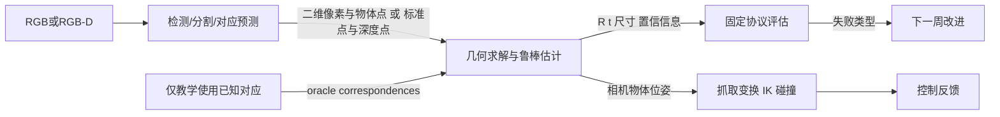
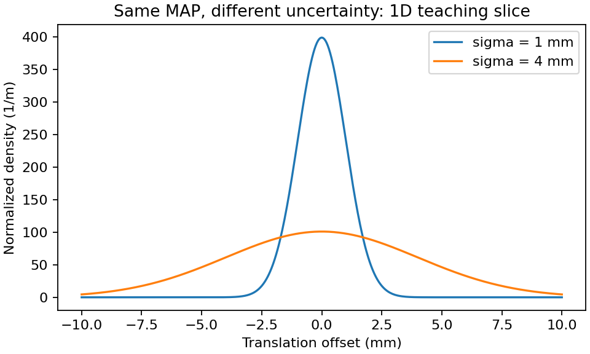
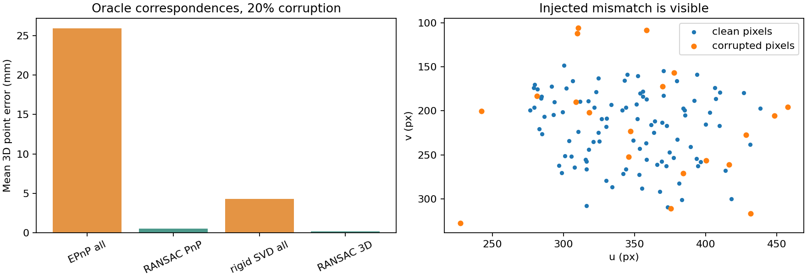

# D39 · 从几何求解基线到NOCS与EPro-PnP的落地条件

[学习入口](../_index.md) · [本周日程](../P3-项目实战-日程.md) · [上一课：GT与坐标检查](../day38/Daily-Learning-Pack.md) · [CPU实验](demo.py)

**先在已知对应关系上验证位姿求解，再让网络提供对应；先明确候选算法的信息条件，再比较其结果。NOCS、EPro-PnP和普通PnP连接的是不同层级的问题，任何一个函数跑通都不等于整个官方模型已经复现。**

Day36确定任务，Day37建立划分，Day38验证坐标与单位。今天我们终于可以选择项目Π-1的第一条运行基线。杯子位姿失败可能因为像素根本没匹配到正确表面，也可能因为几何求解被少量坏对应拖偏；把两层拆开，才知道下一周应改表征、损失还是几何约束。

<details>
<summary>个人作答与实验记录（后续更新保留）</summary>

<!-- learner-notes:start -->
个人作答、实际数据实验与阅读证据写在这里；官方模型和个人验收均不自动勾选。
<!-- learner-notes:end -->

</details>

<!-- daily-pack-generated:start -->

## 1 学习目标与路线

你应能实现带已知对应的RGB PnP与RGB-D刚体配准基线；推导SVD配准与尺度恢复；计算RANSAC成功概率；解释概率PnP中的误差能量、归一化和不确定性；为原NOCS与EPro-PnP候选写出可执行的数据和环境准备清单，而不混用任务或指标。

| 顺序 | 知识主线 | 需要回答的问题 |
| --- | --- | --- |
| 1 | 分层基线 | 前端失败与求解失败怎样拆开？ |
| 2 | 两种几何 | 2D–3D与3D–3D对应各给什么约束？ |
| 3 | NOCS式尺度 | 标准坐标如何恢复米制大小？ |
| 4 | EPro-PnP | 概率分布比单个最优pose多表达什么？ |
| 5 | 运行与证据 | 哪一步本地验证，哪一步还缺数据与模型？ |

## 2 宏观：把基线拆成可检查的三段



“Oracle correspondence”是直接给求解器正确的对应索引，再人为加入噪声或坏点。它用于测求解器对前端误差的敏感性，不是一套从图像识别杯子的系统。它的价值是形成故障隔离：若oracle输入都失败，先查几何或单位；若oracle好而预测对应失败，再查网络和数据。

| 基线层级 | 输入里额外知道什么 | 能验证 | 不能声称 |
| --- | --- | --- | --- |
| Oracle几何 | 对应点、物体身份、正确K | 求解、噪声与离群值边界 | 检测能力或新实例泛化 |
| GT区域+学习对应 | 真实目标框/mask | 坐标预测与pose链 | 整图漏检已经解决 |
| 完整感知 | 原始RGB(-D)及协议允许先验 | 包括漏检的端到端性能 | 机械臂执行成功 |

我们的本地实验处于第一行。它保留了两条原候选的关键几何接口：NOCS对应后的尺度对齐；EPro-PnP所处理的带权二维/三维对应，但不冒充其神经网络或概率层训练。

## 3 微观：RGB基线——带坏对应的PnP

### 3.1 优化问题与输入shape

给定物体点$X_i\in\mathbb R^3$米、对应像素$u_i\in\mathbb R^2$、K及畸变模型，求：

$$
\min_{R\in SO(3),t\in\mathbb R^3}
\sum_i \|\pi_K(RX_i+t)-u_i\|_2^2.
$$

残差用像素，$R$无量纲，$t$用米。输入数组分别`(N,3)`、`(N,2)`、`(3,3)`；输出OpenCV旋转向量`(3,1)`是轴角参数，不是欧拉角。将其用Rodrigues变为矩阵再进入坐标链。

最小点数取决于求解器和几何；共面点、近共线点和小图像覆盖会造成多解或病态。今天用100个空间分布良好的非共面点，使用EPnP求初值，再在RANSAC内点上LM精化。OpenCV的这些API已在本机4.10.0实际执行；文档当前页面可能指向更新版本，生产环境仍应固定版本。[OpenCV PnP接口](https://docs.opencv.org/4.x/d5/d1f/calib3d_solvePnP.html)

### 3.2 为什么一个坏点会拖动整个位姿

平方残差使80像素错误的代价是1像素误差的6400倍。如果目标函数所有点等权，优化器可能移动整个物体来减少几个错误点的代价，牺牲多数正常点。单纯增加迭代次数并不会修复错误的数据关联。

RANSAC反复抽取少量对应、求候选位姿、统计误差小于阈值的内点，选择支持最多的模型，再用这些点精化。它在找**一致的子集**，并不保证每次都找到真值。

若内点率为$w$、每次抽$m$点、迭代$k$次，至少抽到一次全内点样本的理想概率为：

$$
p=1-(1-w^m)^k,
\quad k\geq\frac{\log(1-p)}{\log(1-w^m)}.
$$

这是独立抽样、非退化全内点样本能产生正确模型时的估算，不是任意数据上的保证。手算$w=0.8,m=4,p=0.99$，需约9次；当$w=0.3$时约567次。几何退化、噪声、重复纹理会让实际需求更高。具体OpenCV内部最小采样由实现决定，不把这个四点算例等同于每个API的内部路径。

> [!warning] 内点阈值有单位
> PnP的2像素阈值不能直接用于3D配准；后者本实验使用0.005米。若把像素误差与米误差相加，必须有明确权重及尺度解释。

## 4 微观：RGB-D基线——3D对应的刚体配准

有效深度反投影得到$Y_i$相机点。若已经知道物体点$X_i$与$Y_i$一一对应，求：

$$
\min_{R,t}\frac1N\sum_i\|Y_i-(RX_i+t)\|^2.
$$

先求均值$\bar X,\bar Y$，令$x_i=X_i-\bar X$、$y_i=Y_i-\bar Y$，最优平移对给定R为$t=\bar Y-R\bar X$。消去平移后展开平方，只有交叉项依赖旋转，即最大化$\sum_i y_i^TRx_i$。

定义$C=\sum_i y_i x_i^T=U\Sigma V^T$，则：

$$
D=\operatorname{diag}(1,1,\det(UV^T)),
\quad R=UDV^T,\quad t=\bar Y-R\bar X.
$$

行列式修正确保结果是旋转而非反射。用另一种交叉协方差定义会得到转置形式，不能把不同教材的C与R公式各取一半。今天代码严格采用$Y^TX$约定。

三点非共线且对应准确可以约束刚体，但实际随机三点可能几乎共线。demo用随机体积点避免常见退化；真实实现需要检查奇异值和几何覆盖。若点云没有对应，就还要匹配或ICP；本例不能称为“任意两片点云自动配准”。

RGB与RGB-D基线的信息不同：RGB-D有度量深度但也受空洞、噪声和RGB-D注册误差影响。下面两种误差较小不能直接推出“深度方法永远优于RGB”，它们使用不同噪声设定和观测量。

## 5 微观：NOCS式标准空间如何连接真实尺寸

类别级候选NOCS从RGB预测类别标准坐标与实例区域，再把标准坐标和深度点对齐。标准坐标是无量纲的，观测点用米，因此除R、t以外还需尺度。原NOCS坐标在$[0,1]^3$中，用规范化与类别朝向建立对应，具体训练监督和对称处理要遵守原实现。[NOCS原论文§5](https://arxiv.org/html/1901.02970v1)

为理解几何，考虑各向同性相似变换：

$$
Y_i=sR X_i+t,
\qquad s>0.
$$

把上节C改为均值协方差$C=\frac1N\sum_i y_ix_i^T$，设$\sigma_X^2=\frac1N\sum_i\|x_i\|^2$，则在相同SVD约定下：

$$
s=\frac{\operatorname{tr}(\Sigma D)}{\sigma_X^2},
\qquad t=\bar Y-sR\bar X.
$$

直觉是先找到最佳旋转，再让旋转后标准点的分布幅度匹配真实点幅度。若$X$无量纲，s用米；若两边都用米，s无量纲。不要把s不加解释地叫“杯子宽度”：三维尺寸还依赖标准形状的各轴范围。

手算：标准点x范围为$[-0.4,0.4]$，s=0.20米，则对应宽度0.16米；不是0.20米。如果标准坐标以0.5为中心，进入公式前减去中心会相应改变平移定义；漏减中心会让“物体中心位姿”偏移。

> [!note] 本实验的简化边界
> demo的标准点直接均匀生成于$[-0.5,0.5]^3$，没有实现NOCS原始包围盒对角线归一化、类别网络或对称损失；只验证一般的相似配准。它的s=0.18米是本例标准坐标单位的度量尺度，不冒充原NOCS模型输出。

对非刚体、深度点落在背景或标准坐标预测错的情况，单个s、R、t不能同时解释所有点。各向同性尺度拟合失败也不应直接改成任意三轴自由缩放来掩盖对应错误；先检查表示定义、类别变化与真实形状。

## 6 微观：EPro-PnP中的“概率”在什么位置

### 6.1 从误差最小点到整个候选分布

普通PnP返回一个最小误差姿态。概率视角先把带权重投影残差转换为能量。以下教学式限定在明确的有限可行姿态域$\Omega$内，以保证归一化有定义；更一般的模型要带适当先验和测度：

$$
E(T)=\frac12\sum_i\|w_i\odot(\pi_K(TX_i)-u_i)\|^2,
\qquad p(T\mid X,u,w)=\frac{e^{-E(T)}}{Z},
\quad Z=\int_{\Omega} e^{-E(T)}dT.
$$

$w_i$有两个分量，用来调节像素两个方向的残差尺度；若解释为精度，则量纲约为$1/\mathrm{pixel}$，使能量无量纲。注意论文权重乘在残差上，所以代价中的系数是$w_i^2$，与把$w_i$直接乘平方残差的记法不同。

最优点MAP可能一样，分布宽度却不同。只输出“杯子在x=0.30米”，无法分辨横向不确定性是1毫米还是4厘米；这影响抓取裕量、重新观测或候选评分。



图是一个一维平移教学切片：$p(\Delta x)\propto\exp[-\Delta x^2/(2\sigma^2)]$，在[-10,10]毫米区间数值归一化。横轴毫米，密度纵轴仍按米积分，单位$1/\mathrm m$，所以峰值可以大于1。它不是完整SE(3)后验，也没有从网络估计$\sigma$。

### 6.2 训练为什么需要归一化项

若只鼓励GT处残差小，网络可能让大量对应集中在缺乏姿态区分力的位置。训练分布不仅希望正确pose高概率，还要抑制错误pose。对集中在GT附近的目标分布，负对数密度包含$E(T_{gt})+\log Z$，第二项把其他姿态的质量纳入目标。

原EPro-PnP通过Monte Carlo方法近似分布相关积分，将姿态分布信号传回对应与权重；这里的核心是学习前端怎样形成有区分力的几何约束，而非在普通solvePnP外包一个置信分数。精读§3.1、§3.2和§4.1。[EPro-PnP原论文](https://arxiv.org/html/2203.13254v2)

> [!warning] 不要把PnP统称为不可微
> 在局部唯一、非退化且优化条件满足时，可对解使用隐式微分；多解切换、RANSAC离散选择或病态几何会破坏所需条件。概率建模提供另一条训练路径，但不自动消除所有不确定性，也不保证动作安全。

本课没有训练EPro-PnP、没有近似完整SE(3)积分。实验的二维/三维求解器和一维概率图只帮助建立接口理解。

## 7 工程：为两个原候选留下可执行的落地路径

| 步骤 | NOCS类别级候选 | EPro-PnP-6DoF实例级候选 |
| --- | --- | --- |
| 冻结问题 | 同类别新实例的位姿和尺寸 | 指定物体协议下的6D位姿 |
| 数据条件 | RGB-D、类别实例划分、标准空间监督 | 对象ID、训练图像、3D坐标监督/配置、评价模型 |
| 第一条最小路径 | 官方数据样例的RGB→NOCS map→深度对齐 | 官方LineMOD数据配置→对应网络→pose |
| 需要固定 | 代码版本、权重、NOCS约定、类别和对称 | 版本v1/v1b/v2、checkpoint、配置、对象和评测集 |
| 本地已做 | 通用相似配准与尺度算例 | 普通PnP鲁棒求解和概率切片 |
| 仍未做 | 官方权重推理、类别泛化评测 | 官方概率层训练、完整模型推理和官方分数复现 |

官方EPro-PnP-6DoF说明的历史测试环境为Linux、Python3.6、PyTorch1.5，并给出CUDA10.2依赖路径。其README还明确区分原论文v1与重构后v1b。不要在本机现有环境直接照抄旧依赖覆盖安装；后续完整工程应使用独立、固定版本环境，先核对配置再跑单个样例。[官方数据与运行说明](https://github.com/tjiiv-cprg/EPro-PnP/tree/main/EPro-PnP-6DoF)

一个真正可复现的首轮运行记录应包含：代码revision、模型权重hash、配置、对象列表、数据版本、split、输入模态、是否GT框、K/单位、失败样本、运行硬件与延迟。大型数据和权重未就绪时，本课提供的CPU路径已经可执行；它不会被包装成官方baseline分数。

VLA若利用此pose作为条件，仍需要物体到抓取变换和动作坐标；世界模型若预测未来pose，必须在相同约定下滚动。位姿不确定性可以指导多拍一帧或增大碰撞裕量，但这些用途需要校准和实验，不由一张概率图直接保证。

## 8 动手：固定对应，再只改变离群点比例

依赖NumPy、Matplotlib、OpenCV，CPU单线程。脚本生成100个标准点，真实尺度0.18米，平移$(0.03,-0.02,0.75)$米，旋转由轴角$(0.25,-0.15,0.08)$弧度构造；图像噪声0.6像素，三维噪声每轴1毫米。默认20%点额外受到大扰动。

```bash
python -B 3d_learning/day39/demo.py
python -B 3d_learning/day39/demo.py --outlier-fraction 0 --out-dir /tmp/day39-clean
```

先预测等权解与RANSAC在20%坏对应时的差别。运行后不要只看一列：查看平移误差、旋转误差、模型点平均误差与内点数量。然后只去掉离群值，保持正常噪声、姿态和点集相同；解释为什么鲁棒估计此时不一定比使用所有点更准。脚本为扰动、3D RANSAC抽样、尺度例分别固定独立随机流390/391/392，避免改变离群点数量顺带改变正常数据。



左图是固定GT模型点上的平均三维距离，右图展示被注入的大像素误差。图只用于比较同一分支对离群值的处理；RGB与3D方法的信息不同，不能据此给真实算法排名。这里没有划出独立真实测试集，误差是已知合成姿态的求解检查，不能叫泛化误差。

**已确认（2026-10-24）：** Python3.11.15 / NumPy1.26.4 / OpenCV4.10.0 / Matplotlib3.10.9；CPU，数据seed39，训练更新0，硬件交互0。

| 算法 | 20%坏点：模型点均值误差 | 0%坏点：模型点均值误差 | 默认内点 |
| --- | --- | --- | --- |
| EPnP全部点 | 25.902mm | 0.310mm | 不筛选 |
| RANSAC PnP+LM | 0.538mm | 0.412mm | 76/100 |
| 3D刚体SVD全部点 | 4.275mm | 0.164mm | 不筛选 |
| 3D RANSAC+SVD | 0.191mm | 0.164mm | 80/100 |

在干净对应上，相似配准恢复尺度0.180086米，绝对尺度误差0.086毫米。它是独立子实验，没有加入那20%离群值；两次运行应相同。`elapsed_s`只覆盖数值实验，排除导入和绘图，不能用来比较官方网络端到端速度。

产物：[默认结果](../../_assets/3d_learning/day39/results.json) · [去除离群值结果](../../_assets/3d_learning/day39/variation-results.json)。单次合成实验没有定义真实任务成功率；以后Day40会固定阈值、分母和对称规则，再进行成功计数。

> [!note]- 完整可复制代码（与同目录demo.py一致）
> ```python
> """D39: oracle-correspondence pose baselines; NOT NOCS/EPro-PnP inference."""
> from pathlib import Path
> import argparse, json, platform, time
> import numpy as np
> import cv2
> import matplotlib
> matplotlib.use('Agg')
> import matplotlib.pyplot as plt
> 
> 
> def similarity(x,y):
>     mx,my=x.mean(0),y.mean(0)
>     xc,yc=x-mx,y-my
>     u,s,vt=np.linalg.svd(yc.T@xc/len(x))
>     d=np.eye(3);d[2,2]=np.linalg.det(u@vt)
>     r=u@d@vt
>     scale=np.sum(s*np.diag(d))/np.mean(np.sum(xc*xc,axis=1))
>     return scale,r,my-scale*r@mx
> 
> 
> def rigid(x,y):
>     mx,my=x.mean(0),y.mean(0)
>     u,_,vt=np.linalg.svd((y-my).T@(x-mx))
>     d=np.eye(3);d[2,2]=np.linalg.det(u@vt)
>     r=u@d@vt
>     return r,my-r@mx
> 
> 
> def rotation_error(a,b):
>     return float(np.degrees(np.arccos(np.clip((np.trace(a.T@b)-1)/2,-1,1))))
> 
> 
> def main():
>     ap=argparse.ArgumentParser()
>     ap.add_argument('--outlier-fraction',type=float,default=.20)
>     ap.add_argument('--out-dir',type=Path,default=Path(__file__).resolve().parents[2]/'_assets/3d_learning/day39')
>     a=ap.parse_args()
>     if not 0<=a.outlier_fraction<.7:raise ValueError('use outlier fraction in [0,.7)')
>     start=time.perf_counter();out=a.out_dir;out.mkdir(parents=True,exist_ok=True)
>     rng=np.random.default_rng(39);cv2.setRNGSeed(39);cv2.setNumThreads(1)
>     n=100
>     canonical=rng.uniform(-.5,.5,(n,3));scale=.18;x=canonical*scale
>     rtrue,_=cv2.Rodrigues(np.array([.25,-.15,.08]));ttrue=np.array([.03,-.02,.75])
>     k=np.array([[600.,0,320],[0,600.,240],[0,0,1]])
>     y=x@rtrue.T+ttrue;h=y@k.T;uv=h[:,:2]/h[:,2:]
>     noisy_uv=uv+rng.normal(0,.6,uv.shape)
>     noisy_y=y+rng.normal(0,.001,y.shape)
>     count=int(n*a.outlier_fraction);bad=np.arange(count)
>     corruption_rng=np.random.default_rng(390)
>     noisy_uv[bad]+=corruption_rng.uniform(-80,80,(n,2))[bad]
>     noisy_y[bad]+=corruption_rng.uniform(-.08,.08,(n,3))[bad]
>     methods=[]
>     def report(name,r,t,sc=1.,inliers=None):
>         predicted=sc*x@r.T+t
>         methods.append(dict(method=name,translation_error_mm=float(np.linalg.norm(t-ttrue)*1000),
>                             rotation_error_deg=rotation_error(r,rtrue),
>                             mean_point_error_mm=float(np.mean(np.linalg.norm(predicted-y,axis=1))*1000),
>                             scale_multiplier=float(sc),inliers=inliers))
>     ok,rv,tv=cv2.solvePnP(x,noisy_uv,k,None,flags=cv2.SOLVEPNP_EPNP)
>     if not ok:raise RuntimeError('EPnP failed')
>     r,_=cv2.Rodrigues(rv);report('EPnP all',r,tv.ravel())
>     ok,rv,tv,inside=cv2.solvePnPRansac(x,noisy_uv,k,None,iterationsCount=500,reprojectionError=2.,confidence=.999,flags=cv2.SOLVEPNP_EPNP)
>     if not ok or inside is None or len(inside)<6:raise RuntimeError('RANSAC failed')
>     idx=inside.ravel();rv,tv=cv2.solvePnPRefineLM(x[idx],noisy_uv[idx],k,None,rv,tv)
>     r,_=cv2.Rodrigues(rv);report('RANSAC PnP',r,tv.ravel(),inliers=len(idx))
>     r,t=rigid(x,noisy_y);report('rigid SVD all',r,t)
>     best=np.zeros(n,bool); sampling_rng=np.random.default_rng(391)
>     for _ in range(300):
>         ix=sampling_rng.choice(n,3,replace=False)
>         r,t=rigid(x[ix],noisy_y[ix])
>         good=np.linalg.norm(x@r.T+t-noisy_y,axis=1)<.005
>         if good.sum()>best.sum():best=good
>     r,t=rigid(x[best],noisy_y[best]);report('RANSAC 3D',r,t,inliers=int(best.sum()))
>     # Similarity alignment uses only clean 3D correspondences to isolate scale recovery.
>     sc,r,t=similarity(canonical,y+np.random.default_rng(392).normal(0,.001,y.shape))
>     sim_error=float(abs(sc-scale)*1000)
>     # A 1D translation posterior slice: analytic Gaussian, not SE(3) EPro-PnP.
>     offsets=np.linspace(-.01,.01,401);sigmas=[.001,.004];density=[]
>     for sigma in sigmas:
>         p=np.exp(-.5*(offsets/sigma)**2);p/=np.trapz(p,offsets);density.append(p)
>     result=dict(day=39,verified_on='2026-10-24',seed=39,device='CPU',python=platform.python_version(),
>                 numpy=np.__version__,opencv=cv2.__version__,matplotlib=matplotlib.__version__,
>                 data='100 synthetic 3D points with oracle correspondences and injected corruptions',
>                 outlier_fraction=a.outlier_fraction,noise_image_px=.6,noise_depth_xyz_m=.001,
>                 comparisons=methods,similarity_true_scale_m=scale,similarity_scale_m=float(sc),
>                 similarity_scale_error_mm=sim_error,similarity_rotation_deg=rotation_error(r,rtrue),
>                 similarity_translation_error_mm=float(np.linalg.norm(t-ttrue)*1000),
>                 training_steps=0,hardware_interactions=0,elapsed_s=time.perf_counter()-start)
>     (out/'results.json').write_text(json.dumps(result,indent=2))
>     fig,ax=plt.subplots(1,2,figsize=(11,3.8),constrained_layout=True)
>     names=[m['method'] for m in methods]
>     ax[0].bar(names,[m['mean_point_error_mm'] for m in methods],color=['#e49444','#4c998b','#e49444','#4c998b'])
>     ax[0].set_ylabel('Mean 3D point error (mm)');ax[0].tick_params(axis='x',rotation=25);ax[0].set_title(f'Oracle correspondences, {a.outlier_fraction:.0%} corruption')
>     ax[1].scatter(uv[:,0],uv[:,1],s=10,label='clean pixels');ax[1].scatter(noisy_uv[bad,0],noisy_uv[bad,1],s=20,label='corrupted pixels')
>     ax[1].invert_yaxis();ax[1].set_xlabel('u (px)');ax[1].set_ylabel('v (px)');ax[1].legend();ax[1].set_title('Injected mismatch is visible')
>     fig.savefig(out/'baselines.png',dpi=160);plt.close(fig)
>     fig,ax=plt.subplots(figsize=(6,3.6),constrained_layout=True)
>     for sigma,p in zip(sigmas,density):ax.plot(offsets*1000,p,label=f'sigma = {sigma*1000:.0f} mm')
>     ax.set_xlabel('Translation offset (mm)');ax.set_ylabel('Normalized density (1/m)');ax.legend();ax.set_title('Same MAP, different uncertainty: 1D teaching slice')
>     fig.savefig(out/'uncertainty.png',dpi=160);plt.close(fig)
>     print(json.dumps(result,indent=2))
> 
> 
> if __name__=='__main__':main()
> ```

## 9 今日总结与可验收产出

几何基线先回答“给对对应能不能求对pose”，学习基线再回答“能不能从图像找到对应”。NOCS式对齐把标准空间接到真实尺度，概率PnP把对应误差接到姿态分布。两条路线都需要明确数据条件、版本和评价协议。

最值得掌握的四点是：分层基线让失败可归因；鲁棒估计处理少数坏对应而非所有困难；尺度和标准坐标共同定义物体中心与尺寸；分布训练与单点求解表达的信息不同。三条边界要记牢：EPnP不等于EPro-PnP、通用相似配准不等于NOCS网络、oracle求解误差不等于完整感知性能。

留下四种几何方法的对照表、一张原候选数据/信息条件表、RANSAC手算和一个失败定位记录。正式项目接入数据后，从固定小批样本开始保存预测，下一课接评价器，不先追求更大模型。

## 10 自测

1. Oracle对应基线能隔离哪个模块，不能证明什么？
2. 普通PnP输入中哪些量有米单位，哪些有像素单位？
3. 为什么一个80像素坏点对平方损失的影响可能压过很多1像素好点？
4. $w=0.8,m=4,p=0.99$时，理想RANSAC迭代数约多少？列出一个不满足理想假设的情况。
5. 用$C=Y^TX=U\Sigma V^T$求旋转时，为什么要D的行列式修正？
6. 标准坐标宽0.8，s=0.2米，实际宽多少？为何不等于s？
7. 两个分布MAP一致，一个σ=1mm另一个σ=40mm，对抓取策略可能有什么不同影响？
8. 为什么把solvePnP跑通不能叫EPro-PnP官方复现？
9. 为什么去掉离群值后RANSAC-PnP可能略差于全点EPnP？
10. 把NOCS与EPro-PnP的结果放在同一性能表前，至少需要固定哪些信息条件？

## 11 未理解问题与次日衔接

本课精读顺序为：NOCS §5.2的深度对齐接口；EPro-PnP §3.1–3.2的分布与训练目标；EPro-PnP官方README的数据准备、模型版本和测试配置。每份阅读留下“输入、输出、监督、训练/推理差别、失败条件”五格卡，尚未阅读的保持未完成。

若SVD转置总出错，手造一个90°绕z旋转的三点例，对照两种C定义；若概率归一化仍抽象，先数值积分图中的一维密度，下一周损失方案再回到学习权重。下一课Day40为标准评价与误差分析，第一步是让评估器接收今天保存的pose而非只读一个汇总误差。

> [!note]- 自测答案与判分（每题0/1/2分，建议至少16/20）
> 1. 隔离几何求解及鲁棒性；不能证明检测/匹配/泛化，举两层错误例2分。
> 2. 3D点与t是米，像素和K焦距/主点是像素，R无量纲；完整2分。
> 3. $80^2=6400$，会强烈拉动解；解释等权最小二乘2分。
> 4. 约9次向上取整；样本退化、错误模型、相关抽样等使概率估计失真，算式和边界2分。
> 5. SVD可能给反射，D保证detR=+1；说明C与公式必须成套2分。
> 6. 0.16米；s是每标准坐标单位的尺度，尺寸还乘轴范围，完整2分。
> 7. 不确定性大时可能需追加观测、保守裕量或拒绝，但必须校准后验证；只说“风险更大”1分。
> 8. 缺学习对应/权重、概率分布目标、官方模型权重与数据评测；至少说明训练机制与协议两层2分。
> 9. 抽样和阈值可能排掉正常噪声点、有效信息更少；鲁棒性不等于所有条件最优，2分。
> 10. 对象级/类别级、CAD访问、RGB/RGB-D、GT区域、训练数据与划分、对称和指标；能解释不公平来源2分，单列名词1分。
<!-- daily-pack-generated:end -->
