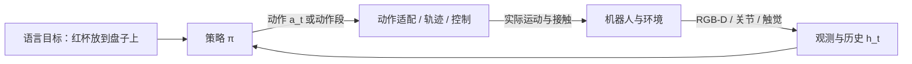
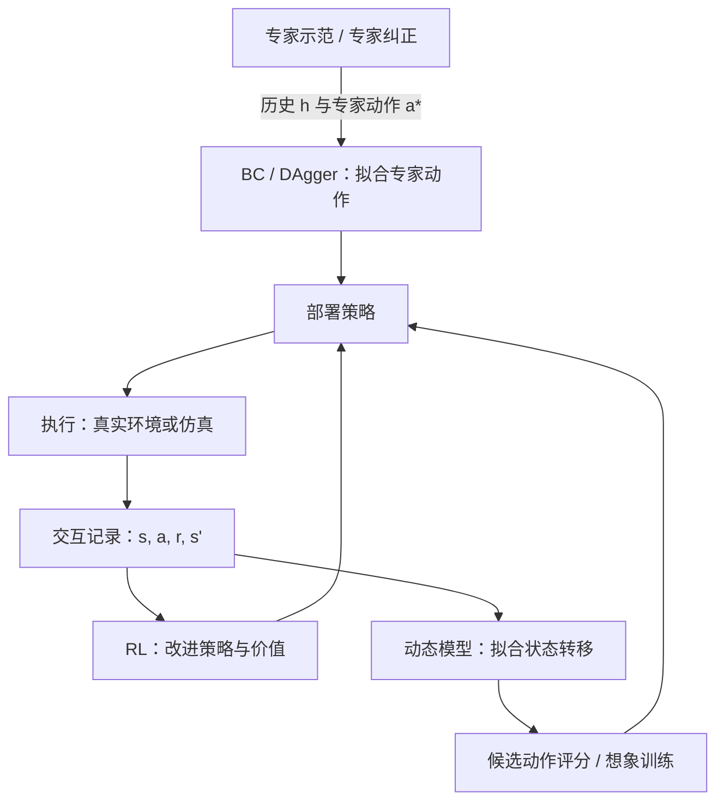
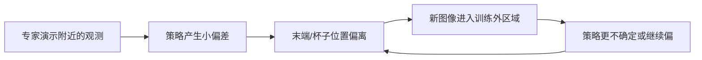
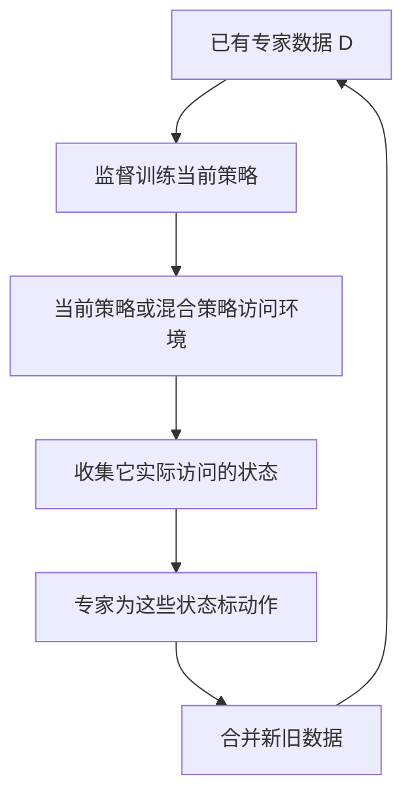
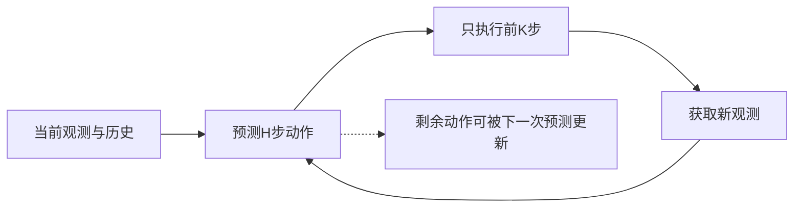
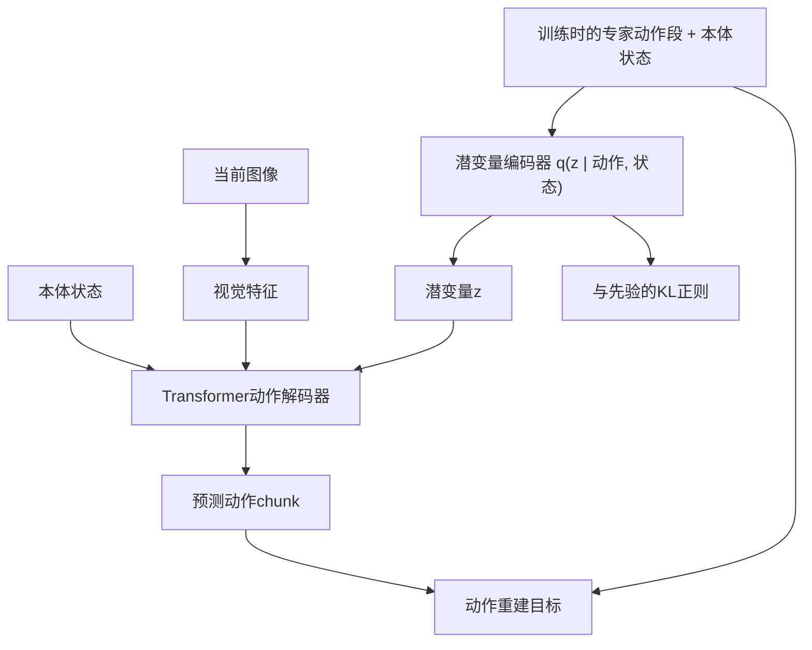
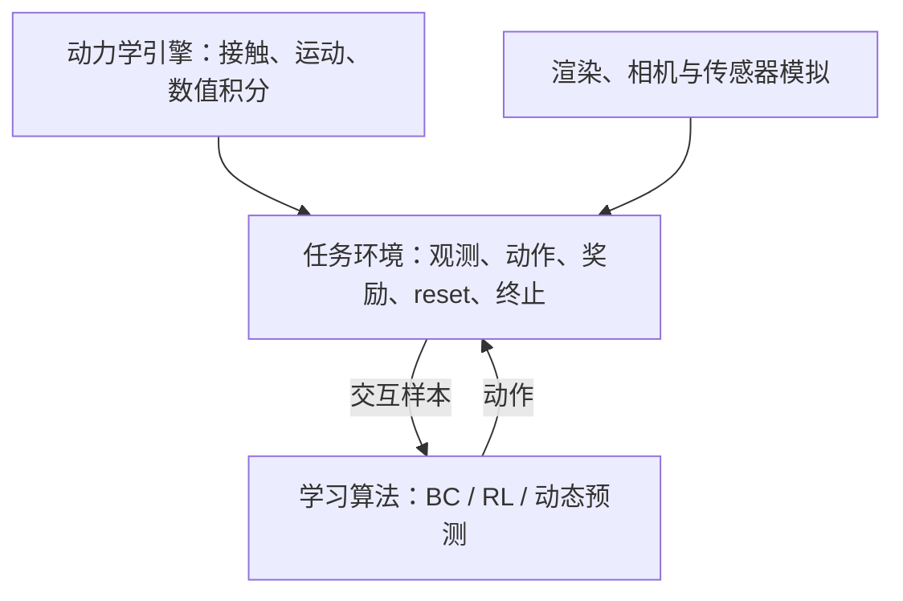
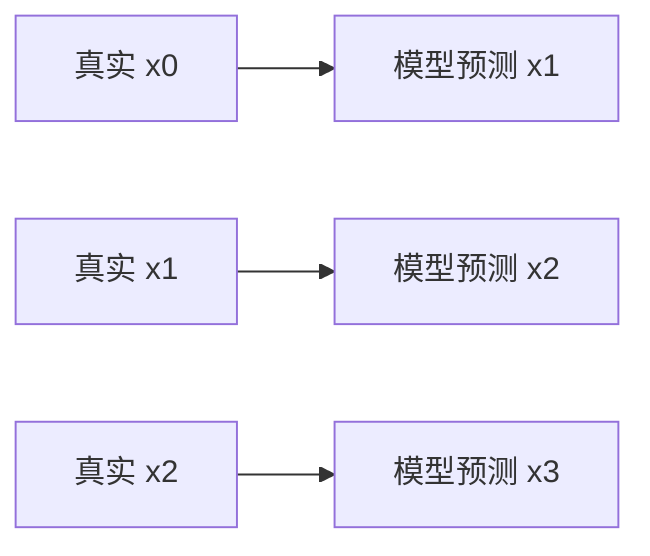
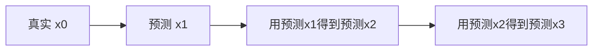
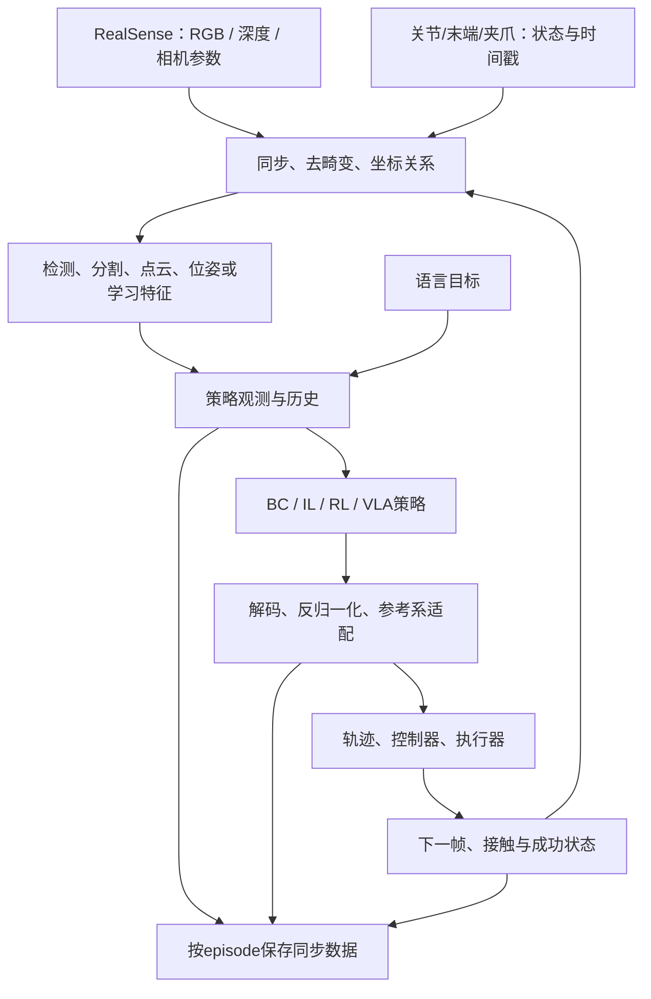

# D4 · 从“模仿动作”到“优化回报、预测后果”

[返回 3D Learning](../_index.md) ｜ [本周日程](../P1-第一周-扫盲日程.md) ｜ [Day 3讲义](../day3/P1-D3-讲义-3D感知任务地图.md) ｜ [实验脚本](demo.py)

<details>
<summary>个人学习记录（自动更新时保留）</summary>

<!-- learner-notes:start -->
**个人学习记录**：尚未提交作答。材料生成与代码验证不代表个人已完成；可在本区域记录自己的答案、实验参数和未理解问题，自动更新教材时保留本区域。
<!-- learner-notes:end -->

</details>

<!-- daily-pack-generated:start -->
**今天要带走一条学习链：演示告诉机器人“别人怎样做”，奖励帮助它判断“怎样做更好”，动态模型预测“这样做会发生什么”。这三种信号可以作用于同一个机器人系统，但它们训练的对象、需要的数据和失效方式不同。**

D3 把感知、策略、世界模型和控制放进了同一个闭环。今天继续使用“把红色杯子放到盘子上”的例子，深入到这个闭环内部：策略的参数怎样改变？专家演示为什么会失效？价值函数究竟在估计什么？一个会预测未来的模型，又怎样帮助选择动作？

本文属于 **P1 / W1-D4 / 全局 Day 4**。下文机器人系统是教学设计，不是对 nerve 或现有机器人项目实现的确认。

## 学习目标与路线

学完后应能：

- 用同一套符号区分状态、观测、历史、动作、奖励、策略、价值函数和状态转移。
- 从损失函数解释 BC 如何学习，并分清动作多模态、观测缺失和闭环分布偏移。
- 画出 DAgger 的采集—标注—聚合—训练循环，解释它补了哪些数据。
- 手算折扣回报与一次 Q-learning 更新，说明价值目标为什么会随学习变化。
- 区分三个分类维度：online/offline、on-policy/off-policy、model-based/model-free。
- 读懂 ACT、Diffusion Policy、VLA 的动作序列接口，分开训练和推理。
- 拟合一个小动态模型，解释一步与多步误差，并写出预测辅助决策的完整链。
- 用可运行实验和受控对照判断问题出在数据、策略、模型还是执行接口。

| 顺序      | 知识主线                     | 要解决的问题                                                                                                                           |
| ------- | ------------------------ | -------------------------------------------------------------------------------------------------------------------------------- |
| 宏观      | 闭环与数据流                   | 连接观测、动作、反馈与学习信号，形成持续完成任务的机器人闭环。                                                                                                  |
| 微观：问题定义 | 状态、观测、MDP与历史             | 明确任务的状态与观测定义，补充单帧观测缺失的决策信息与历史。<br>**MDP 马尔可夫决策过程**                                                                               |
| 微观：模仿   | BC与DAgger                | 从专家演示学习动作，并补充策略走偏后缺失的纠正数据。<br>**Dataset Aggregation 数据集聚合**                                                                      |
| 微观：强化学习 | 回报、V/Q、TD、策略改进           | 在缺少逐步正确动作标签时，利用奖励和长期回报改善策略。<br>V/Q = 状态价值 和 动作价值，估计未来值不值得<br>**TD = Temporal Difference，时序差分**                                   |
| 微观：方法分类 | 三组分类轴与PPO/SAC            | 根据交互条件、数据来源与动态模型的使用方式，选择合适的学习方法。<br>**Actor策略网络 – Critic 价值网络**                                                                  |
| 微观：动作生成 | ACT、Diffusion Policy、VLA | 根据观测及可用的语言指令生成动作，处理多种合理动作，并兼顾序列连贯性与反馈。<br>ACT = Action Chunking with Transformer，比BC更连续<br>**Diffusion Policy** = 扩散模型迭代去噪生成动作轨迹 |
| 微观：预测   | 仿真、转移模型、rollout、规划       | 预测候选动作的后果，并结合目标与约束选择动作。<br>rollout：从当前状态推演，**让策略在真实环境、模拟器或世界模型中连续运行若干步，展开出一条未来轨迹。**                                              |
| 回到宏观    | 工程接口、比较与失败定位             | 将策略接入RGB-D机器人，定位失败原因，并验证实际任务效果。                                                                                                  |
| 动手与总结   | 预测、运行、改变量、自测             | 通过可运行实验、受控对照与反例，验证方法的作用及适用边界。                                                                                                    |

**学习重点顺序：数据与目标 → 模块输入输出 → 算法如何更新 → 假设与失效 → 代表方法。** 后面的公式都围绕具体问题，不需要先背下一张算法名称表。

## 1. 宏观：机器人不是只“输出一次动作”

### 1.1 抓杯子这件事里，实际上有两种循环

第一种是**执行循环**：看见当前情况，做动作，再看执行结果。



第二种是**学习循环**：记录执行与示范，构造目标，更新模型，再让更新后的模型参与执行。



读图时分开两件事：

1. 执行循环每次改变的是**环境状态**；学习循环改变的是**模型参数**。
2. 部署策略可以每一步都使用新观测，但参数保持固定。**有反馈不等于在线训练。**

例如视觉伺服控制器不断根据像素误差修正速度，这已经是闭环控制；如果控制增益和网络参数没有更新，就不能因此说“机器人每一帧都在做强化学习”。

### 1.2 同一条数据，可以被用来学习不同的对象

考虑一条记录：

```text
当前：杯子位置、末端位置、夹爪状态、观测历史
动作：末端向右移动一个小增量
结果：杯子移动了一点，但没有滑落
奖励：根据任务定义计算
```

| 学习对象 | 想回答什么 | 监督或改善信号 | 推理时输出 |
| --- | --- | --- | --- |
| BC策略 | 在这种情况，专家会做什么？ | 专家动作 | 动作或动作分布 |
| RL策略/价值 | 怎样行动能获得更好的长期结果？ | 奖励、转移与回报估计 | 动作、V或Q |
| 动态模型 | 做这个动作，状态会怎样变？ | 执行后的状态/观测 | 下一状态或未来序列 |
| 感知模型 | 画面中的杯子在哪里？ | 位姿、分割标签等 | 当前几何/语义估计 |

**已经执行过的动作不自动成为BC的正确标签。** 如果轨迹来自随机探索，把所有动作都当作专家动作去克隆，学到的可能就是随机行为。

> [!question] 先判断
> 一个Transformer输入点云与语言、输出未来状态，用交互记录训练。它一定是VLA吗？

> [!note]- 参考
> 不一定。输出是未来状态，首先属于预测模型；视觉、语言和Transformer并不足以把它定义为动作策略。要看它是否联合建模并输出动作，以及动作如何被使用。

## 2. 微观：先把“机器人学习问题”定义清楚

### 2.1 状态、观测与历史：三者为什么不一样

- **状态 $s_t$**：用于描述系统当前条件的变量；合适的状态应包含预测未来所需的信息。
- **观测 $o_t$**：传感器实际提供的信息，例如RGB-D、关节编码器、触觉图。
- **历史 $h_t$**：截至当前可用的观测和已执行动作序列。

一个简单力学状态可以是：

$$
s_t=[x_t,v_t],\qquad o_t=x_t
$$

只看位置，不能知道物体正在向左还是向右运动。两张静态画面看起来相同，下一刻却可能不同：

```text
同样的位置 x=10
    情况A：v=+2 → 继续向右
    情况B：v=-2 → 继续向左
仅用 x 决策，可能把A与B当成同一件事。
```

用相邻观测估计速度：

$$
\hat v_t=\frac{x_t-x_{t-1}}{\Delta t}
$$

这里 $\Delta t$ 必须是实际采样间隔。两个位置差都是2mm，一个间隔10ms、一个间隔100ms，估计速度分别是200mm/s和20mm/s。**时间戳既是数据字段，也是物理含义的一部分。**

在真实操作中，遮挡、摩擦、接触模式和物体内部质量分布也可能不可直接观察。历史可以增加信息，但不保证完全恢复真实状态。

### 2.2 MDP：为什么教材一直强调“状态”

Markov Decision Process，**马尔可夫决策过程**，常用以下元素描述：

$$
\mathcal M=(\mathcal S,\mathcal A,P,r,\gamma,\rho_0)
$$

| 符号 | 含义 | 抓杯子的例子 |
| --- | --- | --- |
| $\mathcal S$ | 状态空间 | 机器人与物体的位置、速度、接触等 |
| $\mathcal A$ | 动作空间 | 关节速度、末端增量或其他控制接口 |
| $P(s'|s,a)$ | 状态转移规律 | 执行动作后物体与机器人怎样变化 |
| $r$ | 奖励规则 | 成功、碰撞、动作代价等任务偏好 |
| $\gamma$ | 折扣系数 | 未来奖励相对当前奖励的权重 |
| $\rho_0$ | 初始状态分布 | 测试时杯子和机械臂从哪里开始 |

马尔可夫性表达为：

$$
P(s_{t+1}\mid s_0,a_0,\ldots,s_t,a_t)
=
P(s_{t+1}\mid s_t,a_t)
$$

意思是：**如果状态定义充分，当前状态与动作已经包含预测下一步所需的信息。** 不是说“现实没有历史”，而是历史的有关影响已经被当前状态概括。

如果策略只看不充分的观测，就进入部分可观测问题。一个常见工程近似是：

$$
z_t=E_\psi(o_{\le t},a_{<t}),\qquad
a_t\sim\pi_\theta(\cdot\mid z_t,l)
$$

$z_t$ 是历史编码，$l$ 是语言目标。RNN、Transformer或有限帧堆叠都能实现历史处理，但是否包含足够信息要通过实验判断。[RL状态、策略与价值的术语来源](https://spinningup.openai.com/en/latest/spinningup/rl_intro.html)

### 2.3 episode、trajectory与transition：数据的三个尺度

```text
transition：一次 (o_t, a_t, r_t, o_{t+1})
trajectory：按时间排列的一串transition
episode：从reset开始，到任务终止或采样截断结束的一次运行
```

这直接影响数据划分。把同一次抓取的相邻帧随机分进训练集和测试集，很可能让测试集拥有近乎重复的场景、视角与动作。低测试误差可能反映时间相关性，而不是对新物体、新场景的泛化。

**工程做法**：根据真正想测试的能力，按episode、场景、物体或操作员划分。没有一种划分能自动回答全部泛化问题；先定义问题，再决定留出什么。

## 3. 微观：BC怎样把演示变成策略

### 3.1 从“我会做”变成可训练的样本

**Behavior Cloning，行为克隆**，常见数据形式为：

$$
\mathcal D_E=\{(h_i,l_i,a_i^*)\}_{i=1}^{N}
$$

$h_i$ 是当时可用的信息，$l_i$ 是可选语言条件，$a_i^*$ 是专家动作。策略可以是确定性的：

$$
\hat a_i=\pi_\theta(h_i,l_i)
$$

也可以输出动作分布：

$$
a_i\sim\pi_\theta(\cdot\mid h_i,l_i)
$$

连续动作的一个基本目标：

$$
L_{\mathrm{BC}}(\theta)
=
\frac1N\sum_{i=1}^{N}
\|\pi_\theta(h_i,l_i)-a_i^*\|_2^2
$$

训练过程就是D3的“前向预测→比较目标→梯度→更新参数”；不同的是，现在标签是动作。

### 3.2 真正手算一次：策略参数怎样改

用一个极简策略说明梯度，不模拟完整机械臂：

$$
\pi_w(x)=wx,\qquad
L(w)=\frac12(wx-a^*)^2
$$

这里 $x$ 是**归一化的特征**，$a^*$ 是**归一化动作**，不是未经换算的米和弧度。取 $x=2,a^*=1,w=0$：

$$
\hat a=0,\qquad
\frac{dL}{dw}=(wx-a^*)x=-2
$$

学习率 $\eta=0.1$：

$$
w_{\mathrm{new}}=0-0.1(-2)=0.2,\qquad
\hat a_{\mathrm{new}}=0.4
$$

损失从0.5变成0.18。这个例子回答：**专家动作没有被“写进机器人规则”，它通过损失和梯度改变了参数。**

真实网络里特征和参数数量更多，但基本链条相同。优化器学到的是训练目标下的映射，不自动保证动力学、碰撞和接触约束被满足。

### 3.3 动作loss为什么要关心单位、尺度与mask

假设动作包含平移和旋转。如果平移用mm而旋转用rad，直接相加的平方误差可能被平移数值主导；把平移单位改成m，损失权重又改变了。

一种更明确的写法是：

$$
L=\lambda_p\|\hat{\Delta p}-\Delta p^*\|^2
+\lambda_R\,d_R(\hat R,R^*)^2
+\lambda_g\,\ell_g(\hat g,g^*)
$$

- $\lambda$ 决定各目标在训练中的相对权重。
- 旋转距离 $d_R$ 应与选定表示匹配，不能忘掉角度周期性。
- 夹爪可能是连续宽度，也可能是离散开合状态。
- 轨迹末尾补齐动作chunk时，需要mask屏蔽不存在的动作。

**标准化降低数值尺度问题，不会自动解决坐标定义错误。** 把base系动作误当ee系动作，即使每一维都规范化到同一范围，物理方向仍可能错误。

### 3.4 MSE为什么容易输出“不存在的平均动作”

沿用D3的绕障例：在完全相同的输入条件下，专家左绕动作为−1、右绕为+1，二者等概率。

$$
L(a)=\frac12(a+1)^2+\frac12(a-1)^2=a^2+1
$$

$$
\frac{dL}{da}=2a=0\quad\Rightarrow\quad a=0
$$

零动作最小化了这个设定中的MSE，却可能卡在原地。问题来自**用单个点估计压缩多模态条件分布**。

先判断为什么同一输入会出现两种动作：

| 原因 | 该补什么 | 不能直接下的结论 |
| --- | --- | --- |
| 输入漏掉目标、速度或阶段 | 补条件、历史、本体状态 | “所有回归都不行” |
| 确实存在多条合理路线 | 表达多个候选或动作分布 | “任意采样都安全” |
| 演示时间错位或标签质量差 | 修正数据与接口 | “换扩散模型就能救” |
| 混入不同机器人动作定义 | 统一契约或显式条件化 | “数据越多必然越好” |

即使动作分布表达正确，还需要保证一段时间内的选择一致，不能这一帧左绕、下一帧右绕。动作序列方法的一个动机正是建模这种关联。

### 3.5 离线误差很小，为什么闭环还会偏离

BC的训练输入来自专家访问分布 $d_E$；部署输入来自学习策略诱导的分布 $d_\pi$：

$$
\underbrace{\mathbb E_{h\sim d_E}[\ell(\pi(h),a^*)]}_{\text{训练主要约束}}
\qquad\neq\qquad
\underbrace{\mathbb E_{h\sim d_\pi}[\ell(\pi(h),a^*)]}_{\text{部署真正遇到}}
$$

符号不等号表示两种期望一般不同，不是说它们绝不可能相等。



**教学轨迹**：

```text
专家：0 → 2 → 4 → 6
部署：0 → 3 → 3 → 3 ...  （遇到未见状态3，弱策略选择停止）
```

这里使用故意弱的查表BC显示覆盖缺口；神经网络可能泛化，也可能失败，必须实际测试。

再看一个独立的概率直觉：假设每步独立地有1%概率发生不可恢复失败，那么100步全成功的概率是：

$$
0.99^{100}\approx0.366
$$

**这不是普遍的BC成功率公式。** 真实步骤相关、错误可恢复、测试分布也不同。它只提醒：单步看起来很小的错误率，不能直接当作长任务的成功率。[序列模仿学习的原始问题分析](https://proceedings.mlr.press/v9/ross10a.html)

## 4. 微观：DAgger怎样改变训练数据的来源

### 4.1 补“策略会遇到的状态”，而不是机械增加演示数量

DAgger，Dataset Aggregation，数据集聚合。其关键变化发生在数据采集：



```text
D ← 初始专家演示
for each iteration:
    π ← 在D上训练策略
    states ← 用采集策略访问环境
    labels ← 向专家查询这些states的动作
    D ← D ∪ (states, labels)
```

原论文讨论包含专家混合调度等条件；本课实验是简化的“当前策略采集→专家标注→聚合训练”循环，不把教学实现称为原论文完整复现。[Ross等，DAgger，2011](https://proceedings.mlr.press/v15/ross11a.html)

### 4.2 为什么常常要重复多轮

| 轮次 | 数据已经覆盖 | 执行中发生什么 | 下一轮补什么 |
| --- | --- | --- | --- |
| 初始BC | 0、2、4 | 扰动后到3，停止 | 状态3的专家动作 |
| 聚合一轮 | 0、2、3、4 | 从3前进到5，又停止 | 状态5的专家动作 |
| 聚合两轮 | 0、2、3、4、5 | 0→3→5→6 | 本例测试路径已覆盖 |

补上3之后，策略终于能访问5；**策略改变，随后需要覆盖的状态也改变**。这就是为何不能只收一批错误状态后就假定永久完成。

### 4.3 数据聚合也有工程前提

专家可能是遥操者、传统规划器、脚本或其他可查询策略。要检查：

- 当前偏离状态下，专家是否还能给出可执行动作？
- 专家纠正对应哪一帧观测？人类反应与通信延迟会不会错位？
- 新数据是否只是同一个失败状态被重复记录很多次？
- 专家与学习策略执行时是否使用同一种动作接口？

在真实系统中，经常需要接管和恢复设计；查询一次标签不等于必须让不可靠策略继续撞下去。这是数据采集与运行流程设计，不能由“DAgger”这个名称自动解决。

> [!question] 先想
> 重复100次原来的成功轨迹，与收集10次扰动后的专家纠正，为什么不能只按数据条数判断哪个更有用？

> [!note]- 参考
> 两者覆盖的状态分布不同；后者可能提供原数据中根本没有的恢复信息。还要考虑标签质量、场景多样性和目标测试分布，不能保证10条纠正一定更好。

## 5. 微观：RL怎样把“任务结果”传回动作选择

### 5.1 奖励与回报：近一步不一定好一步

Reward，奖励，是任务定义给执行结果的信号；Return，回报，是沿未来轨迹累计的奖励。

本课约定 $r_t$ 在执行 $a_t$ 后得到：

$$
G_t=\sum_{k=0}^{T-t-1}\gamma^k r_{t+k}
$$

三步奖励 $[-0.02,-0.02,1]$，$\gamma=0.9$：

| 决策时刻 | 从此刻向后计算 | 回报 |
| --- | --- | --- |
| 第3步前 | $1$ | $1$ |
| 第2步前 | $-0.02+0.9\times1$ | $0.88$ |
| 第1步前 | $-0.02+0.9\times0.88$ | $0.772$ |

第一步reward是−0.02，第一步return却为正，因为这一步通向后续成功。

**抓杯子中的对应**：先绕过障碍可能暂时远离杯子；只奖励瞬时距离缩短，可能偏好不安全的捷径。稀疏成功奖励能表达目标，但早期探索可能很难得到正反馈。奖励是你定义的代理目标，要检查它是否真的代表期望任务。

### 5.2 $\gamma$不只是一个“默认0.99”

$\gamma$越接近1，远期奖励的相对权重通常越大；它还与任务终止方式和控制周期一起决定时间尺度。

例如延迟50个决策步才获得奖励：

$$
0.9^{50}\approx0.0052,\qquad
0.99^{50}\approx0.605
$$

如果一个策略决策周期是20ms，50步约1秒；周期200ms时则约10秒。**改变动作频率但保持相同$\gamma$，可能改变奖励对实际时间的折扣。** 这也是策略接口中必须记录控制周期的原因。

这些数字说明折扣机制，不表示应该给所有机器人选同一$\gamma$。

### 5.3 V和Q：都看未来，但起点条件不同

$$
V^\pi(s)=\mathbb E_\pi[G_t\mid s_t=s]
$$

$$
Q^\pi(s,a)=\mathbb E[G_t\mid s_t=s,a_t=a,\text{随后遵循}\pi]
$$

直觉：

- V：到了这个局面，按当前策略继续，整体前景怎样？
- Q：在这个局面先做某个指定动作，再继续当前策略，前景怎样？

离散动作下：

$$
V^\pi(s)=\sum_a\pi(a\mid s)Q^\pi(s,a)
$$

假设左、右两动作的Q值为0.2和0.8，策略各选一半，则V=0.5。把右动作的概率改为0.75，**在暂时固定这组Q值的比较中**，加权值变成0.65。真正更新策略后，后续行为也改变，Q需要再评估。

Advantage，优势函数：

$$
A^\pi(s,a)=Q^\pi(s,a)-V^\pi(s)
$$

它比较“做这个动作”与“当前策略的平均水平”。上例中右动作的优势是0.3。优势为正通常提供提高该动作概率的学习方向；估计噪声和更新幅度仍会影响结果。

### 5.4 Bellman关系：把很长的未来拆成“一步＋剩余未来”

$$
Q^\pi(s,a)=
\mathbb E\left[r_t+\gamma V^\pi(s_{t+1})\mid s_t=s,a_t=a\right]
$$

它不是一个新的奖励标签，而是回报分解：当前得到什么，加上下一状态未来能得到什么。这个分解使算法可以用短转移逐渐学习长远价值。

两种常见估计思想：

| 方式 | 如何构造目标 | 直觉与代价 |
| --- | --- | --- |
| Monte Carlo | 等轨迹结束，用实际累计回报 | 不从下一状态价值估计接续，但完整回报可能波动较大 |
| TD，时序差分 | 当前reward＋下一状态价值估计 | 可以逐步更新，但目标依赖另一个估计，带来偏差和稳定性问题 |

“Bootstrap”在这里指**用当前已有的估计去接续未知的未来**，不是另一种外部专家标签。

### 5.5 Q-learning：手算一次更新，读懂每一项

表格Q-learning的目标为：

$$
y_t=r_t+\gamma(1-d_t)\max_{a'}Q(s_{t+1},a')
$$

更新：

$$
\delta_t=y_t-Q(s_t,a_t),\qquad
Q(s_t,a_t)\leftarrow Q(s_t,a_t)+\alpha\delta_t
$$

$d_t=1$代表任务真正终止，$\alpha$是学习率。设：

$$
Q(s_t,a_t)=0.5,\quad r_t=-0.02,\quad
\max Q(s_{t+1},\cdot)=0.8,\quad\gamma=0.9,\quad\alpha=0.3
$$

则：

$$
y_t=-0.02+0.9\times0.8=0.7,\qquad
\delta_t=0.2,\qquad Q_{\mathrm{new}}=0.56
$$

不是一次把Q强行改成真实答案，而是向当前目标移动一步。随着别的状态价值改善，这条转移的目标还可能变化。

```python
target = reward if terminated else reward + gamma * max(next_q)
td_error = target - q[state][action_index]
q[state][action_index] += learning_rate * td_error
```

如果换成神经网络 $Q_\theta$，就会使用批量转移和回归目标更新参数，而不再逐项更新小表。目标网络、经验回放等是深度实现中的稳定化机制；**把表换成MLP不是唯一需要的工程改动**。

### 5.6 terminal、truncated与reset：一次误用会改掉学习目标

- **terminated**：任务定义下确实结束，例如到达目标或不可继续的失败。
- **truncated**：由于外部限制停止采样，例如采样器到达步数上限。
- **reset**：开始新一轮，重新抽取初态并重置必要状态。

对于被视为持续过程的任务，纯外部时间截断可以保留下一状态bootstrap；如果任务本身是“必须在剩余10步内完成”，剩余步数就是决策信息，耗尽时可能是真正终止。

> [!warning] 不要写死“所有done都把未来价值置零”
> 必须先决定时间上限是任务本身，还是采样器的外部截断。前者要考虑剩余时间与终止定义；后者不能随意把价值截成零。向量化环境自动reset时，还要避免把新episode第一帧当成旧episode的下一状态。

今天脚本把8步上限视为外部采样截断，只在到达位置6时去掉bootstrap；推理测试则在达到上限时停止并记录未成功。

## 6. 微观：三组分类轴，以及PPO和SAC的位置

### 6.1 先问问题，再贴标签

| 分类轴 | 真正的问题 | 常见误解 |
| --- | --- | --- |
| online / offline | 训练过程中是否继续采集新的环境交互？ | “离线保存过文件，就属于offline学习” |
| on-policy / off-policy | 数据行为策略与更新所针对的策略之间是什么关系？ | “用过旧数据就不可能再与环境交互” |
| model-based / model-free | 算法是否显式利用环境转移模型学习或决策？ | “在仿真器里就一定model-based” |

on/off-policy主要用于说明RL的数据与目标策略关系；不必强行给每一种监督学习都贴一个on/off-policy标签。

今天Q-learning训练时：

```text
采集：ε-greedy，有时随机选动作
更新：使用下一状态的max Q，指向贪心目标
数据：训练中不断step得到新转移
模型：没有学习或调用显式转移预测器进行规划
结论：online + off-policy + model-free
```

即使采集环境是MuJoCo，只要算法只通过reset/step获取样本，上面的分类仍可能成立。反过来，算法可以利用已知动力学做规划，模型不一定必须来自神经网络学习。

### 6.2 PPO：尽量不要一次把策略改得太远

PPO常见实现属于on-policy路线，用近期自身策略数据估计优势，再改进动作概率。PPO-Clip使用概率比：

$$
\rho_t(\theta)=\frac{\pi_\theta(a_t\mid s_t)}
{\pi_{\mathrm{old}}(a_t\mid s_t)}
$$

一个核心目标是最大化：

$$
\mathbb E_t\left[
\min\left(\rho_t\hat A_t,\,
\operatorname{clip}(\rho_t,1-\epsilon,1+\epsilon)\hat A_t\right)
\right]
$$

$\rho$比较新旧策略对同一已采样动作的概率，$\hat A$估计它相对平均水平的好坏。比如优势为正，概率从0.2涨到0.3，概率比为1.5；取$\epsilon=0.2$时，该样本目标对继续增大概率的奖励会被截住。

**clip是目标中的机制，不是对所有动作概率变化的硬约束**；完整实现还要价值估计、批量更新及诊断。[PPO官方机制说明](https://spinningup.openai.com/en/latest/algorithms/ppo.html)

### 6.3 SAC：利用回放数据，同时保留动作分布的熵

SAC，Soft Actor-Critic，典型连续控制实现是off-policy actor-critic：用经验回放更新价值估计和策略，目标还考虑策略分布的熵。

$$
J(\pi)=\mathbb E\left[\sum_t\gamma^t
\left(r_t+\alpha_{\mathrm{ent}}\mathcal H(\pi(\cdot\mid s_t))\right)\right]
$$

熵项鼓励一定的动作多样性；$\alpha_{\mathrm{ent}}$控制奖励与熵的相对影响。这里的$\alpha_{\mathrm{ent}}$**不是**上一节Q-learning的学习率。

这不等于部署时随便抖动机械臂。策略的分布参数、采样方式、评价设置、动作缩放和控制接口都需要明确。[SAC官方机制说明](https://spinningup.openai.com/en/latest/algorithms/sac.html)

### 6.4 将来选择方法时，用什么做判断

| 你手头有什么 | 可先建立的路线 | 最先验证 |
| --- | --- | --- |
| 较可靠专家示范 | BC；需要恢复覆盖时考虑纠正数据 | 标签、时序、动作定义、扰动后表现 |
| 能查询专家纠正 | DAgger式采集和监督改进 | 当前策略访问的状态与纠正质量 |
| 可交互环境与任务奖励 | RL基线，按任务比较PPO/SAC等 | reward、reset、终止、交互预算 |
| 有状态动作转移 | 动态预测，再探索模型辅助决策 | 一步/多步及分布外动作 |
| 现成VLA及机器人适配条件 | 先推理和接口验证，再考虑适配 | 数据统计、动作坐标、频率、模态 |

表格给的是**建立第一条可验证路线的逻辑**。演示与奖励可以组合，BC初始化后继续RL是可能的流程；不要求二选一。

## 7. 微观：从单步动作到ACT、Diffusion Policy与VLA

### 7.1 为什么一次预测一段动作

单步策略只输出$a_t$；动作chunk策略输出：

$$
A_t=[a_t,a_{t+1},\ldots,a_{t+H-1}]
\in\mathbb R^{H\times D_a}
$$

$H$是预测的动作步数，$D_a$是每步动作维度。这样可以直接建模动作之间的连续性和任务阶段，但不意味着预测后必须全部盲执行。



假设$H=16$，$K=4$，高层动作周期$\Delta t=0.02$s，那么每次执行0.08s后重新观察和预测。**这里暂未计入推理和通信延迟**，实际部署的反馈间隔还受异步执行和延迟补偿影响。

- $H$：模型一次看多远。
- $K$：真实系统多久重新使用新观测。
- 低层控制频率：控制器多久更新一次执行信号。

三者不等同。模型推理频率低于伺服控制频率很常见，中间需要保持、插值或轨迹跟踪机制；具体方式不能凭动作数组长度猜出来。

### 7.2 ACT：把动作序列放进条件生成模型

ACT，Action Chunking with Transformers，把动作段作为学习对象。原版方法使用条件变分自编码器的训练思路：训练时，动作序列编码器帮助学习潜变量$z$；解码策略结合视觉、本体状态和$z$预测动作段。



用于理解机制的目标可写成：

$$
L_{\mathrm{ACT}}
=
L_{\mathrm{action}}(\hat A,A^*)
+\beta\,D_{\mathrm{KL}}(q_\phi(z\mid A^*,q)\|p(z))
$$

$q$在这里表示本体状态，不是Q-value；$\phi$和$\theta$分别可用于编码器与动作策略参数。

- 动作项推动预测段接近专家。
- 潜变量提供表达演示变化的机制。
- KL项约束潜变量分布，不能只记成“另外一个loss”。
- 推理时没有专家未来动作；原版使用先验均值$z=0$等既定推理设置，不能把训练编码器对未来动作的访问泄漏到部署中。

ACT还讨论重叠动作预测的时间聚合。理解这一点时，要区分“预测一段”“重叠段如何组合”和“实际多久重新反馈”。[ACT／ALOHA原方法](https://tonyzhaozh.github.io/aloha/)

### 7.3 Diffusion Policy：学会从噪声恢复条件动作段

Diffusion Policy把动作段当作需要生成的数据。下面是常见噪声预测形式的示意，不代表所有扩散实现参数化完全相同。

训练时给真实动作段$A^0$加噪：

$$
A^k=\sqrt{\bar\alpha_k}A^0+
\sqrt{1-\bar\alpha_k}\,\epsilon,\qquad
\epsilon\sim\mathcal N(0,I)
$$

网络以带噪动作、扩散步$k$和观测条件$c$为输入：

$$
L_{\mathrm{noise}}=
\mathbb E\left[
\|\epsilon-\epsilon_\theta(A^k,k,c)\|_2^2
\right]
$$

推理时没有真实未来动作：从随机噪声动作段开始，在当前观测条件下反复去噪，得到动作段，再执行前一部分并重新观察。

```text
训练：专家动作段 → 加噪 → 网络预测噪声 → 误差更新参数
推理：随机动作噪声 → 条件去噪若干步 → 动作段 → 执行部分 → 新观测
```

这解释了两件事：为什么可以表达不同合理动作模式，以及为什么要考虑采样推理开销。生成动作分布不会自动满足碰撞和机器人接口约束。[Diffusion Policy原论文与实现](https://diffusion-policy.cs.columbia.edu/)

### 7.4 VLA描述的是视觉、语言与动作如何联合，而非唯一学习算法

| 维度 | 需要分别回答的问题 | 示例 |
| --- | --- | --- |
| 输入条件 | 看什么、听什么、是否有本体和历史？ | RGB、多相机、语言、关节 |
| 计算结构 | 特征怎样交互？ | 视觉编码器、Transformer、动作专家 |
| 动作表示 | 输出什么形式？ | 离散token、连续动作、chunk |
| 学习信号 | 怎样改善？ | 演示、纠正、奖励、辅助预测 |
| 部署接口 | 怎样变成物理运动？ | 解码、反归一化、坐标变换、控制 |

RT-2、OpenVLA原版和π0可以用于比较不同动作建模路线；不能把某个原版、后续变体及其他实现的动作头混用。π0的flow matching与上面的离散扩散步骤也不是同一个训练公式。后续D6及W5会展开原架构，这里先把训练信号和动作接口分开。[RT-2](https://robotics-transformer2.github.io/) ｜ [OpenVLA](https://openvla.github.io/) ｜ [π0原论文](https://arxiv.org/abs/2410.24164)

### 7.5 写代码前先画tensor shape

以下是教学接口，不是统一官方标准。设$B=8$，观测历史$T_o=2$，相机数$N_c=2$，图像$128\times128$，预测$H=16$步，动作$D_a=7$维：

| 量 | Shape示例 | 必须带着理解的约定 |
| --- | --- | --- |
| RGB历史 | $8\times2\times2\times3\times128\times128$ | B、历史、相机、通道、高、宽 |
| 深度历史 | $8\times2\times2\times1\times128\times128$ | z/range、尺度、有效mask |
| 本体历史 | $8\times2\times D_q$ | 关节角、速度、夹爪等字段顺序 |
| 语言token | $8\times L$ | tokenizer、padding、attention mask |
| 动作标签 | $8\times16\times7$ | 每个动作的单位、坐标与时间 |
| 动作有效mask | $8\times16$ | 轨迹结尾不足16步时哪些标签有效 |

如果某轨迹只剩5步，后11步的padding不是“机器人应该停止11步”的示范。一个mask后的平方误差形式为：

$$
L=
\frac{\sum_{b,h}m_{b,h}\|\hat A_{b,h,:}-A^*_{b,h,:}\|^2}
{D_a\sum_{b,h}m_{b,h}}
$$

分母为0的空样本必须跳过或显式处理。不同归约方法会改变loss尺度，比较日志前先看实现。

## 8. 微观：仿真与世界模型怎样支持学习

### 8.1 动力学引擎、任务环境与学习算法是三层



MuJoCo主要提供动力学与相关仿真能力；任务环境在其上定义任务、观测和评价。Isaac Lab、ManiSkill、RLBench等各有依赖平台和工作流，不能仅凭都有机器人场景就认为代码与任务可直接互换。

至少分开三种sim-to-real差异：

| 差异 | 在数据中怎样出现 | 可能影响什么 |
| --- | --- | --- |
| 动力学 | 摩擦、质量、接触、延迟不同 | 动作后果和恢复策略 |
| 视觉外观 | 光照、材质、背景不同 | 视觉表征和目标定位 |
| 传感器/接口 | 深度空洞、时间偏移、控制频率不同 | 观测质量和动作反馈 |

原理学习可以先用小型自建环境；它不提供真实接触精度的证据。[MuJoCo官方概览](https://mujoco.readthedocs.io/en/stable/overview.html)

### 8.2 拟合状态转移：标签变成“执行后发生了什么”

动作条件动态模型：

$$
\hat s_{t+1}=f_\phi(s_t,a_t)
$$

给定数据$\mathcal D_{\mathrm{dyn}}=\{(s_i,a_i,s'_i)\}$，基本目标为：

$$
L_{\mathrm{dyn}}(\phi)
=
\frac1N\sum_i\|f_\phi(s_i,a_i)-s'_i\|^2
$$

如果位置和速度一起预测，单位与权重也要处理。若输出概率分布，可以用负对数似然等目标表达不确定性，而不只输出一个点。

**与BC比较**：BC把动作作为要拟合的标签；动态模型把动作当条件、把下一状态当标签。随机动作对BC未必合适，对动态学习却可能提供有用的系统变化样本。

### 8.3 最小二乘算例：从转移记录辨认动作增益

单独考虑**无边界的一维线性教学系统**：

$$
x_{t+1}=x_t+k a_t
$$

$x$是位置量，$a$是无量纲动作，$k$的单位是位置单位/单位动作。它不使用后面0至6的裁剪边界。

最小化：

$$
L(k)=\sum_i\left[(x'_i-x_i)-ka_i\right]^2
$$

令导数为零：

$$
\frac{dL}{dk}
=-2\sum_i a_i[(x'_i-x_i)-ka_i]=0
$$

得到：

$$
\hat k=
\frac{\sum_i a_i(x'_i-x_i)}{\sum_i a_i^2}
$$

三个样本为$(0,1,2)$、$(3,-1,1)$、$(1,1,3)$：

$$
\sum a_i\Delta x_i=2+2+2=6,\quad
\sum a_i^2=3,\quad \hat k=2
$$

**两个边界**：

1. 如果所有动作都是0，分母为0，数据没有告诉你“动作会产生多大变化”。这属于辨识信息不足，不是多训练几轮就能修复。
2. 如果实际环境有边界裁剪，例如$x=5,a=1$后最多到6，把这条$\Delta x=1$记录直接当成无边界线性关系，会改变拟合结果。需要显式表示裁剪或使用适合模型假设的数据。

### 8.4 一步预测与自由rollout：测试输入条件不同



上图是逐步给真实输入的一步评价。自由rollout则是：



每条预测边还都接收该步动作。若真实$k=2$，模型$\hat k=1.5$，从0连续做$a=1$：

| 步数 | 真实位置 | 自由预测位置 | 绝对误差 |
| --- | --- | --- | --- |
| 1 | 2 | 1.5 | 0.5 |
| 5 | 10 | 7.5 | 2.5 |
| 10 | 20 | 15 | 5 |

一步评测每次使用真实$x_t$，本例每次只错0.5；自由rollout把偏差继续带入，十步错5。

更一般的直觉：若同一动作下转移对状态误差的放大上界为$L_f$，每步模型误差上界为$\varepsilon$，则可能有：

$$
e_{t+1}\le L_f e_t+\varepsilon
$$

$L_f<1$时旧误差可能衰减，$L_f=1$时有线性累积上界，$L_f>1$时可能放大更快。这个关系要求相应的平滑性和误差上界成立；接触切换、分布外状态和反馈会改变分析，不能拿一维线性图概括所有世界模型。

### 8.5 预测器不是规划器：还要定义“什么后果更好”

在线模型辅助规划可写成：

$$
a^*_{t:t+H-1}
=
\arg\min_{a_{t:t+H-1}}
\left[\sum_{j=0}^{H-1}c(\hat s_{t+j},a_{t+j})
+c_T(\hat s_{t+H})\right]
$$

约束是预测轨迹服从模型。$c$是阶段代价，$c_T$是终点代价，动作还需要满足可行范围等约束。MPC执行前一步或一小段，然后用新观测重规划。

```text
当前估计状态
  → 生成候选动作段
  → 世界模型预测每段后果
  → 按目标和约束评分
  → 选动作，执行前一部分
  → 新观测校正状态，重新计算
```

**单步评分反例**：另设归一化位置目标为2，当前位置0，候选动作$\{0,1,2\}$，代价$c=(\hat x'-2)^2+0.1a^2$。

| 动作 | 正确模型$k=2$的预测代价 | 错模型$\hat k=1$的预测代价 |
| --- | --- | --- |
| 0 | 4 | 4 |
| 1 | 0.1 | 1.1 |
| 2 | 4.4 | 0.4 |

正确模型选动作1；错模型认为动作2最好，真实执行却过冲到4。**平均预测误差与“能否排对候选动作”不是同一个检验。** 这个算例的候选集合用于说明评分，不是后面脚本的动作集合。

### 8.6 想象训练与在线规划：模型进入算法的位置不同

| 路线 | 模型在什么时候用 | 最终实际执行什么 |
| --- | --- | --- |
| 在线规划/MPC | 决策时模拟候选后果 | 本次选中的动作或短段 |
| 想象中训练 | 生成训练轨迹，更新策略/价值 | 学好的策略输出 |
| 预测诊断/恢复 | 监测实际结果与预测偏离 | 原策略或恢复动作 |

DreamerV3是利用世界模型想象轨迹学习行为的代表；不应把它概括成“每步都跑MPC”。潜空间预测也不要求生成清晰像素。[DreamerV3项目与论文](https://danijar.com/project/dreamerv3/)

对VLA，一种待验证设计是“VLA给动作候选→模型预测→按任务评分→控制执行”；也可以只把模型用作失败预警。无论怎样组合，都要补候选排序、闭环收益、延迟和失败案例的证据。

## 9. 回到宏观：怎样接入你的机器人系统

### 9.1 先画观测与动作契约，再选择模型



相机图像可能先由检测/分割提取ROI，也可能直接进入视觉策略。架构可以不同，但数据和接口假设必须可检查。

| 字段 | 最小应说明什么 | 遗漏后的常见后果 |
| --- | --- | --- |
| RGB-D | 图像布局、内参、畸变、深度单位与mask | 位置尺度或输入分布错误 |
| frame_id / 坐标 | camera、base、ee、TCP的定义 | 同一增量朝错方向 |
| timestamp | 传感器时刻、命令产生与执行时刻 | 训练标签与观测错位 |
| proprioception | 关节/速度/夹爪等顺序和单位 | 同样画面但机器人状态不同 |
| action | 绝对/增量、单位、参考系、归一化统计、周期 | 数值能运行但物理语义不对 |
| episode与目标 | reset条件、物体、场景、语言 | 数据划分和任务定义混淆 |
| outcome | reward、terminated、truncated、成功判据 | 价值目标或成功率统计错误 |

ROS中的消息字段和tf坐标树有助于表达这些约定，但不会自动保证时间同步、标定质量和模型训练接口一致。

### 9.2 从一个失败现象，定位到可验证的问题

| 现象 | 可能的原因 | 下一步最小检查 |
| --- | --- | --- |
| 学了很多演示，实际走错方向 | 动作坐标/单位、反归一化错 | 固定输入回放一条已知命令 |
| 演示附近能做，偏一点就停住 | 数据覆盖、观测缺失、模型泛化 | 固定任务加扰动，记录访问状态 |
| 策略训练reward涨，任务没更好 | 奖励代理目标被利用 | 独立成功判据、失败视频与场景分组 |
| 一步预测准，多步预测偏 | 累积误差、动作域偏移 | 相同初态与动作下自由rollout |
| 预测评分最好，执行却失败 | 模型错误、候选/约束、接触 | 比较每个候选预测与真实后果 |
| 模型离线推理很好，实时执行差 | 延迟、chunk执行长度、控制周期 | 记录感知—推理—命令—反馈的时间线 |

这是问题定位表，不是只凭一个现象就下结论。一次抓偏5mm可能来自深度、手眼、动作接口或控制；先用受控实验把原因分开。

### 9.3 比较BC、RL和VLA时，至少记住这些变量

同任务比较需要明确：观测模态、动作接口、训练/演示数据量、环境交互预算、训练算力、测试初态与物体、随机种子、成功数/尝试数、延迟和恢复规则。

今天脚本中BC只有3条初始标签，Q-learning使用数千次交互且见过不同起点。它们在扰动测试中的差异可以解释**学习机制**，不能被写成“Q-learning普遍优于BC”的算法结论。

**AI Coding的接入方式**：先让代码助手按契约生成数据检查和回放，再生成模型适配器。让助手检查一个具体形状、时间关系或坐标变换，比一句“帮我接入VLA”更能得到可验证的结果。

## 10. 动手：先预测，再改变一个变量

材料：[完整实验脚本](demo.py)。Python 3.10+，标准库、CPU，不下载模型，不连接机器人。

### 10.1 明确这次到底在模拟什么

本课包含两个独立教学系统：

| 系统 | 状态/动作 | 用来验证 |
| --- | --- | --- |
| 有边界的位置任务 | $x\in\{0,\ldots,6\}$，$a\in\{-1,0,1\}$；$x'=\operatorname{clip}(x+2a+w,0,6)$ | BC覆盖、DAgger、Q-learning |
| 无边界线性转移 | $x'=x+ka$；拟合与rollout按指定动作计算 | 增益辨识与模型误差 |

位置任务到6成功，其他步奖励−0.02，成功步+1。扰动实验只在第一步加$w=1$，之后$w=0$；8步结束采样。无边界模型的10步位置可以到20，**它没有使用第一个任务的6这个上界**。

这两个环境都不是杯子接触或真实机械臂动力学。它们将复杂系统里容易混淆的机制缩小成能手算的例子。

### 10.2 先读懂三个关键代码位置

BC查表：

```python
labels = {0: 1, 2: 1, 4: 1}
policy = lambda x: labels.get(x, 0)  # 未见状态先停止
```

DAgger聚合：

```python
_, _, visited, _ = rollout(bc_policy(labels), disturb=True)
for x in visited:
    labels[x] = 1  # 该教学任务的专家建议向右
```

Q-learning更新：

```python
target = r if terminal else r + 0.9 * max(q[next_state])
q[state][action_index] += 0.3 * (target - q[state][action_index])
```

先用自然语言讲出这三段在更新什么。第一段定义一个弱策略，第二段改变监督数据，第三段改变价值估计；它们不是同一类操作。

### 10.3 运行与预期结果

从笔记库根目录运行：

```bash
python3 3d_learning/day4/demo.py --seed 7 --episodes 1200
```

| 实验 | 运行前先预测 | 已核对的结果 |
| --- | --- | --- |
| BC演示错误率 | 3个已见状态能否全对？ | 0 |
| 无扰动BC | 是否一直在演示覆盖内？ | 0→2→4→6，成功 |
| 扰动BC | 到3后会采取什么动作？ | 0→3→3…，失败 |
| 两轮DAgger | 新访问了哪些状态？ | 补3和5，0→3→5→6 |
| Q-learning扰动 | 是否学会不同起点的价值？ | seed7、1200回合下0→3→5→6 |
| Q(0,+1) | 能否对上三步回报？ | 0.772000 |
| 转移拟合 | 三样本的增益是多少？ | $\hat k=2$ |
| 错模型rollout | 1/5/10步误差如何变化？ | 0.5、2.5、5 |

**验证记录**：2026-09-08，macOS、Python 3.14.3、CPU。默认训练实际产生3341次交互；只代表指定种子与教学环境，不报告为大样本机器人成功率。

### 10.4 改变量实验：必须写出“为什么”

| 改动 | 先预测什么 | 要留下的解释 |
| --- | --- | --- |
| DAgger只聚合1轮 | 3是否解决、5是否仍未覆盖？ | 数据覆盖为什么随策略变化 |
| Q训练改成20回合，seed取0/1/7 | 各自会不会成功？ | 探索预算与随机性如何影响结果 |
| 模型增益从1.5改为2 | 同一无边界系统的误差？ | 拟合正确与跨系统泛化有什么区别 |
| 用全零动作拟合增益 | 能否辨认$k$？ | 无激励的数据为什么不够 |
| 把边界裁剪样本加入线性拟合 | $\hat k$是否仍代表真实未裁剪增益？ | 模型假设与数据机制是否一致 |

只做一轮DAgger时，脚本原来要求两轮成功的断言会**按设计失败**。先看轨迹0→3→5→5…，再恢复参数；不要为了让断言变绿而删掉失败记录。

少回合Q实验已核对：20回合时seed0/1/7分别产生61/65/61次交互，扰动测试分别成功/失败/成功。三个种子只构成教学观察，不能推断可靠成功率。

### 10.5 完整代码：需要时展开

以下代码与同目录`demo.py`一致。主文使用短片段解释机制，完整实现放在折叠区，方便直接复制和核对。

> [!example]- 完整CPU实验代码（可复制；也可直接运行同目录demo.py）
> 
> ```python
> """Day 4: BC coverage, DAgger, tabular Q-learning and system identification.
> 
> Python 3.10+, standard library, CPU, no downloads or robot connection.
> Run: python3 demo.py --seed 7 --episodes 1200
> This is a teaching example, not a fair algorithm benchmark.
> """
> import argparse
> import random
> 
> ACTIONS = (-1, 0, 1)
> 
> 
> class LineEnv:
>     """x in {0,...,6}, action in {-1,0,1}; goal=6; one-step gain=2."""
> 
>     def __init__(self, disturb=False, max_steps=8):
>         self.disturb = disturb
>         self.max_steps = max_steps
>         self.reset()
> 
>     def reset(self, start=0):
>         if start not in range(6):
>             raise ValueError("start must be a nonterminal integer in [0,5]")
>         self.x, self.t = start, 0
>         return {"position": self.x}
> 
>     def step(self, action):
>         if action not in ACTIONS:
>             raise ValueError("action must be -1, 0 or 1")
>         if self.x == 6 or self.t >= self.max_steps:
>             raise RuntimeError("episode ended; call reset")
>         wind = 1 if self.disturb and self.t == 0 else 0
>         self.x = max(0, min(6, self.x + 2 * action + wind))
>         self.t += 1
>         terminated = self.x == 6
>         truncated = self.t >= self.max_steps and not terminated
>         reward = 1.0 if terminated else -0.02
>         return {"position": self.x}, reward, terminated, truncated, {}
> 
> 
> def rollout(policy, disturb=False, start=0):
>     env = LineEnv(disturb=disturb)
>     obs = env.reset(start)
>     path, visited, rewards = [obs["position"]], [], []
>     while True:
>         x = obs["position"]
>         visited.append(x)
>         obs, r, terminal, timeout, _ = env.step(policy(x))
>         path.append(obs["position"])
>         rewards.append(r)
>         if terminal or timeout:
>             return terminal, path, visited, rewards
> 
> 
> def bc_policy(labels):
>     # A deliberately weak memorizing classifier: unseen observations -> stop.
>     return lambda x: labels.get(x, 0)
> 
> 
> def fit_dagger(initial_labels, rounds=2):
>     labels = dict(initial_labels)
>     for _ in range(rounds):
>         _, _, visited, _ = rollout(bc_policy(labels), disturb=True)
>         # Expert is queried on the learner's visited states; aggregate and refit.
>         # Here the expert always moves right. No reward is used for this update.
>         for x in visited:
>             labels[x] = 1
>     return labels
> 
> 
> def fit_q(seed=7, episodes=1200):
>     rng = random.Random(seed)
>     q = [[0.0 for _ in ACTIONS] for _ in range(7)]
>     interactions = 0
>     for _ in range(episodes):
>         env = LineEnv()
>         obs = env.reset(rng.randrange(6))
>         while True:
>             x = obs["position"]
>             i = rng.randrange(3) if rng.random() < 0.25 else max(
>                 range(3), key=lambda j: q[x][j]
>             )
>             obs, r, terminal, timeout, _ = env.step(ACTIONS[i])
>             # Time-limit truncation is treated as an external sampling cutoff.
>             # Only true goal termination removes the bootstrap term.
>             target = r if terminal else r + 0.9 * max(q[obs["position"]])
>             q[x][i] += 0.3 * (target - q[x][i])
>             interactions += 1
>             if terminal or timeout:
>                 break
>     policy = lambda x: ACTIONS[max(range(3), key=lambda j: q[x][j])]
>     return policy, q, interactions
> 
> 
> def fit_gain(samples):
>     # Unclipped transitions x_next = x + k*a; least squares without intercept.
>     den = sum(a * a for x, a, xn in samples)
>     if den == 0:
>         raise ValueError("nonzero actions are required to identify the gain")
>     return sum(a * (xn - x) for x, a, xn in samples) / den
> 
> 
> def main():
>     parser = argparse.ArgumentParser()
>     parser.add_argument("--seed", type=int, default=7)
>     parser.add_argument("--episodes", type=int, default=1200)
>     args = parser.parse_args()
>     if args.episodes < 1:
>         parser.error("episodes must be positive")
> 
>     labels = {0: 1, 2: 1, 4: 1}
>     bc = bc_policy(labels)
>     offline_error = sum(bc(x) != a for x, a in labels.items()) / len(labels)
>     nominal = rollout(bc)
>     disturbed = rollout(bc, disturb=True)
>     dagger_labels = fit_dagger(labels)
>     dagger = rollout(bc_policy(dagger_labels), disturb=True)
>     q_policy, q, interactions = fit_q(args.seed, args.episodes)
>     q_result = rollout(q_policy, disturb=True)
> 
>     print(f"BC demonstration action error: {offline_error:.1f}")
>     for name, result in [("BC nominal", nominal), ("BC disturbed", disturbed),
>                          ("DAgger disturbed", dagger), ("Q-learning disturbed", q_result)]:
>         success, path, _, rewards = result
>         ret = sum(0.9 ** t * r for t, r in enumerate(rewards))
>         print(f"{name:22s}: success={success}, path={path}, return={ret:.6f}")
>     print(f"DAgger labels: {sorted(dagger_labels.items())}")
>     print(f"Q training interactions: {interactions}; greedy actions at x=0..5: "
>           f"{[q_policy(x) for x in range(6)]}")
>     print(f"Q(0,+1)={q[0][2]:.6f}; analytic optimal return=0.772000")
> 
>     k = fit_gain([(0, 1, 2), (3, -1, 1), (1, 1, 3)])
>     print(f"Identified gain on unclipped samples: {k:.1f}")
>     for horizon in (1, 5, 10):
>         true_x, wrong_x, fitted_x = 2.0 * horizon, 1.5 * horizon, k * horizon
>         print(f"rollout H={horizon:2d}: true={true_x:g}, wrong={wrong_x:g}, "
>               f"error={abs(true_x-wrong_x):g}, fitted_error={abs(true_x-fitted_x):g}")
> 
>     assert offline_error == 0 and nominal[0] and not disturbed[0]
>     assert dagger[0] and dagger[1] == [0, 3, 5, 6]
>     assert abs(k - 2.0) < 1e-12
>     assert abs(sum(0.9 ** t * r for t, r in enumerate(nominal[3])) - 0.772) < 1e-12
>     print("Deterministic teaching checks: PASS (Q-learning result is measured, not asserted).")
> 
> 
> if __name__ == "__main__":
>     main()
> ```

### 10.6 将实验迁移到RGB-D接口

写一张接口卡，将toy中的position替换为“感知输出＋本体状态＋必要历史”，列出：

1. 当前图像、深度、本体状态是怎样对齐的？
2. 哪些字段作为BC输入，哪个字段是专家动作？
3. 哪些字段组成$(s,a,s')$，reward是否必需？
4. 怎样区分真实任务终止与采样超时？
5. 固定什么初态和扰动，才能验证策略恢复而不是记住场景？

只要求给出设计与可检查条件，不因画完一张架构图就标记真实接口已验证。

## 11. 今日总结：把方法放回同一张图里

### 11.1 三句话总结

1. **BC拟合专家动作；DAgger继续改善策略会遇到的训练状态覆盖；RL用长期回报改善行为。**
2. **策略选动作，价值评价长期前景，动态模型预测后果；它们可以组合，但输出与目标不能混淆。**
3. **实际效果由数据、观测、动作接口、学习机制和闭环评价共同决定，算法名称不替代工程证据。**

### 11.2 最值得带走的五个要点

| 要点 | 为什么值得掌握 |
| --- | --- |
| 动作会改变后续输入分布 | 能解释离线误差小而长任务失败，指导采纠正数据 |
| 学习信号与模型结构分开 | 能判断同一Transformer是在拟合动作、预测未来还是学习价值 |
| V/Q把长期结果带回当前动作 | 能理解TD更新和奖励诊断，而非只背RL术语 |
| 历史、时间戳与动作语义是模型条件 | 能从数据接口定位失败，避免盲目换网络 |
| 预测误差、候选排序与闭环成功分开评测 | 能判断世界模型究竟帮助了哪个环节 |

### 11.3 三个最容易混淆的边界

- **动作多模态与分布偏移不同**：前者是同一条件下多个合理动作，后者是部署访问了不同输入区域；可以同时出现，但对应的诊断和补救不同。
- **off-policy不等于offline**：前者比较数据行为与更新目标策略，后者关心是否继续采新交互。
- **仿真器、动态模型和规划器不同**：环境负责产生转移，模型近似后果，规划还需要候选、代价和约束。

### 11.4 今日产出与验收

- 一页五格卡：BC、DAgger、Q-learning、动态模型分别的数据、目标、训练、推理、泛化。
- 一份实验记录：原预测、实际轨迹、改动参数、seed、交互量、解释与适用边界。
- 一张机器人闭环图：把感知、历史、策略、价值、模型、动作适配和反馈放到正确位置。
- 一张D5接口草图：动作参考系、单位、周期、终止和超时定义。

个人答案写入本文的“个人学习记录”，保留修改前的判断，才能看清哪些知识真正改变了。

## 12. 自测：从复述、手算走到迁移

先闭卷作答；每题0—2分：0=混淆或无法解释，1=能复述部分机制，2=能正确计算或用例子说明边界。建议至少12/16，且第3、5题不能为0。这是学习验收建议，不代表已取得成绩。

1. 杯子位置相同，为什么策略可能应该做不同动作？给出一个状态、观测、历史不同的例子。
2. $\pi_w(x)=wx$，$x=2,a^*=1,w=0$，损失为$\frac12(wx-a^*)^2$。学习率0.1更新一次，参数、动作预测和loss分别是多少？
3. BC在{0,2,4}上零错误，却在扰动后失败。解释动作多模态与分布偏移的区别，并说明DAgger为何要多轮。
4. 三步奖励−0.02、−0.02、1，$\gamma=0.9$，首步回报是多少？另有旧Q=0.5、reward=−0.02、下一状态maxQ=0.8、学习率0.3，一次非终止Q-learning更新结果是多少？
5. 在MuJoCo中一边采样一边做带回放的Q-learning，没有显式动态预测与规划。它分别属于哪三类？如果环境因外部采样时间上限停止，是否一定把bootstrap置零？
6. ACT、Diffusion Policy与VLA各描述什么机制或接口？预测16步动作、执行4步后再观察，哪个数决定反馈间隔？还缺哪些时延信息？
7. 对无边界$x'=x+ka$，真实$k=2$、估计1.5，连续十次单位动作自由rollout错多少？只收$a=0$的数据为何不能辨认$k$？为什么这不能直接套到有边界裁剪的系统？
8. 设计一次“RGB-D抓杯子”的BC／RL／VLA与模型辅助对照：列出数据字段、控制变量、成功判据，并解释为什么动作MSE或模型一步误差不能独立证明系统更可靠。

## 13. 未理解问题与次日衔接

把问题记录成“我能解释……，但不能解释……；用……例子可以区分两种理解”。

| 问题种子 | 后续位置 | 今天应已具备的起点 |
| --- | --- | --- |
| 历史怎样表示速度、遮挡与接触？ | P2-W4 | 能区分状态与观测 |
| 连续旋转动作怎样定义loss？ | D5 / P2-W2、W3 | 知道周期、单位和参考系不能混 |
| ACT的潜变量与时间聚合怎样实现？ | P2-W3、W5 | 分清训练未来动作与部署输入 |
| diffusion与flow matching怎样生成动作？ | D6 / P2-W5 | 能说明加噪/去噪与动作分布 |
| PPO/SAC怎样稳定训练？ | P3-W13 | 会看回报、Q、优势和数据来源 |
| 模型怎样参与MPC或想象训练？ | P2-W4 / P3-W13 | 知道预测还需要目标与决策机制 |
| 新夹爪和新相机怎样接入策略？ | D5 / P3-W8、W12 | 能列观测动作契约 |

**下一课：D5控制、导航、遥操与动作落地。** 先画“任务目标→策略→轨迹/控制→执行器→反馈”，给每条边写传递量。明日第一件事是解释：**为什么模型已经输出了正确形状的动作数组，机器人仍然可能朝错方向运动？**

### 自测核对要点

> [!note]- 作答后展开：答案与判分
> **1**：同位置但速度、接触或运动阶段不同，下一步可能不同；观测未必包含完整状态，历史与时间戳可补信息。给具体例并说明局限得2分。
>
> **2**：梯度−2，更新$w=0.2$，预测0.4，loss=0.18。算对并说明参数通过目标更新得2分。
>
> **3**：多模态是同一条件下多个合理动作；分布偏移是部署状态与训练覆盖不同。DAgger先补3，策略能走到5后再补5。区分机制并讲清多轮访问变化得2分。
>
> **4**：首步return=0.772；TD目标0.7、误差0.2、新Q=0.56。两个计算正确且不把reward当return得2分。
>
> **5**：online、off-policy、model-free；仿真不自动决定model-based。纯外部截断在本课约定下仍bootstrap；任务本身的期限要按有限时域状态和终止定义处理。分类与边界完整得2分。
>
> **6**：ACT是动作chunk的Transformer/潜变量学习路线；DP条件生成动作序列；VLA联合视觉语言与动作，并非唯一训练算法。执行长度K=4与动作周期影响反馈间隔，还要计推理、通信与执行同步。分清层次得2分。
>
> **7**：十步误差5个位置单位；全零动作使最小二乘分母为0；裁剪改变了真实转移规律，模型假设不再成立。给条件和理由得2分。
>
> **8**：同步观测/历史/语言/本体、带坐标单位周期的动作、专家来源、转移、奖励、终止与超时；控制模态、数据和交互预算、初态、物体、seed、测试规则；记录成功数/尝试数、延迟与恢复。再分开离线拟合、多步预测、候选排序和实际闭环证据，覆盖三方面得2分。

<!-- daily-pack-generated:end -->
