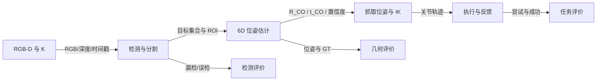
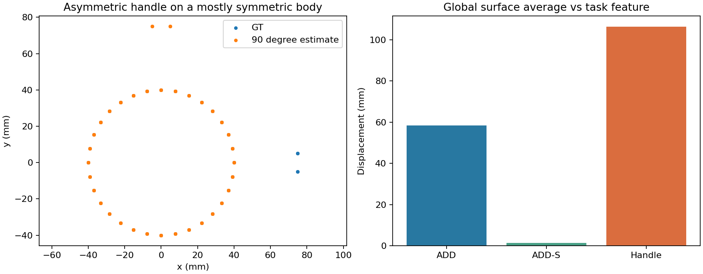
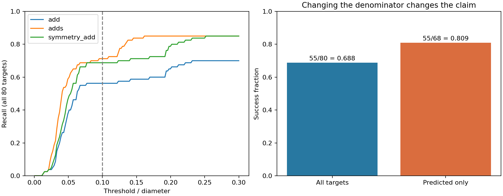

# D40 · 从“误差更小”到“结论可信”：6D 位姿评价与失败归因

[返回学习入口](../_index.md) · [本周日程](../P3-项目实战-日程.md) · [上一课：基线](../day39/Daily-Learning-Pack.md) · [实验代码](demo.py)

**一个位姿算法的成绩，由目标集合、模型坐标、对称性、误差函数、阈值和失败分母共同定义。把其中任何一项悄悄换掉，数值就不再回答原来的问题。**

Day39 已经把原候选 NOCS/EPro-PnP 放进合适的数据条件。今天假设算法吐出了旋转矩阵和平移向量，追问：这些输出怎样变成可以比较、可以归因、可以指导抓杯子的证据？明天会把评价从单帧延伸到带时间戳的观测—动作—下一观测。

<details>
<summary>个人作答与实验记录（后续更新保留）</summary>

<!-- learner-notes:start -->
> [!note]- 个人作答与复盘（保留区）
> 尚未填写；材料已生成不表示个人验收通过。
<!-- learner-notes:end -->

</details>

<!-- daily-pack-generated:start -->

## 1 学习目标与路线

完成本课后，应能手算纯平移的 ADD，解释 ADD-S 对称容忍的代价，写出不丢失失败样本的评价器，并从逐样本结果定位“检测丢失、坐标错误、几何精度、任务失败”四类问题。

| 顺序 | 知识主线 | 要回答的问题 |
| --- | --- | --- |
| 1 | 评价在系统中的位置 | 这个指标对应哪一种成功？ |
| 2 | 位姿与对称误差 | 相同外观是否意味着相同抓取动作？ |
| 3 | 目标集合、阈值与聚合 | 68 个输出能否用作 80 个任务的分母？ |
| 4 | 工程记录与诊断 | 哪些信息必须逐目标保存？ |
| 5 | 受控实验 | 改一个阈值或对称约定，结论怎样改变？ |

## 2 宏观：一套系统需要几种“成功”



图中的三个评价出口有不同分母。检测评价关心候选目标是否正确；几何评价关心预测刚体变换是否符合参考；抓取评价关心真正执行后是否满足任务条件。**位姿准确是抓取成功的重要条件，但不是充分条件**：夹爪宽度、IK、碰撞、摩擦和延迟仍可能导致失败。

本课主实验采用“每个预先指定目标最多一个位姿预测”的定位教学协议。80 个目标全都进入分母，未输出算失败。它不是开放场景检测 AP，也不是完整 BOP 官方评测器。若允许多个候选，必须额外定义排序、实例匹配和重复预测处理，不能对每个 GT 偷选误差最小的一条。

## 3 微观：从刚体变换到表面误差

### 3.1 先固定坐标、单位与模型

令模型点 $x_i\in\mathbb R^3$，单位为米；$T_{CO}=(R,t)$ 把物体坐标变成相机坐标：

$$
y_i=Rx_i+t,\qquad R^TR=I,\quad\det R=1.
$$

参考位姿为 $(R^*,t^*)$。模型点数组 `X[N,3]`，旋转 `R[3,3]`，平移 `t[3]`；NumPy 行向量写成 `X @ R.T + t`。把 $T_{OC}$ 当 $T_{CO}$ 使用，通常比模型结构差异造成的误差更大。形状正确不代表语义正确。

一个包含 $N$ 个点的模型要固定点采样规则。网格顶点平均对网格细分密度敏感；若对一侧密集加点，该侧在均值中的权重就变大。正式比较使用同一官方模型/采样协议，并记住这里平均的是采样点，不自动等价于表面积积分。

### 3.2 ADD：同一个模型点应到同一个位置

Average Distance of Model Points，平均模型点距离：

$$
e_{\mathrm{ADD}}=\frac1N\sum_i\|Rx_i+t-(R^*x_i+t^*)\|_2.
$$

单位为米，不平方。它把旋转和平移通过物体几何联系起来。纯平移误差 $\Delta t$ 时，各点位移相同，所以 $e_{ADD}=\|\Delta t\|$；纯旋转时，离旋转轴越远的点移动越大。

对于距离转轴 $r$ 的点，旋转误差 $\theta$ 引起弦长：

$$
d=2r\sin(\theta/2)\approx r\theta.
$$

近似要求角度小且以弧度表示。杯柄距轴 $r=75\,\mathrm{mm}$，偏转 $10^\circ$，位移约 $13.1\,\mathrm{mm}$。同样的角误差，用在很小的物体与长工具上具有不同后果。

> [!question] 先算
> 预测平移比 GT 多了 $(6,8,0)\,\mathrm{mm}$，旋转完全正确。模型有 8 个点还是 8 万个点，会改变 ADD 吗？

不会；欧氏长度是 $10\,\mathrm{mm}$，每个点都移动相同距离。脚本用这一性质校验实现。

### 3.3 ADD-S：最近表面可以替代原点编号

对不易区分的对称表面，可考察：

$$
e_{\mathrm{ADD-S}}=\frac1N\sum_{x\in M}\min_{x'\in M}\|Rx+t-(R^*x'+t^*)\|_2.
$$

最近邻可以对每个点独立选择。代码计算 `distance[N,N]` 后沿参考点维度取最小值，教学复杂度 $O(N^2)$；大模型可用 KD-tree，但必须保持相同距离方向与单位。

ADD-S 不要求所有点共同服从同一个对称变换。因此它与“在合法对称群中找最佳一个变换”的误差不是同一个定义：

$$
e_G=\min_{S\in G}\frac1N\sum_i\|Rx_i+t-(R^*Sx_i+t^*)\|_2.
$$

这里的 $G$ 是已知、离散的绕物体原点旋转集合；若物体对称轴不穿过原点，必须用完整刚体对称变换，不能只存旋转。脚本对圆柱提供 $C_4$ 集合，只用于展示共同变换；它不是连续对称搜索器。

### 3.4 对称容忍的真实代价：杯柄在哪里

给一个圆柱主体增加少量杯柄点。主体 160 点，杯柄 6 点；预测绕轴转 $90^\circ$。圆柱表面仍大量重合，最近邻平均可以很小，但杯柄位置已经错了。



横向图显示 GT 和旋转后模型；右图比较整体 ADD、ADD-S 与杯柄位移。实际运行得到 ADD **58.366 mm**、ADD-S **1.311 mm**、杯柄位移 **106.301 mm**。这个例子不是说 ADD-S 没用，而是说明**任务关键几何不能被一个整体平均指标替代**。如果需要抓住杯柄，就必须另评杯柄定位或对应抓取可行性。

> [!warning] “近似圆柱”不等于“可忽略所有绕轴旋转”
> 外观对称、几何对称、标注对称、操作等价是四种不同约定。带纹理、杯柄或特定开口方向时，必须明确要保留哪种信息。

## 4 微观：阈值与分母怎样改变成绩

### 4.1 绝对阈值与相对直径阈值

模型直径 $d_M=\max_{i,j}\|x_i-x_j\|$。一种教学判据是 $e<\alpha d_M$，本实验 $\alpha=0.1$。若小物体直径 $50\,\mathrm{mm}$，门限为 $5\,\mathrm{mm}$；大物体直径 $300\,\mathrm{mm}$，门限为 $30\,\mathrm{mm}$。这一门限归一了物体尺度，却不能直接代表夹爪容差。

正式报告应写 `metric=ADD, comparator=<, threshold=0.1*diameter`，不是只写“准确率”。边界值使用 `<` 还是 `<=` 也应固定。任务侧还可以增加绝对毫米门限，但不能混为同一列分数。

### 4.2 缺失预测必须留下一个失败

若目标数 $N_T=80$，输出数 $N_P=68$，几何达标数 $N_S=55$：

$$
\mathrm{Recall}_{all}=55/80=68.75\%,\qquad
\mathrm{Accuracy}_{conditional}=55/68\approx80.88\%.
$$

后者回答“已经给出预测的目标中有多少合格”，不能替代前者。一个只挑最容易的目标才输出的系统可以拥有很高条件准确率，而没有完成大部分任务。



左图横轴是阈值/模型直径，纵轴包含全部 80 个目标；曲线最高受 68/80 的输出覆盖率限制。右图保持同样 55 个成功，只换分母，直观展示乐观偏差。图中 ADD-S 对非对称物体也较宽松，不应据此擅自更换正式协议。

### 4.3 微平均、宏平均与样本相关性

若杯子 90 个、盒子 10 个，系统杯子成功 81 个、盒子成功 1 个，微平均为 $82/100=82\%$；按物体宏平均为 $(90\%+10\%)/2=50\%$。两者都能报告，但回答的问题不同。前者贴近这份数据的目标频率，后者让每类等权。

连续视频帧不是独立抽样。置信区间若按帧 bootstrap，会把相邻帧当成新增独立证据，通常过于乐观。应按场景/序列进行成组重采样，并保留每场景目标数；很少的场景即使有很多帧，泛化证据仍有限。

## 5 与 BOP、NOCS 和原候选的接口边界

BOP 2019 对特定刚体定位定义了 VSD、MSSD、MSPD 及阈值平均召回；官方输出包含 `scene_id,im_id,obj_id,score,R,t,time`，其中平移使用毫米。VSD比较可见表面，MSSD比较对称处理后的最大表面距离，MSPD使用最大投影距离。**本课的 ADD/ADD-S 教学曲线不是 BOP AR。**正式提交应锁定任务版本并用官方评估器。[BOP 2019 官方协议](https://bop.felk.cvut.cz/challenges/bop-challenge-2019/)

NOCS 的类别级设定包含未见实例的形状/尺度条件；YCB-Video、LineMOD 的已知物体级 CAD 条件不同。EPro-PnP 是概率化 PnP 学习组件，不能只凭名字把任意类别级输入映射到已知 CAD 点。比较前列出：训练物体、测试物体、已知模型、是否估计尺度、输入模态、检测框来源、是否使用深度。今天不重新选择项目路线，而是把 Day36–39 已选的条件固定在评价头部。

## 6 工程：逐目标记录比总分更有诊断力

建议每个目标生成一条记录：

```text
(scene_id, frame_id, instance_id, object_id)
protocol_id, model_hash, unit, T_direction, symmetry_version
prediction_present, invalid_reason, score
ADD_m, symmetry_ADD_m, translation_m, rotation_deg
visibility_bin, depth_bin, latency_ms, detector_source
```

`prediction_present=false` 与“存在但 SO(3) 无效”要分开。前者定位检测/输出覆盖问题；后者定位模型数值或接口。对全目标 recall 都算失败，但根因不能被一个无穷大吞掉。

对称物体不要只看普通旋转角：等价旋转可能角度很大但几何正确。位姿误差也不要只看重投影：物体与平移同时乘以 1000 可以保留像素投影，却破坏公制动作。

调试顺序：先验证 GT 与模型坐标→单位与 $R$ 合法性→目标 ID 与重复输出→漏检分母→对称性→按距离/可见性/物体分组→最后再归因到网络。只有这些检查稳定后，W7 的模型改进才有可解释意义。

## 7 动手：先预测，再改变一个变量

依赖 Python、NumPy、Matplotlib。无下载、无硬件、无模型权重。所有输入由 seed40 构造，模型尺寸和误差均在脚本可见。输出是教学验证，不是项目正式测试分数。

从库根目录运行：

```bash
python3 3d_learning/day40/demo.py
python3 3d_learning/day40/demo.py --threshold 0.05 --out-dir /tmp/day40-threshold005
```

先预测：减小阈值会使三个 recall 增大、减小还是不变？然后运行；除了阈值不改随机种子、模型、预测或目标集合。比较成功数与曲线，而不是只比较“漂亮”的图。

同日已执行阈值0.05的单变量对照：成功数55→37，召回68.75%→46.25%，预测仍为68/80。见[改阈值结果](../../_assets/3d_learning/day40/threshold005/results.json)。这验证的是更严格的合格定义，没有改变算法输出。

实际验证：2026-10-24，Python3.11.15、NumPy1.26.4、Matplotlib3.10.9，CPU；默认 80 次目标评价、68 个预测、55 个成功。恒等变换 ADD=0、10mm 纯平移 ADD=10mm、圆柱四分之一转 ADD-S 接近浮点零。计算部分约 0.061s，仅为本机小数组一次测量，不代表完整机器人延迟。原始结果见[results.json](../../_assets/3d_learning/day40/results.json)，逐样本见[per_target.json](../../_assets/3d_learning/day40/per_target.json)。

> [!note]- 完整可复制代码
> ```python
> """D40: synthetic pose metrics; not a BOP benchmark submission."""
> from pathlib import Path
> import argparse, json, platform, time
> import numpy as np
> import matplotlib
> matplotlib.use('Agg')
> import matplotlib.pyplot as plt
> 
> 
> def rz(a):
>     c, s = np.cos(a), np.sin(a)
>     return np.array([[c, -s, 0], [s, c, 0], [0, 0, 1.]])
> 
> 
> def transform(x, r, t):
>     return x @ r.T + t
> 
> 
> def add(x, r, t, r_gt=np.eye(3), t_gt=np.zeros(3)):
>     return float(np.linalg.norm(transform(x, r, t)-transform(x, r_gt, t_gt), axis=1).mean())
> 
> 
> def adds(x, r, t, r_gt=np.eye(3), t_gt=np.zeros(3)):
>     a, b = transform(x, r, t), transform(x, r_gt, t_gt)
>     return float(np.linalg.norm(a[:, None]-b[None], axis=2).min(axis=1).mean())
> 
> 
> def symmetry_add(x, r, t, symmetries):
>     # One common symmetry for all vertices, unlike ADD-S nearest neighbours.
>     return min(add(x, r, t, s, np.zeros(3)) for s in symmetries)
> 
> 
> def diameter(x):
>     return float(np.linalg.norm(x[:, None]-x[None], axis=2).max())
> 
> 
> def main():
>     ap = argparse.ArgumentParser()
>     ap.add_argument('--threshold', type=float, default=.1, help='fraction of model diameter')
>     ap.add_argument('--out-dir', type=Path, default=Path(__file__).resolve().parents[2]/'_assets/3d_learning/day40')
>     args = ap.parse_args()
>     if not 0 < args.threshold < 1:
>         raise ValueError('threshold must be a diameter fraction between 0 and 1')
>     out = args.out_dir; out.mkdir(parents=True, exist_ok=True)
>     rng = np.random.default_rng(40); start = time.perf_counter()
>     angle = np.arange(32)*2*np.pi/32
>     ring = np.array([[.04*np.cos(a), .04*np.sin(a), z] for a in angle for z in np.linspace(-.05,.05,5)])
>     handle = np.array([[.075,y,z] for y in [-.005,.005] for z in [-.015,0,.015]])
>     models = [ring, np.concatenate([ring,handle])]
>     syms = [[rz(a) for a in [0,np.pi/2,np.pi,3*np.pi/2]], [np.eye(3)]]
>     rows = []
>     for i in range(80):
>         obj = i//40; x = models[obj]
>         present = i % 7 != 0
>         a = rng.normal(0,.08) + (np.pi/2 if obj==0 and i%3==0 else 0)
>         t = rng.normal(0,.003,3) + (np.array([.025,0,0]) if i%5==0 else 0)
>         vals = [add(x,rz(a),t),adds(x,rz(a),t),symmetry_add(x,rz(a),t,syms[obj])]
>         rows.append(dict(id=i,obj_id=obj,present=present,diameter_m=diameter(x),
>                          add_m=vals[0] if present else None,
>                          adds_m=vals[1] if present else None,
>                          symmetry_add_m=vals[2] if present else None))
>     thresholds = np.linspace(.001,.3,150)
>     recalls = {}
>     for key in ['add_m','adds_m','symmetry_add_m']:
>         recalls[key]=[sum(r['present'] and r[key] < q*r['diameter_m'] for r in rows)/len(rows) for q in thresholds]
>     success=sum(r['present'] and r['symmetry_add_m']<args.threshold*r['diameter_m'] for r in rows)
>     found=sum(r['present'] for r in rows)
>     special=dict(add_mm=1000*add(models[1],rz(np.pi/2),np.zeros(3)),
>                  adds_mm=1000*adds(models[1],rz(np.pi/2),np.zeros(3)),
>                  handle_displacement_mm=1000*np.linalg.norm(handle@rz(np.pi/2).T-handle,axis=1).mean())
>     result=dict(seed=40,python=platform.python_version(),numpy=np.__version__,matplotlib=matplotlib.__version__,
>                 dataset='80 synthetic targets, 2 analytic models', units='m; figures mm',
>                 threshold_fraction=args.threshold,attempts=80,predictions=found,successes=success,
>                 recall_all=success/80,incorrect_conditional_recall=success/found,
>                 asymmetric_handle_counterexample=special,
>                 checks=dict(identity_add=add(ring,np.eye(3),np.zeros(3)),
>                             translation_10mm=add(ring,np.eye(3),np.array([.01,0,0])),
>                             c4_rotation_adds=adds(ring,rz(np.pi/2),np.zeros(3))),
>                 timing_seconds=time.perf_counter()-start,
>                 scope='No trained model, real data, BOP VSD/MSSD/MSPD evaluation or robot execution')
>     assert abs(result['checks']['translation_10mm']-.01)<1e-12
>     assert result['checks']['c4_rotation_adds']<1e-12
>     (out/'results.json').write_text(json.dumps(result,indent=2),encoding='utf-8')
>     (out/'per_target.json').write_text(json.dumps(rows,indent=2),encoding='utf-8')
>     fig,axes=plt.subplots(1,2,figsize=(11,4.3),layout='constrained')
>     for key,y in recalls.items(): axes[0].plot(thresholds,y,label=key.removesuffix('_m'))
>     axes[0].axvline(args.threshold,color='gray',ls='--'); axes[0].set(xlabel='Threshold / diameter',ylabel='Recall (all 80 targets)',ylim=(0,1)); axes[0].legend()
>     axes[1].bar(['All targets','Predicted only'],[success/80,success/found],color=['#2878a1','#da6d3e'])
>     for k,v in enumerate([success/80,success/found]): axes[1].text(k,v+.015,f'{success}/{[80,found][k]} = {v:.3f}',ha='center')
>     axes[1].set(ylim=(0,1),ylabel='Success fraction',title='Changing the denominator changes the claim')
>     fig.savefig(out/'recall_protocol.png',dpi=160); plt.close(fig)
>     fig,axes=plt.subplots(1,2,figsize=(11,4.3),layout='constrained')
>     axes[0].scatter(models[1][:,0]*1000,models[1][:,1]*1000,s=9,label='GT')
>     rotated=models[1]@rz(np.pi/2).T
>     axes[0].scatter(rotated[:,0]*1000,rotated[:,1]*1000,s=9,label='90 degree estimate'); axes[0].axis('equal')
>     axes[0].set(xlabel='x (mm)',ylabel='y (mm)',title='Asymmetric handle on a mostly symmetric body');axes[0].legend()
>     axes[1].bar(['ADD','ADD-S','Handle'],list(special.values()),color=['#2878a1','#48a086','#da6d3e'])
>     axes[1].set(ylabel='Displacement (mm)',title='Global surface average vs task feature')
>     fig.savefig(out/'symmetry_boundary.png',dpi=160);plt.close(fig)
>     print(json.dumps(result,indent=2))
> 
> if __name__=='__main__': main()
> ```

## 8 回到宏观：错误更小，还要追问什么

三句话总结：位姿误差先要绑定几何与坐标契约。评价协议必须保留所有原定目标以及未输出的失败。任务关键部位还需要独立检查，才能把几何成绩接到操作成功。

最值得掌握的四点：ADD 的刚体几何意义，让角度和平移有物体尺度；ADD-S 与共同对称变换的区别，防止隐藏错误；失败分母，防止选择性报告；分组诊断，让下一轮模型改进针对真实误差来源。容易混淆的边界是“对称几何/操作等价”和“条件正确率/总体召回”。

今日产出：一份 `per_target.json`，一张带单位和对称约定的协议卡，默认/改阈值结果对比，以及对杯柄反例的解释。正式项目结果仍待真实数据与官方评价器。

## 9 自测

1. 纯平移 $(6,8,0)$mm 的 ADD 是多少，为什么与点数无关？
2. $r=100$mm、旋转误差 $5^\circ$ 时单点位移约多少？
3. ADD-S 与在合法对称群上最小化 ADD，为什么不等价？
4. 100 个目标、70 个输出、56 个合格，应如何同时报告覆盖率、条件准确率和总体召回？
5. 为什么“像素误差很小”不能证明动作的米制尺度正确？
6. 对带杯柄物体，ADD-S 很低而杯柄位移很高，应如何设计额外指标？
7. 两个方法只在成功输出帧上比较 median ADD，会遗漏什么？
8. 将本课曲线标为 BOP AR 是否正确？给出一个必要的补充环节。

## 10 未理解问题与次日衔接

待个人填写：对称集合应由几何、纹理还是任务定义？当前项目的官方目标清单在哪里？失效帧应保留哪些诊断字段？这些问题在 W7 消融与 W8 抓取测试中继续验证。明天 Day41 从“同一个目标的记录”推进到“同一时刻的观测和动作”，先检查曝光时间与接收时间的区别。

精读任务：阅读 BOP 2019 官方页面的 Task definition、Format of results、Evaluation methodology，逐项抄出输入、单位、三种误差及召回聚合；再看 [BOP toolkit 的 pose_error.py](https://github.com/thodan/bop_toolkit/blob/master/bop_toolkit_lib/pose_error.py) 中 `add`、`adi`、`mssd`、`mspd` 的接口。目标是写出一张本项目协议差异卡，不能用脚本运行替代个人精读。

## 11 自测核对答案

> [!note]- 展开答案与判分标准
> 每题 0/1/2 分：0=结论错误；1=结论正确但缺少条件或解释；2=结论、依据与适用边界完整。建议至少 12/16，且第4题分母不能错；这里只给标准，不记录个人成绩。
>
> 1. 10mm；所有对应点平移向量相同，平均不改变长度。
> 2. $2\times100\sin2.5^\circ\approx8.72$mm；小角度近似同样成立。
> 3. ADD-S 可为每点选择不同最近邻；对称群方法必须共同使用一个允许的刚体变换。
> 4. 输出覆盖率70%，条件准确率56/70=80%，总体召回56/100=56%。
> 5. 公共尺度变换可能保持投影，且错误模型单位/平移单位会一起抵消；需要公制参照核验。
> 6. 杯柄关键点距离、方向或杯柄抓取可行率，并固定任务所需的对称约定。
> 7. 漏检、无效位姿和困难帧被排除，不能反映全目标完成率；应补覆盖和全目标召回。
> 8. 不正确；需要指定 BOP 版本、目标清单、VSD/MSSD/MSPD 与官方匹配/阈值聚合，实际用官方评估器。

<!-- daily-pack-generated:end -->
