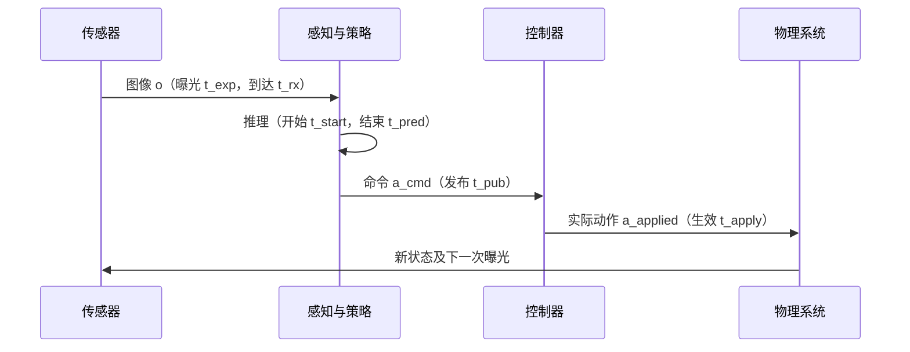
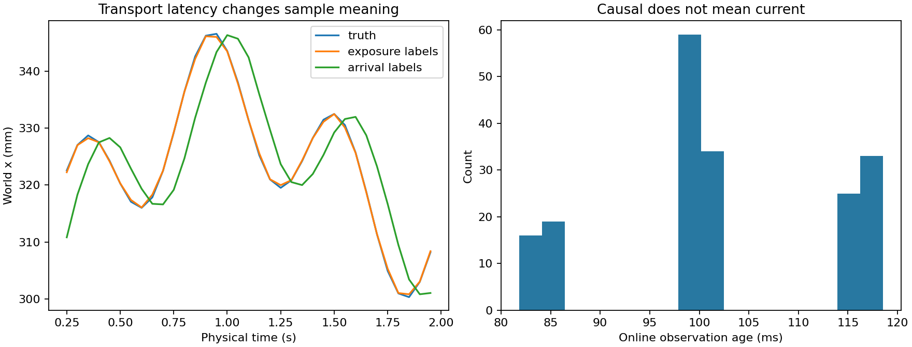
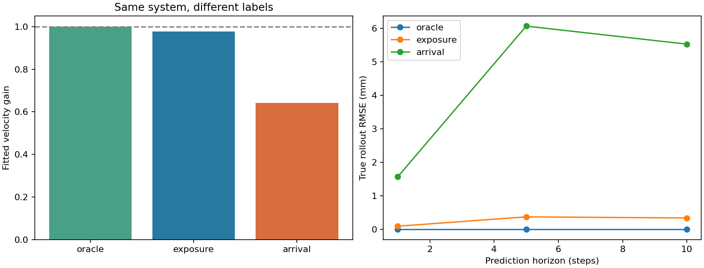

# D41 · 从单帧预测到可复现转移：时间戳、动作契约与因果边界

[返回学习入口](../_index.md) · [本周日程](../P3-项目实战-日程.md) · [上一课：评价协议](../day40/Daily-Learning-Pack.md) · [实验代码](demo.py)

**世界模型和模仿策略首先依赖“这一条数据究竟发生在何时、执行了什么动作”的明确语义；一个看似连续的日志，可能并不包含正确的转移样本。**

上一课固定了目标、坐标、指标和失败分母。今天把一条位姿记录嵌入时间轴：相机什么时候曝光，图像什么时候到达，策略什么时候输出动作，控制器什么时候真正执行？抓杯子时 80ms 的延迟并不只是“慢一点”，它可能把动作与另一个物理状态配在一起。

<details>
<summary>个人作答与实验记录（后续更新保留）</summary>

<!-- learner-notes:start -->
> [!note]- 个人作答与复盘（保留区）
> 尚未填写；材料已生成不表示个人验收通过。
<!-- learner-notes:end -->

</details>

<!-- daily-pack-generated:start -->

## 1 学习目标与路线

能区分采集时间和接收时间；写出带单位、坐标、有效区间的动作记录；用同步检查拒绝跨 episode 的伪转移；实现按曝光时间构造离线标签与按到达时间限制在线观测；解释错位怎样使模型学到错误增益。

| 顺序 | 知识主线 | 要回答的问题 |
| --- | --- | --- |
| 1 | 真实时序闭环 | 数据产生与被使用各是什么时间？ |
| 2 | 转移与动作定义 | 一个动作数值对应速度、位移还是绝对目标？ |
| 3 | 对齐与因果性 | 离线可以插值，在线能否看未来？ |
| 4 | 可复现数据管线 | 哪些字段决定别人能否复跑？ |
| 5 | 受控实验 | 只有时间标签错了，动力学参数能错多少？ |

## 2 宏观：把箭头展开成时间轴



每根箭头都传递值和时间。传输延迟 $t_{rx}-t_{exp}$、推理延迟 $t_{pred}-t_{start}$、执行等待 $t_{apply}-t_{pub}$ 是不同对象。日志若只保留接收时钟，会把相机看到的过去误当现在；若只保存发出的命令，则无法知道控制器是否限幅、插值或拒绝。

对于真实 RGB-D 系统还需区分 RGB 和深度各自的采集时刻。先把两种图像几何对齐，不会自动使它们在时间上对齐。物体速度 $v=0.2\,m/s$，时间错位 $\delta t=0.03\,s$，仅平移就能造成约 $6\,mm$ 的几何差异。

## 3 微观：什么才是一个转移样本

### 3.1 状态、观测和历史分别写清楚

理想动力学：

$$
s_{k+1}=f(s_k,a_k,\Delta t_k).
$$

状态 $s_k$ 若充分，下一状态在条件上无需更早历史；相机观测通常只是 $o_k=h(s_k)+\epsilon_k$。同一个杯子位置可能对应不同速度或接触力，故直接以单帧图像当“完整状态”未必成立。实际可提供历史 $o_{k-L+1:k}$、本体状态、接触状态或递归潜状态。

本课教学状态只有世界系一维位置 $x$，动作是已施加、零阶保持的世界系速度 $v$，无惯性、无饱和、无接触。此时位置与已知动作足以预测下一位置；这是一维积分器，不代表机械臂真实状态定义。

### 3.2 三种动作的量纲决定三种更新

| 动作字段 | 单位 | 正确解释 | 不能直接替代什么 |
| --- | --- | --- | --- |
| `target_position` | m | 控制器追踪一个绝对位置 | 不能再每步累加 |
| `delta_position` | m / action | 本次相对位移 | 不能无条件乘采样周期 |
| `velocity` | m/s | 有效区间内的速度 | 必须积分时间 |

对本实验：

$$
x_{k+1}=x_k+v_k\Delta t,\qquad \Delta t=0.05\,s.
$$

手算：$x_k=0.300m$、$v_k=0.120m/s$，下一状态应为 $0.306m$。若把周期错写为 $0.10s$，预测变成 $0.312m$；若把同一个 `.12` 当每步位移，则一次跳到 $0.420m$。

> [!warning] VLA 的七个数不是通用动作协议
> 维数一致不会保证位置/增量/速度一致，也不保证参考系、旋转参数化、夹爪开合方向或控制频率一致。反归一化只是恢复数值尺度，随后仍要匹配执行接口。

### 3.3 命令与实际动作必须分字段

推荐最小记录包含：

```text
sample_id, episode_id, sensor_id
sensor_time, receive_time, clock_domain, clock_offset_version
observation, observation_frame, calibration_id
command, command_unit, command_frame, command_type
command_time, apply_time, valid_until, controller_mode
applied_action, applied_action_source
next_observation_time, terminal, truncated, valid_mask
```

`applied_action_source` 可是控制器回报、编码器估计或明确的仿真假设；不要把“已发布”写成“已实际执行”。位置控制下从关节角差分得到的速度又是一种测量估计，滤波和延迟也应记录。缺少实际动作并不让数据完全没用，但它限制了能声称训练的因果模型。

## 4 微观：时间对齐有两道不同检查

### 4.1 先处理时钟域，再找邻近样本

两个设备都写 `timestamp=100.0`，未必指同一个物理时刻。若时钟变换近似为 $t_{host}=a\,t_{sensor}+b$，$b$ 是偏移，$a$ 表示漂移。先估计或校验这个映射，再做最近邻；扩大匹配窗口不能修复系统偏移。

当状态速度变化不快时，时间不确定性 $\sigma_t$ 会引起额外位置不确定性，局部近似：

$$
\sigma_x^2\approx \sigma_{measurement}^2+v^2\sigma_t^2.
$$

这里暂把两种误差当独立、速度近似常数。高速、转动或接触切换时需要更完整传播；不能把一个标量容差套进所有场景。

### 4.2 离线标签允许插值，但在线输入必须因果

离线整理数据时，可以用曝光时间前后的两个状态测量重建目标时刻：

$$
\tilde x(t)=(1-\lambda)x(t_0)+\lambda x(t_1),\quad
\lambda=\frac{t-t_0}{t_1-t_0},\quad t_0\le t\le t_1.
$$

这依赖区间内近似线性；本例速度在控制时刻改变，30Hz 摄像与20Hz 控制不完全重合，所以插值仍有误差。姿态不能对旋转矩阵元素简单线性插值后假装仍在 SO(3)，应使用约定清晰的群插值或四元数方法。

在线在时刻 $t$ 选择观测，则必须满足 $t_{rx}\le t$。即便曝光早于 $t$，尚未到达的数据也不能作为当时策略输入。可用输入仍然陈旧：

$$
\mathrm{age}=t-t_{exp}\ge0.
$$

“只使用已到达数据”证明因果性，不证明新鲜度。可以增加 age 特征、利用模型外推到当前时刻，或超时拒绝；但外推会引入模型误差，必须独立评价。

### 4.3 最近邻与 ROS 同步器解决的是局部问题

近似同步工具可以按消息时间戳和允许窗口配对流，但它本身不知道采集时钟是否校准、消息是否陈旧、动作是否真正施加。官方 [ROS message_filters](https://github.com/ros2/message_filters) 提供基于时间的过滤和同步机制；这里不依赖 ROS 安装，也不声称跑通实机同步器。阅读其 ApproximateTime/ApproximateTimeSynchronizer 机制时，分别记录队列长度、时间窗口与消息 stamp 的语义，而不是把它们统一称作“延迟”。

## 5 微观：错位如何改变模型学到的参数

拟合一维增益模型：

$$
\widehat{\Delta x}_k=g\,v_k\Delta t.
$$

记 $q_k=v_k\Delta t$，平方误差最优值为：

$$
\hat g=\frac{\sum_{k\in train}q_k\Delta x_k}{\sum_{k\in train}q_k^2}.
$$

推导只需对 $\sum(gq_k-\Delta x_k)^2$ 求导为零。正确标签下 $\Delta x_k=q_k$，所以 $g=1$。若标签延迟 $\tau$，它近似反映更早的速度，$g$ 便取决于当前动作与过去动作的相关性。

对单频正弦速度且采样充分、边界效应可忽略，可直觉得到 $g\approx\cos(\omega\tau)$：时延越接近四分之一周期，当前动作与错误标签越不相关。这不是“系统变得没有响应”，而是数据配错了。

本实验同时包含两个频率和相机插值，因此不直接用余弦式替代结果。实际拟合：真实标签 $g=1.0000$；曝光插值 $g=0.9778$；错误接收时间标签 $g=0.6423$。同一套真实动力学，错误时间语义让模型看起来只有原来的约64%增益。



左图每条曲线表示同一物理过程在不同标签下的位置。右图在线输入的平均 age 约 **102.03ms**，而配置的基础传输延迟为80ms；剩余来自传输抖动与等待下一帧。旧位置相对当前真值 RMSE **8.847mm**。



图中的 horizon 以控制步计，每步50ms。曝光对齐模型在1/5/10步真值 RMSE 约0.097/0.376/0.343mm；接收标签模型约1.569/6.063/5.526mm。10步不一定大于5步，因为正负速度会相互抵消；**不能把误差曲线必须单调上升当成动力学定律**。

## 6 工程：episode、数据划分与可复现账本

一次 reset 后的状态不由上一回合末动作自然产生。只凭相邻数组下标构造 $(s,a,s')$ 会把 reset 跳变学成异常动力学。必须要求 `episode_id[k]==episode_id[k+1]`；终止或截断还要按环境语义决定是否可用于价值 bootstrap，而不是机械地丢同一种标记。

实验故意造一个 reset 边界，位置跳变33.454mm，检测到并拒绝1条跨回合配对。它不参与增益训练，只用于独立展示数据边界检查。

保存复现实验所需的：源数据/校准/代码/配置版本、种子、模态与单位、时钟映射、采样和插值规则、训练/验证/测试 episode 清单、失败/拒绝原因、模型参数、逐样本误差、机器与依赖版本。相同seed不能弥补数据泄漏或时钟变化；连续片段的训练/测试也不证明跨场景泛化。本课按时间留出65个转移，只验证合成信号上的时间外推，正式项目仍需按场景/episode独立划分。

## 7 动手：把时间语义当作受控变量

从库根目录运行：

```bash
python3 3d_learning/day41/demo.py
python3 3d_learning/day41/demo.py --latency-ms 0 --out-dir /tmp/day41-latency0
```

先预测：去掉80ms基础延迟后，arrival 对齐是否会与 oracle 完全一致？不会必然一致，因为仍有0–10ms抖动和相机采样插值误差。保持所有其他变量一致后，比较拟合增益、对真实状态的一步误差及多步误差。

同日已执行0ms基础延迟对照：arrival模型增益0.9693，真实一步误差0.134mm；在线平均age仍24.15ms，旧状态误差仍2.304mm。见[零基础延迟结果](../../_assets/3d_learning/day41/latency0/results.json)。这把传输延迟与采样/等待导致的陈旧性分开。

依赖仅 NumPy、Matplotlib。已于2026-10-24在CPU运行，Python3.11.15/NumPy1.26.4/Matplotlib3.10.9；seed41，120个训练转移、65个留出转移，实际动作周期0.05s。真实标签模型误差约浮点零；曝光/接收标签对真实一步位移 RMSE 分别0.097/1.564mm。把训练元数据周期错写为0.1s会拟合出 $g=0.5$，这只是错误被参数吸收，不能据此认定接口正确。结果：[results.json](../../_assets/3d_learning/day41/results.json)，数组：arrays.npz (not exported: excluded by publication policy)。

> [!note]- 完整可复制代码
> ```python
> """D41: timestamp contract and action-conditioned transitions, CPU synthetic data."""
> from pathlib import Path
> import argparse,json,platform,time
> import numpy as np
> import matplotlib
> matplotlib.use('Agg')
> import matplotlib.pyplot as plt
> 
> 
> def rms(x): return float(np.sqrt(np.mean(np.asarray(x)**2)))
> 
> 
> def main():
>     ap=argparse.ArgumentParser()
>     ap.add_argument('--latency-ms',type=float,default=80)
>     ap.add_argument('--out-dir',type=Path,default=Path(__file__).resolve().parents[2]/'_assets/3d_learning/day41')
>     args=ap.parse_args()
>     if args.latency_ms<0: raise ValueError('negative latency')
>     out=args.out_dir;out.mkdir(parents=True,exist_ok=True)
>     rng=np.random.default_rng(41); start=time.perf_counter()
>     dt=.05
>     t=np.arange(201)*dt
>     u=.12*np.sin(2*np.pi*t/.6)+.04*np.sin(2*np.pi*t/1.9)
>     x=np.r_[.3,.3+np.cumsum(u[:-1]*dt)]
>     exposure=np.arange(300)/30+rng.uniform(-.002,.002,300)
>     exposure=np.clip(exposure,0,t[-1]); exposure.sort()
>     arrival=exposure+args.latency_ms/1000+rng.uniform(0,.01,len(exposure))
>     observed=np.interp(exposure,t,x)
>     ticks=np.arange(5,191); q=t[ticks]
>     # Offline labels may interpolate exposure-bracketing observations.
>     correct=np.interp(q,exposure,observed)
>     # Wrong: assign the old measurement to the time it arrives.
>     wrong=np.interp(q,arrival,observed)
>     pairs={name:np.diff(a) for name,a in [('oracle',x[ticks]),('exposure',correct),('arrival',wrong)]}
>     feature=u[ticks[:-1]]*dt
>     train=np.arange(len(feature))<120
>     metrics={}; gains={}
>     for name,delta in pairs.items():
>         g=float(np.dot(feature[train],delta[train])/np.dot(feature[train],feature[train]))
>         gains[name]=g
>         metrics[name]=dict(gain=g,heldout_label_rmse_mm=1000*rms(g*feature[~train]-delta[~train]),
>                            heldout_true_step_rmse_mm=1000*rms(g*feature[~train]-pairs['oracle'][~train]))
>     # Online only use an observation that has actually arrived.
>     latest=np.searchsorted(arrival,q,side='right')-1
>     valid=latest>=0
>     assert np.all(arrival[latest[valid]]<=q[valid])
>     ages=q[valid]-exposure[latest[valid]]
>     stale_error=observed[latest[valid]]-x[ticks[valid]]
>     future_count=sum(np.searchsorted(exposure,s,side='right')<len(exposure) for s in q)
>     # One demonstration of a reset boundary: no transition crosses episode IDs.
>     episode=np.zeros(len(q),int);episode[100:]=1
>     reset_x=x[ticks].copy();reset_x[100:]+=.3-reset_x[100]
>     same_episode=episode[1:]==episode[:-1]
>     reset_jump=abs(np.diff(reset_x)[~same_episode][0])
>     # Same true displacements but a metadata period of 100ms instead of 50ms.
>     wrong_dt_gain=float(np.dot(2*feature[train],pairs['oracle'][train])/np.dot(2*feature[train],2*feature[train]))
>     rollout={}
>     for name,g in gains.items():
>         rollout[name]={}
>         for horizon in [1,5,10]:
>             starts=np.arange(130,190-horizon)
>             pred=np.array([x[k]+g*np.sum(u[k:k+horizon])*dt for k in starts])
>             rollout[name][str(horizon)]=1000*rms(pred-x[starts+horizon])
>     result=dict(seed=41,python=platform.python_version(),numpy=np.__version__,matplotlib=matplotlib.__version__,
>                 unit='m, m/s, s',action='applied world-x velocity held on [t,t+0.05)',
>                 state='synthetic noiseless position; camera measurements linearly interpolated',
>                 latency_base_ms=args.latency_ms,dt_seconds=dt,train_transitions=120,
>                 test_transitions=int((~train).sum()),metrics=metrics,rollout_true_rmse_mm=rollout,
>                 online_mean_age_ms=1000*float(ages.mean()),online_stale_position_rmse_mm=1000*rms(stale_error),
>                 offline_future_brackets=int(future_count),reset_pairs_rejected=int((~same_episode).sum()),
>                 reset_jump_mm=1000*float(reset_jump),wrong_period_gain=wrong_dt_gain,
>                 all_online_observations_already_arrived=True,elapsed_seconds=time.perf_counter()-start,
>                 scope='Known synthetic dynamics; no trained robot, ROS stream, VLA or world-model benchmark')
>     assert abs(gains['oracle']-1)<1e-12 and abs(wrong_dt_gain-.5)<1e-12
>     (out/'results.json').write_text(json.dumps(result,indent=2),encoding='utf-8')
>     np.savez(out/'arrays.npz',t=q,truth=x[ticks],exposure_aligned=correct,arrival_aligned=wrong,
>              exposure=exposure,arrival=arrival,observed=observed,applied_velocity=u[ticks])
>     fig,axes=plt.subplots(1,2,figsize=(11,4.2),layout='constrained')
>     s=q<2
>     for name,a in [('truth',x[ticks]),('exposure labels',correct),('arrival labels',wrong)]: axes[0].plot(q[s],1000*a[s],label=name)
>     axes[0].set(xlabel='Physical time (s)',ylabel='World x (mm)',title='Transport latency changes sample meaning');axes[0].legend()
>     axes[1].hist(ages*1000,bins=16,color='#2878a1');axes[1].set(xlabel='Online observation age (ms)',ylabel='Count',title='Causal does not mean current')
>     fig.savefig(out/'timestamp_alignment.png',dpi=160);plt.close(fig)
>     fig,axes=plt.subplots(1,2,figsize=(11,4.2),layout='constrained')
>     axes[0].bar(list(gains),list(gains.values()),color=['#48a086','#2878a1','#da6d3e']);axes[0].axhline(1,ls='--',c='gray')
>     axes[0].set(ylabel='Fitted velocity gain',title='Same system, different labels')
>     for name,r in rollout.items():axes[1].plot([1,5,10],list(r.values()),'o-',label=name)
>     axes[1].set(xlabel='Prediction horizon (steps)',ylabel='True rollout RMSE (mm)');axes[1].legend()
>     fig.savefig(out/'transition_error.png',dpi=160);plt.close(fig)
>     print(json.dumps(result,indent=2))
> 
> if __name__=='__main__':main()
> ```

## 8 回到宏观：把接口质量变成模型质量的前置条件

三句话总结：转移样本必须具有真实时间和动作语义。离线重建标签与在线可用输入拥有不同因果限制。先排除错位与单位错误，再讨论世界模型是否需要更大网络。

今日四个重点及原因：曝光/到达区分决定标签代表哪个状态；动作类型与周期决定数值量纲；episode边界决定是否存在真实转移；复现账本决定结果能否重复和解释。最容易混淆的是“已同步/已校时”和“因果/新鲜”，两者各自都需要两个检查。

产出是一张观测—命令—实际动作时间图、一份字段契约、两个延迟配置的结果对比及跨回合拒绝规则。没有记录真实设备、机器人执行或大型模型验证。

## 9 自测

1. 曝光时间与接收时间分别回答什么问题？
2. 0.12m/s 持续50ms移动多少毫米？若该 `.12` 表示每步增量，该怎么解释？
3. 200mm/s 运动下，30ms 时差会产生多大一阶位置偏差？
4. 为什么离线插值可以使用后继观测，但在线策略不能直接使用同一插值输入？
5. 当前时刻已收到图像，能否推断它足够新？应再检查什么？
6. 用100ms元数据拟合50ms真实系统得到增益0.5，能否说明动力学已正确标定？
7. reset 前后相邻两行日志为何不应直接组成转移？
8. 一个模型10步误差小于5步误差，是实现一定错误吗？

## 10 未理解问题与次日衔接

待个人记录：手头设备 stamp 是曝光还是接收？哪个时钟域是权威？真实 applied action 从哪里取得？若只有命令，哪些结论应降级？W8接真实RGB-D、W12仿真与W15双臂同步时会继续用这些契约。

精读任务：从 [ROS message_filters 官方仓库](https://github.com/ros2/message_filters) 的说明及 Python/C++ 同步实现，定位 stamp、队列和匹配窗口的作用，画出一组延迟消息被配对的例子。此次官方在线教程受访问限制，未核验教程逐行运行；本课只实际验证独立CPU实验。明天Day42把本周数据、位姿、评价和时间检查整合为可执行审计与周报告。

## 11 自测核对答案

> [!note]- 展开答案与判分标准
> 每题0/1/2分：错误/结论正确但缺条件/解释与适用边界完整。建议至少12/16，动作单位题与因果题不得全错；未记录个人成绩。
>
> 1. 曝光对应被观测的物理时刻；接收对应数据何时在主机可用，两者之差是传输相关延迟。
> 2. 6mm；若为每步增量则是120mm，不再乘0.05s，须按接口定义执行。
> 3. 6mm，假设近似匀速且其余误差忽略。
> 4. 离线标签可用完整历史重建；在线尚未到达或尚未发生的观测不可作为当时输入，否则泄漏未来。
> 5. 不能；应看曝光到当前的age以及时钟域和校时状态。
> 6. 不能；参数吸收了错误周期，换成正确周期部署会缩小一半位移；要独立核对单位与采样周期。
> 7. reset是外部重置，不由上一动作自然产生，应依据episode和终止语义划分。
> 8. 不一定，误差和正负动作可抵消；应看逐时刻曲线、不同初态及失败边界，而非要求单调。

<!-- daily-pack-generated:end -->
