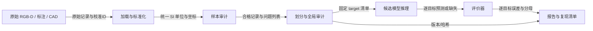
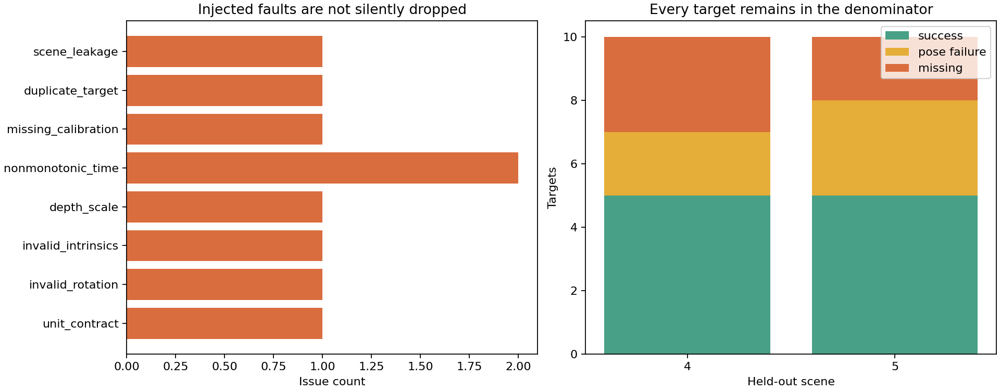

# D42 · 从零散结果到可交接模块：数据审计、评价与 W6 验收

[返回学习入口](../_index.md) · [本周日程](../P3-项目实战-日程.md) · [上一课：时间契约](../day41/Daily-Learning-Pack.md) · [实验代码](demo.py)

**W6 的交付是一个能解释输入、拒绝坏数据、保留失败并复算结果的数据—评价模块。一个漂亮总分无法替代它，一个合成实验也无法替代正式项目验收。**

Day36–41 依次处理任务/数据条件、加载器与划分、坐标投影、候选基线、指标、时间契约。今天把它们汇合成可运行模块，并明确哪些证据已经存在、哪些需要你在正式数据上补齐。下一周才开始有依据地改模型，而不是每换网络同时换一次数据和评价。

<details>
<summary>个人作答与实验记录（后续更新保留）</summary>

<!-- learner-notes:start -->
> [!note]- 个人作答与复盘（保留区）
> 尚未填写；材料已生成不表示个人验收通过。
<!-- learner-notes:end -->

</details>

<!-- daily-pack-generated:start -->

## 1 学习目标与路线

能设计最小可交接接口；实现样本与数据集两个层面的审计；把不合法输入与算法失败分别记录；用内容哈希证明“用的是同一份数据与配置”；生成包含限制和待办的周报告，而非把文件生成勾成个人掌握。

| 顺序 | 知识主线 | 要回答的问题 |
| --- | --- | --- |
| 1 | 模块边界 | 加载、验证、推理、评价各负责什么？ |
| 2 | 数据不变量 | 单条合法是否代表整个数据集合法？ |
| 3 | 可复现结果 | 同一命令如何指向同一证据？ |
| 4 | 审计实验 | 注入错误后，应修复、拒绝还是继续算分？ |
| 5 | 周验收 | 什么完成了，什么仍缺证据？ |

## 2 宏观：把项目拆成可检查的接口



图中的“标准化”和“评价”不能偷偷修复语义。把毫米转换为米需要原始单位证据；把旋转矩阵转置需要知道方向约定。不能因为结果更好就猜哪一种变换正确。

完整工程建议在 vault 外的 `robot_pose_estimation` 中维护；本课 `demo.py` 是独立教学模块，不初始化Git。接口可以分成 `load → normalize → audit → infer → evaluate → report`，每步有明确输入、输出与失败原因。今天实际运行的是 `audit/evaluate/report` 的小实现，不宣称已经完成训练器或大数据加载系统。

## 3 微观：不变量分为样本级和集合级

### 3.1 样本级：形状、范围与语义

位姿旋转需要：

$$
R\in\mathbb R^{3\times3},\quad \|R^TR-I\|<\epsilon,\quad |\det R-1|<\epsilon.
$$

只检查正交不足以排除镜像：$R=\operatorname{diag}(-1,1,1)$ 满足 $R^TR=I$，但行列式为−1，是反射，不是刚体旋转。数值容差应结合标注精度；错误不能靠把容差改大掩盖。

内参 `K[3,3]` 要有限、焦距正；平移 `t[3]` 要有限；预测缺失必须显式 `None`，不能用三个0代表“没有预测”。原始深度转换 $z_{m}=d_{raw}s_{depth}$，其中 $s_{depth}$ 单位m/原始单位，必须正且能追溯。

假设真实深度0.8m，raw=800，则 scale=0.001m/unit；若写为1，得到800m。注意：声明 `unit=m` 并不能证明数值确实以米表示。形式检查之外，还要用GT投影、实物尺度或可信校准检查实际含义；本脚本只做有限的结构/契约检查。

### 3.2 集合级：唯一性、划分与时序

目标唯一键建议为 `(scene_id, frame_id, instance_id)`；教学例每帧只有一个物体，因此用 `(scene,frame,object)`，多实例场景不能照搬这个键。

一个样本完全合法，也可能与另一个样本构成数据泄漏。如果同一场景同时出现在训练和测试，则模型可能通过背景、轨迹或物体布置记住答案。形式化检查：

$$
S_{train}\cap S_{val}=\varnothing,\quad
S_{train}\cap S_{test}=\varnothing,\quad
S_{val}\cap S_{test}=\varnothing.
$$

这只是本课采用的场景隔离规则。已知物体级基准可能允许同一物体跨划分，而类别级未见实例还要求实例集合隔离；不要把“同物体”一概等同泄漏，必须回到任务协议。

在每个 episode 的确定顺序中要求时间严格递增。合法的多传感器同刻消息可能有相同stamp，因此应在相应流内部检查，不能跨传感器乱合并再按时间相等判坏。本课仅单流、每scene一个episode。

## 4 微观：拒绝坏数据，与把模型失败算进分母

两种失败要分开：

| 失败 | 例子 | 正确处理 |
| --- | --- | --- |
| 评价输入无效 | 重复目标、单位未知、GT 非法、划分泄漏 | 阻止发布正式成绩，保留问题清单与原始记录 |
| 算法没有完成目标 | 漏检、无输出、合法但几何误差过大 | 目标仍进入评价分母，记录失败原因 |

为什么不能把所有异常都过滤掉再算分？因为删除目标改变了实验问题。例如原有20个测试目标、10成功、5位姿失败、5无输出。删除5个无输出后得到10/15，掩盖了总体完成率10/20。

另一方面，明显错误的GT也不能简单作为“算法失败”硬算进去。应在看模型结果之前制定GT审计规则，冻结纠正后的目标清单，保留版本变更记录；不同模型都用同一修订清单重评。

本课演示采用 **fail closed（发现协议错误就停止发布成绩）**：审计有问题时 `evaluate` 抛出异常，不能输出一个看起来有效的总分。它不是机器人实时停止控制机制，只是数据评价程序的行为。

## 5 微观：评价模块的契约与可复现性

### 5.1 评价器输入与输出

输入包含完整目标清单和预测，统一单位米，固定阈值10mm。教学对象是8顶点长方体，参考和预测旋转均为单位阵，只有平移误差。因此：

$$
e_{ADD}=\frac18\sum_i\|(x_i+\hat t)-(x_i+t^*)\|=\|\hat t-t^*\|.
$$

这解释了为何示例可以用平移构造可检验结果，又仍对应明确的ADD子问题。它不是完整姿态误差评估器，不能据此声称覆盖任意旋转、对称或可见性。

输出分两层：逐目标 `error_m/present/success/scene`；聚合 `targets/predictions/successes/recall`。缺失误差用JSON `null`，不使用非标准JSON的NaN或Infinity。失败分母通过固定目标清单决定，而非通过过滤后的预测列表决定。

### 5.2 哈希记录了什么，没有记录什么

内容哈希：

$$
h_D=\mathrm{SHA256}(\mathrm{canonicalSerialize}(D)).
$$

同样数据使用稳定键顺序和确定序列化生成同样字节；代码、配置、评价结果分别计算哈希。改变阈值应改变配置哈希；相同输入反复评价应产生相同结果哈希。

哈希证明所比较的内容是否相同，不证明标注真实、算法正确，也不保证另一个GPU平台逐位相同。本课的延迟字段不参与评价结果哈希，因为它每次可能波动。完整实验还需依赖版本、硬件、模型权重与预处理记录，不能只写一个seed。

### 5.3 阈值不从测试集挑最好

W7会试多尺度、损失、几何约束。若每次在同一个测试集挑最好方案、阈值和随机种子，测试集就逐渐变成验证集。建议锁定训练/验证/测试：训练拟合参数，验证选择方案，测试用于最终固定协议报告。可保留预先定义的阈值曲线，但不能挑曲线上最有利的一点冒充预注册结果。

## 6 动手：向数据注入错误，再观察报告怎样拒绝

实验生成60条记录、6个scene，每个scene10帧；前2个scene训练，中间2个验证，后2个测试。另拷贝一份故障输入，注入单位错误、反射矩阵、无效内参、深度scale错误、时间回退、缺校准、重复目标和场景泄漏。



左图显示8类共9个问题，其中重复记录又触发一次时间非递增，所以“问题数”不等于“坏行数”。右图显示清洁输入上两个测试scene的成功/位姿失败/缺失，柱总高始终保持10个目标。

> [!question] 先预测
> 把同一测试目标复制一行，它的单位和位姿都正确，为什么仍然必须拒绝？它不仅可能重复计分，还会改变分母和场景权重。

运行：

```bash
python3 3d_learning/day42/demo.py
python3 3d_learning/day42/demo.py --threshold-mm 2 --out-dir /tmp/day42-threshold2
```

第二次只改阈值：数据哈希应相同，配置哈希应不同，原本3mm误差不再满足2mm门限，成功数应下降。不要修改测试数据来“修复”变差的成绩。

同日已运行2mm阈值：成功数10→0，测试目标仍20，数据哈希保持相同，配置与评价哈希改变。见[改阈值结果](../../_assets/3d_learning/day42/threshold2/results.json)。这一变化属于评价定义，而非模型退化。

实际执行记录：2026-10-24，CPU，Python3.11.15/NumPy1.26.4/Matplotlib3.10.9；固定构造，无随机训练（seed42只作为实验配置标识）。故障输入62条，发现9项问题并阻止评价；清洁原始构造60条，测试20目标、15输出、10成功，召回50%。重复评价结果哈希相同。

这里的“清洁输入”来自独立保留的合成真值构造，**不是程序自动纠正了真实坏数据**。真实项目缺失单位或校准信息时，需要来源证据，不能据此推断修复值。

结果入口：[总结果](../../_assets/3d_learning/day42/results.json) · [审计问题](../../_assets/3d_learning/day42/audit_before.json) · [可复现清单](../../_assets/3d_learning/day42/manifest.json) · [清洁输入](../../_assets/3d_learning/day42/clean_records.json) · [逐目标结果](../../_assets/3d_learning/day42/per_target.json)。

> [!note]- 完整可复制代码
> ```python
> """D42: fail-closed data audit and a small reproducible pose evaluator."""
> from pathlib import Path
> import argparse,copy,hashlib,json,platform,time
> from collections import Counter,defaultdict
> import numpy as np
> import matplotlib
> matplotlib.use('Agg')
> import matplotlib.pyplot as plt
> 
> 
> def digest(value):
>     return hashlib.sha256(json.dumps(value,sort_keys=True,allow_nan=False,separators=(',',':')).encode()).hexdigest()
> 
> 
> def audit(records):
>     issues=[];seen=set();scenes=defaultdict(set);previous={}
>     for r in records:
>         rid=r['id']; key=(r['scene'],r['frame'],r['object'])
>         def flag(code): issues.append(dict(id=rid,code=code))
>         if key in seen: flag('duplicate_target')
>         seen.add(key);scenes[r['scene']].add(r['split'])
>         if r['unit']!='m':flag('unit_contract')
>         R=np.asarray(r['R'],float);K=np.asarray(r['K'],float);t=np.asarray(r['t'],float)
>         if R.shape!=(3,3) or not np.all(np.isfinite(R)) or not np.allclose(R.T@R,np.eye(3),atol=1e-6) or not np.isclose(np.linalg.det(R),1,atol=1e-6):flag('invalid_rotation')
>         if K.shape!=(3,3) or not np.isfinite(K).all() or K[0,0]<=0 or K[1,1]<=0:flag('invalid_intrinsics')
>         if t.shape!=(3,) or not np.isfinite(t).all():flag('invalid_translation')
>         if r['pred_t'] is not None:
>             pred=np.asarray(r['pred_t'],float)
>             if pred.shape!=(3,) or not np.isfinite(pred).all():flag('invalid_prediction')
>         if not np.isfinite(r['stamp']):flag('invalid_timestamp')
>         if r['depth_scale_m_per_unit']<=0:flag('depth_scale')
>         if not r['calibration_id']:flag('missing_calibration')
>         order=(r['split'],r['scene'])
>         if order in previous and r['stamp']<=previous[order]:flag('nonmonotonic_time')
>         previous[order]=r['stamp']
>     for scene,splits in scenes.items():
>         if len(splits)>1:issues.append(dict(id=f'scene:{scene}',code='scene_leakage'))
>     return issues
> 
> 
> def evaluate(records,threshold_m=.01):
>     issues=audit(records)
>     if issues:raise ValueError(f'audit failed: {len(issues)} issues; no official score')
>     targets=[r for r in records if r['split']=='test']
>     if not targets:raise ValueError('empty test target set')
>     rows=[]
>     for r in targets:
>         # Fixed eight-vertex box, identity rotation; this is exactly ADD for pure translation.
>         x=np.array([[a,b,c] for a in [-.03,.03] for b in [-.02,.02] for c in [-.05,.05]])
>         gt=x+np.array(r['t'])
>         error=None if r['pred_t'] is None else float(np.linalg.norm(x+np.array(r['pred_t'])-gt,axis=1).mean())
>         rows.append(dict(id=r['id'],scene=r['scene'],error_m=error,present=error is not None,
>                          success=error is not None and error<threshold_m))
>     return dict(targets=len(rows),predictions=sum(r['present'] for r in rows),
>                 successes=sum(r['success'] for r in rows),recall=sum(r['success'] for r in rows)/len(rows),rows=rows)
> 
> 
> def synthetic_records():
>     rows=[]
>     for i in range(60):
>         scene=i//10; frame=i%10
>         t=[.001*frame,0,1.]
>         pred=None if i%4==0 else [t[0]+(.02 if i%3==0 else .003),0,1.]
>         rows.append(dict(id=i,scene=scene,frame=frame,object=1,split=['train','val','test'][scene//2],
>                          stamp=frame*.05,unit='m',R=np.eye(3).tolist(),t=t,pred_t=pred,
>                          K=[[600,0,320],[0,600,240],[0,0,1]],depth_scale_m_per_unit=.001,
>                          calibration_id='synthetic-pinhole-v1'))
>     return rows
> 
> 
> def main():
>     ap=argparse.ArgumentParser()
>     ap.add_argument('--threshold-mm',type=float,default=10)
>     ap.add_argument('--out-dir',type=Path,default=Path(__file__).resolve().parents[2]/'_assets/3d_learning/day42')
>     args=ap.parse_args()
>     if args.threshold_mm<=0:raise ValueError('threshold must be positive')
>     out=args.out_dir;out.mkdir(parents=True,exist_ok=True);start=time.perf_counter()
>     clean=synthetic_records();bad=copy.deepcopy(clean)
>     bad[0]['unit']='mm';bad[12]['R'][0][0]=-1;bad[23]['K'][0][0]=None
>     bad[31]['depth_scale_m_per_unit']=0;bad[44]['stamp']=.01;bad[54]['calibration_id']=''
>     bad.append(copy.deepcopy(bad[59]))
>     leak=copy.deepcopy(clean[0]);leak.update(id=999,frame=999,stamp=1.,split='test');bad.append(leak)
>     issues=audit(bad)
>     blocked=False
>     try:evaluate(bad,args.threshold_mm/1000)
>     except ValueError:blocked=True
>     assert blocked and not audit(clean)
>     a=evaluate(clean,args.threshold_mm/1000);b=evaluate(copy.deepcopy(clean),args.threshold_mm/1000)
>     assert digest(a)==digest(b)
>     counts=dict(Counter(q['code'] for q in issues))
>     config=dict(seed=42,metric='ADD for identity-rotation translation-only box',threshold_m=args.threshold_mm/1000,
>                 comparator='<',missing_predictions='failure',split='test',target_policy='all specified test instances')
>     manifest=dict(data_sha256=digest(clean),config_sha256=digest(config),script_sha256=hashlib.sha256(Path(__file__).read_bytes()).hexdigest(),
>                   evaluation_sha256=digest(a),python=platform.python_version(),numpy=np.__version__,matplotlib=matplotlib.__version__)
>     result=dict(config=config,manifest=manifest,injected_record_count=len(bad),clean_record_count=len(clean),
>                 audit_issue_count=len(issues),audit_codes=counts,invalid_dataset_blocked=blocked,
>                 repeated_evaluation_identical=True,evaluation={k:v for k,v in a.items() if k!='rows'},
>                 elapsed_seconds=time.perf_counter()-start,
>                 scope='Synthetic module verification; no trained NOCS/EPro-PnP baseline, official benchmark or user assessment')
>     for name,data in [('results',result),('manifest',manifest),('audit_before',issues),('clean_records',clean),('per_target',a['rows'])]:
>         (out/f'{name}.json').write_text(json.dumps(data,indent=2,allow_nan=False),encoding='utf-8')
>     fig,axes=plt.subplots(1,2,figsize=(12,4.7),layout='constrained')
>     axes[0].barh(list(counts),list(counts.values()),color='#da6d3e');axes[0].set(xlabel='Issue count',title='Injected faults are not silently dropped')
>     scenes=sorted(set(r['scene'] for r in a['rows']))
>     y=[]
>     for scene in scenes:
>         subset=[r for r in a['rows'] if r['scene']==scene]
>         y.append([sum(r['success'] for r in subset),sum(r['present'] and not r['success'] for r in subset),sum(not r['present'] for r in subset)])
>     bottom=np.zeros(len(scenes))
>     for j,(name,color) in enumerate([('success','#48a086'),('pose failure','#e5ae38'),('missing','#da6d3e')]):
>         vals=np.array(y)[:,j];axes[1].bar([str(s) for s in scenes],vals,bottom=bottom,label=name,color=color);bottom+=vals
>     axes[1].set(xlabel='Held-out scene',ylabel='Targets',title='Every target remains in the denominator');axes[1].legend()
>     fig.savefig(out/'audit_report.png',dpi=160);plt.close(fig)
>     print(json.dumps(result,indent=2))
> 
> if __name__=='__main__':main()
> ```

## 7 工程交接：W6 周报告应写到什么程度

下面是可以直接填写的报告骨架，括号内是待取得的证据，不预填个人完成状态。

```text
项目：robot_pose_estimation / Π-1
报告版本、日期、代码版本：
任务：物体级或类别级；已见/未见物体与实例条件：
候选：NOCS / EPro-PnP，适配或不适配的依据：
数据：数据集版本、训练/验证/测试清单、标注与模型来源：
输入：RGB、depth、K、畸变、depth scale、校准版本：
坐标：T_CO/T_OC，单位，模型原点、物体尺度、旋转表示：
审计：检查项、错误数量、拒绝列表、修正来源与清单版本：
基线：权重来源、配置、预处理、推理命令、资源与限制：
评价：目标集合、匹配、误差、对称、阈值、聚合、缺失处理：
结果：成功/目标、输出/目标、分物体/分场景、延迟口径：
时间：曝光/接收/应用时刻、控制周期、时钟映射与episode：
复现：数据/配置/权重/代码hash、环境、种子、产物入口：
失败分析：至少三个具体样本及可复查证据：
下一周假设：改什么、保持什么、如何否证、预算与选择规则：
未完成：正式数据/官方baseline/硬件/个人自测各自的缺口：
```

评价模块文档还应有函数签名与错误契约：`audit(records)->issues` 不修改输入；`evaluate(records,threshold)->report` 在严重协议错误时拒绝；输出字段稳定、单位明确。正式工程应扩充文件存在性、RGB/深度分辨率、相机模型、实例键、标注可见性以及实际模型输出审计，而不是把本课轻量检查器视为完整质量系统。

## 8 W6 验收：用证据而不是勾选数量判断

| 本周能力 | 建议验收产物 | 当前材料的边界 |
| --- | --- | --- |
| 任务与候选一致 | 物体级/类别级条件对照卡 | 需要用户确定实际数据与候选配置 |
| 加载与划分 | 可复跑清单、场景隔离检查 | 本课只验证合成记录 |
| 坐标与投影 | GT覆盖图、单位/深度检查 | 真实图像结果需单独提交 |
| 原候选基线 | 固定权重/命令/正式数据输出 | 未把合成评价算作官方模型推理 |
| 评价与失败归因 | 逐目标记录和协议报告 | 这里提供可执行子模块 |
| 时间与转移 | 时钟/动作契约及episode规则 | 未连接任何实际机器人 |

建议闭卷解释为什么“新模型分数更好”可能来自错误分母；再用自己的一条数据走完坐标和评价链。若还没有正式数据，先把缺口写入周报告，然后按课程日序学习W7；资料继续生成不代表正式项目已经验收。

## 9 回到宏观：一个可复现基线是后续改进的参照

三句话总结：输入可检查，输出才可解释。严重数据契约错误要阻止发布成绩，而真实算法失败要保留在目标分母。基线记录完整之后，后续模型改动才具有清晰对照。

本课最重要的四点是样本/集合两级检查、数据错误/模型失败分开处理、固定目标评价、内容与环境共同留证。它们分别防止“单条看着都对”、静默删难样本、分母漂移和无法复跑。最易混淆的是哈希相同与内容正确，以及合成模块通过与正式项目验收。

产出：审计模块、清洁/故障对照、逐目标结果、manifest和一份由你填写的W6报告。个人成绩不在生成时预填。

## 10 自测

1. 正交矩阵为什么不一定是有效旋转？给出反例。
2. `unit=m` 为什么不能替代公制尺度验证？
3. 单个样本都合法，数据集仍可能在哪两处出错？
4. 20目标、15输出、10成功，总体召回是多少？
5. 错误GT与漏检为什么需要不同处理？
6. 同一输入和配置重复评价，哪种哈希应相同，哪类记录可能自然变化？
7. 本课故障输入9个问题，为何不能说有9条坏数据？
8. 想在W7比较多尺度方案，W6至少要固定哪五项条件？

## 11 未理解问题与次日衔接

待个人补充：真正的目标唯一键是什么？哪些错误可凭来源证据修正？当前项目官方测试协议版本是什么？这些答案决定W7消融是否有效。下一课Day43进入多尺度：从杯柄的细部与杯身上下文出发，实测邻域半径、点密度和噪声怎样改变特征质量。

精读任务：在 [BOP toolkit 官方仓库](https://github.com/thodan/bop_toolkit) 定位结果加载、目标清单和评测入口；结合 [BOP 2019 协议](https://bop.felk.cvut.cz/challenges/bop-challenge-2019/) 的结果格式，写出本课 JSON 与正式 CSV/官方评估器的字段差异。此处核验来源与接口思想，没有替用户运行官方数据集或宣称完成个人精读。

## 12 自测核对答案

> [!note]- 展开答案与判分标准
> 每题0/1/2分对应错误、基本正确、可解释并迁移。建议至少12/16且第4/5题不能混淆；不虚构个人成绩。
>
> 1. 还需det=+1；diag(-1,1,1)正交但为反射，det=-1。
> 2. 字段只表达声明；可能把毫米数值错标为米，需可信尺寸、深度scale和投影检查。
> 3. 例如跨划分同场景泄漏、重复目标、episode时序错乱；这些需跨行信息。
> 4. 10/20=50%；10/15是有输出条件下的正确率。
> 5. 错误GT使评价基准无效，应冻结前修复并留证；漏检是真实算法未完成目标，应计入失败。
> 6. 数据、配置、评价结果的规范序列化hash应相同；墙钟时间等运行记录可以波动。
> 7. 一条记录可同时触发多个问题，例如重复目标同时破坏时间严格递增。
> 8. 数据划分与目标、输入模态/预处理、评价协议、训练/推理预算与初态/种子、超参数选择规则；还需明确只改何种结构。

<!-- daily-pack-generated:end -->
