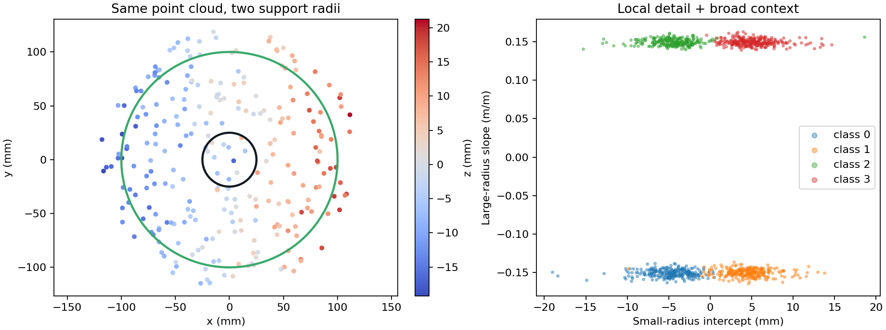
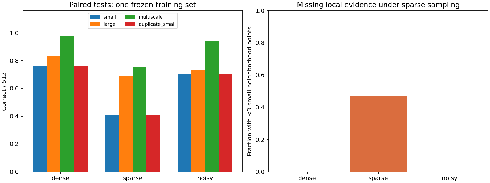

# D43 · 从杯柄细节到杯身上下文：多尺度表示与受控改进

[返回学习入口](../_index.md) · [本周日程](../P3-项目实战-日程.md) · [上一课：W6验收](../day42/Daily-Learning-Pack.md) · [实验代码](demo.py)

**多尺度的价值是让不同空间范围提供互补证据：小邻域保留局部细节，大邻域提供稳定上下文；它是否值得使用，要在固定数据与评价下验证，而不是由分支数量决定。**

W6建立了可复现基线与评价接口。W7按原计划依次研究多尺度、损失、几何约束，再做3–5种方案的受控比较。今天只改变表示的空间范围。RGB-D抓杯子时，杯柄边缘需要细粒度，杯身朝向和遮挡关系又需要更宽上下文；更大的感受野既可能帮助判断，也可能混入桌面或邻物。

<details>
<summary>个人作答与实验记录（后续更新保留）</summary>

<!-- learner-notes:start -->
> [!note]- 个人作答与复盘（保留区）
> 尚未填写；材料已生成不表示个人验收通过。
<!-- learner-notes:end -->

</details>

<!-- daily-pack-generated:start -->

## 1 学习目标与路线

能区分像素分辨率、物理邻域和感受野；写出FPN上下采样与侧向连接的shape；解释PointNet++多半径邻域为何面对密度变化；通过同一批样本上的小/大/多尺度对照，把“信息更丰富”与“参数更多”分开讨论。

| 顺序 | 知识主线 | 要回答的问题 |
| --- | --- | --- |
| 1 | 系统中的尺度 | 哪个部位需要细节，哪个需要上下文？ |
| 2 | 图像金字塔 | 分辨率和语义如何重新结合？ |
| 3 | 点云邻域 | 半径与点数怎样影响统计可靠性？ |
| 4 | 可证伪假设 | 多尺度在哪些条件下改善或失败？ |
| 5 | 工程接入 | 如何接原NOCS/EPro-PnP候选而不改任务？ |

## 2 宏观：同一物体需要几种观察范围


图回答的不是“所有尺度都越大越好”，而是下游求解需要哪些信息。若一个低分辨率特征已经把杯柄平均掉，后续再上采样只会得到平滑插值，不能凭空恢复丢失细节；若局部窗口只看到一小段平滑曲面，分不清杯子正反面又是信息不足。

今天的受控任务把这两类信息拆开：局部凹凸符号与大范围倾斜符号共同决定四类标签。它对应“局部几何+整体上下文”的机制实验，并非真实杯子分类器或完整6D位姿网络。

## 3 微观：尺度不是一个单一参数

### 3.1 像素尺度与米制尺度

针孔近似下，横向物理长度 $w$ 在深度 $Z$ 处投影为 $p\approx f_xw/Z$ 个像素。反过来一个 $p$ 像素窗口覆盖：

$$
w\approx pZ/f_x.
$$

$f_x=600px$，窗口16px，在0.5m覆盖13.3mm，在2m覆盖53.3mm。相同图像卷积窗口随着距离改变物理含义。点云中固定半径25mm则保持公制范围，但点数可能因距离、遮挡、角度而改变。

### 3.2 感受野与输出步幅

对连续卷积层，输入感受野 $r_l$ 和采样间隔 $j_l$ 可递推：

$$
j_l=j_{l-1}s_l,\qquad
r_l=r_{l-1}+(k_l-1)d_lj_{l-1},\quad r_0=j_0=1.
$$

$k$是核大小，$s$步幅，$d$空洞率。三层3×3、步幅分别1/2/1、空洞率1：感受野依次3/5/9，输出间隔1/2/2。输出步幅2并不意味着感受野只有2px。

理论感受野是可能影响输出的范围；实际梯度贡献可能集中在其中一部分。不能只用一个理论数字断言模型已学会全局关系。

## 4 微观：FPN怎样把语义送回高分辨率

Feature Pyramid Network（特征金字塔网络）把骨干不同层的特征做侧向通道变换，再从粗层向细层上采样融合。它使用一套骨干的层次特征，区别于对多张缩放输入分别完整跑骨干。[FPN原论文](https://arxiv.org/abs/1612.03144)

用 $C_l$ 表示骨干输出，$M_l$ 表示融合中间量，$P_l$表示输出：

$$
M_l=\mathrm{Conv}_{1\times1}(C_l)+\mathrm{Up}(M_{l+1}),
\qquad P_l=\mathrm{Conv}_{3\times3}(M_l).
$$

顶层 $M_L=\mathrm{Conv}_{1\times1}(C_L)$。侧向1×1卷积让通道数一致；上采样匹配空间分辨率；相加要求两者shape相同；3×3卷积进一步混合局部邻域。区分 $M$ 与 $P$ 可以避免实现中不经意改变自顶向下路径。

以640×640输入、batch1为示意：

| 层 | 骨干shape | 通道对齐后 | 输出步幅 |
| --- | --- | --- | --- |
| C2 | `[1,256,160,160]` | `[1,256,160,160]` | 4 |
| C3 | `[1,512,80,80]` | `[1,256,80,80]` | 8 |
| C4 | `[1,1024,40,40]` | `[1,256,40,40]` | 16 |
| C5 | `[1,2048,20,20]` | `[1,256,20,20]` | 32 |

这里只是常见骨干维度的教学配置，不是原候选已经确认的实际接口。单张P2的FP32激活占 $256\times160\times160\times4=26.2$MB；训练还要保留梯度和其他中间值，所以增加高分辨率分支有明确代价。输出头必须约定每层坐标原点、stride和采样对齐，不能把80×80上预测的偏移直接当640×640像素。

> [!warning] 上采样不会逆转所有信息损失
> 粗层辨认“这像杯子”的语义可以帮助细层，但已经被抹掉的杯柄边缘仍需要侧向细节。形状能相加，只证明张量相容，不证明像素位置已对齐。

## 5 微观：PointNet++的半径邻域与密度问题

PointNet++先采样中心，再在局部集合上做共享点特征与对称聚合，逐层扩大上下文。多尺度分组可在相同中心使用多个半径并拼接分支，针对非均匀采样保留不同范围的证据。[PointNet++原论文](https://arxiv.org/abs/1706.02413)

对中心 $c$、半径$r$，一般3D邻域为：

$$
\mathcal N_r(c)=\{i:\|p_i-c\|_2<r\},\quad
f_r(c)=\max_{i\in\mathcal N_r(c)}\phi_r([p_i-c,f_i]).
$$

多个半径输出拼接 $f(c)=[f_{r_1}(c),f_{r_2}(c),\ldots]$。输入点云 `[B,N,3]`、中心 `[B,M,3]`、分组坐标 `[B,M,K,3]`，共享MLP后 `[B,M,K,C]`，沿K聚合得到 `[B,M,C]`。不满K时重复填充或mask的约定必须明确，否则padding可错误地主导max/mean。

固定K近邻与固定半径回答不同问题。KNN保证数量却可能把稀疏区域的邻域扩得很远；ball query保持物理尺度却可能没有足够点。不能仅凭“张量都是K个点”推断实际物理支持范围相同。

### 5.1 可手算的点数与噪声权衡

在半径 $R=120mm$ 的均匀二维表面采样N点，中心半径r内的期望点数为：

$$
\mathbb E[n_r]=N(r/R)^2.
$$

这是二维表面面积比，不是三维体积比。N=256，r=25mm时约11.11点，r=100mm时约177.78点；N=64时小邻域只剩约2.78点。

独立零均值高度噪声标准差 $\sigma=3mm$ 时，简单均值的标准差约 $\sigma/\sqrt n$。小邻域约0.90mm，大邻域约0.225mm。但大邻域同时稀释小凸起信号：更稳定的统计量不等于更适合当前细节任务。

局部平面 $z=a+b_xx+b_yy$ 中，坡度估计还受点的空间分布影响：若点几乎共线，最小二乘矩阵条件数很差。点数≥3只是必要条件，不保证几何可辨识。正式实现应结合rank/condition检查，而非只有数目门限。

## 6 微观：构造一个能否证“多尺度必然更好”的实验

### 6.1 数据与标签不是从模型输出中制造

在半径0.12m的圆盘上采样点，定义：

$$
z(x,y)=0.15b\,x+0.02a\exp\left(-\frac{x^2+y^2}{2(0.008)^2}\right)+\epsilon,
\quad a,b\in\{-1,+1\}.
$$

$x,y,z$单位m；0.15是无量纲斜率；局部凸/凹峰值±20mm，宽度8mm；噪声 $\epsilon\sim\mathcal N(0,(0.003m)^2)$。四类标签同时编码 $a,b$，所以只知道细节或只知道倾斜都不够。

本课为了隔离采样密度，邻域使用XY平面距离，是已知表面参数域的2.5D教学实验；它不等价于通用3D ball query，更不是PointNet++完整实现。点集有随机采样和噪声，分类器必须从几何观测估计两个符号。

### 6.2 特征、学习目标与张量

每个半径内用最小二乘拟合平面：

$$
A=[\mathbf1,x,y],\qquad \hat\beta=\arg\min_\beta\|A\beta-z\|^2.
$$

实际使用 `np.linalg.lstsq`，避免手动求逆；保留截距 $a_0$ 和坡度 $b_x$ 两个特征。小邻域不足3点时输出零，并独立统计不足比例；零值可能与真实平坦表面混淆，因此正式模型应增加valid mask。本课保留这个限制来暴露稀疏退化。

| 方案 | 输入特征 | 训练系数数（含偏置） |
| --- | --- | --- |
| small | 小半径截距/坡度 `[B,2]` | 12 |
| large | 大半径截距/坡度 `[B,2]` | 12 |
| multiscale | 两个半径拼接 `[B,4]` | 20 |
| duplicate_small | 小特征复制两遍 `[B,4]` | 20 |

分类头为标准化后特征的岭回归one-hot拟合：

$$
\hat W=(X^TX+\lambda I)^{-1}X^TY,\qquad\lambda=10^{-3},
\quad\hat y=\arg\max_c(XW)_c.
$$

代码用线性方程求解，不显式矩阵逆。均值/标准差只用训练集计算，标签为四类one-hot；输出分数不是经过校准的概率。训练1024点云，测试512点云，train/test种子分别43/430，训练不接触测试标签。

复制小特征的对照保持系数数量相同，但没有增加独立几何信息。它不能完全消除有效秩/表达能力差异，故这不是“所有模型容量严格相同”的证明；它能检验“仅把数组变宽就会有提升”的说法。

### 6.3 配对密度和噪声改变

三个测试条件使用相同潜在标签和基础随机数：dense为256点/3mm噪声；sparse是dense的前64点原样子集；noisy保持256点坐标和同一噪声方向，只把噪声标准差变6mm。这样密度对照没有同时重新生成另一种形状。



左图点的颜色是高度z，两个圈分别25mm/100mm；右图把小邻域截距和大邻域坡度画在一起，四个符号组合更容易分离。每个轴的量和单位都不同，训练标准化正是为了避免把毫米和无量纲坡度直接按数值大小混合。

## 7 实验结果：互补信息有效，稀疏缺口仍然存在



| 测试条件 | small | large | multiscale | duplicate_small |
| --- | --- | --- | --- | --- |
| dense：256点，3mm噪声 | 389/512 | 428/512 | 502/512 | 389/512 |
| sparse：64点，3mm噪声 | 211/512 | 352/512 | 385/512 | 211/512 |
| noisy：256点，6mm噪声 | 360/512 | 373/512 | 481/512 | 360/512 |

多尺度在本构造里利用了互补信息；它没有消除缺数据。稀疏条件下 **46.875%** 的小邻域不足3点，大尺度仍保留上下文，表现较稳；多尺度也从502/512降到385/512，不能声称对稀疏完全鲁棒。

点序置换后特征最大差约 $3.33\times10^{-16}$，验证局部最小二乘统计在这个数值范围的集合不变性；这不等于任何任意PointNet++实现均不受采样顺序影响。FPS种子、距离并列和padding都可能使实现行为发生变化。

本实验没有真实图像、官方训练数据或大型网络。它证明的是这组明确条件下的机制可行性；将多尺度接入项目后仍需正式位姿指标、算力和失败样本证据。

## 8 工程：怎样接回原候选而不换掉问题

NOCS类别级路径中，多尺度特征可以帮助预测规范坐标或分割，后续仍需对应的尺度/位姿恢复与类别级评价。EPro-PnP路径中，多尺度可以服务图像特征和2D-3D对应/权重估计，后续仍需原有概率化PnP目标和物体模型条件。不能用本课四类分类准确率替代项目位姿成绩。

建议固定数据划分、RGB-D模态、检测框来源、输入尺寸、初始化、训练步数、优化器和评价器，再改变一个特征结构；如果参数量/FLOPs改变，应同时记录。第一次试验可比较单尺度、双尺度、重复/同等宽度控制；W7-D4统一做原定3–5个方案的受控对照。

调试顺序：先打印每层shape和空间stride→检查像素/点索引映射→统计每半径有效点数→查看局部关键区域误差→检查远近/遮挡分组→核对延迟和显存。多尺度改善总体分数但破坏杯柄关键点时，应保留两种证据，不能只报告平均收益。

世界模型可以用多尺度编码器，但静态几何特征的改进不自动保证动作条件预测更好；未来W10仍需独立的1/5/10步评价。VLA的视觉token分辨率会影响动作所需细节，但动作接口与控制周期仍保持Day31/41的约定。

## 9 动手：只改变小邻域半径

```bash
python3 3d_learning/day43/demo.py
python3 3d_learning/day43/demo.py --small-radius-mm 40 --out-dir /tmp/day43-radius40
```

先预测：25→40mm会增加点数、降低部分噪声，但局部凸起相对邻域会被进一步稀释。small/multiscale 是否一起改善，应由结果回答；不要看完测试集再选最好的半径当成最终分数。

同日已执行40mm对照：small在dense上389→500/512；多尺度在sparse上385→411/512，但noisy上481→467/512。小邻域稀疏不足比例46.875%→3.516%。见[40mm结果](../../_assets/3d_learning/day43/radius40/results.json)。扩大半径降低了缺点风险，却没有让所有条件同时改善；如果据此选择半径，应重新使用独立验证集，保留测试集用于固定方案最终评价。

依赖NumPy和Matplotlib，CPU运行。已于2026-10-24验证，Python3.11.15/NumPy1.26.4/Matplotlib3.10.9；所有方案同一训练集，固定岭系数，测试无重新拟合。计算部分一次约0.133s，不包括完整机器人推理链。记录：[results.json](../../_assets/3d_learning/day43/results.json)，特征与标签：arrays.npz (not exported: excluded by publication policy)。

> [!note]- 完整可复制代码
> ```python
> """D43: two-scale geometric features, paired density/noise controls, no deep backbone."""
> from pathlib import Path
> import argparse,json,platform,time
> import numpy as np
> import matplotlib
> matplotlib.use('Agg')
> import matplotlib.pyplot as plt
> 
> 
> def clouds(seed,m,n=256,noise=.003):
>     # Always draw 256 points, then take a subset: sparse is paired with dense.
>     rng=np.random.default_rng(seed);labels=rng.integers(0,4,m)
>     local=np.where(labels%2,1,-1);global_sign=np.where(labels//2,1,-1)
>     angle=rng.uniform(0,2*np.pi,(m,256));radius=.12*np.sqrt(rng.uniform(0,1,(m,256)))
>     x=radius*np.cos(angle);y=radius*np.sin(angle)
>     epsilon=rng.normal(0,1,(m,256))
>     z=.15*global_sign[:,None]*x+.02*local[:,None]*np.exp(-radius**2/(2*.008**2))+noise*epsilon
>     return np.stack([x,y,z],axis=-1)[:,:n],labels
> 
> 
> def features(points,radii):
>     n_batch=points.shape[0];output=[];counts=[]
>     for radius in radii:
>         branch=[];sizes=[]
>         for p in points:
>             mask=np.linalg.norm(p[:,:2],axis=1)<radius
>             sizes.append(int(mask.sum()))
>             if mask.sum()<3:
>                 branch.append([0.,0.]);continue
>             # Local plane z = intercept + bx*x + by*y; only intercept,bx retained.
>             A=np.c_[np.ones(mask.sum()),p[mask,:2]]
>             coef=np.linalg.lstsq(A,p[mask,2],rcond=None)[0]
>             branch.append(coef[:2])
>         output.append(np.asarray(branch));counts.append(sizes)
>     return np.concatenate(output,axis=1),np.array(counts)
> 
> 
> def fit(f,y):
>     mean=f.mean(0);std=f.std(0)+1e-8
>     A=np.c_[(f-mean)/std,np.ones(len(f))]
>     W=np.linalg.solve(A.T@A+1e-3*np.eye(A.shape[1]),A.T@np.eye(4)[y])
>     return mean,std,W
> 
> 
> def predict(f,model):
>     mean,std,W=model
>     return np.argmax(np.c_[(f-mean)/std,np.ones(len(f))]@W,axis=1)
> 
> 
> def main():
>     ap=argparse.ArgumentParser()
>     ap.add_argument('--small-radius-mm',type=float,default=25)
>     ap.add_argument('--out-dir',type=Path,default=Path(__file__).resolve().parents[2]/'_assets/3d_learning/day43')
>     args=ap.parse_args()
>     if not 5<=args.small_radius_mm<100:raise ValueError('small radius must be in [5,100) mm')
>     out=args.out_dir;out.mkdir(parents=True,exist_ok=True);start=time.perf_counter()
>     radii=[args.small_radius_mm/1000,.1]
>     train,y_train=clouds(43,1024);F,train_counts=features(train,radii)
>     specs={'small':[0,1],'large':[2,3],'multiscale':[0,1,2,3],'duplicate_small':[0,1,0,1]}
>     models={name:fit(F[:,ids],y_train) for name,ids in specs.items()}
>     settings={'dense':(256,.003),'sparse':(64,.003),'noisy':(256,.006)}
>     scores={};group_stats={};test_features={};test_labels=None
>     for condition,(n,noise) in settings.items():
>         points,y=clouds(430,512,n,noise);f,counts=features(points,radii)
>         test_features[condition]=f;test_labels=y
>         group_stats[condition]=dict(mean_neighbors=counts.mean(axis=1).tolist(),
>             small_insufficient_fraction=float(np.mean(counts[0]<3)))
>         scores[condition]={}
>         for name,ids in specs.items():
>             prediction=predict(f[:,ids],models[name]);correct=int(np.sum(prediction==y))
>             scores[condition][name]=dict(correct=correct,total=512,accuracy=correct/512)
>     # Numerical point-order invariance: same local fits after permuting inputs.
>     perm=np.random.default_rng(431).permutation(256)
>     permF,_=features(train[:8,perm],radii)
>     permutation_error=float(np.max(abs(permF-F[:8])))
>     assert permutation_error<1e-10
>     dense,_=clouds(430,512,256,.003);sparse,_=clouds(430,512,64,.003)
>     assert np.array_equal(dense[:,:64],sparse)
>     result=dict(seed_train=43,seed_test=430,seed_permutation=431,python=platform.python_version(),
>         numpy=np.__version__,matplotlib=matplotlib.__version__,radii_m=radii,
>         train_samples=1024,test_samples_per_condition=512,train_points=256,train_noise_m=.003,
>         class_definition='two independent signs: local Gaussian bump and broad x slope',
>         scores=scores,neighborhoods=group_stats,point_order_max_error=permutation_error,
>         sparse_is_exact_dense_subset=True,parameter_counts={n:int(m[2].size) for n,m in models.items()},
>         elapsed_seconds=time.perf_counter()-start,
>         scope='Synthetic analytic local-plane features + linear ridge classifier; not FPN/PointNet++/NOCS/EPro-PnP training')
>     (out/'results.json').write_text(json.dumps(result,indent=2),encoding='utf-8')
>     np.savez(out/'arrays.npz',train_features=F,train_labels=y_train,test_labels=test_labels,**test_features)
>     fig,axes=plt.subplots(1,2,figsize=(11.5,4.3),layout='constrained')
>     xx=np.arange(len(settings));width=.19
>     for j,name in enumerate(specs):axes[0].bar(xx+(j-1.5)*width,[scores[c][name]['accuracy'] for c in settings],width,label=name)
>     axes[0].set(xticks=xx,xticklabels=list(settings),ylim=(0,1.16),ylabel='Correct / 512',title='Paired tests; one frozen training set');axes[0].legend(ncols=2,fontsize=8,loc='upper center')
>     axes[1].bar(list(settings),[group_stats[c]['small_insufficient_fraction'] for c in settings],color='#da6d3e')
>     axes[1].set(ylim=(0,1),ylabel='Fraction with <3 small-neighborhood points',title='Missing local evidence under sparse sampling')
>     fig.savefig(out/'multiscale_ablation.png',dpi=160);plt.close(fig)
>     fig,axes=plt.subplots(1,2,figsize=(11.5,4.3),layout='constrained')
>     p=train[0];sc=axes[0].scatter(p[:,0]*1000,p[:,1]*1000,c=p[:,2]*1000,cmap='coolwarm',s=12)
>     for r,c in zip(radii,['#101820','#39a96b']):axes[0].add_patch(plt.Circle((0,0),r*1000,fill=False,color=c,lw=2))
>     axes[0].axis('equal');axes[0].set(xlabel='x (mm)',ylabel='y (mm)',title='Same point cloud, two support radii');fig.colorbar(sc,ax=axes[0],label='z (mm)')
>     for cls in range(4):
>         mask=y_train==cls;axes[1].scatter(F[mask,0]*1000,F[mask,3],s=5,alpha=.4,label=f'class {cls}')
>     axes[1].set(xlabel='Small-radius intercept (mm)',ylabel='Large-radius slope (m/m)',title='Local detail + broad context');axes[1].legend(markerscale=2)
>     fig.savefig(out/'multiscale_features.png',dpi=160);plt.close(fig)
>     print(json.dumps(result,indent=2))
> 
> if __name__=='__main__':main()
> ```

## 10 回到宏观：改进必须能指出多出来的信息在哪里

三句话总结：尺度是信息支持范围，不只是张量尺寸。局部细节与大范围上下文可能互补，但密度与噪声决定各分支是否可靠。接入位姿系统后，要保持原任务和评价协议，重新验证收益与代价。

四个重点：像素/米制尺度区别决定近远物体的可见细节；侧向融合解释语义如何回到细层；邻域点数与条件数解释稀疏退化；固定协议的配对消融让结构收益可核查。容易混淆的是“上采样/恢复细节”“更多参数/更多信息”“合成分类收益/真实位姿收益”。

产出：四方案配对结果、半径变化报告、一张原候选多尺度接入shape图，以及至少一个收益不成立的边界。若没有正式项目模型可跑，保留接口设计与待验证清单，不冒称已完成模型改进。

## 11 自测

1. 16px窗口在焦距600px、深度0.5m和2m处分别覆盖多大物理长度？
2. 三层3×3卷积步幅1/2/1，感受野和输出间隔分别是多少？
3. FPN的侧向1×1卷积和自顶向下上采样各解决什么shape问题？
4. 固定半径与固定K近邻在稀疏点云中各有什么代价？
5. 半径120mm圆盘内256点，中心25mm邻域期望多少点？减到64点呢？
6. 为什么重复small特征为4维不等于获得两个尺度？
7. sparse条件下多尺度仍明显变差，是否否定多尺度方案？应怎样表述结论？
8. 如何把本课对照迁移到EPro-PnP或NOCS，而不偷换任务和指标？

## 12 未理解问题与次日衔接

待个人记录：真实点云的密度随距离怎样变？杯柄需要多少像素/邻域点？哪一层特征对应哪一种坐标采样？这些问题将在W7消融及W8RGB-D应用中验证。下一课Day44保持今天的数据和结构参照，讨论损失函数怎样重新分配误差与梯度，避免“结构变了、损失也变了”而无法归因。

精读任务：[FPN原文](https://arxiv.org/pdf/1612.03144) 的Feature Pyramid Networks章节与架构图，画出一个侧向融合的shape推演；[PointNet++原文](https://arxiv.org/pdf/1706.02413) 的Hierarchical Point Set Feature Learning与Robust Feature Learning under Non-Uniform Sampling，定位MSG/MRG和密度处理。本文已核验一手原文；个人精读需提交自己的差异卡，运行本例不等于复现论文。

## 13 自测核对答案

> [!note]- 展开答案与判分标准
> 每题0/1/2分：错误、基本结论、完整计算/解释与边界。建议至少12/16且第8题不能把分类成绩当位姿成绩；未记录个人分数。
>
> 1. 13.3mm和53.3mm，由 $w=pZ/f_x$ 得到。
> 2. 感受野3→5→9，输出间隔1→2→2；最后RF=9px、stride=2。
> 3. 1×1对齐通道，上采样对齐空间尺寸；仍需检查坐标采样位置是否一致。
> 4. 固定半径可能点数不足；固定K可能扩展到很远或跨物体，改变物理支持范围。
> 5. 约11.11和2.78点；用二维面积比，不是三维体积比。
> 6. 同一信息复制不增加独立几何证据，也可能只是重参数化；本例重复控制与small成绩一致。
> 7. 不否定；本任务互补信息有效，但缺失局部观测仍限制性能，不能宣称无条件稀疏鲁棒。
> 8. 保留任务级别、数据划分、对应/坐标头、求解器和评价协议，仅改特征结构并记录资源；用正式位姿与任务结果验证。

<!-- daily-pack-generated:end -->
