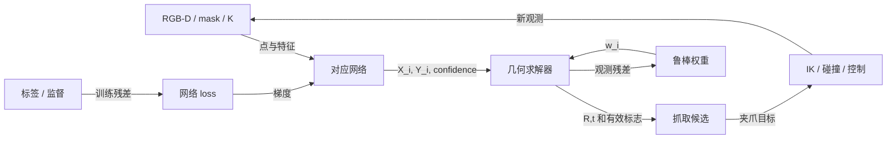
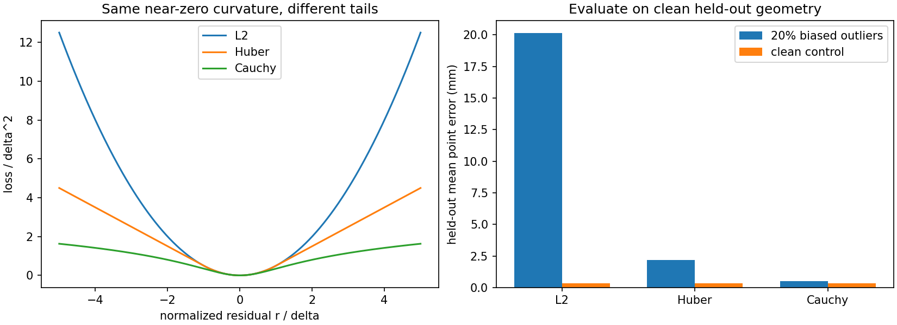
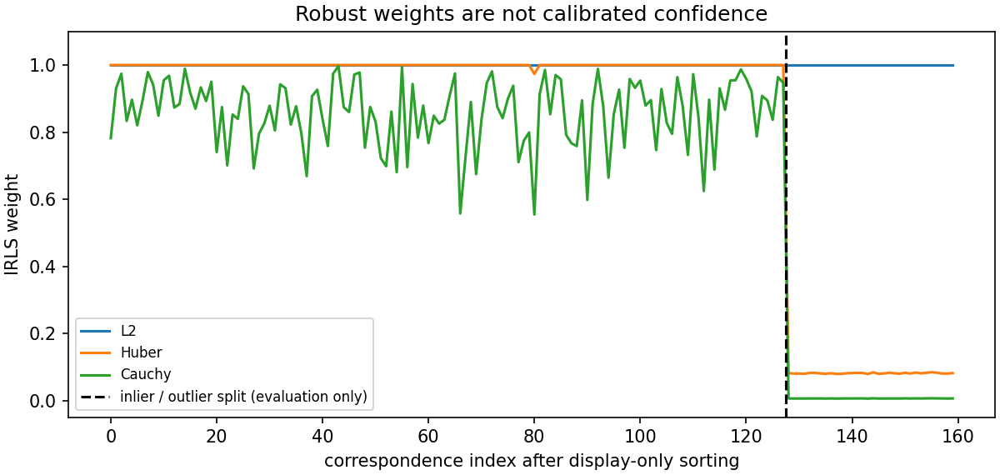

# D44 · 从“误差更小”到“错误信息不再主导位姿”

[返回学习入口](../_index.md) · [本周项目日程](../P3-项目实战-日程.md) · [上一课：多尺度方案](../day43/Daily-Learning-Pack.md) · [实验脚本](demo.py)

**损失函数不仅决定如何计算误差，还决定每一条观测可以对参数更新施加多大影响。降低坏标签上的拟合误差，可能使真实物体位姿更差。**

上一课改变特征如何汇聚，本课保持数据与几何求解器结构固定，专门改变残差的处理方式。RGB-D 抓杯子时，杯沿深度飞点、杯身掩码混入桌面、NOCS 对应错误，都会把少量错误变成很大的空间残差。我们要回答：这些点是可以相信的大误差，还是应该抑制的离群观测？

<details>
<summary>个人作答与实验记录（后续更新保留）</summary>

<!-- learner-notes:start -->
请在这里保留自己的预测、改变量结果和问题；教材更新不覆盖这一段。
<!-- learner-notes:end -->

</details>

<!-- daily-pack-generated:start -->

## 1 学习目标与路线

读完应能推导 L2、Huber、Cauchy 的影响函数；把尺度参数从“魔法超参数”解释为米、像素或标准差；实现 IRLS 与带权刚体配准；判断鲁棒 loss 是否改善了真正任务指标；给原 NOCS/EPro-PnP 候选设计一个只改变 loss 的可复现实验。

| 顺序 | 知识主线 | 需要回答的问题 |
| --- | --- | --- |
| 1 | 残差与任务 | 我在拟合哪个空间里的哪种误差？ |
| 2 | 影响函数 | 一个 100 mm 的坏点能拉动多少参数？ |
| 3 | IRLS 与几何 | 怎样在不破坏旋转约束的前提下降低坏点权重？ |
| 4 | 实际对照 | 为什么观测 RMSE 变大、保留几何误差反而变小？ |
| 5 | 项目接入 | 哪些结论能迁移，哪些还需要训练证据？ |

## 2 宏观：loss 位于训练和求解两条不同链上



图里有两个闭环。网络训练改变参数 $\theta$；单帧位姿优化改变 $R,t$。两者都可以使用鲁棒损失，但“把几何优化从 L2 改成 Huber”没有证明网络学到了更好的特征。今天的 CPU 实验只验证后者，神经网络训练步数为 0。

设物体点 $X_i\in\mathbb R^3$、对应相机点 $Y_i\in\mathbb R^3$，都用米；$R\in SO(3)$、$t\in\mathbb R^3$ 把物体坐标变到相机坐标。残差是

$$
e_i(R,t)=RX_i+t-Y_i,\qquad r_i=\|e_i\|_2.
$$

这里“残差”是对观测的差，不等于对真实表面的误差。相机测错了 $Y_i$，优化器仍会努力拟合它，除非我们明确表达观测可信度。

## 3 微观：从概率假设到 L2、Huber 和 Cauchy

### 3.1 L2 的长处也是它的风险

若每维观测误差为独立零均值高斯噪声，方差固定，则最大似然等价于最小化平方和。采用标量范数残差写成

$$
L_{\rm L2}=\sum_i \frac12 r_i^2,\qquad \psi(r)=\frac{d\rho(r)}{dr}=r.
$$

例如 2 mm 与 100 mm 的点，损失比为 $2500$，影响函数幅值比为 $50$。这在大残差来自正常高斯尾部时合乎假设；在 100 mm 来自桌面误分割时，优化器就会把杯子的位姿拉向桌面。

不要把“L2 容易受离群点影响”误解为“L2 不能用”。在标签可信、噪声近高斯、尺度归一化合理时，L2 提供平滑的优化目标，仍是重要基线。

### 3.2 Huber：近处二次，远处线性

$$
\rho_\delta(r)=
\begin{cases}
\frac12r^2,&|r|\le\delta,\\
\delta(|r|-\frac12\delta),&|r|>\delta,
\end{cases}
\quad
\psi_\delta(r)=\operatorname{clip}(r,-\delta,\delta).
$$

$\delta$ 与 $r$ 单位相同。残差用米，8 mm 应写成 `0.008`，不是 `8`。近零区间保留二次曲率，大误差的梯度则封顶。Huber 并不把坏点直接删掉：它保留有限影响，因此在很多离群点同向偏移时仍会产生偏差。

### 3.3 Cauchy：大残差的影响还会下降

$$
\rho_\delta(r)=\frac{\delta^2}{2}\log(1+(r/\delta)^2),\qquad
\psi_\delta(r)=\frac{r}{1+(r/\delta)^2}.
$$

当 $|r|\gg\delta$ 时，影响约为 $\delta^2/r$。这称为下降型影响：特别大的离群点可能几乎被忽略。代价是目标通常非凸，坏初始化会让真正内点也落入低影响区，得到错误的局部解。

> [!question] 先算
> $r=100$ mm、$\delta=8$ mm，Huber 与 Cauchy 对这一点分别保留多少 IRLS 权重？再比较 $r=2$ mm。

权重取 $w(r)=\psi(r)/r$：Huber 为 $\min(1,\delta/|r|)$，Cauchy 为 $1/(1+(r/\delta)^2)$。100 mm 时分别为 0.08 与约 0.00636；2 mm 时为 1 与约 0.9412。Cauchy 连较小的残差也会轻微降权。



左图用无量纲 $r/\delta$ 比较尾部；右图比较同一份数据上的保留点误差。它回答的不是“哪条曲线更平”，而是“不同影响规则有没有改善真实几何”。

## 4 微观：从影响函数到 IRLS

IRLS 是迭代重加权最小二乘。把当前残差记为 $r_i^{(k)}$，固定本轮权重后求

$$
w_i^{(k)}=\frac{\psi(r_i^{(k)})}{r_i^{(k)}},\qquad
(R,t)^{(k+1)}=\arg\min_{R\in SO(3),t}\frac12\sum_iw_i^{(k)}\|RX_i+t-Y_i\|^2.
$$

零残差按极限取权重 1；代码用很小的下界防止除零。权重由上一轮计算，不能在同一次线性求解中一边更新每个点一边继续使用旧雅可比而不说明算法。

带权中心为 $\bar X=\sum w_iX_i/\sum w_i$、$\bar Y=\sum w_iY_i/\sum w_i$。令

$$
H=\sum_iw_i(X_i-\bar X)(Y_i-\bar Y)^T=U\Sigma V^T,
$$

则

$$
R=V\operatorname{diag}(1,1,\det(VU^T))U^T,\qquad t=\bar Y-R\bar X.
$$

为什么要补最后一个对角元素？普通正交 Procrustes 可能给出行列式为 $-1$ 的镜像；真实刚体旋转需要 $\det R=+1$。带权中心保证平移与旋转的求解一致。矩阵秩过低、点共线或大多数权重趋近零时，数值可返回一个矩阵，但姿态可能不可辨识，工程代码必须同时检查有效点数和几何分布。

| 数组 | shape | 单位/含义 |
| --- | --- | --- |
| `x`, `y` | `[N,3]` | 米，已确认对应关系 |
| `residual` | `[N]` | 三维欧氏范数，米 |
| `w` | `[N]` | 非负无量纲权重 |
| `H` | `[3,3]` | 平移中心化后的相关矩阵 |
| `R`, `t` | `[3,3]`, `[3]` | 物体到相机变换 |
| 批量扩展 | `[B,N,3]` | 必须另带 `[B,N]` 有效 mask，padding 不作为真实点 |

`x @ R.T + t` 使用行向量存储，实现的仍是数学中的列向量 $RX+t$。形状能广播成功并不证明方向正确，应先用单位旋转与单轴平移做手算。

## 5 微观：尺度、对称性和可学习置信度

### 5.1 像素与米不能直接相加

若同时优化像素重投影残差 $e_u$ 和深度残差 $e_z$，更清楚的表达是

$$
L=\sum_i\rho(\|e_{u,i}\|/\sigma_u)+\lambda\sum_i\rho(e_{z,i}/\sigma_z).
$$

$\sigma_u$ 用像素、$\sigma_z$ 用米，归一化后残差无量纲。它们表达预期噪声尺度，$\lambda$ 表达任务取舍。把米换成毫米而不改尺度，会使目标函数的相对权重改变一百万倍（平方项）。明天会把这个问题放进几何约束实验。

### 5.2 对称性不是随机离群点

杯子没有把手且完全轴对称时，绕轴旋转可能不可观测。若监督强行指定唯一 yaw，真实等价姿态会得到“大残差”；鲁棒 loss 只是压低了监督影响，没有修好错误的任务定义。对已知对称群 $\mathcal S$，可定义 $\min_{S\in\mathcal S}d(\hat T,TS)$ 或使用评价协议指定的对称距离。带把手杯子不能不加区分地当作圆柱。

### 5.3 网络预测权重可能逃避学习

若直接训练 $L=\sum_iw_i\|e_i\|^2$，且 $w_i\ge0$ 可任意变小，网络可以令所有 $w_i=0$。一个高斯负对数似然例子是

$$
L_i=\frac{\|e_i\|^2}{2\sigma_i^2}+\frac d2\log\sigma_i^2,
$$

其中 $d$ 是残差维数。第二项惩罚无限放大的不确定性，但仍需数据、范围约束与校准检查；它不是自动得到“真正置信度”的保证。

**本实验的 IRLS 权重由残差规则产生，并非训练出来的成功概率。** 一个被严重遮挡、始终没有正确对应的区域，可能既残差小又几何错误；权重只能表达当前目标下的相容性。

## 6 动手：先预测，再改变一个变量

脚本只依赖 NumPy 和 Matplotlib，提供 160 个物体到相机对应点；其中 20% 叠加固定方向 `[70,-40,60]` mm 偏移。所有方法从同一无权 Kabsch 开始，固定 30 轮；400 个独立物体点只作干净几何评价。它们属于同一物体和同一姿态，不是跨场景泛化测试。

在项目根目录运行：

```bash
python3 3d_learning/day44/demo.py
python3 3d_learning/day44/demo.py --outlier-fraction 0.6 --out-dir /tmp/day44-more-outliers
python3 3d_learning/day44/demo.py --delta-mm 80 --out-dir /tmp/day44-large-scale
```

若环境缺库，使用具备 `numpy`、`matplotlib` 的 Python 环境；无需 CUDA、Open3D 或机器人。默认结果写入本课附件目录，改变量结果用独立目录保留原基线。

先预测：Cauchy 会否在污染观测上取得最小 RMSE？然后观察下表，再把离群比例增大至 60%，检查鲁棒方法是否开始锁定错误多数簇。第二次只改 $\delta$ 为 80 mm，解释其越来越接近 L2 的原因。扩展命令是待学习者执行任务，不冒充已验证结果。

2026-10-24 已实际执行默认实验，CPU Python 3.11.15、NumPy 1.26.4、Matplotlib 3.10.9、种子44：

| 方法 | 平移误差 mm | 旋转误差 ° | 保留点平均误差 mm | 污染观测 RMSE mm |
| --- | --- | --- | --- | --- |
| L2 | 20.205 | 3.851 | 20.129 | 40.139 |
| Huber | 2.166 | 0.429 | 2.186 | 44.067 |
| Cauchy | 0.436 | 0.405 | 0.525 | 44.831 |

在无注入离群点的负对照中，保留点均值分别为 0.348、0.348、0.317 mm。单个种子下 Cauchy 略低，不能据此声称它在高斯噪声下全面优于 L2。这里没有采集交互，真机尝试数为0；`results.json` 中的单次求解延迟只是当前 CPU 实测，不作为部署性能承诺。



图中为便于观察把已知合成内点放前、离群点放后；这个真值排序**没有输入求解器**。Cauchy 对离群点的平均权重约0.00637，Huber约0.08149。权重与误差曲线一起解释结果，不能只展示“最好一行”。完整数字见[结果记录](../../_assets/3d_learning/day44/results.json)。

> [!note]- 完整可复制 CPU 脚本
> ```python
> """D44: robust rigid registration losses, CPU NumPy; no model training."""
> from pathlib import Path
> import argparse, json, platform, time
> import numpy as np
> import matplotlib
> matplotlib.use("Agg")
> import matplotlib.pyplot as plt
> 
> 
> def rigid(x, y, w):
>     w = w / w.sum()
>     xc, yc = w @ x, w @ y
>     u, _, vt = np.linalg.svd((x - xc).T @ ((y - yc) * w[:, None]))
>     d = np.diag([1., 1., np.linalg.det(vt.T @ u.T)])
>     r = vt.T @ d @ u.T
>     return r, yc - r @ xc
> 
> 
> def fit(x, y, kind, delta=.008, steps=30):
>     r, t = rigid(x, y, np.ones(len(x)))
>     for _ in range(steps):
>         residual = np.linalg.norm(x @ r.T + t - y, axis=1)
>         w = np.ones(len(x))
>         if kind == "Huber":
>             w = np.minimum(1., delta / np.maximum(residual, 1e-12))
>         elif kind == "Cauchy":
>             w = 1. / (1. + (residual / delta) ** 2)
>         r, t = rigid(x, y, w)
>     return r, t, w
> 
> 
> def main():
>     ap = argparse.ArgumentParser()
>     ap.add_argument("--outlier-fraction", type=float, default=.2)
>     ap.add_argument("--delta-mm", type=float, default=8.)
>     ap.add_argument("--out-dir", type=Path, default=Path(__file__).resolve().parents[2] / "_assets/3d_learning/day44")
>     args = ap.parse_args()
>     if not 0 <= args.outlier_fraction < 1 or args.delta_mm <= 0:
>         raise ValueError("fraction must be in [0,1), delta positive")
>     args.out_dir.mkdir(parents=True, exist_ok=True)
>     rng = np.random.default_rng(44)
>     x = rng.uniform(-1, 1, (160, 3)) * [.07, .05, .04]
>     theta = .35
>     r_true = np.array([[np.cos(theta), -np.sin(theta), 0], [np.sin(theta), np.cos(theta), 0], [0, 0, 1.]])
>     t_true = np.array([.03, -.01, .65])
>     truth = x @ r_true.T + t_true
>     y_clean = truth + rng.normal(0, .002, truth.shape)
>     y = y_clean.copy()
>     bad = rng.permutation(len(x))[:int(len(x) * args.outlier_fraction)]
>     y[bad] += [.07, -.04, .06]
>     held_x = rng.uniform(-1, 1, (400, 3)) * [.07, .05, .04]
>     held_true = held_x @ r_true.T + t_true
>     records, estimates = {}, {}
>     for name in ["L2", "Huber", "Cauchy"]:
>         start = time.perf_counter()
>         r, t, w = fit(x, y, name, args.delta_mm / 1000)
>         elapsed = (time.perf_counter() - start) * 1000
>         pred = held_x @ r.T + t
>         err = np.linalg.norm(pred - held_true, axis=1)
>         records[name] = dict(translation_mm=float(np.linalg.norm(t - t_true) * 1000),
>             rotation_deg=float(np.rad2deg(np.arccos(np.clip((np.trace(r @ r_true.T) - 1) / 2, -1, 1)))),
>             held_add_mm=float(err.mean() * 1000), observed_rmse_mm=float(np.sqrt(np.mean(np.sum((x @ r.T + t - y) ** 2, 1))) * 1000),
>             inlier_weight=float(np.mean(w[np.setdiff1d(np.arange(len(x)), bad)])),
>             outlier_weight=None if not len(bad) else float(w[bad].mean()), fit_ms=elapsed)
>         estimates[name] = (r, t, w)
>     # Wholly clean negative control; same samples, no injected outliers.
>     clean = {}
>     for name in records:
>         r, t, _ = fit(x, y_clean, name, args.delta_mm / 1000)
>         clean[name] = float(np.linalg.norm(held_x @ r.T + t - held_true, axis=1).mean() * 1000)
>     report = dict(seed=44, data="synthetic metric correspondences; fixed object, independent held-out points", units="m; outputs mm and deg", frame="object to camera", timestamp="synthetic single instant t=0", initial_state="unweighted Kabsch for every method", train_samples=160, heldout_samples=400, optimizer_steps=30, network_train_steps=0, robot_interactions=0,
>         outlier_fraction=args.outlier_fraction, delta_mm=args.delta_mm, environment=dict(python=platform.python_version(), numpy=np.__version__, matplotlib=matplotlib.__version__), corrupted=records, clean_held_add_mm=clean,
>         scope="Known correspondences, rigid object; no correspondence network, NOCS/EPro-PnP reproduction, or robot execution.")
>     (args.out_dir / "results.json").write_text(json.dumps(report, indent=2), encoding="utf-8")
>     fig, ax = plt.subplots(1, 2, figsize=(11, 4), constrained_layout=True)
>     u = np.linspace(-5, 5, 400)
>     ax[0].plot(u, .5 * u*u, label="L2")
>     ax[0].plot(u, np.where(np.abs(u) <= 1, .5*u*u, np.abs(u)-.5), label="Huber")
>     ax[0].plot(u, .5*np.log1p(u*u), label="Cauchy")
>     ax[0].set(xlabel="normalized residual r / delta", ylabel="loss / delta^2", title="Same near-zero curvature, different tails")
>     ax[0].legend()
>     pos = np.arange(3)
>     ax[1].bar(pos-.18, [records[k]["held_add_mm"] for k in records], .36, label="20% biased outliers" if args.outlier_fraction == .2 else f"{args.outlier_fraction:.0%} outliers")
>     ax[1].bar(pos+.18, list(clean.values()), .36, label="clean control")
>     ax[1].set(xticks=pos, xticklabels=list(records), ylabel="held-out mean point error (mm)", title="Evaluate on clean held-out geometry")
>     ax[1].legend()
>     fig.savefig(args.out_dir / "robust-losses.png", dpi=150)
>     plt.close(fig)
>     fig, ax = plt.subplots(figsize=(8, 3.8), constrained_layout=True)
>     order = np.r_[np.setdiff1d(np.arange(len(x)), bad), bad]
>     for name, (_, _, w) in estimates.items():
>         ax.plot(w[order], label=name)
>     ax.axvline(len(x)-len(bad)-.5, color="black", linestyle="--", label="inlier / outlier split (evaluation only)")
>     ax.set(xlabel="correspondence index after display-only sorting", ylabel="IRLS weight", ylim=(-.05, 1.1), title="Robust weights are not calibrated confidence")
>     ax.legend(fontsize=8)
>     fig.savefig(args.out_dir / "influence-weights.png", dpi=150)
>     plt.close(fig)
>     print(json.dumps(report, indent=2))
> 
> 
> if __name__ == "__main__":
>     main()
> ```

## 7 回到宏观：接入原位姿项目时怎样避免假改进

对物体级、具有精确模型的候选，先确定对应残差发生在模型坐标、相机点云还是像素空间；对 NOCS 类别级路径，还要处理预测规范坐标、尺度和实例形状差异。它们的输入假设不同，不能把同一 $\delta$ 原样迁移。

建议在已有基线配置中显式记录 `residual_space`、`robust_type`、`scale`、`valid_mask`、`symmetry_rule`。保留网络、数据划分、种子、训练步数和推理迭代数，先只改变鲁棒核。每个实例记录错误对应比例的可测代理，例如轮廓附近点比例、深度有效率，以及 ADD/ADD-S 等协议指标。若只改善训练损失而测试位姿不变，不能写“提升感知”。

排障顺序应是：先核对单位与坐标；再可视化 mask/对应；检查残差分布；查看权重是否全部接近零；最后调整尺度或模型。用强鲁棒核遮住了毫米/米错误，得到的只是一个停止更新的系统。

VLA 使用这个位姿或其生成的训练动作时，同样会继承系统偏差。世界模型预测残差变大也可能由状态输入错误造成。loss 的改善必须沿链条验证到真正任务指标，不把某一模块的优化值当作抓取成功率。

## 8 今日总结与产出

第一，残差是“预测与观测的差”，它不天然等于真值误差。第二，鲁棒核通过影响函数改变谁能主导优化，尺度与初始化决定其是否有效。第三，方法是否值得保留，最终看固定协议下的保留几何、标准位姿指标和下游任务。

最值得掌握的四点：影响函数解释离群点为何危险；IRLS 把统计想法变成可运行算法；单位归一化使超参数可解释；干净保留集防止把坏标签拟合得更好误判为进步。三个边界是：对称标签错误不靠鲁棒核修复；IRLS 权重不等于成功概率；本实验是已知对应的求解器研究，没有验证网络训练或真实抓取。

今天应留下：运行结果、两张图、一份包含残差单位和 $\delta$ 的配置记录，以及“观测 RMSE 上升而真实误差下降”的解释。个人修改可保留为补充脚本或实验输出；材料的已验证状态不代表个人通过。

## 9 自测

1. 观测残差和真值误差为什么可能朝相反方向变化？
2. $r=100$ mm、$\delta=8$ mm 时 Huber/Cauchy 权重各是多少？
3. IRLS 的权重从哪来，为什么每轮需要重新计算？
4. 带权 Kabsch 的行列式修正解决什么问题？
5. 把所有长度从米变毫米而保持 Huber 的数值阈值不变，会发生什么？
6. 一个杯子 yaw 标签有180°等价解，是否应直接用 Cauchy 抑制“错误解”？
7. 学习权重 $w_i$ 时，为什么只优化 $\sum_iw_i\|e_i\|^2$ 存在退化解？
8. 本实验 Cauchy 最好，下一步怎样设计实验才能判断是否适用于真实基线？

## 10 未理解问题与下一课

记录仍不清楚的具体位置：是 $\psi/r$ 的推导、加权中心化，还是残差量纲？D45继续尺度与重投影/深度几何约束；D46用固定数据协议比较多种改进，检验单次漂亮结果是否稳定。若问题是对称物体的评价，回到D19及D40的协议，不靠本课核函数替代。

精读任务：[Ceres 非线性最小二乘建模](https://ceres-solver.readthedocs.io/latest/nnls_modeling.html) 的 `LossFunction`、`HuberLoss`、`CauchyLoss` 与尺度变换段，核对它以平方范数为自变量的写法如何与本课 $\rho(r)$ 对应；[EPro-PnP](https://arxiv.org/html/2203.13254v4) 附录 A.1–A.2，区分其自适应 Huber/LM 实现与本课固定阈值 Kabsch。以上一手页面已于2026-10-24核验。本课公式与合成例为教学推导，并非论文实验复现。阅读产出是一张“残差、核、自变量、单位、有效范围”对照卡，不代填已读。

## 11 核对答案

> [!note]- 自测参考与判分
> 每题0/1/2分：0为缺失或核心错误，1为能复述结论，2为给出计算、反例或工程验证方法。建议至少12/16且单位/退化解两题无核心错误；未对个人评分。
>
> 1. 观测可能被污染；L2更贴近坏点，但远离真实几何。本课污染RMSE最小的L2，保留点误差反而最大。
> 2. Huber $8/100=0.08$；Cauchy $1/(1+12.5^2)\approx0.00636$。
> 3. 来自当前残差的 $\psi(r)/r$；位姿更新后每个点的相容性变化，需要重算。
> 4. 排除行列式为−1的镜像，保证旋转属于 $SO(3)$；不解决点共线等可观测性问题。
> 5. 残差数值放大1000倍而阈值未同步，更多点被强降权；应把阈值也放大1000倍或先标准化。
> 6. 应先修正对称监督/评价定义，不能把物理等价解当离群点；把手等破坏对称结构需另考虑。
> 7. 全部权重趋于零即可降低目标；需可信监督、归一化或包含对数方差等完整概率目标，并验证校准。
> 8. 固定真实训练/验证/测试场景与预算，只改loss，用多个种子报告标准位姿和关键子集；同时核对对称性、单位、无离群负对照及失败样例。

<!-- daily-pack-generated:end -->
