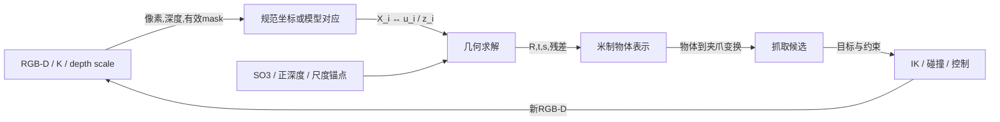
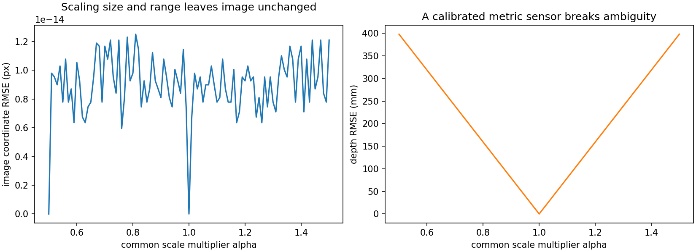
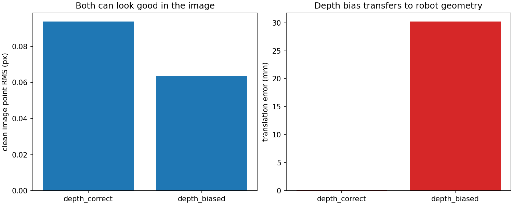

# D45 · 从图像对齐到机器人可用的尺度与刚体几何

[返回学习入口](../_index.md) · [本周日程](../P3-项目实战-日程.md) · [上一课：鲁棒损失](../day44/Daily-Learning-Pack.md) · [CPU实验](demo.py)

**几何约束的作用是排除观测无法排除的错误解；约束本身必须有可信来源。一个投影误差更小的解，仍可能把抓取点放到错误的深度。**

昨天我们限制坏点对优化的影响。今天进一步检查：即使所有点的投影都吻合，模型是否仍能以错误的物体大小、尺度或变形“解释”图像？对机器人而言，杯子看起来位于正确像素，并不能保证夹爪到达正确空间位置。

<details>
<summary>个人作答与实验记录（后续更新保留）</summary>

<!-- learner-notes:start -->
在这里填写尺度歧义手算、约束可信度检查与改变量结果。
<!-- learner-notes:end -->

</details>

<!-- daily-pack-generated:start -->

## 1 学习目标与路线

本课结束应能区分硬约束与软正则、推导单目尺度歧义、用深度方程锚定规范物体的米制尺度、说明 $SO(3)$ 投影的能力边界，并给真实项目建立“约束来源—量纲—故障模式”的调试记录。

| 顺序 | 知识主线 | 需要回答的问题 |
| --- | --- | --- |
| 1 | 几何约束的层次 | 有效旋转、重投影、深度、接触先验各限制什么？ |
| 2 | 可观测性 | 为什么低重投影误差不能确认尺度？ |
| 3 | 数值实现 | 如何把像素和深度写成可解的联合约束？ |
| 4 | 失败边界 | 错误深度会把哪类误差传给抓取？ |
| 5 | 项目接入 | NOCS 与已知 CAD 的原候选应分别检查什么？ |

## 2 宏观：从感知到控制，每个接口都隐含几何条件



图中“米制”是关键。语言模型可以指出“左边的杯子”，点云网络可以识别杯体，世界模型可以预测杯子继续运动；执行模块仍需要一致的长度单位、坐标系和时间戳。几何约束是把这些接口连接起来的一部分。

| 条件 | 数学形式示例 | 获得什么 | 不保证什么 |
| --- | --- | --- | --- |
| 旋转合法性 | $R^TR=I,\det R=1$ | 刚性、不镜像 | 姿态等于真值 |
| 重投影一致 | $\pi(K(RX+t))\approx u$ | 对应能解释像素 | 未知物体的绝对大小 |
| 正深度 | $Z_i>0$ | 点在相机前方 | 点可见或无遮挡 |
| 米制深度 | $(RX+t)_z\approx z$ | 距离/尺度锚点 | 深度标定正确 |
| 支撑面/接触 | 物体不穿桌、支撑面相接 | 某些物理不可能解被排除 | 杯子永远贴桌、接触力足够 |

桌面支撑条件在杯子被抓起后会失效；遮挡处“不看见”不等于“没有物体”。约束需要明确适用阶段。

## 3 微观：硬约束与软惩罚解决不同问题

硬约束直接限制可行域，例如用旋转指数映射 $R=\exp([\omega]_\times)$ 或单位四元数，使参数更新留在有效旋转上。软惩罚例如

$$
L_{\rm orth}=\|A^TA-I\|_F^2
$$

鼓励一个自由矩阵 $A$ 接近正交，但有限权重并不保证完全满足；单独这个式子也不排除 $\det A=-1$ 的镜像。

若网络先给出任意矩阵 $A=U\Sigma V^T$，最近的合法旋转为

$$
R^*=U\operatorname{diag}(1,1,\det(UV^T))V^T.
$$

这是 $\min_{R\in SO(3)}\|R-A\|_F$ 的解。它纠正“变形矩阵不是旋转”，却没有使用图像或真值，因此不可能凭空恢复正确姿态。后面的实验中正交误差降至约 $4.35\times10^{-15}$，但角度仍错约2.43°，正好展示这个边界。

> [!warning] 正交误差小不是位姿精度高
> 一个绕相机竖轴错误旋转90°的矩阵仍完全正交。结构有效性检查必须和任务误差分别报告。

## 4 微观：单目尺度歧义的直接推导

考虑规范物体点 $X_i$ 无量纲、尺度 $s>0$ 用米、旋转 $R$ 无量纲、平移 $t$ 用米：

$$
q_i=sRX_i+t,\qquad u_i=f_x\frac{q_{ix}}{q_{iz}}+c_x,\quad v_i=f_y\frac{q_{iy}}{q_{iz}}+c_y.
$$

对任意 $\alpha>0$，令 $s'=\alpha s,t'=\alpha t$，则 $q_i'=\alpha q_i$，分子分母同时缩放，像素完全不变。这是一个数据不可辨识方向，不是优化器不够强。更大的网络或更多相同条件单目观测不会自动提供米制锚点。

> [!question] 先手算
> 杯子宽度120 mm、距离800 mm，假定另一解把宽度变为90 mm。保持同样图像大小时，距离应是多少？夹爪沿深度方向会错多少？

$\alpha=90/120=0.75$，距离变为600 mm，差200 mm。若杯子中心不在光轴上，横向平移也要乘0.75，才是整个位姿尺度歧义。只改 $z$ 不改 $x,y,s$ 通常不会保持所有像素不变。



左图同时缩放物体大小和相机位置，像素差仅浮点舍入级；右图同样操作产生明确深度误差。它回答“新增深度究竟增加了哪条信息”。本课无噪声尺度族的最大像素坐标 RMSE 为 $1.25\times10^{-14}$ px。

已知米制 CAD 的物体级 PnP 不存在这里这条自由尺度，因为 $X_i$ 的尺寸固定。NOCS 类别级路径要估计新实例的尺度，不能直接套用“模型尺寸已经知道”的假设。本课以**单一各向同性尺度**简化机制，真实形状差异和尺度定义还要按原数据协议核对。

## 5 微观：把投影和深度变成可执行的约束

### 5.1 交叉相乘后是什么残差

为隔离尺度，本实验假定旋转已知，记 $a_i=RX_i$，把像素去内参得到 $\tilde u=(u-c_x)/f_x$、$\tilde v=(v-c_y)/f_y$。投影等式可以写成

$$
s(a_{ix}-\tilde u_i a_{iz})+t_x-\tilde u_it_z=0,
$$
$$
s(a_{iy}-\tilde v_i a_{iz})+t_y-\tilde v_it_z=0.
$$

未知量 $\beta=[s,t_x,t_y,t_z]^T$，每个点贡献两行，得到 $A_p\beta\approx0$。没有尺度锚点时，$\beta=0$ 总会满足齐次形式；不能直接用普通最小二乘取这个无意义解。无噪声时还存在真实尺度族；有像素噪声时最小奇异值变成小非零，也不等于数据突然获得了物理尺度。

加入深度观测 $z_i$：

$$
sa_{iz}+t_z=z_i.
$$

把这些行记为 $A_z\beta=z$，即可求联合问题

$$
\hat\beta=\arg\min_\beta
\left\|\frac{A_p\beta}{\sigma_{\rm ray}}\right\|^2+
\left\|\frac{A_z\beta-z}{\sigma_z}\right\|^2.
$$

### 5.2 为什么还要解释量纲

交叉相乘后的投影残差单位是米，不是像素。约有 $e_{\rm ray}\approx Z e_u/f$。因此代码采用名义距离0.8 m、像素噪声0.4 px、焦距600 px，得到 $\sigma_{\rm ray}=0.8\times0.4/600\approx0.000533$ m。深度标准差取0.002 m。

这是在名义距离附近的近似加权代数解，不是严格最大似然的非线性重投影优化。远近变化很大时，应该迭代更新尺度或直接最小化像素残差并用合适的雅可比；不能把本课线性解称作完整 PnP 或 NOCS 原版求解器。

| 数据/模块 | shape | 含义 |
| --- | --- | --- |
| `canonical` | `[80,3]` | 无量纲规范点 |
| `rotation` | `[3,3]` | 本实验已知旋转 |
| `pixels` | `[80,2]` | 像素，对应关系已给定 |
| `depth` | `[80]` | 相机轴向深度，米 |
| `A_p` | `[160,4]` | 两条投影代数方程/点 |
| `A_z` | `[80,4]` | 一条深度方程/点 |
| `beta` | `[4]` | 正尺度与平移；实现后还需检查正尺度和正深度 |

真实接口中 depth 要有 valid mask、时间戳、深度比例、对齐坐标约定。无效值0不是“物体在相机中心”。RGB与深度未对齐时，把同一像素索引下的深度直接配给RGB对应，会制造系统性错误约束。

## 6 微观：可信约束和错误约束会产生什么结果

脚本在相同80点、相同图像噪声和深度噪声下，只给深度额外加30 mm偏置。数据与权重均保持一致。

| 条件 | 估计尺度 mm | 平移误差 mm | 干净投影点 RMS px | 平均3D点误差 mm |
| --- | --- | --- | --- | --- |
| 正确深度 | 120.267 | 0.142 | 0.0939 | 0.178 |
| 全部深度多30 mm | 124.607 | 30.252 | 0.0635 | 30.139 |

错误深度下，投影指标甚至略好！因为系统可以增大物体尺度和距离来保持外观一致。不是“几何约束没有用”，而是错误约束把原本不可辨识方向锚定到了错误位置。真实系统中这种偏差可能来自深度标定、时间错位、规范尺寸定义错误；不能只把残差调低就宣布问题消失。



图把像素误差与米制平移误差分开画，避免两个量纲混在同一轴上。几何评测应同时检查重投影、米制位姿、尺度与独立深度/测量证据；某一损失最小不代表控制接口正确。

## 7 动手：先预测，再改变一个变量

CPU 依赖为 NumPy 与 Matplotlib，无训练模型和外部数据。2026-10-24已实际执行默认命令：Python3.11.15、NumPy1.26.4、Matplotlib3.10.9，随机种子45，80个对应点，合成时间戳t=0；网络训练步数和真机交互数均为0。

```bash
python3 3d_learning/day45/demo.py
python3 3d_learning/day45/demo.py --depth-bias-mm -30 --out-dir /tmp/day45-negative-bias
```

先预测：深度变小，尺度会变大还是变小？然后运行负偏置实验，检查尺度、平移与投影误差，解释是否与正偏置对称。扩展命令尚待你运行。进一步把物体移到很远处时，应同时改变噪声模型，而不是把当前固定噪声结果外推。

默认产物为[结果JSON](../../_assets/3d_learning/day45/results.json)与上面两图。`solve_ms`是当前单次CPU测量，不含数据加载、网络、相机或控制。检查顺序是：先查看尺度正值、相机深度正值、矩阵rank与单位；再看重投影；最后对照独立米制误差。脚本为最小教学实验，实用部署必须为退化输入返回明确失败，不能只返回最小二乘数组。

> [!note]- 完整可复制 CPU 脚本
> ```python
> """D45: metric scale ambiguity, depth constraints and SO(3); CPU NumPy."""
> from pathlib import Path
> import argparse, json, platform, time
> import numpy as np
> import matplotlib
> matplotlib.use("Agg")
> import matplotlib.pyplot as plt
> 
> 
> def project(q):
>     return q[:, :2] / q[:, 2:] * 600 + [320, 240]
> 
> 
> def solve_scale_translation(canonical_rotated, pixels, depth, sigma_z):
>     # Algebraic cross-multiplied projection residual; NOT a nonlinear PnP solver.
>     x = canonical_rotated
>     uv = (pixels - [320, 240]) / 600
>     a = np.zeros((2 * len(x), 4))
>     a[::2, 0] = x[:, 0] - uv[:, 0] * x[:, 2]
>     a[1::2, 0] = x[:, 1] - uv[:, 1] * x[:, 2]
>     a[::2, 1], a[1::2, 2] = 1, 1
>     a[::2, 3], a[1::2, 3] = -uv[:, 0], -uv[:, 1]
>     b = np.zeros(2 * len(x))
>     # Approximate ray residual scale at nominal range .8 m, image noise .4 px.
>     sigma_ray = .8 * .4 / 600
>     az = np.c_[x[:, 2], np.zeros((len(x), 2)), np.ones(len(x))]
>     matrix = np.r_[a / sigma_ray, az / sigma_z]
>     target = np.r_[b, depth / sigma_z]
>     solution = np.linalg.lstsq(matrix, target, rcond=None)[0]
>     return solution, np.linalg.svd(a, compute_uv=False)
> 
> 
> def main():
>     ap = argparse.ArgumentParser()
>     ap.add_argument("--depth-bias-mm", type=float, default=30.)
>     ap.add_argument("--out-dir", type=Path, default=Path(__file__).resolve().parents[2] / "_assets/3d_learning/day45")
>     args = ap.parse_args()
>     args.out_dir.mkdir(parents=True, exist_ok=True)
>     rng = np.random.default_rng(45)
>     canonical = rng.uniform(-.5, .5, (80, 3))
>     a = .45
>     rotation = np.array([[np.cos(a), 0, np.sin(a)], [0, 1, 0], [-np.sin(a), 0, np.cos(a)]])
>     x = canonical @ rotation.T
>     scale, trans = .12, np.array([.03, -.01, .8])
>     truth = scale*x + trans
>     pixels = project(truth)
>     noisy_pixels = pixels + rng.normal(0, .4, pixels.shape)
>     noisy_depth = truth[:, 2] + rng.normal(0, .002, len(x))
>     records = {}
>     for name, depth in [("depth_correct", noisy_depth), ("depth_biased", noisy_depth + args.depth_bias_mm/1000)]:
>         start = time.perf_counter()
>         sol, sv = solve_scale_translation(x, noisy_pixels, depth, .002)
>         q = sol[0]*x + sol[1:]
>         records[name] = dict(scale_m=float(sol[0]), translation_m=sol[1:].tolist(),
>             translation_error_mm=float(np.linalg.norm(sol[1:]-trans)*1000), scale_error_mm=float(abs(sol[0]-scale)*1000),
>             clean_reprojection_rms_px=float(np.sqrt(np.mean(np.sum((project(q)-pixels)**2, axis=1)))),
>             point_error_mm=float(np.linalg.norm(q-truth, axis=1).mean()*1000), solve_ms=(time.perf_counter()-start)*1000)
>     alpha = np.linspace(.5, 1.5, 101)
>     pixel_error = [np.sqrt(np.mean((project(k*truth)-pixels)**2)) for k in alpha]
>     depth_error = [np.sqrt(np.mean((k*truth[:, 2]-truth[:, 2])**2))*1000 for k in alpha]
>     # A coordinate network might produce a non-rotation: inspect and project.
>     raw = rotation @ np.array([[1.10, .08, 0], [0, .92, .03], [0, 0, 1.05]])
>     u, _, vt = np.linalg.svd(raw)
>     corrected = u @ np.diag([1, 1, np.linalg.det(u @ vt)]) @ vt
>     report = dict(seed=45, timestamp="synthetic t=0", units="canonical unitless, metric m, images px", frame="object to camera", network_train_steps=0, robot_interactions=0, data_points=80,
>         assumptions="Known rotation and correspondences; uniform scale unknown; algebraic weighted least squares, not full 6D PnP or NOCS reproduction.",
>         nominal_scale_m=scale, nominal_translation_m=trans.tolist(), depth_bias_mm=args.depth_bias_mm, image_noise_px=.4, depth_noise_m=.002,
>         environment=dict(python=platform.python_version(), numpy=np.__version__, matplotlib=matplotlib.__version__), results=records,
>         scale_ambiguity_max_pixel_coordinate_rmse=float(max(pixel_error)), noisy_projection_singular_values=sv.tolist(),
>         rotation_constraints=dict(raw_orthogonality_error=float(np.linalg.norm(raw.T@raw-np.eye(3))), raw_det=float(np.linalg.det(raw)), projected_orthogonality_error=float(np.linalg.norm(corrected.T@corrected-np.eye(3))), projected_det=float(np.linalg.det(corrected)), projected_angle_error_deg=float(np.rad2deg(np.arccos(np.clip((np.trace(corrected@rotation.T)-1)/2, -1, 1))))))
>     (args.out_dir / "results.json").write_text(json.dumps(report, indent=2), encoding="utf-8")
>     fig, ax = plt.subplots(1, 2, figsize=(11, 4), constrained_layout=True)
>     ax[0].plot(alpha, pixel_error)
>     ax[0].set(xlabel="common scale multiplier alpha", ylabel="image coordinate RMSE (px)", title="Scaling size and range leaves image unchanged")
>     ax[1].plot(alpha, depth_error, color="tab:orange")
>     ax[1].set(xlabel="common scale multiplier alpha", ylabel="depth RMSE (mm)", title="A calibrated metric sensor breaks ambiguity")
>     fig.savefig(args.out_dir / "scale-ambiguity.png", dpi=150)
>     plt.close(fig)
>     fig, ax = plt.subplots(1, 2, figsize=(10, 4), constrained_layout=True)
>     ax[0].bar(list(records), [v["clean_reprojection_rms_px"] for v in records.values()])
>     ax[0].set(ylabel="clean image point RMS (px)", title="Both can look good in the image")
>     ax[1].bar(list(records), [v["translation_error_mm"] for v in records.values()], color="tab:red")
>     ax[1].set(ylabel="translation error (mm)", title="Depth bias transfers to robot geometry")
>     fig.savefig(args.out_dir / "biased-constraint.png", dpi=150)
>     plt.close(fig)
>     print(json.dumps(report, indent=2))
> 
> 
> if __name__ == "__main__":
>     main()
> ```

## 8 回到宏观：原项目中几何改进应怎样落地

**已知物体模型路径：** 固定米制模型尺寸，检查 $T_{CO}$ 的方向、相机内参/畸变、对应点和可见mask；以重投影优化或模型表面距离细化位姿。不要把类别级尺度自由度无理由加入物体级基线，使模型可以缩放来吸收误差。

**NOCS 类别级路径：** 规范坐标预测需要与深度反投影正确配对，尺度/尺寸按原定义恢复；核对对称类别的处理。未见实例的形状差异不是简单高斯噪声，应分解规范坐标误差、mask误差、深度误差和尺度误差，再判断哪个约束真正帮助。

**EPro-PnP 候选：** 权重与对应学习、概率位姿分布的训练和最终位姿求解是不同部件。本课说明的是几何可观测性，不能把线性尺度演示包装成端到端概率层实现。真实改动前保持官方输入条件和评价协议，再单独验证所加几何项是否有可靠监督。

若引入桌面先验，要记录平面来源、法向方向、是否允许物体被抬起。若引入抓取接触约束，要区分杯体可抓区域与机器人可达性。新增约束不应偷偷改变“测试时可用哪些信息”，例如使用GT尺寸而把原任务写成未知实例。

## 9 今日总结与产出

第一，结构约束让输出合法，数据约束让输出解释观测，两者不能互相代替。第二，尺度歧义来自信息缺失，必须由米制模型、标定深度或其他真实尺度锚点消除。第三，错误锚点可以得到漂亮投影和错误空间位置，因而需要独立几何评价。

四个重点的价值在于：$SO(3)$ 阻止形变伪解；尺度族揭示不可观测方向；单位归一化让联合目标有意义；偏置对照说明约束可信度决定收益。最容易混淆的是“正交即准确”“重投影即米制正确”“数值满秩即物理可辨识”。

应留下三项产出：手推尺度族和联合方程；包含传感器单位/坐标/有效mask的约束卡；对两种深度条件的结果解释。本课结果只验证合成假设，不代表真实数据集或夹爪执行通过。

## 10 自测

1. $A^TA=I$ 为什么还不足以声明 $A$ 是真实旋转？
2. 120 mm宽、800 mm远的杯子缩成90 mm，怎样保持所有像素不变？
3. 已知米制CAD的PnP与本课未知尺度问题有什么区别？
4. 交叉相乘投影残差用什么单位？名义0.8 m、0.4 px、f=600 px对应多大残差尺度？
5. 单独对齐次投影系统做最小二乘，为什么可能返回零解？
6. 深度统一加30 mm后投影误差下降，是否说明深度修正正确？
7. 把RGB像素与未经对齐的深度图同索引配对，会破坏哪条假设？
8. 桌面支撑先验在抓杯子哪个阶段可能失效？怎样设计状态依赖约束？

## 11 未理解问题、精读与下一课

若仍不清楚哪个量有单位，手写 $X,s,R,t,q,K,u,z$ 的表并在每次乘法后检查。若不清楚旋转参数化，回到D19/D35的刚体与扰动。D46将固定数据和预算比较改进，重点检验“正确深度有帮助”能否在偏置深度时仍成立。

精读：[NOCS 原论文](https://arxiv.org/abs/1901.02970) 的方法部分中规范空间定义、像素到规范坐标预测、从深度恢复米制位姿与尺寸的段落，分别标出训练可用与测试可用信息；[EPro-PnP](https://arxiv.org/html/2203.13254v4) §3.1与附录A.4，区分概率分布建模和初始化/几何求解。2026-10-24核验一手页面；这里只给阅读任务与独立教学推导，没有把自己的实验写成论文复现。交付一张“信息从哪来、消除哪条歧义、错误时表现”的三列表。

## 12 核对答案

> [!note]- 自测参考与判分
> 每题0/1/2分：0为核心错误，1为能复述，2为能推导或给工程检验。建议12/16以上，尺度和单位题需正确；不代替个人验收。
>
> 1. 还要 $\det A=+1$；即便合法，也可能角度完全错。合法性与准确度分开。
> 2. 尺度和三维平移同时乘0.75，距离变600 mm，深度差200 mm；只改宽度不够。
> 3. CAD尺寸已固定了尺度，本课规范点无量纲且实例尺寸未知，额外存在尺度自由度。
> 4. 米；约 $0.8\times0.4/600=0.000533$ m，也就是0.533 mm。
> 5. $A\beta=0$ 总接受 $\beta=0$；必须增加尺度锚点或规范化并明确剩余物理歧义。
> 6. 否，尺度和距离可共同变化保持外观；应核对独立米制测量，本例平移约错30.25 mm。
> 7. 配对量应来自同一空间射线、同一物体表面与相容时间；未对齐的深度不能直接充当该RGB点的轴向深度。
> 8. 抬起后不再受桌面支撑；按接触/任务状态启用约束，并允许接触状态不确定，不能强行把所有阶段压回桌面。

<!-- daily-pack-generated:end -->
