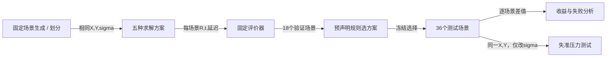
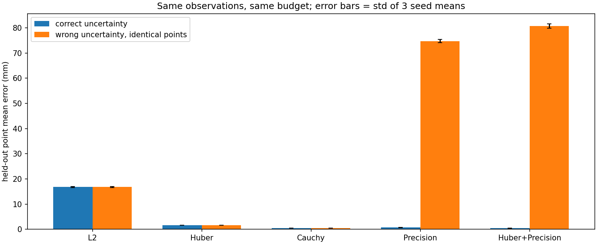
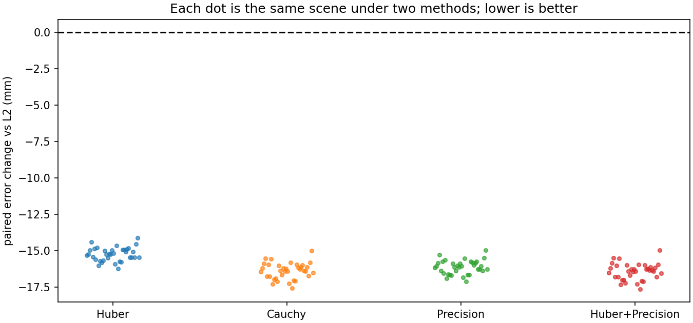

# D46 · 从单次提升到固定协议下可归因的四种改进

[返回学习入口](../_index.md) · [本周日程](../P3-项目实战-日程.md) · [上一课：几何约束](../day45/Daily-Learning-Pack.md) · [CPU实验](demo.py)

**一个改进只有在数据、初始化、评价和预算可比时，才能归因到它本身。组合方案在正常条件下最好，也可能在其假设失效时成为最差。**

D43改变多尺度表征，D44改变损失，D45增加几何约束。今天保留原计划的3至5种方案比较要求：在可独立运行的CPU求解器实验中，做“基线+四种改进”，并把真实网络的多尺度、损失、几何组合写成明确的后续接入矩阵。我们不会把合成求解器结果冒充原NOCS/EPro-PnP训练结果。

<details>
<summary>个人作答与实验记录（后续更新保留）</summary>

<!-- learner-notes:start -->
记录运行前的排名预测、失败解释、真实基线的实验配置与尚未完成的对照。
<!-- learner-notes:end -->

</details>

<!-- daily-pack-generated:start -->

## 1 学习目标与路线

本课结束后应能把研究想法写成可检验假设，区分组件消融与系统配置比较；实现固定划分和逐场景配对评价；解释均值、跨种子标准差和成功数；通过一次错误置信度对照定位组合方案的失效机制。

| 顺序 | 知识主线 | 需要回答的问题 |
| --- | --- | --- |
| 1 | 假设与对照 | 我想改变哪个变量，预期在哪个子集有效？ |
| 2 | 五条计算路径 | 各方案真正执行了什么不同操作？ |
| 3 | 固定数据协议 | 验证集选择后，测试集还承担什么角色？ |
| 4 | 配对结果 | 同一场景是否改善，改善是否稳定？ |
| 5 | 反例和迁移 | 不确定性失准时，为什么组合会崩溃？ |

## 2 宏观：把一次实验当作可追溯的数据管线



这个图说明“模型对比”的输入不只是图像，还有划分、参数、评价器和选择规则。若A使用更好的初始化，B看到更多训练实例，表格虽然能排出第一名，却不能说明第一名来自哪个改动。

机器人链上，本课直接研究 perception→representation 的位姿求解头。下游抓取、VLA与世界模型可能使用同一输出，但没有实际执行就不能把位姿成功写成机器人任务成功。

## 3 微观：基线加四种改进，分别押注什么假设

设每个场景有已知对应 $X_i\leftrightarrow Y_i$，求刚体 $R,t$，残差 $r_i=\|RX_i+t-Y_i\|$，米为内部单位。五种方法都从同一无权Kabsch初始化，做25次重加权求解，所有输入相同。

| 名称 | 本轮权重 $w_i$ | 改动与假设 |
| --- | --- | --- |
| L2基线 | $1$ | 各点同等可信，平方误差 |
| 改进A：Huber | $\min(1,\delta/r_i)$ | 限制大残差影响 |
| 改进B：Cauchy | $1/(1+(r_i/\delta)^2)$ | 更强抑制大残差，接受非凸风险 |
| 改进C：Precision | $1/\sigma_i^2$ | 传感器或模型给出的噪声尺度可信 |
| 改进D：Huber+Precision | $\min(1,\delta/r_i)/\sigma_i^2$ | 同时利用残差和外部可信度 |

固定 $\delta=0.006$ m，不在测试集上挑阈值。对于不依赖残差的L2/Precision，重复25轮不会改变收敛结果；这里保留相同迭代预算是为了统一教学执行路径，不声称真实部署应该浪费这些迭代。延迟差异仍需记录，因为单轮权重计算不同。

### 3.1 外部精度与鲁棒权重不是一回事

Precision是方差的倒数，来自观测质量模型；鲁棒权重来自“当前位姿下残差多大”。独立零均值高斯误差且方差已知时，$\sum r_i^2/\sigma_i^2$ 是合理目标。若某些点同时存在偏置，方差只描述随机散布，无法完全描述偏置误差。

本实验的坏点除了每维12 mm随机噪声，还叠加 `[50,-30,60]` mm固定方向偏置；好点每维2 mm。把坏点标成高方差对排序有帮助，但这仍是理想化“外部质量信息”，不等于网络已学会精确不确定性。

### 3.2 一个手算解释组合为什么也会失败

20%坏点若被错误标成2 mm，好点被标成12 mm，则单点权重比为

$$
\frac{1/0.002^2}{1/0.012^2}=36.
$$

粗略忽略点位置和后续鲁棒核，坏点占总权重比例

$$
\frac{0.2\times36}{0.2\times36+0.8}=0.9.
$$

只有20%的坏点，实际占了90%的权重。位姿被拉到坏簇后，真正好点变成“大残差”，Huber会降低它们的权重，进一步巩固错误解。这是“多个看起来合理模块组合后更差”的具体机制。

> [!question] 先预测
> 正常置信度下，组合是否一定最好？把sigma分配反转后，加入Huber是否一定能挽救Precision？在看结果前写下理由。

## 4 微观：如何冻结协议，而不是只固定一个seed

### 4.1 划分单位与信息边界

验证种子为461/462/463，每个生成6个独立场景，共18个；测试种子471/472/473，每个12个，共36个。每场景160个拟合点、256个独立探针点；物体形状范围、真实旋转和平移、噪声样本按场景生成。拟合点直接用于估计该场景的位姿，探针点不参与求解，用于评价同一姿态下的空间误差。

**这里没有神经网络训练集。** 每个场景是在推理时做参数估计，因此`network_train_steps=0`。把拟合点叫作“训练样本”可以描述优化语境，但不能因此声称完成了原基线网络训练。真实工程需额外按场景/实例划分网络训练数据，与本课验证/测试协议分开。

验证集唯一用于从五个预声明方法中选择平均探针误差最低者，选择后冻结；测试用于报告泛化到新合成场景。错误置信度实验复用测试X/Y，只反转输入sigma，属于明确标记的压力测试，不用于重新选择主方案。

### 4.2 固定不等于相同文件名

代码对每个场景的X/Y字节计算SHA-256，正常测试与失准测试必须相同。场景ID、初值、点数、阈值、迭代数、单位和坐标方向均记入结果。若换了点采样，哪怕同一图片仍不能称作“仅改loss”。

| 数组/记录 | shape/粒度 | 检查 |
| --- | --- | --- |
| 对应点 | `[160,3]` | 同一场景、相同顺序、米 |
| `sigma` | `[160]` | 正数，米，来源独立于真值拟合误差 |
| 探针点 | `[256,3]` | 不参与优化，评价几何范围一致 |
| 逐场景结果 | 场景×方法 | 每行带seed、scene_id、误差、成功、延迟 |
| 汇总 | 方法×条件 | 平均误差、跨seed均值标准差、分子/分母 |

## 5 微观：指标怎样支持结论

探针点平均位移采用已知逐点对应：

$$
d_j=\frac1M\sum_{m=1}^M\|\hat R_jX_m+\hat t_j-(R_jX_m+t_j)\|.
$$

这是本合成物体的ADD式平均误差，单位米；没有对称最近邻匹配，不冒充ADD-S，也不是官方数据集指标实现。

逐场景配对差值为 $\Delta_j=d_j^{\rm method}-d_j^{\rm baseline}$。同一场景能消除“方法恰好遇到了更容易样本”的解释。平均 $\bar\Delta<0$ 表示本组平均改善，不保证每个样本都改善；应同时报告改善数与总数。

三个种子各先得到一个均值 $\bar d_s$，然后报告样本标准差

$$
s_{\rm seed}=\sqrt{\frac1{3-1}\sum_s(\bar d_s-\bar d)^2}.
$$

它不是95%置信区间，也不是逐场景误差标准差。只有三个种子时，对分布尾部与微小排名的判断仍很有限。切勿把误差条短解读为真实机器人环境已经覆盖。

合成诊断成功条件事先固定为平移误差小于5 mm且旋转误差小于2°。需报告`成功数/尝试数`；36/36仅表示36个合成位姿通过自定门槛，不是抓取成功率，也不是官方BOP门槛。

## 6 实测结果：正常条件下的收益和失准时的翻转

2026-10-24在CPU实际运行，Python3.11.15、NumPy1.26.4、Matplotlib3.10.9。全部方法都完成固定预算，完整逐场景结果见[per-scene.json](../../_assets/3d_learning/day46/per-scene.json)，协议和摘要见[results.json](../../_assets/3d_learning/day46/results.json)。

| 方法 | 正常测试均值 ± 跨seed标准差 mm | 合成门槛通过 | sigma反转后均值 mm | 反转后通过 |
| --- | --- | --- | --- | --- |
| L2 | 16.827 ± 0.216 | 0/36 | 16.827 | 0/36 |
| Huber | 1.573 ± 0.029 | 36/36 | 1.573 | 36/36 |
| Cauchy | 0.422 ± 0.024 | 36/36 | 0.422 | 36/36 |
| Precision | 0.688 ± 0.032 | 36/36 | 74.770 | 0/36 |
| Huber+Precision | 0.384 ± 0.019 | 36/36 | 80.726 | 0/36 |

验证集选出组合方案，平均误差0.332 mm；它在正常测试仍略好，但相对Cauchy只有约0.0388 mm的均值差，没有足够证据把这个微小差距外推为真实系统优势。反转sigma后，组合错误最严重，说明其收益依赖置信度质量。



误差条是三个种子均值的标准差。正常条件与失准条件共享完全相同的观测，改变的只有sigma。未使用sigma的三个方法数值完全不变，这是本对照成立的重要检查。



每个点对应同一场景上“改进−L2”的误差差值。四种改进在正常条件下均为36/36改善，但这是人为构造的强离群点场景；没有普通高质量数据的普遍优势结论。D44的干净负对照可以提醒我们补齐此类测试。

## 7 动手：重跑、检查选择，再只改一个因素

```bash
python3 3d_learning/day46/demo.py
```

先检查正常测试与压力测试的数据hash一致、验证与测试种子不交叉。然后在复制的脚本中只把坏点比例从32/160改为16/160，保留所有方法和预算，并把输出指向独立目录；预测L2与鲁棒方法差距是否缩小。不要同时改delta与噪声。此扩展尚待个人执行。

进一步任务是写一条断言：正常与失准条件中，L2/Huber/Cauchy的每个场景误差都一致。如果不一致，先找随机数消耗、样本重排或求解状态共享问题，而不是解释成“置信度也间接影响了未使用置信度的方法”。

当前每种方案单次求解中位耗时约0.53–0.59 ms，包含NumPy计算和Python循环，不含网络或数据I/O；无硬件交互、无动作执行。它只能说明此教学例可在CPU运行。

> [!note]- 完整可复制 CPU 脚本
> ```python
> """D46: predeclared five-method paired ablation, independent synthetic scenes."""
> from pathlib import Path
> import argparse, hashlib, json, platform, time
> import numpy as np
> import matplotlib
> matplotlib.use("Agg")
> import matplotlib.pyplot as plt
> 
> METHODS = ["L2", "Huber", "Cauchy", "Precision", "Huber+Precision"]
> 
> 
> def rigid(x, y, w):
>     w = w / w.sum()
>     xc, yc = w @ x, w @ y
>     u, _, vt = np.linalg.svd((x-xc).T @ ((y-yc)*w[:, None]))
>     r = vt.T @ np.diag([1, 1, np.linalg.det(vt.T @ u.T)]) @ u.T
>     return r, yc-r@xc
> 
> 
> def solve(x, y, sigma, method, delta=.006):
>     r, t = rigid(x, y, np.ones(len(x)))
>     for _ in range(25):
>         e = np.linalg.norm(x@r.T+t-y, axis=1)
>         w = np.ones(len(x))
>         if "Huber" in method:
>             w *= np.minimum(1., delta / np.maximum(e, 1e-12))
>         if method == "Cauchy":
>             w *= 1. / (1.+(e/delta)**2)
>         if "Precision" in method:
>             w *= 1. / sigma**2
>         r, t = rigid(x, y, w)
>     return r, t
> 
> 
> def scene(seed, j):
>     rng = np.random.default_rng(seed*1000+j)
>     x = rng.uniform(-1, 1, (160, 3))*[.06, .045, .035]
>     angle = rng.uniform(-1, 1)
>     r = np.array([[np.cos(angle), -np.sin(angle), 0], [np.sin(angle), np.cos(angle), 0], [0, 0, 1.]])
>     t = np.r_[rng.uniform(-.05, .05, 2), rng.uniform(.5, .9)]
>     sigma = np.full(len(x), .002)
>     bad = rng.permutation(len(x))[:32]
>     sigma[bad] = .012
>     y = x@r.T+t+rng.normal(size=x.shape)*sigma[:, None]
>     y[bad] += [.05, -.03, .06]
>     probe = rng.uniform(-1, 1, (256, 3))*[.06, .045, .035]
>     return x, y, sigma, r, t, probe
> 
> 
> def evaluate(seeds, count, flipped=False):
>     rows = []
>     digest = hashlib.sha256()
>     for seed in seeds:
>         for j in range(count):
>             x, y, sigma, rt, tt, probe = scene(seed, j)
>             digest.update(x.tobytes()+y.tobytes())
>             supplied = np.where(sigma == .002, .012, .002) if flipped else sigma
>             for method in METHODS:
>                 start = time.perf_counter()
>                 r, t = solve(x, y, supplied, method)
>                 latency = (time.perf_counter()-start)*1000
>                 trans = float(np.linalg.norm(t-tt)*1000)
>                 angle = float(np.rad2deg(np.arccos(np.clip((np.trace(r@rt.T)-1)/2, -1, 1))))
>                 add = float(np.linalg.norm(probe@r.T+t-(probe@rt.T+tt), axis=1).mean()*1000)
>                 rows.append(dict(seed=seed, scene_id=f"{seed}-{j}", method=method, add_mm=add, trans_mm=trans, angle_deg=angle, success=bool(trans<5 and angle<2), latency_ms=latency))
>     summary = {}
>     for method in METHODS:
>         sel = [r for r in rows if r["method"] == method]
>         seed_means = [float(np.mean([r["add_mm"] for r in sel if r["seed"]==s])) for s in seeds]
>         summary[method] = dict(add_mean_mm=float(np.mean([r["add_mm"] for r in sel])), add_seed_std_mm=float(np.std(seed_means, ddof=1)), seed_means_mm=seed_means,
>             successes=sum(r["success"] for r in sel), attempts=len(sel), median_solve_ms=float(np.median([r["latency_ms"] for r in sel])))
>     return rows, summary, digest.hexdigest()
> 
> 
> def main():
>     ap = argparse.ArgumentParser()
>     ap.add_argument("--out-dir", type=Path, default=Path(__file__).resolve().parents[2] / "_assets/3d_learning/day46")
>     args = ap.parse_args()
>     args.out_dir.mkdir(parents=True, exist_ok=True)
>     val_rows, val, val_hash = evaluate([461, 462, 463], 6)
>     winner = min(METHODS, key=lambda k: val[k]["add_mean_mm"])
>     test_rows, test, test_hash = evaluate([471, 472, 473], 12)
>     ood_rows, ood, ood_hash = evaluate([471, 472, 473], 12, flipped=True)
>     assert test_hash == ood_hash  # Only reported uncertainty changes.
>     paired = {}
>     baseline = {r["scene_id"]: r["add_mm"] for r in test_rows if r["method"]=="L2"}
>     for method in METHODS[1:]:
>         dif = np.array([r["add_mm"]-baseline[r["scene_id"]] for r in test_rows if r["method"]==method])
>         paired[method] = dict(mean_delta_mm=float(dif.mean()), better_count=int((dif<0).sum()), count=len(dif))
>     report = dict(environment=dict(python=platform.python_version(), numpy=np.__version__, matplotlib=matplotlib.__version__),
>         protocol=dict(methods=METHODS, fixed_delta_m=.006, solve_iterations=25, validation_seeds=[461,462,463], test_seeds=[471,472,473], validation_scenes=18, test_scenes=36, points_per_scene=160, probe_points=256, pose_success="translation <5 mm AND rotation <2 deg; synthetic diagnostic, not benchmark threshold", network_train_steps=0, robot_interactions=0, units="m internally", frame="object to camera", timestamp="each scene independent synthetic t=0", initialization="same unweighted Kabsch", tuning="no hyperparameter search; select method by validation ADD only", validation_hash=val_hash, test_hash=test_hash, ood_hash=ood_hash),
>         selected_on_validation=winner, validation=val, test=test, ood_uncertainty_flipped=ood, paired_test_against_l2=paired,
>         scope="Five solver heads; not trained multi-scale feature networks, official datasets, or real robot success.")
>     (args.out_dir/"results.json").write_text(json.dumps(report, indent=2), encoding="utf-8")
>     (args.out_dir/"per-scene.json").write_text(json.dumps(dict(validation=val_rows,test=test_rows,ood=ood_rows), indent=2), encoding="utf-8")
>     fig, ax = plt.subplots(figsize=(11, 4.5), constrained_layout=True)
>     x = np.arange(len(METHODS))
>     ax.bar(x-.18, [test[m]["add_mean_mm"] for m in METHODS], .36, yerr=[test[m]["add_seed_std_mm"] for m in METHODS], capsize=3, label="correct uncertainty")
>     ax.bar(x+.18, [ood[m]["add_mean_mm"] for m in METHODS], .36, yerr=[ood[m]["add_seed_std_mm"] for m in METHODS], capsize=3, label="wrong uncertainty, identical points")
>     ax.set(xticks=x, xticklabels=METHODS, ylabel="held-out point mean error (mm)", title="Same observations, same budget; error bars = std of 3 seed means")
>     ax.legend()
>     fig.savefig(args.out_dir/"controlled-comparison.png", dpi=150)
>     plt.close(fig)
>     fig, ax = plt.subplots(figsize=(9, 4.2), constrained_layout=True)
>     for i, method in enumerate(METHODS[1:]):
>         vals = [r["add_mm"]-baseline[r["scene_id"]] for r in test_rows if r["method"]==method]
>         ax.scatter(np.full(len(vals), i)+np.linspace(-.15,.15,len(vals)), vals, s=12, alpha=.65)
>     ax.axhline(0, color="black", linestyle="--")
>     ax.set(xticks=np.arange(4), xticklabels=METHODS[1:], ylabel="paired error change vs L2 (mm)", title="Each dot is the same scene under two methods; lower is better")
>     fig.savefig(args.out_dir/"paired-effects.png", dpi=150)
>     plt.close(fig)
>     print(json.dumps(report, indent=2))
> 
> 
> if __name__ == "__main__":
>     main()
> ```

## 8 回到宏观：把对照接入原项目，而不偷换任务

本课实跑了四种求解头改进，满足一个可审查的比较实例。原项目还需要把D43多尺度、D44损失与D45几何约束接入真实NOCS或EPro-PnP候选；以下是**待执行的项目实验矩阵**，不把它们勾选为已训练：

| 配置 | 唯一主要变化 | 固定项与验收 |
| --- | --- | --- |
| 原基线B | 官方适用输入和协议 | 先复现数据/评价、保存运行配置 |
| B+多尺度 | 加多层特征融合 | 数据/训练步数/输入大小固定；另报告参数与延迟增加 |
| B+损失 | 改鲁棒核或监督方式 | 不改变特征/初始化；检查尺度、对称定义 |
| B+几何 | 加可信重投影/深度项或合法参数化 | 测试信息条件一致；明确额外模态成本 |
| B+三者 | 组合 | 与单项对照比较，定位相互作用，不默认相加 |

如果某几何方案在测试时多用了深度，它是“输入条件变化的系统比较”，不能写成相同RGB输入下的纯算法优势；可以保留这个实验，只需准确命名。多尺度增加算力时，应同时给等训练步数与预算说明，不能只报一个更大的模型准确率。

VLA与世界模型在未来W13对照时也遵守同样原则：相同初态、观测、数据和交互预算，记录延迟与失败恢复；不能用不同任务难度的成功率直接比较。

## 9 今日总结与产出

第一，受控实验控制的是信息、计算和选择过程，不只是seed。第二，逐场景配对和分子/分母让平均提升可以追查。第三，错误置信度反例说明组合模块依赖的假设比模块名字更重要。

最重要的四点：预声明方案和选择规则防止测试集调参；观测hash保证对照确实共享数据；配对差值保留失败细节；压力测试暴露潜在依赖。边界是：三种子误差条不是置信区间，合成通过不是抓取成功，求解头实验不是神经网络消融。

今天应留下实验JSON、两图、五方案表以及一段失败归因：为什么“加鲁棒核”没有挽救错误精度权重。真实基线矩阵保留为待执行清单，后续D49据证据写消融报告。

## 10 自测

1. 为什么只固定一个随机seed仍不足以证明公平对照？
2. 本课验证集和测试集分别用于什么？是否有神经网络训练？
3. 为什么同一场景做差比比较两个不相交场景集合更容易解释？
4. 20%坏点被赋予36倍权重，大约占总权重多少？
5. Huber+Precision为何会在sigma反转后比Precision更差？
6. 图中的三个种子标准差能否当作95%置信区间？
7. 36/36意味着机器人抓取成功率100%吗？
8. RGB基线与RGB-D改进应怎样命名和报告，才能保留有价值的结论？

## 11 未理解问题、精读与下一课

把未理解点写成能复验的问题：例如“权重比36为何让IRLS锁定错误簇”“哪一层随机数让成对数据不一致”。D47把位姿结果转换为抓取候选；D48检查可达性/碰撞；D49回收本课原始结果形成消融报告，仍不替代真实项目实验。

精读：[EPro-PnP](https://arxiv.org/html/2203.13254v4) §5.3 的基线与消融、权重/坐标学习贡献，以及附录E.2的推理耗时讨论。记录每行改了哪个模块、评价数据是否相同、准确率和时间如何对应。本课对照结构为独立教学设计，没有复制论文数字。阅读与页面核验日期2026-10-24，用户阅读状态待记录。

## 12 核对答案

> [!note]- 自测参考与判分
> 每题0/1/2分：0核心错误，1能复述，2能解释本实验或提出可执行检查；建议12/16且选择规则与信息条件题正确，未对个人评分。
>
> 1. 数据划分、初始化、输入模态、预算、评价器和超参数选择都可能不同；seed仅控制部分随机性。
> 2. 验证选预声明方法，测试冻结后评估新场景；没有网络训练，每场景只优化位姿。
> 3. 同一场景的难度被配对抵消；仍需报告全部样本和失败，不只看均值。
> 4. $7.2/(7.2+0.8)=90\%$，这说明少量高权重坏点可以主导。
> 5. 错误精度先把解拉向坏簇，真实好点残差增大又被Huber抑制；鲁棒核依赖当前解与初始化。
> 6. 不能；这里只是三个seed均值的样本标准差，样本量有限，也未构造置信区间。
> 7. 不是；只是36个合成位姿通过预声明5 mm/2°门槛，机器人尝试数0。
> 8. 称作输入/系统配置比较，说明深度额外信息与成本；若要纯模块消融，应另设相同输入条件的基线。

<!-- daily-pack-generated:end -->
