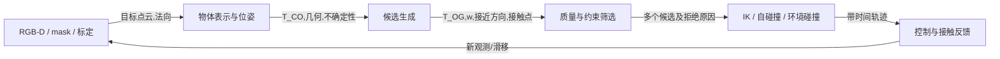
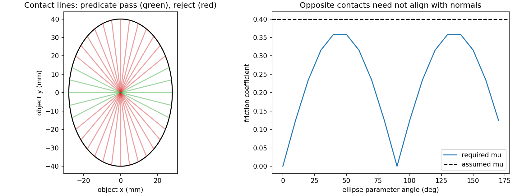
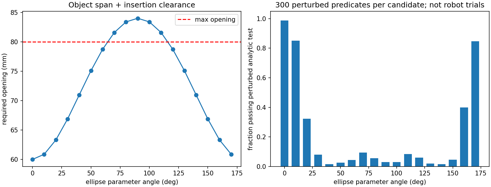

# D47 · 从物体位姿到夹爪候选、接触几何与抓取质量

[返回学习入口](../_index.md) · [本周日程](../P3-项目实战-日程.md) · [上一课：受控对照](../day46/Daily-Learning-Pack.md) · [CPU实验](demo.py)

**物体位姿描述杯子在哪里；抓取候选还必须描述夹爪从哪里接近、沿哪个方向闭合、张开多宽、接触能承受什么载荷。一个高分候选仍需经过可达性、碰撞与执行反馈。**

过去几天我们改善了感知输出并检验其误差。今天把这些输出送入操作算法：从杯体表面生成多个夹爪目标，而不是把杯子中心坐标直接发送给机械臂。明天才进一步检查这些目标是否能由具体机器人到达以及路径是否碰撞。

<details>
<summary>个人作答与实验记录（后续更新保留）</summary>

<!-- learner-notes:start -->
保留自己的坐标链手算、夹爪轴定义、候选筛选结果和失败解释。
<!-- learner-notes:end -->

</details>

<!-- daily-pack-generated:start -->

## 1 学习目标与路线

本课结束应能从接触点构造右手夹爪坐标系，推导对象到夹爪/法兰的变换链，计算开口宽度和预抓取位姿，解释摩擦锥与对向接触条件，区分解析评分、模型预测置信度与真机成功率，并实现一个有失败原因的候选生成器。

| 顺序 | 知识主线 | 需要回答的问题 |
| --- | --- | --- |
| 1 | 抓取表示 | 除了6D位姿还需要哪些字段？ |
| 2 | 坐标链 | 物体、夹爪中心、TCP与法兰如何连接？ |
| 3 | 接触机制 | 两个点相对，是否就能夹稳？ |
| 4 | 质量与不确定性 | 分数代表什么，有哪些没检查？ |
| 5 | 实操 | 如何生成、筛选并导出候选供D48接入？ |

## 2 宏观：候选生成处于感知和运动规划之间



这里保留多个候选是有意义的。几何质量最好的姿态可能让手腕超出关节限制；略低分的另一侧抓取可能更容易执行。把感知置信度、接触质量和规划可行性压成一个来源不明的分数，会让失败归因很困难。

用 $g=(T_{OG},w,d_{\rm pre},\mathcal C,q)$ 表示候选：$T_{OG}$ 是夹爪坐标到物体坐标的变换，$w$ 是开口宽度，$d_{\rm pre}$ 是预抓取距离，$\mathcal C$ 为接触假设，$q$ 为明确定义的评分。所有长度用米；质量字段必须带类型，例如启发式几何分数、解析判定通过率或学习模型logit。

## 3 微观：用接近与闭合方向构造夹爪坐标系

本课固定约定：夹爪 $x_G$ 是向物体前进的接近方向 $a$，$y_G$ 是两指连线/闭合轴 $b$，$z_G=a\times b$。这些约定**不代表所有夹爪API的标准**，实际硬件要查工具坐标定义。

设两个接触点 $p_1,p_2$ 在同一物体坐标系，中心 $c=(p_1+p_2)/2$，闭合轴

$$
b=\frac{p_2-p_1}{\|p_2-p_1\|}.
$$

选择与 $b$ 垂直的接近方向 $a$；若候选原始向量不垂直，先做Gram–Schmidt：$a\leftarrow(a-(a^Tb)b)/\|a-(a^Tb)b\|$，平行时必须拒绝。然后

$$
R_{OG}=[a\ b\ a\times b],\qquad T_{OG}=\begin{bmatrix}R_{OG}&c\\0&1\end{bmatrix}.
$$

列向量是夹爪各轴在物体系的方向。检查 $R^TR=I$ 和 $\det R=+1$；把叉积顺序写反可能得到左手坐标。两个接触点确定了闭合轴，但绕闭合轴仍有接近方向自由度，实际候选应枚举可行接近方向。本实验只示范顶向下的一组方向，不能代表完整6D候选覆盖。

### 3.1 宽度不是“物体包围盒最长边”

平行夹爪沿 $b$ 方向的物体跨度为

$$
w_{\rm obj}=\max_j b^Tp_j-\min_jb^Tp_j.
$$

开口宽度可设 $w=w_{\rm obj}+2m$，其中每侧安全间隙 $m$ 必须解释。接触完成后的宽度和接近时的张开宽度不同；指尖厚度、插入深度、物体可压缩性也不能从一条距离自动得出。

手算：跨度56 mm、每侧2 mm间隙，接近开口60 mm。若同一物体另一方向跨度80 mm，80 mm最大开口的夹爪无法同时满足84 mm接近开口，即使最终接触宽度恰好是80 mm。

## 4 微观：从对象坐标到基座、TCP和法兰

统一 $T_{AB}$ 的定义为“把B坐标表达的点变到A”。设基座B、相机C、物体O、抓取中心G、法兰F，则

$$
T_{BG}=T_{BC}T_{CO}T_{OG},\qquad T_{BF}=T_{BG}T_{GF}.
$$

如果标定给出的是 $T_{FG}$，先求逆得到 $T_{GF}$，不能直接在式子末尾拼上 $T_{FG}$。知道工具长100 mm，只够说明某个局部轴上的位移，不知道坐标轴就不能加到基座z上。

预抓取位置沿接近方向的反向退开：

$$
c_{\rm pre}=c_G-d_{\rm pre}a_B,\qquad a_B=R_{BG}[1,0,0]^T.
$$

数值例来自本课合成变换：$c_G^B=[0.43,-0.10,0.75]$ m、$a_B=[0,0,-1]$，退开80 mm得到 $c_{\rm pre}^B=[0.43,-0.10,0.83]$ m。若法兰在抓取中心后方100 mm，即 $t_{GF}=[-0.10,0,0]$，则法兰目标z为0.85 m。预抓取距离与工具固定偏置是不同量。

> [!warning] 输出位置不等于执行状态
> 即使 $T_{BF}$ 完全正确，也尚未求IK、验证关节限位和碰撞，更没有控制机器人。候选导出要保留frame与时间戳，执行反馈另记。

## 5 微观：接触点在两边，为什么仍可能滑动

### 5.1 摩擦锥及对向条件

库仑摩擦模型约束接触切向力与法向力：$\|f_t\|\le\mu f_n$，其中 $f_n\ge0$，$\mu$ 为无量纲摩擦系数。允许力方向形成半角 $\alpha=\arctan\mu$ 的摩擦锥。

在两个对向接触的简化平面图中，希望两接触产生沿连线的相反作用力。若连线与各自指向物体内侧的法向夹角均小于 $\alpha$，称为满足相应的对向摩擦几何条件。代码用外法向与从物体中心指向接触的方向比较，二者同时取反得到相同夹角。

> [!question] 先判断
> 圆的对径线与表面法向一致。椭圆的对径线也总与法向一致吗？

椭圆截面 $x^2/a^2+y^2/b^2=1$ 的外法向与 $[x/a^2,y/b^2]$ 同向；从中心指向表面的向量是 $[x,y]$，只有圆或主轴等特殊位置二者平行。因此“两个点相对”并不自动满足低摩擦抓取。

设夹角为 $\beta$，几何上最小需要 $\mu_{\min}=\tan\beta$。例如 $\beta=20°$，需 $\mu\ge0.364$；$\mu=0.2$ 时不满足。估计法向有噪声时，临界候选的判定容易翻转。



左图为解析椭圆柱的水平截面，绿色是通过本例全部解析谓词的方向，红色被宽度或载荷等条件拒绝。右图显示不同对径方向需要的摩擦系数；不是只有开口宽度在变化。

### 5.2 能产生对向力，还要能承受重力

质量0.25 kg、每指法向力上限4 N、$\mu=0.4$。若 $\beta=0$，最大总竖直摩擦力是 $2\mu f_n=3.2$ N，重力为2.4525 N，余量0.7475 N。

当 $\beta>0$ 时，一部分切向摩擦用于使合力沿接触连线，已消耗 $f_n\tan\beta$。在本课水平对称接触、重力竖直、两指法向力相同的模型中，竖直剩余能力为

$$
F_{z,\max}=2f_n\sqrt{\mu^2-\tan^2\beta},\qquad \tan\beta\le\mu.
$$

因此本例还要求 $F_{z,\max}\ge mg$。不能分别检验“水平摩擦够”和“竖直摩擦够”后把两者相加使用同一份摩擦预算。比如 $\mu=0.4,\beta=20°$，虽然满足对向条件，竖直容量约1.33 N，仍不足以托住这件0.25 kg物体。

这个式子是对称、静态、已知质量和法向力上限下的简化载荷检查。实际加速度、偏心质心、软指接触、力控制误差会改变需求。不能把模型中4 N法向力直接等同于任意夹爪API的“force=4”：API可能描述总夹持力、马达电流或归一化力度。

### 5.3 对向夹持不等于完整六维力闭合

力闭合讨论接触能否产生抵抗任意扰动力/力矩的组合。两个理想硬点接触无法抵抗绕两点连线的任意力矩，因此本课对向与载荷判定不是完整空间力闭合证明。软指接触面能提供额外摩擦力矩，但需要相应接触模型。

这个区分很重要：一个平面图里“夹得住”的例子，不能直接升级成真实六维空间中“不会翻转”。实际抓取验证还应包括外载荷、接触面与机械力上限。

## 6 微观：质量分数、鲁棒率与学习式抓取

本实验为通过硬筛选的候选设启发式分数

$$
q=\left(1-\frac{\mu_{\min}}\mu\right)_+
\left(1-\frac w{w_{\max}}\right)_+
\exp\left[-\left(\frac{h-0.05}{0.03}\right)^2\right].
$$

第一项偏好摩擦余量，第二项偏好开口余量，第三项偏好中部接触高度。高度以米计；0.05/0.03是本例设计选择。这个公式可解释，但不是概率，也不是通用最佳评分。若真实任务要避开易碎中部、抓杯柄或倒水，偏好应改变。

另外给每个候选做300次解析扰动：两侧法向夹角各加5°标准差高斯误差、开口估计加2 mm标准差误差；再测试摩擦、剩余载荷与宽度。得到的是“在指定扰动分布下通过解析谓词的比例”，不是机器人执行成功率。它仍没有覆盖深度孔洞、未知表面、关节限制或路径碰撞。

学习式抓取方法可以从RGB-D/点云预测 $T,w,q$，或者对已生成候选评分。训练标签若来自解析接触模型，模型继承该标签的假设；训练标签若来自真实执行，也依赖机器人、物体、分布与成功定义。分类分数需经过独立校准才能接近概率，不能因为使用sigmoid就宣称“0.9表示90%成功”。

| 字段 | shape | 工程含义 |
| --- | --- | --- |
| 候选中心 | `[K,3]` | 同一frame，米 |
| 候选旋转 | `[K,3,3]` | 轴约定固定、合法旋转 |
| 开口 | `[K]` | 接近开口米值，附夹爪范围 |
| 接触点/法向 | `[K,2,3]` | 估计或解析假设，保留可信度 |
| 拒绝原因 | `[K]`结构记录 | 宽度、摩擦、载荷等分别记录 |
| 质量/不确定性 | `[K]`及元数据 | 必须标明评分类型和训练/扰动条件 |

## 7 动手：生成54个候选，再检查为何只留下15个

本课合成几何是半径28/40 mm的椭圆柱，取18个对径方向、三个接触高度，共54个候选；固定从上方接近。没有下载数据、调用抓取大模型或连接机器人。

```bash
python3 3d_learning/day47/demo.py
python3 3d_learning/day47/demo.py --mu 0.15 --out-dir /tmp/day47-low-friction
python3 3d_learning/day47/demo.py --max-width-mm 65 --out-dir /tmp/day47-narrow-gripper
```

先预测低摩擦情况下能否承重：$2\times0.15\times4=1.2$ N，小于2.4525 N，所以连最佳主轴接触也无法通过本模型载荷条件。随后运行第一条改变量命令核对；第二条只缩小夹爪开口，观察候选数和最优方向变化。默认与低摩擦边界已实际验证；窄夹爪对照仍是个人任务。

2026-10-24 CPU默认运行记录：Python3.11.15、NumPy1.26.4、Matplotlib3.10.9、随机种子47。54个候选中15个通过解析谓词；最高启发式分数为0.25，接触高度50 mm、主轴方向、接近开口60 mm。该候选300次扰动中296次通过，真实机器人尝试数为0。另已运行 $\mu=0.15$ 的[低摩擦边界记录](../../_assets/3d_learning/day47/low-friction-results.json)：0/54通过，`chosen_candidate=null`。无可行候选时应明确返回失败，不能强行执行评分最高的拒绝候选。



左图解释不同方向所需开口，右图是中间高度候选的扰动谓词通过率。法向几何、宽度余量和载荷余量共同决定结果；只按预测分数排序会隐藏哪条约束先失效。

查看[候选完整记录](../../_assets/3d_learning/day47/candidates.json)和[结果/坐标链](../../_assets/3d_learning/day47/results.json)。输出含`width_ok`、`friction_ok`、`load_ok`，拒绝候选也保留，便于解释。当前代码没有IK和碰撞检查，后续D48必须把它们加为独立关卡。

> [!note]- 完整可复制 CPU 脚本
> ```python
> """D47: parallel-jaw contact candidates on an analytic elliptical cylinder."""
> from pathlib import Path
> import argparse, json, platform, time
> import numpy as np
> import matplotlib
> matplotlib.use("Agg")
> import matplotlib.pyplot as plt
> 
> 
> def rz(a):
>     return np.array([[np.cos(a), -np.sin(a), 0], [np.sin(a), np.cos(a), 0], [0, 0, 1.]])
> 
> 
> def transform(r, t):
>     out = np.eye(4)
>     out[:3, :3], out[:3, 3] = r, t
>     return out
> 
> 
> def main():
>     ap = argparse.ArgumentParser()
>     ap.add_argument("--mu", type=float, default=.4)
>     ap.add_argument("--max-width-mm", type=float, default=80.)
>     ap.add_argument("--out-dir", type=Path, default=Path(__file__).resolve().parents[2]/"_assets/3d_learning/day47")
>     args = ap.parse_args()
>     if args.mu <= 0 or args.max_width_mm <= 0:
>         raise ValueError("mu and width must be positive")
>     args.out_dir.mkdir(parents=True, exist_ok=True)
>     rng = np.random.default_rng(47)
>     radii = np.array([.028, .04])
>     heights = [.025, .05, .075]
>     max_width, margin = args.max_width_mm/1000, .004
>     mass, force_per_finger, gravity = .25, 4., 9.81
>     load_margin = 2*args.mu*force_per_finger-mass*gravity
>     candidates = []
>     start = time.perf_counter()
>     for j, angle in enumerate(np.linspace(0, np.pi, 18, endpoint=False)):
>         xy = radii*np.array([np.cos(angle), np.sin(angle)])
>         p = np.r_[xy, 0.]
>         closing = p/np.linalg.norm(p)
>         normal = np.r_[xy/radii**2, 0.]
>         normal /= np.linalg.norm(normal)
>         beta = float(np.arccos(np.clip(normal@closing, -1, 1)))
>         required_mu = float(np.tan(beta))
>         capacity = 2*force_per_finger*np.sqrt(max(0., args.mu**2-required_mu**2))
>         coupled_margin = capacity-mass*gravity
>         contact_width = float(2*np.linalg.norm(p))
>         width = contact_width+margin
>         approach = np.array([0., 0., -1.])
>         rotation = np.column_stack([approach, closing, np.cross(approach, closing)])
>         assert np.allclose(rotation.T@rotation, np.eye(3)) and np.linalg.det(rotation) > .999
>         for h in heights:
>             center = np.array([0., 0., h])
>             # Two opposing contact normal errors; this tests an analytic predicate only.
>             beta_noisy = np.abs(beta+rng.normal(0, np.deg2rad(5), (300, 2)))
>             width_noisy = width+rng.normal(0, .002, 300)
>             noisy_mu = np.tan(beta_noisy).max(axis=1)
>             noisy_capacity = 2*force_per_finger*np.sqrt(np.maximum(0., args.mu**2-noisy_mu**2))
>             pass_samples = ((noisy_mu <= args.mu) & (width_noisy <= max_width) & (noisy_capacity >= mass*gravity))
>             width_ok, friction_ok = width <= max_width, required_mu <= args.mu
>             valid = bool(width_ok and friction_ok and coupled_margin >= 0)
>             # A heuristic score, not an execution success probability.
>             score = max(0, 1-required_mu/args.mu)*max(0, 1-width/max_width)*np.exp(-((h-.05)/.03)**2) if valid else 0.
>             candidates.append(dict(id=f"a{j}-h{h:.3f}", angle_deg=float(np.rad2deg(angle)), center_m=center.tolist(), rotation=rotation.tolist(), width_m=width, contact_width_m=contact_width,
>                 minimum_mu=required_mu, beta_deg=float(np.rad2deg(beta)), width_ok=bool(width_ok), friction_ok=bool(friction_ok), load_ok=bool(coupled_margin>=0), coupled_load_margin_N=float(coupled_margin), geometric_candidate=valid, score=float(score),
>                 perturbation_passes=int(pass_samples.sum()), perturbation_trials=300))
>     best = max(candidates, key=lambda c:c["score"])
>     tog = transform(np.array(best["rotation"]), np.array(best["center_m"]))
>     tbc = transform(rz(np.pi/2), [.4, -.2, .1])
>     tco = transform(rz(np.pi/6), [.1, -.03, .6])
>     tbg = tbc@tco@tog
>     tgf = transform(np.eye(3), [-.10, 0, 0])
>     tbf = tbg@tgf
>     pregrasp = tbg[:3, 3]-.08*tbg[:3, 0]
>     elapsed = (time.perf_counter()-start)*1000
>     report = dict(seed=47, environment=dict(python=platform.python_version(), numpy=np.__version__, matplotlib=matplotlib.__version__), units="m, N, kg, radians internally", timestamp="synthetic t=0", frame_convention="T_AB maps B to A; gripper x=approach, y=closing, z=x cross y", geometry="analytic elliptical cylinder, radii 28/40 mm; hard point contacts with Coulomb friction",
>         mu=args.mu, max_width_mm=args.max_width_mm, opening_margin_mm=4, mass_kg=mass, force_per_finger_N=force_per_finger, load_margin_N=load_margin,
>         candidate_count=len(candidates), predicates_pass=sum(c["geometric_candidate"] for c in candidates), robot_attempts=0, optimization_training_steps=0, generate_and_perturb_ms=elapsed,
>         chosen_candidate=best if best["score"]>0 else None, transform_example_even_if_rejected=dict(T_BC=tbc.tolist(),T_CO=tco.tolist(),T_OG=tog.tolist(),T_BG=tbg.tolist(),T_BF=tbf.tolist(),pregrasp_B_m=pregrasp.tolist()),
>         scope="Analytic candidate predicates, not full 6D force closure, collision/IK, grasp policy, or robot success; scores are not calibrated probabilities.")
>     (args.out_dir/"results.json").write_text(json.dumps(report, indent=2), encoding="utf-8")
>     (args.out_dir/"candidates.json").write_text(json.dumps(candidates, indent=2), encoding="utf-8")
>     mid = [c for c in candidates if c["center_m"][2] == .05]
>     fig, ax = plt.subplots(1, 2, figsize=(11, 4.2), constrained_layout=True)
>     theta = np.linspace(0, 2*np.pi, 300)
>     ax[0].plot(28*np.cos(theta), 40*np.sin(theta), color="black")
>     for c in mid:
>         y = np.array(c["rotation"])[:, 1]
>         half = c["contact_width_m"]/2*y*1000
>         ax[0].plot([-half[0],half[0]],[-half[1],half[1]], color="tab:green" if c["geometric_candidate"] else "tab:red", alpha=.45)
>     ax[0].set(xlabel="object x (mm)", ylabel="object y (mm)", title="Contact lines: predicate pass (green), reject (red)")
>     ax[0].set_aspect("equal")
>     angles = [c["angle_deg"] for c in mid]
>     ax[1].plot(angles, [c["minimum_mu"] for c in mid], label="required mu")
>     ax[1].axhline(args.mu, color="black", linestyle="--", label="assumed mu")
>     ax[1].set(xlabel="ellipse parameter angle (deg)", ylabel="friction coefficient", title="Opposite contacts need not align with normals")
>     ax[1].legend()
>     fig.savefig(args.out_dir/"contact-geometry.png", dpi=150)
>     plt.close(fig)
>     fig, ax = plt.subplots(1, 2, figsize=(11, 4.2), constrained_layout=True)
>     ax[0].plot(angles, [c["width_m"]*1000 for c in mid], marker="o")
>     ax[0].axhline(max_width*1000, color="red", linestyle="--", label="max opening")
>     ax[0].set(xlabel="ellipse parameter angle (deg)", ylabel="required opening (mm)", title="Object span + insertion clearance")
>     ax[0].legend()
>     ax[1].bar(angles, [c["perturbation_passes"]/300 for c in mid], width=7)
>     ax[1].set(xlabel="ellipse parameter angle (deg)", ylabel="fraction passing perturbed analytic test", ylim=(0,1.05), title="300 perturbed predicates per candidate; not robot trials")
>     fig.savefig(args.out_dir/"width-and-uncertainty.png", dpi=150)
>     plt.close(fig)
>     print(json.dumps(report, indent=2))
> 
> 
> if __name__ == "__main__":
>     main()
> ```

## 8 回到宏观：如何接入RGB-D、VLA和真实操作

真实RGB-D先给出目标点云和表面法向；候选生成时要记录可见部分与未知部分，不能把未观测的背面当成确知平面。可以用已有CAD/形状估计补全候选，但需要把模型假设标明，并对误差做扰动或保守间隙处理。

对模块化系统，可由语言/VLM选杯子，再用感知求 $T_{CO}$、候选模块生成 $T_{OG}$。对VLA输出动作的系统，动作依然需要单位、参考系、夹爪开合语义和可执行范围；不能把七维动作直接当作本课的完整抓取契约。世界模型可以帮助预测接触后的滑移或筛选动作，但预测质量要用真实/仿真闭环证据检验，不能代替几何检查。

真实调试应先画出夹爪三轴和接触点，再用静态目标确认变换方向，然后离线做IK和碰撞，最后在已有安全控制流程中执行。今天止于离线数据和解析计算，未向任何硬件发送动作。

## 9 今日总结与产出

第一，抓取是带接近、闭合、宽度和接触假设的候选，不是物体位姿的另一个名字。第二，摩擦和载荷共享同一接触力预算，必须同时分析。第三，解析质量、扰动通过率、规划可行性和真实成功分别需要证据。

最值得掌握的四点：坐标链决定实际夹爪目标；开口与接近方向决定几何可进入性；摩擦预算解释为什么看似对向仍会滑；分开记录拒绝原因让失败可定位。三个边界是：两硬点不保证完整空间力闭合，启发式分数不等于概率，候选通过不等于可执行。

今天应留下54候选的JSON、两张图、对象到法兰的坐标链手算、低摩擦/窄夹爪对照解释。这些成为D48的输入，不需要重新把候选压缩成单一“最佳点”。

## 10 自测

1. 为什么只给物体中心坐标无法确定平行夹爪抓取？
2. 如何由接近轴和闭合轴构造合法右手旋转？平行时怎么办？
3. 56 mm跨度加每侧2 mm间隙，需要多大接近开口？
4. 已知 $T_{BC},T_{CO},T_{OG},T_{FG}$，法兰目标如何计算？
5. 接近方向为基座负z，目标z=0.75 m、预抓取退开80 mm，预抓取z是多少？
6. $\beta=20°$、$\mu=0.2$ 能否满足对向摩擦几何？
7. 质量0.25 kg、每指4 N、$\mu=0.15$，即使主轴对向接触，是否能通过本课静态承重条件？
8. 两个硬点满足对向条件，为什么仍不等于完整空间力闭合？
9. 296/300究竟测量了什么？下一步还缺哪些检查？

## 11 未理解问题、精读与下一课

记录具体未理解点：变换乘法方向、叉积顺序，还是摩擦预算中水平与竖直分量的关系。D48接入IK、自碰撞与环境碰撞，并观察感知位姿误差如何改变候选可行性；W8再把候选、路径、轨迹和执行日志串起来。

一手精读任务：[Modern Robotics §12.2.1 Friction](https://modernrobotics.northwestern.edu/nu-gm-book-resource/12-2-1-friction/) 中摩擦锥与接触力矩解释；[§12.2.3 Force Closure](https://modernrobotics.northwestern.edu/nu-gm-book-resource/12-2-3-force-closure/) 中平面与空间接触数量/软指边界。画一张“硬点接触能抵抗哪些力矩”的图，不把教程中的无限理论力闭合等同有限夹爪能力。

代表方法：[Dex-Net 2.0](https://arxiv.org/abs/1703.09312) 阅读抓取质量定义、合成标签到GQ-CNN的训练输入输出，标注其抓取参数化；[GraspNet评测说明](https://graspnet.net/evaluation.html) 阅读摩擦系数条件下的标签、Precision@k和位姿NMS段，区分它的AP与2D检测常见AP。本课没有训练这些模型或运行其官方评测，自己的q不与其分数直接比较。上述一手页面于2026-10-24核验；用户精读完成需个人卡片证据。

## 12 核对答案

> [!note]- 自测参考与判分
> 每题0/1/2分：0为核心错误，1为能复述，2为算对或给出工程反例；建议14/18且坐标链、接触边界题正确，不代填个人成绩。
>
> 1. 缺接近/闭合方向、开口、接触位置、工具偏置与可达性；同一杯子有多种候选。
> 2. 归一化正交 $a,b$，令第三轴 $a\times b$，以三者为列；平行导致退化，应换方向或拒绝。
> 3. 60 mm；它是接近开口，不是接触后的夹持宽度。
> 4. $T_{BF}=T_{BC}T_{CO}T_{OG}T_{FG}^{-1}$，先确认各矩阵定义一致。
> 5. 0.83 m，沿接近反方向退开。
> 6. 不满足，$\tan20°\approx0.364>0.2$；宽度即使够也不能修复这个条件。
> 7. 不能，1.2 N小于2.4525 N；更大beta只会消耗额外切向预算。
> 8. 两硬点不能抵抗绕连线的任意力矩；软指接触面可能提供额外力矩，需不同模型。
> 9. 指定法向/宽度扰动下解析谓词通过296次，未发生机器人执行；还缺真实几何/不确定性、IK、碰撞、轨迹、控制、接触和成功反馈。

<!-- daily-pack-generated:end -->
