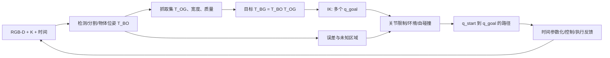
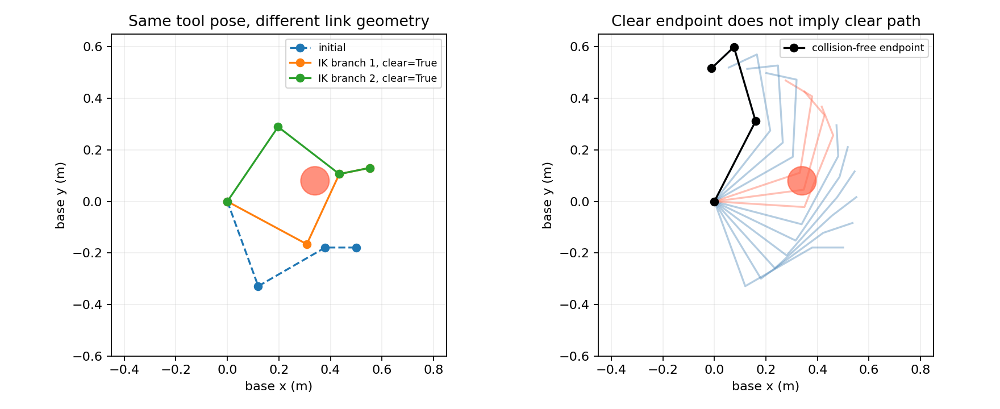
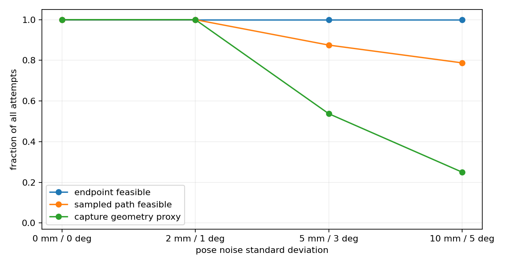

# D48 · 从“估计到杯子”到“机械臂确实走得到”

[返回学习入口](../_index.md) ｜ [本周日程](../P3-项目实战-日程.md) ｜ [上一课 D47](../day47/Daily-Learning-Pack.md) ｜ [CPU 实验](demo.py)

**抓取位姿是一个目标，IK 是关节构型候选，碰撞检查是几何可行性证据，路径与控制才把候选连接到执行。位姿误差会同时改变目标位置、IK 分支和运动余量，不能只用一个检测或位姿分数代表整条链。**

本课是 P3 / Π-1 / W7-D6，保留原定 2026-10-22 课次，实际于 2026-10-24 补写并验证。D47 已把杯子表面的接触、夹爪宽度、接近方向变成候选；今天继续追问：目标看起来合理，但机器人从当前姿态能否到达，手臂途中是否碰桌边，感知误差又会怎样改变判断？

<details>
<summary>个人学习记录（你的作答与修改记录，自动更新时保留）</summary>

<!-- learner-notes:start -->

- 我实际运行与修改的变量：
- 我的解释、自测答案与未理解问题：
- 需要接入实际项目的接口：

<!-- learner-notes:end -->

</details>

<!-- daily-pack-generated:start -->

## 0. 学习目标与路线

完成本课后，你应能推导平面三关节机械臂的两支解析 IK，用刚体链把物体误差传播到夹爪目标，实现带关节限制的连杆碰撞与路径采样检查，并解释“本次筛选通过”的适用范围。

| 顺序 | 知识主线 | 需要回答的问题 |
| --- | --- | --- |
| 宏观 | 候选到闭环 | 位姿、构型、路径、轨迹各代表什么？ |
| 微观一 | 坐标与误差 | 杯子旋转误差为什么引起夹爪位置误差？ |
| 微观二 | IK 与分支 | 同一个目标为什么有多组关节角？ |
| 微观三 | 碰撞与路径 | 终点没碰，途中为什么会碰？ |
| 工程 | 不确定性与接口 | 拒绝一个候选与证明任务无解有何区别？ |
| 动手 | 受控噪声实验 | 哪些失败来自感知，哪些来自筛选器？ |

## 1. 宏观：为每一层写出输入、输出和拒绝理由



这里 $T_{AB}$ 把 B 系坐标变成 A 系坐标，$q$ 是关节角向量，单位 rad。输出 `q_goal` 不意味着已经规划；输出路径 $q(s)$ 的参数 $s\in[0,1]$ 不一定是秒；输出轨迹 $q(t)$ 仍需要控制器和执行反馈。图中的任意拒绝都要保留原因，避免最后只剩一句“抓取失败”。

| 检查 | 输入 → 输出 | 失败意味着什么 |
| --- | --- | --- |
| IK | 目标位姿 → 关节角候选 | 解析几何无解，或数值求解未找到解，二者不同 |
| 关节限制 | 候选角度 → 有效构型 | 某一解超范围，另一分支可能可用 |
| 终点碰撞 | 构型 + 几何模型 → 净间隙 | 当前模型中的目标构型不可用 |
| 路径检查 | 起终点 + 路径 → 最小间隙 | 这条路径失败，不代表不存在绕行路径 |
| 执行反馈 | 轨迹 + 测量 → 跟踪/接触状态 | 需要看控制误差、延迟、接触和物体运动 |

**本课实验只证明平面模型中的关节与几何条件，并用捕获误差作代理评价；没有模拟摩擦、夹爪闭合和真实抓起。**

## 2. 微观：物体位姿到夹爪位姿，旋转误差有“杠杆臂”

### 2.1 变换乘法里面发生了什么

设杯子在基座系中的位置与旋转是 $(t_{BO},R_{BO})$，夹爪抓取坐标原点相对物体系的偏移为 $r_{OG}$，则

$$
p_{BG}=t_{BO}+R_{BO}r_{OG},\qquad R_{BG}=R_{BO}R_{OG}.
$$

矩阵乘法的顺序体现了“先在物体上定义抓法，再把它带到世界中”。如果抓取原点离物体原点很远，物体小角度旋转会把这个点扫过较长距离。反过来，若 $r_{OG}=0$，旋转误差仍会改变夹爪朝向，但不会由这一项产生夹爪原点平移误差。

采用**物体局部小旋转扰动** $R'=R\exp([\delta\theta]_\times)$，忽略二阶项：

$$
\delta p_G\approx\delta t+R[\delta\theta]_\times r
=\delta t-R[r]_\times\delta\theta.
$$

$[r]_\times$ 是叉乘矩阵，$\delta t$ 单位 m、$\delta\theta$ 单位 rad。换成基座系左扰动时雅可比写法会变化，不能混用协方差约定。

> [!question] 先算
> 夹爪目标离物体原点 10 cm，物体方向误差 3°，假设旋转轴与偏移垂直，仅旋转项产生多少位置误差？再加入 4 mm 的平移误差，能直接把两者平方相加吗？

答案中的数量级是 $0.1\times3\pi/180\approx5.24$ mm；最坏同向偏差约 9.24 mm。只有给定零均值、独立性及投影方向，才能按方差传播讨论均方误差；不能把两个确定性误差随手平方相加后称为保证。

### 2.2 从单个误差到分布

若 $\delta\xi=[\delta t^T,\delta\theta^T]^T$ 有协方差 $\Sigma_\xi$，局部近似为

$$
\Sigma_{p_G}\approx J_G\Sigma_\xi J_G^T,\qquad
J_G=[I\;\;-R[r]_\times].
$$

它说明需要保留方向性：杯把方向可能比杯身轴向更敏感。它不包括错误物体关联、错误对称分支和大角度多峰歧义；那些情况不适合只用一个高斯协方差概括。可保留多个候选，或对不同位姿假设分别检查后续几何。

这里也解释 VLA 的接口：即使策略直接产生工具增量，参考系、当前关节和目标几何仍然存在。世界模型可以预测候选动作后的状态，但若输入坐标或障碍地图有偏差，预测不能自动修复这个接口错误。

## 3. 微观：用平面 3R 看懂“有解、多解、受限解”

### 3.1 为什么选择三个关节

二维抓取目标包括 $(x,y,\phi)$ 三个自由度。两个转动关节通常不能任意满足位置与朝向，三个关节则可在可达范围内解出两支典型构型。本课长度 $l=(0.35,0.30,0.12)$ m；这是三维机械臂 IK 的教学切片，不把二维解冒充六维 IK。

正运动学为

$$
\begin{aligned}
x&=\sum_{i=1}^3l_i\cos\alpha_i,&y&=\sum_{i=1}^3l_i\sin\alpha_i,\\
\alpha_i&=\sum_{j=1}^i q_j,&\phi&=q_1+q_2+q_3.
\end{aligned}
$$

求 IK 时先去掉第三连杆，得到“腕点”

$$
w=\begin{bmatrix}x\\y\end{bmatrix}-l_3\begin{bmatrix}\cos\phi\\\sin\phi\end{bmatrix}.
$$

再用余弦定理：

$$
c_2=\frac{\|w\|^2-l_1^2-l_2^2}{2l_1l_2},\quad
q_2=\pm\arccos c_2.
$$

若 $|c_2|>1$，腕点在该二连杆的可达圆环之外；若仅超出 $10^{-10}$ 左右，可能是浮点误差，可在明确容差内截断。不能把远大于 1 的数强行裁成 1，这会把真实无解变成假解。

$$
q_1=\operatorname{atan2}(w_y,w_x)-\operatorname{atan2}(l_2\sin q_2,l_1+l_2\cos q_2),
\qquad q_3=\phi-q_1-q_2.
$$

每个分支还必须检查限位。本实验限位分别为 ±170°、±150°、±170°，是教学设定，不代表某个真实机械臂型号。

手算一个整齐例子：令 $\phi=0$、目标 $(x,y)=(0.47,0.30)$ m，则腕点 $(0.35,0.30)$，$c_2=0$。一支为 $(q_1,q_2,q_3)=(0°,90°,-90°)$；另一支的 $q_2=-90°$，$q_1\approx81.20°$、$q_3\approx8.80°$。末端相同，肘部和连杆占据的空间不同。

### 3.2 从解析 IK 到数值 IK

真实多自由度机械臂常用数值方法。在局部令误差 $e=x_{target}-f(q)$，线性化 $e\approx J\Delta q$，阻尼最小二乘为

$$
\Delta q=J^T(JJ^T+\lambda^2I)^{-1}e.
$$

这里位置与角度不同量纲，应先按允许误差或特征长度进行加权，不能把 1 m 与 1 rad 当作天然同等代价。阻尼能降低近奇异方向上的巨大更新，却可能保留残差；还需要步长、限位、终止阈值和多初值。数值失败可能只是初值落入不良区域，不足以宣布全局无解。

本课解析式提供一种调试参照：把解送回 FK，检查位置残差与角度残差。真实模型还要检查工具坐标、关节零位、URDF 几何和驱动器方向，否则算法收敛于错误模型也会“算得很准、走得很偏”。

[Modern Robotics：数值逆运动学](https://modernrobotics.northwestern.edu/nu-gm-book-resource/6-2-numerical-inverse-kinematics-part-1-of-2/)中的 Newton–Raphson、初值和伪逆解释可与本节对应；本课的平面解析推导与实验为独立教学实现。

## 4. 微观：终点、连杆、附着物和整条路径

### 4.1 胶囊几何让碰撞判定可计算

把一根连杆近似成线段 $\overline{ab}$ 膨胀半径 $r_l$，即胶囊体；障碍在二维中是圆心 $c$、半径 $r_o$。投影参数与净间隙为

$$
\tau=\operatorname{clip}\left(\frac{(c-a)^T(b-a)}{\|b-a\|^2},0,1\right),\quad
 d=\|c-a-\tau(b-a)\|-r_l-r_o.
$$

$d>0$ 为分离，$d\le0$ 为接触或重叠。若连杆中心线到障碍中心为 80 mm、两半径分别 12 mm 与 55 mm，则净间隙仅 13 mm。增加 5 mm 余量后剩 8 mm。

自碰撞要检查非相邻连杆：本实验检查第 1 与第 3 段，求线段间最短距离后减去两倍连杆半径。相邻段在关节处相接，不能机械地按相同规则全部判成碰撞；真实系统使用碰撞对配置，但禁用某一对检查需要机械结构依据。

三维系统可先用包围盒做粗筛，再用网格、凸体或距离场做细查。还必须把夹爪、线缆近似体、已经拿住的杯子等加入几何。遗漏 attached object（附着物）会出现“手腕没碰，但杯子扫过桌沿”。MoveIt 的规划场景同时管理机器人和世界几何，[Planning Scene 教程](https://moveit.picknik.ai/main/doc/examples/planning_scene/planning_scene_tutorial.html)可用于核对工程对应关系。

### 4.2 端点有效只是必要条件

实验用最简单的关节空间直线

$$
q(s)=q_0+s(q_g-q_0),\quad s\in[0,1].
$$

初态固定为 $(-70°,100°,-30°)$。对有硬限位的关节，不能无条件用角度 wrap 后的最短弧跨过 ±π；本例直接在有效坐标范围内插值。虽然线性插值保持区间型关节限制，连杆在空间里走的是弧线，仍可能撞上障碍。



左图两条连杆链到达同一目标，肘部位置不同；右图黑色终点无碰撞，途中红色构型却进入障碍。图中的量是基座平面位置（m），不是图像像素。

实验以 61 个构型检查路径。**采样通过不能证明连续路径绝对无碰撞**：细小障碍可能位于两个样本之间。可进一步减小步长、依据连杆速度和净间隙自适应细分、或使用连续碰撞检测。增加采样数量应作为离散近似验证，不能写成安全保证。

若直线路径失败，可以继续用 D17 的 RRT/RRT-Connect 寻找绕行，或换 IK 分支、换接近方向。MoveIt 的[运动规划概念](https://moveit.picknik.ai/main/doc/concepts/motion_planning.html)将规划约束、碰撞与时间参数化分开；本例只实现几何筛选，并未实现规划器和动力学控制器。

## 5. 工程：给不确定性留位置，但不要把“余量”变成魔法

若沿最近障碍法向 $n$ 的位置标准差为 $\sigma_n$，常见设计会采用形如 $m=k\sigma_n+m_{model}+v\tau$ 的余量：分别覆盖估计不确定性、几何近似以及延迟中的运动。这个表达式只是明确误差来源的设计模型；是否满足实际概率要求还取决于分布、相关性、尾部和控制误差。

更大的余量减少放行，也可能拒绝真实可行的抓取。尤其不能把“拒绝了更多动作”直接等同“任务成功率更高”。本课用固定障碍真值，余量对捕获代理通过数的影响主要是可行性收缩；没有随机障碍误差，因此不能声称已经估计真实碰撞风险。

| 工程量 | 推荐形状与语义 | 必须伴随的信息 |
| --- | --- | --- |
| 物体位姿假设 | `[B,K,4,4]` | 变换方向、时间、物体 ID、对称假设 |
| 抓取候选 | `[B,G,4,4]` 与宽度 `[B,G]` | 工具坐标、m、接近与闭合方向 |
| IK 候选 | `[B,G,S,J]` | 分支有效 mask、rad、关节顺序 |
| 路径 | `[B,T,J]` | T 是采样数；另存 s 或真实 t |
| 检查结果 | 每候选一条记录 | min clearance、拒绝层、场景版本 |

可按 `candidate_id` 保存 `ik_unreachable / joint_limit / endpoint_collision / path_collision / capture_error`。同一候选可以有多个失败原因，但汇总漏斗时应明确第一次拒绝层；否则每层失败数相加可能超过总尝试数。

## 6. 动手：先预测，再把位姿误差传到执行入口

依赖 Python、NumPy、Matplotlib，全部使用 CPU 和内置合成输入。进入本课目录后运行：

```bash
python demo.py
python demo.py --margin-mm 5 --output ../../_assets/3d_learning/day48/margin5.json
```

完整脚本见下方折叠区；运行环境缺少库时可在自己的练习环境安装 `numpy matplotlib`，无需 CUDA 或机器人。默认结果和图只由默认输出文件 `results.json` 的运行刷新，改变量结果保存到独立文件。

先预测三个问题：噪声加大会先导致 IK 无解，还是抓取目标偏离？终点一直无碰撞是否足够？增加余量为什么可能降低通过率？然后查看 [默认结果](../../_assets/3d_learning/day48/results.json) 和 [5 mm 余量结果](../../_assets/3d_learning/day48/margin5.json)。

### 6.1 本次实测

2026-10-24，macOS CPU，Python 3.11.15 / NumPy 1.26.4 / Matplotlib 3.10.9，seed=48。每组使用同一批 80 个标准正态噪声，分别乘以对应平移/角度标准差；训练样本和真实交互均为 0。物体真值为 $(0.65,0.15,0.2)$，位置 m、角度 rad；场景静态，路径参数不冒充时间戳。

| 平移/朝向标准差 | 有 IK /80 | 有有效终点 /80 | 采样路径通过 /80 | 捕获几何代理通过 /80 | 平均目标位置误差 |
| --- | ---: | ---: | ---: | ---: | ---: |
| 0 mm /0° | 80 | 80 | 80 | 80 | 0 mm |
| 2 mm /1° | 80 | 80 | 80 | 80 | 2.901 mm |
| 5 mm /3° | 80 | 80 | 70 | 43 | 7.750 mm |
| 10 mm /5° | 80 | 80 | 63 | 20 | 14.509 mm |

捕获代理要求存在本例通过的路径、位置误差 ≤8 mm、角度误差 ≤8°，分母始终为所有 80 次。它不是接触力或抓起成功。默认主要计算一次约 1.19 s（不含绘图），单次壁钟记录不作性能基准。



图揭示“IK 仍有解”与“抓对位置”可以明显分离。把余量改为 5 mm 后，四组路径通过数变为 80、68、54、52；捕获代理通过数为 80、68、32、15。相同位姿误差没有消失，只是某些候选被更早拒绝。

接着只改变 `--seed`，判断趋势是否稳健；再只改变碰撞采样密度，检查最小间隙是否稳定。不要同时换噪声、障碍与初态后把差异全部归因于 IK。

### 6.2 完整最小脚本

> [!note]- 完整可复制代码（与同目录 demo.py 一致）
>
> ```python
> """Day48: planar 3R IK, capsule collision and pose-error propagation. CPU only."""
> import argparse
> import json
> import platform
> import time
> from pathlib import Path
> import numpy as np
> import matplotlib
> matplotlib.use("Agg")
> import matplotlib.pyplot as plt
>
> L = np.array([0.35, 0.30, 0.12])  # metres
> LIMIT = np.deg2rad([170, 150, 170])
> Q0 = np.deg2rad([-70, 100, -30])
> OBSTACLE = np.array([0.34, 0.08])
> RADIUS, LINK_RADIUS = 0.055, 0.012
>
>
> def wrap(x):
>     return (np.asarray(x) + np.pi) % (2 * np.pi) - np.pi
>
>
> def fk(q):
>     angles = np.cumsum(q)
>     return np.vstack([np.zeros(2), np.cumsum(
>         L[:, None] * np.column_stack([np.cos(angles), np.sin(angles)]), axis=0)])
>
>
> def ik(pose):
>     x, y, phi = pose
>     wrist = np.array([x, y]) - L[2] * np.array([np.cos(phi), np.sin(phi)])
>     c2 = (wrist @ wrist - L[0]**2 - L[1]**2) / (2 * L[0] * L[1])
>     if abs(c2) > 1 + 1e-10:
>         return []
>     out = []
>     for sign in [1, -1]:
>         q2 = sign * np.arccos(np.clip(c2, -1, 1))
>         q1 = np.arctan2(wrist[1], wrist[0]) - np.arctan2(
>             L[1] * np.sin(q2), L[0] + L[1] * np.cos(q2))
>         q = wrap([q1, q2, phi - q1 - q2])
>         if not any(np.allclose(q, old) for old in out):
>             out.append(q)
>     return out
>
>
> def point_segment(p, a, b):
>     v = b - a
>     t = np.clip((p - a) @ v / max(v @ v, 1e-15), 0, 1)
>     return np.linalg.norm(p - (a + t * v))
>
>
> def segment_distance(a, b, c, d):
>     v, w = b - a, d - c
>     cross = lambda u, z: u[0] * z[1] - u[1] * z[0]
>     den = cross(v, w)
>     if abs(den) > 1e-12:
>         t, u = cross(c - a, w) / den, cross(c - a, v) / den
>         if 0 <= t <= 1 and 0 <= u <= 1:
>             return 0.0
>     return min(point_segment(a, c, d), point_segment(b, c, d),
>                point_segment(c, a, b), point_segment(d, a, b))
>
>
> def clearance(q, margin=0.0):
>     p = fk(q)
>     env = min(point_segment(OBSTACLE, p[i], p[i+1]) for i in range(3))
>     self_distance = segment_distance(p[0], p[1], p[2], p[3])
>     return min(env - RADIUS - LINK_RADIUS - margin,
>                self_distance - 2 * LINK_RADIUS - margin)
>
>
> def valid(q, margin=0.0):
>     return bool(np.all(np.abs(q) <= LIMIT) and clearance(q, margin) > 0)
>
>
> def path_to(q, samples=61):
>     # Interpolate actual limited joint coordinates, not wrapped shortest arcs.
>     return Q0 + np.linspace(0, 1, samples)[:, None] * (q - Q0)
>
>
> def filter_pose(pose, margin=0.0):
>     branches = ik(pose)
>     endpoint = [q for q in branches if valid(q, margin)]
>     paths = [q for q in endpoint if all(valid(z, margin) for z in path_to(q))]
>     best = min(paths, key=lambda q: np.linalg.norm(q-Q0)) if paths else None
>     return len(branches), len(endpoint), best
>
>
> def target(object_pose):
>     x, y, theta = object_pose
>     # A deliberately simplified tool transform: local offset (-0.10, 0), same yaw.
>     return np.array([x - 0.10 * np.cos(theta), y - 0.10 * np.sin(theta), theta])
>
>
> def main():
>     ap = argparse.ArgumentParser()
>     ap.add_argument("--seed", type=int, default=48)
>     ap.add_argument("--trials", type=int, default=80)
>     ap.add_argument("--margin-mm", type=float, default=0)
>     ap.add_argument("--output", type=Path, default=Path(__file__).resolve().parents[2]/"_assets/3d_learning/day48/results.json")
>     args = ap.parse_args()
>     assert args.trials > 0 and args.margin_mm >= 0
>     started = time.perf_counter()
>     rng = np.random.default_rng(args.seed)
>     assert valid(Q0), "Start must be collision free"
>     # Find a reproducible endpoint-clear but straight-joint-path-blocked example.
>     counter = None
>     for _ in range(1200):
>         q = rng.uniform(-0.95 * LIMIT, 0.95 * LIMIT)
>         if valid(q) and any(not valid(z) for z in path_to(q)):
>             counter = q
>             break
>     assert counter is not None
>     truth = np.array([0.65, 0.15, 0.2])
>     true_target = target(truth)
>     branches, endpoints, nominal_q = filter_pose(true_target)
>     assert nominal_q is not None, "Nominal grasp proxy needs a feasible path"
>     assert np.linalg.norm(fk(nominal_q)[-1] - true_target[:2]) < 1e-10
>     assert abs(wrap(nominal_q.sum() - true_target[2])) < 1e-10
>     standardized = rng.normal(size=(args.trials, 3))  # paired noise across conditions
>     rows = []
>     for mm, deg in [(0, 0), (2, 1), (5, 3), (10, 5)]:
>         counts = dict(ik=0, endpoint=0, path=0, capture_proxy=0)
>         errors = []
>         for z in standardized:
>             noisy = truth + z * [mm/1000, mm/1000, np.deg2rad(deg)]
>             estimated_target = target(noisy)
>             ni, ne, q = filter_pose(estimated_target, args.margin_mm/1000)
>             counts["ik"] += ni > 0
>             counts["endpoint"] += ne > 0
>             counts["path"] += q is not None
>             error = np.linalg.norm(estimated_target[:2] - true_target[:2])
>             errors.append(error)
>             counts["capture_proxy"] += bool(q is not None and error <= 0.008
>                 and abs(wrap(estimated_target[2]-true_target[2])) <= np.deg2rad(8))
>         rows.append(dict(translation_std_mm=mm, yaw_std_deg=deg, trials=args.trials,
>                          mean_target_error_mm=float(1000*np.mean(errors)), **counts))
>     report = dict(python=platform.python_version(), numpy=np.__version__,
>         matplotlib=matplotlib.__version__, seed=args.seed, trials=args.trials,
>         device="CPU", data="synthetic planar 3R, known circle obstacle",
>         unit="m, rad", frame="planar base x-y; object local grasp offset",
>         timestamp="static scene, path interpolation parameter is not seconds",
>         start_q_rad=Q0.tolist(), link_lengths_m=L.tolist(), margin_mm=args.margin_mm,
>         path_samples=61, training_samples=0, real_robot_interactions=0,
>         nominal_branches=branches, nominal_clear_endpoints=endpoints,
>         counterexample_q_rad=counter.tolist(), rows=rows,
>         elapsed_s=time.perf_counter()-started)
>     args.output.parent.mkdir(parents=True, exist_ok=True)
>     args.output.write_text(json.dumps(report, indent=2)+"\n")
>     print(json.dumps(report, indent=2))
>     if args.output.stem != "results":
>         return
>     asset = Path(__file__).resolve().parents[2] / "_assets/3d_learning/day48"
>     asset.mkdir(parents=True, exist_ok=True)
>     fig, axes = plt.subplots(1, 2, figsize=(11, 4.5))
>     for ax in axes:
>         ax.add_patch(plt.Circle(OBSTACLE, RADIUS, color="tomato", alpha=.7))
>         ax.set(xlim=(-.45, .85), ylim=(-.6, .65), xlabel="base x (m)", ylabel="base y (m)")
>         ax.set_aspect("equal"); ax.grid(alpha=.2)
>     p = fk(Q0); axes[0].plot(*p.T, "o--", label="initial")
>     for i, q in enumerate(ik(true_target)):
>         p = fk(q); axes[0].plot(*p.T, "o-", label=f"IK branch {i+1}, clear={valid(q)}")
>     axes[0].set_title("Same tool pose, different link geometry"); axes[0].legend(fontsize=8)
>     trajectory = path_to(counter)
>     for q in trajectory[::5]:
>         p = fk(q); axes[1].plot(*p.T, color="tomato" if not valid(q) else "steelblue", alpha=.4)
>     p = fk(counter); axes[1].plot(*p.T, "ko-", label="collision-free endpoint")
>     axes[1].set_title("Clear endpoint does not imply clear path"); axes[1].legend(fontsize=8)
>     fig.tight_layout(); fig.savefig(asset/"ik_and_path.png", dpi=160); plt.close(fig)
>     fig, ax = plt.subplots(figsize=(8, 4.2))
>     x = np.arange(len(rows))
>     for name, label in [("endpoint", "endpoint feasible"), ("path", "sampled path feasible"),
>                         ("capture_proxy", "capture geometry proxy")]:
>         ax.plot(x, [r[name]/args.trials for r in rows], "o-", label=label)
>     ax.set(xticks=x, xticklabels=[f'{r["translation_std_mm"]} mm / {r["yaw_std_deg"]} deg' for r in rows],
>            ylim=(-.03, 1.05), ylabel="fraction of all attempts", xlabel="pose noise standard deviation")
>     ax.grid(alpha=.2); ax.legend(); fig.tight_layout()
>     fig.savefig(asset/"pose_noise.png", dpi=160); plt.close(fig)
>
>
> if __name__ == "__main__":
>     main()
> ```

## 7. 回到宏观：本周改进怎样连接操作任务

D43–46 改进的是表征、目标函数和几何约束；D47–48 让这些改进接受下游检验。一个位姿方法即使平均误差更低，也可能在杯把方向留下少量大误差，或把候选推到机械臂近奇异区域。因此下一步报告要同时列位姿误差、候选保留率、路径可行率和明确的任务代理。

三句话收束：感知输出要经过物体到工具的变换才能成为抓取目标。IK 解和无碰撞终点都不足以证明可执行。误差与筛选余量的作用必须通过固定初态、固定几何和完整分母的实验拆开。

最值得保留的四点：**偏移产生旋转杠杆效应**，因为夹爪位置也依赖旋转；**IK 分支保留多样性**，因为连杆占据空间不同；**路径检查独立于端点**，因为运动扫过额外空间；**拒绝原因与完整分母**，因为才能定位模块贡献。三个边界是平面代理≠六维机械臂、离散检查≠连续证明、捕获误差≠物理抓起。

产出物：保留两份结果 JSON、两图、一次只改余量的解释，以及一张 `pose→grasp→IK→collision→path` 接口表。个人验收依据是你能解释变化，不是材料文件已生成。

## 8. 自测：从手算到系统判断

1. $T_{BO}T_{OG}$ 的方向是什么？为什么反过来通常不成立？
2. 10 cm 偏移、3° 垂直旋转误差，对目标位置影响约多少？偏移为零时还有什么误差？
3. 本课手算目标 $(0.47,0.30,0)$ 的腕点和一支 IK 是什么？
4. 数值 IK 失败与目标几何不可达为什么不能等同？
5. 中心线距障碍 80 mm，半径 12、55 mm，额外余量 5 mm，剩余间隙多少？
6. 终点有效，但 61 点路径检查失败，你可以如何处理？通过又能证明到哪一步？
7. 高噪声组有 80 次 IK、有 63 条路径、20 次捕获代理通过。路径条件成功率与全尝试通过率分别是多少？哪一个应作为完整漏斗末端指标？
8. 若 VLA 直接输出工具位姿，哪些本课检查仍有必要？若世界模型预测“能成功”，又需要什么独立证据？

## 9. 未理解问题与次日衔接

若仍不清楚小旋转左/右扰动，先给同一点各写一次坐标变换，再回查 D19；若不清楚路径绕行，回查 D17，并在 W8 的路径轨迹课继续做端到端接入。碰撞模型、连续检查与真实控制误差需要在 W8 闭环实验中加入，今天不能据代理结果勾选真实验证。

下一课 D49 保持 W7 周验收主题：用配对消融和场景分组统计解释“某项改进是否值得保留”，并将未复现的官方模型和未做的硬件实验明确列出。

精读/源码任务：对照 Modern Robotics 第6.2节数值IK中的线性化与伪逆步骤，再阅读上文 Planning Scene 教程的 Self-collision checking 与 Full collision checking 部分；写出解析IK、数值IK、几何碰撞检查各自可以否定什么。不要把教程代码已阅读记作机器人执行。

> [!note]- 自测核对答案与判分标准（先答后展开）
> 每题 0/1/2 分：错误或空白 0 分；核心结论正确 1 分；能给计算、假设或迁移例子 2 分。满分 16，建议 ≥12 且第 6、7 题不能为 0；这是建议线，不是个人成绩。
> 1. 从工具/抓取系到基座系；中间物体系要抵消，交换顺序一般既不匹配坐标语义，也因刚体变换不交换而不同。
> 2. 约 5.24 mm；偏移为零时这一位置项消失，但夹爪朝向仍错。
> 3. 腕点 (0.35,0.30) m；一支 (0°,90°,-90°)，代回 FK 验证。
> 4. 数值方法依赖初值、局部线性化与终止条件；几何不可达需要模型下的明确证据，其他分支可能存在。
> 5. 80−12−55−5=8 mm。
> 6. 换分支/接近方向或搜索绕行；采样通过仅说明被检查构型在当前模型下有效，未覆盖连续段与真实动态。
> 7. 20/63≈31.75%；20/80=25%。完整末端指标用后者，并附路径通过率63/80；前者可作条件诊断但不能隐藏拒绝。
> 8. 坐标/单位/时间、关节限位、碰撞、路径和反馈仍需验证；模型预测要与真实或明确仿真转移、保留初态及失败记录对照，不能循环用模型自己给自己验收。

<!-- daily-pack-generated:end -->
