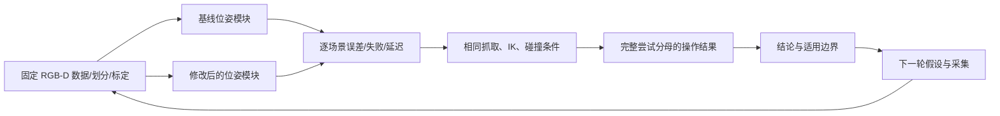
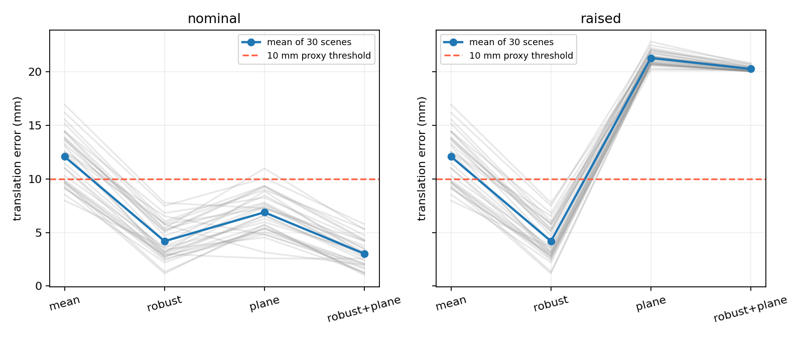
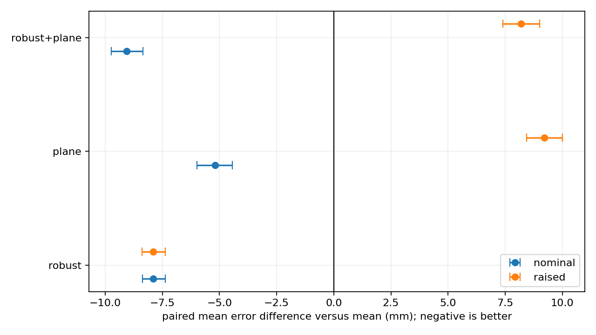

# D49 · 从“指标涨了”到有证据的消融结论

[返回学习入口](../_index.md) ｜ [本周日程](../P3-项目实战-日程.md) ｜ [上一课 D48](../day48/Daily-Learning-Pack.md) ｜ [CPU 实验](demo.py)

**一个改进是否值得保留，要同时回答：改变了什么、在同一批场景上改善多少、代价是什么、在哪些条件下失效。消融报告的核心是可复查的比较关系，单个最高分不能替代这些证据。**

本课是 P3 / Π-1 / W7-D7，原定 2026-10-23，实际于 2026-10-24 补写并验证。D43–48 依次讨论多尺度、损失、几何约束、受控对照、抓取候选及可达碰撞筛选；今天把它们收束成一份能指导 W8 系统接入的报告。贯穿案例仍是 RGB-D 机械臂抓杯子：需要决定保留哪些感知改进，并知道它们对后续操作能支持多大结论。

<details>
<summary>个人学习记录（你的作答与修改记录，自动更新时保留）</summary>

<!-- learner-notes:start -->

- 我实际运行与修改的变量：
- 我的解释、自测答案与未理解问题：
- 需要接入实际项目的接口：

<!-- learner-notes:end -->

</details>

<!-- daily-pack-generated:start -->

## 0. 学习目标与路线

你应能建立固定协议的实验矩阵，计算配对差异和两因素交互项，以场景而非相邻帧做重采样，分开正常域与偏移域的结论，并从报告追溯到逐样本记录和代码版本。

| 顺序 | 知识主线 | 需要回答的问题 |
| --- | --- | --- |
| 宏观 | 实验中的可比性 | 两个结果是否来自同一个问题？ |
| 微观一 | 基线与因素设计 | 单项、组合、交互分别说明什么？ |
| 微观二 | 配对与分组 | 同一场景的多帧能否算独立证据？ |
| 微观三 | 不确定性和偏移 | 区间很窄为什么仍可能部署失败？ |
| 动手 | 四方案、两个域 | 几何先验在什么条件下帮忙或害人？ |
| 收束 | W7 验收 | 现在有什么证据，还欠什么真实项目工作？ |

## 1. 宏观：让实验比较沿着系统链发生



比较必须让“改动”与“结果差异”之间有清晰对应。若基线使用 RGB，而新模型使用 RGB-D，结果可以说明整套方案的变化，但不能把全部收益归因于新损失。若新模型使用更好的 ROI 或更多演示数据，这些也是实验因素。

可把结果抽象为

$$
Y=f(\text{算法},\text{数据},\text{模态},\text{初态},\text{预算},\text{评价协议},\text{随机性}).
$$

消融不是把这些因素全部消掉，而是明确固定哪些、主动改变哪些，并如实命名比较。VLA、世界模型和操作算法同样遵循这条规则：动作频率、观测历史、交互次数或成功定义改变后，不能仍写“只替换了模型”。

### 1.1 指标、分母和失败记录先于排行榜

| 层级 | 主指标示例 | 必须同时报告 |
| --- | --- | --- |
| 检测 | 协议规定的 AP/召回 | 类别、IoU/距离阈值、目标集合 |
| 位姿 | ADD/对称感知指标或平移旋转误差 | 对称约定、对象尺度、漏检处理 |
| 抓取筛选 | 可行候选/全部候选 | 宽度、IK、碰撞分别拒绝多少 |
| 任务执行 | 成功次数/全部尝试 | 初态、停止条件、超时、恢复策略 |
| 工程成本 | 端到端延迟与资源 | 预处理、模型、后处理、通信是否计入 |

某方法只在 40/100 场景输出，其中 38 次正确，条件精度是 95%，完整成功比例是 38%。拒绝可能是合理设计，但不能在汇总中把 60 次消失。更不能只取两方法共同成功的场景当作总体：那会系统性删掉最有区分度的失败。

## 2. 微观：从单项改进到两因素交互

### 2.1 固定基线，再定义干预

本课用一个透明的三维平移估计问题：同一目标中心有 24 个带噪测量，部分测量有偏置离群点。算法输出中心 $\hat t\in\mathbb R^3$。它故意移除检测、对应与旋转的不确定性，以便隔离两个因素：

- R：用 Huber 型 IRLS 降低大残差测量的权重。
- P：施加“目标中心在 $z=0.50$ m 平面上”的硬约束。

四个单元分别是 `mean`、`robust`、`plane`、`robust+plane`。这是 D46 受控比较之后的一次统计实验，**不替代原计划中完整网络的 3–5 个改进方案对照，也不冒充 NOCS/EPro-PnP 训练**。

令 $E_{00},E_{10},E_{01},E_{11}$ 表示这四个单元的平均误差（越小越好），则

$$
\Delta_R=E_{10}-E_{00},\quad
\Delta_P=E_{01}-E_{00},\quad
I=E_{11}-E_{10}-E_{01}+E_{00}.
$$

$I$ 是相对于误差加法基准的交互项。$I<0$ 表示组合比“两个单项误差降低量直接相加”更好；$I>0$ 表示组合收益有重叠或抵消。不能只因为组合绝对误差最低就称为正协同。

> [!question] 先算
> 基线误差 12 mm，R 为 4 mm，P 为 7 mm，组合为 3 mm。组合最好，但交互项是多少？若直接把两项改进相加，预期误差甚至为 −1 mm，这说明了什么？

计算 $I=3-4-7+12=4$ mm。误差的下界与非线性会限制加法解释，因此交互项应连同指标定义看；它不是某种普适的“模型合作程度”。在精度百分比或对数误差上重新计算，数值含义也会变化。

### 2.2 求解机制与张量形状

测量 $y_i$ 的均值解最小化 $\sum_i\|t-y_i\|^2$。本课鲁棒解迭代

$$
r_i=\|y_i-t\|,\quad w_i=\min(1,\delta/\max(r_i,\epsilon)),\quad
t\leftarrow\frac{\sum_iw_iy_i}{\sum_iw_i},
$$

其中 $\delta=0.005$ m，固定迭代 12 次。阈值在实验前按演示假设固定，不用测试结果调到最优。该过程相当于对向量残差范数施加 Huber 型鲁棒代价。它假设大残差更可能被污染；若真实观测呈现多个合法模式，简单降权可能压掉正确但稀少的模式。

平面因素在求解后设定 $\hat t_z=0.50$ m。这个顺序组合不一定等于固定z后重新优化同一个鲁棒目标：重新计算残差会改变权重，本课明确比较的是“先IRLS、再投影”的实现。

这是**目标中心平面**，不是桌面高度；实际杯子中心通常高于桌面。即使桌面已知，也需要物体尺寸和姿态才能推出中心高度。把两者混淆会从几何先验直接引入系统偏差。

| 量 | 形状 | 解释 |
| --- | --- | --- |
| 真值中心 | `[30,3]` | 30 个独立场景，m |
| 观测 | `[30,4,24,3]` | 每场景 4 视图、每视图 24 次测量 |
| 权重 | `[24]` | 当前单视图内的相对权重 |
| 逐样本误差 | `[4,30,4]` | 4 方法 × 场景 × 视图，mm |
| bootstrap 索引 | `[2000,30]` | 按场景有放回抽样 |

## 3. 微观：配对能控制场景难度，分组避免虚增样本量

### 3.1 为什么先相减再汇总

同一场景 $s$、视图 $v$ 上有基线误差 $e^A_{sv}$ 与改进误差 $e^B_{sv}$，定义

$$
d_{sv}=e^B_{sv}-e^A_{sv},\quad
\bar d_s=\frac1{V_s}\sum_vd_{sv},\quad
\hat\Delta=\frac1S\sum_s\bar d_s.
$$

负值表示改进误差更小。配对比较让容易或困难场景对双方同时起作用。方差恒等式

$$
\operatorname{Var}(B-A)=\operatorname{Var}(B)+\operatorname{Var}(A)-2\operatorname{Cov}(A,B)
$$

说明当两方法受相同难度影响而正相关时，差值往往比两个独立均值的比较更稳定。但配对不能纠正错误的测试划分，也不能消除共同的标定偏差。

例：三个场景中基线为 $[2,10,20]$ mm，新方案为 $[1,9,19]$ mm。绝对误差跨度很大，逐场景差值却全为 −1 mm。若把两个数组分别独立重采样，会破坏这个对应关系。

### 3.2 为什么 30 场景 ×4 帧不等于 120 个独立场景

同一场景的视图共享物体、背景、标定和采集条件。脚本显式加入每场景公共的测量偏差，制造这种相关性。若将每帧独立抽样，就忽略了“这个场景整体偏一点”的不确定性，可能得到过窄区间。

本课使用 cluster bootstrap（按组自助重采样）：

1. 计算每个场景的配对平均差值 $\bar d_s$。
2. 从 $S=30$ 个场景 ID 中有放回抽取 30 个 ID。
3. 取所抽场景差值的平均，重复 2000 次。
4. 用这些均值的 2.5% 与 97.5% 分位数给出百分位区间。

场景的所有视图随场景一起进入样本。若实际实验以物体实例或采集会话为独立单元，就应按那个层级分组。**这里场景等权；当每场景帧数不同，场景等权与每帧等权估计的是不同目标，必须先选定。**

区间表达的是在分组、样本代表性和重采样近似成立时的统计不确定性。它不是“真值有 95% 概率位于这一个已算出的区间”的简单频率学解释，也不覆盖未知领域偏移。没有覆盖的物体类型不能靠多抽 2000 次补出来。

可参考 [UC Berkeley：抽样估计、偏差与标准误](https://www.stat.berkeley.edu/~stark/SticiGui/Text/estimation.htm)中关于抽样设计及误差来源的讨论；本节分组配对实验与计算为课程自编，不把重采样区间当作部署保证。

## 4. 微观：区分随机误差、系统偏差与领域偏移

本例正常域的真实中心高度为 0.50 m，平面先验正确；压力域将所有真实中心升至 0.52 m，保留相同的标准噪声和离群分布。于是使用平面约束的估计器必然有 20 mm 的 z 方向偏差。

这不是增加一点随机噪声，而是破坏先验适用条件。因此即使正常域的平均误差下降、置信区间不跨零，部署到抬高的杯子仍会失败。类似情形包括深度尺度换了、手眼标定漂移、透明杯深度缺失、真实对象与模型几何不同。



灰线连接同一场景的四个方法结果，蓝线为 30 场景均值，红线为 10 mm 教学阈值。右图只改变目标高度，含平面先验的方法整体失效；无平面的方法保持相同测量误差，因为合成噪声设计与绝对高度无关。这是受控生成器的性质，不能推断真实深度相机在所有距离噪声相同。

### 4.1 复现不是只写一个 seed

还要记录数据 ID 与版本、训练/验证/测试划分、模型与配置、软件/设备、初始化、随机数生成器、预处理、计时边界。固定 seed 是复现条件的一部分；同一 seed 跨库版本和硬件不保证逐位相同。[PyTorch 可复现性说明](https://docs.pytorch.org/docs/2.14/notes/randomness.html)也明确区分随机源控制与跨版本/平台保证。本课只使用 NumPy CPU，没有把 PyTorch 文档中的条件当成已运行的训练。

原计划的网络对照还应报告多个训练种子；本课 bootstrap 在固定生成结果上重抽场景，不等于重新训练 2000 个模型，也没有估计训练随机性。若有多个训练种子，可先分别报告，再设计合适层次的统计，不能混成一个看似巨大的帧数。

## 5. 动手：用四个求解器写出一条可证伪的结论

进入本课目录，依赖 Python、NumPy、Matplotlib，运行：

```bash
python demo.py
python demo.py --outlier-rate 0 --output ../../_assets/3d_learning/day49/clean.json
```

先预测：没有离群点时，鲁棒估计还能明显胜过均值吗？平面先验在正常域有效是否意味着它能容忍中心高度变化？运行后查看 [默认 JSON](../../_assets/3d_learning/day49/results.json)、[逐样本 CSV](../../_assets/3d_learning/day49/results.csv)、[无离群点对照](../../_assets/3d_learning/day49/clean.json)。

### 5.1 本次实际结果与统计解释

2026-10-24 实测，Python 3.11.15 / NumPy 1.26.4 / Matplotlib 3.10.9，CPU、seed=49。30 场景、每场景 4 视图、每视图 24 次三维测量；默认离群概率 25%，共享相同观测。内部单位 m、报告 mm，静态单相机坐标；训练样本、机器人交互为 0。阈值 10 mm 是平移教学代理，不能标注真实抓取成功。

| 方法 | 正常域均误差 | 正常域达标/120 | 抬高域均误差 | 抬高域达标/120 |
| --- | ---: | ---: | ---: | ---: |
| 均值 | 12.082 mm | 39 | 12.082 mm | 39 |
| 鲁棒 | 4.191 mm | 119 | 4.191 mm | 119 |
| 平面 | 6.887 mm | 105 | 21.297 mm | 0 |
| 鲁棒+平面 | 3.026 mm | 120 | 20.277 mm | 0 |

正常域鲁棒方法的配对平均差为 −7.891 mm，按场景重采样 95% 百分位区间约 [−8.365,−7.374] mm；组合差为 −9.056 mm，区间 [−9.730,−8.346] mm。交互项却为 **+4.030 mm**：组合绝对值最好，但收益不是单项简单相加。



横轴小于零表示比均值基线误差小。右移到正值的橙色点清楚说明：约束的有效性与领域条件绑定。区间只描述本次 30 个合成场景的抽样波动。

把离群概率改为 0 后，均值与鲁棒正常域均误差为 3.413 与 3.414 mm，差值区间约 [−0.023,0.027] mm；这时没有观察到明确鲁棒收益。鲁棒方法仍执行 12 次迭代，CPU 测得单次求解中位数约 0.07 ms，均值约 0.002 ms；这些微小壁钟值只用作本机实现成本线索，没有预热与隔离基准，不能作为部署延迟承诺。

### 5.2 把结果写成一句有范围的结论

可接受：“在本生成器 25% 有偏离群观测、30 个配对场景下，鲁棒平移估计相对均值降低约 7.9 mm 平均误差；移除离群后收益不明确；平面约束只在中心高度假设成立的域中有效。”

不充分：“我们的方法更鲁棒，提升 75%，适合机器人抓杯子。”后一句遗漏任务定义、比较对象、约束条件和失败域。

改变一个变量后，先核对 CSV 中 `scene,view` 是否仍一一配对；再画最大退化的 3 个场景，不只展示最好看的成功图。没有输出的样本要保留状态与失败码，不能填 0 mm。

### 5.3 完整最小脚本

> [!note]- 完整可复制代码（与同目录 demo.py 一致）
>
> ```python
> """Day49: a paired 2x2 ablation, scene-cluster bootstrap and domain stress test."""
> import argparse
> import csv
> import json
> import platform
> import time
> from pathlib import Path
> import numpy as np
> import matplotlib
> matplotlib.use("Agg")
> import matplotlib.pyplot as plt
>
> METHODS = ["mean", "robust", "plane", "robust+plane"]
>
>
> def estimate(points, robust, plane):
>     t = points.mean(axis=0)
>     if robust:
>         for _ in range(12):
>             residual = np.linalg.norm(points-t, axis=1)
>             w = np.minimum(1, 0.005 / np.maximum(residual, 1e-12))
>             t = (w[:, None]*points).sum(axis=0)/w.sum()
>     if plane:
>         t[2] = 0.50  # an assumed known object-centre plane, not a learned fact
>     return t
>
>
> def paired_ci(differences, rng, repeats=2000):
>     # Rows are independent scenes. Keep the four views within a scene together.
>     scene_means = differences.mean(axis=1)
>     n = len(scene_means)
>     indices = rng.integers(0, n, size=(repeats, n))
>     boot = scene_means[indices].mean(axis=1)
>     return np.quantile(boot, [0.025, 0.975]).tolist()
>
>
> def main():
>     ap = argparse.ArgumentParser()
>     ap.add_argument("--seed", type=int, default=49)
>     ap.add_argument("--outlier-rate", type=float, default=0.25)
>     ap.add_argument("--output", type=Path, default=Path(__file__).resolve().parents[2]/"_assets/3d_learning/day49/results.json")
>     args = ap.parse_args()
>     assert 0 <= args.outlier_rate < 1
>     rng = np.random.default_rng(args.seed)
>     scenes, views, measurements = 30, 4, 24
>     centers = rng.uniform([-.15, -.15, 0], [.15, .15, 0], (scenes, 3))
>     scene_bias = rng.normal(0, .002, (scenes, 1, 1, 3))
>     sensor_noise = rng.normal(0, .003, (scenes, views, measurements, 3))
>     outlier = rng.random((scenes, views, measurements, 1)) < args.outlier_rate
>     error = scene_bias + sensor_noise + outlier * [0.025, 0.005, 0.040]
>     results, csv_rows, errors = {}, [], {}
>     for domain, height in [("nominal", .50), ("raised", .52)]:
>         truth = centers.copy(); truth[:, 2] = height
>         observed = truth[:, None, None, :] + error
>         e = np.empty((4, scenes, views)); latency = [[] for _ in METHODS]
>         for m, name in enumerate(METHODS):
>             for s in range(scenes):
>                 for v in range(views):
>                     started = time.perf_counter_ns()
>                     predicted = estimate(observed[s, v], m in [1, 3], m in [2, 3])
>                     latency[m].append((time.perf_counter_ns()-started)/1e6)
>                     e[m, s, v] = np.linalg.norm(predicted-truth[s])*1000
>                     csv_rows.append([domain, name, s, v, e[m, s, v], int(e[m, s, v] <= 10)])
>         errors[domain] = e
>         reports = {}
>         for m, name in enumerate(METHODS):
>             reports[name] = dict(attempts=scenes*views, successes=int((e[m] <= 10).sum()),
>                 mean_mm=float(e[m].mean()), median_mm=float(np.median(e[m])),
>                 p90_mm=float(np.quantile(e[m], .9)),
>                 paired_delta_vs_mean_mm=float((e[m]-e[0]).mean()),
>                 scene_bootstrap_95_ci_mm=paired_ci(e[m]-e[0], rng),
>                 median_estimator_ms=float(np.median(latency[m])))
>         # Negative means more than additive error reduction for these four cells.
>         interaction = e[3]-e[1]-e[2]+e[0]
>         results[domain] = dict(methods=reports,
>             interaction_mm=float(interaction.mean()),
>             interaction_ci_mm=paired_ci(interaction, rng))
>     report = dict(python=platform.python_version(), numpy=np.__version__,
>         matplotlib=matplotlib.__version__, device="CPU", seed=args.seed,
>         outlier_rate=args.outlier_rate, scenes=scenes, views_per_scene=views,
>         measurements_per_view=measurements, data="synthetic translation-only observations",
>         modalities="3D measurements with known point association", unit="m internally, mm reported",
>         frame="single camera frame", timestamps="static independent scenes, four correlated views",
>         training_samples=0, optimizer_iterations=12, real_robot_interactions=0,
>         success="translation error <= 10 mm; not physical grasp success", results=results)
>     args.output.parent.mkdir(parents=True, exist_ok=True)
>     args.output.write_text(json.dumps(report, indent=2)+"\n")
>     with args.output.with_suffix(".csv").open("w", newline="") as f:
>         writer = csv.writer(f)
>         writer.writerow(["domain", "method", "scene", "view", "error_mm", "success"])
>         writer.writerows(csv_rows)
>     print(json.dumps(report, indent=2))
>     if args.output.stem != "results":
>         return
>     asset = Path(__file__).resolve().parents[2]/"_assets/3d_learning/day49"
>     asset.mkdir(parents=True, exist_ok=True)
>     fig, axes = plt.subplots(1, 2, figsize=(10, 4.2), sharey=True)
>     for ax, domain in zip(axes, ["nominal", "raised"]):
>         e = errors[domain]
>         for s in range(scenes):
>             ax.plot(range(4), e[:, s].mean(axis=1), color="gray", alpha=.18)
>         ax.plot(range(4), e.mean(axis=(1, 2)), "o-", lw=2, label="mean of 30 scenes")
>         ax.axhline(10, color="tomato", ls="--", label="10 mm proxy threshold")
>         ax.set(xticks=range(4), xticklabels=METHODS, title=domain, ylabel="translation error (mm)")
>         ax.tick_params(axis="x", rotation=15); ax.grid(alpha=.2); ax.legend(fontsize=8)
>     fig.tight_layout(); fig.savefig(asset/"paired_ablation.png", dpi=160); plt.close(fig)
>     fig, ax = plt.subplots(figsize=(8, 4.5))
>     for shift, domain in [(-.12, "nominal"), (.12, "raised")]:
>         reports = results[domain]["methods"]
>         values = np.array([reports[n]["paired_delta_vs_mean_mm"] for n in METHODS[1:]])
>         intervals = np.array([reports[n]["scene_bootstrap_95_ci_mm"] for n in METHODS[1:]])
>         ax.errorbar(values, np.arange(3)+shift,
>             xerr=np.maximum(0, np.vstack([values-intervals[:, 0], intervals[:, 1]-values])),
>             fmt="o", capsize=4, label=domain)
>     ax.axvline(0, color="black", lw=1); ax.set(yticks=range(3), yticklabels=METHODS[1:],
>         xlabel="paired mean error difference versus mean (mm); negative is better")
>     ax.grid(alpha=.2); ax.legend(loc="lower right"); fig.tight_layout()
>     fig.savefig(asset/"grouped_confidence.png", dpi=160); plt.close(fig)
>
>
> if __name__ == "__main__":
>     main()
> ```

## 6. W7 验收：把知识证据与项目证据分开

| 本周课次 | 已提供的学习内容 | 进入实际项目仍需你的证据 |
| --- | --- | --- |
| [D43](../day43/Daily-Learning-Pack.md) | 多尺度机制与受控例 | 固定数据上的网络方案与尺度分组结果 |
| [D44](../day44/Daily-Learning-Pack.md) | 鲁棒损失与配准 | 训练目标、超参数选择、独立测试 |
| [D45](../day45/Daily-Learning-Pack.md) | 几何约束与失效 | 实际 K、深度单位、坐标与约束假设 |
| [D46](../day46/Daily-Learning-Pack.md) | 3–5 方案受控比较 | 原网络改进矩阵及真实训练/推理记录 |
| [D47](../day47/Daily-Learning-Pack.md) | 抓取候选与质量 | 夹爪实际几何、接近方向、接触假设 |
| [D48](../day48/Daily-Learning-Pack.md) | IK、碰撞、路径代理 | 真实机械臂模型与控制/执行验证 |
| D49 | 配对消融与统计边界 | 能复查的总结报告及保留/撤回理由 |

网络消融至少包含原基线与 3–5 种明确改动，沿用已选数据协议；模型候选与数据条件的核对见 D39。先在验证集决定超参数，测试集用于冻结后的比较。如果看到测试错误再修改方案，就应承认测试集参与开发，并准备新的最终保留测试。

报告可以直接采用如下条目，每条填具体证据：

1. **问题与假设**：哪类误差会减少，为什么？给一个反例使假设可被否定。
2. **固定协议**：数据 ID、划分、模态、单位、坐标、目标与分母。
3. **实验矩阵**：一行一方案，标出新增信息、参数、计算、训练预算。
4. **结果表与逐样本入口**：均值/尾部/失败数/延迟，配对差值及分组方式。
5. **退化与边界**：最坏场景、域偏移、无收益情况、资源限制。
6. **决策**：保留哪一项、在什么条件下启用、下一步优先验证什么。

这里的验收不要求“所有新增模块都有效”。能据证据撤回一个无收益方案，或给几何先验增加适用条件，都是有效工程产出。VLA 或世界模型若尚未接入同一任务，只能写接口分析或待实验，不能填一行虚构成功率。

## 7. 回到宏观：让报告指导 W8，而非结束在表格

三句话总结：同数据、同任务、同预算才有清晰的比较含义。配对与分组让统计单位匹配真实采集过程。一个在正常域表现良好的约束仍可能在假设破坏时失效，因此报告必须保存失败边界。

四个重点及其理由：**冻结协议**防止把数据变化当算法收益；**配对差值**保留场景对应关系；**按独立单元分组**避免帧数虚增证据；**领域压力测试**识别平均指标遮住的系统偏差。三个边界：bootstrap≠多次训练、窄区间≠跨域保证、平移代理≠完整六维位姿或抓取成功。

产出物是一份 W7 消融报告、两组 JSON/CSV、一张场景配对图和一份未完成清单。文件生成与 CPU 实验验证已经完成；你的报告复述、网络训练、官方基线复现和真机验收未因此自动完成。

## 8. 自测

1. 基线 RGB、新方法 RGB-D，能否把收益全部归因于新损失？如何命名这个比较？
2. 某方法 100 次尝试输出 40 次，正确 38 次，两个常见比例分别是什么？
3. $E_{00}=12,E_{10}=4,E_{01}=7,E_{11}=3$ mm，计算交互项并解释。
4. 为什么应该在同一场景上先算 B−A，再分析差值？
5. 30 场景、每场景 4 个相关视图，bootstrap 应怎样抽样？若每场景帧数不同，先决定什么？
6. 正常域约束方法均误差 3 mm、区间很窄，为什么中心高度增加 20 mm 后仍可失败？
7. 无离群点时鲁棒方案差值区间跨零，应写“证明完全相同”还是别的结论？
8. W7 要交付哪些证据，才能支持进入 W8 的真实 RGB-D 系统接入？列出不能由今天合成实验代替的两项。

## 9. 未理解问题与下一课

若混淆抽样波动和系统偏差，拿“30 个不同场景”和“同一场景重复 30 次”各画一张采集图；若不清楚多种子与多场景的差别，在 W13 策略训练对照时继续分层报告。若几何先验无法写出适用条件，应先回查 D45，再决定是否启用。

下一课 D50 开始 W8：把 RGB-D 原始输入、深度尺度、内外参、时间和坐标系组成可验证的数据包，再在 D51 提取检测/分割 ROI。第一步是确认深度值到底表示哪个相机坐标系中的什么距离。

阅读任务：对照上文 Berkeley 材料的 Bias、Standard Error、Mean Squared Error 小节，再读 PyTorch Reproducibility 的控制随机源与可复现限制；分别写一个“重复运行相同”“统计估计稳定”“外部泛化有效”的反例。正文已经给出本课所需推导，不用外部阅读替代讲义。

> [!note]- 自测答案与判分标准
> 每题 0/1/2 分：错误或空白 0；基本概念正确 1；能给计算、适用条件或迁移例 2。建议 ≥12/16，且第 2、5、6 题无零分；不预填你的分数。
> 1. 不能；可称含新增深度信息的整套方案对照。单测损失需固定模态及其余训练条件。
> 2. 输出条件正确率38/40=95%；全尝试达标率38/100=38%，还应报告40%输出覆盖率。
> 3. +4 mm；组合绝对值最好，但相对加法基准收益重叠，不能仅据最低误差声称协同增强。
> 4. 两者共享场景难度；配对保留协方差和失败对应，独立重采样会破坏关系。
> 5. 按场景抽取，携带组内所有视图；先确定场景等权还是帧等权及目标总体。
> 6. 区间不覆盖先验失效；硬设0.50m与真值0.52m产生至少20mm的z偏差。
> 7. 本实验未观察到明确差异；不能证明完全等价。等价性需要预定义容忍区间和相应设计。
> 8. 固定协议、原基线/改进矩阵、逐样本评估、失败/成本、抓取接口与未完成清单；不能替代官方网络复现、真实标定/机器人闭环等。

<!-- daily-pack-generated:end -->
