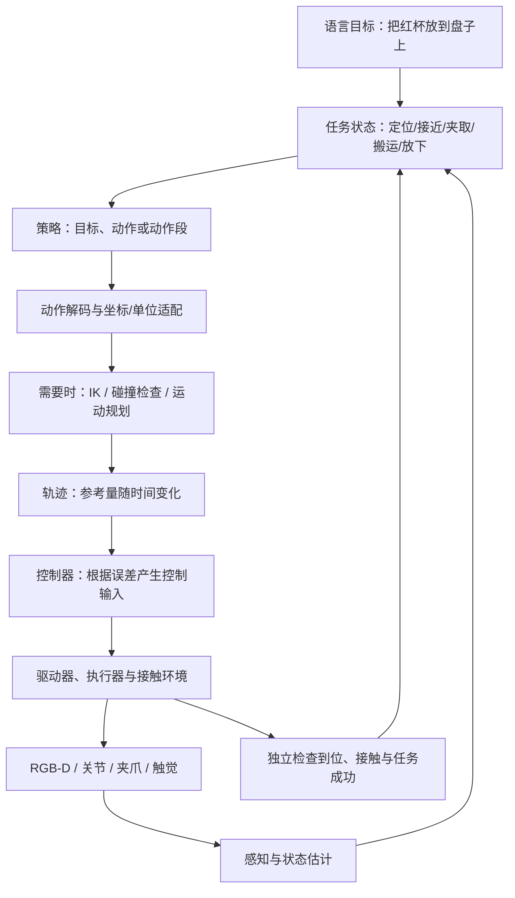
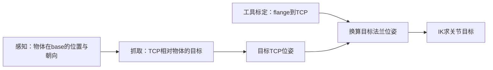
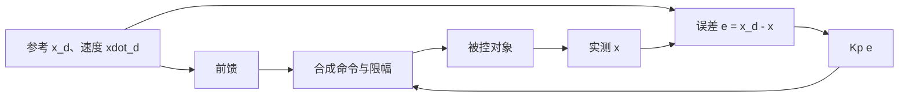
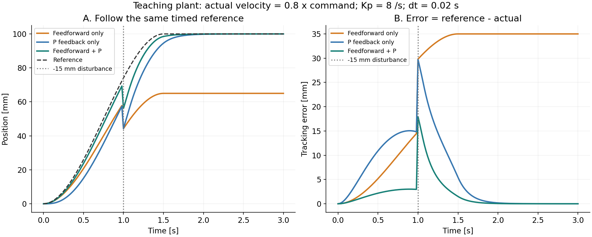
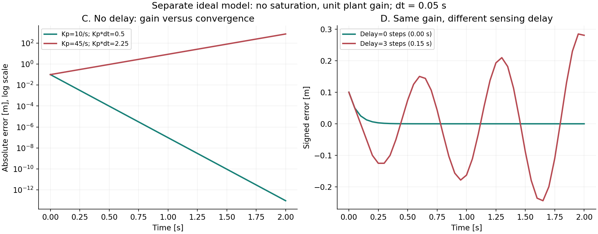
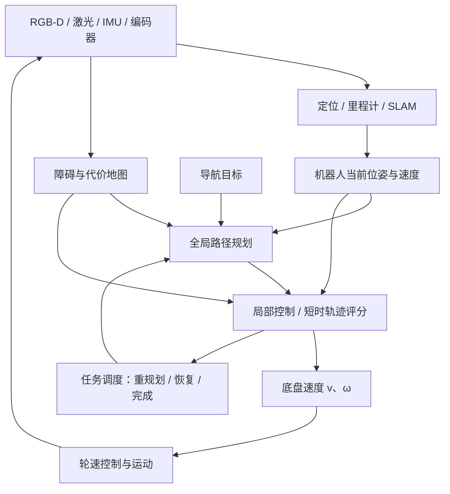
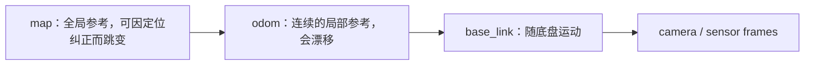
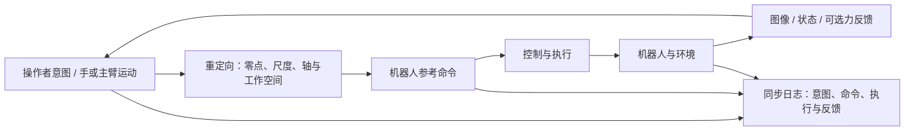

# D5 · 从“输出动作”到“按正确的方向、时序与反馈执行”

[返回 3D Learning](../_index.md) ｜ [本周日程](../P1-第一周-扫盲日程.md) ｜ [Day 4 讲义](../day4/Daily-Learning-Pack.md) ｜ [CPU实验](demo.py)

<details>
<summary>个人学习记录（自动更新时保留）</summary>

<!-- learner-notes:start -->
**个人状态**：尚未提交本课作答。可在这里记录初次判断、改变量实验、答案和未理解问题；资料生成及脚本通过不代表个人已完成学习。
<!-- learner-notes:end -->

</details>

<!-- daily-pack-generated:start -->

**动作数组只有在“控制什么量、相对于哪个坐标系、用什么单位、对应哪个时刻、怎样执行和纠偏”都明确之后，才成为可执行的机器人命令。策略决定做什么，规划与轨迹组织怎么到达，控制根据反馈把它实现。**

D3 建立感知—策略—世界模型—控制的闭环，D4 解释策略如何从演示或奖励中学出来。今天沿着同一个案例继续：RGB-D 看见红杯，策略决定抓取，机械臂却朝错误方向运动，或者在接近目标时振荡。此时仅看网络输出shape正确，还远远不够。

今天属于 **P1 / W1-D5 / 全局 Day 5**。我们先把动作执行链画完整，再手算坐标转换、反馈误差和轨迹时间化，最后把机械臂、移动导航、遥操、VLA放回同一张系统图。所有数值实验均为合成教学系统，不是对现有机器人项目实现或真机性能的确认。

## 学习目标与路线

学完应能：

- 用输入输出区分任务决策、策略、运动规划、轨迹生成、反馈控制与执行器。
- 写清一个动作接口的类型、单位、参考系、周期、归一化、时间戳和执行状态。
- 手算TCP增量转到base系，解释为什么点、位移、旋转和速度不能使用同一套“直接相加”。
- 从理想速度模型推导P控制的误差变化，并说明离散采样、延迟和限幅为什么会改变结论。
- 将一条几何路径加上时间，算出满足速度与加速度限制的教学轨迹时长。
- 区分PBVS与IBVS、位置与接触控制，理解FK、IK、雅可比在执行链中的位置。
- 解释导航中定位、地图、全局路径、局部控制与恢复的分工。
- 设计遥操演示日志，区分人类意图、发送命令和实际执行动作。
- 运行并修改CPU实验，用误差曲线与接口反例定位失败。

| 顺序 | 知识主线 | 需要回答的问题 |
| --- | --- | --- |
| 宏观 | 从任务目标到执行反馈 | 模型输出之后还有哪些必要步骤？ |
| 动作语义 | 控制量、坐标、单位、时间 | 相同的7个数为什么可能表示完全不同的命令？ |
| 控制机制 | 前馈、P/PI/PID、采样与延迟 | 怎样消除误差，为什么增益不能无限提高？ |
| 运动与接触 | FK/IK、路径/轨迹、视觉/力反馈 | 目标能到达是否等于过程可执行？ |
| 跨系统 | 导航、遥操、VLA与世界模型 | 哪些概念可以复用，哪些接口不能混？ |
| 动手与总结 | 手算、曲线、改变量、自测 | 能否从现象找到一个最小可验证原因？ |

## 1. 宏观：把“红杯放到盘子上”拆成执行链

### 1.1 同一目标，不同层输出不同东西



图中每个箭头都应标出具体量，而不是全部叫“action”。例如策略给末端目标位姿，IK输出关节目标，轨迹模块输出$q_d(t),\dot q_d(t)$，控制器可能输出关节速度或力矩。具体系统也可能让策略直接输出关节参考，绕过显式的几何规划；**哪些层显式存在取决于接口，但其约束与执行反馈不会因此消失。**

| 层 | 输入与输出示例 | 回答的问题 |
| --- | --- | --- |
| 任务决策 | 目标与成功状态 → 下一阶段 | 先接近、夹取还是恢复？ |
| 策略 | 观测历史/语言 → 动作或目标 | 当前选什么行动？ |
| 运动规划 | 初态、目标、几何约束 → 路径 | 怎样绕过障碍到达？ |
| 轨迹生成 | 路径、运动限制 → 带时间的参考 | 每个时刻该在哪里、多快？ |
| 反馈控制 | 参考与实测 → 速度/力矩等输入 | 怎样使实际运动跟随参考？ |
| 驱动与执行 | 电流/力矩/速度命令 → 真实运动 | 命令通过什么物理接口生效？ |

### 1.2 “命令接收成功”与“任务成功”不是同一个状态

```text
请求已发送 → 接口已接受 → 控制器开始执行 → 到达允许误差
          → 夹取后物体随末端运动 → 放置后物体稳定留在盘子上
```

接口返回成功可能只表示请求格式合法。关节到位也不说明杯子被抓住；夹爪闭合可能只是空夹。任务验收必须使用与目标一致的证据。

一个教学状态机：接近阶段检查位姿误差与碰撞距离；夹取阶段检查宽度/接触/物体跟随；搬运阶段检查滑移；放置阶段检查物体支撑稳定。各阈值应由任务与传感器精度决定，不从网络置信度直接抄来。

> [!question] 先判断
> 机械臂每次都精确跟随策略给出的轨迹，但总是抓到红杯旁边的蓝杯。主要问题必然是控制器吗？

> [!note]- 参考
> 不必然。控制器可能忠实执行了错误目标，问题可能在语言定位、实例关联、目标坐标或任务决策。先分开“参考是否正确”与“实际是否跟随参考”。

## 2. 微观：动作接口首先是一份语义约定

### 2.1 位置、增量、速度、力矩：数值相同，物理含义不同

| 动作类型 | 示例 | 单位 | 还需要知道什么 |
| --- | --- | --- | --- |
| 绝对关节位置 | $q_d$ | rad或m | 关节顺序、零位、限位 |
| 关节位置增量 | $\Delta q$ | rad或m | 相对实际值还是上一目标值？ |
| 关节速度 | $\dot q_d$ | rad/s或m/s | 持续时长、超时行为 |
| 末端绝对位姿 | $T^b_{tcp,d}$ | m与旋转表示 | base/TCP定义、姿态约定 |
| 末端位移与旋转增量 | $(\Delta p,\Delta R)$ | m、rad等 | 在base还是TCP表达、组合次序 |
| 笛卡尔速度 | $(v,\omega)$ | m/s、rad/s | 表达坐标、速度作用点 |
| 关节力矩 | $\tau$ | N·m | 动力学、驱动与反馈能力 |
| 夹爪 | 宽度/开合/力目标 | m、离散量或N | 极性、量程、实际控制模式 |

例如`0.01`可以是目标位置10mm、这次移动10mm，或者以10mm/s运动。把位移当速度，即使程序没有报错，运动距离也会改变。

若每次指令是10mm增量，20Hz连续发送且每次都完整累计，对应的平均推进量是0.2m/s；100Hz发送则变成1m/s。这只是理想累计关系，真实执行还受轨迹和驱动限制。**相同动作数据更换频率，并不自动保持相同任务。**

### 2.2 “相对当前”还要追问：当前实际值，还是当前目标值

假设实际位置$x=0.10$m，上次目标$x_d=0.12$m，新增量$\Delta x=0.01$m：

- 相对实测值：新目标是0.11m。
- 相对上次目标：新目标是0.13m。

如果控制器尚未跟上而策略不断相对旧目标累计，参考可能越积越远；相对实测更新则表现不同。两种定义都可以存在，训练与部署必须一致。记录`delta_position`这个名字还不足以分清它们。

### 2.3 反归一化：恢复物理量之后再谈动作

一种标准化约定是：

$$
a_{norm}=(a-\mu)\oslash\sigma,
\qquad a=\mu+\sigma\odot a_{norm}
$$

$\odot$、$\oslash$表示逐元素运算。$a_{norm}$无量纲，$\mu$、$\sigma$带各动作维度的物理单位。若平移维$\mu=0$m、$\sigma=0.02$m，模型输出0.5，对应0.01m，即10mm。

有些模型用分位数区间缩放、离散token或其他约定；必须读取该模型对应数据集、动作头和统计量，不能一律当作均值/标准差。夹爪维也不一定适合连续标准化。

**先恢复定义正确的物理量，再按训练约定转换参考系，最后检查执行约束。** 非各向同性缩放通常不能任意与旋转交换顺序。

### 2.4 一个可以检查的动作契约

```yaml
# 教学接口，非特定VLA或ROS驱动的官方消息格式
action_type: delta_pose
translation_unit: m
rotation_representation: rotation_vector
rotation_unit: rad
translation_frame: tcp_at_observation
rotation_composition: right_multiply
delta_anchor: measured_pose_at_observation
action_period_s: 0.05
gripper_semantics: target_width_m
normalization: dataset_specific_statistics
observation_timestamp: required
command_timestamp: required
sequence_id: required
```

同样的`[B,H,7]`可以表示三维平移、三维旋转和一维夹爪，但也可能是7个关节量。shape只约束布局，不约束物理语义。检查时要能回答：这段数组送到哪个控制器，它会怎样解释每一维？

## 3. 微观：把坐标系、TCP和动作组合说清楚

### 3.1 先固定变换记法

本文$T^a_b$把b系中的点坐标转成a系：

$$
\begin{bmatrix}p^a\\1\end{bmatrix}
=T^a_b\begin{bmatrix}p^b\\1\end{bmatrix},
\quad T^a_b=\begin{bmatrix}R^a_b&t^a_b\\0&1\end{bmatrix}
$$

点要旋转并平移；在两个姿态固定的坐标表示之间转换**同一自由位移向量**，只需旋转：

$$
\Delta p^a=R^a_b\Delta p^b
$$

不能把相机到基座的平移向量重复加到每个动作增量上。齐次坐标中，点的最后一维为1，自由向量为0，正好表达这个区别。

### 3.2 手算：沿TCP的x轴，不一定沿base的x轴

设TCP相对base绕z轴旋转90°：

$$
R^b_{tcp}=
\begin{bmatrix}0&-1&0\\1&0&0\\0&0&1\end{bmatrix},
\quad\Delta p^{tcp}=\begin{bmatrix}0.01\\0\\0\end{bmatrix}\mathrm m
$$

则：

$$
\Delta p^b=\begin{bmatrix}0\\0.01\\0\end{bmatrix}\mathrm m
$$

```text
base +y ↑  同时也是 TCP +x
        │  正确动作：向上10mm
        ●────→ base +x
               错误直加：向右10mm
```

若当前base位置是$(0.30,0.20,0.10)$m，正确目标是$(0.30,0.21,0.10)$m；忘记旋转得到$(0.31,0.20,0.10)$m。两目标相差约14.14mm。这个偏差不是深度网络的误差，也不是增益不够大。

### 3.3 物体位姿、抓取TCP位姿、法兰位姿是三个对象

感知给出$T^b_{obj}$，抓取方案给出TCP相对物体的目标$T^{obj}_{tcp,d}$，工具标定给出$T^{flange}_{tcp}$。需要控制法兰时：

$$
T^b_{flange,d}
=T^b_{obj}T^{obj}_{tcp,d}(T^{flange}_{tcp})^{-1}
$$

沿着下标消去可以检查链条：base→object→TCP→flange。换夹爪、改变工具长度后，感知位姿可能仍准确，但TCP偏置已经变化。



### 3.4 旋转增量的左乘、右乘不能混

若$R^b_{tcp}$描述当前姿态，增量在TCP局部轴上表达：

$$
R^b_{tcp,new}=R^b_{tcp}\Delta R_{local}
$$

在base轴上表达的旋转增量则为：

$$
R^b_{tcp,new}=\Delta R_{base}R^b_{tcp}
$$

旋转一般不交换。欧拉角逐维加法也不等于任意有限旋转的正确组合。完整位姿增量可以用SE(3)左/右组合描述，但“平移分量独立相加＋旋转相乘”的接口与某些twist指数映射接口不完全相同，必须看定义。

速度还要知道作用点。同一刚体上P、Q两点、所有向量在同一坐标系表达时：

$$
v_Q=v_P+\omega\times(p_Q-p_P)
$$

因此改变速度参考点时，不能只把线速度和角速度各乘一个旋转就认为完成了全部换算。完整twist的变换将在几何课展开。

### 3.5 ROS约定与传感器光学系

REP-103推荐SI单位、右手系；常见机体系为x前、y左、z上，相机`_optical`系为z前、x右、y下。它们都可以正确，只是轴定义不同。驱动、标定和tf应把转换关系写清，不能把相机图像的“向右”直接当base的“向右”。[ROS REP-103官方源文件](https://raw.githubusercontent.com/ros-infrastructure/rep/master/rep-0103.rst)

## 4. 微观：时间戳、动作段和多速率执行

### 4.1 “最新数据”可能早已过时

```text
t_capture → t_receive → t_inference_done → t_command → t_apply → t_feedback
   采样        接收          推理完成          发出        生效       反馈
```

真正影响当前动作的观测年龄：

$$
\tau_{age}=t_{apply}-t_{capture}
$$

如果目标或末端以0.25m/s运动，观测到动作生效间隔80ms，忽略这段运动就可能产生约：

$$
\Delta x\approx v\tau=0.25\times0.08=0.02\ \mathrm m
$$

即20mm。它是匀速近似，遇到加速度、转动和接触还需更完整模型。提高图像分辨率不能直接修复这类时间误差。

跨设备时间戳要先对齐时钟；不要直接相减两个来源不同、未同步的时间基准。ROS仿真时间、系统时间和进程单调时钟也不能不加区分混用。

### 4.2 变换必须对应采样时刻

手眼相机随机械臂运动。把$t_{capture}$时刻的相机点云，套用$t_{apply}$时刻的相机姿态，会把运动误差写进世界坐标。

对静态世界点，可以先使用采样时刻的外参将点转到base/world，再结合当前机器人状态规划动作；若物体本身也在运动，还需要物体跟踪或预测。时间正确的tf查询不是运动预测的替代品。

### 4.3 动作chunk的预测长度、执行长度、伺服周期

回连D4：策略一次输出$H$步，执行$K\le H$步再用新观测更新。若动作采样间隔$\Delta t_a=0.05$s、$H=16$、$K=2$，预测覆盖0.8s，执行0.1s后请求更新。

模型可能20Hz，关节控制器可能500Hz；这些只是教学数值，不是普适配置。中间需要明确零阶保持、插值、动作重叠处理与超时行为。把同一条“增量10mm”在每个500Hz控制tick里重复积分，会把一个动作重复执行很多次。


### 4.4 一个最小动作适配器该检查什么

```text
检查shape和有限值
→ 检查动作模式、单位、参考系和统计版本
→ 检查观测/命令的时序与有效期
→ 反归一化，按指定时刻和锚点转换
→ 检查工作空间、关节/速度/加速度与碰撞条件
→ 生成参考并记录发送/接受/实际执行状态
```

今天代码只实现其中的二维平移、时序和接口检查，不实现机器人驱动、IK和碰撞检测。这个边界必须在看见“检查通过”时一起记住。

## 5. 微观：反馈控制怎样改变误差

### 5.1 先说明被控对象，才有资格讨论控制律

令$x$为一维位置，$u$为输入速度。先假设底层已经能准确跟随速度命令：

$$
\dot x=u
$$

这是理想速度输入模型。真实机械臂常有惯性、摩擦、延迟与低层伺服，它们在这里暂时被简化。如果接口直接接受力矩，更接近的关节动力学是：

$$
M(q)\ddot q+C(q,\dot q)\dot q+g(q)=\tau+J(q)^TF_{ext}
$$

$M$是惯性矩阵，$C\dot q$概括速度相关项，$g$是重力项，$F_{ext}$为按匹配坐标定义的外力/力矩。这里不推导逆动力学；它提醒你：**给速度与给力矩，是两种不同的被控对象假设，不能照搬同一组控制参数。**

### 5.2 前馈：根据参考运动提前给命令

令期望位置为$x_d(t)$。最直接的做法：

$$
u_{ff}=\dot x_d(t)
$$

如果初始状态完全一致、模型完全正确且没有扰动，实际位置可以跟随参考。但途中被推偏15mm，之后即使速度仍正确，这15mm偏差也会保留。

设$e=x_d-x$，理想模型下$\dot e=\dot x_d-u_{ff}=0$。因此前馈不主动消除已有误差。真实模型增益若只有0.8，参考走100mm，纯前馈可能只走80mm；再叠加−15mm位置扰动，最终相差35mm。

### 5.3 P反馈：让当前误差产生纠正方向

对固定目标$x_d$，取：

$$
u=K_p e=K_p(x_d-x)
$$

$u$单位m/s，$e$单位m，因此$K_p$单位$s^{-1}$。代入理想模型：

$$
\dot e=-K_pe
\quad\Rightarrow\quad
e(t)=e(0)\exp(-K_pt)
$$

在上述连续、无延迟、无限幅模型里，$K_p>0$使误差衰减。$K_p<0$则反向纠偏，越偏越远。时间常数为$1/K_p$。

跟踪匀速参考$x_d=ct$时，只有P反馈则：

$$
\dot e=c-K_pe
\quad\Rightarrow\quad e_{ss}=c/K_p
$$

原因很直观：纯P需要非零误差，才能持续发出非零速度。**固定目标能归零，不代表移动目标也没有跟踪滞后。** [Modern Robotics 11.3：速度输入与P控制](https://modernrobotics.northwestern.edu/nu-gm-book-resource/11-3-motion-control-with-velocity-inputs-part-1-of-3/)

### 5.4 前馈加反馈：一个跟上参考，一个修正偏离

$$
u=\dot x_d+K_p(x_d-x)
$$

理想条件下：

$$
\dot e=\dot x_d-(\dot x_d+K_pe)=-K_pe
$$

移动参考的已知速度由前馈提供，当前偏差由反馈修正。若真实动力学与模型不同，公式中的完美抵消也会被破坏，但反馈仍可能改善误差。



任务空间控制会进一步把位姿误差、参考速度转换到一致坐标，再经雅可比得到关节速度。不能把不同坐标系中的前馈和反馈直接相加。[Modern Robotics 11.3：任务空间控制](https://modernrobotics.northwestern.edu/nu-gm-book-resource/11-3-motion-control-with-velocity-inputs-part-3-of-3/)

### 5.5 看实验曲线：终点误差与全程误差不是一个指标



图A黑虚线是参考，橙色是纯前馈，蓝色是P，绿色是前馈+P。图B画$e=x_d-x$。竖虚线处加入−15mm扰动。被控对象速度是命令的0.8倍，命令限制为±0.2m/s。

纯前馈最后保留35mm偏差；两种反馈在后续固定目标段继续修正，所以最终误差都很小。但在移动过程中，前馈+P的全程RMSE小于纯P。**只看终点位置，会遗漏中途的跟踪质量；只看平均误差，也可能遗漏一次严重偏离。**

这些数值来自理想化一维系统，没有传感器噪声、摩擦接触和空间障碍。不能把图上的极小终点误差当作实际机械臂精度。

### 5.6 PI/PID：新增项分别解决什么问题

在同一个速度输入教学模型下，可写：

$$
u=u_{ff}+K_pe+K_i\int e\,dt+K_d\dot e
$$

| 项 | 直觉 | 要留意的边界 |
| --- | --- | --- |
| P | 当前偏差越大，纠正越强 | 增益与延迟、限幅共同影响稳定性 |
| I | 把持续的小偏差积累成纠正 | 饱和时可能积分累积，产生windup |
| D | 对误差变化趋势作响应 | 差分放大噪声，参考跳变可能造成尖峰 |

在这个单位约定里，$K_i$是$s^{-2}$、$K_d$无量纲；换成力矩输出时单位不同。离散积分$ I_{k+1}=I_k+e_k\Delta t$不能漏掉$\Delta t$，否则改变采样率就改变实际积分强度。

Anti-windup，抗积分饱和，可以在执行器饱和且积分还在推动更大饱和时冻结积分，或用回算机制修正。它处理的是“控制器内部想输出”与“执行器实际能输出”的差异，不是把增益调小的同义词。

### 5.7 离散采样：正增益也可能不稳定

对理想速度对象，命令在一个采样间隔内保持不变：

$$
x_{k+1}=x_k+\Delta tK_p(x_d-x_k)
$$

固定目标下：

$$
e_{k+1}=(1-K_p\Delta t)e_k
$$

令$a=K_p\Delta t$，收敛要求：

$$
|1-a|<1\quad\Longleftrightarrow\quad0<a<2
$$

| $a$ | 每步误差怎样变化 | 该教学模型的行为 |
| --- | --- | --- |
| 0.5 | 乘0.5 | 同号衰减 |
| 1.5 | 乘−0.5 | 交替过冲但衰减 |
| 2 | 乘−1 | 持续振荡、不衰减 |
| 2.25 | 乘−1.25 | 振荡发散 |

这不是所有PID/机械臂的通用稳定范围。推导依赖理想速度对象、固定目标、零延迟、零噪声、无饱和与固定采样周期。真正工程里改变其中任何一项，都要重新检查。

### 5.8 延迟：纠正的是过去的误差

若观测延迟$d$个采样步：

$$
e_{k+1}=e_k-ae_{k-d}
$$

当前可能已经越过目标，控制器仍根据过去的正误差向前推。令$e_k=\lambda^k$可得特征方程：

$$
\lambda^{d+1}-\lambda^d+a=0
$$

需要所有根的模小于1才渐近稳定；不能继续直接套用无延迟的$0<a<2$。本课取$K_p=10/s$、$\Delta t=0.05$s，$a=0.5$：无延迟误差衰减；延迟3步即0.15s时出现增长振荡。



图C使用绝对误差的对数纵轴，比较无延迟下$a=0.5$与2.25；图D使用带符号的线性纵轴，比较同样$a=0.5$时有无延迟。**两幅图与上一幅跟踪图使用不同教学对象条件**：这里没有0.8增益、速度限幅或位置扰动。

> [!warning] 不要把“换大增益”作为所有误差的补救
> 坐标错，增益会更快把机器人推向错误方向；数据旧，增益可能放大迟到的纠正；执行器饱和，命令增大并不等于实际速度增加。先确认误差的物理来源。

## 6. 微观：目标、路径、轨迹与运动学

### 6.1 FK、IK、雅可比各解决哪个问题

Forward Kinematics（FK，正运动学）把关节配置映射为末端位姿：$T=f(q)$。Inverse Kinematics（IK，逆运动学）为目标位姿寻找关节配置。一个位姿可能无解、多解，或虽然有解却碰撞。

局部速度关系是：

$$
V=J(q)\dot q,\qquad J\in\mathbb R^{6\times n}
$$

$V$与$J$必须采用同一twist顺序、表达坐标和作用点约定。用伪逆或阻尼最小二乘求$\dot q$，并不自动满足关节限位和碰撞约束；奇异点附近某些末端方向难以实现。W2会用双连杆与雅可比算例继续展开。

**IK回答某个目标配置能否实现，规划回答从当前配置怎样走过去。** 把一串目标逐点求IK，仍可能出现解分支跳变或中途碰撞。

### 6.2 配置空间：看的是整台机器人

设$q=(q_1,\ldots,q_n)$，配置空间障碍$\mathcal C_{obs}$收集所有发生碰撞的配置。规划路径：

$$
q(s),\ s\in[0,1],\qquad q(s)\notin\mathcal C_{obs}
$$

末端的一条直线可能让肘部扫过桌子。TCP轨迹无碰撞，不足以证明整条机械臂无碰撞；夹住杯子后还需要把杯子作为附着物参与几何检查。

采样规划如RRT类方法通过采样配置、扩展树和检查连接来寻找路径；轨迹优化如CHOMP则按平滑性与障碍代价迭代改善初始运动。它们的核心操作是搜索或优化，不因为“优化了一个cost”就成为强化学习。

### 6.3 路径没有决定几点到达

几何路径$q(s)$只给先后顺序。加入单调时间进度$s(t)$，得到轨迹：

$$
q(t)=q(s(t)),\quad
\dot q=q'(s)\dot s,\quad
\ddot q=q''(s)\dot s^2+q'(s)\ddot s
$$

同一路径可以慢走、快走、停下来再走；速度和加速度由时间化决定。直接把一串位置点按固定间隔发送，可能在急弯或密度不均的部分产生过大加速度。

### 6.4 手算一条两端静止的三次轨迹

为移动距离$D$，令$r=t/T\in[0,1]$，采用：

$$
x_d(t)=x_0+D(3r^2-2r^3)
$$

由$x(0)=x_0,x(T)=x_0+D,\dot x(0)=\dot x(T)=0$可以解出三次系数。求导：

$$
\dot x_d=\frac DT(6r-6r^2),\qquad
\ddot x_d=\frac D{T^2}(6-12r)
$$

峰值为：

$$
|\dot x|_{max}=\frac{1.5|D|}{T},\qquad
|\ddot x|_{max}=\frac{6|D|}{T^2}
$$

给定$D=0.10$m、速度限制0.10m/s、加速度限制0.40m/s²：

$$
T\ge\max\left(\frac{1.5\times0.10}{0.10},
\sqrt{\frac{6\times0.10}{0.40}}\right)
=\max(1.5,1.225)=1.5\ \mathrm s
$$

这里的1.5s是该三次轨迹族、该标量位移与限制下的最小允许时长，不是任意机械臂路径的全局时间最优解。三次多项式端点加速度不为零，接上静止段会有加速度跳变；需要更平滑过渡时要考虑五次多项式或jerk限制。

### 6.5 MoveIt中的位置

运动规划通常先得到几何运动，再用时间参数化添加时间戳、速度和加速度信息；后处理如果改变路径形状，还需相应碰撞复查。MoveIt文档也区分时间参数化与jerk限制平滑。今天学习这个边界，不把某个版本的默认插件配置当作通用控制接口。[MoveIt：Time Parameterization](https://moveit.picknik.ai/main/doc/examples/time_parameterization/time_parameterization_tutorial.html)

## 7. 微观：视觉反馈与接触控制为什么需要不同误差

### 7.1 PBVS与IBVS：误差在哪里定义

Position-Based Visual Servoing（PBVS，基于位姿的视觉伺服）先估计目标/相机的三维关系，再在位姿空间定义误差；Image-Based Visual Servoing（IBVS，基于图像的视觉伺服）直接用图像特征误差构造反馈。

| 方式 | 误差示例 | 优势直觉 | 要检查什么 |
| --- | --- | --- | --- |
| PBVS | 目标位姿与当前位姿的差 | 与空间任务目标直接对应 | 标定、位姿估计、目标可见性 |
| IBVS | 当前特征位置与期望图像特征的差 | 直接让图像中的目标关系对齐 | 特征跟踪、交互矩阵、深度与收敛条件 |

IBVS并不意味着永远不需要深度或相机参数。它只是把控制误差定义在图像特征中。PBVS也不自动保证运动过程中目标始终处于视野。

### 7.2 交互矩阵：从“像素错了”到“相机怎么动”

令图像特征向量$s\in\mathbb R^m$、期望$s^*$，误差$e_s=s-s^*$；静止目标、eye-in-hand示意下：

$$
\dot s=L_sV_c,\qquad
L_s\in\mathbb R^{m\times6}
$$

控制可写成：

$$
V_c=-\lambda\hat L_s^+e_s
$$

$V_c$是与交互矩阵约定一致的相机速度，$+$表示伪逆，$\lambda>0$。需要经手眼关系与机器人雅可比，才能转换为相应关节速度；图像误差向量不能直接作为关节命令。

一个单自由度直觉：静止点、相机仅沿自身x轴平移且深度$Z$近似固定，归一化图像横坐标$u=X/Z$满足$\dot u\approx-v_x/Z$。若点在期望位置右侧，$u-u^*>0$，让相机向右运动会使点在图像中向左移动。**图像误差与相机运动的符号要通过几何关系判断。** [Chaumette与Hutchinson，Visual Servo Control, Part I（2006）](https://web.mit.edu/amcp/OldFiles/drg/Chaumette_Part_I.pdf)

### 7.3 从自由运动进入接触，位置误差不再足够

接近杯子时主要关心位置与避障；夹紧、插入或按压时，环境约束开始主导响应。刚性位置控制器如果不断尝试穿过桌面，位移可能很小，接触力却持续增大。

用线性弹簧接触模型解释：

$$
F=k_{env}\delta
$$

若$k_{env}=1000$N/m，多压入5mm就对应5N力变化。这里仅是静态线性教学近似，真实接触刚度、摩擦、变形和力传感器噪声会变化。

### 7.4 位置、力、阻抗、导纳：看输入输出关系

| 控制方式 | 主要目标或关系 | 典型使用位置 |
| --- | --- | --- |
| 位置/运动控制 | 跟踪位姿或轨迹 | 自由空间移动、接近 |
| 力控制 | 跟踪接触力目标 | 按压、恒力加工等 |
| 阻抗控制 | 建立运动偏差与作用力的关系 | 遇到接触时呈现期望柔顺性 |
| 导纳控制 | 根据测得外力生成运动响应 | 以位置/速度接口实现柔顺运动 |

一个任务空间弹簧阻尼的阻抗直觉是：

$$
F_{cmd}=K(x_d-x)+D(\dot x_d-\dot x)
$$

它还需要合适的动力学补偿与执行接口。导纳示意则可以给测得外力到偏移$\delta x$的动态关系：

$$
M_d\ddot{\delta x}+D_d\dot{\delta x}+K_d\delta x=F_{ext}
$$

随后将$\delta x$叠加到运动参考。这里的$K_d$表示虚拟刚度，**与前面PID的微分增益同字母但不是同一物理量**；实现中应取不同变量名。W5再深入接触与稳定性，今天先明确力与运动的关系及传感器条件。

## 8. 宏观迁移：导航也是估计、规划与反馈

### 8.1 SLAM、定位、地图、规划、控制不能混成一个模块



SLAM通常同时估计机器人轨迹和环境地图；定位可以在已有地图中进行。点云不是天然可通行地图，要处理地面、障碍高度、机器人尺寸、未知区域和传感器覆盖。

Nav2把计算路径的planner与产生局部控制命令的controller分开，由上层行为逻辑协调。导航栈中的controller可能做短时轨迹优化，底盘内部还可以有更低层轮速控制，看到同一个词要先问它控制的是哪一层。[Nav2：Planner与Controller的分工](https://docs.nav2.org/jazzy/configuration_and_development/first_time_robot_setup_guide/navigation_plugins/setup_navigation_plugins/)

### 8.2 map与odom：全局纠偏和局部连续性

REP-105常用关系：



odom给局部控制连续性，map承载长期全局参考。定位的全局纠正通常通过map→odom体现。若把一次全局定位跳变误当机器人瞬间物理移动，控制误差可能突然增大。框架名字不等于估计质量，仍要检查延迟与协方差。[ROS REP-105官方源文件](https://raw.githubusercontent.com/ros-infrastructure/rep/master/rep-0105.rst)

### 8.3 差速底盘不能任意横移

简化无侧滑模型：

$$
\dot x=v\cos\theta,\qquad
\dot y=v\sin\theta,\qquad
\dot\theta=\omega
$$

当$\theta=0$时，瞬时横向速度为0，不能直接执行“向左平移0.1m”而保持朝向不变。需要转向与前进组合；全向底盘的约束又不同。

给定轮半径$r$、轮距$b$，以$v$为车体前进速度、$\omega$为逆时针角速度：

$$
\dot\phi_R=(v+\omega b/2)/r,\quad
\dot\phi_L=(v-\omega b/2)/r
$$

例如$r=0.05$m、$b=0.30$m、$v=0.20$m/s、$\omega=0.50$rad/s，则右轮5.5rad/s、左轮2.5rad/s。这里假定轮标号、正方向和无滑移关系一致；驱动接口还要核对实际定义。

### 8.4 A*与局部速度搜索解决的尺度不同

A*用$f(n)=g(n)+h(n)$组织图搜索，$g$是已走代价，$h$是剩余代价估计。地图离散化和机器人形状决定搜索结果能否实际通过；一条栅格连通路径不自动满足车辆转弯与加速度约束。

DWA（Dynamic Window Approach，动态窗口法）直接在短时可达的速度范围内搜索，考虑制动可行性，再按朝向、速度和障碍距离等目标评分。这里的“动态”是速度可达与运动约束，不等于使用了神经世界模型。[Fox等，DWA（1997）](https://publications.ri.cmu.edu/storage/publications/pub_files/pub1/fox_dieter_1997_1/fox_dieter_1997_1.pdf)

一个制动距离直觉：

$$
d_{stop}\approx v\tau+\frac{v^2}{2a_{brake}}
$$

取$v=0.5$m/s、延迟0.1s、恒定制动减速度1m/s²，得到0.175m。这是假设制动能力可靠、直线匀减速的简化距离，工程还需机器人外形与不确定性余量，不能把0.175m直接当所有场景阈值。

## 9. 宏观迁移：遥操既是控制入口，也是学习数据来源

### 9.1 人的动作不等于机器人动作

Teleoperation，遥操作，通常包含输入设备、人机映射、命令通信、机器人控制与反馈。输入可以来自主臂、手柄、VR追踪器或其他设备；输出仍必须落在机器人的动作契约上。



重定向（retargeting）解决人的运动空间、设备空间与机器人空间不同的问题。主从关节对应适合部分相似构型；末端位姿映射更容易跨不同构型，但增加了IK、可达性和奇异点问题。

### 9.2 相对映射与clutch：为什么重新拿起手柄不应让机械臂跳跃

一个平移映射：

$$
p_{r,d}=p_{r,0}+sR(p_h-p_{h,0})
$$

$p_h$是操作者位置，$p_{h,0}$是启用时的操作者锚点；$p_{r,0}$是机器人锚点；$R$把操作者位移转到机器人参考系；$s$是尺度。

例如手移动100mm、$s=0.2$，机器人移动20mm。clutch（离合/重新设定锚点）释放期间可以重新摆放输入设备；再次接合时更新两侧锚点，使新映射从当前机器人位置连续开始。若只重置人侧而保留不匹配的机器人锚点，就可能产生目标跳变。

姿态映射需要单独定义旋转参考与组合顺序，不能简单复制四元数分量就完成不同世界坐标系的映射。

### 9.3 遥操数据要记录三个动作层次

| 量 | 是什么 | 为什么要分开 |
| --- | --- | --- |
| 人类意图 | 输入设备原始动作 | 可诊断映射与操作者纠正 |
| 发送参考 | 缩放、坐标变换、约束后的目标 | 与策略部署接口对应 |
| 实际执行 | 驱动接纳量、限幅量或测得运动 | 决定真实转移与执行误差 |

如果人想前进20mm，适配器限为10mm，机器人因接触只走了2mm，这三条数据各有用途。BC应该拟合哪一层，取决于部署时策略负责输出哪一层；不能把“人想做的”“发出去的”“实际发生的”混作同一个标签。

动作条件世界模型通常需要与实际状态转移对齐的动作量。若选择以发送命令作为条件，预测器实际上也在建模控制器和执行器的响应，此时控制模式、限幅与必要历史应进入模型条件或数据约定。不要把未测得的实际力矩编造成已知标签。

### 9.4 演示对齐与人类反应延迟

一个动作标签应对应操作者作出决策时能看到的信息，而不是事后更清晰的未来图像。人类反应、相机缓存、通信和控制延迟可能不同，简单按文件行号拼接容易错位。

同时记录采样时刻与生效时刻，有助于估计延迟和建立重采样规则。数据集按episode划分，并保留接管、恢复、失败和任务阶段；仅保存成功片段可能失去恢复训练需要的状态。

对于断连或松开使能键的行为，要按驱动接口定义保持、受控减速或其他状态转换。**把关节位置命令全部设成0，并不等于停止运动。** 双向力反馈还涉及通信时延与稳定性，不能只把力传感器数值原样传回就认为完成了稳定遥操系统。

ALOHA展示了遥操硬件、数据采集和动作学习的配合；Mobile ALOHA进一步把移动底盘与双臂纳入全身遥操和模仿学习。它们适合观察“采集接口如何定义可学的数据”，不把某个演示视频当作所有任务都能成功的证据。[ALOHA](https://tonyzhaozh.github.io/aloha/) ｜ [Mobile ALOHA](https://mobile-aloha.github.io/)

## 10. 回到宏观：VLA、世界模型与控制怎样接在一起

### 10.1 VLA动作头处于哪一层，必须按具体实现判断

```text
语言 + RGB-D或RGB + 本体状态 + 历史
  → 视觉语言/策略模型
  → 模型动作表示
  → 解码、反归一化、参考系和时序适配
  → 需要时IK/规划，或直接生成已有控制器的参考
  → 控制器与执行反馈
```

模型输出关节目标，意味着它把一部分运动组织学进了策略；输出末端增量，则还需要相应转换。二者不是只改一下维度就能互换。动作段越长，也不意味着模型能忽略观测更新和低层控制。

### 10.2 世界模型的预测必须对应真实执行语义

若模型训练时的$a_t$是“每50ms一次、TCP系位移”，部署时把它当作“每20ms一次、base系速度”，那么$f(s,a)$接收的数值可能仍在训练范围内，物理含义却已经改变。

世界模型即使完美拟合旧数据，也会预测错误。该问题首先是接口分布变化，不能仅用更长rollout或更大模型解释。

当预测模型参与候选评分时，应记录：候选的物理动作、时长、控制模式、预测后果、实际后果。**模型评的是哪段真实行为，必须可以从日志还原。**

### 10.3 从归一化tensor到控制器参考：完整展开一次

下面是教学布局，不是某模型官方标准：

| 阶段 | Shape示例 | 处理 |
| --- | --- | --- |
| 多相机RGB历史 | $[1,2,2,3,240,320]$ | batch、历史、相机、通道、高、宽 |
| 本体历史 | $[1,2,D_q]$ | 关节、速度、夹爪、有效标记 |
| 动作chunk | $[1,16,7]$ | 本例定义为平移3、旋转向量3、夹爪1 |
| 取第一条动作 | $[7]$ | 同时取该动作对应采样时刻与序号 |
| 平移反归一化 | $[3]$ | 例如得到TCP系10mm位移 |
| 位姿组合 | $[4,4]$ | 根据观测时刻的锚点产生绝对目标 |
| 关节参考 | $[n]$或$[H_q,n]$ | 需要时IK、连续性和约束检查 |
| 控制器输入 | 带时间的参考 | 匹配驱动模式、关节顺序与单位 |

假设约定为“相对观测时刻实测TCP位姿”，则先用该时刻姿态构造绝对目标，再依据当前状态检查是否仍适合执行。不能在执行时偷偷改成“相对最新实际位置”，否则改变了模型学到的动作锚点。若系统选择重定基准，也应当作为显式适配策略验证。

### 10.4 用五格卡区分：优化、控制与Learning

| 对象 | 数据/输入 | 学什么或求什么 | 目标/信号 | 运行时行为与评价 |
| --- | --- | --- | --- | --- |
| 固定P控制器 | 当前误差 | 参数固定，不在每步训练 | 把误差变成纠正量 | 每步算控制；看稳定、跟踪与扰动恢复 |
| 运动规划器 | 几何、初态、目标 | 求当前任务的一条可行路径 | 路径代价与约束 | 搜索或优化；看可行性、碰撞与计算量 |
| BC/VLA策略 | 对齐演示与观测 | 参数化动作映射/分布 | 专家动作或模型规定训练信号 | 前向推理；看闭环成功与新场景表现 |
| 动态模型 | 对齐状态、动作、转移 | 参数化状态变化规律 | 下一状态/特征等 | 预测、评分或想象训练；看多步与闭环收益 |

控制器或规划器也可以包含学习模块，例如学动力学、学残差、学代价。判断依据是实际更新的对象与信号，不能仅凭有“loss”“优化器”就判断属于RL。

### 10.5 工程诊断：先把错误分到正确的层

| 现象 | 首先检查 | 能区分原因的最小实验 |
| --- | --- | --- |
| 每次朝错误方向移动 | frame、旋转组合、单位 | 固定90°姿态，发送一个合成位移到纯软件适配器 |
| 目标一直累积远离实际位置 | 增量锚点与重复积分 | 对比实际锚点/上次目标锚点日志 |
| 静态正确，运动时抓偏 | 观测年龄、外参时刻、目标运动 | 同轨迹改变软件延迟，比较偏差 |
| 增益变大后振荡 | 采样、延迟、饱和 | 先在简化模型隔离增益和延迟 |
| 终点可达，中途撞桌 | 全臂几何、路径、附着物 | 检查整条路径上的机器人形状 |
| 夹爪闭合但杯子没跟随 | 接触状态与独立成功判据 | 比较夹爪状态和杯子轨迹 |
| 遥操好、克隆后差 | 标签层次、对齐、状态覆盖 | 回放一段示范，逐字段检查输入输出 |

## 11. 动手：用CPU实验检查接口、轨迹与反馈

### 11.1 环境与入口

核心脚本[demo.py](demo.py)只依赖Python标准库，Python 3.10+即可运行。没有模型下载、ROS安装、相机或机器人连接。曲线已经嵌在讲义中；重画曲线才需要Matplotlib和[plot_demo.py](plot_demo.py)。

在笔记库根目录运行：

```bash
python3 3d_learning/day5/demo.py --csv /tmp/day5-tracking.csv
```

脚本中的三组系统要分清：

1. 二维TCP动作解码与契约检查：固定姿态、固定教学归一化统计。
2. 跟踪系统：三次参考轨迹、执行增益0.8、一次−15mm扰动、速度限幅±0.2m/s、$\Delta t=0.02$s。
3. 稳定性系统：理想单位增益、无饱和、固定目标、初始误差0.1m、$\Delta t=0.05$s，单独改变增益或延迟。

第三组出现数百米的发散值只是无限幅数学模型的数值结果；第二组有速度限制，行为不同。不要把某组参数默默套进另一组结论。

### 11.2 先预测四件事

> [!question] 运行前写下判断
> 1. TCP转90°后，局部x方向10mm会变成base的哪个方向？
> 2. 参考移动100mm、真实增益0.8、再被推回15mm，纯前馈最终差多少？
> 3. 同样$K_p\Delta t=0.5$，加入延迟后是否仍能只凭这个数判稳定？
> 4. 拒绝过时消息、单位错误和模式错误，是否等于已经实现碰撞检测？

### 11.3 已执行结果

**验证记录：2026-09-09，macOS，核心实验Python 3.14.3；确定性合成输入，无训练/随机探索，随机种子不适用。** 跟踪每种方法150个运动步，稳定性每种40个更新步；不把这些样本数写成机器人成功率。

| 项 | 已核对结果 |
| --- | --- |
| 动作坐标 | TCP $(0.010,0)$m → base $(0,0.010)$m |
| 契约反例 | 过时观测、mm单位、velocity模式、未来命令时刻共4种均拒绝 |
| 三次轨迹最小允许时长 | 1.500s，限值与§6一致 |
| 纯前馈 | 最终误差0.03500000m；RMSE0.02856389m；限幅0/150步 |
| 纯P | 最终误差约0.00000019m；RMSE0.00944285m；限幅4/150步 |
| 前馈+P | 最终误差约0.00000005m；RMSE0.00367140m；限幅3/150步 |
| 无延迟、$a=0.5$ | 误差衰减，40步后接近零 |
| 无延迟、$a=2.25$ | 振荡发散，40步后约752.316m |
| 延迟3步、$a=0.5$ | 40步末误差约0.280273m，峰值绝对误差0.284375m |

跟踪前馈使用每个采样区间的精确平均参考速度$(x_{d,k+1}-x_{d,k})/\Delta t$，所以35mm偏差不是对参考速度进行粗糙数值积分造成的。RMSE在含初始点的151个记录点上计算，终点误差和全程RMSE分开报告。

复查数据：[默认轨迹CSV](../../_assets/3d_learning/day5/tracking.csv)。绘图实际使用Python 3.11.15、Matplotlib 3.10.9；两张PNG已经打开检查过坐标单位、图例与布局。

### 11.4 改变一个变量，保留失败记录

```bash
python3 3d_learning/day5/demo.py --kp 2 --csv /tmp/day5-kp2.csv
python3 3d_learning/day5/demo.py --kp 8 --delay-steps 5 --csv /tmp/day5-delay5.csv
python3 3d_learning/day5/demo.py --kp 20 --delay-steps 5 --csv /tmp/day5-kp20-delay5.csv
```

这些命令中的`--kp`和`--delay-steps`只改变跟踪实验；末尾三个稳定性对照保留固定参数，便于比较。不得把固定对照的输出误解为命令行参数下的结果。

| 改动 | 先写预测 | 检查与解释 |
| --- | --- | --- |
| 低Kp | 修正更慢，移动阶段可能滞后更多 | 最终误差、RMSE与扰动后恢复 |
| 同Kp增加观测延迟 | 纠正更迟，不保证每个误差指标都单调变差 | 误差符号、相位、峰值与限幅 |
| 高Kp叠加延迟 | 可能振荡或频繁限幅 | 看实际命令与误差，不只看终点 |
| 把TCP yaw改为0 | 正确位移变成base +x | 原90°专用断言应相应检查；不要只删断言 |
| 改packet为过时观测 | 应拒绝，不返回正常动作 | 解释拒绝的是哪条契约 |
| 把反归一化0.02改为20 | 位移放大1000倍 | 用单位推理发现错误，不依赖真机试错 |

**已经实测的改变量**（其余条件与默认跟踪实验相同）：

| Kp / 观测延迟步数 | P的RMSE | 前馈+P的RMSE | P / 前馈+P的限幅步数 |
| --- | --- | --- | --- |
| 2 / 0 | 28.843mm | 9.333mm | 0 / 0 |
| 8 / 5 | 5.579mm | 3.879mm | 6 / 3 |
| 20 / 5 | 7.472mm | 8.130mm | 34 / 41 |

有限时段内，延迟可能改变相位、使某一个指标变小；不能据此说“延迟改善了控制稳定性”。高增益叠加延迟也不保证前馈+P在每项指标上更好。应结合固定参考、长期响应、扰动与限幅一起判断；更换模型或采样周期后重新评价。

### 11.5 关键实现，逐行对应公式

```python
# 1. 将归一化动作恢复到TCP位移，再转到base系
local = tuple(0.02 * value for value in packet.action_norm)
delta_base = rotate_xy(local, tcp_yaw)

# 2. 前馈使用一整个采样区间的平均参考速度
u = (ref_next - ref) / dt
u += kp * (ref - observed)
u_limited = max(-0.2, min(0.2, u))
x_next = x + 0.8 * u_limited * dt

# 3. 另一组无饱和理想模型中的延迟误差递推
e_next = errors[-1] - kp * dt * errors[max(0, n - delay_steps)]
```

注意第二段控制器拿到的是`observed`，被控对象推进使用的是实际`x`；有延迟时二者不同。把两者都替换成当前真实值，会意外删掉你本来想研究的延迟。

### 11.6 完整核心代码

以下完整实现与同目录[demo.py](demo.py)一致，可复制运行。独立[绘图脚本](plot_demo.py)仅用于重生成图片；若环境已有Matplotlib，可执行`python3 3d_learning/day5/plot_demo.py --output /tmp/day5-figures`，不影响标准库实验的可用性。

> [!example]- 完整CPU实验代码（可复制）
>
> ```python
> """Day 5: action contracts, time scaling, tracking, and sampled-data delay.
>
> Python 3.10+, standard library, deterministic CPU examples; no robot I/O.
> Run: python3 demo.py --csv /tmp/day5-tracking.csv
> All positions are in meters, times in seconds, and velocities in m/s.
> """
> import argparse
> import csv
> import math
> from dataclasses import dataclass, replace
> from pathlib import Path
>
>
> @dataclass(frozen=True)
> class Packet:
>     action_norm: tuple[float, float] = (0.5, 0.0)
>     frame: str = "tcp"
>     mode: str = "delta_position"
>     decoded_unit: str = "m"
>     period_s: float = 0.05
>     observation_time_s: float = 9.95
>     command_time_s: float = 9.98
>
>
> def rotate_xy(vector, yaw):
>     x, y = vector
>     c, s = math.cos(yaw), math.sin(yaw)
>     return c * x - s * y, s * x + c * y
>
>
> def decode_delta(packet, now_s=10.0, tcp_yaw=math.pi / 2):
>     """Teaching contract: normalized 2-D TCP translation, fixed statistics.
>
>     Returns a base-frame displacement. This is not a collision checker,
>     driver, complete VLA adapter, or permission to execute physical motion.
>     """
>     if packet.frame != "tcp" or packet.mode != "delta_position":
>         raise ValueError("unsupported frame or action mode")
>     if packet.decoded_unit != "m":
>         raise ValueError("decoded translation must use meters")
>     timing = (now_s, packet.period_s, packet.observation_time_s,
>               packet.command_time_s, tcp_yaw)
>     if not all(math.isfinite(v) for v in timing):
>         raise ValueError("non-finite metadata")
>     if not math.isclose(packet.period_s, 0.05, abs_tol=1e-9):
>         raise ValueError("action period differs from this contract")
>     if not packet.observation_time_s <= packet.command_time_s <= now_s:
>         raise ValueError("timestamp order invalid")
>     if now_s - packet.observation_time_s > 0.10:
>         raise ValueError("observation is stale")
>     if len(packet.action_norm) != 2 or not all(
>         math.isfinite(v) and abs(v) <= 1 for v in packet.action_norm
>     ):
>         raise ValueError("expected two finite normalized values in [-1,1]")
>     # Teaching statistics: mu=(0,0) m, sigma=(0.02,0.02) m.
>     local = tuple(0.02 * value for value in packet.action_norm)
>     return rotate_xy(local, tcp_yaw)
>
>
> def cubic(t, duration=1.5, goal=0.1):
>     """Return position and analytic velocity for a rest-to-rest cubic."""
>     if t <= 0:
>         return 0.0, 0.0
>     if t >= duration:
>         return goal, 0.0
>     s = t / duration
>     return goal * (3*s*s - 2*s*s*s), goal/duration * (6*s - 6*s*s)
>
>
> def track(mode, kp=8.0, delay_steps=0, dt=0.02, total_s=3.0):
>     """Velocity plant x_next=x+0.8*u*dt, with one -0.015 m disturbance.
>
>     Feedforward uses exact average reference velocity over each interval,
>     so its final bias is not an Euler integration artifact.
>     The actuator has a +/-0.2 m/s limit. Delayed sensing uses held initial
>     state before the start; the command itself has no extra queue delay.
>     """
>     if mode not in {"ff", "p", "ff+p"}:
>         raise ValueError("unknown tracking mode")
>     if kp < 0 or delay_steps < 0:
>         raise ValueError("kp and delay_steps must be nonnegative")
>     history = [0.0]
>     rows = [dict(mode=mode, t_s=0.0, reference_m=0.0, position_m=0.0,
>                  error_m=0.0, command_mps=0.0, saturated=0)]
>     for i in range(round(total_s / dt)):
>         t, tn = i * dt, (i + 1) * dt
>         ref, _ = cubic(t)
>         ref_next, _ = cubic(tn)
>         observed = history[max(0, len(history)-1-delay_steps)]
>         u = (ref_next-ref)/dt if mode in {"ff", "ff+p"} else 0.0
>         if mode in {"p", "ff+p"}:
>             u += kp * (ref-observed)
>         limited = max(-0.2, min(0.2, u))
>         x = history[-1] + 0.8 * limited * dt
>         if i + 1 == round(1.0 / dt):
>             x -= 0.015
>         history.append(x)
>         rows.append(dict(mode=mode, t_s=tn, reference_m=ref_next,
>                          position_m=x, error_m=ref_next-x,
>                          command_mps=limited, saturated=int(abs(u) > 0.2)))
>     return rows
>
>
> def error_sequence(kp, dt=0.05, delay_steps=0, steps=40):
>     """Unsaturated ideal velocity plant; fixed target, initial error 0.1 m.
>
>     e[n+1] = e[n] - kp*dt*e[n-delay]. The initial prehistory is constant.
>     Separate from track(): no gain mismatch, no velocity limit, no impulse.
>     """
>     errors = [0.1]
>     for n in range(steps):
>         errors.append(errors[-1] - kp*dt*errors[max(0, n-delay_steps)])
>     return errors
>
>
> def main():
>     parser = argparse.ArgumentParser()
>     parser.add_argument("--kp", type=float, default=8.0)
>     parser.add_argument("--delay-steps", type=int, default=0)
>     parser.add_argument("--csv", type=Path)
>     args = parser.parse_args()
>     if not math.isfinite(args.kp) or args.kp < 0 or args.delay_steps < 0:
>         parser.error("kp must be finite/nonnegative; delay-steps nonnegative")
>
>     delta = decode_delta(Packet())
>     print(f"Frame: TCP delta (0.010,0.000) m -> base ({delta[0]:.3f},{delta[1]:.3f}) m")
>     print("Target: base (0.300,0.200) -> (0.300,0.210); wrong-frame target (0.310,0.200)")
>     bad_packets = {
>         "stale": replace(Packet(), observation_time_s=9.7),
>         "unit": replace(Packet(), decoded_unit="mm"),
>         "mode": replace(Packet(), mode="velocity"),
>         "future": replace(Packet(), command_time_s=10.1),
>     }
>     rejected = 0
>     for name, packet in bad_packets.items():
>         try:
>             decode_delta(packet)
>         except ValueError as exc:
>             rejected += 1
>             print(f"Contract rejects {name}: {exc}")
>
>     distance, vmax, amax = 0.1, 0.1, 0.4
>     duration = max(1.5*distance/vmax, math.sqrt(6*distance/amax))
>     print(f"Cubic minimum duration under stated limits: {duration:.3f} s")
>     all_rows = []
>     results = {}
>     for mode in ("ff", "p", "ff+p"):
>         rows = track(mode, args.kp, args.delay_steps)
>         results[mode] = rows
>         all_rows.extend(rows)
>         rms = math.sqrt(sum(r["error_m"]**2 for r in rows)/len(rows))
>         sat = sum(r["saturated"] for r in rows)
>         print(f"Tracking {mode:4s}: final_error={rows[-1]['error_m']:.8f} m, "
>               f"RMSE={rms:.8f} m, saturated_steps={sat}/150")
>
>     for label, kp, delay in (("stable", 10.0, 0),
>                               ("excess_gain", 45.0, 0),
>                               ("delayed", 10.0, 3)):
>         errors = error_sequence(kp, delay_steps=delay)
>         print(f"Stability {label:11s}: kp*dt={kp*0.05:.2f}, delay={delay}, "
>               f"final_error={errors[-1]:.6f} m, max_abs={max(map(abs, errors)):.6f} m")
>
>     if args.csv:
>         args.csv.parent.mkdir(parents=True, exist_ok=True)
>         with args.csv.open("w", newline="") as f:
>             writer = csv.DictWriter(f, fieldnames=list(all_rows[0]))
>             writer.writeheader()
>             writer.writerows(all_rows)
>         print(f"Saved tracking CSV: {args.csv}")
>
>     assert math.dist(delta, (0.0, 0.01)) < 1e-12 and rejected == 4
>     assert abs(duration - 1.5) < 1e-12
>     assert abs(results["ff"][-1]["error_m"] - 0.035) < 1e-12
>     assert abs(error_sequence(10.0)[-1]) < 1e-10
>     assert abs(error_sequence(45.0)[-1]) > 0.1
>     assert max(map(abs, error_sequence(10.0, delay_steps=3))) > 0.1
>     print("Analytic contract/trajectory/stability checks: PASS.")
>     print("Tracking with user-selected gains is measured, not assumed successful.")
>
>
> if __name__ == "__main__":
>     main()
> ```

### 11.7 迁移任务：给你的机器人画一份可回放接口

不连接真机，先设计一条“RGB-D目标→TCP目标→关节参考”的日志，至少包含观测时间、相机与base变换、TCP标定、目标来源、动作类型与单位、控制周期、发送/接纳/执行时刻、实际状态、任务成功判据。选一个故障注入：坐标旋转90°、延迟80ms、工具偏置5mm或动作单位放大1000倍，说明哪个检查应该首先发现它。

## 12. 一手材料：五篇摘要怎样服务于今天的问题

P1原目标包含15篇摘要记录。今天明确安排下面5篇摘要卡；若以前读过，补“今天新增的接口认识”，不将重复阅读算成另一篇。D6、D7继续补齐其余记录并核对总数，**当前不预设已有多少篇被你实际完成**。

每篇留下四句：问题是什么；核心机制；证据来自什么实验/分析；不能外推到什么场景。下表是助读提炼，个人阅读与记录仍待完成。

| 材料与具体阅读位置 | 今天要提取的机制 | 回看正文与一个边界问题 |
| --- | --- | --- |
| [Fox等，The Dynamic Window Approach to Collision Avoidance，1997](https://publications.ri.cmu.edu/storage/publications/pub_files/pub1/fox_dieter_1997_1/fox_dieter_1997_1.pdf)：摘要、Introduction与速度搜索定义 | 在短时可达速度集合中筛选可制动候选，再按任务评分 | §8：已知速度运动模型为何不等于神经世界模型？原运动平台与自己的底盘有何区别？ |
| [Ratliff等，CHOMP: Gradient Optimization Techniques for Efficient Motion Planning，2009](https://publications.ri.cmu.edu/chomp-gradient-optimization-techniques-for-efficient-motion-planning)：摘要及所链论文Introduction、算法目标 | 用梯度改进路径/轨迹的平滑与障碍代价，理解采样搜索与连续优化的不同角色 | §6：局部优化结果是否自动给出全局最优与完整执行保证？ |
| [Chaumette、Hutchinson，Visual Servo Control, Part I，2006](https://web.mit.edu/amcp/OldFiles/drg/Chaumette_Part_I.pdf)：开篇概述、Basic Components、IBVS与PBVS开头 | 把视觉特征误差与运动速度建立联系，比较两类误差空间 | §7：IBVS中的深度和相机参数去了哪里？ |
| [Zhao等，Learning Fine-Grained Bimanual Manipulation with Low-Cost Hardware，2023](https://tonyzhaozh.github.io/aloha/)：Abstract、Teleoperation System、Learning Algorithm | 遥操采集与动作chunk学习共同形成系统，动作接口是训练的一部分 | §9：主臂动作、策略输出、执行器控制分别是什么？ |
| [Fu等，Mobile ALOHA，2024](https://mobile-aloha.github.io/)：Abstract、Teleoperation及Failures展示 | 移动底盘与双臂共同采集示范，结合已有静态数据训练移动操作 | §9：底盘和双臂如何同步？报告中的任务结果能否直接外推到新平台？ |

补查数学与工具：手写一次$R_z(90^\circ)\Delta p$、一次三次多项式求导与一次误差递推；用CSV画图或核对给出的曲线；把矩阵维度、单位与假设写在式子旁。D7再回查特征值、QR、刚体变换与李群，不因本课使用旋转矩阵就声称已经掌握全部线性代数。

## 13. 今日总结：先保证动作有正确的物理意义

### 13.1 三句话总结

1. **动作的意义由控制量、参考系、单位、锚点和时序共同确定；shape正确只是最早的一关。**
2. **前馈利用已知参考，反馈纠正实际偏差；稳定性取决于对象、采样、延迟、限幅和测量。**
3. **机械臂、导航、遥操与VLA共享执行闭环，但必须分别处理其运动约束、控制接口和任务成功证据。**

### 13.2 最重要的五个知识点

| 要点 | 为什么值得掌握 |
| --- | --- |
| 动作契约与锚点 | 能解释“同一个数组换系统就出错”，使AI Coding和驱动适配可检查 |
| 点/向量、TCP/base、旋转组合 | 能把感知几何真正接到操作命令，避免把接口错误误判为模型不准 |
| 前馈与反馈及其模型假设 | 能看懂跟踪曲线，区分参考错、执行偏与控制失稳 |
| 路径与时间轨迹 | 能解释终点可达却过程不可执行，以及速度加速度从何而来 |
| 时间与实际执行日志 | 能对齐演示、世界模型转移与闭环评估，发现延迟和限幅造成的差异 |

### 13.3 三个最容易混淆的边界

- **策略选择正确≠执行正确**：坐标或时序可以把正确选择变成错误运动；控制精准也可能忠实执行错误目标。
- **连续模型稳定≠数字实现稳定**：今天的$K_p>0$结论必须带连续、无延迟等假设；离散后看$K_p\Delta t$，延迟后还要看更完整动态。
- **优化≠学习、接收成功≠任务成功**：规划求一条路径与用数据训练参数不同；必须通过真实观测判断任务是否实现。

### 13.4 今日产出与验收

- 一张完整执行链，给每条边写输入输出、坐标、单位和频率。
- 一份动作契约，明确增量锚点、旋转次序、夹爪语义及时间戳。
- 一份实验记录：先预测、默认结果、至少一个改变量、曲线解释和适用边界。
- 五篇摘要卡与本课八题作答。个人成绩与掌握状态只根据实际提交更新。

## 14. 自测：从手算到系统诊断

先作答再看最后答案。每题0—2分：0=混淆或无法解释，1=能说出部分机制，2=计算正确并说明假设/边界。建议达到12/16，且第2、5、8题不为0；这是建议验收线，不是已取得的成绩。

1. 一个模型输出`[1,16,7]`。写出两种不同的动作解释，并说明为什么仅检查shape无法接入控制器。
2. TCP相对base绕z轴90°，归一化局部平移动作为$(0.5,0,0)$，$\mu=0$m、$\sigma=0.02$m。base中当前位置$(0.30,0.20,0.10)$m，新目标是多少？误把局部位移直接加到base会错在哪里？
3. 采样到执行延迟80ms，目标匀速0.25m/s，忽略延迟可能带来多大位移偏差？移动手眼相机的旧点云应使用哪个时刻的外参？
4. 理想速度对象$\dot x=u$，固定目标、$u=K_p(x_d-x)$。推导连续与无延迟离散误差方程；取$K_p=10/s,\Delta t=0.05$s，每步误差乘多少？
5. 同样$K_p\Delta t=0.5$，观测延迟3步后能否继续用$0<a<2$断言稳定？若大命令被限幅，积分项还不断增加，会有什么问题？
6. 三次轨迹移动0.1m，速度限制0.1m/s、加速度限制0.4m/s²，最小允许时长是多少？它是否保证机械臂全路径无碰撞、jerk连续？
7. 区分PBVS/IBVS、map/odom、导航planner/controller，每对用一句输入输出说明。差速底盘能否直接把任意二维平移增量当瞬时速度执行？
8. 遥操输入想走20mm，适配后发送10mm，实际接触只走2mm。为BC与动作条件世界模型分别选择哪些数据，并设计一个能区分接口错误、控制误差和感知误差的回放检查。

## 15. 未理解问题与下一课

把未懂之处写成“我已能解释……，但不能判断……；我准备通过……区分”。

| 问题 | 后续课位 | 当前应能说清的起点 |
| --- | --- | --- |
| SE(3)与twist怎样统一位姿、速度？ | W2-D1/D3，D7数学回查 | 点和向量不同、坐标必须匹配 |
| IK、DLS为什么在奇异点附近有效或失效？ | W2-D2/D3 | 目标、关节和局部速度映射的区别 |
| 采样、噪声、饱和怎样联合决定控制稳定性？ | W5-D1/D2、P3控制调试 | 能说明本课递推式的假设 |
| 路径的碰撞与动态可行性怎样检查？ | W3-D3/D4、P3-W7/W8 | 末端无碰撞不等于全臂无碰撞 |
| 视觉误差怎样与触觉滑移共同反馈？ | W5、P3-W9/W10 | 视觉和接触对应不同可观测量 |
| VLA动作头和世界模型潜状态怎样实现？ | D6、W4/W5 | 训练目标、动作语义与执行闭环分开 |

**下一课D6：VLA与世界模型结构、BEV与环境准备。** 从“视觉/语言/本体输入如何变成token或特征”出发，画动作头与动态转移模块，并明确BEV的坐标、尺度及其与操作的关系。第一步是给今天的闭环图补上：哪些模块训练时需要专家动作，哪些需要执行后的下一状态，哪些推理时只使用当前可获得的信息。

### 自测答案与判分

> [!note]- 作答后展开：核对要点
> **1**：可表示16步7关节目标，也可表示16步“平移3＋旋转3＋夹爪1”；还缺单位、参考系、锚点、时序、归一化、关节或夹爪定义。两种解释及接口缺项完整得2分。
>
> **2**：局部位移$(0.01,0,0)$m，转base为$(0,0.01,0)$m；目标$(0.30,0.21,0.10)$m。错误直加得到$(0.31,0.20,0.10)$m。方向、反归一化与结果都正确得2分。
>
> **3**：约0.02m，即20mm，依赖匀速近似。旧点云先用采样时刻的相机变换；物体在运动时还需要目标跟踪/预测。计算和时刻说明正确得2分。
>
> **4**：$\dot e=-K_pe$，$e_{k+1}=(1-K_p\Delta t)e_k$；给定参数每步乘0.5。说明固定目标、理想速度、零延迟与无饱和条件得2分。
>
> **5**：不能；延迟后$e_{k+1}=e_k-ae_{k-3}$，需检查对应特征根，今天$a=0.5$的对照出现增长振荡。饱和时持续积分可能windup，导致解除饱和后过冲/恢复慢，需抗饱和机制。两点完整得2分。
>
> **6**：$\max(1.5,\sqrt{1.5})=1.5$s，仅是该标量三次轨迹族的限制。未检查全臂碰撞、动力学或jerk，端点加速度与静止段连接可能跳变。计算和边界完整得2分。
>
> **7**：PBVS从位姿误差、IBVS从图像特征误差构造反馈；map提供全局参考可跳变，odom提供局部连续参考但漂移；planner求路径，controller结合局部状态产生执行命令。差速底盘受无侧滑运动约束，不能任意瞬时横移。四组关系清楚得2分。
>
> **8**：同步保存意图、发送参考、限幅/控制状态、实际运动及前后观测。BC标签与部署时策略输出层匹配；动态模型用与转移一致的动作，若条件是命令则显式包含控制响应假设。先以已知坐标和时刻回放适配器，再比较参考与实测，最后用独立几何/标定证据检查感知；不能把三层数值合并成同一标签。数据选择与分层实验完整得2分。

<!-- daily-pack-generated:end -->
