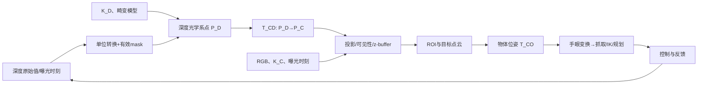
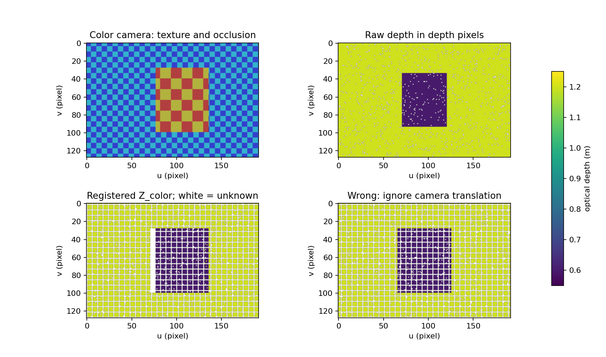
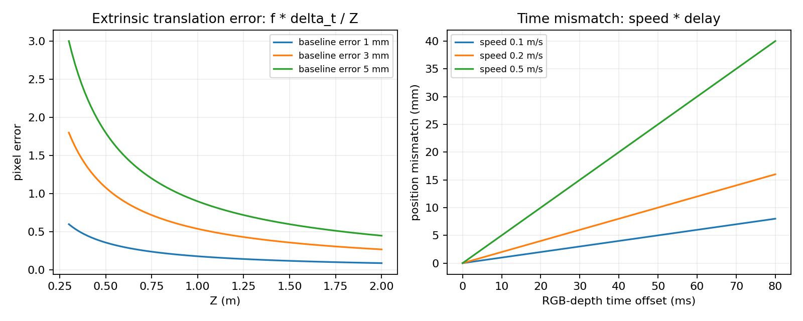

# D50 · 从两张传感器图像到可信的 RGB-D 三维输入

[返回学习入口](../_index.md) ｜ [本周日程](../P3-项目实战-日程.md) ｜ [上一课 D49](../day49/Daily-Learning-Pack.md) ｜ [CPU 实验](demo.py)

**RGB 和 Depth 只有在单位、内参、外参、时间、可见性都明确时，才能组成可靠的三维观测。对齐是一项几何变换，既不替代标定，也不能补出传感器没有看到的表面。**

本课是 P3 / Π-1 / W8-D1，对应 2026-10-24。W6 解决数据协议与基线，W7 研究模型改进与抓取筛选，W8 开始把模块接成可观察、可复现的系统。第一步不急着换模型：先让“杯子的这个像素对应空间哪里”有完整、可检验的答案。下一课才继续检测/分割 ROI 与目标提取。

<details>
<summary>个人学习记录（你的作答与修改记录，自动更新时保留）</summary>

<!-- learner-notes:start -->

- 我实际运行与修改的变量：
- 我的解释、自测答案与未理解问题：
- 需要接入实际项目的接口：

<!-- learner-notes:end -->

</details>

<!-- daily-pack-generated:start -->

## 0. 学习目标与路线

完成本课后，你应能推导深度反投影与跨相机配准，明确 raw depth、轴向深度和欧氏距离的不同；能在裁剪缩放后更新 K，用有效 mask 与 z-buffer 处理无测量和遮挡；能给 RGB-D 数据包写出时间、坐标与标定契约，并用独立实验区分代码正确与标定正确。

| 顺序 | 知识主线 | 需要回答的问题 |
| --- | --- | --- |
| 宏观 | 传感器到闭环 | 输入错误会在哪些后续模块被放大？ |
| 微观一 | 深度单位与成像 | 数值600到底表示600什么？ |
| 微观二 | 跨相机变换 | 同一个物理点在两张图上为何不在同一像素？ |
| 微观三 | 标定与数据变换 | 原始K还能不能用于裁剪后的图？ |
| 工程 | 时间、可见性与接口 | 对齐后有洞应怎样传给位姿或策略？ |
| 动手 | 注入一个外参错误 | 5 mm 外参误差会造成多少像素偏移？ |

## 1. 宏观：RGB-D 是带几何语义的数据包



箭头上的数据不是只有数组。必须知道数组的像素网格、物理单位、坐标原点、时刻和有效区域。若 Depth 数组位于深度相机网格，而 mask 位于 RGB 相机网格，把两者按同一 `(u,v)` 索引相乘，会混合不同射线。

例：杯子深度是 0.60 m，背景是 1.20 m。杯沿只错几个像素，ROI 就可能夹进一排背景点。随后中心估计、表面法向、ICP、抓取宽度都发生变化。检测框 AP 可能几乎不变，机器人目标却已偏移。

| 最小字段 | 示例形状/单位 | 语义 |
| --- | --- | --- |
| RGB | `[Hc,Wc,3]`，uint8或明确归一化 | RGB/BGR顺序、曝光与处理状态 |
| 原始深度 | `[Hd,Wd]`，uint16 | 不能从 dtype 推断每单位代表多少米 |
| metric depth | `[Hd,Wd]`，float，m | 明确是哪个光学系中的 Z |
| valid mask | `[Hd,Wd]`，bool | 无测量与真实近零距离分开 |
| K、distortion | `[3,3]`、系数及模型名 | 对应分辨率、是否已校正 |
| 外参 | `[4,4]` | 例如 $T_{CD}$，把D坐标变成C坐标 |
| 时间 | 两个曝光时刻 + clock domain | 不能用文件保存时间替代 |
| provenance | 标定ID、流配置、处理链 | 才能追溯K、滤波、裁剪从何而来 |

## 2. 微观：从原始深度值到三维点

### 2.1 轴向深度不是到相机的欧氏距离

对已去畸变的针孔相机，像素中心坐标为 $(u,v)$，光学系 x向右、y向下、z向前，内参

$$
K=\begin{bmatrix}f_x&0&c_x\\0&f_y&c_y\\0&0&1\end{bmatrix}.
$$

投影满足 $u=f_xX/Z+c_x$、$v=f_yY/Z+c_y$。如果深度值代表轴向 $Z$，反投影为

$$
P=\begin{bmatrix}X\\Y\\Z\end{bmatrix}
=Z\begin{bmatrix}(u-c_x)/f_x\\(v-c_y)/f_y\\1\end{bmatrix}.
$$

$f_x,f_y,c_x,c_y$ 单位 pixel，$P,Z$ 单位 m。欧氏距离是

$$
\rho=\|P\|=Z\sqrt{1+x_n^2+y_n^2},\qquad
x_n=(u-c_x)/f_x,\ y_n=(v-c_y)/f_y.
$$

假设 $f_x=f_y=600$ px，主点 $(320,240)$，像素 $(440,300)$，$Z=0.60$ m，则 $P=(0.12,0.06,0.60)$ m，$\rho\approx0.6148$ m。把 0.6148 当作 Z 再反投影，会把整条射线上的点向外推。不同传感器可能给轴向深度或量程，接入前必须核对数据定义。

### 2.2 uint16 只是编码，尺度来自传感器与文件契约

原始整数 $d$ 与米制深度的关系为 $Z=s_d d$。若 $s_d=0.001$ m/unit、$d=600$，则 $Z=0.6$ m。换为 $s_d=0.0001$ 时，同一个整数变成 0.06 m。不能把“16位深度”当成“默认毫米”。

本课合成例规定 `depth_scale=0.001`；实际 RealSense 应读取当前设备或录制文件所对应的尺度。官方[投影与深度说明](https://github.com/realsenseai/librealsense/wiki/Projection-in-RealSense-SDK-2.0)介绍像素坐标、光学坐标、深度缩放与投影接口；这里不把教学常数当作硬件默认值。

无测量的 0 值先进入 invalid mask，而不是反投影成相机原点。若用 0 填空洞后计算均值，会把杯子中心拉向相机；若将 NaN 无检查地输入网络，也会传播异常。正确做法是同时传数值与有效性，并定义每个模块如何处理未知。

> [!question] 先算
> 深度单位错大10%，杯子在0.60m处，仅Z方向就偏多少？若再用错误点云拟合一个很漂亮的平面，能证明单位正确吗？

误差为 60 mm。平面拟合能在错误尺度下仍很好，因为统一尺度变换保留平面结构；内部自洽不能代替外部尺度检查。

### 2.3 原始畸变像素不能直接套理想公式

若输入仍有畸变，应先按模型将像素射线恢复到理想归一化坐标，再乘 Z。以常见 Brown 型示意，径向项依赖 $r^2=x_n^2+y_n^2$，切向项依赖 $p_1,p_2$；不同 SDK 的正向/逆向模型和系数顺序可能不同，不能只看“有五个数”就互换。

本实验明确使用无畸变模型。工程中应保存模型名称、系数、原始/校正标志。ROS `CameraInfo` 的 K 对应原始相机内参，P 表达校正后的投影，二者左上角3×3未必相同；已校正图像继续使用原始 K，会再引入系统误差。字段语义可核对 [ROS2 CameraInfo 源定义](https://raw.githubusercontent.com/ros2/common_interfaces/rolling/sensor_msgs/msg/CameraInfo.msg)。

## 3. 微观：跨相机配准是“反投影→刚体变换→再投影”

### 3.1 把方向与单位写进公式

设 D 为深度光学系、C 为彩色光学系，

$$
P_C=R_{CD}P_D+t_{CD},\qquad
\begin{bmatrix}u_C\\v_C\end{bmatrix}
=\begin{bmatrix}f_x^C X_C/Z_C+c_x^C\\f_y^C Y_C/Z_C+c_y^C\end{bmatrix}.
$$

$R_{CD}$ 无单位，$t_{CD}$ 是 m，最终像素是 float。点在相机后方、落出图像范围或原始深度无效时，不应强行夹到边界并当作有效匹配。

本例两相机平行、$t_{CD}=(0.035,0,0)$ m。因此深度相机原点在彩色坐标中位于 x=+0.035m；彩色相机中心在深度坐标中是 −0.035m。这个符号必须从变换定义推出，不能靠“相机在左还是在右”的口头印象猜。

对于中心射线上的 $Z=0.6$ m 点、彩色焦距 180 px，仅基线引起的像素位移为

$$
\Delta u=f_x^C\frac{t_x}{Z}=180\frac{0.035}{0.6}=10.5\ \text{px}.
$$

再考虑两相机焦距不同，非中心像素的映射还会有缩放。直接按同像素取 RGB 与 Depth，不能处理这些变化。

### 3.2 为什么需要 z-buffer

多个深度点可能投影到同一个彩色像素。若都写入，结果取决于遍历顺序。z-buffer 为每个目标像素保留最近的正 $Z_C$：

$$
D_C(u,v)=\min_{i:\operatorname{round}(\pi_C(P_{C,i}))=(u,v)}Z_{C,i}.
$$

空集合表示未知，不能填成“没有障碍”。本脚本用 `np.minimum.at` 对重复像素做归约，初值为正无穷，最后把未命中的位置变为 NaN。普通高级索引赋值遇到重复索引不能直接等价于逐点取最小。

还有两个边界：最近邻取整会产生离散误差；深度相机看不到而彩色相机看得到的区域没有可用三维点，重投影不能创造这些信息。反过来，彩色视角可能有新的遮挡。本例显示不同视点下前景边缘与空洞；真实系统可用可见性判断或带置信度的插值，但必须标出推断值。



左上为彩色相机看到的前景与纹理；右上是深度相机的原始像素网格。左下按外参配准后的位置与彩色视角一致，白色仍表示未知；右下忽略基线后前景错位。规则网格状空洞来自本例点中心投影和不同焦距的采样密度，并不代表真实传感器一定产生相同纹理。

### 3.3 “aligned depth”需要问清数值语义

本例明确输出 **彩色光学系的 $Z_C$**。但一个 SDK 返回“分辨率/像素网格已经对齐的 depth”时，不应未经核对就断言每个数值已被重新计算成目标系 Z。

2026-10-24 核对的 librealsense 通用 `align.cpp` 路径中，深度点用于决定目标像素覆盖范围，而转移数值的代码保留源 uint16 深度并在冲突时取较小值；这与“先算 $P_C$ 再存其第三维”的自定义算法语义不同。其他后端和版本应按实际安装实现核对，不能从一个路径推断所有设备。[官方通用对齐实现](https://raw.githubusercontent.com/realsenseai/librealsense/master/src/proc/align.cpp)

在本课平行轴、$t_z=0$ 的设定下，$Z_C=Z_D$，因此这个差别不影响示例数值；存在旋转或 z 平移时就必须认真处理。需要精确三维点时，稳妥的接口是保留原深度射线与度量 Z，先构建 $P_D$，再用刚体变换得到 $P_C$ 或 $P_B$。

**对齐重排数据，标定估计参数，融合估计状态；三者解决的问题不同。**

## 4. 微观：标定、裁剪和缩放如何共同决定 K

### 4.1 三层标定，三种不同的外部证据

| 层级 | 要估计或读取的量 | 独立检查方式 |
| --- | --- | --- |
| 单相机 | K、畸变、图像分辨率 | 保留标定板姿态上的角点重投影/覆盖范围 |
| RGB与深度 | $T_{CD}$、深度尺度 | 多距离平面、前景边界、已知尺寸与跨视角对应 |
| 相机与机器人 | $T_{BC}$ 或手眼链 | 基座系已知点/不同机械臂姿态下的目标一致性 |

D13 的完整 OpenCV 标定和 D38 的投影检查是前置。今天将它们接入数据流：不是每帧重新标定，而是每帧携带与当前流配置一致的标定版本。改分辨率、ROI、镜头配置或安装位置后，检查是否仍适用。

手眼链例如

$$
T_{BO}(t)=T_{BE}(t)T_{EC}T_{CO}(t)
$$

用于眼在手上场景。$T_{BE}$ 必须对应观测时刻，不能取处理完成时刻的最新关节姿态；否则移动中的机械臂会把延迟误差混入“手眼不准”。固定相机则使用另一种链，不能直接套这一公式。

### 4.2 先裁剪再缩放，要同步更新主点

采用像素中心约定，原像素 $u$，裁剪起点 $x_0$，缩放倍率 $s_x$：

$$
u'=s_x(u-x_0+0.5)-0.5,
$$

因此

$$
f_x'=s_x f_x,\qquad c_x'=s_x(c_x-x_0+0.5)-0.5.
$$

v 方向同理。若所用库采用另一种坐标映射约定，应按实际采样公式推导；半像素项不是在所有 API 中都原样出现的常数。畸变参数定义在归一化坐标时通常不因简单缩放改变，但其使用必须匹配新 K 与处理后的图像；已去畸变图不能再次按原始畸变模型处理。

本例 $f_x=150,c_x=95.5$，裁掉左侧20像素、上侧10像素，再缩小至一半，得到 $f_x'=75,c_x'=37.5,c_y'=26.5$。像素 $(110,70)$ 变为 $(44.75,29.75)$；新旧归一化射线相同。若仍使用旧 K，0.6m深度处该点的三维误差约 **306.663mm**。大误差来自图像坐标整体换了，不是求解器能力不够。

> [!warning] 重投影闭环可能“完美地错”
> 用同一个错误 K 做反投影再投影，像素仍能精确回来。这个测试能检查代码是否实现了互逆关系，却不能证明 K 是真实相机参数。必须加入独立已知尺寸、保留角点或空间点作外部约束。

## 5. 工程：时间差、坐标轴与未知区域一起进入误差预算

### 5.1 同一帧号不保证同一物理时刻

若目标相对相机以速度 $v$ 移动，RGB 与 Depth 曝光时间相差 $\Delta t$，一阶位置错配量级为

$$
\|\delta p\|\approx\|v\|\,|\Delta t|.
$$

$v=0.2$m/s、$\Delta t=30$ms 时是 6mm。角速度还会通过距离和偏移产生额外误差。需要记录硬件/系统时间域、曝光时刻、帧丢失、队列和插值策略；ApproximateTime 配对只是在时间戳上寻找近邻，不会自动消除真实运动或不同时钟的偏移。



左图给平行轴小平移误差的 $f\delta t_x/Z$ 像素量级，近处更敏感；右图给速度乘时间差的空间量级。两图回答不同问题：前者是几何参数偏差，后者是观测不同步。即使优化外参，也不能把动态时间差稳定吸收进一个固定外参。

### 5.2 ROS坐标与光学坐标要明确转换

ROS 常见机体坐标约定为 x前、y左、z上；光学系为 z前、x右、y下，均为右手系。不要因为都叫 `camera_link` 就把点云当作同一轴定义。用明确的 `*_optical_frame` 与变换树记录关系，并在可视化中画轴。[ROS REP-103](https://raw.githubusercontent.com/ros-infrastructure/rep/master/rep-0103.rst)

建议把下游消息接口定义为：

```text
RGBDFrame {
  color, raw_depth, depth_m, valid_mask
  depth_frame_id, color_frame_id, calibration_id
  K_depth, K_color, distortion_model_and_coeffs
  T_color_depth, depth_scale_m_per_unit
  exposure_time_depth, exposure_time_color, clock_domain
  roi, resize_mapping, processing_history
}
```

对 ROS/RealSense 接入，先用已有录制数据或离线数组验证上述契约。官方[Python示例目录](https://github.com/realsenseai/librealsense/tree/master/wrappers/python/examples)包含对齐、点云和录制读取示例，可核对当前接口；本次没有安装或运行 librealsense、没有连接相机或机器人，不能把合成实验报告为设备验证。

### 5.3 给位姿、VLA与世界模型的输入不能悄悄改变含义

位姿模块接收到的点应标明 camera/base 坐标及单位；若点云被归一化成单位球，输出还原必须保留尺度和平移。VLA 使用 RGB crop 时，语言目标与动作参考系仍需匹配；模型训练使用的深度缺失编码不能在部署时随意改成 0 或均值。

世界模型若将不同步的 $(o_t,a_t,o_{t+1})$ 当成同步转移，会学到带延迟的关系；缩放或外参随批次漂移则会造成伪动力学。D41 的时间契约因此不只是日志规范，而是学习目标的定义。未知区域也应该作为 mask 或置信度传递，不能把补洞预测当作实际测量再用于独立验收。

## 6. 动手：先预测，再只改一项外参

本课脚本仅依赖 Python、NumPy、Matplotlib，CPU生成两平面场景、原始整数深度、彩色图像和稀疏未知值。无需硬件或下载数据。进入本课目录运行：

```bash
python demo.py
python demo.py --baseline-error-mm 5 --output ../../_assets/3d_learning/day50/baseline_error5.json
```

先预测：$f=180$px、$Z=0.6$m，x外参偏5mm，前景像素错多少？对背景1.2m又是多少？然后检查 [默认结果](../../_assets/3d_learning/day50/results.json)、[5 mm外参偏差](../../_assets/3d_learning/day50/baseline_error5.json)、可复用的合成数据包 (not exported: excluded by publication policy)。NPZ中包含原始深度、颜色、valid、K、外参、尺度与时间戳，可作为 D51 ROI 提取的离线输入。

### 6.1 实测记录

2026-10-24，Python 3.11.15 / NumPy 1.26.4 / Matplotlib 3.10.9，CPU、seed=50。图像128×192，深度焦距150px、彩色焦距180px，平行光学轴、35mm x基线，前景0.6m/背景1.2m。约3.918%的源深度无效；训练、真实交互、硬件连接均为0。场景静态时刻t=0，动态时间错配只做解析预算，没有伪造动态设备采样。

| 检查 | 实测值 | 能说明什么 |
| --- | ---: | --- |
| 源有效深度像素 | 23613 /24576 | 只反投影有效测量 |
| 目标网格有值像素 | 16086 /24576 | 点投影不保证每个目标像素有测量 |
| 直接用相同像素索引的前景均错配 | 11.093 px | 同尺寸图像也未必同射线 |
| 正确连续几何映射误差 | 0 px | 合成真值与实现一致 |
| 反投影→再投影最大残差 | $1.42\times10^{-14}$px | 互逆实现的数值检查 |
| 忽略外参时目标深度不一致比例 | 6.025%（在其有值像素上） | 前景边界被放错位置 |
| 正确外参时同类不一致比例 | 0.0435%（在其有值像素上） | 取整/边缘离散仍可能残留 |
| 外参x偏5mm：前景投影误差 | 1.500 px | 与 $180×0.005/0.6$ 一致 |

深度不一致定义为与独立彩色视角几何深度差超过0.01m；不同方案有效区域不同，因此这里只作注册误差诊断，不能把两个百分比当作完整任务召回。没有值的区域必须另外报告覆盖率。连续映射误差为零也不意味着栅格化后的所有像素都精确对齐。

一次核心数据生成与计算约0.005s（不含绘图）；这是小数组的本机运行记录，不是实际相机或ROS端到端延迟。外参偏5mm后投影误差变为1.5px，符合先算结果；原始深度输入完全相同，改变的是几何参数。

再选择一个变量修改：深度尺度乘1.1，或缺失概率从0.04改成0.20，或只改焦距。写清它影响“坐标位置”“观测覆盖”还是二者。不要在不更新元数据时修改相机图像尺寸。

### 6.2 主流程对应的实现

```python
valid = raw > 0
depth_m = raw.astype(np.float64) * depth_scale
points_D = deproject(depth_m, K_D)
points_C = points_D[valid] @ R_CD.T + t_CD
# 随后投影、剔除视野外点、按目标像素取最小正Z_C。
```

这段使用行向量存点，所以写 `@ R_CD.T`；公式使用列向量，因此是 $R_{CD}P_D$。二者等价，不能把转置看作变换方向反了。完整实验为平行轴，使用R=I，未实现一般畸变或点面覆盖插值。

### 6.3 完整最小脚本

> [!note]- 完整可复制代码（与同目录 demo.py 一致）
>
> ```python
> """Day50: metric depth, cross-camera registration and calibration failure injection."""
> import argparse
> import json
> import platform
> from pathlib import Path
> import time
> import numpy as np
> import matplotlib
> matplotlib.use("Agg")
> import matplotlib.pyplot as plt
>
> H, W = 128, 192
> KD = np.array([[150., 0, 95.5], [0, 150., 63.5], [0, 0, 1]])
> KC = np.array([[180., 0, 95.5], [0, 180., 63.5], [0, 0, 1]])
> T_CD = np.array([0.035, 0., 0.])  # p_color = p_depth + T_CD, parallel optical axes
>
>
> def render(k, camera_center):
>     v, u = np.indices((H, W))
>     rays = np.stack([(u-k[0, 2])/k[0, 0], (v-k[1, 2])/k[1, 1], np.ones_like(u)], -1)
>     front = camera_center + .6*rays
>     fg = (np.abs(front[..., 0]) < .10) & (np.abs(front[..., 1]) < .12)
>     depth = np.where(fg, .6, 1.2)
>     points = camera_center + depth[..., None]*rays
>     checker = ((np.floor((points[..., 0]+1)*25) + np.floor((points[..., 1]+1)*25)) % 2)
>     rgb = np.stack([.2+.5*fg, .25+.45*checker, .8-.55*fg], -1)
>     return depth, rgb, fg
>
>
> def deproject(depth, k):
>     v, u = np.indices(depth.shape)
>     return np.stack([(u-k[0, 2])*depth/k[0, 0],
>                      (v-k[1, 2])*depth/k[1, 1], depth], -1)
>
>
> def project(points, k):
>     z = points[..., 2]
>     return np.stack([k[0, 0]*points[..., 0]/z+k[0, 2],
>                      k[1, 1]*points[..., 1]/z+k[1, 2]], -1)
>
>
> def register(points_d, valid, translation):
>     pc = points_d[valid] + translation
>     uv_float = project(pc, KC)
>     uv = np.rint(uv_float).astype(int)
>     inside = (pc[:, 2] > 0) & (uv[:, 0] >= 0) & (uv[:, 0] < W) & (uv[:, 1] >= 0) & (uv[:, 1] < H)
>     pc, uv = pc[inside], uv[inside]
>     # Explicit custom output: Z in the COLOR optical frame, not a copied raw uint16.
>     aligned = np.full(H*W, np.inf)
>     np.minimum.at(aligned, uv[:, 1]*W+uv[:, 0], pc[:, 2])
>     aligned = aligned.reshape(H, W)
>     aligned[~np.isfinite(aligned)] = np.nan
>     return aligned
>
>
> def main():
>     ap = argparse.ArgumentParser()
>     ap.add_argument("--seed", type=int, default=50)
>     ap.add_argument("--baseline-error-mm", type=float, default=0)
>     ap.add_argument("--output", type=Path, default=Path(__file__).resolve().parents[2]/"_assets/3d_learning/day50/results.json")
>     args = ap.parse_args()
>     started = time.perf_counter()
>     rng = np.random.default_rng(args.seed)
>     z_d, _, fg_d = render(KD, np.zeros(3))
>     # Camera centre C in D is -t_CD because R_CD is identity.
>     z_c, color, fg_c = render(KC, -T_CD)
>     scale = .001  # metres per raw unit; actual device value must be queried
>     raw = np.rint(z_d/scale).astype(np.uint16)
>     missing = rng.random((H, W)) < .04
>     raw[missing] = 0
>     valid = raw > 0
>     metric = raw.astype(np.float64)*scale
>     points = deproject(metric, KD)
>     estimated_t = T_CD + [args.baseline_error_mm/1000, 0, 0]
>     registered = register(points, valid, estimated_t)
>     wrong_registered = register(points, valid, np.zeros(3))
>     overlap = np.isfinite(registered)
>     foreground = valid & fg_d
>     correct_uv = project(points[foreground]+T_CD, KC)
>     bad_uv = project(points[foreground]+estimated_t, KC)
>     naive_uv = np.column_stack(np.nonzero(foreground)[::-1])
>     # Same-camera mathematical round trip: useful code check, not external calibration evidence.
>     original_uv = np.column_stack(np.nonzero(valid)[::-1])
>     roundtrip = project(points[valid], KD)
>     assert np.max(np.abs(roundtrip-original_uv)) < 1e-10
>     assert np.all(metric[valid] > 0) and not np.any(valid & (raw == 0))
>     # Crop and resize with pixel-centre convention u' = s*(u-x0+0.5)-0.5.
>     uv = np.array([[110., 70.]])
>     cropped = .5*(uv-[20, 10]+.5)-.5
>     k_new = KD.copy(); k_new[0, 0] *= .5; k_new[1, 1] *= .5
>     k_new[:2, 2] = .5*(KD[:2, 2]-[20, 10]+.5)-.5
>     ray_old = np.r_[((uv[0]-KD[:2, 2])/KD.diagonal()[:2]), 1.]
>     ray_new = np.r_[((cropped[0]-k_new[:2, 2])/k_new.diagonal()[:2]), 1.]
>     assert np.allclose(ray_old, ray_new)
>     bad_ray = np.r_[((cropped[0]-KD[:2, 2])/KD.diagonal()[:2]), 1.]
>     report = dict(python=platform.python_version(), numpy=np.__version__,
>         matplotlib=matplotlib.__version__, device="CPU", seed=args.seed,
>         data="synthetic two-plane RGB-D with two calibrated parallel-axis cameras",
>         frame="optical x right, y down, z forward; p_C = p_D + t_CD",
>         unit="m and pixel", depth_scale_m_per_unit=scale,
>         timestamp="static synthetic t=0; motion budget evaluated analytically",
>         raw_shape=list(raw.shape), valid_depth_pixels=int(valid.sum()),
>         aligned_valid_pixels=int(overlap.sum()), total_pixels=H*W,
>         missing_fraction=float(missing.mean()), baseline_error_mm=args.baseline_error_mm,
>         foreground_registration_error_px=float(np.linalg.norm(bad_uv-correct_uv, axis=1).mean()),
>         naive_same_pixel_error_px=float(np.linalg.norm(naive_uv-correct_uv, axis=1).mean()),
>         registered_depth_disagreement_fraction=float((np.abs(registered[overlap]-z_c[overlap])>.01).mean()),
>         ignored_extrinsic_disagreement_fraction=float((np.abs(wrong_registered[np.isfinite(wrong_registered)]-
>             z_c[np.isfinite(wrong_registered)])>.01).mean()),
>         roundtrip_max_error_px=float(np.abs(roundtrip-original_uv).max()),
>         crop_resize_correct_ray_error=float(np.linalg.norm(ray_old-ray_new)),
>         crop_resize_old_K_point_error_mm=float(600*np.linalg.norm(ray_old-bad_ray)),
>         depth_scale_10pct_error_at_600mm=60.,
>         motion_error_mm_at_0_2mps_30ms=6.,
>         training_samples=0, hardware_connections=0, real_robot_interactions=0,
>         elapsed_s=time.perf_counter()-started)
>     args.output.parent.mkdir(parents=True, exist_ok=True)
>     args.output.write_text(json.dumps(report, indent=2)+"\n")
>     np.savez_compressed(args.output.with_suffix(".npz"), raw_depth=raw, color=color,
>         valid=valid, K_depth=KD, K_color=KC, t_color_depth=T_CD, registered_z_color=registered,
>         depth_scale=scale, timestamp_depth_s=0., timestamp_color_s=0.)
>     print(json.dumps(report, indent=2))
>     if args.output.stem != "results":
>         return
>     asset = Path(__file__).resolve().parents[2]/"_assets/3d_learning/day50"
>     asset.mkdir(parents=True, exist_ok=True)
>     fig, axes = plt.subplots(2, 2, figsize=(11, 6.5))
>     axes[0, 0].imshow(color); axes[0, 0].set_title("Color camera: texture and occlusion")
>     for ax, img, title in [(axes[0, 1], np.where(valid, metric, np.nan), "Raw depth in depth pixels"),
>             (axes[1, 0], registered, "Registered Z_color; white = unknown"),
>             (axes[1, 1], wrong_registered, "Wrong: ignore camera translation")]:
>         im = ax.imshow(img, vmin=.55, vmax=1.25, cmap="viridis"); ax.set_title(title)
>     for ax in axes.flat: ax.set(xlabel="u (pixel)", ylabel="v (pixel)")
>     fig.colorbar(im, cax=fig.add_axes([.91, .2, .02, .6]), label="optical depth (m)")
>     fig.subplots_adjust(wspace=.3, hspace=.4, right=.86)
>     fig.savefig(asset/"rgbd_registration.png", dpi=160); plt.close(fig)
>     fig, axes = plt.subplots(1, 2, figsize=(10, 4))
>     depths = np.linspace(.3, 2, 100)
>     for error_mm in [1, 3, 5]:
>         axes[0].plot(depths, KC[0, 0]*error_mm/1000/depths, label=f"baseline error {error_mm} mm")
>     axes[0].set(xlabel="Z (m)", ylabel="pixel error", title="Extrinsic translation error: f * delta_t / Z")
>     dt = np.arange(0, 81, 5)
>     for speed in [.1, .2, .5]: axes[1].plot(dt, speed*dt, label=f"speed {speed} m/s")
>     axes[1].set(xlabel="RGB-depth time offset (ms)", ylabel="position mismatch (mm)", title="Time mismatch: speed * delay")
>     for ax in axes: ax.grid(alpha=.2); ax.legend(fontsize=8)
>     fig.tight_layout(); fig.savefig(asset/"calibration_budgets.png", dpi=160); plt.close(fig)
>
>
> if __name__ == "__main__":
>     main()
> ```

## 7. 回到宏观：输入验收先于模型验收

如果杯子在点云中的宽度错了，先检查单位、深度尺度和内参；如果RGB边界与深度轮廓错开，检查外参、时间与可见性；如果camera系中正常而base系目标漂移，检查手眼链和对应时刻。只有这些基础量可信，位姿网络的误差分析和抓取算法改进才有可解释的输入。

三句话总结：每个深度值必须绑定单位与射线。跨相机对应必须经过三维几何和可见性处理。标定正确、代码自洽、观测同步是三件需要不同证据支持的事。

四个重点及理由：**轴向深度与尺度**决定点的物理位置；**跨相机变换与z-buffer**决定颜色和几何是否属于同一表面；**裁剪缩放后的K**保证图像处理没有悄悄改变射线；**时间与有效mask**防止把动态错配和未知区域当作可靠观测。三个边界：对齐≠标定、内部往返≠外部准确、补洞≠实测。

产出物：脚本、两组结果、合成数据包、两图，以及一份你能解释每个字段的 RGB-D 接入契约。下一课直接用这个离线数据包连接 ROI 与点云提取；实际设备与机器人验证仍需独立开展，未按教材生成状态记为已完成。

## 8. 自测

1. uint16深度值600，在尺度0.001m/unit与0.0001m/unit下分别代表多少米？0值怎样处理？
2. $f_x=f_y=600$、主点(320,240)、像素(440,300)、Z=0.6m，计算点坐标与欧氏距离。
3. 写出深度像素到彩色像素的三步映射，并说明 $T_{CD}$ 的方向。
4. 平行轴、fx=180px、Z=0.6m，基线误差5mm导致多少像素误差？Z翻倍如何变化？
5. 为什么多个点落入同一目标像素需要z-buffer？为什么空洞不能直接当作自由空间？
6. 本例裁剪起点(20,10)，缩放0.5，原K的fx=fy=150、cx=95.5、cy=63.5，求新K的四个参数。
7. 使用同一个K反投影与投影，往返残差为零，为什么仍不能证明标定正确？给一种独立检查。
8. 目标相对速度0.2m/s、RGB-D时间差30ms，位置错配量级多少？更准确外参能普遍消除它吗？
9. 对齐后的深度数组已经与RGB同尺寸，可以无条件断言其数值是彩色系Z吗？工程上如何避免语义混淆？
10. 若位姿网络换了一套RGB裁剪，但动作头仍用旧标定还原坐标，可能怎样失败？应保存什么变换信息？

## 9. 未理解问题与次日衔接

若畸变与K仍混淆，回查 D12–13 的标定实验并分别画原始/校正网格；若变换方向容易写反，回查 D8/D38，用一个原点验证平移符号；若时间域与动作生效区间不清，回查 D41。滚动快门、动态插值、深度滤波的实际代价在 W8 闭环测试中继续验证，不由今天静态图像推断。

下一课 D51 / W8-D2 保持原计划：检测/分割 ROI 与目标提取。第一步读取 `results.npz`，明确 mask 属于哪个像素网格，再把目标点云送往位姿模块。

源码阅读任务：查看上文官方 `align.cpp` 的 `align_images` 与 `align_z_to_other`，分清“用于找目标像素的几何量”和“实际写入输出的深度值”；再对照 ROS CameraInfo 的 K、R、P 与 header 注释，写一张原始图/校正图/裁剪图的参数对应表。固定到自己安装版本后再作设备接口验证。

> [!note]- 自测答案与判分标准
> 每题0/1/2分：错误或空白0；核心结论正确1；有计算、条件或工程反例2。建议≥15/20且第3、5、7、9题无零分。没有你的作答，不记录个人通过。
> 1. 0.6m与0.06m；0按该数据契约作为无测量，保留mask，不当成相机原点观测。
> 2. (0.12,0.06,0.60)m；距离约0.6148m。轴向Z与欧氏距离不同。
> 3. D像素反投影得到P_D，P_C=R_CD P_D+t_CD，再以K_C及正确畸变模型投影；T_CD从D到C。
> 4. 1.5px；Z=1.2m时0.75px，前提是此平行轴小平移模型。
> 5. 保留目标视角最近可见表面，避免遍历顺序决定深度；空洞可能由缺测、遮挡或采样造成，不能证明无障碍。
> 6. fx'=fy'=75，cx'=37.5，cy'=26.5，采用本课像素中心映射约定。
> 7. 错误参数也可互逆；需保留标定板角点、已知长度或独立空间点等外部证据。
> 8. 6mm；动态偏差依赖速度和时间，固定外参一般不能消除，应处理时间同步或运动补偿。
> 9. 不能；像素网格和深度标量语义分开核对。保留原始射线/尺度构建P_D，再变换成目标系点；核对实际SDK后端。
> 10. 射线、目标位置或动作尺度偏移；保存crop/resize映射、新K、原图坐标对应与动作参考系，做独立端到端几何检查。

<!-- daily-pack-generated:end -->
