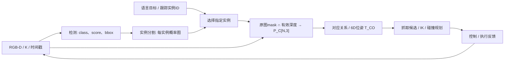
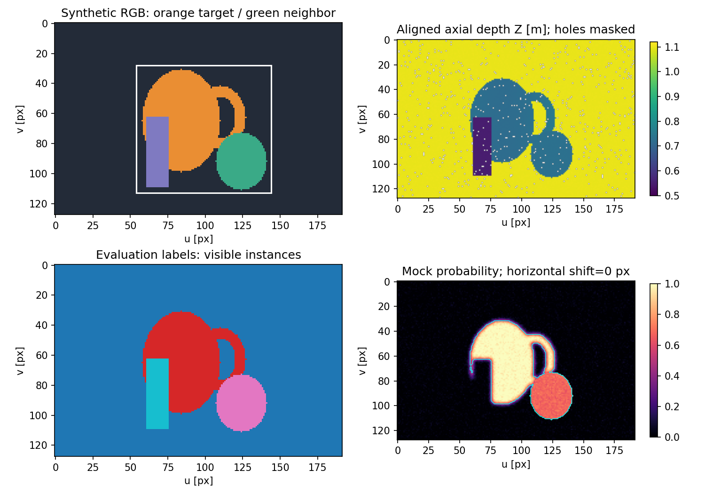
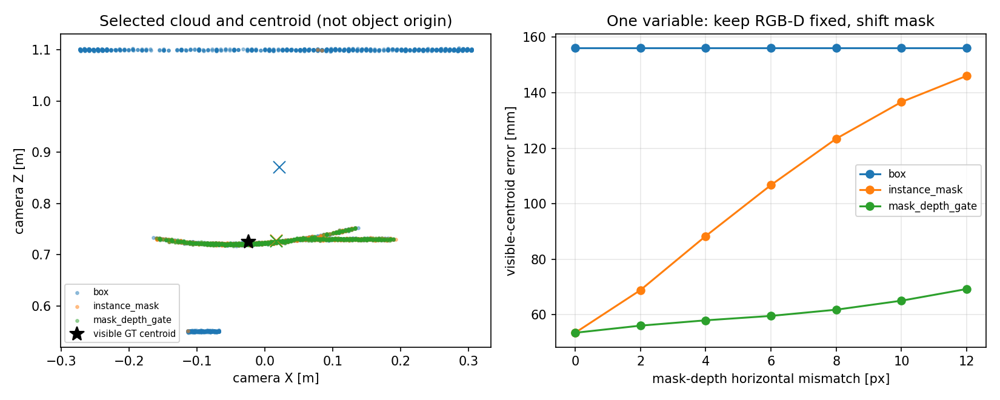

# D51 · 从检测框到属于同一物体的三维观测

[返回学习入口](../_index.md) ｜ [本周日程](../P3-项目实战-日程.md) ｜ [上一课 D50](../day50/Daily-Learning-Pack.md) ｜ [CPU 实验](demo.py)

**检测框回答“去哪里找”，实例分割回答“哪些像素属于这个实例”，RGB-D 几何回答“这些像素在空间哪里”。三者只有使用同一图像坐标、同一时刻和明确的实例身份，才能交付可信的目标点云。**

本课是 P3 / Π-1 / W8-D2，保留原课程日期 2026-10-25，于 2026-10-29 补写和验证。上一课建立带内外参、深度单位和时间语义的 RGB-D 数据包；今天让机械臂从桌面上两只杯子、一个遮挡物中选出指定杯子的观测。下一课使用这些观测求物体位姿。这里的点云仍只是可见表面，不能直接当作完整模型、物体中心或抓取位姿。

<details>
<summary>个人学习记录（自动更新时保留）</summary>

<!-- learner-notes:start -->

- 我对实验的预测与实际结果：
- 我修改的变量、解释与截图：
- 我的自测作答与未理解问题：

<!-- learner-notes:end -->

</details>

<!-- daily-pack-generated:start -->

## 0. 学习目标与路线

学完后，你应能解释检测和实例分割分别学习什么；推导 ROI 坐标、双线性采样和反投影；把 RGB-D、实例 mask、有效深度合成一个可追溯的目标点云；用保留率、污染率和下游几何偏差判断过滤是否有帮助；指出何时应拒绝输出，而不是强行给规划器一个“中心点”。

| 顺序 | 知识主线 | 需要回答的问题 |
| --- | --- | --- |
| 宏观 | 目标选择与闭环 | “杯子”是哪一个实例，输出交给谁？ |
| 微观一 | 检测、分割与监督 | 类别、框、mask 为什么不能互相替代？ |
| 微观二 | ROI 与采样 | 特征图坐标怎样回到原图像素？ |
| 微观三 | 目标点云 | 哪些像素可以反投影，哪些必须拒绝？ |
| 工程 | 污染、遮挡与身份 | 清理后点少了，是否就更正确？ |
| 动手 | 单变量错位实验 | 相同 RGB-D 中横移 mask 会怎样？ |

## 1. 宏观：实例选择是几何模块的入口



这张图传递的是不同语义的量：`class` 是类别，`instance_id` 是当前观测或跟踪中的实体编号，`P_C` 是相机坐标下的米制三维点，`T_CO` 是物体坐标到相机坐标的变换。不要把它们统一叫“识别结果”。若桌上有两只杯子，类别相同不代表任务目标相同。语言“左边那只杯子”还需要明确左边相对于相机、机器人还是人；实例分割本身不保证跨帧身份保持。

一个合理的模块契约是：输入一帧经过注册的 RGB、轴向深度 Z、颜色相机 K、时间戳、实例候选和选择条件；输出点云、对应原图像素、实例 ID、保留点数、污染风险标记和失败原因。**保留像素索引十分重要**：下一课既可能用 RGB 特征预测 2D–3D 对应，也可能用深度构造 3D–3D 对应；丢掉对应关系以后，点集“看着像杯子”并不够。

## 2. 微观：框、类别和实例 mask 各自在学习什么

### 2.1 三种输出的区别

目标检测通常给一组框 $b_i=(x_1,y_1,x_2,y_2)$、类别 $c_i$ 和分数 $s_i$。框是紧凑的空间提案：矩形里允许有背景、遮挡物和其他实例。语义分割给每像素类别，同类物体接触时仍可能属于同一类别区域。实例分割则给每个对象独立的 mask $M_i(u,v)$；类别相同的两个杯子仍有两个实例。

| 输出 | 一帧常见 shape | 训练监督 | 用于抓杯子的作用 |
| --- | --- | --- | --- |
| boxes | $[N,4]$ | GT 框及匹配关系 | 限制搜索区域 |
| class logits | $[N,C+1]$ 或其他背景约定 | 类别标签 | 区分杯子与其他类 |
| mask logits | $[N,1,H_m,W_m]$ 或 $[N,C,H_m,W_m]$ | 实例像素标签 | 隔离选中实例可见区域 |
| instance identity | 数据结构中的 ID | 跟踪关联/任务选择 | 保持“同一只杯子”的引用 |

这些只是典型接口，不能根据 shape 猜模型的全部语义。特别是 `[N,C,Hm,Wm]` 要选择对应类别的通道；若把它按类别 softmax 后当作每实例的空间竞争，会改变原本的训练假设。

### 2.2 从检测机制连接到 mask 分支

回忆 CenterNet：特征图上预测中心热图、局部偏移和尺寸，由中心与尺寸解码框。热图上的局部峰值筛选与传统基于框 IoU 的 NMS 是不同操作。框可以由一个中心得到，但杯把的空洞和遮挡边缘不能只用框宽高表达。参见原论文 [Objects as Points §4、§5 inference](https://arxiv.org/html/1904.07850v2)。本课不重复训练它，重点是接口后面为什么还需要像素归属。

Mask R-CNN 提供另一条代表路径：骨干/FPN 特征 → 候选框 → RoIAlign → 分类与框回归、并行的 mask 预测。原方法对正 RoI 的真实类别通道计算二元 mask 损失，把类别选择和空间分割解耦。RoIAlign 通过避免边界取整来保持位置对应。精读 [Mask R-CNN §3、RoIAlign 与 §4.2 独立 mask 消融](https://arxiv.org/html/1703.06870v3)，关注“为什么预测 mask 对空间对齐比分类更敏感”。

### 2.3 损失函数和工程指标不是同一个量

对像素标签 $y\in\{0,1\}$、前景概率 $p=\sigma(z)$，二元交叉熵为

$$\ell_{\mathrm{BCE}}=-y\log p-(1-y)\log(1-p).$$

$z$ 是无单位 logit，$\sigma$ 是 sigmoid。来自伯努利似然的负对数：当标签为前景且 $p=0.9$ 时损失约 $0.105$；若误给 $p=0.1$ 则约 $2.303$。同一个像素的损失很大，不自动意味着三维抓取误差大；位于杯把边缘、携带方向信息的少数像素，可能比杯身中部大量像素更影响姿态。

常见区域损失 Dice 可写作

$$\ell_{\rm Dice}=1-\frac{2\sum_jp_jy_j+\epsilon}{\sum_jp_j+\sum_jy_j+\epsilon}.$$

它把区域整体重叠纳入目标，但并不保证概率校准，也不保证被遮挡部分的几何真实。上式是使用概率和的一个明确版本，其他实现可能用平方和，比较前必须核对。训练时是连续概率，提点时阈值变成二值决定；阈值在验证集上选择，不用测试 GT 调到最优再报结果。

> [!question] 先判断
> 两个 mask 的 IoU 都是 0.9，一个多出远背景，一个漏掉杯身内部少量像素。它们给三维点云造成的误差一定相同吗？想一想多出的点深度为 1.1 m、杯子为 0.72 m 时，均值会被拉向哪里。

检测分数也不能直接解释为“抓取成功概率”。分数可能结合类别和目标存在性，概率校准要另行验证；动作成功还依赖位姿、夹爪宽度、碰撞、摩擦和控制。

## 3. 微观：ROI 是坐标变换，不只是数组切片

### 3.1 原图、网络输入、特征图、RoI 四套坐标

假设原图像素为 $(u,v)$，先裁剪左上角 $(u_0,v_0)$，再按 $(s_x,s_y)$ 缩放。采用连续几何坐标约定时

$$u'=s_x(u-u_0),\quad v'=s_y(v-v_0),\quad K'=AK,$$

$$A=\begin{bmatrix}s_x&0&-s_xu_0\\0&s_y&-s_yv_0\\0&0&1\end{bmatrix}.$$

这是投影 $\tilde p\sim KX_C$ 左乘图像仿射变换的结果。若框来自 letterbox 输入，还要先减 padding 再除缩放。实现库使用像素中心时可能是 $u'=s_x(u-u_0+0.5)-0.5$；这时平移项也应按该约定调整。不要把一种几何公式直接混用另一种 resize 的采样坐标。

手算：$f_x=170$ px、$c_x=96$ px；裁掉左边 54 px、等比例放大 2 倍，则在上述连续约定下 $f'_x=340$ px，$c'_x=84$ px。原像素 $u=100$ 变成 $u'=92$。深度 $Z=0.72$ m 时，两种坐标算出的 $X$ 相同：

$$X=(100-96)0.72/170=(92-84)0.72/340\approx0.01694\,\mathrm m.$$

本课脚本保留**全图像素坐标**做反投影，不裁剪 K，因此不需要改 K。若你改成 `depth[y0:y1,x0:x1]`，必须把局部索引加回偏移或更新 K，不能两者都做。

### 3.2 为什么 RoIAlign 要用连续采样

骨干步幅为 $s$ 时，原图位置映射到特征图约为 $(u/s,v/s)$，还要服从该模型具体的中心偏移约定。把 ROI 边界取整，会把小物体细节移动一个或多个特征位置。若步幅 16，错一个特征格对应原图 16 px，分类可能仍对，杯把却可能被移走。

双线性插值用周围四个格点恢复连续位置：

$$f(x,y)=(1-a)(1-b)f_{00}+a(1-b)f_{10}+(1-a)bf_{01}+abf_{11},$$

其中 $a,b$ 是局部小数偏移，范围 $[0,1]$。取四格值 $f_{00}=1,f_{10}=2,f_{01}=3,f_{11}=4$，$a=0.25,b=0.5$，得到 $2.25$。RoIAlign 在每个 bin 内采样后聚合，输出固定尺寸特征；固定的 mask 分辨率最后还要回贴到原框/原图。

```text
原图 [H,W,3] --预处理变换 A--> 网络图 --骨干步幅--> 特征图 [C,Hf,Wf]
        ↑                                                        |
        | 逆 A + mask 回贴                  RoIAlign -> [N,C,h,w]
        +---------------- mask [N,H,W] <----- mask head ----------+
```

该图回答“为什么不能把 $28\times28$ 的 mask 直接与 $128\times192$ 深度做索引”。mask 值的双线性上采样通常可以保持软边界，再阈值化；对已经离散的类别 ID 图做双线性插值则会产生无意义的类别数字。

## 4. 微观：从实例像素得到可追溯点云

### 4.1 三个条件取交集

选中实例 $i$ 后，定义有效集合

$$\Omega_i=\{(u,v):M_i(u,v)\ge\tau,\;Z(u,v)>0,\;Z\text{有限且处于量程}\}.$$

必要时再与框相交，但框只限制空间，不证明身份。`0` 深度是缺测，不是距离相机零米的物体。对注册到颜色图的轴向深度与对应 K：

$$X_C=ZK^{-1}[u,v,1]^T=\left[(u-c_x)Z/f_x,(v-c_y)Z/f_y,Z\right]^T.$$

输入 `depth[H,W]` 米、`mask[H,W]` bool、`K[3,3]`；得到 `uv[N,2]` 像素和 `points[N,3]` 米。若网络只接受固定 N，可以随机/最远点采样并保存采样索引；不足 N 的补点必须提供有效 mask，不能把填充零当成真实点参加均值或注意力。

以 $u=120,v=80,Z=0.72$、$K$ 使用本课数值，点为 $(0.10165,0.06776,0.72)$ m。这里相机 $+Y$ 向下，因此图像下方对应正 Y；机器人基座常用另一套方向，后续要乘真实外参，不能只改坐标轴标签。

### 4.2 为什么形态学和深度过滤有边界

深度门控是从观测估计一个前景深度 $\hat Z$，接受 $|Z-\hat Z|<\delta$。本实验从高概率像素的有效深度取中位数，$\delta=0.035$ m。它可排除明显远背景；若邻物体也在 0.73 m，目标在 0.72 m，就无法仅凭深度区分身份。若高概率区域被近处遮挡物占据，中位数甚至可能选错前景。

腐蚀能减轻边界混合像素，也可能消灭细杯把；最大连通分量会去掉碎噪声，也可能丢掉被遮挡分成两段的同一目标；统计离群点滤波会删远点，也可能抹掉稀疏的细长结构。**每个过滤条件都在引入结构假设**，应保留过滤前后的数量、原因和目标几何变化。

> [!warning] 可见点均值不是物体中心
> 设杯子只有面向相机的半侧可见，点云均值会偏向前表面。即便 mask 完全正确、深度完全无噪声，这个均值也不等于 CAD/NOCS 定义的物体坐标原点。本课用“可见 GT 点云均值”衡量提取偏差，只评估提取模块；下一课才评估物体平移 $t$。

## 5. 工程：同时报告保留率、污染率和下游偏差

定义可见目标且有有效深度的 GT 像素集合 $G$，提取集合 $S$：

$$\mathrm{retention}=\frac{|S\cap G|}{|G|},\qquad
\mathrm{contamination}=\frac{|S\setminus G|}{|S|}.$$

这分别回答漏掉多少目标、混进多少非目标。若 $S$ 为空，污染率应记为无定义并报告拒绝输出，不能用“0% 污染”给空结果奖励。两者也不等于标准 mask AP，后者涉及多个实例、分数排序、IoU 阈值和匹配协议。

提取对下游的影响可再用

$$e_{\rm centroid}=\|\operatorname{mean}(P_S)-\operatorname{mean}(P_G)\|_2$$

表示，单位米。本课图表改用毫米，GT 只参与评估；这不是训练目标，也不是抓取成功指标。三维误差会受错点深度影响，因而相同的 mask IoU 不保证相同的空间误差。

真实系统至少区分四类错误：目标选择错（选了另一只杯子）、mask 错（目标带了邻物体）、注册错（正确 mask 索引到另一表面）、深度错（透明/反光/量程/缺测）。它们的排查入口分别是任务实例、像素标签、RGB-D 对齐、传感器值。若前面选错实例，后面更精确的 PnP 只会更准确地追踪错误物体。

世界模型的数据也受影响：若两帧点云换了实例，而动作属于另一实体，转移模型会学习伪动力学。VLA 输入中的图像 crop 同样需要保存裁剪位置与机器人动作参考系；把图像居中并不等于动作坐标也居中。

## 6. 动手：先预测，再横移一个 mask

### 6.1 这次实验确切做了什么

场景含橙色目标、与目标深度相近的绿色邻物体、较近的紫色遮挡物和较远背景。脚本内置 RGB-D 合成输入，将可见 GT mask 模糊并人为污染成一张**模拟网络概率图**。这样可以控制错误来源，但不是检测网络推理、分割网络训练或真实传感器精度测试。GT 用于制造受控错误和评估，部署版必须由模型提供概率图。

比较三条提点路径：框、实例概率阈值、实例概率加深度门控。先预测哪一种会把远背景混入，哪一种无法排除同深度邻物体。再只改概率图横向偏移，RGB-D、K、随机种子、阈值全部固定。

依赖为 Python、NumPy、OpenCV、Matplotlib。已有这些依赖的环境可在笔记库根目录运行：

```bash
python 3d_learning/day51/demo.py
python 3d_learning/day51/demo.py --shift-px 6 --out _assets/3d_learning/day51/shift6
```

本次实际执行解释器为 `/path/to/python/environment/bin/python`，Python 3.11.15、NumPy 1.26.4、OpenCV 4.10.0、Matplotlib 3.10.9；CPU、seed=51、合成同步时刻 0 s，长度米。没有训练，没有真实机器人尝试，交互预算为零。默认几何处理测得约 6.11 ms，变体约 1.87 ms，均为单次本地观测，包含场景构造、不包含绘图与模型推理，不能比较成性能优势。



图中白框包含整个搜索范围，概率图却故意把绿色邻物体也给较高概率。深度图显示邻物体与杯身颜色接近——门控无法从相近 Z 中推断“这不是同一个实例”。黑洞/空白深度必须保留缺测含义。

| 路径（默认无错位） | 提取点数 | 目标保留率 | 污染率 | 可见均值偏差 |
| --- | ---: | ---: | ---: | ---: |
| 框 | 7449 | 100.00% | 65.36% | 156.01 mm |
| 实例 mask | 3541 | 98.72% | 28.07% | 53.53 mm |
| mask + 深度门控 | 3531 | 98.72% | 27.87% | 53.54 mm |

结果明确展示：最后一步删了十个点，污染率略降，均值偏差却没有随之改善。不能只挑一个变好的数字宣布“系统优化成功”。



左图投影到相机 X–Z 平面，星号是可见 GT 均值，叉号是提取均值；右图固定 RGB-D 只平移 mask。6 px 偏移下，实例 mask 保留率降为 78.22%，污染率升为 42.26%，均值偏差 106.72 mm；深度门控后的偏差仍有 59.61 mm。后者优于没有门控，但仍不代表准确物体位姿。横移 6 px 不等于所有点刚性平移某个三维距离，因为被选中的表面也变了。

默认数据：[results.json](../../_assets/3d_learning/day51/results.json)、results.npz (not exported: excluded by publication policy)；单变量结果：[shift6/results.json](../../_assets/3d_learning/day51/shift6/results.json)。这两张图及变体均已实际生成；个人是否理解和完成实验仍待你的作答。

### 6.2 最小模块与接入方式

关键代码先检查深度有效性，再用全图像素和 K 反投影：

```python
v, u = np.nonzero(mask & np.isfinite(depth) & (depth > 0))
z = depth[v, u]
points = np.column_stack(((u-cx)*z/fx, (v-cy)*z/fy, z))
```

接 D50 的文件时可读取 `registered_z_color`、`K_color` 与颜色图，但必须核对保存 shape 和有效深度，不把 `K_depth` 误配给颜色图。检测模型输出必须先还原原图 mask；若选择用自己的实测数据，把本脚本 `make_scene` 替换为读取函数，其余评估只能在有 GT 时运行。没有 GT 就输出点数、过滤量、空间范围和可视化，不能编造污染率。

<details>
<summary>完整可复制 CPU 实验代码（与 demo.py 一致）</summary>

```python
"""D51: synthetic instance ROI -> camera-frame cloud; no learned model or hardware."""
import argparse
import json
import platform
import time
from pathlib import Path

import cv2
import matplotlib
matplotlib.use('Agg')
import matplotlib.pyplot as plt
import numpy as np


def make_scene(seed):
    rng = np.random.default_rng(seed)
    h, w = 128, 192
    v, u = np.mgrid[:h, :w]
    body = ((u - 84) / 26) ** 2 + ((v - 65) / 34) ** 2 <= 1
    outer = ((u - 110) / 17) ** 2 + ((v - 63) / 21) ** 2 <= 1
    inner = ((u - 110) / 10) ** 2 + ((v - 63) / 14) ** 2 < 1
    amodal = body | (outer & ~inner)
    neighbor = ((u - 124) / 17) ** 2 + ((v - 92) / 19) ** 2 <= 1
    occluder = (u > 60) & (u < 76) & (v > 62) & (v < 110)
    labels = np.zeros((h, w), np.uint8)
    labels[amodal] = 1
    labels[neighbor] = 2
    labels[occluder] = 3
    target = labels == 1  # visible target, evaluation only
    depth = np.full((h, w), 1.1, dtype=float)
    depth[target] = .72 + .012 * ((u[target] - 84) / 26) ** 2
    depth[labels == 2] = .73  # similar depth: gating cannot separate identity
    depth[labels == 3] = .55
    depth += rng.normal(0, .001, depth.shape)
    depth[rng.random(depth.shape) < .025] = 0
    palette = np.array([[.14, .17, .22], [.92, .56, .20], [.23, .67, .53], [.50, .48, .76]])
    rgb = palette[labels]
    # Controlled mock network output, explicitly constructed from labels.
    probability = cv2.GaussianBlur(target.astype(np.float32), (9, 9), 1.5)
    probability[neighbor] = np.maximum(probability[neighbor], .68)
    probability = np.clip(probability + rng.normal(0, .025, depth.shape), 0, 1)
    k = np.array([[170., 0, 96], [0, 170., 64], [0, 0, 1.]])
    return rgb, depth, labels, probability, k


def shift_mask(probability, shift):
    transform = np.array([[1., 0, shift], [0, 1., 0]])
    return cv2.warpAffine(probability, transform,
                          (probability.shape[1], probability.shape[0]),
                          flags=cv2.INTER_LINEAR, borderValue=0)


def extract(depth, mask, k):
    v, u = np.nonzero(mask & np.isfinite(depth) & (depth > 0))
    z = depth[v, u]
    return np.column_stack(((u-k[0, 2])*z/k[0, 0],
                            (v-k[1, 2])*z/k[1, 1], z))


def evaluate(depth, labels, probability, k, shift):
    shifted = shift_mask(probability, shift)
    v, u = np.mgrid[:depth.shape[0], :depth.shape[1]]
    roi = (u >= 54) & (u < 144) & (v >= 28) & (v < 113)
    valid = np.isfinite(depth) & (depth > 0)
    predicted = (shifted >= .5) & roi
    seeds = roi & valid & (shifted > .90)
    center_z = float(np.median(depth[seeds])) if np.any(seeds) else np.nan
    gated = predicted & (np.abs(depth - center_z) < .035)
    reference = extract(depth, labels == 1, k).mean(axis=0)
    masks = {'box': roi, 'instance_mask': predicted, 'mask_depth_gate': gated}
    reports, clouds = {}, {}
    denominator = int(np.sum((labels == 1) & valid))
    for name, mask in masks.items():
        accepted = mask & valid
        count = int(np.sum(accepted))
        correct = int(np.sum(accepted & (labels == 1)))
        cloud = extract(depth, accepted, k)
        clouds[name] = cloud
        reports[name] = dict(points=count, target_points=correct,
            retention=correct/denominator,
            contamination=(count-correct)/count if count else None,
            visible_centroid_error_mm=float(np.linalg.norm(cloud.mean(0)-reference)*1000)
            if count else None)
    return reports, clouds, shifted, reference, center_z


def main():
    parser = argparse.ArgumentParser()
    parser.add_argument('--shift-px', type=float, default=0)
    parser.add_argument('--seed', type=int, default=51)
    parser.add_argument('--out', type=Path, default=Path(__file__).resolve().parents[2]/'_assets/3d_learning/day51')
    args = parser.parse_args()
    args.out.mkdir(parents=True, exist_ok=True)
    started = time.perf_counter()
    rgb, depth, labels, probability, k = make_scene(args.seed)
    reports, clouds, shifted, reference, center_z = evaluate(depth, labels, probability, k, args.shift_px)
    elapsed_ms = (time.perf_counter()-started)*1000
    result = dict(seed=args.seed, shift_px=args.shift_px, depth_gate_center_m=center_z,
        metrics=reports, frame='camera_optical: x right, y down, z forward',
        length_unit='m', image_shape=list(depth.shape), data='procedural mock RGB-D and mask probabilities',
        timestamp_s=0.0, pairing='same synthetic instant', physical_robot_trials=0,
        training_samples=0, synthetic_generation_and_geometry_ms=elapsed_ms,
        runtime=dict(python=platform.python_version(), numpy=np.__version__,
                     opencv=cv2.__version__, matplotlib=matplotlib.__version__))
    (args.out/'results.json').write_text(json.dumps(result, indent=2)+'\n')
    np.savez_compressed(args.out/'results.npz', rgb=rgb, depth=depth, labels=labels,
        probability=shifted, K=k, selected_cloud=clouds['mask_depth_gate'])
    fig, axes = plt.subplots(2, 2, figsize=(10, 7))
    axes[0, 0].imshow(rgb); axes[0, 0].set_title('Synthetic RGB: orange target / green neighbor')
    axes[0, 0].add_patch(plt.Rectangle((54, 28), 90, 85, fill=False, color='white', lw=1.5))
    im = axes[0, 1].imshow(np.ma.masked_equal(depth, 0), vmin=.5, vmax=1.12, cmap='viridis')
    axes[0, 1].set_title('Aligned axial depth Z [m]; holes masked')
    fig.colorbar(im, ax=axes[0, 1], shrink=.8)
    axes[1, 0].imshow(labels, vmin=0, vmax=3, cmap='tab10'); axes[1, 0].set_title('Evaluation labels: visible instances')
    im = axes[1, 1].imshow(shifted, vmin=0, vmax=1, cmap='magma')
    axes[1, 1].contour(shifted >= .5, levels=[.5], colors='cyan', linewidths=.7)
    axes[1, 1].set_title(f'Mock probability; horizontal shift={args.shift_px:g} px')
    fig.colorbar(im, ax=axes[1, 1], shrink=.8)
    for ax in axes.flat:
        ax.set_xlabel('u [px]'); ax.set_ylabel('v [px]')
    fig.tight_layout(); fig.savefig(args.out/'roi_scene.png', dpi=150); plt.close(fig)
    fig, axes = plt.subplots(1, 2, figsize=(11, 4.4))
    for name, cloud in clouds.items():
        axes[0].scatter(cloud[::4, 0], cloud[::4, 2], s=5, alpha=.4, label=name)
        axes[0].plot(cloud[:, 0].mean(), cloud[:, 2].mean(), 'x', markersize=10)
    axes[0].plot(reference[0], reference[2], 'k*', ms=12, label='visible GT centroid')
    axes[0].set(xlabel='camera X [m]', ylabel='camera Z [m]', title='Selected cloud and centroid (not object origin)')
    axes[0].legend(fontsize=7)
    shifts = np.arange(0, 13, 2)
    for name in clouds:
        errors = [evaluate(depth, labels, probability, k, float(s))[0][name]['visible_centroid_error_mm'] for s in shifts]
        axes[1].plot(shifts, errors, 'o-', label=name)
    axes[1].set(xlabel='mask-depth horizontal mismatch [px]', ylabel='visible-centroid error [mm]', title='One variable: keep RGB-D fixed, shift mask')
    axes[1].legend(fontsize=8); axes[1].grid(alpha=.3)
    fig.tight_layout(); fig.savefig(args.out/'roi_cloud_error.png', dpi=150); plt.close(fig)
    print(json.dumps(result, indent=2))


if __name__ == '__main__':
    main()
```

</details>

## 7. 回到宏观：怎样交付一个可靠的目标观测

三句话总结：检测与实例分割提供带身份的像素选择。反投影把选择变成带相机参考系的三维观测，几何过滤只能在明确假设下修正它。位姿、抓取和控制必须接收这些观测的来源与失败状态，而不是仅接收一个看似精确的三维中心。

今天值得保留四个结论：

1. **ROI 坐标必须可逆追踪**，因为预处理中的少量像素偏差会改变对应的三维表面。
2. **mask 和有效深度必须取交集**，因为缺测值不能补成物体表面。
3. **过滤要同时看保留率与污染率**，因为删光点可以制造虚假的“干净”。
4. **可见均值与物体原点要分开**，因为遮挡引入的是几何偏置，增加同一侧点数不会消除它。

边界是：相同深度不是相同实例；高分 mask 不是动作成功保证；本课模拟概率图不是官方分割网络复现。产出应有一张包含像素/点云对应关系的接口图、两次实验结果、一段对同深度污染失败的解释，以及一个可追溯 `points + uv + instance_id + frame + timestamp` 数据结构。

## 8. 自测：先写判断，再核对理由

每题 0/1/2 分：错误或缺失为 0；结论正确但无理由为 1；计算/机制正确并说明适用条件为 2。建议达到 12/16 且第 3、4、7 题不能只靠猜对。这个标准是建议，不代表你已通过。

1. 两只杯子被语义分割成同一种颜色，为什么还不能直接取该颜色区域抓“右边的杯子”？
2. BCE 中前景标签且预测概率 0.1、0.9，各损失多少？这个损失与抓取成功率是否同一量？
3. 原 K 的 $f_x=170,c_x=96$，从 $u_0=54$ 裁剪并放大 2 倍。使用本课连续约定写出新 $f'_x,c'_x$。若仍用原图像素反投影是否需要改 K？
4. $u=120,v=80,Z=0.72$，$f_x=f_y=170,c_x=96,c_y=64$。计算 $X_C,Y_C$，说明坐标正方向。
5. GT 有 1000 个有效目标像素，提取 900 点，其中 800 正确。保留率和污染率各多少？输出零点能否宣称污染率为 0？
6. 为什么深度门控能去掉本实验的远背景，却保留绿色邻物体？若种子落在遮挡物上会怎样？
7. 完美 mask 的可见点均值与物体坐标原点相差 20 mm，是不是一定存在标定错误？给一个反例。
8. 从 D51 接到位姿或世界模型训练，需要随点云保存哪四类信息？没有 GT 时哪些实验指标不能报告？

## 9. 未理解问题与次日衔接

若仍不清楚 mask 的亚像素回贴，回到第 3 节手算双线性权重，并把 ROI 的正向/逆向映射分别写成矩阵；若仍把同深度当同实例，检查绿色邻物体是否有任何身份信息进入门控。下一课 D52 的第一步是区分“看到的点”与“这些点在物体坐标系中的对应点”，再求 $T_{CO}$，用坐标轴、包围盒和重投影共同检验。

实例随时间的身份一致性在后续语言系统和动作日志里继续验证；本课不把跟踪关联自动当作已完成。真实 RGB-D 的透明表面和边界混合误差需要在 W8 闭环实验单独收集失败例。

资料核验（2026-10-29）：本课模型机制参考上述 CenterNet 原论文 §4–5 与 Mask R-CNN §3、§4.2；几何、受控场景及对照代码为本课教学实现。原论文架构有对应链接，本地没有下载或执行其模型权重。

> [!note]- 核对答案与判分依据
> 1. 语义类别未区分实例；需要实例 mask 和“右边”参考系/任务选择规则。能指出遮挡和跨帧 ID 不自动解决得 2 分。
> 2. 约 2.303 和 0.105；是像素概率拟合损失，非机器人动作成功。能说明误差位置/深度不同影响也不同得 2 分。
> 3. 340 px、84 px；使用原图坐标应保留原 K。局部坐标与新 K 或原坐标与原 K 二选一一致使用；说明像素中心约定得 2 分。
> 4. $X=0.10165$ m、$Y=0.06776$ m；相机 X 向右、Y 向下、Z 向前。单位和方向均正确得 2 分。
> 5. 保留率 80%，污染率 $100/900=11.11\%$；空集合污染率无定义，应明确拒绝/空结果。分母解释正确得 2 分。
> 6. 远背景偏离门控中心超过 35 mm，同深度邻物体仍在范围内；种子被遮挡污染可把门控中心锁在错误表面。能给解决线索但不保证万能得 2 分。
> 7. 不一定；只看到杯子前侧时均值偏向前表面，即便标定、mask、深度均正确。明确可见均值不是物体原点得 2 分。
> 8. 保存像素对应/实例身份、参考系与单位、K/预处理变换、时间戳与有效性等；无 GT 不报告真实污染率、目标保留率或 GT 均值误差。能说明跨帧换实例导致伪动力学得 2 分。
<!-- daily-pack-generated:end -->
