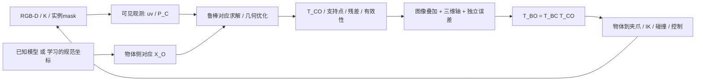
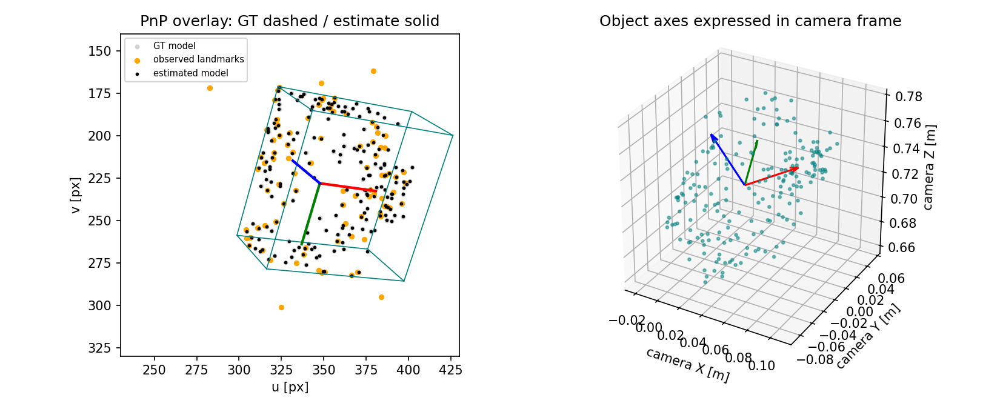
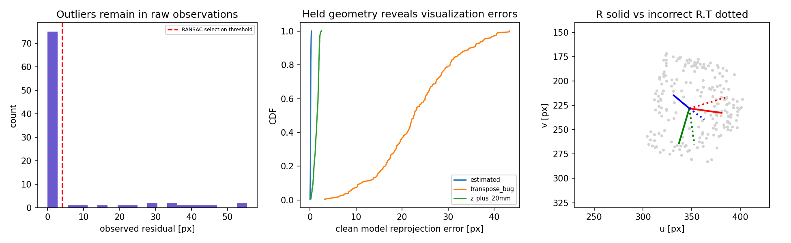

# D52 · 从目标观测到可检验的六自由度物体位姿

[返回学习入口](../_index.md) ｜ [本周日程](../P3-项目实战-日程.md) ｜ [上一课 D51](../day51/Daily-Learning-Pack.md) ｜ [CPU 实验](demo.py)

**六自由度位姿不是在点云上画三根线，而是找到一个具有明确方向、单位和参考系的刚体变换，使物体模型与观测的对应关系成立。图像叠加、三维几何误差和坐标约定要一起检验它。**

本课是 P3 / Π-1 / W8-D3，保留原课程日期 2026-10-26，于 2026-10-29 补写和验证。D51 得到属于目标实例的可见观测；今天进一步回答这些观测相对于物体本体处在哪里。明天把物体位姿转成夹爪候选并检查 IK，所以本课尤其要分清物体坐标原点、可见点均值和抓取坐标系。

<details>
<summary>个人学习记录（自动更新时保留）</summary>

<!-- learner-notes:start -->

- 我对坐标轴、投影和误差的预测：
- 我实际运行与改变的变量：
- 我的自测答案与后续问题：

<!-- learner-notes:end -->

</details>

<!-- daily-pack-generated:start -->

## 0. 学习目标与路线

完成本课后，你应能写清 $T_{CO}$ 的方向并求逆；从带对应的点推导 PnP 的重投影目标、局部更新与 RANSAC 机制；计算并解释平移、旋转、ADD 和重投影误差；正确绘制物体坐标轴和定向包围盒；辨别 NOCS 类别级路线与已知模型的 EPro-PnP 路线所需条件；把一个有拒绝机制、版本和时间戳的位姿包交给后续抓取规划。

| 顺序 | 知识主线 | 需要回答的问题 |
| --- | --- | --- |
| 宏观 | 观测到物体坐标 | mask 之后还缺了哪一种信息？ |
| 微观一 | SE(3) 与可观测性 | 6 个自由度怎样对应矩阵和实物？ |
| 微观二 | 对应与求解 | 像素如何约束旋转、平移？ |
| 微观三 | 可视化与度量 | 为什么看着贴合仍可能有厘米误差？ |
| 工程 | 原候选路线 | NOCS 和 EPro-PnP 能否直接互换？ |
| 动手 | 噪声与错误注入 | 一个变量改变后哪些证据会变化？ |

## 1. 宏观：位姿位于感知与操作之间



本图强调一个缺口：目标点云提供 $P_C$，但它没有自动告诉我们每个点对应物体模型中的哪个 $X_O$。PnP 需要 2D–3D 对应；配准需要 3D–3D 对应或搜索它们。网络可以预测对应，纹理特征可以匹配对应，已知标志点可以提供对应，但“已经分割出目标”不等于“对应已经正确”。

物体级任务可使用已知实例 CAD 的形状、大小和原点；类别级任务面对同类别的新实例，通常还要学习共享的规范空间并恢复尺度。六自由度只包含 3 个旋转自由度和 3 个平移自由度；物体尺寸不属于 SE(3)，即便某方法联合预测姿态和尺寸，也不能把“6D”解释为任意六个网络输出。

## 2. 微观：矩阵的方向决定三根轴表示什么

### 2.1 统一用物体到相机变换

设物体坐标为 O，相机光学坐标为 C，定义

$$X_C=R_{CO}X_O+t_{CO},\qquad
T_{CO}=\begin{bmatrix}R_{CO}&t_{CO}\\0&1\end{bmatrix}.$$

$R\in SO(3)$，满足 $R^TR=I,\det R=+1$；$t\in\mathbb R^3$，本课单位米。$t$ 是物体原点在相机中的坐标，不是相机在物体中的坐标。后者由逆变换给出：

$$T_{OC}=T_{CO}^{-1}=\begin{bmatrix}R_{CO}^T&-R_{CO}^Tt_{CO}\\0&1\end{bmatrix}.$$

仅将 R 转置、却保持 t 不变，通常既不是原变换也不是逆变换。这个错误在可视化里很常见：程序仍画出三条相互垂直的轴，看起来“像坐标系”，但方向含义已错。

若代码把每个点作为行向量存于 `points[N,3]`，计算为 `points @ R.T + t`；数学的列向量表达 $RX+t$ 与这个存储实现一致。**代码中出现 `.T` 不代表变换方向反了，先检查向量排布。**

### 2.2 手算一次变换与投影

取绕物体/相机共用初始 Z 轴旋转 90° 的矩阵

$$R=\begin{bmatrix}0&-1&0\\1&0&0\\0&0&1\end{bmatrix},\quad
 t=[0.1,0,0.8]^T\;\mathrm m.$$

物体点 $X_O=[0.02,0,0]^T$ m 变成 $X_C=[0.1,0.02,0.8]^T$ m。若 $f_x=f_y=600$ px、$c_x=320,c_y=240$ px，则投影为 $u=395,v=255$ px。物体原点投影在 $(395,240)$，所以物体的正 X 轴在图中向下，而非必然向右。颜色红色只表示“物体 X”，不能推断屏幕方向。

逆变换的平移为 $-R^Tt=[0,0.1,-0.8]^T$ m；直接写 $-t$ 就错了，因为相机原点要用物体轴来表达。

### 2.3 遮挡、对称与不可观测性

无纹理圆柱绕自身轴旋转，很多观测可能几乎不变；杯把被遮挡时，有杯把的杯子也可能暂时出现类似歧义。这时优化器输出某个数值解，不代表观测确实约束了该方向。应区分完整模型的几何对称、任务允许的等价位姿、当前视角产生的观测歧义。

点都集中在一条小线段上，某些姿态方向会非常敏感；近平面结构也可能产生多个候选，需要正深度、附加视角或时间信息筛选。平面 PnP 可以求解，不应笼统说“平面物体无法估计位姿”。但只画一种候选又不报告歧义，会把算法选择误当成物理确定性。

## 3. 微观：从对应关系求出位姿

### 3.1 PnP 的输入和重投影目标

给定物体点 $X_i$、对应像素 $u_i\in\mathbb R^2$、内参 K 和畸变模型，定义

$$r_i(R,t)=\pi_K(RX_i+t)-u_i,\qquad
\hat R,\hat t=\arg\min_{R\in SO(3),t}\sum_i\rho(\|r_i\|_2^2).$$

无畸变针孔投影为 $\pi_K([x,y,z]^T)=[f_xx/z+c_x,f_yy/z+c_y]^T$；$r_i$ 单位像素，$\rho$ 可为平方损失或鲁棒损失。真实图像若已经去畸变，使用与去畸变图匹配的新 K，不再次施加原畸变；若未去畸变，就在投影模型中带原系数。

像素噪声均值零、各方向独立且方差相等时，平方残差对应高斯噪声的最大似然；实际检测错误可能是离群点，因而单次最小二乘会被错误对应拉走。没有有效对应时，增加更多假点不是信息增益。

| 变量 | 本脚本 shape | 含义 |
| --- | --- | --- |
| `model_points` | $[200,3]$ | 米制非对称教学模型 |
| `correspondences_3d` | $[90,3]$ | 被观测的物体坐标 |
| `observations_2d` | $[90,2]$ | 带噪声和错误对应的像素 |
| `K` | $[3,3]$ | 原图针孔内参 |
| `rvec`,`tvec` | $[3,1]$ | Rodrigues 旋转向量、米制平移 |
| `T_CO` | $[4,4]$ | 物体到相机的齐次变换 |

旋转向量的模是角度（弧度）、方向是旋转轴；它不是欧拉角，也不是前课提到的连续 6D 旋转表示。OpenCV 的 `solvePnP` 返回物体/世界到相机的变换，光学轴约定为右、下、前。[官方 PnP 文档：坐标与 refinement](https://docs.opencv.org/4.x/d5/d1f/calib3d_solvePnP.html)。在线页面当前为 4.13.0，本课实际执行 4.10.0 中的接口。

### 3.2 局部优化为什么能改进初值

先用代数 PnP 取得初值，再在它附近优化重投影。采用左扰动 $T'=\exp(\delta\xi^\wedge)T$，$\delta\xi=[\delta\rho,\delta\phi]$ 分别为米和弧度，小扰动时

$$X_C'\approx X_C+\delta\rho-[X_C]_\times\delta\phi.$$

对投影求导：

$$J_\pi=\begin{bmatrix}f_x/z&0&-f_xx/z^2\\0&f_y/z&-f_yy/z^2\end{bmatrix},\qquad
J_i=J_\pi[\,I\; -[X_C]_\times\,].$$

$[X]_\times a=X\times a$。因为本课残差定义为“预测减观测”，一阶近似 $r(\delta)\approx r+J\delta$，故阻尼正规方程为

$$\left(J^TWJ+\lambda D\right)\delta=-J^TWr.$$

$W$ 可表达权重，$D$ 可取对角尺度；尺度选择很重要，平移的米与旋转的弧度不能任意混成同一数值单位。LM 会根据局部改进调阻尼，本课调用 OpenCV refinement，不声称其内部实现逐行等同于这里选定的左扰动推导。

手算灵敏度：$x=0.05,z=0.72,f_x=570$ 时，$\partial u/\partial x\approx791.67$ px/m，而 $\partial u/\partial z\approx-54.98$ px/m。向右 1 mm 可引起约 0.79 px，沿深度 1 mm 在这个点只约 0.055 px。靠近主光轴时，深度变化的像素影响更弱。于是**小重投影误差并不必然对应小深度误差**。

### 3.3 RANSAC 用一致性抵抗错误对应

RANSAC 反复抽样求假设，将重投影误差小于阈值的点当作支持集合，再选一致性较好的假设，最后对支持点细化。阈值单位是像素；提高阈值会留住更多噪声点，也可能收进错误对应。迭代次数、最小求解器和退化抽样共同影响结果。

若有效内点比例为 $w$，每次抽样 $s$ 点且近似独立，要至少一次全部抽到内点的概率达到 $p$，需要

$$N\ge\frac{\log(1-p)}{\log(1-w^s)}.$$

例如 $w=0.8,s=4,p=0.99$，约需 9 次理想化抽样。这个公式忽略退化与噪声，不能替代实际验证；不同 API 的有效采样策略也不同。本脚本用最大 500 次、4 px 阈值、置信参数 0.999，并显式检查失败或内点不足，不返回伪造的单位姿态。

> [!warning] 内点残差是“经过筛选后的拟合质量”
> 只显示内点的误差会隐藏被排除的错误对应。应同时报告输入数、支持数、内点残差、原始全部观测残差，以及可用时独立几何评价。refinement 后残差与抽样阶段阈值也不必严格保持同样分界。

## 4. 微观：把一个变换画成可核对的证据

### 4.1 坐标轴是变换后的三条线段

物体原点为 $o_O=0$，长度为 $\ell$ 的轴端点为 $\ell e_x,\ell e_y,\ell e_z$。相机中

$$o_C=t,\qquad a_{C,j}=t+\ell R e_j.$$

所以 R 的**列**是物体各轴在相机中的方向；代码绘三维箭头用 `R[:, j]`。先变换轴端点再投影，不是向像素中心直接加 $(\ell,0)$：米与像素的尺度不同，轴方向也受透视影响。将 `R.T` 当 R 绘制可能仍是正交三轴，但它已经表示另一姿态。

包围盒也必须来自物体坐标中的完整尺寸。先取 8 个角点，经 $RX+t$ 变换后投影，并连接只相差一个坐标分量的角点。可见点云的轴对齐框通常比完整物体小；它不能直接替代模型的物体框。模型原点不同也会改变 t，比较位姿前要统一模型规范。

### 4.2 三维误差与投影误差各自回答什么

平移误差 $e_t=\|t-\hat t\|$，旋转角误差为

$$e_R=\arccos\!\left(\operatorname{clip}\frac{\operatorname{tr}(R\hat R^T)-1}{2}\right).$$

clip 的区间是 $[-1,1]$，防止浮点误差使 arccos 无定义。轴角差不能简单用欧拉角逐维相减。对同一个有固定对应的模型点集，ADD 为

$$\mathrm{ADD}=\frac1M\sum_{i=1}^{M}\|(RX_i+t)-(\hat R X_i+\hat t)\|.$$

它把旋转和平移对实体点的影响合到同一个米制量；大物体的同角度误差一般造成更大点偏差。对称物体需明确协议，不能把普通 ADD、最近邻 ADD-S 和按等价姿态集合最小化的误差混称一个指标。本实验刻意构造非对称模型，使用固定对应的 ADD，不设 BOP 官方阈值、不报官方分数。

重投影 RMSE 为

$$e_{2D}=\sqrt{\frac1N\sum_i\|\pi_K(RX_i+t)-u_i\|^2},$$

这里分母是点数 N，不是坐标数 2N。必须说明 $u_i$ 来自带噪观测、内点、还是干净 GT。本课另外留出 110 个未用于 PnP 求解的模型点，用 GT 姿态生成它们的干净投影作为几何核对；它们不构成独立真实图像测试集，只减少“仅在拟合点上检查”的盲区。

### 4.3 两个“看起来没问题”的反例

本实验在正确估计后只给 t 的 Z 分量增加 20 mm，模型投影 RMSE 仅约 1.55 px，但平移误差已约 20.56 mm。小图里很难看出，夹爪却可能在错误深度合拢。

另一个反例是把 R 转置用于画轴：正交性检查仍通过、平移也不变，但旋转误差约 69.13°，ADD 约 49.70 mm。正交性是必要条件，不是姿态正确的充分条件。把“检查 R 合法”和“检查 R 与观测一致”分成两个检查才能发现它。

## 5. 工程：原候选 NOCS 与 EPro-PnP 怎样接入

### 5.1 两条路线的条件不同

NOCS 原版用已知类别的规范空间表达新实例，RGB 网络预测类别、实例 mask 与规范坐标，再结合深度做鲁棒对齐，恢复米制姿态及大小。类别内需要一致的轴与中心规范；它不要求测试实例的精确 CAD，却仍依赖类别训练和监督。精读 [NOCS §3、§5.1–5.2](https://arxiv.org/html/1901.02970v1)，重点核对网络输入与深度后处理的分工。

EPro-PnP 的 6DoF 官方实现面向 LineMOD 已知模型路线，使用修改后的 CDPN 稠密对应分支及二维权重，再接概率 PnP。它不等于把本课 `solvePnPRansac` 换个名字，也不自带“任意未知杯子”的形状定义。[官方 EPro-PnP-6DoF README](https://github.com/tjiiv-cprg/EPro-PnP/tree/main/EPro-PnP-6DoF)。

| 条件 | NOCS 原版路线 | EPro-PnP 官方 6DoF 路线 |
| --- | --- | --- |
| 物体侧表示 | 类别共享规范坐标 | 已知实例模型中的对应 |
| 米制来源 | 深度与尺度对齐 | 米制模型、K 与投影几何 |
| 主要输入约束 | RGB + 可用注册深度 | 图像、K、已知对象模型和对应网络 |
| 泛化问题 | 已知类别的新实例 | 已知实例与其测试条件 |
| 本课完成范围 | 解释接口，未跑网络 | 几何模块演示，未跑官方网络 |

W6 保留的 YCB-Video/LineMOD 已知实例任务与 NOCS 类别级任务不能直接混用训练划分和评价分母。选择路线时先确定“部署时知道具体模型吗”“是否有规范坐标监督”“深度是否可靠”，再选网络。任何现成 checkpoint 都要匹配类别、模型单位、输入预处理与标注规范。

### 5.2 概率位姿与普通加权残差的联系

一个通用加权残差能定义位姿能量 $E(T)=\frac12\sum_i\|w_i\odot r_i(T)\|^2$，其中二维 $w_i$ 乘的是残差，因此能量里实际出现平方权重。进一步得到 $p(T|X)=\exp[-E(T)]/Z(X)$，归一化项 $Z$ 对所有候选位姿积分。EPro-PnP 的要点是用目标位姿分布监督这个归一化分布，并用采样估计相关积分；不是仅对正确姿态算一次重投影损失。参见 [EPro-PnP §3.1–3.2](https://arxiv.org/html/2203.13254v2)。

以两个候选为离散直觉例，能量分别 0 和 2，其相对概率约 0.881 和 0.119；若都降到 0，正确候选并没有更确定，概率变成各 0.5。这说明学习对应时，既需支持正确姿态，也需区别错误姿态。连续真实姿态空间更复杂，这个两候选例不能替代论文的积分算法。也不要由此断言普通 PnP 一律不可微：局部隐式求导有自己的条件与适用范围。

### 5.3 可复现的真实接入顺序

如果继续原 EPro-PnP 候选，在 vault 外工程目录固定代码版本、模型版本、配置和数据清单；读取官方 CDPN 格式的 LineMOD 模型、真实训练/测试与合成数据，并核对单位。官方文档所列历史测试环境为 Linux、Python 3.6、PyTorch 1.5 和 CUDA 10.2；不能假定本机 macOS 环境直接兼容。先运行指定权重的测试，再保存原协议评价和叠加图，之后才做模型修改。官方 v1/v1b 行为差异需记录，本课没有安装这套历史依赖或下载权重。

NOCS 路线先检查相机深度注册、规范坐标输出和类别轴定义，再保存原图 mask、NOCS map、深度点与对齐支持集。观察失败是网络规范坐标错误还是深度缺失，不能把所有误差归给 RANSAC。真实接入尚未完成时，项目里保留待做状态；本课 CPU 求解成功不勾选官方复现。

## 6. 动手：求解、绘图，再只改变像素噪声

### 6.1 输入的真实性边界

脚本构造一个尺寸不等且带侧向突出部分的米制模型，采样 200 点；其中 90 个点提供已知 2D–3D 身份，15 个像素被加大幅偏移，另外叠加高斯像素噪声。所有对应由合成程序直接产生，没有检测/分割网络，也没有遮挡剔除；部分投影点在真实相机中可能不可见。因此这是一项**几何与接口实验**，不能用结果声称真实视觉识别或真实 RGB-D 位姿达到相同精度。

先预测：改变噪声会使 RANSAC 支持点如何变化？为什么原始全部观测 RMSE 可能始终很大，而正确位姿依然接近 GT？然后运行：

```bash
python 3d_learning/day52/demo.py
python 3d_learning/day52/demo.py --noise-px 2 --out _assets/3d_learning/day52/noise2
```

两次仅改变 `noise_px`，固定模型、点身份、离群点索引与偏移、K、seed=52、4 px RANSAC 阈值和求解配置。基础依赖为 NumPy、OpenCV、Matplotlib；本次 CPU 实测版本与 D51 相同：Python 3.11.15、NumPy 1.26.4、OpenCV 4.10.0、Matplotlib 3.10.9。合成时刻 0 s，物理机器人尝试 0 次，模型训练样本 0；求解输入的 90 点不应记成训练集。



左图灰色是 GT 模型，橙色是含离群点的观测，黑色是估计后的模型投影；轴颜色红/绿/蓝对应物体 X/Y/Z，虚线为 GT、实线为估计。青色框使用模型尺寸，与 visible cloud 的外接框不是同一对象。右图是在相机坐标数值下画出的物体和轴，绘图相机的观察视角只影响屏幕显示，不改变保存的 `T_CO`。

| 记录 | 默认 0.6 px | 只改成 2 px |
| --- | ---: | ---: |
| RANSAC 支持点 / 输入点 | 75 / 90 | 58 / 90 |
| 内点重投影 RMSE | 0.839 px | 2.193 px |
| 全部原始观测 RMSE | 14.242 px | 14.669 px |
| 留出点干净投影 RMSE | 0.163 px | 1.006 px |
| 旋转误差 | 0.251° | 2.024° |
| 平移误差 | 0.565 mm | 2.798 mm |
| ADD | 0.549 mm | 3.119 mm |

原始观测中仍有那 15 个错误点，所以求解成功不会让全部残差都小。2 px 情况下固定 4 px 阈值也会排掉一部分真对应的高噪观测；并非每个被排掉的点都具有错误身份。该次本地求解用时约 3.95 ms 与 1.93 ms，只含 RANSAC 和 refinement；单次差异没有统计意义，也不含网络推理或数据传输。



中图统计固定 200 个模型点的干净投影误差累计分布，分别是正常估计、将 R 转置、Z 增加 20 mm。右图保持原点不变，仅把错误 R 转置后的轴画成点线。这个受控反例让“相互垂直”“能投影”和“与真实物体一致”成为三个可区分的条件。

默认输出：[results.json](../../_assets/3d_learning/day52/results.json)、results.npz (not exported: excluded by publication policy)；单变量输出：[noise2/results.json](../../_assets/3d_learning/day52/noise2/results.json)。NPZ 保存 `K, R, t, T_CO, model_points, observations_2d, correspondences_3d, inlier_indices, timestamp_s`，便于下一课接口读取。需要真机外参时必须另给 $T_{BC}$，不能假设相机坐标就是机器人基座坐标。

### 6.2 关键实现与失败处理

```python
ok, rvec, tvec, inliers = cv2.solvePnPRansac(
    object_points, image_points, K, None,
    iterationsCount=500, reprojectionError=4.0,
    confidence=0.999, flags=cv2.SOLVEPNP_EPNP)
# ok、支持点数、正深度、数值有限性、几何分布都需要核查
# 失败输出 invalid + reason；不能返回看起来合法的单位矩阵冒充成功
```

本脚本检查求解返回和至少 6 个支持点，并检查 R 合法、投影正深度。实际系统还应检查支持点空间覆盖、残差、估计随时间跳变与对称假设；“至少 6 点”是本实验的拒绝条件，不是所有 PnP 算法统一的数学最小点数。

<details>
<summary>完整可复制 CPU 实验代码（与 demo.py 一致）</summary>

```python
"""D52: calibrated 6D PnP and pose visualization, synthetic known correspondences."""
import argparse
import json
import platform
import time
from pathlib import Path

import cv2
import matplotlib
matplotlib.use('Agg')
import matplotlib.pyplot as plt
import numpy as np


def project(points, r, t, k):
    camera = points @ r.T + t
    assert np.all(camera[:, 2] > 0), 'points behind camera'
    homogeneous = camera @ k.T
    return homogeneous[:, :2] / homogeneous[:, 2:3]


def make_model(rng):
    # Unequal box dimensions and protrusion remove exact rotational symmetry.
    body = rng.uniform([-0.04, -0.06, -0.03], [0.04, 0.06, 0.03], (160, 3))
    faces = rng.integers(0, 3, len(body))
    signs = rng.choice([-1, 1], len(body))
    body[np.arange(len(body)), faces] = np.array([.04, .06, .03])[faces]*signs
    handle = rng.uniform([.04, -.025, -.01], [.08, .025, .01], (40, 3))
    return np.vstack((body, handle))


def errors(model, r, t, r_gt, t_gt, k):
    angle = np.degrees(np.arccos(np.clip((np.trace(r @ r_gt.T)-1)/2, -1, 1)))
    predicted = model @ r.T + t
    truth = model @ r_gt.T + t_gt
    return dict(rotation_deg=float(angle), translation_mm=float(np.linalg.norm(t-t_gt)*1000),
        add_mm=float(np.linalg.norm(predicted-truth, axis=1).mean()*1000),
        clean_reprojection_rmse_px=float(np.sqrt(np.mean(np.sum((project(model,r,t,k)-project(model,r_gt,t_gt,k))**2,axis=1)))))


def draw_axes(ax, r, t, k, style, alpha=1, length=.05):
    endpoints = np.vstack((np.zeros(3), np.eye(3)*length))
    pixels = project(endpoints, r, t, k)
    for i, color in enumerate(['red', 'green', 'blue']):
        ax.plot(pixels[[0, i+1], 0], pixels[[0, i+1], 1], style, color=color, lw=2, alpha=alpha)


def main():
    parser = argparse.ArgumentParser()
    parser.add_argument('--noise-px', type=float, default=.6)
    parser.add_argument('--seed', type=int, default=52)
    parser.add_argument('--out', type=Path, default=Path(__file__).resolve().parents[2]/'_assets/3d_learning/day52')
    args = parser.parse_args()
    if args.noise_px < 0:
        raise ValueError('noise must be nonnegative')
    args.out.mkdir(parents=True, exist_ok=True)
    rng = np.random.default_rng(args.seed)
    cv2.setRNGSeed(args.seed)
    model = make_model(rng)
    k = np.array([[570., 0, 320], [0, 570., 240], [0, 0, 1.]])
    r_gt = cv2.Rodrigues(np.array([.35, -.45, .20]))[0]
    t_gt = np.array([.035, -.015, .72])
    chosen = rng.choice(len(model), 90, replace=False)
    points = np.ascontiguousarray(model[chosen], dtype=np.float64)
    clean = project(points, r_gt, t_gt, k)
    observations = clean + rng.normal(size=clean.shape)*args.noise_px
    outlier_ids = rng.choice(len(points), 15, replace=False)
    observations[outlier_ids] += rng.uniform(-45, 45, (len(outlier_ids), 2))
    started = time.perf_counter()
    ok, rvec, tvec, inliers = cv2.solvePnPRansac(points, observations, k, None,
        iterationsCount=500, reprojectionError=4., confidence=.999, flags=cv2.SOLVEPNP_EPNP)
    if not ok or inliers is None or len(inliers) < 6:
        raise RuntimeError('PnP failed or insufficient inliers; do not output identity pose')
    ids = inliers[:, 0]
    rvec, tvec = cv2.solvePnPRefineLM(points[ids], observations[ids], k, None, rvec, tvec)
    r = cv2.Rodrigues(rvec)[0]; t = tvec.reshape(3)
    solver_ms = (time.perf_counter()-started)*1000
    assert np.allclose(r.T@r, np.eye(3), atol=1e-8) and np.linalg.det(r) > .999
    residuals = np.linalg.norm(project(points, r, t, k)-observations, axis=1)
    heldout = np.setdiff1d(np.arange(len(model)), chosen)
    heldout_rmse = np.sqrt(np.mean(np.sum((project(model[heldout],r,t,k)-project(model[heldout],r_gt,t_gt,k))**2,axis=1)))
    cases = {'estimated': (r, t), 'transpose_bug': (r.T, t),
             'z_plus_20mm': (r, t+np.array([0, 0, .02]))}
    comparison = {name: errors(model, rr, tt, r_gt, t_gt, k) for name, (rr,tt) in cases.items()}
    result = dict(seed=args.seed, noise_px=args.noise_px, correspondences=len(points),
        injected_outliers=len(outlier_ids), ransac_inliers=len(ids), ransac_threshold_px=4,
        inlier_rmse_px=float(np.sqrt(np.mean(residuals[ids]**2))),
        all_observation_rmse_px=float(np.sqrt(np.mean(residuals**2))),
        heldout_clean_rmse_px=float(heldout_rmse), cases=comparison, solver_ms=solver_ms,
        input_contract='known synthetic model and 2D-3D identities; no correspondence network',
        frame='T_CO: object -> camera optical (x right, y down, z forward)',
        length_unit='m', timestamp_s=0., physical_robot_trials=0, training_samples=0,
        runtime=dict(python=platform.python_version(), numpy=np.__version__,opencv=cv2.__version__,matplotlib=matplotlib.__version__))
    (args.out/'results.json').write_text(json.dumps(result, indent=2)+'\n')
    transform = np.eye(4); transform[:3, :3]=r; transform[:3, 3]=t
    np.savez_compressed(args.out/'results.npz', model_points=model, K=k, R=r, t=t,
        R_gt=r_gt, t_gt=t_gt, T_CO=transform, correspondences_3d=points,
        observations_2d=observations, inlier_indices=ids, timestamp_s=np.array(0.))
    fig=plt.figure(figsize=(11,4.5)); ax=fig.add_subplot(121)
    gt_pixels=project(model,r_gt,t_gt,k); pred_pixels=project(model,r,t,k)
    ax.scatter(gt_pixels[:,0],gt_pixels[:,1],s=8,c='lightgray',label='GT model')
    ax.scatter(observations[:,0],observations[:,1],s=12,c='orange',label='observed landmarks')
    ax.scatter(pred_pixels[:,0],pred_pixels[:,1],s=3,c='black',label='estimated model')
    corners=np.array([[x,y,z] for x in [-.04,.08] for y in [-.06,.06] for z in [-.03,.03]])
    projected_corners=project(corners,r,t,k)
    for i in range(8):
        for j in range(i+1,8):
            if np.count_nonzero(corners[i]!=corners[j])==1:
                ax.plot(projected_corners[[i,j],0],projected_corners[[i,j],1],color='teal',lw=.8)
    draw_axes(ax,r_gt,t_gt,k,'--',.5); draw_axes(ax,r,t,k,'-')
    ax.set(xlabel='u [px]',ylabel='v [px]',title='PnP overlay: GT dashed / estimate solid',xlim=(230,430),ylim=(330,140))
    ax.set_aspect('equal'); ax.legend(fontsize=7)
    ax=fig.add_subplot(122,projection='3d'); camera=model@r.T+t
    ax.scatter(camera[:,0],camera[:,1],camera[:,2],s=5,color='teal',alpha=.5)
    for i,color in enumerate(['red','green','blue']):
        direction=r[:,i]*.05
        ax.quiver(*t,*direction,color=color,arrow_length_ratio=.15)
    ax.set(xlabel='camera X [m]',ylabel='camera Y [m]',zlabel='camera Z [m]',title='Object axes expressed in camera frame')
    ax.set_box_aspect((1,1,1)); fig.tight_layout(); fig.savefig(args.out/'pose_overlay.png',dpi=150); plt.close(fig)
    fig,axes=plt.subplots(1,3,figsize=(13,4))
    axes[0].hist(residuals,bins=20,color='slateblue')
    axes[0].axvline(4,color='red',ls='--',label='RANSAC selection threshold')
    axes[0].set(xlabel='observed residual [px]',ylabel='count',title='Outliers remain in raw observations'); axes[0].legend(fontsize=6)
    for name,(rr,tt) in cases.items():
        err=np.linalg.norm(project(model,rr,tt,k)-project(model,r_gt,t_gt,k),axis=1)
        axes[1].plot(np.sort(err),np.arange(1,len(err)+1)/len(err),label=name)
    axes[1].set(xlabel='clean model reprojection error [px]',ylabel='CDF',title='Held geometry reveals visualization errors'); axes[1].legend(fontsize=7)
    axes[2].scatter(gt_pixels[:,0],gt_pixels[:,1],s=6,c='lightgray')
    draw_axes(axes[2],r,t,k,'-'); draw_axes(axes[2],r.T,t,k,':')
    axes[2].set(xlabel='u [px]',ylabel='v [px]',title='R solid vs incorrect R.T dotted',xlim=(230,430),ylim=(330,140))
    axes[2].set_aspect('equal'); fig.tight_layout(); fig.savefig(args.out/'pose_diagnostics.png',dpi=150); plt.close(fig)
    print(json.dumps(result,indent=2))


if __name__=='__main__':
    main()
```

</details>

## 7. 回到宏观：位姿包应该怎样进入规划

三句话总结：位姿把观测与一个明确定义的物体坐标系联系起来。鲁棒求解依赖正确对应、标定、尺度与可观测性，而不是只依赖点数。可视化、像素误差和三维误差共同决定结果是否足以进入物体到抓取变换。

今天的关键结论有四个：

1. **变换方向必须写在字段名里**，因为错误求逆会让外参组合和抓取姿态整体翻转。
2. **对应关系比单纯点云更有约束力**，因为 PnP 要知道像素与物体点的身份，而 mask 没有提供该身份。
3. **残差必须注明统计集合**，因为内点小误差会隐藏原始对应污染，图像小误差也会隐藏深度误差。
4. **候选方法必须匹配任务条件**，因为未知实例的规范坐标问题与已知 CAD 的投影问题需要不同数据支持。

最易混淆的边界是：SE(3) 的 6DoF 不等于连续 6D 旋转编码；R 合法不等于 R 正确；绘图成功不等于真实感知基线复现。今日产出应有两次 JSON、两张带参考系说明的图、一个包含 `T_CO` 与失败状态的接口草案，以及对 Z 偏移 20 mm 反例的计算解释。真实项目的官方网络、数据协议验收和个人掌握程度仍分别记录。

## 8. 自测：从矩阵到失败定位

每题 0/1/2 分：错误或缺失 0；结论正确但理由不足 1；能计算并说明边界 2。建议至少 12/16，且第 1、3、6 题需能独立解释。这里不预填个人成绩。

1. $T_{CO}$ 把哪一系的点变到哪一系？它的 t 表示什么？写出逆变换。
2. 用第 2 节的 90°旋转与 t，把 $[0.02,0,0]$ m 变换并投影，说明为何物体 X 轴在图上向下。
3. `points @ R.T + t` 和 $RX+t$ 是否矛盾？画物体 X 轴应取 `R[:,0]` 还是 `R[0,:]`？
4. 只有实例 mask、深度点云和 K，能否不提供任何模型/规范坐标/对应就直接调用 PnP 得到物体规范位姿？缺少什么？
5. RANSAC 里 $w=0.8,s=4,p=0.99$，理想化最少约需几次抽样？哪些现实因素会使这个数过于乐观？
6. 本课 Z 增加 20 mm 时投影仍只差约 1.55 px，能否据此认为抓取无影响？用投影导数解释。
7. 原始观测 RMSE 为 14 px、内点 RMSE 不到 1 px，是不是说明代码算错了？应再报告哪些量？
8. 一个陌生杯子无精确 CAD，但有 RGB-D；在 NOCS 原版与官方 EPro-PnP-6DoF 中，哪条路线的任务假设更接近？为什么不能把本课求解成功叫作这条路线的官方复现？

## 9. 未理解问题与次日衔接

如果 R 的行列仍混淆，手算物体的三个基向量被 R 变到哪里，再写出行向量批处理代码。若像素误差与空间误差仍混为一谈，在主光轴附近和远离主光轴处各算一次 $\partial u/\partial z$。若多解问题仍不清楚，画出圆柱转动时哪些可见几何不变，再思考杯把被遮挡的情况。

下一课 D53 的第一步是给出物体坐标中的抓取变换 $T_{OG}$，组合 $T_{BG}=T_{BC}T_{CO}T_{OG}$，随后检查 IK 可达性，而非把 $T_{CO}$ 直接发送给机器人。W8 后续的动作日志和闭环实验继续检验时间对齐、姿态跳变和真实失败；本课没有操纵硬件。

一手资料核验于 2026-10-29：OpenCV PnP 坐标、RANSAC 与 refinement 文档；NOCS §3 与 §5.1–5.2；EPro-PnP §3.1–3.2 与官方 6DoF README 的数据、环境和测试入口。链接位于对应知识章节。图表、数值与代码来自本次教学实验，不引用论文性能作为本机实测。

> [!note]- 核对答案与判分依据
> 1. O→C；t 为物体原点在相机系坐标。逆为 $(R^T,-R^Tt)$，能区分相机位置与物体位置得 2 分。
> 2. $X_C=[0.1,0.02,0.8]$ m，像素 $(395,255)$；原点 $(395,240)$，正 X 经旋转成为相机正 Y，后者在图像向下。过程和单位正确得 2 分。
> 3. 不矛盾，前者各点为行向量；物体 X 轴在相机中是 R 第一列。能说明单独把 R 转置画轴改变姿态得 2 分。
> 4. 不能直接得到约定的物体规范位姿；还需要物体侧定义以及图像/三维观测与该定义的对应或可求对应的模型。随意用 PCA 建局部轴不等于类别/模型规范轴。能指出对称歧义得 2 分。
> 5. $\lceil\log0.01/\log(1-0.8^4)\rceil=9$；退化样本、非独立抽样、阈值与噪声、内点比例估错都会影响。能说明 API 求解器具体规则另查得 2 分。
> 6. 不能；$\partial u/\partial z=-f_xx/z^2$，主轴附近的深度变化对像素较不敏感，但夹爪实际位置仍差厘米。能解释图像检查与米制检查必须同时存在得 2 分。
> 7. 不一定，全部集合包含注入离群点；应报支持点/输入点数、阈值、独立干净几何/留出点、R/t/ADD 等，并注明无真实测试。能区分筛选后拟合与总体错误得 2 分。
> 8. NOCS 的已知类别新实例假设更接近，但仍需类别训练、规范坐标预测与深度对齐；本课直接生成已知对应，未运行网络、真实数据或原协议，因此不是官方复现。两类条件都说清得 2 分。
<!-- daily-pack-generated:end -->
