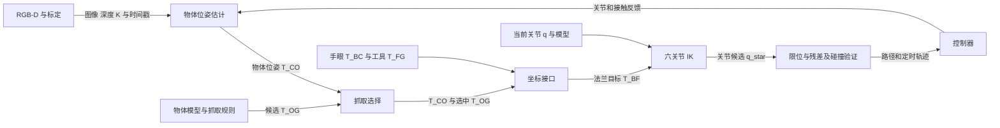
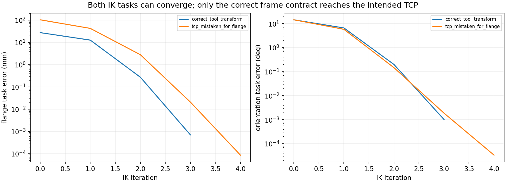
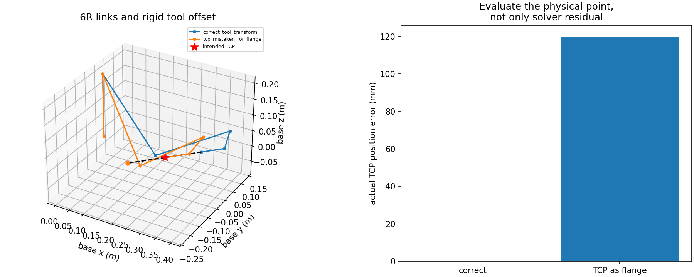

# D53 · 从物体位姿到工具目标，再到六关节构型

[返回学习入口](../_index.md) ｜ [本周日程](../P3-项目实战-日程.md) ｜ [上一课 D52](../day52/Daily-Learning-Pack.md) ｜ [CPU 实验](demo.py)

**IK 求解器只能满足你交给它的坐标目标。把物体中心、抓取中心、工具中心点与法兰混为一谈，会得到“残差很小、关节合法、夹爪却抓偏”的完整错误链。今天把这条接口链写成可计算、可验证的三维变换与六关节求解。**

本课属于 P3 / Π-1 / W8-D4，原课程日期为 2026-10-27，实际于 2026-10-29 补写并验证。D52 把 RGB-D 目标转成物体位姿与可视化；D48 曾用平面机械臂分析可达性和碰撞。今天将目标推进到三维：相机看见杯子后，夹爪的哪个点、以什么朝向到哪里，机械臂求解器又控制哪个坐标系？D54 再为关节路径加入时间与执行日志。

<details>
<summary>个人学习记录（自动更新时保留）</summary>

<!-- learner-notes:start -->

- 我实际改变的工具参数与观察：
- 我对坐标方向、IK 失败原因的解释：
- 我的自测答案与实际项目接口：

<!-- learner-notes:end -->

</details>

<!-- daily-pack-generated:start -->

## 学习目标与路线

今天结束后，你应当能从坐标命名推导变换乘法顺序，手算工具偏置；为六转动关节机械臂构造几何雅可比；解释位置与姿态残差的单位和权重；实现带阻尼、步长限制和关节限位检查的局部 IK；最后通过工具实际位置复核求解结果，而不是只查看求解器返回码。

| 顺序 | 知识主线 | 要回答的问题 |
|---|---|---|
| 1 | 感知到执行的接口 | 从物体位姿到关节指令，还缺什么？ |
| 2 | 三维刚体变换 | 为什么工具偏置要右乘逆变换？ |
| 3 | 六关节 FK 与雅可比 | 每个关节怎样改变法兰的位置与朝向？ |
| 4 | 位姿残差与数值 IK | 怎样把米与弧度放进同一个优化问题？ |
| 5 | 实验与工程回查 | 求解器收敛为什么仍可能抓偏 120 mm？ |

## 1 宏观：物体、抓取、工具和法兰是四个不同对象

机械臂抓杯子时，感知通常输出物体坐标系在相机中的位姿。它描述杯子在哪里，不包含“从杯身哪一侧夹、夹爪张开多少、朝哪里接近”。D47 的抓取候选生成器提供相对于物体的抓取目标；机器人运动学模型再把末端目标转成关节构型。



图中的关键传递量不是一个统一的 `pose`。感知给 $T_{CO}$，抓取生成给 $T_{OG}$，IK 可能要求 $T_{BF}$。每条边都必须携带坐标系、单位和时间。控制反馈也不能直接等价于下一次物体观测：关节反馈与视觉观测只是闭环中的不同证据。

用 $B,C,O,G,F$ 分别表示基座、相机、物体、抓取/工具中心点 TCP、法兰。TCP（Tool Center Point，工具中心点）是工具上约定的参考点；本实验将抓取坐标系 $G$ 与该 TCP 重合。实际夹爪可以把 TCP 放在指尖中心，也可以放在夹爪根部，必须明确约定。如果抓取模型使用另一个参考点，还要补上两者的刚性变换。

> [!warning] 求解器终端 link 必须确认
> 若机器人插件的 IK 直接以 TCP link 为终端，就输入 TCP 目标；若终端是 flange link，就先转换到法兰。重复补偿与完全不补偿都会出错。本实验明确以法兰为 FK/IK 终端。

## 2 微观：用下标检查变换，而不是凭直觉凑乘法

### 2.1 一个约定贯穿全部接口

本文采用列向量。$T_{AB}$ 将 **B 系表达的点变成 A 系表达**：

$$
\begin{bmatrix}p_A\\1\end{bmatrix}
=T_{AB}\begin{bmatrix}p_B\\1\end{bmatrix},\qquad
T_{AB}=\begin{bmatrix}R_{AB}&t_{AB}\\0&1\end{bmatrix}.
$$

$R$ 是无量纲的 $3\times3$ 旋转矩阵，$t$ 是用 A 系表达、单位为米的 B 系原点。相邻下标可以消去：

$$T_{BG}=T_{BC}T_{CO}T_{OG}.$$

从右往左看，这是“抓取局部点→物体→相机→基座”。程序中每个矩阵 shape 都是 `[4,4]`，但 shape 相同完全不能保证语义正确。因此 `T_base_camera` 远比 `matrix1` 有价值。

固定工具安装关系给出：

$$T_{BG}=T_{BF}T_{FG}
\quad\Longrightarrow\quad
\boxed{T_{BF}=T_{BG}T_{FG}^{-1}}.$$

逆变换为

$$T^{-1}=\begin{bmatrix}R^T&-R^Tt\\0&1\end{bmatrix}.$$

一般情况下，旋转和平移不交换。左乘 $T_{FG}^{-1}$ 会在错误坐标中做变换；仅仅从目标的基座 $z$ 坐标减去工具长度，也只在工具轴与基座 $z$ 恰好对齐时成立。

### 2.2 手算：工具沿法兰 z 轴，但不沿基座 z 轴

设工具长度 $\ell=0.12\,m$，$T_{FG}=[I,(0,0,\ell)^T]$。目标 TCP 位姿满足 $R_{BG}=R_y(90^\circ)$，$p_{BG}=(0.40,0.10,0.30)^T m$。因为工具安装没有附加旋转，$R_{BF}=R_{BG}$，所以

$$p_{BF}=p_{BG}-R_{BG}(0,0,\ell)^T
=(0.40,0.10,0.30)^T-(0.12,0,0)^T
=(0.28,0.10,0.30)^T m.$$

法兰要沿基座 $x$ 轴退 120 mm，而不是沿基座 $z$ 轴退。若把 TCP 目标直接交给法兰 IK，即使求解完全精确，实际 TCP 仍会再偏移 $R_{BG}(0,0,\ell)^T$，其长度就是 120 mm。

> [!question] 先猜
> 如果把工具长度改成 60 mm，错误接口的实际 TCP 位置误差会接近多少？求解器自己的法兰残差是否一定变大？

答案将由独立于求解器目标的 TCP 复核给出：错误目标也可以被精准满足。

### 2.3 时间是变换链的另一半

静止相机的 $T_{BC}$ 可以长期固定；眼在手上的相机通常需要 $T_{BC}(t)=T_{BF}(q(t))T_{FC}$。这时不能把“最新关节角”与较早 RGB-D 帧无条件组合。假如夹爪以 $0.2\,m/s$ 移动，50 ms 对时误差可对应约 10 mm 位移误差。

本实验所有变换都处于合成时刻 $t=0$，没有真实时钟漂移。接入 RGB-D 项目时需要同时保存图像时间、关节采样时间、用于插值的样本、标定版本与工具版本，才能定位到底是识别误差还是接口误差。

## 3 微观：从六个关节角得到法兰位姿

### 3.1 标准 DH 的顺序与适用范围

前向运动学 FK（Forward Kinematics）把 $q\in\mathbb R^6$ 映射成 $T_{BF}$。实验使用标准 DH（Denavit–Hartenberg）参数约定：

$$A_i(q_i)=R_z(q_i)\,T_z(d_i)\,T_x(a_i)\,R_x(\alpha_i),\qquad T_{BF}=A_1A_2\cdots A_6.$$

$a_i,d_i$ 单位为米，$q_i,\alpha_i$ 单位为弧度；标准 DH 与改进 DH 的坐标定义不同，不能拿一个模型的表直接代入另一个公式。

| 关节 i | $a_i$ / m | $d_i$ / m | $\alpha_i$ | 对称关节限位 |
|---|---:|---:|---:|---:|
| 1 | 0 | 0.20 | $\pi/2$ | ±175° |
| 2 | 0.30 | 0 | 0 | ±140° |
| 3 | 0.25 | 0 | 0 | ±150° |
| 4 | 0 | 0.10 | $\pi/2$ | ±175° |
| 5 | 0 | 0 | $-\pi/2$ | ±150° |
| 6 | 0 | 0.08 | 0 | ±175° |

这是一台用于解释接口的合成 6R 机械臂，不对应任何厂商型号。真实系统应从已核对的机器人描述获得关节轴、原点与限位，并用多个已知构型检查 FK。不能把本表复制到真机。

### 3.2 几何雅可比：转轴到末端的杠杆臂

设第 $i$ 个转动关节的轴为 $z_i$，轴上一点为 $o_i$，法兰原点为 $p_F$，三者均用基座坐标表达。关节速度 $\dot q_i$ 产生角速度 $z_i\dot q_i$；绕轴旋转的点有线速度 $\omega\times(p_F-o_i)$，因此

$$J_i=\begin{bmatrix}z_i\times(p_F-o_i)\\z_i\end{bmatrix},\qquad
\begin{bmatrix}v_F\\\omega_F\end{bmatrix}=J(q)\dot q.$$

本文堆叠顺序是 **线速度在前、角速度在后**。其他教材的 twist 可能使用相反顺序；复制雅可比时必须同步修改误差向量。上半部量纲是 m/rad，下半部是 rad/rad；输入 $\dot q$ 为 rad/s，输出分别为 m/s 与 rad/s。

手算一个关节：$z=(0,0,1)$，$o=(0,0,0)m$，$p_F=(0.3,0.1,0)m$，则 $J_v=(-0.1,0.3,0)^T$。若该关节转 $\Delta q=0.01rad$，一阶近似的法兰位移为 $(-1,3,0)mm$。这解释了为什么相同角度误差在长杠杆处形成更大的位置误差。

| 数据 | shape | 含义 |
|---|---|---|
| `q` / `delta` | `[6]` | 有固定关节名称顺序的角度/更新量 |
| `T_BF` | `[4,4]` | 法兰到基座的齐次变换 |
| `origins`, `axes` | `[6,3]` | 各关节轴的位置与方向，均在基座系 |
| `jac` | `[6,6]` | 法兰几何雅可比，线在前角在后 |
| `points` | `[7,3]` | 可视化用的连杆端点，不是碰撞网格 |

若直接对 TCP 求 IK，雅可比的上半部分应使用 $p_G$ 代替 $p_F$。本实验先把 TCP 目标转为法兰目标，因此使用法兰雅可比是自洽的。将 TCP 误差配法兰线速度雅可比则不自洽。

### 3.3 用有限差分先检查雅可比

固定 $q$，只扰动第 $i$ 个关节 $\pm\epsilon$，检查

$$J_{v,i}\approx\frac{p_F(q+\epsilon e_i)-p_F(q-\epsilon e_i)}{2\epsilon},$$

$$J_{\omega,i}\approx\frac{\operatorname{Log}(R_+R_-^T)^\vee}{2\epsilon}.$$

`Log` 将小旋转映射为旋转向量。默认 $\epsilon=10^{-6}rad$，脚本中的几何公式与差分最大绝对差为 $5.43\times10^{-11}$。这是当前合成构型的数值检查，不是对所有构型的数学证明，却能有效暴露关节轴取错、坐标混用与矩阵顺序错误。

## 4 微观：位置误差与姿态误差怎样共同驱动 IK

### 4.1 姿态不是三个可以直接相减的欧拉角

位置误差为 $e_p=p^*-p(q)$。姿态使用基座表达的相对旋转：

$$e_R=\operatorname{Log}(R^*R(q)^T)^\vee,\qquad e=\begin{bmatrix}e_p\\e_R\end{bmatrix}.$$

若当前绕 $z$ 为 $179^\circ$、目标为 $-179^\circ$，欧拉数值相减得到 $-358^\circ$，实际最短旋转约为 $2^\circ$。对合法旋转矩阵，令 $\theta=\arccos((\operatorname{tr}R_e-1)/2)$，远离 0 和 $\pi$ 时

$$e_R=\frac{\theta}{2\sin\theta}(R_e-R_e^T)^\vee.$$

这里 $\vee$ 表示从反对称矩阵取三维向量。接近零角时使用一阶表达；接近 $\pi$ 时分母趋零，脚本改从旋转轴特征向量恢复方向。$\pi$ 附近的最短旋转轴本来就有分支问题，这个数值处理并不带来全局连续参数化。

### 4.2 米与弧度不能靠“都是六个数”混在一起

定义特征长度 $L=0.20m/rad$，使用

$$\tilde e=\begin{bmatrix}e_p\\L e_R\end{bmatrix},\qquad
\tilde J=\begin{bmatrix}J_v\\LJ_\omega\end{bmatrix}.$$

所有任务残差被放进米的尺度。比如位置误差 10 mm 与姿态误差 $0.05rad$ 在该度量中同为 10 mm。$L$ 表示工程取舍：姿态偏差可能造成指尖位移、碰撞或接触方向错误。它不是机器人的精确工具长度，也不是随便为了让曲线好看调的数。

### 4.3 从最小二乘推导阻尼更新

局部近似下，$\tilde J\Delta q\approx\tilde e$。接近奇异构型时，某个很小的奇异值会把小残差放大成巨大的关节更新。阻尼最小二乘 DLS 求

$$\min_{\Delta q}\|\tilde J\Delta q-\tilde e\|_2^2+\lambda^2\|\Delta q\|_2^2.$$

对 $\Delta q$ 求导并令零，得到

$$\boxed{(\tilde J^T\tilde J+\lambda^2I)\Delta q=\tilde J^T\tilde e}.$$

脚本用线性方程求解，避免显式矩阵求逆。取 $\lambda=0.01$；其单位应与当前加权雅可比的列尺度一致。若把米整体改为毫米却保留相同数值的 $\lambda$，实际正则强度就已经改变。

在单一奇异方向上，未阻尼逆的系数是 $1/\sigma$，阻尼系数变为 $\sigma/(\sigma^2+\lambda^2)$。例如 $\sigma=0.001$、$\lambda=0.01$ 时，增益从 1000 降到约 9.90。代价是牺牲该方向的一步精确修正，因此还要迭代。

这里使用几何雅可比作为旋转误差的局部更新近似；当旋转残差较大时，它不是 `Log` 残差对关节的完整精确导数。更严格的优化可以引入 SO(3) 雅可比修正或在一致的 SE(3) 误差框架下求解。本例靠近合理初值，并用实际误差下降的线搜索守住每步，不能据此宣称任意初值都收敛。

### 4.4 能收敛还不够：限制步长、限位和独立复核

每次把 $\|\Delta q\|$ 限制到 0.20 rad，再按 $1,1/2,1/4,\ldots$ 试探步长。超出限位的候选直接拒绝；只有实际加权残差下降才接收。这个方法是简单局部搜索，不是带限位的全局完整求解器：当下降方向撞上限位时，它可能停止，即使另一条路径或另一个 IK 分支存在。

终止条件分别检查位置 $<10^{-5}m$ 与姿态 $<10^{-4}rad$。**优化使用加权和，验收仍分别看物理量。** 返回状态后还要从最终 $q$ 重新计算 FK，避免仅因为迭代次数用尽就把最后一个构型当作解。

默认使用已知可达构型附近、随机种子 53 的扰动作为初值。这是为了聚焦工具接口错误，而不是测 IK 全局成功率。一次默认运行有两个目标，两次均在关节限位内收敛；这只表示 2/2 局部运动学任务完成，并不是 2/2 抓取成功。

## 5 回到宏观：收敛的是哪一个物理目标



图中两组法兰误差都快速下降：一个求的是正确法兰目标，另一个求的是错误地当成法兰目标的 TCP 位姿。纵轴是求解器内部任务误差，单凭此图无法判断夹爪是否到达抓取点。



左图画两种关节解与刚性工具偏置；右图用同一个真实目标 TCP 重新评价。它回答的是执行接口问题，而不是“哪个优化器更强”。绘图连杆为骨架示意，并未建立网格或胶囊碰撞体。

| 默认工具长 120 mm | 正确工具变换 | 把 TCP 当法兰 |
|---|---:|---:|
| 记录的迭代状态数（含初值） | 4 | 5 |
| 法兰任务位置残差 / mm | 0.000693 | 0.0000853 |
| 法兰任务姿态残差 / ° | 0.001011 | 0.0000333 |
| **实际 TCP 位置误差 / mm** | **0.001928** | **120.000054** |
| 关节限位检查 | 通过 | 通过 |
| 碰撞、路径与真实抓取 | 未执行 | 未执行 |

误差更小的求解器残差恰好来自错误接口。这是跨模块验证的重要反例。实际系统必须同时保存目标 frame、求解器末端 link、工具版本与最后 TCP 复核结果。

### 5.1 怎样理解不可达与求解失败

脚本还将法兰平移目标改成 $(2,2,2)m$。它的距离为 $\sqrt{12}\approx3.464m$，而本合成模型所有固定平移长度的保守总和上界为

$$\sum_i(|a_i|+|d_i|)=0.30+0.25+0.20+0.10+0.08=0.93m.$$

任意转动只改变这些平移向量的方向；由三角不等式，法兰不可能超过此上界，因此该特定目标可明确判为不可达。程序达到 160 次上限、残差约 2.7869 m 与此相符，但**不可达的证明来自几何上界，不来自迭代失败**。一般目标上，失败可能只是初值不好、奇异点、限位处理过于保守或迭代预算不足。

### 5.2 项目接口应怎样落地

在 Π-1 工程中，把 D52 的位姿输出适配成明确的记录：`T_camera_object`、物体类别/实例、置信度、`timestamp`、单位与对称约定。抓取模块输出 `T_object_tcp`、夹爪宽度、接近距离和接触假设；机器人适配层提供 `T_base_camera`、`T_flange_tcp`、`joint_names` 与当前关节状态。

IK 结果至少返回：有名称顺序的关节角、目标 TCP 与法兰矩阵、实际 TCP 误差、解状态、限位检查和种子。碰撞检查需要规划场景及工具几何；轨迹需要速度加速度限制；执行需要控制反馈与失败处理。今天的 `interface_packet.npz` 只实现其中的数值接口，绝不代表后续检查已通过。

若有多个 IK 解，优先比较与当前状态的关节距离、限位余量、可操作性与路径可行性，而不是只取第一个收敛结果。连续关节需要按拓扑处理角差，有限位关节不能随意加减 $2\pi$。MoveIt 的运动学插件和 RobotState 提供求解与 FK/Jacobian 角色，碰撞仍需要规划场景；参阅[官方 Kinematics 概念说明](https://moveit.picknik.ai/main/doc/concepts/kinematics.html)。

## 6 动手：先预测工具偏差，再运行三维接口实验

### 6.1 依赖、运行与单变量对照

脚本仅需 NumPy 与 Matplotlib，使用 CPU，不下载数据、不连接硬件。从本课目录运行：

```bash
python demo.py
python demo.py --tool-length-mm 60 --out-dir ../../_assets/3d_learning/day53/tool60
```

本次已使用 Python 3.11.15、NumPy 1.26.4、Matplotlib 3.10.9 执行，默认种子 53。120 mm 与 60 mm 的两次运行都成功完成。60 mm 对照中，正确接口 TCP 误差约 0.001174 mm，错误接口约 60.000034 mm。只改工具长度时，相机/物体合成场景随目标 TCP 保持一致；两种接口仍共享同一机器人、初值、求解器和该次目标。它检验的是遗漏工具变换的误差随偏置变化，并非独立场景上的统计泛化。

实验步骤是：先写出偏差预测；运行默认值，先看法兰残差再看实际 TCP；把长度减半；用旋转后的工具位移解释方向与大小；最后记录为什么多迭代无法修复语义错误。

结果入口：[默认结果 JSON](../../_assets/3d_learning/day53/results.json)、变换与关节接口 NPZ (not exported: excluded by publication policy)。运行耗时记录在 JSON 中，仅为一次本地观测，不作性能排名。训练更新数 0，真实机器人交互数 0。

已归档的[60 mm 工具对照结果](../../_assets/3d_learning/day53/tool60/results.json)可与默认结果逐项核对。

### 6.2 完整可复制代码

> [!note]- 展开完整 demo.py
> ```python
> """D53: 3D frame contract and numerical IK for a synthetic six-revolute-joint arm."""
> from pathlib import Path
> import argparse, json, platform, time
> import numpy as np
> import matplotlib
> matplotlib.use("Agg")
> import matplotlib.pyplot as plt
> 
> A = np.array([0, .30, .25, 0, 0, 0.])
> D = np.array([.20, 0, 0, .10, 0, .08])
> ALPHA = np.array([np.pi/2, 0, 0, np.pi/2, -np.pi/2, 0])
> LIMIT = np.deg2rad([175, 140, 150, 175, 150, 175])
> LENGTH_WEIGHT = .20  # metres per radian in the least-squares task metric
> 
> 
> def dh(theta, a, d, alpha):
>     c, s, ca, sa = np.cos(theta), np.sin(theta), np.cos(alpha), np.sin(alpha)
>     return np.array([[c, -s*ca, s*sa, a*c], [s, c*ca, -c*sa, a*s],
>                      [0, sa, ca, d], [0, 0, 0, 1.]])
> 
> 
> def fk(q):
>     t = np.eye(4)
>     origins, axes = [], []
>     points = [np.zeros(3)]
>     for angle, a, d, alpha in zip(q, A, D, ALPHA):
>         origins.append(t[:3, 3].copy())
>         axes.append(t[:3, 2].copy())
>         t = t @ dh(angle, a, d, alpha)
>         points.append(t[:3, 3].copy())
>     jac = np.vstack([np.cross(axes, t[:3, 3]-np.array(origins)).T, np.array(axes).T])
>     return t, jac, np.array(points)
> 
> 
> def log_rotation(r):
>     angle = np.arccos(np.clip((np.trace(r)-1)/2, -1, 1))
>     vee = np.array([r[2, 1]-r[1, 2], r[0, 2]-r[2, 0], r[1, 0]-r[0, 1]])
>     if angle < 1e-7:
>         return .5*vee
>     if np.pi-angle < 1e-5:
>         _, vectors = np.linalg.eigh((r+r.T)/2)
>         axis = vectors[:, -1]
>         if axis @ vee < 0:
>             axis = -axis
>         return angle*axis
>     return angle/(2*np.sin(angle))*vee
> 
> 
> def pose_error(goal, actual):
>     return np.r_[goal[:3, 3]-actual[:3, 3], log_rotation(goal[:3, :3]@actual[:3, :3].T)]
> 
> 
> def ik(goal, initial, max_steps=160):
>     q = np.asarray(initial, dtype=float).copy()
>     history = []
>     status = "max_steps"
>     scale = np.r_[np.ones(3), np.full(3, LENGTH_WEIGHT)]
>     for _ in range(max_steps):
>         actual, jac, _ = fk(q)
>         e = pose_error(goal, actual)
>         history.append([np.linalg.norm(e[:3])*1000, np.rad2deg(np.linalg.norm(e[3:]))])
>         if np.linalg.norm(e[:3]) < 1e-5 and np.linalg.norm(e[3:]) < 1e-4:
>             status = "converged"
>             break
>         j, ew = scale[:, None]*jac, scale*e
>         delta = np.linalg.solve(j.T@j+.01**2*np.eye(6), j.T@ew)
>         delta *= min(1., .20/max(np.linalg.norm(delta), 1e-12))
>         accepted = False
>         for step in [1., .5, .25, .125, .0625, .03125]:
>             candidate = q+step*delta
>             if np.any(np.abs(candidate) > LIMIT):
>                 continue
>             trial = pose_error(goal, fk(candidate)[0])*scale
>             if trial@trial < ew@ew:
>                 q, accepted = candidate, True
>                 break
>         if not accepted:
>             status = "stalled_or_joint_limit"
>             break
>     # Report final state even when the last iteration did not enter the stop branch.
>     e = pose_error(goal, fk(q)[0])
>     ok = bool(np.linalg.norm(e[:3]) < 1e-5 and np.linalg.norm(e[3:]) < 1e-4)
>     return q, np.array(history), "converged" if ok else status
> 
> 
> def make_t(r, p):
>     t = np.eye(4)
>     t[:3, :3], t[:3, 3] = r, p
>     return t
> 
> 
> def main():
>     ap = argparse.ArgumentParser()
>     ap.add_argument("--tool-length-mm", type=float, default=120.)
>     ap.add_argument("--out-dir", type=Path, default=Path(__file__).resolve().parents[2]/"_assets/3d_learning/day53")
>     args = ap.parse_args()
>     if args.tool_length_mm < 0:
>         raise ValueError("tool length must be nonnegative")
>     args.out_dir.mkdir(parents=True, exist_ok=True)
>     rng = np.random.default_rng(53)
>     truth_q = np.array([.35, -1., 1.4, -.6, .9, .2])
>     true_flange = fk(truth_q)[0]
>     tfg = make_t(np.eye(3), [0, 0, args.tool_length_mm/1000])
>     desired_tcp = true_flange@tfg
>     # These define a synthetic camera/object scene consistent with a reachable TCP.
>     tbc = make_t(dh(.4, 0, 0, .3)[:3, :3], [.15, -.08, .35])
>     tog = make_t(dh(-.3, 0, 0, .5)[:3, :3], [.025, -.015, .045])
>     tco = np.linalg.inv(tbc)@desired_tcp@np.linalg.inv(tog)
>     reconstructed_tcp = tbc@tco@tog
>     correct_flange = reconstructed_tcp@np.linalg.inv(tfg)
>     initial = truth_q+rng.normal(0, .18, 6)
>     # Check geometric Jacobian with a finite difference independent of the IK solve.
>     _, jac, _ = fk(initial)
>     fd = np.zeros((6, 6)); eps = 1e-6
>     for j in range(6):
>         dq = np.eye(6)[j]*eps
>         plus, minus = fk(initial+dq)[0], fk(initial-dq)[0]
>         fd[:, j] = np.r_[(plus[:3, 3]-minus[:3, 3])/(2*eps), log_rotation(plus[:3, :3]@minus[:3, :3].T)/(2*eps)]
>     jac_error = float(np.max(np.abs(fd-jac)))
>     assert jac_error < 1e-6
>     rows, histories, solutions = {}, {}, {}
>     for name, target in [("correct_tool_transform", correct_flange), ("tcp_mistaken_for_flange", reconstructed_tcp)]:
>         started = time.perf_counter()
>         q, history, status = ik(target, initial)
>         elapsed = (time.perf_counter()-started)*1000
>         estimated_flange = fk(q)[0]
>         tcp_error = pose_error(desired_tcp, estimated_flange@tfg)
>         solver_error = pose_error(target, estimated_flange)
>         rows[name] = dict(status=status, iterations=len(history), q_rad=q.tolist(),
>             solver_position_mm=float(np.linalg.norm(solver_error[:3])*1000), solver_angle_deg=float(np.rad2deg(np.linalg.norm(solver_error[3:]))),
>             actual_tcp_error_mm=float(np.linalg.norm(tcp_error[:3])*1000), actual_tcp_angle_deg=float(np.rad2deg(np.linalg.norm(tcp_error[3:]))), solve_ms=elapsed,
>             within_joint_limits=bool(np.all(np.abs(q)<=LIMIT)))
>         histories[name], solutions[name] = history, q
>     unreachable = correct_flange.copy(); unreachable[:3, 3] = [2., 2., 2.]
>     uq, _, ustatus = ik(unreachable, initial)
>     report = dict(seed=53, environment=dict(python=platform.python_version(), numpy=np.__version__, matplotlib=matplotlib.__version__),
>         model="synthetic standard-DH 6R arm, not a hardware model", frame="T_AB maps B to A; B base, C camera, O object, G TCP/grasp, F flange", units="m/rad; reports mm/deg", timestamp="all transforms synthetic t=0", tool_length_mm=args.tool_length_mm,
>         dh=dict(a_m=A.tolist(), d_m=D.tolist(), alpha_rad=ALPHA.tolist()), joint_names=[f"joint_{i}" for i in range(1, 7)], joint_limits_rad=LIMIT.tolist(), initial_q_rad=initial.tolist(),
>         jacobian_max_abs_error=jac_error, chain_max_abs_error=float(np.max(np.abs(correct_flange-true_flange))), cases=rows,
>         unreachable=dict(status=ustatus, residual_m=float(np.linalg.norm(pose_error(unreachable,fk(uq)[0])[:3]))),
>         success_rule="flange translation <0.01 mm and orientation <0.0001 rad; kinematic only", collision_checked=False, robot_interactions=0, training_steps=0)
>     (args.out_dir/"results.json").write_text(json.dumps(report, indent=2), encoding="utf-8")
>     np.savez(args.out_dir/"interface_packet.npz", T_BC=tbc, T_CO=tco, T_OG=tog, T_FG=tfg, T_BG=desired_tcp, T_BF=correct_flange, q_seed=initial, q_solution=solutions["correct_tool_transform"], timestamp_s=0.)
>     fig, axes = plt.subplots(1, 2, figsize=(11, 4), constrained_layout=True)
>     for name, h in histories.items():
>         axes[0].semilogy(np.maximum(h[:, 0], 1e-9), label=name)
>         axes[1].semilogy(np.maximum(h[:, 1], 1e-9), label=name)
>     for ax, label in zip(axes, ["flange task error (mm)", "orientation task error (deg)"]):
>         ax.set(xlabel="IK iteration", ylabel=label); ax.legend(fontsize=7); ax.grid(alpha=.2)
>     fig.suptitle("Both IK tasks can converge; only the correct frame contract reaches the intended TCP")
>     fig.savefig(args.out_dir/"ik-convergence.png", dpi=150); plt.close(fig)
>     fig = plt.figure(figsize=(12, 4.8), constrained_layout=True)
>     grid = fig.add_gridspec(1, 2, wspace=.22)
>     ax = fig.add_subplot(grid[0, 0], projection="3d")
>     for name, q in solutions.items():
>         tf, _, p = fk(q)
>         pg = (tf@tfg)[:3, 3]
>         ax.plot(*p.T, "o-", label=name, markersize=3)
>         ax.plot(*np.vstack([tf[:3, 3], pg]).T, "--", color="black")
>         ax.scatter(*pg, s=25)
>     ax.scatter(*desired_tcp[:3, 3], marker="*", s=100, color="red", label="intended TCP")
>     ax.set(xlabel="base x (m)", ylabel="base y (m)", zlabel="base z (m)", title="6R links and rigid tool offset")
>     ax.legend(fontsize=6)
>     ax.zaxis.labelpad = 1
>     bx = fig.add_subplot(grid[0, 1])
>     bx.bar(["correct", "TCP as flange"], [rows[k]["actual_tcp_error_mm"] for k in rows])
>     bx.set(ylabel="actual TCP position error (mm)", title="Evaluate the physical point,\nnot only solver residual")
>     fig.savefig(args.out_dir/"tool-frame-error.png", dpi=150); plt.close(fig)
>     print(json.dumps(report, indent=2))
> 
> 
> if __name__ == "__main__":
>     main()
> ```

## 7 今日总结：把每一个“成功”限定到它实际证明的层

从感知物体到机器人执行，必须显式构造抓取与工具的坐标关系。局部 IK 将给定的末端目标变成一个关节候选，误差度量和雅可比的坐标、顺序与单位必须一致。最后必须回到真实关注的 TCP 复核，再交给碰撞、路径、轨迹和反馈模块。

最值得保留的四条结论：**变换下标**能在实现前排除乘法方向错误；**工具末端语义**决定求解器到底在优化哪个物理点；**加权与阻尼**决定近奇异位置上的更新尺度；**独立 TCP 复核**能发现内部残差完全看不见的接口错误。

三个边界：局部求解失败通常不等价于无解；通过限位不等价于无碰撞；合成构型达到目标不等价于完成抓杯子。产出应包括一张含坐标系的接口图、一份默认与 60 mm 对照笔记，以及能解释每个矩阵方向的 `interface_packet.npz`。

## 8 自测：从矩阵方向到工程判断

1. $T_{CO}$ 将哪一系的点变成哪一系？如何得到 $T_{BG}$？
2. 目标 TCP 为 $(0.4,0.1,0.3)m$，$R_{BG}=R_y(90^\circ)$，工具沿法兰 $z$ 长 0.12 m，法兰目标平移是什么？
3. $z=(0,0,1)$、$p_F-o=(0.3,0.1,0)m$，求该关节的线速度雅可比列；转 0.01 rad 大致移动多少？
4. 为什么本文使用 $\operatorname{Log}(R^*R^T)$ 而不是直接减三个欧拉角？误差在哪一坐标系？
5. 位置误差 0.01 m、姿态误差 0.05 rad、$L=0.20m/rad$，两者的加权幅值各是多少？增大 $L$ 会偏向什么？
6. 两个解都通过法兰残差与限位检查，为什么其中一个实际 TCP 仍偏移 120 mm？
7. 一般情况下 IK 160 次未收敛能否证明目标不可达？本文 $(2,2,2)m$ 目标为什么可以额外证明不可达？
8. 将今天的结果交给真实执行层之前，还必须补充哪些证据？列出至少四项并说明其中一项的失败例。

## 9 未理解问题与次日衔接

如果还不能区分几何雅可比与位姿残差的精确导数，先用很小旋转验证一阶更新，再回查 Modern Robotics 第 5–6 章；正式工程可比较 SE(3) 误差与不同求解器。若不清楚 IK 分支如何影响连续运动，保留当前关节作为种子，并在 D54 的路径/轨迹日志中观察关节跳变。D55 将继续以系统级闭环和明确的成功标准评价完整链条。

精读任务：阅读 [Modern Robotics 6.2 数值 IK 第一部分](https://modernrobotics.northwestern.edu/nu-gm-book-resource/6-2-numerical-inverse-kinematics-part-1-of-2/) 中 Newton–Raphson、雅可比伪逆与初值讨论，把标量切线迭代对应到本文 $J\Delta q=e$；再读上述 MoveIt Kinematics 页，标出 IK 插件、RobotState 与碰撞场景各自负责什么。今天采用的阻尼、工具反例与合成 6R 参数是教学实现，不是官方求解器复现。

> [!note]- 自测参考答案与判分（每题 0/1/2 分）
> 每题关键结论正确得 1 分，能写出算式或给出工程反例再得 1 分；建议达到 12/16 后进入下一课。这里不记录你的实际成绩。
>
> 1. O→C；$T_{BG}=T_{BC}T_{CO}T_{OG}$，列向量从右向左作用。
> 2. $(0.28,0.10,0.30)m$；局部 $z$ 偏置被 $R_y(90^\circ)$ 旋转到基座 $x$。
> 3. $(-0.1,0.3,0)^T$，近似位移 $(-1,3,0)mm$。
> 4. 欧拉角有分支和参数耦合；相对旋转的 Log 表示最短局部轴角误差，本文在基座系表达，需匹配基座几何雅可比。
> 5. 都是 0.01 m；增大 $L$ 会提高姿态误差在优化目标中的权重，但不能替代分别验收。
> 6. 错误接口让法兰到达 TCP 的目标位置，实际工具还要再沿旋转后的工具轴延伸；内部优化针对错误物理点。
> 7. 一般不能，可能初值/奇异/限位处理导致局部失败；本例目标半径 3.464 m 超过全部固定平移的 0.93 m 保守上界。
> 8. 例如工具和手眼版本、时间同步、场景/自碰撞检查、连续路径、速度加速度约束、执行反馈与超时处理。静态目标可达但路径穿过桌子，是终点验证不足的例子。

<!-- daily-pack-generated:end -->
